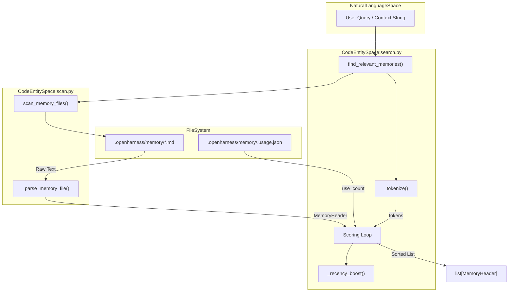
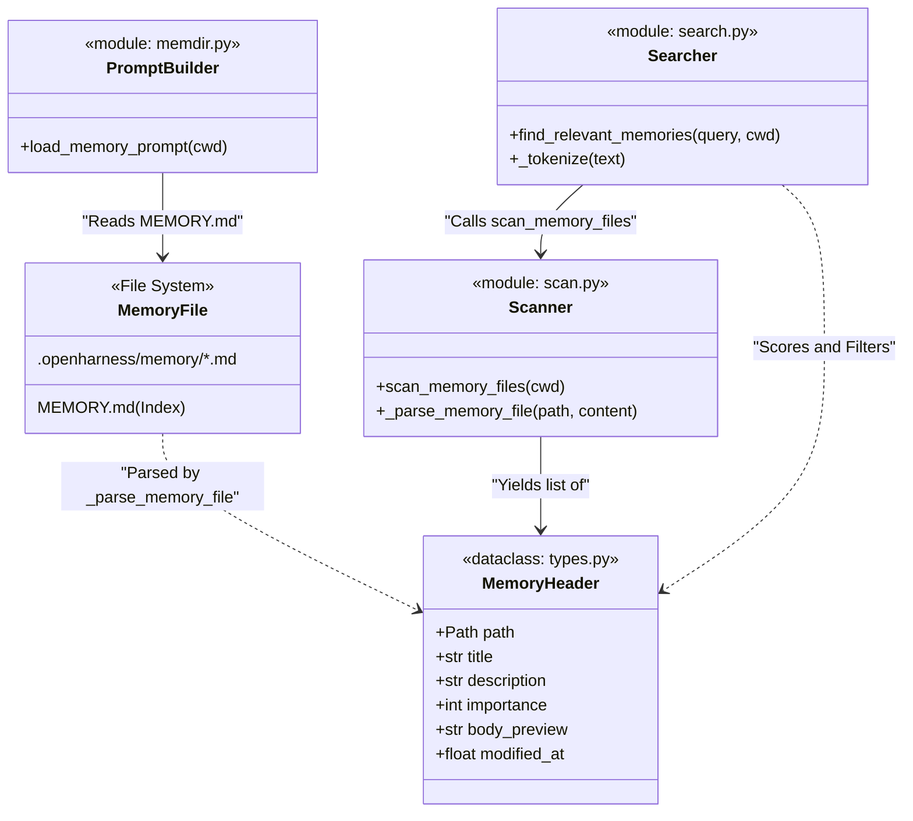

<!-- source: DeepWiki mcp.deepwiki.com · repo HKUDS/OpenHarness · page 9.2 Memory Scanning and Search · fetched 2026-11-09 -->

# Memory Scanning and Search

Relevant source files

The following files were used as context for generating this wiki page:

- [ohmo/memory.py](ohmo/memory.py)
- [scripts/migrate_memory.py](scripts/migrate_memory.py)
- [src/openharness/memory/__init__.py](src/openharness/memory/__init__.py)
- [src/openharness/memory/agent.py](src/openharness/memory/agent.py)
- [src/openharness/memory/manager.py](src/openharness/memory/manager.py)
- [src/openharness/memory/memdir.py](src/openharness/memory/memdir.py)
- [src/openharness/memory/migrate.py](src/openharness/memory/migrate.py)
- [src/openharness/memory/relevance.py](src/openharness/memory/relevance.py)
- [src/openharness/memory/scan.py](src/openharness/memory/scan.py)
- [src/openharness/memory/schema.py](src/openharness/memory/schema.py)
- [src/openharness/memory/search.py](src/openharness/memory/search.py)
- [src/openharness/memory/team.py](src/openharness/memory/team.py)
- [src/openharness/memory/types.py](src/openharness/memory/types.py)
- [src/openharness/services/memory_extract/__init__.py](src/openharness/services/memory_extract/__init__.py)
- [src/openharness/ui/coordinator_drain.py](src/openharness/ui/coordinator_drain.py)
- [tests/test_memory/test_memdir.py](tests/test_memory/test_memdir.py)
- [tests/test_ohmo/test_prompts.py](tests/test_ohmo/test_prompts.py)

The Memory Scanning and Search subsystem provides the mechanisms for discovering, indexing, and retrieving persistent project-specific knowledge. It operates by scanning Markdown files within a project's dedicated memory directory and employing heuristic-based search to surface relevant context for the LLM, supporting both ASCII and Han (CJK) characters.

## Memory Discovery and Scanning

The discovery process is centered around the `scan_memory_files` function in `scan.py`, which identifies valid memory entries within a project. It bypasses the primary index file (`MEMORY.md`) to focus on individual topical memory files [src/openharness/memory/scan.py:31-33]().

### The Scanning Pipeline

1.  **Directory Resolution**: Locates the project memory directory using `get_project_memory_dir` [src/openharness/memory/scan.py:29-29]().
2.  **File Iteration**: Globs all `.md` files [src/openharness/memory/scan.py:31-31]().
3.  **Content Parsing**: Each file is processed by `_parse_memory_file` to extract structured metadata [src/openharness/memory/scan.py:38-38]().
    *   **YAML Frontmatter**: `split_memory_file` separates the YAML block for fields like `name`, `description`, and `type` [src/openharness/memory/scan.py:52-62]().
    *   **Fallback Extraction**: If no description exists in frontmatter, `first_content_line` is used to extract a fallback from the first 10 lines of the body [src/openharness/memory/scan.py:64-74]().
    *   **Body Preview**: Captures the first 300 characters of the content (excluding the description line and headings) for search indexing [src/openharness/memory/scan.py:78-85]().
4.  **Ranking**: Headers are sorted by `modified_at` in descending order to prioritize recent information [src/openharness/memory/scan.py:44-44]().

### Memory Metadata Model

The `MemoryHeader` dataclass serves as the primary data structure for representing discovered memory files before they are read in full.

| Field | Type | Description |
| :--- | :--- | :--- |
| `path` | `Path` | Absolute path to the `.md` file [src/openharness/memory/types.py:14-14](). |
| `title` | `str` | The `name` from frontmatter or the filename stem [src/openharness/memory/types.py:15-15](). |
| `description` | `str` | A summary snippet used for search weighting [src/openharness/memory/types.py:16-16](). |
| `modified_at` | `float` | Unix timestamp of the last modification [src/openharness/memory/types.py:17-17](). |
| `memory_type` | `str` | Optional category (e.g., "project", "user", "personal") [src/openharness/memory/types.py:18-18](). |
| `importance` | `int` | Numerical weight used for search scoring [src/openharness/memory/types.py:23-23](). |
| `disabled` | `bool` | Indicates a "soft-deleted" entry [src/openharness/memory/types.py:29-29](). |

**Sources:** [src/openharness/memory/types.py:10-34](), [src/openharness/memory/scan.py:20-47](), [src/openharness/memory/schema.py:17-49]()

## Heuristic Search Implementation

OpenHarness uses a multi-lingual heuristic search in `find_relevant_memories` to match user queries or agent context against the scanned memory headers. This allows the system to inject specific memory files into the prompt without loading the entire memory bank.

### Search Logic Flow

The search process follows a "Scoring and Ranking" approach:

1.  **Tokenization**: The `_tokenize` function extracts ASCII words (length $\ge 3$) and individual Han ideographs (Chinese/Japanese characters) to ensure cross-language compatibility [src/openharness/memory/search.py:53-59]().
2.  **Scoring Weights**:
    *   **Metadata Hits**: Matches in the `title` or `description` are weighted **2.0x** [src/openharness/memory/search.py:32-36]().
    *   **Body Hits**: Matches in the `body_preview` are weighted **1.0x** [src/openharness/memory/search.py:33-37]().
    *   **Importance**: Boosted by `importance * 0.4` [src/openharness/memory/search.py:42-42]().
    *   **Usage**: Boosted by `min(use_count, 5) * 0.1` retrieved via `get_memory_usage` [src/openharness/memory/search.py:38-43]().
    *   **Recency**: `_recency_boost` adds up to **0.3** points for files updated within 14 days [src/openharness/memory/search.py:44-44](), [src/openharness/memory/search.py:62-71]().
3.  **Sorting**: Results are sorted primarily by `score` (descending) and secondarily by `modified_at` (newest first) [src/openharness/memory/search.py:49-49]().

### Memory Search Data Flow

The following diagram illustrates how a query string is transformed into a list of relevant memory headers.

**Diagram: Memory Search Resolution**

**Sources:** [src/openharness/memory/search.py:15-50](), [src/openharness/memory/scan.py:20-47](), [src/openharness/memory/usage.py:12-13]()

## Context Injection

While `scan.py` and `search.py` handle the discovery, the resulting data is used to populate the LLM's system prompt via `load_memory_prompt`.

1.  **Entrypoint Injection**: The `MEMORY.md` file (the index) is loaded as the primary entrypoint to give the LLM an overview of the persistent memory structure [src/openharness/memory/memdir.py:23-42]().
2.  **Durable Policy**: The prompt includes `MEMORY_POLICY_LINES`, instructing the LLM on how to manage durable context [src/openharness/memory/memdir.py:30-30](), [src/openharness/memory/schema.py:214-220]().
3.  **Truncation Logic**: To avoid context window overflow, `truncate_entrypoint_content` bounds the index to `MAX_ENTRYPOINT_LINES` (200) and `MAX_ENTRYPOINT_BYTES` (25,000) [src/openharness/memory/schema.py:137-169]().
4.  **Personal Memory (ohmo)**: In `ohmo` mode, personal preferences are separately injected from `~/.ohmo/memory/` using `ohmo.memory.load_memory_prompt` [ohmo/memory.py:156-176]().

### Entity Relationship Mapping

This diagram maps the logical concepts of "Memory" to the specific Python classes and functions that implement them.

**Diagram: Memory System Entity Mapping**

**Sources:** [src/openharness/memory/types.py:10-34](), [src/openharness/memory/scan.py:20-28](), [src/openharness/memory/search.py:15-28](), [src/openharness/memory/memdir.py:15-20]()

---

