# Page: OpenHarness Overview

# OpenHarness Overview

<details>
<summary>Relevant source files</summary>

The following files were used as context for generating this wiki page:

- [.gitignore](.gitignore)
- [CHANGELOG.md](CHANGELOG.md)
- [README.md](README.md)
- [README.zh-CN.md](README.zh-CN.md)
- [RELEASE_NOTES_v0.1.8.md](RELEASE_NOTES_v0.1.8.md)
- [RELEASE_NOTES_v0.1.9.md](RELEASE_NOTES_v0.1.9.md)
- [assets/scene-agentloop.png](assets/scene-agentloop.png)
- [assets/scene-context.png](assets/scene-context.png)
- [assets/scene-governance.png](assets/scene-governance.png)
- [assets/scene-swarm.png](assets/scene-swarm.png)
- [assets/scene-toolkit.png](assets/scene-toolkit.png)
- [ohmo/__init__.py](ohmo/__init__.py)
- [pyproject.toml](pyproject.toml)
- [src/openharness/cli.py](src/openharness/cli.py)
- [src/openharness/tools/web_fetch_tool.py](src/openharness/tools/web_fetch_tool.py)
- [src/openharness/tools/web_search_tool.py](src/openharness/tools/web_search_tool.py)
- [src/openharness/utils/network_guard.py](src/openharness/utils/network_guard.py)
- [tests/test_commands/test_cli.py](tests/test_commands/test_cli.py)
- [tests/test_entrypoints/test_config_cli.py](tests/test_entrypoints/test_config_cli.py)
- [tests/test_tools/test_web_fetch_tool.py](tests/test_tools/test_web_fetch_tool.py)
- [tests/test_utils/test_network_guard.py](tests/test_utils/test_network_guard.py)

</details>


OpenHarness (`oh`) is an open-source Python implementation of an **Agent Harness**. While a Large Language Model (LLM) provides the "intelligence," OpenHarness provides the "infrastructure"—the hands, eyes, memory, and safety boundaries required to transform a model into a functional agent capable of software engineering and system interaction [README.md:137-143]().

It delivers core lightweight agent infrastructure including tool-use, skills, memory, and multi-agent coordination, supporting integration with models from Anthropic, OpenAI, and other compatible providers [README.md:14-16](), [README.zh-CN.md:86-117]().

### Core Philosophy
- **Lightweight:** Designed as a core agent infrastructure with 43+ built-in tools [README.md:14-23]().
- **Transparent:** Pure Python implementation for easy auditing and extension [pyproject.toml:5-14]().
- **Safe:** Built-in multi-level permission system and lifecycle hooks [README.md:102-115]().
- **Extensible:** Supports the Model Context Protocol (MCP) and a plugin ecosystem [README.md:70-82]().

---

## System Architecture

The OpenHarness architecture is divided into primary subsystems that manage the lifecycle of an agentic session.

### High-Level Subsystems
| Subsystem | Responsibility |
| :--- | :--- |
| **Engine** | Manages the iterative `run_query` loop and tool execution flow [README.md:54-65](). |
| **Tools** | 43+ built-in capabilities (File I/O, Shell, Search, Web, MCP) [README.md:78](). |
| **Permissions** | Safety checks for tool execution and file path access [README.md:102-113](). |
| **Hooks** | Lifecycle events (`PreToolUse`, `PostToolUse`) for automation [README.md:112](). |
| **MCP** | Model Context Protocol client for external tool integration [README.md:78](). |
| **Memory** | Persistent knowledge storage via `MEMORY.md` and `CLAUDE.md` [README.md:86-97](). |
| **Coordinator** | Multi-agent management and sub-agent spawning (Swarm) [README.md:118-129](). |
| **UI** | Dual-mode interface: React/Ink TUI or non-interactive print mode [README.md:30](), [README.zh-CN.md:153-169](). |
| **ohmo** | Personal agent application built on the harness [README.md:16](), [ohmo/__init__.py:1-5](). |

### Data Flow: User Input to LLM Response
The following diagram illustrates how a user request flows through the `QueryEngine` and interacts with various code entities.

**Diagram: Request Execution Pipeline**
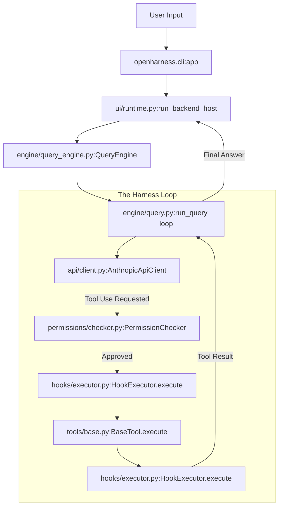
Sources: [pyproject.toml:48-52](), [src/openharness/cli.py:1-18](), [README.md:54-65]()

---

## Key Subsystems

### 1. The Agent Loop (Engine)
The `Engine` implements an asynchronous loop that streams messages from the LLM, parses tool calls, evaluates permissions, and feeds results back to the model until a final response is generated [README.md:62-65](). It tracks token usage and costs via a `CostTracker` [README.md:65]().

For details, see [Architecture Overview](#1.2).

### 2. Tools and MCP
OpenHarness includes 43+ built-in tools for file manipulation, shell execution, and web searching [README.md:78](). It also supports the **Model Context Protocol (MCP)**, allowing it to connect to external tool servers [README.md:78]().

**Diagram: Tool Registration and Discovery**
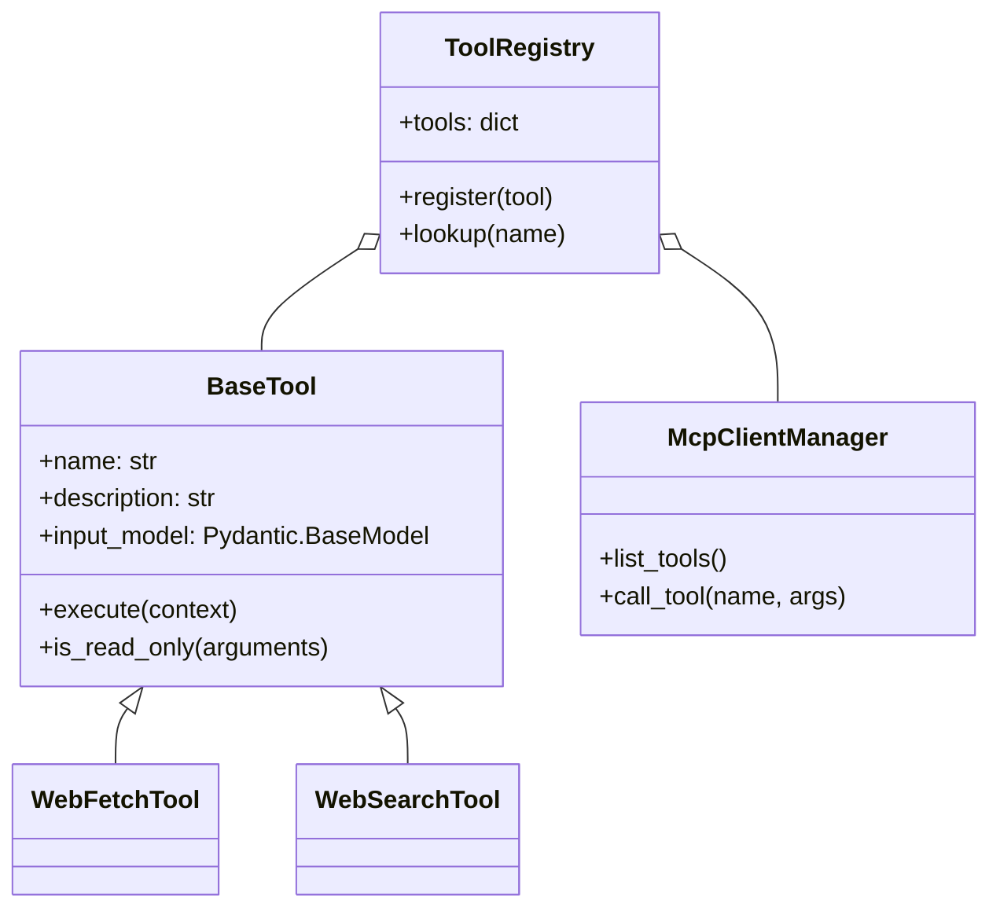
Sources: [src/openharness/tools/web_fetch_tool.py:33-38](), [src/openharness/tools/web_search_tool.py:28-33](), [README.md:78]()

### 3. Permissions and Safety
Safety is enforced through `PermissionMode` settings (DEFAULT, PLAN, FULL_AUTO) and glob-based `PathRule` patterns [README.md:110-113](). Every tool execution is intercepted by the `PermissionChecker` before it reaches the OS [README.md:112-113]().

### 4. Skills and Plugins
- **Skills:** On-demand Markdown-based knowledge files loaded into the LLM context via the `skill` tool [README.md:79]().
- **Plugins:** Self-contained extensions that can contribute new tools, hooks, or agents [README.md:80](). Discovery includes auto-instantiation of `BaseTool` subclasses from a plugin's `tools_dir` [CHANGELOG.md:37-38]().

---

## Getting Started

### Prerequisites
- **Python 3.10+** [pyproject.toml:11]()
- **Node.js 18+** (required for React TUI)
- An LLM API Key (Anthropic, OpenAI, or compatible provider) [README.zh-CN.md:93-117]()

### Installation
The recommended way to install is via the one-click installer script:
```bash
curl -fsSL https://raw.githubusercontent.com/HKUDS/OpenHarness/main/scripts/install.sh | bash
```
Sources: [README.zh-CN.md:43-45]()

### Entry Points
- `oh`: Launches the interactive React Terminal UI [pyproject.toml:50]().
- `oh setup`: Guided configuration for providers and models [src/openharness/cli.py:53-61](), [README.zh-CN.md:71-75]().
- `ohmo`: Launches the personal agent application [pyproject.toml:52]().
- `oh --dry-run`: Safe preview of runtime settings, tools, and MCP servers without execution [src/openharness/cli.py:38](), [CHANGELOG.md:38]().

For detailed installation and first-run instructions, see [Getting Started](#1.1).

---

## Project Structure
```text
src/openharness/
├── api/           # LLM provider clients (Anthropic, OpenAI, Codex)
├── engine/        # Agent loop and query execution
├── tools/         # Built-in tool implementations
├── permissions/   # Safety and access control
├── hooks/         # Lifecycle event handlers
├── mcp/           # Model Context Protocol integration
├── memory/        # Persistent session memory
├── swarm/         # Multi-agent coordination
├── ui/            # React TUI backend host
└── config/        # Settings and path management
ohmo/              # Personal agent application
```
Sources: [pyproject.toml:54-55](), [README.md:48-133]()

---

# Page: Getting Started

# Getting Started

<details>
<summary>Relevant source files</summary>

The following files were used as context for generating this wiki page:

- [.gitignore](.gitignore)
- [CHANGELOG.md](CHANGELOG.md)
- [README.md](README.md)
- [README.zh-CN.md](README.zh-CN.md)
- [RELEASE_NOTES_v0.1.8.md](RELEASE_NOTES_v0.1.8.md)
- [RELEASE_NOTES_v0.1.9.md](RELEASE_NOTES_v0.1.9.md)
- [ohmo/__init__.py](ohmo/__init__.py)
- [pyproject.toml](pyproject.toml)
- [scripts/install.ps1](scripts/install.ps1)
- [scripts/install.sh](scripts/install.sh)
- [scripts/install_dev.sh](scripts/install_dev.sh)
- [src/openharness/cli.py](src/openharness/cli.py)
- [src/openharness/prompts/environment.py](src/openharness/prompts/environment.py)
- [src/openharness/tools/image_to_text_tool.py](src/openharness/tools/image_to_text_tool.py)
- [src/openharness/tools/web_fetch_tool.py](src/openharness/tools/web_fetch_tool.py)
- [src/openharness/tools/web_search_tool.py](src/openharness/tools/web_search_tool.py)
- [src/openharness/utils/network_guard.py](src/openharness/utils/network_guard.py)
- [tests/test_commands/test_cli.py](tests/test_commands/test_cli.py)
- [tests/test_entrypoints/test_config_cli.py](tests/test_entrypoints/test_config_cli.py)
- [tests/test_install/test_windows_alias.py](tests/test_install/test_windows_alias.py)
- [tests/test_prompts/test_environment.py](tests/test_prompts/test_environment.py)
- [tests/test_prompts/test_system_prompt.py](tests/test_prompts/test_system_prompt.py)
- [tests/test_tools/test_web_fetch_tool.py](tests/test_tools/test_web_fetch_tool.py)
- [tests/test_utils/test_network_guard.py](tests/test_utils/test_network_guard.py)

</details>


This page provides a technical guide for installing, configuring, and initializing **OpenHarness**. It covers the environment setup, the resolution logic for settings and API keys, and the transition from the CLI entry point to the interactive agent loop.

## Installation and Environment Setup

OpenHarness is a Python-based application requiring **Python 3.10+** [README.md:29-29](). It uses `hatchling` as the build backend [pyproject.toml:2-3]().

### One-Click Installation
The recommended way to install OpenHarness is via the provided shell script, which handles OS detection, Python version checks (>= 3.10), and virtual environment creation [scripts/install.sh:90-103]().

**Linux/macOS:**
```bash
curl -fsSL https://raw.githubusercontent.com/HKUDS/OpenHarness/main/scripts/install.sh | bash
```

**Windows (PowerShell):**
```powershell
iex (Invoke-WebRequest -Uri 'https://raw.githubusercontent.com/HKUDS/OpenHarness/main/scripts/install.ps1')
```

The installer also checks for **Node.js >= 18**, which is required to power the React-based Terminal UI (TUI) [scripts/install.sh:153-179]().

### Manual Setup
To install the package from source in editable mode:
```bash
git clone https://github.com/HKUDS/OpenHarness.git
cd OpenHarness
pip install -e ".[dev]"
```

The installation registers primary CLI entry points: `openharness`, `oh`, and `ohmo` [pyproject.toml:49-52]().

**Sources:** [README.md:29-30](), [scripts/install.sh:1-203](), [scripts/install.ps1:1-188](), [pyproject.toml:1-52]()

---

## Configuration and Directory Structure

OpenHarness follows XDG-like conventions for persistent data. By default, it stores all configurations and state in a hidden directory in the user's home folder.

### Directory Resolution
| Directory | Path (Default) | Role |
| :--- | :--- | :--- |
| **Config Root** | `~/.openharness/` | Global settings, profiles, and auth storage. |
| **Data Root** | `~/.openharness/data/` | Persistent state, tasks, and cron registry. |
| **Sessions**| `~/.openharness/data/sessions/` | JSON snapshots of conversation history. |
| **Skills** | `~/.openharness/skills/` | User-defined Markdown skill files. |
| **Plugins** | `~/.openharness/plugins/` | Externally installed agent extensions. |

The system also creates a project-specific `.openharness/` directory within the current working directory to store local context like `issue.md` or `pr_comments.md`.

### Settings Precedence
The configuration is populated using a strict resolution order (highest priority first):
1.  **CLI Arguments**: Passed via `typer` and merged into the runtime state [src/openharness/cli.py:17-18]().
2.  **Environment Variables**: `ANTHROPIC_API_KEY`, `OPENAI_API_KEY`, `OPENHARNESS_MODEL`, etc. [CHANGELOG.md:43-45]().
3.  **Config File**: `~/.openharness/settings.json`.
4.  **Provider Profiles**: Scoped settings (base URL, model, credentials) defined in `active_profile` [tests/test_commands/test_cli.py:58-60]().

**Sources:** [src/openharness/cli.py:1-18](), [CHANGELOG.md:33-64](), [tests/test_commands/test_cli.py:34-60]()

---

## CLI Entry Points and First Run

The CLI is implemented using `typer` in `src/openharness/cli.py`.

### Provider and Auth Setup
OpenHarness uses a unified `setup` workflow to guide users through provider selection and authentication [tests/test_commands/test_cli.py:34-56]().
```bash
oh setup
```
This command supports multiple workflows:
*   **API Key Providers**: Anthropic, OpenAI, NVIDIA NIM, Qwen (DashScope), MiniMax, and Gemini [CHANGELOG.md:33-41]().
*   **Subscription Services**: Claude Code and OpenAI Codex [tests/test_commands/test_cli.py:42-43]().

### Dry-Run Mode
A safety feature `oh --dry-run` allows users to preview the resolved environment without executing the model or tools [src/openharness/cli.py:38-38](). It inspects:
*   Resolved runtime settings and auth state [src/openharness/cli.py:157-158]().
*   Configured MCP servers and their connection status [src/openharness/cli.py:89-121]().
*   Available tools, skills, and slash commands [src/openharness/cli.py:124-201]().

### CLI Subcommands
*   `oh provider`: Manage profiles (`add`, `edit`, `list`, `remove`) [tests/test_commands/test_cli.py:157-206]().
*   `oh setup`: Interactive wizard for initial configuration [tests/test_commands/test_cli.py:34-56]().
*   `ohmo init`: Bootstraps the personal agent workspace (`soul.md`, `user.md`) [README.md:16-17]().

### Data Flow: CLI to Runtime
The following diagram illustrates how the CLI command initializes the system state and transitions into the interactive session.

**CLI Initialization Flow**
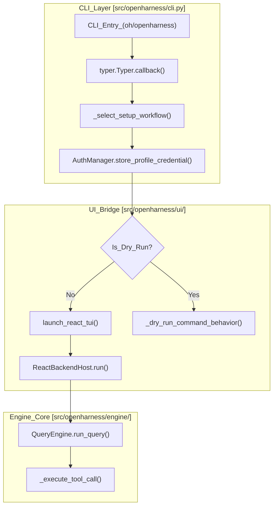
**Sources:** [src/openharness/cli.py:89-124](), [tests/test_commands/test_cli.py:34-56](), [CHANGELOG.md:38-38]()

---

## Session Modes

OpenHarness supports two primary modes of operation:

### 1. Interactive Mode (Default)
Launches the React-based Terminal User Interface (TUI). 
*   **Real-time Streaming**: Renders structured Markdown blocks, including tables and code fences [CHANGELOG.md:50-51]().
*   **Unified Diffs**: Tools like `edit_file` and `write_file` show a diff preview for approval [CHANGELOG.md:12-12]().
*   **Slash Commands**: Direct control via `/config`, `/memory`, `/skills`, etc. [CHANGELOG.md:24-25]().

### 2. Print Mode (`--print` / `-p`)
A non-interactive mode that executes the query and prints the final result to stdout. Useful for CI/CD or piping output to other tools.

### Session Persistence
Sessions are automatically saved as snapshots. Users can resume the most recent session using `oh --continue` or a specific one using `oh --resume <id>` [CHANGELOG.md:59-61]().

---

## Technical Implementation: Provider Resolution

The system resolves credentials based on the `active_profile`. This allows switching between different LLM backends (e.g., switching from Anthropic to a local Ollama instance) without re-entering keys.

**Provider and Credential Mapping**
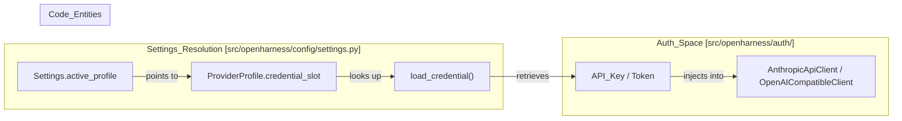

### Key Classes
*   `Settings`: Central Pydantic model for configuration [tests/test_commands/test_cli.py:13-13]().
*   `AuthManager`: Handles secure storage and retrieval of credentials [tests/test_commands/test_cli.py:100-104]().
*   `WebFetchTool`: Example of a network-aware tool using `NetworkGuard` for security [src/openharness/tools/web_fetch_tool.py:33-40]().
*   `NetworkGuard`: Validates outbound HTTP requests to prevent SSRF and access to non-public IPs [src/openharness/utils/network_guard.py:95-113]().

**Sources:** [src/openharness/config/settings.py:1-13](), [src/openharness/auth/storage.py:1-10](), [src/openharness/tools/web_fetch_tool.py:33-71](), [src/openharness/utils/network_guard.py:1-113]()

---

# Page: Architecture Overview

# Architecture Overview

<details>
<summary>Relevant source files</summary>

The following files were used as context for generating this wiki page:

- [README.md](README.md)
- [README.zh-CN.md](README.zh-CN.md)
- [assets/scene-agentloop.png](assets/scene-agentloop.png)
- [assets/scene-context.png](assets/scene-context.png)
- [assets/scene-governance.png](assets/scene-governance.png)
- [assets/scene-swarm.png](assets/scene-swarm.png)
- [assets/scene-toolkit.png](assets/scene-toolkit.png)
- [src/openharness/tools/web_search_tool.py](src/openharness/tools/web_search_tool.py)
- [src/openharness/ui/backend_host.py](src/openharness/ui/backend_host.py)
- [src/openharness/ui/runtime.py](src/openharness/ui/runtime.py)
- [src/openharness/utils/network_guard.py](src/openharness/utils/network_guard.py)
- [tests/test_entrypoints/test_config_cli.py](tests/test_entrypoints/test_config_cli.py)
- [tests/test_tools/test_web_fetch_tool.py](tests/test_tools/test_web_fetch_tool.py)
- [tests/test_ui/test_react_backend.py](tests/test_ui/test_react_backend.py)
- [tests/test_utils/test_network_guard.py](tests/test_utils/test_network_guard.py)

</details>


OpenHarness is designed as an ultra-lightweight, modular Agent Harness. An "Agent Harness" serves as the infrastructure wrapping an LLM, providing it with the necessary interfaces to interact with the physical and digital world—specifically tools, persistent memory, safety boundaries, and multi-agent coordination capabilities [README.md:133-139]().

The system is composed of 10 primary subsystems that work in concert to transform natural language user input into structured agentic actions and responses. The `RuntimeBundle` serves as the primary container for these subsystems during an active session [src/openharness/ui/runtime.py:121-141]().

## System Subsystems

The architecture is organized into the following functional areas:

| Subsystem | Responsibility | Key Code Entities |
|:---|:---|:---|
| **Engine** | Manages the core agent loop (Query -> Tool -> Loop). | `QueryEngine`, `run_query` |
| **Tools** | 43+ built-in functions for file I/O, shell, and web. | `BaseTool`, `ToolRegistry` |
| **MCP** | Integration with Model Context Protocol servers. | `McpClientManager`, `McpStdioServerConfig` |
| **Skills** | On-demand knowledge injection via Markdown files. | `SkillRegistry`, `SkillDefinition` |
| **Plugins** | Extends commands, hooks, and tools via manifests. | `PluginManifest`, `load_plugins` |
| **Permissions** | Safety gatekeeper for tool execution and path access. | `PermissionChecker`, `PermissionMode` |
| **Hooks** | Lifecycle event triggers (Pre/Post Tool Use). | `HookExecutor`, `HookReloader` |
| **UI** | Dual-mode interface (React TUI and Print Mode). | `ReactBackendHost`, `launch_react_tui` |
| **Memory** | Persistent cross-session knowledge storage. | `MEMORY.md`, `add_memory_entry` |
| **Coordinator** | Multi-agent spawning and swarm management. | `TeamRegistry`, `TeamLifecycleManager` |

Sources: [README.md:44-129](), [src/openharness/ui/runtime.py:11-43](), [src/openharness/ui/backend_host.py:73-116]().

## High-Level Data Flow

The flow of information in OpenHarness follows a cyclical "Agent Loop" pattern. The `QueryEngine` acts as the orchestrator, managing the transition between the Natural Language Space (LLM) and the Code Entity Space (Tools/System).

### Sequence of Operations

1.  **Input Assembly**: The `build_runtime_system_prompt` gathers environment data, `CLAUDE.md` project instructions, active skills, and memory entries to create the initial context [src/openharness/ui/runtime.py:40]().
2.  **LLM Query**: The `QueryEngine` sends message history and tool definitions to the resolved API client (e.g., `AnthropicApiClient`, `OpenAICompatibleClient`, `CodexApiClient`, or `CopilotClient`) [src/openharness/ui/runtime.py:11-15](), [src/openharness/ui/runtime.py:124]().
3.  **Event Streaming**: As the LLM responds, the `ReactBackendHost` translates API events into `StreamEvent` objects (like `AssistantTextDelta`, `ToolExecutionStarted`, and `ToolExecutionCompleted`) for the UI [src/openharness/ui/backend_host.py:24-33]().
4.  **Tool Execution**:
    *   **Permission Check**: `PermissionChecker` evaluates if the tool and its arguments are allowed based on the active `PermissionMode` [src/openharness/ui/runtime.py:38]().
    *   **Pre-Use Hooks**: `HookExecutor` runs configured shell, HTTP, or LLM hooks before execution [src/openharness/ui/runtime.py:34]().
    *   **Execution**: The tool's `execute()` method is called within a `ToolExecutionContext` [src/openharness/tools/web_search_tool.py:39-43]().
    *   **Post-Use Hooks**: Hooks run again to validate or process tool output [src/openharness/hooks/executor.py:34]().
5.  **Loop Continuation**: Tool results are appended to the message history via `ConversationMessage`, and the engine re-queries the LLM until a completion state is reached [src/openharness/ui/runtime.py:26-31]().

## Architectural Diagrams

### 1. Component Interconnectivity (Code Entity Space)
This diagram shows how the core Python classes interact to facilitate the agent loop and manage the session lifecycle.

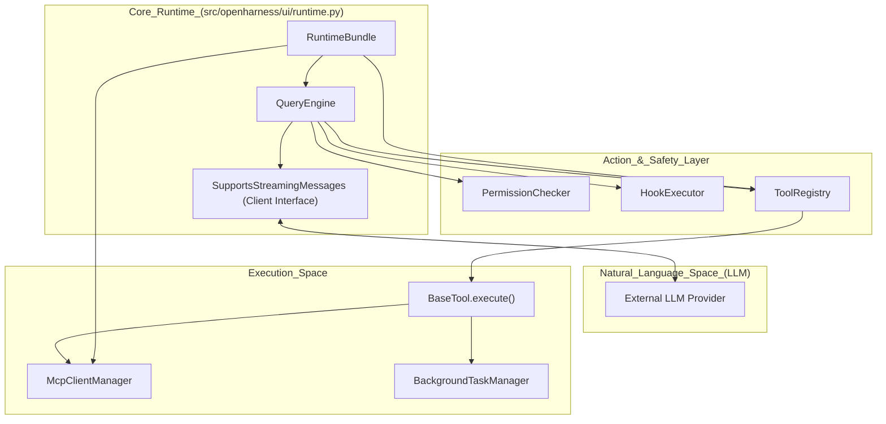
Sources: [src/openharness/ui/runtime.py:121-141](), [src/openharness/ui/backend_host.py:92-116](), [src/openharness/tasks/manager.py:35]().

### 2. UI-to-Engine Data Flow
This diagram bridges user input in the UI to the underlying code entities that process the data through the `OHJSON` protocol.

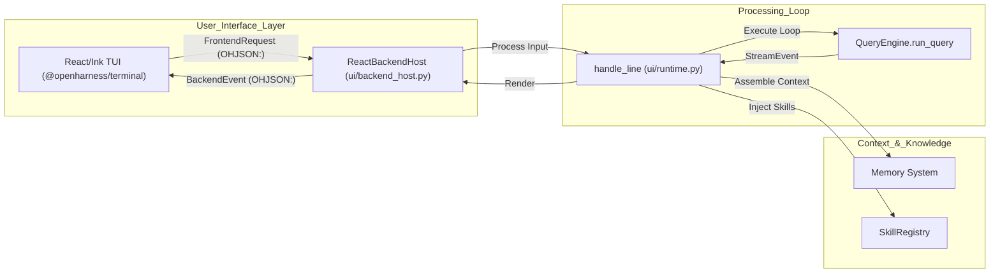
Sources: [src/openharness/ui/backend_host.py:45](), [src/openharness/ui/backend_host.py:128-175](), [src/openharness/ui/runtime.py:38]().

## Subsystem Details

### The Permission System
The `PermissionChecker` validates tool calls against `PathRule` glob patterns and `command_deny_patterns`. It operates in three modes: `DEFAULT` (ask for mutating tools), `PLAN` (dry-run mode), and `FULL_AUTO` (no prompts) [src/openharness/ui/runtime.py:38](), [README.zh-CN.md:333-339]().

### The Multi-Agent Swarm
Multi-agent coordination is handled via the `swarm` and `coordinator` modules. The primary agent uses the `agent` tool to spawn sub-agents, which are managed by the `TeamRegistry`. Communication is facilitated through a file-based `TeammateMailbox` to ensure persistence and isolation [README.md:118-129]().

### Memory and Persistence
Memory is managed as a set of Markdown files, with `MEMORY.md` serving as the primary index. The system automatically scans for these files in the project root or user home directory and injects relevant snippets into the system prompt to maintain long-term context [README.md:86-97]().

### Plugin and Skill Architecture
OpenHarness allows for dynamic extension. **Skills** are Markdown files with YAML frontmatter that provide on-demand domain knowledge [src/openharness/ui/runtime.py:21-23](). **Plugins** are structured directories containing a `plugin.json` manifest that can contribute new tools, hooks, and MCP server configurations to the `RuntimeBundle` [src/openharness/ui/runtime.py:39](), [src/openharness/ui/runtime.py:154-160]().

### Web and Network Guard
For outbound interactions, OpenHarness implements a `NetworkGuard` to prevent Server-Side Request Forgery (SSRF). Tools like `WebFetchTool` and `WebSearchTool` use `fetch_public_http_response` to ensure that only public IP addresses are targeted, supporting proxy and synthetic DNS modes for enterprise environments [src/openharness/utils/network_guard.py:95-113](), [src/openharness/tools/web_search_tool.py:47-52]().

Sources: [src/openharness/ui/runtime.py:1-141](), [src/openharness/ui/backend_host.py:1-126](), [README.md:48-131]().

---

# Page: Core Engine

# Core Engine

<details>
<summary>Relevant source files</summary>

The following files were used as context for generating this wiki page:

- [src/openharness/engine/query.py](src/openharness/engine/query.py)
- [src/openharness/engine/query_engine.py](src/openharness/engine/query_engine.py)
- [src/openharness/engine/stream_events.py](src/openharness/engine/stream_events.py)
- [src/openharness/services/compact/__init__.py](src/openharness/services/compact/__init__.py)
- [src/openharness/services/tool_outputs.py](src/openharness/services/tool_outputs.py)
- [tests/test_engine/test_query_engine.py](tests/test_engine/test_query_engine.py)
- [tests/test_services/test_compact.py](tests/test_services/test_compact.py)

</details>


The **Core Engine** is the central orchestration layer of OpenHarness. It manages the iterative conversation loop between the user, the Large Language Model (LLM), and the available toolset. It is responsible for maintaining conversation state, enforcing security via permissions, executing lifecycle hooks, and tracking the financial cost of API interactions.

## Overview

The engine is built around two primary components:
1.  **`QueryEngine`**: A high-level state manager that holds the `ConversationMessage` history, manages session memory, and persists services like the `CostTracker` [src/openharness/engine/query_engine.py:21-60]().
2.  **`run_query`**: The core functional loop that drives the "thought-action-observation" cycle, handling streaming responses, auto-compaction, and concurrent tool execution [src/openharness/engine/query.py:230-550]().

### Core Engine Data Flow

The following diagram illustrates how the `QueryEngine` bridges high-level user requests to low-level code execution and API calls.

**Diagram: Engine Orchestration Flow**
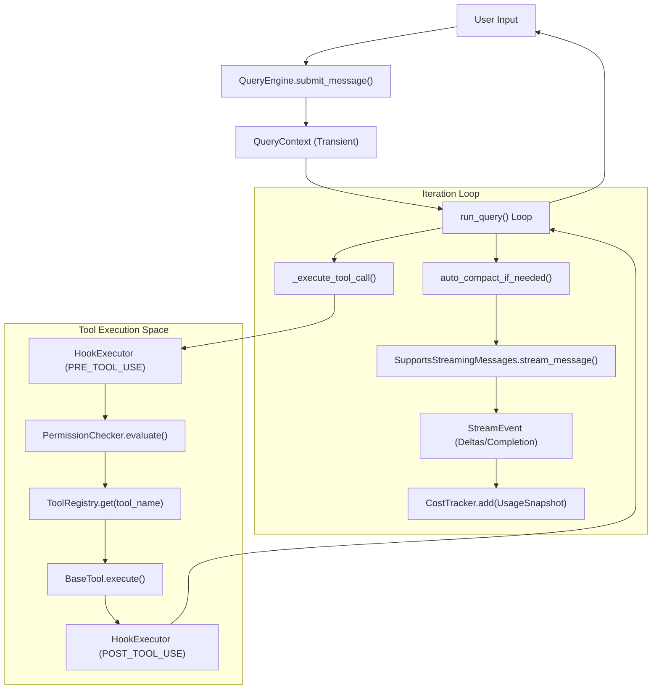
**Sources:** [src/openharness/engine/query_engine.py:214-250](), [src/openharness/engine/query.py:230-550](), [src/openharness/engine/query.py:1005-1150](), [src/openharness/services/compact/__init__.py:222-250]()

---

## Key Components

### QueryEngine
The `QueryEngine` class acts as the primary interface for the UI layer. It encapsulates the `api_client`, `tool_registry`, and `permission_checker` [src/openharness/engine/query_engine.py:24-42](). When a user submits a prompt via `submit_message()`, the engine appends the message to its internal history and initializes a `QueryContext` to execute the turn [src/openharness/engine/query_engine.py:214-245](). It also manages background tasks like `schedule_auto_dream` and session memory updates after user turns [src/openharness/engine/query_engine.py:141-182]().

### QueryContext
A dataclass used to pass configuration and state into the `run_query` loop. It includes metadata such as the current working directory (`cwd`), reasoning `effort` levels, `max_turns` (defaulting to 200), and callbacks for user interaction like `permission_prompt` and `ask_user_prompt` [src/openharness/engine/query.py:138-156]().

### Message and Event Models
The engine communicates state changes via a hierarchy of events and structured message blocks:
*   **`ConversationMessage`**: Represents a single turn in the chat (user, assistant, or tool results) [src/openharness/engine/messages.py:24-31]().
*   **`StreamEvent`**: Granular updates yielded during execution, such as `AssistantTextDelta` for real-time typing or `ToolExecutionStarted` when a tool begins [src/openharness/engine/stream_events.py:12-90]().

**Diagram: Entity Relationship**
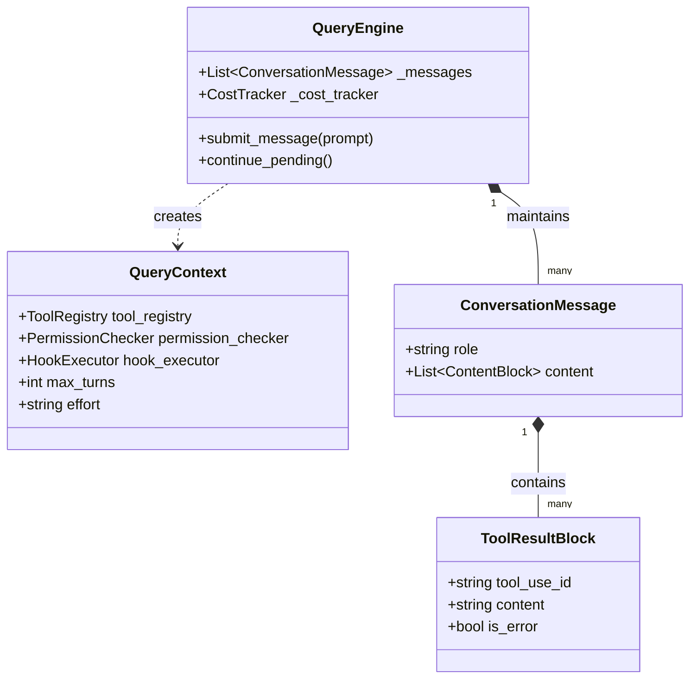
**Sources:** [src/openharness/engine/query_engine.py:21-60](), [src/openharness/engine/query.py:138-156](), [src/openharness/engine/messages.py:24-31](), [src/openharness/engine/stream_events.py:12-90]()

---

## Subsystems

### [Query Loop and Tool Execution](#2.1)
This child page details the iterative logic in `run_query`. It explains how the engine handles parallel tool execution using `asyncio.gather` when the LLM requests multiple actions simultaneously [src/openharness/engine/query.py:465-490](). It also covers the validation of tool inputs, turn limits via `MaxTurnsExceeded` [src/openharness/engine/query.py:129-135](), and the integration of the `PermissionChecker` and `HookExecutor` during tool dispatch [src/openharness/engine/query.py:1005-1150]().

### [Streaming Events and Cost Tracking](#2.2)
This child page documents the lifecycle of a request from the first token to the final cost tally. It covers how `ApiTextDeltaEvent` is transformed into `AssistantTextDelta` [src/openharness/engine/query.py:380-385]() and how the `CostTracker` aggregates `UsageSnapshot` data to provide real-time spending metrics [src/openharness/engine/query_engine.py:60](), [src/openharness/engine/query_engine.py:93-95]().

---

## Usage Example

```python
# Initializing the engine
engine = QueryEngine(
    api_client=anthropic_client,
    tool_registry=registry,
    permission_checker=checker,
    cwd=Path.cwd(),
    model="claude-3-5-sonnet-20241022",
    system_prompt="You are a helpful assistant."
)

# Submitting a message and consuming the stream
async for event in engine.submit_message("List the files in this directory"):
    if isinstance(event, AssistantTextDelta):
        print(event.text, end="")
    elif isinstance(event, ToolExecutionStarted):
        print(f"\nExecuting {event.tool_name}...")
    elif isinstance(event, AssistantTurnComplete):
        print(f"\nTurn complete. Usage: {event.usage}")
```
**Sources:** [src/openharness/engine/query_engine.py:24-42](), [src/openharness/engine/query_engine.py:214-250]()

---

# Page: Query Loop and Tool Execution

# Query Loop and Tool Execution

<details>
<summary>Relevant source files</summary>

The following files were used as context for generating this wiki page:

- [src/openharness/engine/query.py](src/openharness/engine/query.py)
- [src/openharness/engine/query_engine.py](src/openharness/engine/query_engine.py)
- [src/openharness/hooks/events.py](src/openharness/hooks/events.py)
- [src/openharness/services/compact/__init__.py](src/openharness/services/compact/__init__.py)
- [src/openharness/services/tool_outputs.py](src/openharness/services/tool_outputs.py)
- [src/openharness/tools/agent_tool.py](src/openharness/tools/agent_tool.py)
- [src/openharness/tools/base.py](src/openharness/tools/base.py)
- [src/openharness/tools/send_message_tool.py](src/openharness/tools/send_message_tool.py)
- [tests/test_engine/test_query_engine.py](tests/test_engine/test_query_engine.py)
- [tests/test_services/test_compact.py](tests/test_services/test_compact.py)

</details>


The core of OpenHarness is an iterative conversation loop that manages the interaction between the Large Language Model (LLM) and the local environment. This system handles the transition from natural language requests to structured tool execution, enforces security via a permission layer, and integrates lifecycle hooks and conversation compaction for long-running sessions.

## The Query Engine Architecture

The `QueryEngine` class acts as the high-level orchestrator for a conversation session. It maintains the state of the conversation, tracks token usage and costs, and provides a simplified interface for submitting user prompts or continuing interrupted turns.

### Key Components
- **`QueryEngine`**: The stateful wrapper that holds `ConversationMessage` history and the `CostTracker` [src/openharness/engine/query_engine.py:21-60]().
- **`QueryContext`**: A data container that bundles the API client, tool registry, permission checker, and environment settings for a single execution run [src/openharness/engine/query.py:138-156]().
- **`run_query`**: The stateless asynchronous generator that implements the iterative "LLM call -> Tool Execution -> LLM call" loop [src/openharness/engine/query.py:465-590]().

### Data Flow: User Input to Tool Execution
The following diagram illustrates how a user message moves through the `QueryEngine` and into the `run_query` loop.

**Query Execution Flow**
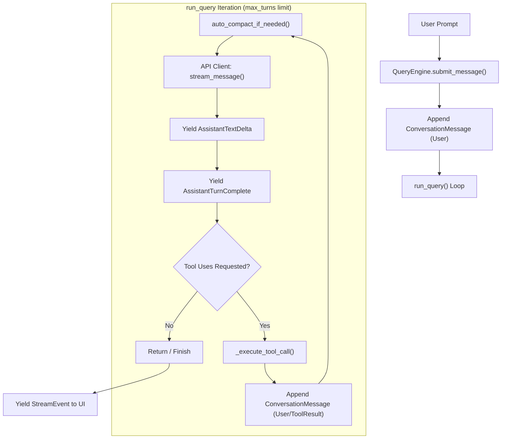
Sources: [src/openharness/engine/query_engine.py:204-245](), [src/openharness/engine/query.py:465-590]()

## The Iterative Loop (`run_query`)

The `run_query` function is the engine's heartbeat. It executes up to a configurable `max_turns` (defaulting to 200) to prevent infinite loops while allowing the model to perform complex multi-step tasks [src/openharness/engine/query.py:153-153]().

1.  **Auto-Compaction**: Before every LLM call, it checks if the conversation history exceeds token thresholds using `auto_compact_if_needed` [src/openharness/engine/query.py:495-502](). It first attempts a "microcompact" (clearing old tool results) and then a full LLM-based summarization if necessary [src/openharness/services/compact/__init__.py:1-7]().
2.  **LLM Invocation**: It calls `api_client.stream_message` with the current message history and tool schemas [src/openharness/engine/query.py:512-516]().
3.  **Streaming**: It yields `AssistantTextDelta` events as they arrive and captures the final `ConversationMessage` [src/openharness/engine/query.py:521-536]().
4.  **Tool Dispatch**: If the model requests tools, the engine determines if they should be run sequentially or concurrently [src/openharness/engine/query.py:550-584]().
5.  **History Augmentation**: Tool results are wrapped in a `ConversationMessage` with the `user` role and appended to the history for the next turn [src/openharness/engine/query.py:586-587]().

### Concurrent vs. Sequential Execution
- **Single Tool**: If only one tool is requested, it executes immediately via `_execute_tool_call` and yields events sequentially [src/openharness/engine/query.py:557-567]().
- **Multiple Tools**: If the LLM requests multiple tools in a single turn, the engine uses `asyncio.gather` to execute them concurrently, improving performance for independent operations [src/openharness/engine/query.py:569-584]().

Sources: [src/openharness/engine/query.py:465-590](), [src/openharness/services/compact/__init__.py:1-7]()

## Tool Execution and Permission Checks

The internal `_execute_tool_call` function is responsible for the lifecycle of a single tool invocation, including validation, permissions, and hooks.

### Execution Pipeline
1.  **Pre-Tool Hooks**: Executes `HookEvent.PRE_TOOL_USE`. If a hook returns a blocked status, the tool execution is aborted [src/openharness/engine/query.py:601-611]().
2.  **Registry Lookup**: Retrieves the tool implementation from the `ToolRegistry` [src/openharness/engine/query.py:613-619]().
3.  **Input Validation**: Uses Pydantic `model_validate` on the tool's `input_model` to ensure the LLM provided valid parameters [src/openharness/engine/query.py:621-628]().
4.  **Permission Evaluation**: The `PermissionChecker` evaluates the request based on the tool name and input parameters [src/openharness/engine/query.py:630-638]().
5.  **Human-in-the-loop**: If the permission check requires confirmation, the `permission_prompt` callback is triggered [src/openharness/engine/query.py:640-653]().
6.  **Actual Execution**: The tool's `execute` method is called with a `ToolExecutionContext` [src/openharness/engine/query.py:655-665]().
7.  **Post-Tool Hooks**: Executes `HookEvent.POST_TOOL_USE` after completion [src/openharness/engine/query.py:671-675]().

**Tool Execution Logic**
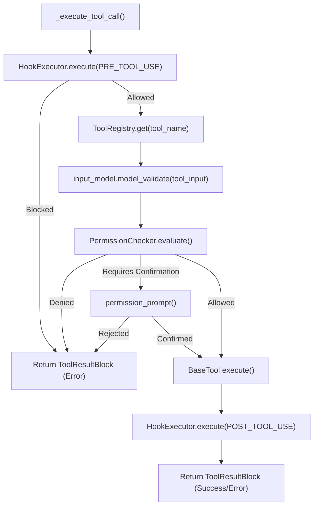
Sources: [src/openharness/engine/query.py:593-675]()

## Message and Event Models

The engine uses a structured message model to communicate with the API and a stream event model to update the UI.

### Conversation Messages
The `ConversationMessage` class encapsulates the role and content of a turn. Content can consist of `TextBlock`, `ToolUseBlock`, `ToolResultBlock`, or `ImageBlock` [src/openharness/engine/messages.py:24-29]().

| Block Type | Purpose | Key Fields |
| :--- | :--- | :--- |
| `TextBlock` | Assistant or User text content | `text` [src/openharness/engine/messages.py:27]() |
| `ToolUseBlock` | LLM request to run a tool | `id`, `name`, `input` [src/openharness/engine/messages.py:28]() |
| `ToolResultBlock` | Result of a tool execution | `tool_use_id`, `content`, `is_error` [src/openharness/engine/messages.py:28]() |
| `ImageBlock` | Multimodal input (user only) | `media_type`, `data`, `source_path` [src/openharness/engine/messages.py:26]() |

Sources: [src/openharness/engine/messages.py:24-29]()

### Stream Events
As `run_query` progresses, it yields `StreamEvent` objects:
- **`AssistantTextDelta`**: Real-time text updates for the UI [src/openharness/engine/stream_events.py:31]().
- **`AssistantTurnComplete`**: Signals the end of an LLM turn and provides usage statistics [src/openharness/engine/stream_events.py:32]().
- **`ToolExecutionStarted`**: Notifies the UI that a tool is being invoked [src/openharness/engine/stream_events.py:38]().
- **`ToolExecutionCompleted`**: Provides the final output of a tool [src/openharness/engine/stream_events.py:37]().
- **`StatusEvent`**: Transient messages like retry notifications [src/openharness/engine/stream_events.py:35]().

Sources: [src/openharness/engine/stream_events.py:30-39]()

---

# Page: Streaming Events and Cost Tracking

# Streaming Events and Cost Tracking

<details>
<summary>Relevant source files</summary>

The following files were used as context for generating this wiki page:

- [src/openharness/engine/query.py](src/openharness/engine/query.py)
- [src/openharness/engine/query_engine.py](src/openharness/engine/query_engine.py)
- [src/openharness/engine/stream_events.py](src/openharness/engine/stream_events.py)
- [src/openharness/services/compact/__init__.py](src/openharness/services/compact/__init__.py)
- [src/openharness/services/tool_outputs.py](src/openharness/services/tool_outputs.py)
- [tests/test_engine/test_messages.py](tests/test_engine/test_messages.py)
- [tests/test_engine/test_query_engine.py](tests/test_engine/test_query_engine.py)
- [tests/test_services/test_compact.py](tests/test_services/test_compact.py)

</details>


OpenHarness employs a structured event system to provide real-time feedback during the LLM query loop and a robust tracking mechanism to monitor token consumption across sessions. This page documents the `StreamEvent` hierarchy used for communication between the core engine and user interfaces, alongside the `UsageSnapshot` and `CostTracker` models.

## Streaming Event Hierarchy

The `StreamEvent` union type represents the lifecycle of a single interaction turn with the assistant. These events are yielded by `run_query` in `src/openharness/engine/query.py` [src/openharness/engine/query.py:71-71]() (and specifically within the streaming generator at [src/openharness/engine/query.py:284-633]()) to notify the UI or other observers about incremental text generation, tool invocations, and completion status.

### Event Types

| Event Class | Description | Key Attributes |
|:---|:---|:---|
| `AssistantTextDelta` | Represents a chunk of incremental text generated by the LLM. | `text: str` [src/openharness/engine/stream_events.py:13-17]() |
| `AssistantTurnComplete` | Signals the end of an assistant's response turn, including usage data. | `message: ConversationMessage`, `usage: UsageSnapshot` [src/openharness/engine/stream_events.py:19-25]() |
| `ToolExecutionStarted` | Emitted immediately before the engine executes a tool call. | `tool_name: str`, `tool_input: dict` [src/openharness/engine/stream_events.py:28-33]() |
| `ToolExecutionCompleted` | Emitted after a tool returns a result or encounters an error. | `tool_name: str`, `output: str`, `is_error: bool` [src/openharness/engine/stream_events.py:36-43]() |
| `StatusEvent` | A transient system message, such as an API retry notification. | `message: str` [src/openharness/engine/stream_events.py:54-58]() |
| `ErrorEvent` | An error surfaced to the user, such as a network failure. | `message: str`, `recoverable: bool` [src/openharness/engine/stream_events.py:46-51]() |
| `CompactProgressEvent` | Tracks phases of conversation compaction (e.g., `session_memory_start`). | `phase: Literal`, `trigger: Literal` [src/openharness/engine/stream_events.py:61-80]() |

### Event Data Flow

The following diagram illustrates how the `run_query` loop generates these events during a typical execution involving tool use.

**Query Engine Event Generation Flow**
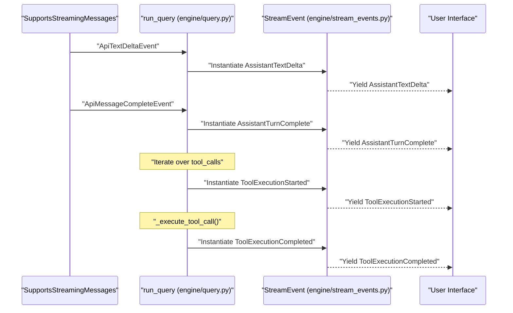

**Sources:**
- [src/openharness/engine/stream_events.py:1-90]()
- [src/openharness/engine/query.py:284-633]()

---

## Cost Tracking and Usage Models

OpenHarness tracks token usage using the `UsageSnapshot` model for discrete API responses and the `CostTracker` for session-wide accumulation.

### UsageSnapshot and CostTracker
The `UsageSnapshot` captures the raw token counts returned by the model provider.
- **UsageSnapshot**: Includes `input_tokens` and `output_tokens` [src/openharness/api/usage.py:10-12]().
- **CostTracker**: A class in `src/openharness/engine/cost_tracker.py` (referenced in `QueryEngine` [src/openharness/engine/query_engine.py:60]()) that maintains a running `total` of usage across all turns in a session [src/openharness/engine/query_engine.py:93-95]().

### Token Estimation and Compaction
When explicit usage data is unavailable or when planning for compaction, the engine uses `estimate_message_tokens` [src/openharness/services/compact/__init__.py:116-132]().
- **Padding**: A conservative multiplier of `4/3` (`TOKEN_ESTIMATION_PADDING`) is applied to raw character-based estimates [src/openharness/services/compact/__init__.py:75-75]().
- **Thresholds**: Auto-compaction is triggered when the estimated token count approaches the model's context window, minus a buffer (default `13,000` tokens) [src/openharness/services/compact/__init__.py:55-55]().

### Usage Architecture Mapping

The diagram below bridges the natural language concepts of "Usage" and "Estimation" to the specific code entities.

**Usage and Cost Entity Mapping**
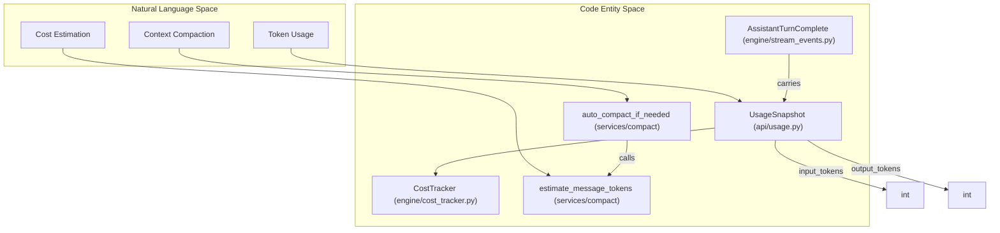

**Sources:**
- [src/openharness/api/usage.py:8-18]()
- [src/openharness/engine/query_engine.py:59-60]()
- [src/openharness/engine/stream_events.py:20-25]()
- [src/openharness/services/compact/__init__.py:41-81]()

---

## Implementation Details

### Sequential vs Concurrent Tool Execution
The `run_query` function handles tool events differently based on the number of tool calls requested by the LLM:
- **Single Tool**: Events are streamed immediately. `ToolExecutionStarted` is yielded, the tool runs, and `ToolExecutionCompleted` is yielded [src/openharness/engine/query.py:539-556]().
- **Multiple Tools**: Tools are executed concurrently using `asyncio.gather`. All `ToolExecutionStarted` events are yielded first [src/openharness/engine/query.py:566-574](), followed by the execution block, and finally all `ToolExecutionCompleted` events [src/openharness/engine/query.py:595-603]().

### Network and API Resilience
The engine monitors the stream for `ApiRetryEvent`. When the API client encounters a rate limit, it yields a `StatusEvent` containing the retry attempt number and delay [src/openharness/engine/query.py:378-385](). If a terminal exception occurs, an `ErrorEvent` is yielded to the UI [src/openharness/engine/query.py:392-398]().

### Compaction Triggers
Compaction can be triggered in three ways:
1. **Auto**: Automatically when token estimates exceed thresholds [src/openharness/services/compact/__init__.py:83]().
2. **Reactive**: Triggered when the API returns a "Prompt Too Long" error [src/openharness/engine/query.py:403-421]().
3. **Manual**: Triggered via slash commands (e.g., `/compact`).

**Sources:**
- [src/openharness/engine/query.py:370-633]()
- [src/openharness/engine/messages.py:1-68]()
- [src/openharness/engine/stream_events.py:1-90]()
- [src/openharness/services/compact/__init__.py:83-110]()

---

# Page: API Layer

# API Layer

<details>
<summary>Relevant source files</summary>

The following files were used as context for generating this wiki page:

- [src/openharness/api/__init__.py](src/openharness/api/__init__.py)
- [src/openharness/api/client.py](src/openharness/api/client.py)
- [src/openharness/api/copilot_client.py](src/openharness/api/copilot_client.py)
- [src/openharness/api/openai_client.py](src/openharness/api/openai_client.py)
- [src/openharness/api/provider.py](src/openharness/api/provider.py)
- [src/openharness/api/registry.py](src/openharness/api/registry.py)
- [tests/test_api/test_copilot_auth.py](tests/test_api/test_copilot_auth.py)
- [tests/test_api/test_copilot_client.py](tests/test_api/test_copilot_client.py)
- [tests/test_api/test_openai_client.py](tests/test_api/test_openai_client.py)
- [tests/test_ui/test_runtime_close.py](tests/test_ui/test_runtime_close.py)

</details>


The **API Layer** serves as the communication bridge between the OpenHarness Core Engine and various LLM providers. It abstracts the complexities of streaming responses, multi-provider message format conversion, authentication, and robust error handling with exponential backoff.

### Overview

OpenHarness interacts with LLMs through a standardized interface. While the internal message model is optimized for Anthropic's Claude, the API layer provides specialized clients for OpenAI-compatible gateways, GitHub Copilot, and OpenAI Codex subscriptions. The architecture ensures that the [Core Engine](#2) remains decoupled from specific provider implementations by using the `SupportsStreamingMessages` protocol [src/openharness/api/client.py:80-85]().

**Communication Flow:**
1.  The `QueryEngine` prepares an `ApiMessageRequest` [src/openharness/api/client.py:40-49]().
2.  The active client (e.g., `AnthropicApiClient`, `OpenAICompatibleClient`, or `CopilotClient`) manages the connection and retries transient failures [src/openharness/api/client.py:169-197]().
3.  The client yields `ApiStreamEvent` objects—such as `ApiTextDeltaEvent` for incremental updates or `ApiMessageCompleteEvent` for final message processing [src/openharness/api/client.py:52-77]().

### API Communication Bridge

The following diagram illustrates how high-level requests are translated into provider-specific SDK calls and handled by the client infrastructure.

**Entity Mapping: Engine to API Clients**

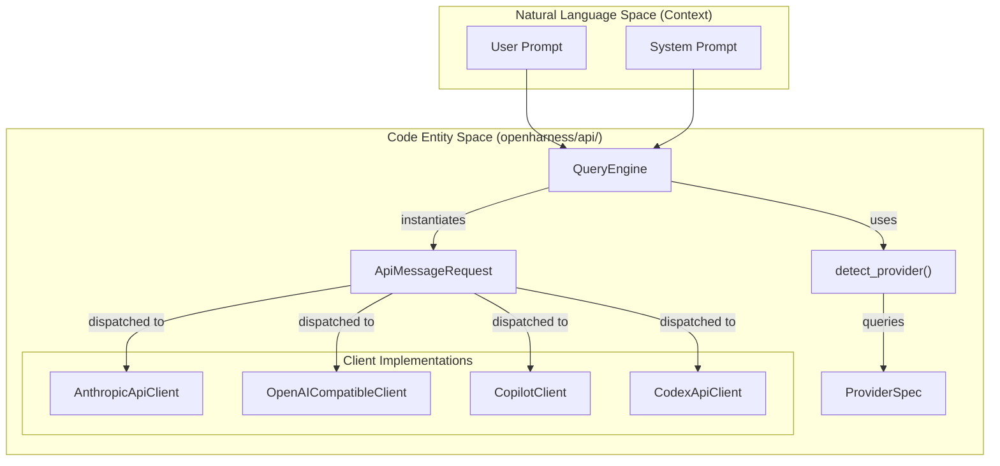

**Sources:** [src/openharness/api/client.py:40-49](), [src/openharness/api/provider.py:42-94](), [src/openharness/api/registry.py:18-49](), [src/openharness/api/client.py:80-85]()

---

### Anthropic API Client
The `AnthropicApiClient` is the primary implementation of the `SupportsStreamingMessages` protocol. It wraps the `anthropic` Python SDK to provide standardized streaming and automatic retries.

*   **Retry Logic:** Uses exponential backoff with jitter, respecting `Retry-After` headers when provided by the API [src/openharness/api/client.py:98-115]().
*   **OAuth Support:** Includes specialized handling for Claude subscription auth, including token refreshing and identity headers [src/openharness/api/client.py:157-164]().

For details, see [Anthropic API Client](#3.1).

**Sources:** [src/openharness/api/client.py:118-151](), [src/openharness/api/client.py:165-202]()

---

### OpenAI-Compatible, Codex, and Copilot Clients
OpenHarness supports a wide range of alternative backends through specialized translation layers.

*   **OpenAICompatibleClient:** Bridges Anthropic-style tool schemas and message blocks to the OpenAI ChatCompletion format [src/openharness/api/openai_client.py:60-78](). It handles provider-specific quirks like "thinking" model reasoning content and token limit parameter normalization [src/openharness/api/openai_client.py:46-57](), [src/openharness/api/openai_client.py:162-186]().
*   **CopilotClient:** A wrapper around the OpenAI client that injects GitHub OAuth Bearer tokens and specific headers required by the Copilot API [src/openharness/api/copilot_client.py:48-110]().
*   **CodexApiClient:** Interfaces with the `chatgpt.com` backend, extracting account IDs from JWT claims and converting messages to the Codex-specific JSON-line stream format [src/openharness/api/codex_client.py:1-10]().

For details, see [OpenAI-Compatible, Codex, and Copilot Clients](#3.2).

**Sources:** [src/openharness/api/openai_client.py:81-126](), [src/openharness/api/copilot_client.py:112-130](), [src/openharness/api/openai_client.py:46-57]()

---

### Provider Detection and Authentication
The system automatically identifies the correct backend and authentication flow based on user configuration.

*   **Provider Registry:** A central list of `ProviderSpec` objects defines keywords, API key environment variables, and default base URLs for dozens of providers including DeepSeek, DashScope, and OpenRouter [src/openharness/api/registry.py:55-213]().
*   **Detection Logic:** `detect_provider` inspects the configured model and base URL to resolve metadata for the UI and diagnostics [src/openharness/api/provider.py:42-94]().
*   **Multimodal Detection:** The layer includes heuristics to detect if a model supports native vision capabilities [src/openharness/api/provider.py:175-186]().

For details, see [Provider Detection and Authentication](#3.3).

**Sources:** [src/openharness/api/provider.py:42-94](), [src/openharness/api/registry.py:18-49](), [src/openharness/api/provider.py:135-172]()

---

### Error Handling and Translation
The API layer categorizes exceptions into a hierarchy of `OpenHarnessApiError` types to allow the engine to make informed decisions about whether to halt execution or notify the user.

| Exception Class | Source Trigger | Retriable? |
| :--- | :--- | :--- |
| `AuthenticationFailure` | 401 Unauthorized / 403 Forbidden | No |
| `RateLimitFailure` | 429 Too Many Requests | Yes |
| `RequestFailure` | 400 Bad Request / 500 Internal Error | Depends on status code |

**Provider and Error Mapping**

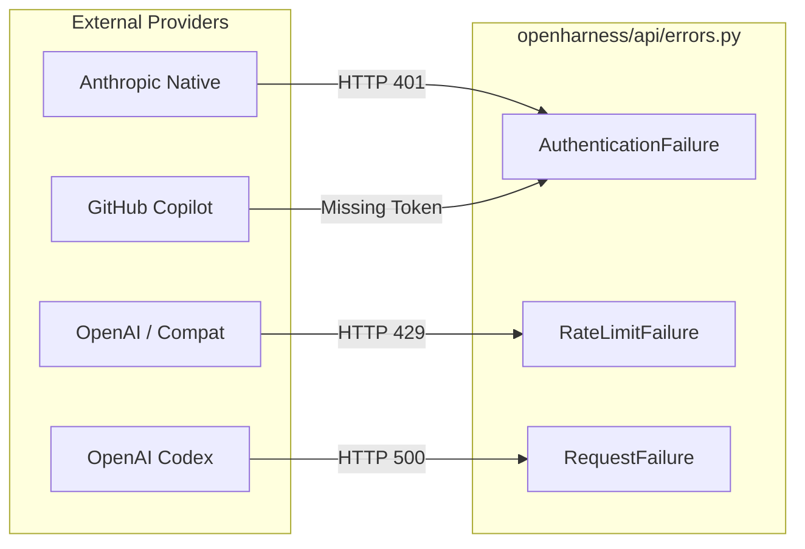

**Sources:** [src/openharness/api/client.py:14-19](), [src/openharness/api/openai_client.py:22-27](), [src/openharness/api/copilot_client.py:27-27]()

---

# Page: Anthropic API Client

# Anthropic API Client

<details>
<summary>Relevant source files</summary>

The following files were used as context for generating this wiki page:

- [src/openharness/api/client.py](src/openharness/api/client.py)
- [src/openharness/api/copilot_client.py](src/openharness/api/copilot_client.py)
- [src/openharness/api/openai_client.py](src/openharness/api/openai_client.py)
- [tests/test_api/test_client.py](tests/test_api/test_client.py)
- [tests/test_api/test_copilot_auth.py](tests/test_api/test_copilot_auth.py)
- [tests/test_api/test_copilot_client.py](tests/test_api/test_copilot_client.py)
- [tests/test_api/test_openai_client.py](tests/test_api/test_openai_client.py)
- [tests/test_ui/test_runtime_close.py](tests/test_ui/test_runtime_close.py)

</details>


The `AnthropicApiClient` serves as the primary interface between the OpenHarness engine and the Anthropic Messages API. It wraps the asynchronous Anthropic SDK to provide robust error handling, automated retry logic with exponential backoff, and a standardized streaming protocol for the query loop. It also supports Claude OAuth authentication and session attribution for specialized environments.

Sources: [src/openharness/api/client.py:1-29]()

## Core Data Structures

The client uses several dataclasses to standardize communication between the API layer and the `QueryEngine`. These structures ensure that the engine remains decoupled from provider-specific SDK formats.

### Request and Event Models
*   **`ApiMessageRequest`**: Encapsulates all parameters required for a model invocation, including the model ID, conversation history, system prompt, token limits, and tool definitions [src/openharness/api/client.py:40-49]().
*   **`ApiTextDeltaEvent`**: Represents an incremental chunk of text streamed from the model [src/openharness/api/client.py:52-56]().
*   **`ApiMessageCompleteEvent`**: The terminal event in a stream, containing the final `ConversationMessage`, token usage statistics via `UsageSnapshot`, and the API's `stop_reason` [src/openharness/api/client.py:59-65]().
*   **`ApiRetryEvent`**: Dispatched when a recoverable upstream failure occurs, informing the UI or engine about the current retry attempt and expected delay [src/openharness/api/client.py:68-75]().

### Usage Tracking
The `UsageSnapshot` model tracks token consumption for both input and output, providing a consistent interface for cost accounting across different providers [src/openharness/api/usage.py:8-18]().

Sources: [src/openharness/api/client.py:40-77](), [src/openharness/api/usage.py:8-18]()

## Streaming Protocol and Implementation

The client implements the `SupportsStreamingMessages` protocol, which defines a standard asynchronous iterator interface for the engine to consume model responses.

### Protocol Definition
```python
class SupportsStreamingMessages(Protocol):
    """Protocol used by the query engine in tests and production."""

    async def stream_message(self, request: ApiMessageRequest) -> AsyncIterator[ApiStreamEvent]:
        """Yield streamed events for the request."""
```
Sources: [src/openharness/api/client.py:80-84]()

### Data Flow: Natural Language to Code Entities
The following diagram illustrates how the `AnthropicApiClient` bridges high-level engine requests to the underlying SDK events.

**API Streaming Data Flow**
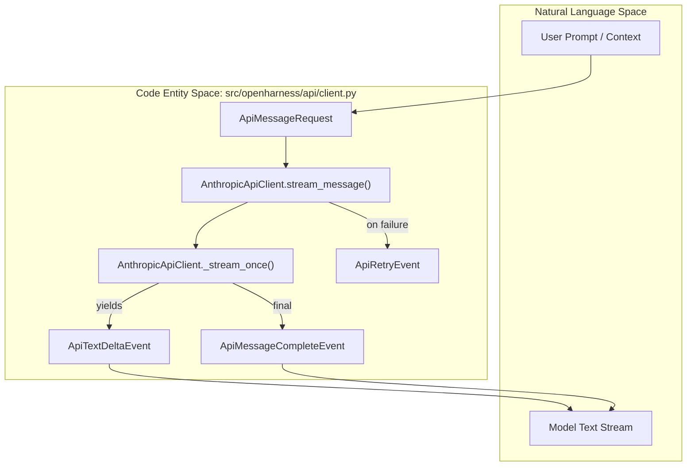
Sources: [src/openharness/api/client.py:40-77](), [src/openharness/api/client.py:165-246]()

## Retry Logic and Error Handling

OpenHarness implements a sophisticated retry mechanism to handle transient network issues and API rate limits.

### Exponential Backoff
The client uses exponential backoff with jitter to prevent "thundering herd" problems. 
*   **Base Delay**: 1.0s [src/openharness/api/client.py:33]()
*   **Max Delay**: 30.0s [src/openharness/api/client.py:34]()
*   **Max Retries**: 3 [src/openharness/api/client.py:32]()

The function `_get_retry_delay` calculates wait time and respects the `retry-after` header if provided by the Anthropic API [src/openharness/api/client.py:98-116]().

### Retryable Errors
Errors are categorized via `_is_retryable` [src/openharness/api/client.py:87-95](). Retryable conditions include:
*   HTTP Status Codes: 429 (Rate Limit), 500, 502, 503, 529 [src/openharness/api/client.py:35]().
*   Network exceptions: `ConnectionError`, `TimeoutError`, and `OSError` [src/openharness/api/client.py:93-94]().

### Error Translation
The client maps SDK-specific exceptions to internal `OpenHarnessApiError` types via `_translate_api_error` [src/openharness/api/client.py:249-261]():

| SDK Error | OpenHarness Error |
| :--- | :--- |
| `AuthenticationError` / `PermissionDeniedError` | `AuthenticationFailure` |
| `RateLimitError` | `RateLimitFailure` |
| Generic `APIError` | `RequestFailure` |

Sources: [src/openharness/api/client.py:31-36](), [src/openharness/api/client.py:87-116](), [src/openharness/api/client.py:249-261]()

## Internal Execution Flow

The `AnthropicApiClient` manages authentication state and the retry loop. It supports an `auth_token_resolver` callback to refresh OAuth tokens mid-session if they expire [src/openharness/api/client.py:157-164]().

**Retry and Execution Logic**
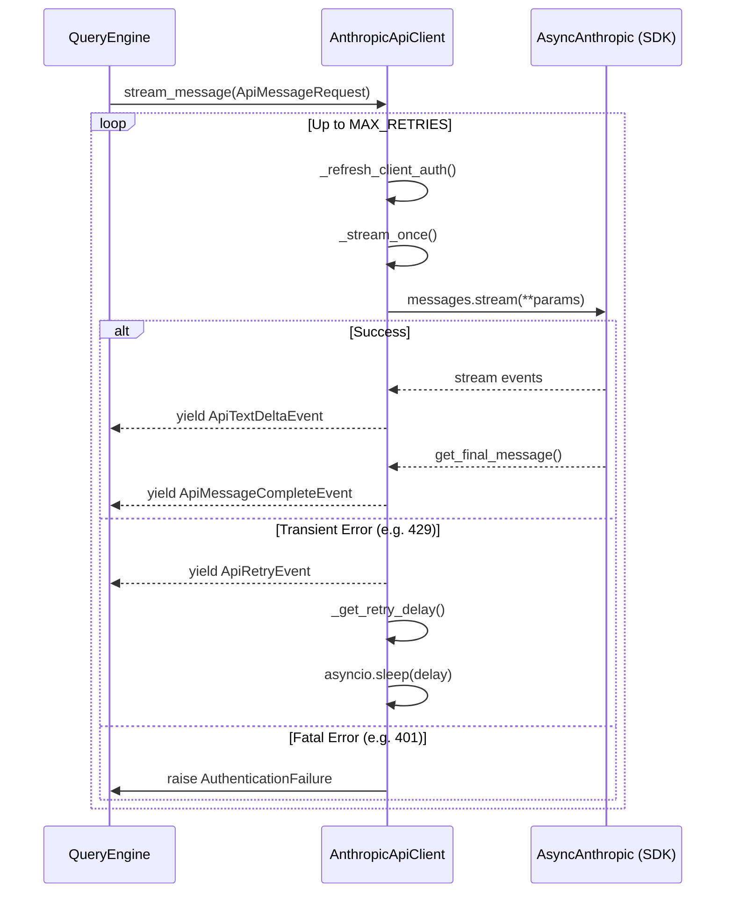
Sources: [src/openharness/api/client.py:165-201]()

### Implementation Details of `_stream_once`
1.  **Parameter Mapping**: Converts `ApiMessageRequest` into the format expected by the Anthropic SDK. `ConversationMessage` objects are mapped to API parameters via `to_api_param()` [src/openharness/api/client.py:205-209]().
2.  **OAuth and Thinking Models**: If `claude_oauth` is enabled, the client injects specific headers and metadata, including specialized `betas` for the Claude Code environment [src/openharness/api/client.py:212-220](). It also handles the `effort` parameter for reasoning models [src/openharness/api/client.py:221-222]().
3.  **Delta Filtering**: The client iterates over the SDK stream, yielding `ApiTextDeltaEvent` only for `text_delta` types within `content_block_delta` events [src/openharness/api/client.py:227-234]().
4.  **Finalization**: Retrieves the final message object to extract token usage and the full response body, converting it back to the internal `ConversationMessage` format using `assistant_message_from_api` [src/openharness/api/client.py:236-246]().

Sources: [src/openharness/api/client.py:203-246](), [src/openharness/engine/messages.py:27-27]()

---

# Page: OpenAI-Compatible, Codex, and Copilot Clients

# OpenAI-Compatible, Codex, and Copilot Clients

<details>
<summary>Relevant source files</summary>

The following files were used as context for generating this wiki page:

- [src/openharness/api/client.py](src/openharness/api/client.py)
- [src/openharness/api/codex_client.py](src/openharness/api/codex_client.py)
- [src/openharness/api/copilot_client.py](src/openharness/api/copilot_client.py)
- [src/openharness/api/openai_client.py](src/openharness/api/openai_client.py)
- [tests/test_api/test_codex_client.py](tests/test_api/test_codex_client.py)
- [tests/test_api/test_copilot_auth.py](tests/test_api/test_copilot_auth.py)
- [tests/test_api/test_copilot_client.py](tests/test_api/test_copilot_client.py)
- [tests/test_api/test_openai_client.py](tests/test_api/test_openai_client.py)
- [tests/test_ui/test_runtime_close.py](tests/test_ui/test_runtime_close.py)

</details>


This page documents the specialized API clients within OpenHarness that facilitate communication with non-Anthropic providers. This includes providers offering OpenAI-compatible endpoints (e.g., Alibaba DashScope, GitHub Models), the subscription-backed Codex interface for chatgpt.com, and the GitHub Copilot chat API.

## OpenAI-Compatible Client

The `OpenAICompatibleClient` class in `api/openai_client.py` provides a bridge between the Anthropic-style message format used internally by the OpenHarness engine and the OpenAI Chat Completion API. [src/openharness/api/openai_client.py:1-21]()

### Schema Conversion
Because the OpenHarness engine standardized on the Anthropic message and tool schema, the `OpenAICompatibleClient` performs real-time translation of requests and responses.

*   **Tool Conversion**: The function `_convert_tools_to_openai` transforms Anthropic's `input_schema` into OpenAI's `function` parameters format. [src/openharness/api/openai_client.py:60-78]()
*   **Message Conversion**: `_convert_messages_to_openai` handles structural differences, such as moving system prompts into the message array and splitting tool results into individual `role: "tool"` entries. [src/openharness/api/openai_client.py:81-126]()
*   **Thinking Models**: For models that support "reasoning" (like Kimi k2.5 or OpenAI o1), the client manages the `reasoning_content` field. It stashes reasoning text in `msg._reasoning` during streaming and replays it in subsequent turns. [src/openharness/api/openai_client.py:162-202]()
*   **Think Block Stripping**: The client includes a utility `_strip_think_blocks` to remove `` tags from model output to provide clean text to the engine. [src/openharness/api/openai_client.py:381-384]()

### Token Limit Logic
Modern OpenAI models (o1, o3, gpt-5) have replaced the `max_tokens` parameter with `max_completion_tokens`. The helper `_token_limit_param_for_model` detects these model prefixes and adjusts the request payload accordingly. [src/openharness/api/openai_client.py:46-57]()

### Data Flow: OpenAI Request Transformation
The following diagram illustrates how an internal `ApiMessageRequest` is transformed into an OpenAI-compatible payload.

Title: OpenAI Client Transformation Flow
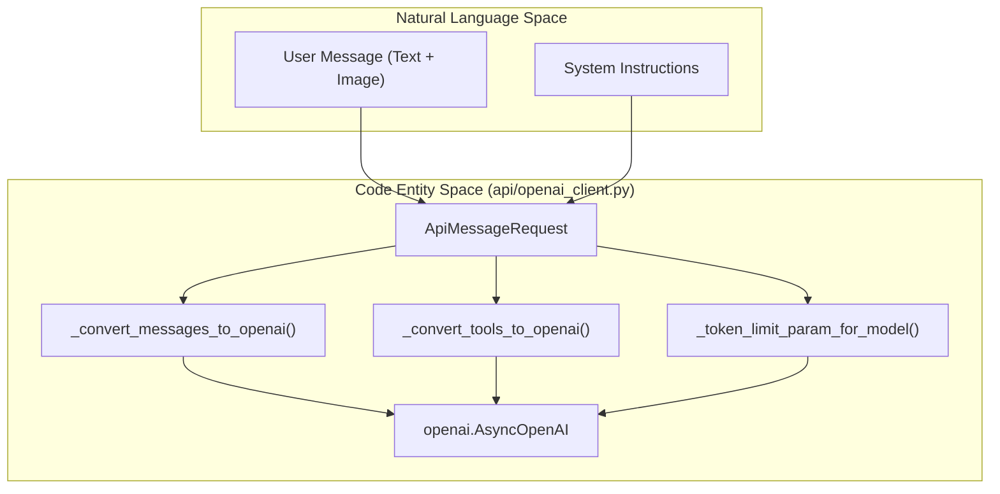
Sources: [src/openharness/api/openai_client.py:46-126](), [src/openharness/api/openai_client.py:228-253]()

---

## Codex API Client

The `CodexApiClient` in `api/codex_client.py` is designed to interact with the `chatgpt.com/backend-api/codex` endpoints. This client is used primarily for subscription-backed access to OpenAI's reasoning capabilities via the experimental Responses API. [src/openharness/api/codex_client.py:1-23]()

### JWT Account-ID Extraction
Unlike standard API clients that only require a Bearer token, the Codex backend requires a `chatgpt-account-id` header. The client extracts this ID from the provided JWT (JSON Web Token) by:
1.  Splitting the token and decoding the payload section. [src/openharness/api/codex_client.py:30-39]()
2.  Accessing the `https://api.openai.com/auth` claim. [src/openharness/api/codex_client.py:40-42]()
3.  Retrieving the `chatgpt_account_id` string. [src/openharness/api/codex_client.py:43-46]()

### Protocol Handling
Codex uses a custom EventStream protocol. The `stream_message` method iterates over lines from `httpx.AsyncClient`, parsing events such as `response.output_text.delta` for text and `response.output_item.added` for tool calls. [src/openharness/api/codex_client.py:236-320]()

| Feature | Implementation Detail |
| :--- | :--- |
| **Auth Headers** | Includes `OpenAI-Beta: responses=experimental` and `chatgpt-account-id`. [src/openharness/api/codex_client.py:61-74]() |
| **URL Resolution** | Normalizes base URLs to ensure they end in `/codex/responses`. [src/openharness/api/codex_client.py:49-58]() |
| **Tool Calls** | Converts tool uses to `function_call` types with specific ID prefixing (`fc_`). [src/openharness/api/codex_client.py:112-121]() |

Sources: [src/openharness/api/codex_client.py:1-121](), [tests/test_api/test_codex_client.py:69-121]()

---

## Copilot Client

The `CopilotClient` in `api/copilot_client.py` is a wrapper around the `OpenAICompatibleClient`. It leverages the fact that GitHub Copilot's chat endpoint is OpenAI-compatible but requires specific headers and authentication flows. [src/openharness/api/copilot_client.py:1-10]()

### Authentication and Initialization
*   **Bearer Token**: It uses the GitHub OAuth token (prefixed with `ghu_` or `gho_`) directly as the API key. [src/openharness/api/copilot_client.py:51-52]()
*   **Token Resolution**: It attempts to load tokens from `~/.openharness/copilot_auth.json` via `load_copilot_auth()` if no token is provided explicitly. [src/openharness/api/copilot_client.py:74-79]()
*   **Enterprise Support**: Supports custom enterprise domains, resolving the API base URL via `copilot_api_base(ent_url)`. [src/openharness/api/copilot_client.py:81-89]()

### Specialized Headers
The client injects mandatory headers for Copilot compatibility: [src/openharness/api/copilot_client.py:90-93]()
*   `User-Agent`: Identifies the client as `openharness/<version>`.
*   `Openai-Intent`: Set to `conversation-edits` to signal the context of the request.

### Client Architecture: Copilot Wrapper
The diagram below shows how `CopilotClient` encapsulates the standard OpenAI client while applying Copilot-specific configurations.

Title: Copilot Client Delegation Architecture
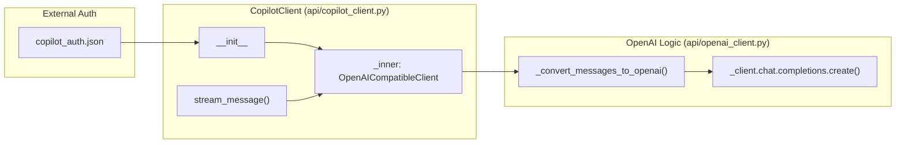
Sources: [src/openharness/api/copilot_client.py:48-105](), [src/openharness/api/copilot_client.py:112-130](), [tests/test_api/test_copilot_client.py:113-141]()

## Summary of Client Protocol Support

| Client | Protocol | Key Files |
| :--- | :--- | :--- |
| **OpenAICompatibleClient** | OpenAI Chat Completions | `api/openai_client.py` [src/openharness/api/openai_client.py:1-13]() |
| **CodexApiClient** | chatgpt.com Backend API | `api/codex_client.py` [src/openharness/api/codex_client.py:1-23]() |
| **CopilotClient** | OpenAI + Copilot Headers | `api/copilot_client.py` [src/openharness/api/copilot_client.py:1-10]() |

Sources: [src/openharness/api/openai_client.py:1-5](), [src/openharness/api/codex_client.py:1-5](), [src/openharness/api/copilot_client.py:1-10]()

---

# Page: Provider Detection and Authentication

# Provider Detection and Authentication

<details>
<summary>Relevant source files</summary>

The following files were used as context for generating this wiki page:

- [src/openharness/api/__init__.py](src/openharness/api/__init__.py)
- [src/openharness/api/copilot_auth.py](src/openharness/api/copilot_auth.py)
- [src/openharness/api/provider.py](src/openharness/api/provider.py)
- [src/openharness/api/registry.py](src/openharness/api/registry.py)
- [src/openharness/auth/__init__.py](src/openharness/auth/__init__.py)
- [src/openharness/auth/external.py](src/openharness/auth/external.py)
- [src/openharness/auth/flows.py](src/openharness/auth/flows.py)
- [src/openharness/auth/manager.py](src/openharness/auth/manager.py)
- [src/openharness/auth/storage.py](src/openharness/auth/storage.py)
- [src/openharness/config/settings.py](src/openharness/config/settings.py)
- [src/openharness/utils/fs.py](src/openharness/utils/fs.py)
- [tests/test_auth/test_external.py](tests/test_auth/test_external.py)
- [tests/test_auth/test_flows.py](tests/test_auth/test_flows.py)
- [tests/test_config/test_settings.py](tests/test_config/test_settings.py)

</details>


This page documents the mechanisms OpenHarness uses to identify the active LLM provider, resolve authentication credentials across diverse sources (API keys, OAuth, and external CLI bindings), and manage provider-specific capability sets. The system supports native Anthropic, OpenAI-compatible backends, GitHub Copilot, and subscription-based external providers like Claude Code and ChatGPT Codex.

## Provider Detection Logic

OpenHarness uses the `detect_provider` function to infer the underlying LLM infrastructure based on the configured `base_url`, `model` name, and `api_format`. This detection determines the `auth_kind` required and the availability of advanced features like voice mode.

### Provider Information Model
The `ProviderInfo` dataclass [src/openharness/api/provider.py:33-40]() encapsulates the resolved metadata:
- **`name`**: A string identifier for the provider (e.g., "github_copilot", "claude-subscription").
- **`auth_kind`**: The expected authentication method: `api_key`, `oauth_device`, or `external_oauth` [src/openharness/api/provider.py:13-19]().
- **`voice_supported`**: A boolean indicating if the current provider supports the voice streaming backend.
- **`voice_reason`**: A human-readable explanation for why voice support is or isn't available [src/openharness/api/provider.py:21-29]().

### Detection Mapping
The logic in `detect_provider` [src/openharness/api/provider.py:42-94]() follows this precedence:
1.  **Explicit Provider**: Checks for `openai_codex` [src/openharness/api/provider.py:44-50]() or `anthropic_claude` [src/openharness/api/provider.py:51-57]() settings.
2.  **API Format**: Detects `copilot` via the `api_format` field [src/openharness/api/provider.py:58-64]().
3.  **Registry Lookup**: Uses `detect_provider_from_registry` [src/openharness/api/registry.py:10-11]() to match model substrings (e.g., "gpt", "claude", "qwen") or `base_url` keywords (e.g., "openrouter", "deepseek") defined in the `PROVIDERS` registry [src/openharness/api/registry.py:55-215]().
4.  **Fallback**: Defaults to `anthropic` or `openai-compatible` based on `api_format` [src/openharness/api/provider.py:82-94]().

**Sources:**
- [src/openharness/api/provider.py:13-94]()
- [src/openharness/api/registry.py:17-50]()
- [src/openharness/api/registry.py:55-215]()

## Authentication Manager and Storage

The `AuthManager` class [src/openharness/auth/manager.py:71-76]() serves as the central authority for provider state. It interacts with the `storage.py` layer to persist credentials securely.

### Credential Storage Backends
OpenHarness supports two storage backends in `auth/storage.py`:
- **File-based**: Credentials are stored in `~/.openharness/credentials.json` with strict `0o600` permissions [src/openharness/auth/storage.py:54-76]().
- **System Keyring**: If the `keyring` package is installed and a usable backend is detected [src/openharness/auth/storage.py:87-110](), it is used as the primary store [src/openharness/auth/storage.py:122-145]().
- **Resolution Precedence**: Settings resolve credentials with the precedence: CLI arguments → Environment variables (e.g., `ANTHROPIC_API_KEY`) → Config file [src/openharness/config/settings.py:3-8]().

### External CLI Bindings
For providers like Claude Code and Codex, OpenHarness can "bind" to credentials managed by their respective official CLIs [src/openharness/auth/external.py:76-113]().
- **`ExternalAuthBinding`**: A pointer to an external JSON credential file or keychain service [src/openharness/auth/storage.py:39-47]().
- **Auto-Refresh**: The `load_external_credential` function [src/openharness/auth/external.py:116-141]() can automatically refresh expired OAuth tokens for Claude subscriptions [src/openharness/auth/external.py:204-205]().

**Sources:**
- [src/openharness/auth/manager.py:71-106]()
- [src/openharness/auth/storage.py:54-145]()
- [src/openharness/auth/external.py:76-205]()
- [src/openharness/config/settings.py:3-8]()

## Authentication Flows

The `auth/flows.py` module implements interactive strategies for obtaining credentials.

| Flow Class | Description |
| :--- | :--- |
| **`ApiKeyFlow`** | Prompts for a raw string via `getpass.getpass` [src/openharness/auth/flows.py:34-48](). |
| **`DeviceCodeFlow`** | Implements the GitHub/Copilot OAuth device-code grant. It opens a browser [src/openharness/auth/flows.py:79-115]() and polls for the access token [src/openharness/auth/flows.py:144-159](). |
| **`BrowserFlow`** | Opens a generic URL and waits for the user to paste back a resulting token [src/openharness/auth/flows.py:167-190](). |

### Entity Association: Authentication Resolution
The following diagram illustrates how the system resolves a final credential from various input sources.

**Title: Credential Resolution Pipeline**
```mermaid
graph TD
    subgraph "Natural Language Space"
        "User Input" --> "Auth Flow"
        "Environment Config" --> "Runtime Key"
        "External CLI" --> "Bound Credential"
    end

    subgraph "Code Entity Space"
        "User Input" -- "run()" --> "ApiKeyFlow[src/openharness/auth/flows.py:34]"
        "ApiKeyFlow" -- "store_credential()" --> "Storage[src/openharness/auth/storage.py:122]"
        
        "Environment Config" -- "os.environ.get()" --> "Settings[src/openharness/config/settings.py:Settings]"
        "Settings" -- "resolve_auth()" --> "ResolvedAuth[Final Credential]"
        
        "External CLI" -- "load_external_credential()" --> "ExtLogic[src/openharness/auth/external.py:116]"
        "ExtLogic" -- "refresh_if_needed" --> "ResolvedAuth"
        
        "Storage" -- "load_credential()" --> "ResolvedAuth"
    end
```
**Sources:**
- [src/openharness/auth/flows.py:21-190]()
- [src/openharness/auth/storage.py:122-164]()
- [src/openharness/auth/external.py:116-141]()
- [src/openharness/config/settings.py:149-158]()

## CLI and Status Management

OpenHarness provides a dedicated `auth` subcommand group and slash commands for runtime management.

### Status Resolution
The `auth_status` function [src/openharness/api/provider.py:97-126]() provides a compact string indicating if a provider is "configured", "missing", or "invalid". It specifically checks for Copilot auth files and external bindings for Claude/Codex [src/openharness/api/provider.py:111-123]().

### Auth Commands
- **`/login` (Slash Command)**: Triggers the appropriate `AuthFlow` based on the active provider profile.
- **`oh auth status`**: Aggregates data from `AuthManager.get_auth_source_statuses()` [src/openharness/auth/manager.py:116-184]() to show configuration origins (env vs file vs external).
- **`oh auth login`**: Directly invokes the flow for the active provider profile.

### Entity Association: Auth Command Mapping
This diagram maps CLI and Slash actions to internal auth entities.

**Title: Auth Command to Code Mapping**
```mermaid
graph LR
    subgraph "Natural Language Space"
        "oh auth status" --> "Check All Providers"
        "/provider switch" --> "Change Active Profile"
        "oh auth login" --> "Trigger Flow"
    end

    subgraph "Code Entity Space"
        "Check All Providers" --> "get_auth_status[src/openharness/auth/manager.py:186]"
        "get_auth_status" --> "load_credential[src/openharness/auth/storage.py:147]"
        
        "Change Active Profile" -- "settings.active_profile" --> "Settings[src/openharness/config/settings.py:Settings]"
        "Settings" -- "resolve_profile()" --> "AuthManager[src/openharness/auth/manager.py:110]"
        
        "Trigger Flow" --> "AuthFlow[src/openharness/auth/flows.py:21]"
        "AuthFlow" -- "store_credential()" --> "Storage[src/openharness/auth/storage.py:122]"
    end
```

**Sources:**
- [src/openharness/auth/manager.py:116-205]()
- [src/openharness/api/provider.py:97-126]()
- [src/openharness/auth/flows.py:21-27]()
- [src/openharness/config/settings.py:124-138]()

---

# Page: Tools System

# Tools System

<details>
<summary>Relevant source files</summary>

The following files were used as context for generating this wiki page:

- [scripts/react_tui_e2e.py](scripts/react_tui_e2e.py)
- [src/openharness/hooks/events.py](src/openharness/hooks/events.py)
- [src/openharness/tools/__init__.py](src/openharness/tools/__init__.py)
- [src/openharness/tools/agent_tool.py](src/openharness/tools/agent_tool.py)
- [src/openharness/tools/base.py](src/openharness/tools/base.py)
- [src/openharness/tools/glob_tool.py](src/openharness/tools/glob_tool.py)
- [src/openharness/tools/grep_tool.py](src/openharness/tools/grep_tool.py)
- [src/openharness/tools/send_message_tool.py](src/openharness/tools/send_message_tool.py)
- [tests/test_hooks_skills_plugins_real.py](tests/test_hooks_skills_plugins_real.py)
- [tests/test_real_large_tasks.py](tests/test_real_large_tasks.py)
- [tests/test_swarm/test_imports.py](tests/test_swarm/test_imports.py)
- [tests/test_tools/test_core_tools.py](tests/test_tools/test_core_tools.py)
- [tests/test_tools/test_grep_tool.py](tests/test_tools/test_grep_tool.py)
- [tests/test_tools/test_integration_flows.py](tests/test_tools/test_integration_flows.py)
- [tests/test_untested_features.py](tests/test_untested_features.py)

</details>


The **Tools System** is the primary interface through which the OpenHarness agent interacts with the external world. It provides a structured framework for the LLM to perform actions such as file manipulation, shell command execution, web searching, and multi-agent coordination. The system currently supports over 43 built-in tools, all managed through a unified registry and execution pipeline [src/openharness/tools/__init__.py:48-98]().

### Core Architecture

The tools system is built on a strictly typed foundation using Pydantic for input validation and a centralized registry for discovery. When the LLM decides to use a tool, the `QueryEngine` dispatches the request to the `ToolRegistry`, which instantiates the appropriate tool class and executes it within a controlled `ToolExecutionContext` [src/openharness/tools/base.py:12-34]().

#### Tool Interaction Flow
The following diagram illustrates how a natural language request from the LLM is transformed into a code execution via the `ToolRegistry` and `BaseTool` abstractions.

**Tool Execution Pipeline**
```mermaid
graph TD
    subgraph "Natural Language Space (LLM)"
        A["LLM Tool Call (JSON)"]
    end

    subgraph "Code Entity Space (OpenHarness)"
        B["engine/query_engine.py: QueryEngine"]
        C["tools/base.py: ToolRegistry"]
        D["tools/base.py: BaseTool Subclass"]
        E["tools/base.py: ToolExecutionContext"]
        F["tools/base.py: ToolResult"]
    end

    A -->|Dispatch| B
    B -->|Lookup| C
    C -->|Instantiate| D
    D -->|Validate Input| E
    E -->|execute()| D
    D -->|Return| F
    F -->|Observation| A
```
Sources: [src/openharness/tools/base.py:12-34](), [src/openharness/tools/__init__.py:50-98]()

### Tool Abstractions and Registry

Every tool in OpenHarness inherits from the `BaseTool` abstract base class [src/openharness/tools/base.py:12-12](). This ensures a consistent interface for the `QueryEngine` to interact with, regardless of whether the tool is a simple file reader or a complex MCP (Model Context Protocol) client.

Key components include:
- **`BaseTool`**: Defines the `execute()` method and the `input_model` (a Pydantic class) used for argument validation [src/openharness/tools/base.py:26-34]().
- **`ToolRegistry`**: A registry that manages the lifecycle of all available tools, including built-in tools, plugin-contributed tools, and MCP tools [src/openharness/tools/base.py:12-12]().
- **`ToolExecutionContext`**: Provides tools with access to the current environment, such as the working directory (`cwd`), session ID, and event emitters [src/openharness/tools/base.py:12-12]().
- **`ToolResult`**: A standardized container for tool output, supporting text results and error flagging via `is_error` [src/openharness/tools/base.py:12-12]().

For details on implementing custom tools or the internals of the registry, see [Tool Abstractions and Registry](#4.1).

Sources: [src/openharness/tools/base.py:12-34](), [src/openharness/tools/__init__.py:48-98]()

### Built-in Tool Categories

OpenHarness ships with a comprehensive suite of 43+ tools designed to cover the majority of software engineering and general-purpose tasks. These are logically grouped into several categories:

| Category | Description | Key Tools |
| :--- | :--- | :--- |
| **File I/O** | Safe filesystem operations with path validation and regex search. | `read_file`, `write_file`, `edit_file`, `grep`, `glob` |
| **Shell** | Execution of arbitrary bash commands with timeout control. | `bash` |
| **Tasks** | Management of background processes via `BackgroundTaskManager`. | `task_create`, `task_list`, `task_stop`, `task_output` |
| **Agents** | Spawning and communicating with sub-agents via `TeamRegistry`. | `agent`, `team_create`, `send_message` |
| **MCP** | Integration with external Model Context Protocol servers. | `mcp_tool`, `list_mcp_resources`, `read_mcp_resource` |
| **Utilities** | Specialized helpers for search, web, and productivity. | `web_search`, `web_fetch`, `skill`, `lsp`, `cron_create` |

#### System Integration Diagram
This diagram maps high-level tool categories to their specific implementation entry points in the codebase.

**Tool Category Mapping**
```mermaid
graph LR
    subgraph "Tool Categories"
        IO["File I/O"]
        SH["Shell & Tasks"]
        AG["Coordination"]
        UT["Utilities"]
    end

    subgraph "Code Implementation"
        IO_C["tools/grep_tool.py: GrepTool"]
        SH_C["tools/bash_tool.py: BashTool"]
        AG_C["tools/agent_tool.py: AgentTool"]
        UT_C["tools/web_fetch_tool.py: WebFetchTool"]
    end

    IO --- IO_C
    SH --- SH_C
    AG --- AG_C
    UT --- UT_C
```
Sources: [src/openharness/tools/grep_tool.py:29-34](), [src/openharness/tools/agent_tool.py:38-43](), [src/openharness/tools/glob_tool.py:25-30]()

For a complete catalog of all built-in tools and their parameters, see [Built-in Tool Reference](#4.2).

### Tool Invocation and Security

Tools are not executed in a vacuum. Every tool call is intercepted by the **Permissions System** and can be observed by the **Hooks System** [tests/test_untested_features.py:104-143]().
1. **Discovery**: The `ToolRegistry` generates a tool schema which is sent to the LLM [src/openharness/tools/__init__.py:48-98]().
2. **Validation**: When the LLM calls a tool, the `QueryEngine` validates arguments against the tool's `input_model` (e.g., `GrepToolInput` [src/openharness/tools/grep_tool.py:15-26]()).
3. **Authorization**: The `PermissionChecker` evaluates the call based on the current `PermissionMode` [tests/test_untested_features.py:43-65]().
4. **Hooks**: Lifecycle hooks like `PRE_TOOL_USE` and `POST_TOOL_USE` can block execution or log results [src/openharness/hooks/events.py:8-21]().
5. **Sandboxing**: Sensitive tools like `BashTool` or `GlobTool` check for sandbox availability and use the `DockerSandbox` if configured [src/openharness/tools/glob_tool.py:117-126]().

For details on the security layer, see [Permissions System](#5) and [Hooks System](#6).

Sources: [src/openharness/tools/grep_tool.py:40-71](), [src/openharness/hooks/events.py:15-16](), [src/openharness/tools/glob_tool.py:117-133]()

---

# Page: Tool Abstractions and Registry

# Tool Abstractions and Registry

<details>
<summary>Relevant source files</summary>

The following files were used as context for generating this wiki page:

- [src/openharness/hooks/events.py](src/openharness/hooks/events.py)
- [src/openharness/tools/agent_tool.py](src/openharness/tools/agent_tool.py)
- [src/openharness/tools/base.py](src/openharness/tools/base.py)
- [src/openharness/tools/glob_tool.py](src/openharness/tools/glob_tool.py)
- [src/openharness/tools/grep_tool.py](src/openharness/tools/grep_tool.py)
- [src/openharness/tools/send_message_tool.py](src/openharness/tools/send_message_tool.py)
- [tests/test_tools/test_core_tools.py](tests/test_tools/test_core_tools.py)
- [tests/test_tools/test_grep_tool.py](tests/test_tools/test_grep_tool.py)

</details>


This page documents the core abstractions and registration mechanisms that power the OpenHarness tools system. It details the lifecycle of a tool from its definition and registration to its execution within the LLM query loop.

## Overview

The OpenHarness tool system is built on a unified interface that bridges the gap between the Large Language Model's (LLM) intent and the execution of Python code. Every tool in the system inherits from a common base class, uses Pydantic for strict input validation, and is managed by a central registry.

### Core Architecture Diagram

The following diagram illustrates how the `QueryContext` coordinates between the LLM's tool calls and the underlying `ToolRegistry`.

**Natural Language to Code Entity Bridge: Tool Dispatch**

```mermaid
graph TD
    subgraph "Natural Language Space"
        LLM["LLM (Anthropic API)"]
        TC_JSON["Tool Use JSON (name, input)"]
    end

    subgraph "Code Entity Space (engine/query.py)"
        QC["QueryContext"]
        RUN["run_query()"]
        EXEC["_execute_tool_call()"]
    end

    subgraph "Code Entity Space (tools/base.py)"
        TR["ToolRegistry"]
        BT["BaseTool Implementation"]
        IM["input_model (Pydantic)"]
        TRB["ToolResult"]
    end

    LLM -- "returns" --> TC_JSON
    TC_JSON -- "parsed by" --> RUN
    RUN -- "calls" --> EXEC
    EXEC -- "looks up in" --> TR
    TR -- "returns" --> BT
    EXEC -- "validates with" --> IM
    BT -- "executes & returns" --> TRB
    TRB -- "sent back to" --> LLM
```
Sources: [src/openharness/tools/base.py:35-81](), [src/openharness/tools/base.py:18-33]()

---

## Tool Definitions

### BaseTool
The `BaseTool` class is the abstract foundation for all tools [src/openharness/tools/base.py:35-58](). It requires a Pydantic `input_model` for schema generation and validation, and an `execute()` method for the actual logic.

*   **`input_model`**: A `type[BaseModel]` that defines the arguments the LLM must provide [src/openharness/tools/base.py:40-40](). This is used by `to_api_schema()` to generate the JSON Schema sent to the LLM provider [src/openharness/tools/base.py:51-57](). For example, `GrepTool` uses `GrepToolInput` [src/openharness/tools/grep_tool.py:34-34](), and `GlobTool` uses `GlobToolInput` [src/openharness/tools/glob_tool.py:30-30]().
*   **`execute(arguments, context)`**: An asynchronous method that receives the validated Pydantic model and a `ToolExecutionContext`. It returns a `ToolResult` [src/openharness/tools/base.py:42-44](). Implementation examples include searching files using `ripgrep` in `GrepTool` [src/openharness/tools/grep_tool.py:40-94]() or listing files in `GlobTool` [src/openharness/tools/glob_tool.py:36-41]().
*   **`is_read_only(arguments)`**: A method used by the permission system to determine if the tool call requires elevated privileges. Read-only tools like `GrepTool` [src/openharness/tools/grep_tool.py:36-38]() and `GlobTool` [src/openharness/tools/glob_tool.py:32-34]() override this to return `True`.
*   **`to_api_schema()`**: Automatically generates the tool definition (name, description, and input schema) required by the Anthropic Messages API format [src/openharness/tools/base.py:51-57]().

### ToolExecutionContext
This object provides tools with necessary environmental data and callbacks without coupling them to the core engine.
*   **`cwd`**: The current working directory for file or shell operations [src/openharness/tools/base.py:21-21]().
*   **`metadata`**: A dictionary containing optional references, such as the `edit_approval_prompt` used in `FileWriteTool` tests [src/openharness/tools/base.py:22-22](), [tests/test_tools/test_core_tools.py:69-69]().
*   **`hook_executor`**: An optional reference to the `HookExecutor` for emitting events like `SUBAGENT_STOP` during tool execution [src/openharness/tools/base.py:23-23](), [src/openharness/tools/agent_tool.py:109-123]().

### ToolResult
The normalized output of a tool execution, containing the string `output`, a boolean `is_error` flag, and optional `metadata` [src/openharness/tools/base.py:26-33](). For instance, `AgentTool` includes the `task_id` and `agent_id` in the metadata [src/openharness/tools/agent_tool.py:135-140]().

**Tool Implementation Structure**

```mermaid
classDiagram
    class BaseTool {
        <<abstract>>
        +input_model: Type[BaseModel]
        +name: str
        +description: str
        +execute(arguments, context) ToolResult*
        +is_read_only(arguments) bool
        +to_api_schema() dict
    }
    class ToolExecutionContext {
        +cwd: Path
        +metadata: dict
        +hook_executor: HookExecutor
    }
    class ToolResult {
        +output: str
        +is_error: bool
        +metadata: dict
    }
    BaseTool ..> ToolExecutionContext : uses
    BaseTool ..> ToolResult : returns
```
Sources: [src/openharness/tools/base.py:18-58]()

---

## Tool Registry

The `ToolRegistry` serves as the central repository for all available tools [src/openharness/tools/base.py:60-81](). It is responsible for mapping tool names to their implementation instances and generating the collective schema for the LLM.

### Key Functions
*   **`register(tool)`**: Adds a `BaseTool` instance to the internal mapping [src/openharness/tools/base.py:66-68]().
*   **`get(name)`**: Retrieves a tool instance by its string name [src/openharness/tools/base.py:70-72]().
*   **`list_tools()`**: Returns a list of all registered tool instances [src/openharness/tools/base.py:74-76]().
*   **`to_api_schema()`**: Iterates through all registered tools and compiles their individual schemas into a list suitable for the API request [src/openharness/tools/base.py:78-80]().

Sources: [src/openharness/tools/base.py:60-81]()

---

## Execution Flow and Validation

When the LLM requests a tool, the engine manages the lifecycle of that request by interacting with the `ToolRegistry` and the tool's `input_model`.

1.  **Lookup**: The tool is retrieved from the `ToolRegistry`.
2.  **Validation**: The raw JSON input from the LLM is validated against the tool's `input_model`. Tools like `GlobTool` use `validation_alias` to support multiple parameter names (e.g., `pattern` or `path`) [src/openharness/tools/glob_tool.py:17-20]().
3.  **Execution**: The tool's `execute` method is called. Tools handle their own internal logic, such as `GrepTool` falling back from `ripgrep` to a pure-Python implementation if the binary is missing [src/openharness/tools/grep_tool.py:74-94]().
4.  **Error Handling**: If a tool times out (e.g., `GrepTool` reaching its `timeout_seconds`), it returns a `ToolResult` with `is_error=True` and a descriptive message [src/openharness/tools/grep_tool.py:151-161]().

### Data Flow: Tool Call to Result

```mermaid
sequenceDiagram
    participant LLM as LLM (Anthropic/OpenAI)
    participant Engine as engine/query.py
    participant Registry as ToolRegistry
    participant Tool as BaseTool Instance
    participant Pydantic as input_model (Pydantic)

    LLM->>Engine: Tool Use Request (name, input)
    Engine->>Registry: get(name)
    Registry-->>Engine: Tool Instance
    Engine->>Pydantic: model_validate(input)
    Note over Engine, Pydantic: Validation & Aliasing
    Pydantic-->>Engine: Parsed Arguments
    Engine->>Tool: execute(parsed_arguments, context)
    Tool-->>Engine: ToolResult(output, is_error)
    Engine->>LLM: Tool Result Block
```
Sources: [src/openharness/tools/base.py:35-81](), [src/openharness/tools/grep_tool.py:40-94](), [src/openharness/tools/glob_tool.py:14-23]()

---

# Page: Built-in Tool Reference

# Built-in Tool Reference

<details>
<summary>Relevant source files</summary>

The following files were used as context for generating this wiki page:

- [src/openharness/permissions/checker.py](src/openharness/permissions/checker.py)
- [src/openharness/tools/bash_tool.py](src/openharness/tools/bash_tool.py)
- [src/openharness/tools/config_tool.py](src/openharness/tools/config_tool.py)
- [src/openharness/tools/cron_toggle_tool.py](src/openharness/tools/cron_toggle_tool.py)
- [src/openharness/tools/file_read_tool.py](src/openharness/tools/file_read_tool.py)
- [src/openharness/tools/glob_tool.py](src/openharness/tools/glob_tool.py)
- [src/openharness/tools/grep_tool.py](src/openharness/tools/grep_tool.py)
- [src/openharness/tools/image_generation_tool.py](src/openharness/tools/image_generation_tool.py)
- [src/openharness/tools/todo_write_tool.py](src/openharness/tools/todo_write_tool.py)
- [src/openharness/utils/shell.py](src/openharness/utils/shell.py)
- [tests/test_permissions/test_checker.py](tests/test_permissions/test_checker.py)
- [tests/test_tools/test_bash_tool.py](tests/test_tools/test_bash_tool.py)
- [tests/test_tools/test_core_tools.py](tests/test_tools/test_core_tools.py)
- [tests/test_tools/test_grep_tool.py](tests/test_tools/test_grep_tool.py)
- [tests/test_utils/test_shell.py](tests/test_utils/test_shell.py)

</details>


OpenHarness provides a comprehensive suite of over 43 built-in tools designed to give the LLM agent deep integration with the local operating system, development environment, and external services. These tools are implemented as Pydantic-backed classes inheriting from `BaseTool` [src/openharness/tools/base.py:12-12](), ensuring strict input validation and consistent API schema generation for the LLM.

The tools are registered within the `ToolRegistry` [src/openharness/tools/base.py:46-46]() and invoked through the `QueryEngine` loop, which handles concurrent execution, permission gating, and result formatting.

## File I/O and Search Tools

These tools provide the primary interface for the agent to explore and modify the codebase. They implement safety checks and efficient searching using standard Unix-like utilities where possible.

| Tool Name | Class / Implementation | Purpose |
| :--- | :--- | :--- |
| `read_file` | `FileReadTool` | Reads the content of a specific file with optional line-based `offset` and `limit` [src/openharness/tools/file_read_tool.py:1-20](). |
| `write_file` | `FileWriteTool` | Overwrites or creates a file. Triggers `edit_approval_prompt` if configured in metadata [tests/test_tools/test_core_tools.py:60-84](). |
| `edit_file` | `FileEditTool` | Applies targeted search-and-replace edits to a file using `old_str` and `new_str` [tests/test_tools/test_core_tools.py:51-57](). |
| `glob` | `GlobTool` | Lists files matching a pattern. Prefers `ripgrep` (`rg --files`) for performance in large repositories [src/openharness/tools/glob_tool.py:107-115](). |
| `grep` | `GrepTool` | Searches for regex patterns within files using `ripgrep` or Python fallback [src/openharness/tools/grep_tool.py:73-94](). |

### Data Flow: Search and Edit
The `GrepTool` prefers `ripgrep` (`rg`) for performance [src/openharness/tools/grep_tool.py:174-176](), falling back to a pure-Python implementation `_python_grep_files` [src/openharness/tools/grep_tool.py:105-141]() if the binary is unavailable. It enforces a default 20s timeout and a 200-match limit [src/openharness/tools/grep_tool.py:25-26]().

**Code Entity Interaction: File Search and Edit**
```mermaid
graph TD
    subgraph "Natural Language Space"
        UserPrompt["'Change beta to gamma in demo.py'"]
    end

    subgraph "Code Entity Space (src/openharness/tools/)"
        QueryEngine["engine/query.py: QueryEngine"]
        Glob["glob_tool.py: GlobTool"]
        Grep["grep_tool.py: GrepTool"]
        Edit["file_edit_tool.py: FileEditTool"]
        Filesystem["Local Filesystem"]
    end

    UserPrompt --> QueryEngine
    QueryEngine -- "1. find file" --> Glob
    Glob -- "Path.glob() or rg --files" --> Filesystem
    QueryEngine -- "2. find string" --> Grep
    Grep -- "subprocess: rg" --> Filesystem
    QueryEngine -- "3. apply change" --> Edit
    Edit -- "pathlib.Path.write_text" --> Filesystem
```
Sources: [src/openharness/tools/grep_tool.py:29-94](), [src/openharness/tools/glob_tool.py:25-41](), [src/openharness/tools/base.py:12-46]()

## Shell and Task Management

OpenHarness distinguishes between immediate shell execution and long-running background tasks.

*   **`bash`**: Executes a command in a subshell using `create_shell_subprocess` [src/openharness/tools/bash_tool.py:45-52](). It captures `stdout`/`stderr` combined into one stream (`stderr=asyncio.subprocess.STDOUT`) and enforces a default 600s timeout [src/openharness/tools/bash_tool.py:24-24](). It includes "preflight" checks to detect interactive scaffolding commands like `npm init` that might hang [src/openharness/tools/bash_tool.py:155-164]().
*   **`task_create`**: Spawns a background process (shell or agent) managed by the `BackgroundTaskManager`.
*   **`task_list`**: Returns all active background tasks and their IDs.
*   **`task_get`**: Retrieves the current status and metadata of a specific task.
*   **`task_output`**: Reads the accumulated output from a running task.
*   **`task_stop`**: Terminates a running background process.
*   **`task_update`**: Sends input to the `stdin` of a running task via `write_to_task` [src/openharness/tools/send_message_tool.py:37-37]().

Sources: [src/openharness/tools/bash_tool.py:27-85](), [src/openharness/utils/shell.py:51-84](), [src/openharness/tools/send_message_tool.py:31-40]()

## Multi-Agent and Team Tools

These tools allow the primary agent to delegate work to sub-agents or coordinate within a "Team" structure.

*   **`agent`**: Spawns a sub-agent using the `subprocess` backend [src/openharness/tools/agent_tool.py:64-64](). It supports different modes: `local_agent`, `remote_agent`, or `in_process_teammate` [src/openharness/tools/agent_tool.py:44-48]().
*   **`team_create`**: Initializes a named team via `TeamRegistry.create_team()`.
*   **`team_delete`**: Dissolves a team and cleans up associated resources.
*   **`send_message`**: Routes messages to agents. If the ID contains `@`, it routes via `_send_swarm_message` using the `subprocess` executor [src/openharness/tools/send_message_tool.py:42-58]().

**Agent Lifecycle Flow**
```mermaid
graph LR
    subgraph "Orchestration"
        Registry["coordinator/coordinator_mode.py: get_team_registry"]
        BackendReg["swarm/registry.py: get_backend_registry"]
    end

    subgraph "Execution"
        AgentTool["tools/agent_tool.py: AgentTool"]
        SubprocessBackend["swarm/impl/subprocess.py: SubprocessBackend"]
        SubProcess["Sub-Agent Process (oh --agent)"]
    end

    AgentTool --> Registry
    AgentTool -- "executor.spawn()" --> SubprocessBackend
    SubprocessBackend -- "asyncio.create_subprocess_exec" --> SubProcess
    SubProcess -- "TeammateMailbox" --> AgentTool
```
Sources: [src/openharness/tools/agent_tool.py:36-94](), [src/openharness/tools/send_message_tool.py:24-59]()

## MCP (Model Context Protocol) Tools

OpenHarness acts as an MCP host, allowing the LLM to interact with external MCP servers via the `McpClientManager`.

*   **`mcp_tool`**: Invoked via `McpToolAdapter` [src/openharness/tools/__init__.py:93-93]().
*   **`mcp_auth`**: Handles authentication flows required by specific MCP servers.
*   **`list_mcp_resources`**: Lists available data resources [src/openharness/tools/list_mcp_resources_tool.py:1-20]().
*   **`read_mcp_resource`**: Fetches the content of a specific MCP resource [src/openharness/tools/read_mcp_resource_tool.py:1-20]().

Sources: [src/openharness/tools/__init__.py:89-94]()

## Utility and Specialized Tools

### Development Utilities
*   **`lsp`**: Interacts with Language Server Protocol servers for diagnostics and symbols [tests/test_tools/test_core_tools.py:24-24]().
*   **`notebook_edit`**: Specialized tool for manipulating Jupyter Notebook cells [tests/test_tools/test_core_tools.py:25-25]().
*   **`worktree_create` / `worktree_list`**: Manages Git worktrees for isolation [src/openharness/tools/__init__.py:67-68]().

### Knowledge and Context
*   **`skill`**: Dynamically loads a "Skill" definition into the context [src/openharness/tools/skill_tool.py:1-20]().
*   **`todo_write`**: Appends or updates items in the project's `TODO.md` [src/openharness/tools/todo_write_tool.py:1-20]().
*   **`tool_search`**: Searches for available tools and their documentation [tests/test_tools/test_core_tools.py:29-29]().
*   **`brief`**: Requests a summary of the current session state.

### System and Interaction
*   **`web_fetch` / `web_search`**: External information retrieval.
*   **`image_generation`**: Generates or edits raster images via `openai` or `codex` providers [src/openharness/tools/image_generation_tool.py:74-85]().
*   **`cron_create` / `cron_list` / `cron_delete` / `cron_toggle`**: Manages persistent scheduled tasks [src/openharness/services/cron.py:44-71](). `cron_toggle` uses `set_job_enabled` to flip the `enabled` flag in the registry [src/openharness/tools/cron_toggle_tool.py:31-31]().
*   **`sleep`**: Pauses execution for a specified duration.
*   **`config`**: Reads or updates agent-specific configuration settings using `load_settings` and `save_settings` [src/openharness/tools/config_tool.py:28-54]().
*   **`ask_user_question`**: Explicitly pauses the agent loop to request human input.
*   **`remote_trigger`**: Triggers a webhook or remote event [src/openharness/tools/remote_trigger_tool.py:1-20]().

Sources: [src/openharness/tools/config_tool.py:21-55](), [src/openharness/tools/image_generation_tool.py:74-126](), [src/openharness/tools/cron_toggle_tool.py:18-37](), [src/openharness/services/cron.py:1-105](), [src/openharness/tools/__init__.py:46-87]()

---

# Page: Permissions System

# Permissions System

<details>
<summary>Relevant source files</summary>

The following files were used as context for generating this wiki page:

- [src/openharness/permissions/checker.py](src/openharness/permissions/checker.py)
- [src/openharness/tools/bash_tool.py](src/openharness/tools/bash_tool.py)
- [src/openharness/utils/shell.py](src/openharness/utils/shell.py)
- [tests/test_permissions/test_checker.py](tests/test_permissions/test_checker.py)
- [tests/test_tools/test_bash_tool.py](tests/test_tools/test_bash_tool.py)
- [tests/test_utils/test_shell.py](tests/test_utils/test_shell.py)

</details>


The Permissions System in OpenHarness provides a robust security and safety layer that governs how the LLM interacts with the host system. It evaluates every tool call against a set of configurable modes, path-based rules, and command patterns to determine if an action should be executed, blocked, or require explicit user confirmation.

The system is centered around the `PermissionChecker` class [src/openharness/permissions/checker.py:57-58](), which processes `PermissionSettings` [src/openharness/config/settings.py]() to yield a `PermissionDecision` [src/openharness/permissions/checker.py:41-46]().

## Permission Modes

OpenHarness operates in one of three primary modes defined by the `PermissionMode` enum [src/openharness/permissions/modes.py:8-13](). These modes dictate the baseline behavior for "mutating" tools (tools that modify the system state, such as file writes or shell commands).

| Mode | Behavior | Use Case |
| :--- | :--- | :--- |
| `DEFAULT` | Mutating tools require user confirmation; read-only tools are allowed [src/openharness/permissions/checker.py:143-156](). | Standard interactive development. |
| `PLAN` | Mutating tools are strictly blocked [src/openharness/permissions/checker.py:137-141](). | Initial brainstorming or architecture phases. |
| `FULL_AUTO` | All tools are allowed to execute without confirmation [src/openharness/permissions/checker.py:129-130](). | Autonomous agents or trusted environments. |

For a deep dive into how these modes are configured and the impact of the `--dangerously-skip-permissions` flag, see **[Permission Modes and Path Rules](#5.1)**.

**Sources:**
- [src/openharness/permissions/modes.py:8-13]()
- [src/openharness/permissions/checker.py:127-156]()
- [tests/test_permissions/test_checker.py:12-50]()

## Permission Rules and Evaluation

Beyond the global mode, the system supports granular rules to allow or deny specific actions based on tool names, file paths, or shell command patterns.

### Sensitive Path Protection
A critical security feature is the `SENSITIVE_PATH_PATTERNS` [src/openharness/permissions/checker.py:18-37](). This hardcoded list protects high-value credentials (SSH keys, AWS/GCP/Azure configs, Kubernetes tokens) from LLM access. These patterns are checked first and cannot be overridden by user settings or `FULL_AUTO` mode [src/openharness/permissions/checker.py:84-98]().

### Path and Command Rules
The `PermissionChecker` utilizes `PathRule` [src/openharness/permissions/checker.py:50-55]() objects to match file paths against glob patterns. This allows users to protect specific directories even if the tool is generally allowed [src/openharness/permissions/checker.py:109-117](). Similarly, `denied_commands` patterns in settings can block specific dangerous shell invocations like `rm -rf /` [src/openharness/permissions/checker.py:120-126]().

### The Evaluation Logic
The `evaluate()` method [src/openharness/permissions/checker.py:75-82]() follows a strict precedence:
1. **Sensitive Paths**: Matches against `SENSITIVE_PATH_PATTERNS` are denied immediately [src/openharness/permissions/checker.py:88-98]().
2. **Explicit Deny List**: If a tool is in `self._settings.denied_tools`, it is blocked [src/openharness/permissions/checker.py:101-102]().
3. **Explicit Allow List**: If a tool is in `self._settings.allowed_tools`, it is permitted [src/openharness/permissions/checker.py:104-106]().
4. **Path Rules**: User-defined glob matches against `file_path` are checked [src/openharness/permissions/checker.py:109-117]().
5. **Command Patterns**: Shell commands are matched against `denied_commands` [src/openharness/permissions/checker.py:120-126]().
6. **Mode Resolution**: Logic falls back to `PermissionMode` and `is_read_only` status [src/openharness/permissions/checker.py:128-156]().

### Permission System Components
The following diagram bridges the natural language concepts of "Rules" and "Modes" to the specific classes and enums in the codebase.

**Diagram: Permission Entity Mapping**
```mermaid
graph TD
    subgraph "Natural Language Space"
        A["Permission Settings"]
        B["Security Rules"]
        C["Operational Mode"]
        D["Hardcoded Protections"]
    end

    subgraph "Code Entity Space"
        A --> AS["PermissionSettings (config/settings.py)"]
        B --> PR["PathRule (permissions/checker.py)"]
        B --> DC["denied_commands (List[str])"]
        C --> PM["PermissionMode (permissions/modes.py)"]
        D --> SPP["SENSITIVE_PATH_PATTERNS (permissions/checker.py)"]
        
        AS --> PC["PermissionChecker (permissions/checker.py)"]
        PR --> PC
        DC --> PC
        PM --> PC
        SPP --> PC
        
        PC --> EV["evaluate()"]
        EV --> PD["PermissionDecision (permissions/checker.py)"]
    end
```
**Sources:**
- [src/openharness/permissions/checker.py:18-82]()
- [src/openharness/permissions/modes.py:8-13]()

## Integration with Tool Execution

The Permissions System is integrated directly into the `QueryEngine` loop. Before any tool is invoked via `_execute_tool_call` in `engine/query.py`, the engine requests a decision from the `PermissionChecker`.

If the decision returns `allowed=False` with `requires_confirmation=True`, the UI layer intercepts the flow to prompt the user [src/openharness/permissions/checker.py:152-156](). If `allowed=False` without confirmation, the tool execution is aborted, and a failure message is returned to the LLM explaining the permission violation.

Special handling exists for shell commands; for example, `BashTool` [src/openharness/tools/bash_tool.py:27]() pre-flights commands to check for interactivity requirements [src/openharness/tools/bash_tool.py:36-42](), while the `PermissionChecker` provides specific hints for package installation commands in `DEFAULT` mode [src/openharness/permissions/checker.py:172-195]().

### Decision Pipeline
The diagram below illustrates how a tool request flows through the various checks defined in the `PermissionChecker`.

**Diagram: Permission Decision Flow**
```mermaid
graph TD
    LLM["LLM Tool Call Request"] --> PC["PermissionChecker.evaluate()"]
    
    subgraph "Evaluation Pipeline"
        PC --> SensCheck{"Matches SENSITIVE_PATH_PATTERNS?"}
        SensCheck -- "Yes" --> Denied["Return allowed=False"]
        
        SensCheck -- "No" --> DenyList{"In denied_tools?"}
        DenyList -- "Yes" --> Denied
        
        DenyList -- "No" --> AllowList{"In allowed_tools?"}
        AllowList -- "Yes" --> Allowed["Return allowed=True"]
        
        AllowList -- "No" --> PathCheck{"User Path Rule Match?"}
        PathCheck -- "Deny Match" --> Denied
        
        PathCheck -- "No Match" --> CmdCheck{"Matches denied_commands?"}
        CmdCheck -- "Yes" --> Denied
        
        CmdCheck -- "No" --> ModeCheck{"Check PermissionMode"}
        ModeCheck -- "FULL_AUTO" --> Allowed
        ModeCheck -- "PLAN" --> Denied
        ModeCheck -- "DEFAULT" --> ReadOnly{"is_read_only?"}
        
        ReadOnly -- "Yes" --> Allowed
        ReadOnly -- "No" --> Confirm["Return requires_confirmation=True"]
    end
    
    Denied --> UI_Block["Notify LLM of Denial"]
    Allowed --> Exec["Execute Tool"]
    Confirm --> UI_Prompt["Prompt User for Permission"]
```
For a line-by-line trace of this pipeline within the engine, see **[Permission Decision Flow](#5.2)**.

**Sources:**
- [src/openharness/permissions/checker.py:75-156]()
- [src/openharness/permissions/modes.py:8-13]()
- [src/openharness/tools/bash_tool.py:34-85]()

---

# Page: Permission Modes and Path Rules

# Permission Modes and Path Rules

<details>
<summary>Relevant source files</summary>

The following files were used as context for generating this wiki page:

- [src/openharness/auth/manager.py](src/openharness/auth/manager.py)
- [src/openharness/config/settings.py](src/openharness/config/settings.py)
- [src/openharness/permissions/checker.py](src/openharness/permissions/checker.py)
- [src/openharness/tools/bash_tool.py](src/openharness/tools/bash_tool.py)
- [src/openharness/utils/shell.py](src/openharness/utils/shell.py)
- [tests/test_config/test_settings.py](tests/test_config/test_settings.py)
- [tests/test_permissions/test_checker.py](tests/test_permissions/test_checker.py)
- [tests/test_tools/test_bash_tool.py](tests/test_tools/test_bash_tool.py)
- [tests/test_utils/test_shell.py](tests/test_utils/test_shell.py)

</details>


The OpenHarness permissions system provides a multi-layered security framework that governs how the LLM interacts with the host system. It evaluates every tool call against a combination of high-level operation modes, explicit tool allow/deny lists, and granular glob-based path or command rules.

## Permission Modes

The `PermissionMode` enum defines the high-level behavior of the agent loop regarding tool execution.

| Mode | Identifier | Description |
| :--- | :--- | :--- |
| **DEFAULT** | `default` | The standard operating mode. Read-only tools are allowed automatically, while mutating tools (e.g., `bash`, `write_file`) require explicit user confirmation via the UI. |
| **PLAN** | `plan` | A restrictive mode used for architectural review or planning. Mutating tools are strictly blocked, preventing the agent from making any changes to the environment. |
| **FULL_AUTO** | `full_auto` | A non-interactive mode where all tool calls are automatically approved (subject to sensitive path protections). |

**Sources:**
- `PermissionMode` definition: [src/openharness/permissions/modes.py:8-13]()
- Mode logic in `evaluate()`: [src/openharness/permissions/checker.py:129-156]()

## Permission Configuration

Permissions are configured via the `PermissionSettings` model, which is a sub-component of the global `Settings` object [src/openharness/config/settings.py:50-58]().

### PermissionSettings Attributes
- `mode`: The active `PermissionMode`. Defaults to `PermissionMode.DEFAULT` [src/openharness/config/settings.py:53]().
- `allowed_tools`: A list of tool names that bypass all confirmation prompts [src/openharness/config/settings.py:54]().
- `denied_tools`: A list of tool names that are strictly forbidden from executing [src/openharness/config/settings.py:55]().
- `path_rules`: A list of `PathRuleConfig` objects for file-system level access control [src/openharness/config/settings.py:56]().
- `denied_commands`: A list of glob patterns used to block specific shell commands (e.g., `rm -rf *`) [src/openharness/config/settings.py:57]().

### Path Rules
Path rules use `fnmatch` glob patterns to either allow or deny access to specific files or directories.
- `pattern`: The glob string (e.g., `src/**/*.py`, `/etc/*`) [src/openharness/config/settings.py:46]().
- `allow`: A boolean indicating if the pattern represents an inclusion (True) or exclusion (False). Defaults to True [src/openharness/config/settings.py:47]().

**Sources:**
- `PermissionSettings` class: [src/openharness/config/settings.py:50-58]()
- `PathRuleConfig` class: [src/openharness/config/settings.py:43-48]()
- `PathRule` internal class: [src/openharness/permissions/checker.py:50-55]()

## PermissionChecker Evaluation Logic

The `PermissionChecker` class is responsible for resolving a `PermissionDecision` for every tool invocation. The `evaluate()` method processes rules in a specific order of precedence, including a hardcoded "defence-in-depth" layer for sensitive files.

### Decision Resolution Flow
1.  **Sensitive Path Protection**: Before any user settings are checked, the system matches `file_path` against `SENSITIVE_PATH_PATTERNS`. If a match is found (e.g., `~/.ssh/id_rsa`), the tool is blocked regardless of the mode [src/openharness/permissions/checker.py:88-98]().
2.  **Explicit Deny List**: If the `tool_name` is in `self._settings.denied_tools`, it is blocked [src/openharness/permissions/checker.py:101-102]().
3.  **Explicit Allow List**: If the `tool_name` is in `self._settings.allowed_tools`, it is allowed immediately [src/openharness/permissions/checker.py:105-106]().
4.  **Path Rules**: If a `file_path` is provided, it is checked against `self._path_rules`. If a pattern matches and `rule.allow` is `False`, the tool is blocked [src/openharness/permissions/checker.py:109-117]().
5.  **Command Patterns**: If the tool provides a `command` string (e.g., `bash`), it is checked against `denied_commands` glob patterns [src/openharness/permissions/checker.py:120-126]().
6.  **Full Auto Mode**: If the mode is `PermissionMode.FULL_AUTO`, the tool is allowed [src/openharness/permissions/checker.py:129-130]().
7.  **Read-Only Check**: If the tool is marked as `is_read_only`, it is allowed [src/openharness/permissions/checker.py:133-134]().
8.  **Plan Mode**: If the mode is `PermissionMode.PLAN`, the mutating tool is blocked [src/openharness/permissions/checker.py:137-141]().
9.  **Default Mode**: If none of the above apply, the tool is blocked and `requires_confirmation` is set to `True` [src/openharness/permissions/checker.py:143-156]().

### Sensitive Path Patterns
The system includes a built-in list of patterns that are always denied to prevent LLM-directed access to credential material. These include SSH keys, AWS/GCP/Azure credentials, Docker/Kubernetes configs, and OpenHarness's own credential stores [src/openharness/permissions/checker.py:18-37]().

### Permission Logic Mapping
This diagram maps the natural language security requirements to the internal code entities that enforce them.

**Logic to Entity Mapping**
```mermaid
graph TD
    subgraph "Natural Language Requirements"
        R1["'Never let the agent touch my SSH keys'"]
        R2["'Always let it read logs'"]
        R3["'Ask me before editing code'"]
        R4["'Block deletion of system files'"]
    end

    subgraph "Code Entity Space"
        E1["SENSITIVE_PATH_PATTERNS: ['*/.ssh/*']"]
        E2["BaseTool.is_read_only(): True"]
        E3["PermissionMode.DEFAULT"]
        E4["PathRuleConfig(pattern='/etc/*', allow=False)"]
        
        PC["PermissionChecker.evaluate()"]
        PD["PermissionDecision"]
    end

    R1 --> E1
    R2 --> E2
    R3 --> E3
    R4 --> E4
    
    E1 --> PC
    E2 --> PC
    E3 --> PC
    E4 --> PC
    PC --> PD
```
**Sources:**
- `PermissionChecker` implementation: [src/openharness/permissions/checker.py:57-156]()
- `PermissionDecision` dataclass: [src/openharness/permissions/checker.py:41-47]()
- `SENSITIVE_PATH_PATTERNS`: [src/openharness/permissions/checker.py:18-37]()

## Settings Precedence and CLI Flags

The system resolves settings with specific precedence to allow for flexible overrides.

### Configuration Precedence
1.  **CLI Arguments**: (e.g., `--dangerously-skip-permissions` or `--permission-mode full_auto`) [src/openharness/config/settings.py:4]().
2.  **Environment Variables**: (e.g., `OPENHARNESS_PERMISSION_MODE`) [src/openharness/config/settings.py:5]().
3.  **Config File**: `~/.openharness/settings.json` [src/openharness/config/settings.py:6]().
4.  **Defaults**: [src/openharness/config/settings.py:7]().

The `--dangerously-skip-permissions` flag is handled at the engine level to bypass the standard permission check turn-by-turn logic.

**Sources:**
- Settings precedence: [src/openharness/config/settings.py:3-8]()
- CLI override application: [src/openharness/config/settings.py:456-465]()
- Environment override logic: [src/openharness/config/settings.py:504-515]()

## Permission Data Flow

The following diagram illustrates how user settings are transformed into runtime decisions during a tool execution turn.

**Permission Data Flow**
```mermaid
sequenceDiagram
    participant S as Settings (settings.json)
    participant C as PermissionChecker
    participant E as QueryEngine (engine/query.py)
    participant U as User/UI

    S->>C: Load PermissionSettings
    Note over C: PermissionChecker.__init__ parses path_rules
    
    E->>C: evaluate(tool_name, is_read_only, file_path, command)
    
    alt Sensitive Path / Explicit Deny
        C-->>E: PermissionDecision(allowed=False, reason="...")
    else Explicit Allow / Read-Only / FULL_AUTO
        C-->>E: PermissionDecision(allowed=True)
    else Requires Confirmation (DEFAULT Mode)
        C-->>E: PermissionDecision(allowed=False, requires_confirmation=True)
        E->>U: Prompt for approval (UI Modal)
        U-->>E: Approved / Denied
    end
```

**Sources:**
- `PermissionChecker.__init__`: [src/openharness/permissions/checker.py:60-74]()
- `PermissionChecker.evaluate`: [src/openharness/permissions/checker.py:75-156]()
- `PermissionSettings` model: [src/openharness/config/settings.py:50-58]()

---

# Page: Permission Decision Flow

# Permission Decision Flow

<details>
<summary>Relevant source files</summary>

The following files were used as context for generating this wiki page:

- [src/openharness/engine/query.py](src/openharness/engine/query.py)
- [src/openharness/engine/query_engine.py](src/openharness/engine/query_engine.py)
- [src/openharness/permissions/checker.py](src/openharness/permissions/checker.py)
- [src/openharness/services/compact/__init__.py](src/openharness/services/compact/__init__.py)
- [src/openharness/services/tool_outputs.py](src/openharness/services/tool_outputs.py)
- [src/openharness/tools/bash_tool.py](src/openharness/tools/bash_tool.py)
- [src/openharness/utils/shell.py](src/openharness/utils/shell.py)
- [tests/test_engine/test_query_engine.py](tests/test_engine/test_query_engine.py)
- [tests/test_permissions/test_checker.py](tests/test_permissions/test_checker.py)
- [tests/test_services/test_compact.py](tests/test_services/test_compact.py)
- [tests/test_tools/test_bash_tool.py](tests/test_tools/test_bash_tool.py)
- [tests/test_utils/test_shell.py](tests/test_utils/test_shell.py)

</details>


This page documents the technical implementation of the permission decision pipeline within OpenHarness. It traces how a tool call requested by an LLM is validated against user settings, path rules, sensitive path protections, and operational modes before execution.

## Pipeline Overview

The permission logic is primarily orchestrated within the `_execute_tool_call` function in `engine/query.py` [src/openharness/engine/query.py:210-255](). This function acts as a gatekeeper between the LLM's request and the actual tool execution. It utilizes the `PermissionChecker` class [src/openharness/permissions/checker.py:57-157]() to evaluate whether a tool invocation is safe and authorized.

### Decision Logic Flow

The following diagram illustrates the transition from the LLM tool request (Natural Language/JSON space) to the internal permission evaluation (Code Entity Space).

**Tool Execution Permission Gate**
```mermaid
graph TD
    subgraph "LLM Interaction Space"
        A["tool_use request"] -- "tool_name, tool_input" --> B["_execute_tool_call"]
    end

    subgraph "Permission Logic (engine/query.py)"
        B --> C["PermissionChecker.evaluate()"]
        C --> D{"PermissionDecision.allowed?"}
        D -- "True" --> E["tool.execute()"]
        D -- "False" --> F{"requires_confirmation?"}
        F -- "True" --> G["permission_prompt()"]
        G -- "Confirmed" --> E
        G -- "Denied" --> H["Return ToolResultBlock (Error)"]
        F -- "False" --> H
    end

    subgraph "Data Entities"
        I["PermissionSettings"] -.-> C
        J["PermissionMode"] -.-> C
        K["SENSITIVE_PATH_PATTERNS"] -.-> C
    end
```
Sources: [src/openharness/engine/query.py:210-255](), [src/openharness/permissions/checker.py:57-157]()

## The `PermissionChecker` Evaluation Sequence

The `PermissionChecker.evaluate` method [src/openharness/permissions/checker.py:75-157]() performs a prioritized check. The order of evaluation is critical as early returns prevent subsequent rules from being processed. Notably, **Sensitive Path Protection** is the highest priority and cannot be overridden.

| Step | Check Type | Logic | Source |
| :--- | :--- | :--- | :--- |
| 1 | **Sensitive Paths** | Check `file_path` against `SENSITIVE_PATH_PATTERNS` (SSH keys, AWS/GCP/Kube creds). | [src/openharness/permissions/checker.py:88-98]() |
| 2 | **Denied Tools** | If `tool_name` is in `denied_tools`, return `allowed=False`. | [src/openharness/permissions/checker.py:101-102]() |
| 3 | **Allowed Tools** | If `tool_name` is in `allowed_tools`, return `allowed=True`. | [src/openharness/permissions/checker.py:105-106]() |
| 4 | **Path Rules** | If `file_path` is provided, check against user-defined `PathRule` glob patterns. | [src/openharness/permissions/checker.py:109-117]() |
| 5 | **Command Deny** | If `command` is provided, check against `denied_commands` glob patterns. | [src/openharness/permissions/checker.py:120-126]() |
| 6 | **Full Auto Mode** | If `PermissionMode.FULL_AUTO`, return `allowed=True`. | [src/openharness/permissions/checker.py:129-130]() |
| 7 | **Read-Only** | If `is_read_only` is True, return `allowed=True`. | [src/openharness/permissions/checker.py:133-134]() |
| 8 | **Plan Mode** | If `PermissionMode.PLAN`, return `allowed=False`. | [src/openharness/permissions/checker.py:137-141]() |
| 9 | **Default Mode** | Return `allowed=False` with `requires_confirmation=True`. | [src/openharness/permissions/checker.py:144-156]() |

### Path and Command Rules
OpenHarness supports granular control over filesystem and shell access using glob patterns:
*   **Sensitive Path Protection**: A hardcoded list of patterns like `*/.ssh/*` or `*/.aws/credentials` that are always denied [src/openharness/permissions/checker.py:18-37]().
*   **Path Rules**: Defined as a list of `PathRule` objects containing a `pattern` (e.g., `/etc/*`) and an `allow` boolean [src/openharness/permissions/checker.py:50-55]().
*   **Command Deny Patterns**: Simple strings (e.g., `rm -rf /`) matched using `fnmatch` against the `command` argument of shell-based tools [src/openharness/permissions/checker.py:120-126]().

Sources: [src/openharness/permissions/checker.py:18-157](), [src/openharness/config/settings.py:14-14]()

## Implementation Detail: `_execute_tool_call`

The execution flow in `engine/query.py` handles the results of the `PermissionChecker` and manages the asynchronous user confirmation loop.

**Code-to-System Mapping**
```mermaid
sequenceDiagram
    participant Q as engine/query.py
    participant PC as PermissionChecker
    participant UI as PermissionPrompt (UI)
    participant T as BaseTool

    Note over Q, PC: Tool Execution Gate
    Q->>PC: evaluate(tool_name, is_read_only, file_path, command)
    PC-->>Q: PermissionDecision(allowed, requires_confirmation, reason)
    
    alt is not allowed AND requires_confirmation
        Q->>UI: await permission_prompt(tool_name, reason)
        UI-->>Q: bool (confirmed)
        alt confirmed
            Q->>T: await tool.execute(...)
        else not confirmed
            Q-->>Q: Return Error ToolResultBlock
        end
    else is allowed
        Q->>T: await tool.execute(...)
    else is not allowed
        Q-->>Q: Return Error ToolResultBlock
    end
```
Sources: [src/openharness/engine/query.py:210-255](), [src/openharness/permissions/checker.py:41-48]()

### Key Components

#### PermissionDecision
A frozen dataclass returned by the checker [src/openharness/permissions/checker.py:41-48]():
*   `allowed`: Boolean indicating if the tool can proceed without user intervention.
*   `requires_confirmation`: Boolean indicating if the user should be prompted (used in `DEFAULT` mode for mutating tools).
*   `reason`: A string explaining the decision (e.g., "Access denied: sensitive credential path").

#### PermissionMode
An Enum [src/openharness/permissions/modes.py:8-13]() defining the overall security posture:
*   `DEFAULT`: Safe mode. Read-only tools pass; mutating tools require confirmation.
*   `PLAN`: Restricted mode. Mutating tools are blocked entirely to allow the LLM to "plan" without side effects [src/openharness/permissions/checker.py:137-141]().
*   `FULL_AUTO`: Unrestricted mode. All tools are allowed unless explicitly denied by tool/path rules or sensitive path protections [src/openharness/permissions/checker.py:129-130]().

#### Input Extraction
Before calling the checker, `_execute_tool_call` attempts to extract standard fields from the LLM's tool input to facilitate path and command-level filtering [src/openharness/engine/query.py:217-219]():
*   `file_path`: Extracted from `tool_input.get("path")` or `tool_input.get("file_path")`.
*   `command`: Extracted from `tool_input.get("command")`.

#### Bash Permission Hints
In `DEFAULT` mode, if a `bash` command matches specific installation or scaffolding patterns (like `npm install` or `create-next-app`), the `PermissionChecker` appends a specific hint to the reason [src/openharness/permissions/checker.py:172-195]().

Sources: [src/openharness/engine/query.py:210-225](), [src/openharness/permissions/modes.py:1-14](), [src/openharness/permissions/checker.py:1-195]()

---

# Page: Hooks System

# Hooks System

<details>
<summary>Relevant source files</summary>

The following files were used as context for generating this wiki page:

- [src/openharness/hooks/executor.py](src/openharness/hooks/executor.py)
- [src/openharness/hooks/loader.py](src/openharness/hooks/loader.py)
- [src/openharness/hooks/schemas.py](src/openharness/hooks/schemas.py)
- [tests/test_hooks/test_executor.py](tests/test_hooks/test_executor.py)
- [tests/test_hooks/test_priority.py](tests/test_hooks/test_priority.py)

</details>


The **Hooks System** in OpenHarness provides a flexible framework for intercepting and reacting to lifecycle events within the agent loop. It allows developers to inject custom logic—ranging from shell scripts and webhooks to LLM-based validations—at critical execution points such as before or after a tool is used.

The system is designed to be extensible and reactive, supporting "hot-reload" capabilities that allow hook configurations to be modified without restarting the active session.

### Lifecycle Events

Hooks are triggered by specific events defined in the `HookEvent` enumeration [src/openharness/hooks/events.py:8-15]().

| Event | Description |
| :--- | :--- |
| `SESSION_START` | Triggered when a new OpenHarness session is initialized. |
| `SESSION_END` | Triggered when a session is terminated or completed. |
| `PRE_TOOL_USE` | Triggered immediately before a tool is executed. Often used for validation or environment setup. |
| `POST_TOOL_USE` | Triggered immediately after a tool execution completes. Often used for cleanup or result verification. |

### Hook Architecture

The system bridges high-level configuration to executable logic via the `HookExecutor`. It manages a `HookRegistry` and utilizes a `HookExecutionContext` to provide necessary dependencies like API clients and the current working directory.

**Hook Execution Flow**
```mermaid
graph TD
    subgraph "Natural Language Space (Config)"
        A["HookDefinition (YAML/JSON)"]
    end

    subgraph "Code Entity Space"
        B["HookRegistry"]
        C["HookExecutor"]
        D["HookExecutionContext"]
        E["AggregatedHookResult"]
    end

    A -->|"Loaded via load_hook_registry()"| B [src/openharness/hooks/loader.py:48-50]
    B -->|"Injected into"| C [src/openharness/hooks/executor.py:44-46]
    D -->|"Provides api_client & cwd"| C [src/openharness/hooks/executor.py:33-46]
    
    C -->|"execute(event, payload)"| F{{"Hook Loop"}} [src/openharness/hooks/executor.py:64-78]
    F -->|"Match Glob Pattern"| G["_matches_hook()"]
    G -->|"Run Logic"| H["HookResult"] [src/openharness/hooks/types.py:13-21]
    H -->|"Collect all"| E
```
Sources: [src/openharness/hooks/executor.py:33-78](), [src/openharness/hooks/loader.py:48-50](), [src/openharness/hooks/types.py:13-21]()

### Hook Types and Schemas
OpenHarness supports four distinct types of hooks, each inheriting from `HookDefinition`. These allow for a variety of integration patterns:

*   **Command Hooks**: Execute arbitrary shell commands via `create_shell_subprocess` [src/openharness/hooks/executor.py:80-98]().
*   **HTTP Hooks**: Send POST requests to external webhooks using `httpx` [src/openharness/hooks/executor.py:138-151]().
*   **Prompt Hooks**: Use an LLM to validate the event payload based on a natural language prompt [src/openharness/hooks/executor.py:169-189]().
*   **Agent Hooks**: Similar to Prompt Hooks but intended for more complex, "agentic" reasoning over the payload [src/openharness/hooks/executor.py:182-183]().

Each hook can specify a `matcher` (glob pattern) to filter which tools or subjects trigger the hook, and a `block_on_failure` flag to halt the agent's execution if the hook fails [src/openharness/hooks/schemas.py:10-58](). Additionally, hooks support a `priority` field; higher priority hooks within the same event run first [src/openharness/hooks/loader.py:20-27]().

For detailed schema definitions and configuration examples, see **[Hook Types and Schemas (#6.1)]**.

### Execution and Environment
The `HookExecutor` is responsible for the actual invocation of hook logic. When a hook is executed, OpenHarness injects context into the execution environment.

**Environment Injection (Command Hooks)**
When a `CommandHookDefinition` is triggered, the following environment variables are made available to the shell process [src/openharness/hooks/executor.py:93-97]():
*   `OPENHARNESS_HOOK_EVENT`: The name of the event (e.g., `pre_tool_use`).
*   `OPENHARNESS_HOOK_PAYLOAD`: A JSON-encoded string containing the event data.

To prevent shell injection, `$ARGUMENTS` in command hooks are shell-escaped using `shlex.quote` when `shell_escape=True` is passed to `_inject_arguments` [src/openharness/hooks/executor.py:86-88](), [tests/test_hooks/test_executor.py:88-95]().

**LLM Validation (Prompt/Agent Hooks)**
For LLM-based hooks, the `HookExecutor` uses the `SupportsStreamingMessages` protocol to send a validation request. The LLM is instructed to return a strict JSON object: `{"ok": true}` or `{"ok": false, "reason": "..."}` [src/openharness/hooks/executor.py:178-181]().

For details on the executor implementation and the hot-reload mechanism, see **[Hook Executor and Hot Reload (#6.2)]**.

### System Integration

The Hooks System is integrated directly into the `QueryEngine`. During the tool execution phase, the engine calls `HookExecutor.execute()` to ensure all safety checks and side effects are processed.

**Component Interaction**
```mermaid
sequenceDiagram
    participant QE as "QueryEngine"
    participant HE as "HookExecutor"
    participant HR as "HookRegistry"
    participant Tool as "BaseTool"

    QE->>HE: execute(PRE_TOOL_USE, payload) [src/openharness/hooks/executor.py:64]
    HE->>HR: get(PRE_TOOL_USE) [src/openharness/hooks/loader.py:20]
    HR-->>HE: List[HookDefinition] (Priority Sorted)
    HE->>HE: _run_command_hook() / _run_http_hook()
    HE-->>QE: AggregatedHookResult [src/openharness/hooks/types.py:24]
    Note over QE: If blocked, abort tool execution
    QE->>Tool: execute()
    Tool-->>QE: ToolResult
    QE->>HE: execute(POST_TOOL_USE, payload)
    HE-->>QE: AggregatedHookResult
```
Sources: [src/openharness/hooks/executor.py:64-78](), [src/openharness/hooks/loader.py:20-27](), [src/openharness/hooks/types.py:24-27](), [tests/test_hooks/test_priority.py:83-99]()

---
**Child Pages:**
*   **[Hook Types and Schemas](#6.1)**: Documentation on `matcher` patterns, `block_on_failure`, `priority` ordering, and the four hook implementations (`Command`, `Http`, `Prompt`, `Agent`).
*   **[Hook Executor and Hot Reload](#6.2)**: Deep dive into `executor.py`, environment injection (`OPENHARNESS_HOOK_PAYLOAD`), and the `hot_reload.py` file watcher for dynamic config updates.

---

# Page: Hook Types and Schemas

# Hook Types and Schemas

<details>
<summary>Relevant source files</summary>

The following files were used as context for generating this wiki page:

- [src/openharness/hooks/events.py](src/openharness/hooks/events.py)
- [src/openharness/hooks/loader.py](src/openharness/hooks/loader.py)
- [src/openharness/hooks/schemas.py](src/openharness/hooks/schemas.py)
- [src/openharness/tools/agent_tool.py](src/openharness/tools/agent_tool.py)
- [src/openharness/tools/base.py](src/openharness/tools/base.py)
- [src/openharness/tools/send_message_tool.py](src/openharness/tools/send_message_tool.py)
- [tests/test_hooks/test_priority.py](tests/test_hooks/test_priority.py)

</details>


The OpenHarness hook system allows developers to inject custom logic, validations, and side effects into the agentic lifecycle. Hooks are triggered by specific events and can be configured to either passively observe or actively block execution based on the result of a shell command, HTTP request, or LLM-based evaluation.

## Hook Definition Hierarchy

All hooks in OpenHarness are defined using Pydantic models in `src/openharness/hooks/schemas.py`. These definitions specify the execution parameters, timeout constraints, and failure behaviors for the hook.

### Core Configuration Fields
Across all hook types, several key fields control the execution flow:

| Field | Type | Description |
| :--- | :--- | :--- |
| `matcher` | `str \| None` | A glob pattern used to filter events. For tool-related events, this matches against the `tool_name` [src/openharness/hooks/schemas.py:16-16](). |
| `block_on_failure` | `bool` | If `True`, a failed hook execution (or a negative validation) will halt the current operation [src/openharness/hooks/schemas.py:17-17](). |
| `timeout_seconds` | `int` | Maximum duration allowed for the hook to complete before it is terminated [src/openharness/hooks/schemas.py:15-15](). |
| `priority` | `int` | Determines execution order within an event. Higher priority runs first [src/openharness/hooks/schemas.py:18-19](). |

### Hook Schema Mapping
The system supports four distinct hook types, encapsulated in the `HookDefinition` union [src/openharness/hooks/schemas.py:61-66]().

#### 1. CommandHookDefinition (type: "command")
Executes a local shell command. This is typically used for linting, running tests, or environment setup/cleanup [src/openharness/hooks/schemas.py:10-20]().
- **Default Timeout**: 30 seconds.
- **Default Block**: `False`.
- **Default Priority**: 0.

#### 2. HttpHookDefinition (type: "http")
Sends an asynchronous `POST` request to a specified URL containing the event payload. Useful for webhooks, external logging, or remote CI integration [src/openharness/hooks/schemas.py:35-45]().
- **Default Timeout**: 30 seconds.
- **Default Block**: `False`.

#### 3. PromptHookDefinition (type: "prompt")
Performs a lightweight LLM-based validation. It sends a specific prompt to the model to check if a condition is met [src/openharness/hooks/schemas.py:22-32](). The executor enforces a strict JSON response format: `{"ok": true}` or `{"ok": false, "reason": "..."}`.
- **Default Timeout**: 30 seconds.
- **Default Block**: `True`.

#### 4. AgentHookDefinition (type: "agent")
Performs a deeper model-based validation. This is used for complex reasoning tasks that might require more time or a more capable model [src/openharness/hooks/schemas.py:48-58]().
- **Default Timeout**: 60 seconds.
- **Default Block**: `True`.

**Sources:** [src/openharness/hooks/schemas.py:1-67](), [src/openharness/hooks/loader.py:26-27]()

---

## Data Flow and Execution State

When an event occurs, the `HookExecutor` processes all matching `HookDefinition` objects. These are retrieved from the `HookRegistry`, which maintains hooks sorted by their `priority` field [src/openharness/hooks/loader.py:26-27]().

### Entity Relationship: Definition to Result
The following diagram illustrates how configuration schemas translate into runtime result objects within the system.

**Hook Schema to Runtime Entity Mapping**
```mermaid
classDiagram
    class HookDefinition {
        <<Union>>
        CommandHookDefinition
        HttpHookDefinition
        PromptHookDefinition
        AgentHookDefinition
    }

    class CommandHookDefinition {
        +String type = "command"
        +String command
        +int priority
        +int timeout_seconds
        +String matcher
        +bool block_on_failure
    }

    class HookRegistry {
        -_hooks: Dict[HookEvent, List[HookDefinition]]
        +register(event, hook)
        +get(event) List[HookDefinition]
    }

    class HookExecutor {
        +execute(event, payload) AggregatedHookResult
    }

    class AggregatedHookResult {
        +List~HookResult~ results
        +bool blocked
    }

    HookDefinition --o HookRegistry : "Stored in"
    HookRegistry ..> HookExecutor : "Provides sorted hooks"
    HookExecutor ..> AggregatedHookResult : "Produces"
```
**Sources:** [src/openharness/hooks/schemas.py:61-66](), [src/openharness/hooks/loader.py:10-27](), [src/openharness/hooks/executor.py:14-23]()

---

## Hook Lifecycle Events

Hooks are triggered by the `HookEvent` enumeration. The engine emits these events at critical transition points, including session management, tool execution, and subagent lifecycle [src/openharness/hooks/events.py:8-21]().

| Event Name | Code Symbol | Description |
| :--- | :--- | :--- |
| `session_start` | `HookEvent.SESSION_START` | Triggered when a new session is initialized [src/openharness/hooks/events.py:11-11](). |
| `session_end` | `HookEvent.SESSION_END` | Triggered when a session is closed [src/openharness/hooks/events.py:12-12](). |
| `pre_tool_use` | `HookEvent.PRE_TOOL_USE` | Triggered before a tool is executed [src/openharness/hooks/events.py:15-15](). |
| `post_tool_use` | `HookEvent.POST_TOOL_USE` | Triggered after tool execution [src/openharness/hooks/events.py:16-16](). |
| `subagent_stop` | `HookEvent.SUBAGENT_STOP` | Triggered when a background agent task finishes [src/openharness/hooks/events.py:20-20](). |

### Logic Flow: Event to Block Decision
The `HookRegistry` ensures that hooks with higher priority values are executed first [src/openharness/hooks/loader.py:21-27](). If multiple hooks have the same priority, their registration order is preserved [tests/test_hooks/test_priority.py:48-57]().

**Hook Execution Logic Flow**
```mermaid
graph TD
    A["Event Triggered (e.g. SUBAGENT_STOP)"] --> B["HookRegistry.get(event)"]
    B --> C["Sort by priority DESC"]
    C --> D["Iterate through HookDefinitions"]
    D --> E["Match glob pattern in matcher"]
    E -- "Match" --> F["Execute Hook (Command/HTTP/LLM)"]
    F --> G["Evaluate block_on_failure"]
    G -- "Failed & Block=True" --> H["Set AggregatedHookResult.blocked = True"]
    H --> I["Engine Aborts Operation"]
    G -- "Success or Block=False" --> J["Continue to next hook"]
    J --> K["Engine Proceeds"]
```
**Sources:** [src/openharness/hooks/loader.py:21-27](), [src/openharness/hooks/schemas.py:15-18](), [tests/test_hooks/test_priority.py:37-46]()

---

## Detailed Schema Specifications

### Shell Hooks (`CommandHookDefinition`)
The `command` string is executed in the user's current shell environment. The system injects context via environment variables and allows filtering by `matcher` against the event metadata [src/openharness/hooks/schemas.py:10-20]().

### LLM Hooks (`PromptHookDefinition` & `AgentHookDefinition`)
These hooks leverage the LLM to perform semantic checks. 
- **Prompt Hook**: Used for quick checks. `block_on_failure` defaults to `True` [src/openharness/hooks/schemas.py:30-30]().
- **Agent Hook**: Used for complex validation. It has a longer default timeout (60s) and higher execution limits [src/openharness/hooks/schemas.py:54-56]().

### Subagent Integration
The `AgentTool` integrates with the hook system by emitting a `SUBAGENT_STOP` event when a background task completes [src/openharness/tools/agent_tool.py:102-123](). It registers a completion listener with the `TaskManager` to ensure hooks run even if the parent tool execution has finished [src/openharness/tools/agent_tool.py:125-128]().

**Sources:** [src/openharness/hooks/schemas.py:10-58](), [src/openharness/tools/agent_tool.py:98-128](), [src/openharness/hooks/events.py:20-20]()

---

# Page: Hook Executor and Hot Reload

# Hook Executor and Hot Reload

<details>
<summary>Relevant source files</summary>

The following files were used as context for generating this wiki page:

- [src/openharness/hooks/executor.py](src/openharness/hooks/executor.py)
- [src/openharness/hooks/loader.py](src/openharness/hooks/loader.py)
- [src/openharness/hooks/schemas.py](src/openharness/hooks/schemas.py)
- [tests/test_hooks/test_executor.py](tests/test_hooks/test_executor.py)
- [tests/test_hooks/test_priority.py](tests/test_hooks/test_priority.py)

</details>


The Hooks system in OpenHarness provides a mechanism to intercept lifecycle events (such as `PreToolUse` or `PostToolUse`) and execute custom logic via shell commands, HTTP requests, or LLM-based validations. The `HookExecutor` is responsible for dispatching these events to registered hooks, while the Hot Reload system ensures that configuration changes are picked up without requiring a process restart.

## Hook Executor

The `HookExecutor` class in `src/openharness/hooks/executor.py` is the central engine for running hooks [src/openharness/hooks/executor.py:41-42](). It maintains a reference to a `HookRegistry` and uses a `HookExecutionContext` to provide necessary environment details like the current working directory, API clients for LLM-based hooks, and the default model name [src/openharness/hooks/executor.py:32-39](), [src/openharness/hooks/executor.py:44-46]().

### Execution Flow

When `HookExecutor.execute()` is called [src/openharness/hooks/executor.py:64](), it performs the following steps:
1. **Filtering**: It retrieves all hooks registered for the specific `HookEvent` from the registry, sorted by priority (higher priority runs first) [src/openharness/hooks/loader.py:20-27](), [src/openharness/hooks/executor.py:67]().
2. **Matching**: It checks if the hook's `matcher` (if present) matches the event payload (e.g., matching a specific tool name) using `_matches_hook` [src/openharness/hooks/executor.py:68-69]().
3. **Dispatching**: Based on the hook's type, it invokes specialized private methods:
    - `_run_command_hook`: Executes a bash command [src/openharness/hooks/executor.py:70-71]().
    - `_run_http_hook`: Sends an HTTP POST request [src/openharness/hooks/executor.py:72-73]().
    - `_run_prompt_like_hook`: Calls an LLM to validate the event, with an optional `agent_mode` flag for `AgentHookDefinition` [src/openharness/hooks/executor.py:74-77]().
4. **Aggregation**: Results from all executed hooks are collected into an `AggregatedHookResult` [src/openharness/hooks/executor.py:78]().

### Hook Execution Logic

| Hook Type | Implementation Detail | Environment / Context Injection |
| :--- | :--- | :--- |
| **Command** | Spawns a shell subprocess via `create_shell_subprocess` [src/openharness/hooks/executor.py:88-98]() | Injects `OPENHARNESS_HOOK_EVENT` and `OPENHARNESS_HOOK_PAYLOAD` (JSON) [src/openharness/hooks/executor.py:95-96](). |
| **HTTP** | Uses `httpx.AsyncClient` to POST [src/openharness/hooks/executor.py:145-150]() | Sends JSON body with `event` and `payload` keys [src/openharness/hooks/executor.py:148](). |
| **Prompt/Agent** | Streams message via `api_client.stream_message` [src/openharness/hooks/executor.py:193]() | Injects payload arguments into the prompt string via `_inject_arguments` [src/openharness/hooks/executor.py:177](). |

### Data Flow: Hook Execution Pipeline

The following diagram traces the flow from an event trigger to the final aggregated result.

**Hook Execution Pipeline**
```mermaid
graph TD
    subgraph "Natural Language Space"
        EventTrigger["Lifecycle Event (e.g. PreToolUse)"]
        Decision["Should execution continue?"]
    end

    subgraph "Code Entity Space"
        HookExecutor["HookExecutor.execute() [src/openharness/hooks/executor.py:64]"]
        Registry["HookRegistry [src/openharness/hooks/loader.py:10]"]
        Result["HookResult [src/openharness/hooks/types.py:27]"]
        AggResult["AggregatedHookResult [src/openharness/hooks/types.py:27]"]
        
        CommandHook["_run_command_hook [src/openharness/hooks/executor.py:80]"]
        HttpHook["_run_http_hook [src/openharness/hooks/executor.py:138]"]
        PromptHook["_run_prompt_like_hook [src/openharness/hooks/executor.py:169]"]
    end

    EventTrigger --> HookExecutor
    HookExecutor --> Registry
    Registry -- "Filter by HookEvent [src/openharness/hooks/loader.py:20]" --> HookExecutor
    
    HookExecutor -- "CommandHookDefinition" --> CommandHook
    HookExecutor -- "HttpHookDefinition" --> HttpHook
    HookExecutor -- "Prompt/AgentHookDefinition" --> PromptHook
    
    CommandHook --> Result
    HttpHook --> Result
    PromptHook --> Result
    
    Result --> AggResult
    AggResult --> Decision
```
Sources: [src/openharness/hooks/executor.py:64-78](), [src/openharness/hooks/loader.py:10-27](), [src/openharness/hooks/types.py:27]()

## Environment Injection and Security

For `CommandHookDefinition` types, OpenHarness provides the hook script with full context via environment variables. This allows external scripts to reason about the tool being called or the output produced.

- `OPENHARNESS_HOOK_EVENT`: The string value of the `HookEvent` (e.g., `pre_tool_use`) [src/openharness/hooks/executor.py:95]().
- `OPENHARNESS_HOOK_PAYLOAD`: A JSON-serialized string containing the event payload [src/openharness/hooks/executor.py:96]().

### Shell Injection Prevention
To prevent shell injection from payload values containing metacharacters (e.g., `$(...)`), the `_inject_arguments` helper uses `shlex.quote` when `shell_escape=True` is passed [src/openharness/hooks/executor.py:86](). This ensures that the `$ARGUMENTS` substitution in command hooks is safely wrapped in single quotes, causing the shell to treat the JSON as a literal string [tests/test_hooks/test_executor.py:88-93]().

Sources: [src/openharness/hooks/executor.py:80-98](), [tests/test_hooks/test_executor.py:81-122]()

## Result Aggregation and Blocking

The system uses `AggregatedHookResult` to determine if the main agent loop should proceed.

- **Blocking**: If any single hook returns `success=False` AND has `block_on_failure=True`, the `AggregatedHookResult.blocked` property becomes `True` [src/openharness/hooks/executor.py:133]().
- **Reasoning**: The `reason` property of the hook result captures the output or the failure cause (e.g., timeout or exit code) [src/openharness/hooks/executor.py:119-120](), [src/openharness/hooks/executor.py:134]().
- **Sandbox Safety**: If a command hook is attempted but the sandbox is unavailable, a `SandboxUnavailableError` is caught and the hook is marked as failed/blocked based on its definition [src/openharness/hooks/executor.py:99-105]().

Sources: [src/openharness/hooks/executor.py:99-136](), [src/openharness/hooks/types.py:27]()

## Hot Reloading

The `hot_reload.py` file-watcher mechanism (implemented via `HookReloader`) monitors the OpenHarness configuration files.

### Implementation

The reloader tracks changes to hook definitions in `settings.json` or plugin configurations. When the `HookExecutor` is updated via `update_registry()` [src/openharness/hooks/executor.py:48-49](), the system can swap out the active registry without restarting. This allows users to modify hook definitions (e.g., changing a bash command, priority, or an LLM prompt) and have them take effect in the next tool execution.

**Hot Reload Data Flow**
```mermaid
graph TD
    subgraph "Natural Language Space"
        UserEdit["User edits settings.json"]
        AgentAction["Agent triggers next hook event"]
    end

    subgraph "Code Entity Space"
        SettingsFile["settings.json [src/openharness/config/settings.py]"]
        HotReload["hot_reload.py [src/openharness/hooks/hot_reload.py]"]
        Loader["load_hook_registry() [src/openharness/hooks/loader.py:48]"]
        HookExecutor["HookExecutor.update_registry() [src/openharness/hooks/executor.py:48]"]
        HookRegistry["HookRegistry [src/openharness/hooks/loader.py:10]"]
    end

    UserEdit --> SettingsFile
    AgentAction --> HotReload
    HotReload -- "File Watcher Trigger" --> Loader
    Loader -- "Creates New" --> HookRegistry
    HookRegistry --> HookExecutor
```
Sources: [src/openharness/hooks/executor.py:48-49](), [src/openharness/hooks/loader.py:10-14](), [src/openharness/hooks/loader.py:48-68]()

---

# Page: MCP Integration

# MCP Integration

<details>
<summary>Relevant source files</summary>

The following files were used as context for generating this wiki page:

- [src/openharness/mcp/__init__.py](src/openharness/mcp/__init__.py)
- [src/openharness/mcp/client.py](src/openharness/mcp/client.py)
- [src/openharness/tools/mcp_tool.py](src/openharness/tools/mcp_tool.py)
- [src/openharness/tools/read_mcp_resource_tool.py](src/openharness/tools/read_mcp_resource_tool.py)
- [tests/test_mcp/test_client_errors.py](tests/test_mcp/test_client_errors.py)
- [tests/test_mcp/test_http_flow.py](tests/test_mcp/test_http_flow.py)
- [tests/test_tools/test_mcp_tool.py](tests/test_tools/test_mcp_tool.py)

</details>


The Model Context Protocol (MCP) integration in OpenHarness allows the system to connect to external servers that provide additional tools and resources to the LLM. By implementing the MCP standard, OpenHarness can extend its capabilities beyond built-in tools, enabling interactions with specialized databases, APIs, and local services through a unified interface.

### System Overview

The MCP subsystem is responsible for lifecycle management of server connections, discovery of remote capabilities, and the execution of remote tool calls. It supports multiple transport layers, primarily `stdio` for local process communication and `http` for remote streamable services [src/openharness/mcp/client.py:47-52]().

#### MCP Data Flow and Entity Mapping

The following diagram illustrates how high-level MCP concepts map to specific code entities and how data flows from configuration to active sessions.

**MCP Entity Architecture**
```mermaid
graph TD
    subgraph "Configuration Space (mcp/config.py)"
        A["settings.json"] --> B["load_mcp_server_configs"]
        C["plugin.json"] --> B["load_mcp_server_configs"]
        B --> D["McpServerConfig"]
    end

    subgraph "Management Space (mcp/client.py)"
        D --> E["McpClientManager"]
        E -- "connect_all()" --> F["_connect_stdio"]
        E -- "connect_all()" --> G["_connect_http"]
        F --> H["ClientSession (mcp-sdk)"]
        G --> H["ClientSession (mcp-sdk)"]
    end

    subgraph "Runtime State (mcp/types.py)"
        H --> I["McpConnectionStatus"]
        I --> J["McpToolInfo"]
        I --> K["McpResourceInfo"]
    end

    E -- "call_tool()" --> H
    E -- "read_resource()" --> H
```
Sources: [src/openharness/mcp/client.py:29-52](), [src/openharness/mcp/types.py:16-22](), [src/openharness/mcp/__init__.py:35-47]()

### Key Components

#### Client Management
The `McpClientManager` class serves as the primary orchestrator for all MCP interactions [src/openharness/mcp/client.py:29-30](). It maintains a mapping of server names to active `ClientSession` instances and tracks the health of each connection via `McpConnectionStatus` [src/openharness/mcp/client.py:34-43](). It provides methods to aggregate all available tools and resources across all connected servers for injection into the LLM context [src/openharness/mcp/client.py:115-127]().

For details on session lifecycle, tool invocation, and resource reading, see **[MCP Client Manager](#7.1)**.

#### Configuration and Discovery
MCP servers can be configured globally in user settings or contributed dynamically by plugins. The system supports `McpStdioServerConfig` for local executable servers [src/openharness/mcp/client.py:180-185]() and `McpHttpServerConfig` for streamable HTTP servers [src/openharness/mcp/client.py:211-216](). The `mcp` CLI subcommand allows users to inspect and manage these configurations at runtime.

For details on configuration schemas and the MCP CLI, see **[MCP Configuration](#7.2)**.

### Transport Support

OpenHarness supports both local and remote MCP transports.

| Transport | Config Class | Implementation Status |
| :--- | :--- | :--- |
| **stdio** | `McpStdioServerConfig` | Fully Supported via `stdio_client` [src/openharness/mcp/client.py:184]() |
| **http** | `McpHttpServerConfig` | Fully Supported via `streamable_http_client` [src/openharness/mcp/client.py:215]() |
| **websocket** | `McpWebSocketServerConfig` | Configurable / Not yet implemented [src/openharness/mcp/client.py:52-59]() |

Sources: [src/openharness/mcp/client.py:47-60](), [src/openharness/mcp/types.py:16-22]()

### Integration with Subsystems

The MCP subsystem interacts with several other core areas of OpenHarness:
*   **Tools System**: MCP tools are wrapped by `McpToolAdapter` [src/openharness/tools/mcp_tool.py:14-24](), which dynamically generates Pydantic input models from JSON schemas [src/openharness/tools/mcp_tool.py:49-63]().
*   **Resources**: The `ReadMcpResourceTool` provides a standardized way for the LLM to access MCP resources by URI [src/openharness/tools/read_mcp_resource_tool.py:18-23]().
*   **Error Handling**: If a server is disconnected or a call fails, the system raises `McpServerNotConnectedError` [src/openharness/mcp/client.py:25-26](), which is caught by tool adapters to return an error result to the LLM [src/openharness/tools/mcp_tool.py:34-36]().

**MCP Integration Logic**
```mermaid
sequenceDiagram
    participant R as "ToolRegistry"
    participant A as "McpToolAdapter"
    participant M as "McpClientManager"
    participant S as "ClientSession (mcp-sdk)"

    R->>A: execute(arguments)
    A->>M: call_tool(server, tool, args)
    M->>S: session.call_tool(tool, args)
    Note over S: JSON-RPC over stdio/http
    S-->>M: CallToolResult
    M-->>A: Stringified Output [src/openharness/mcp/client.py:144-154]
    A-->>R: ToolResult
```
Sources: [src/openharness/mcp/client.py:129-154](), [src/openharness/tools/mcp_tool.py:26-36](), [src/openharness/tools/read_mcp_resource_tool.py:32-38]()

---
## Child Pages
*   **[MCP Client Manager](#7.1)**: Detailed documentation of `McpClientManager`, session handling, and the `call_tool`/`read_resource` implementation.
*   **[MCP Configuration](#7.2)**: Deep dive into `mcp/config.py`, server configuration models, and CLI management commands.

---

# Page: MCP Client Manager

# MCP Client Manager

<details>
<summary>Relevant source files</summary>

The following files were used as context for generating this wiki page:

- [src/openharness/mcp/__init__.py](src/openharness/mcp/__init__.py)
- [src/openharness/mcp/client.py](src/openharness/mcp/client.py)
- [src/openharness/tools/mcp_tool.py](src/openharness/tools/mcp_tool.py)
- [src/openharness/tools/read_mcp_resource_tool.py](src/openharness/tools/read_mcp_resource_tool.py)
- [tests/test_mcp/test_client_errors.py](tests/test_mcp/test_client_errors.py)
- [tests/test_mcp/test_http_flow.py](tests/test_mcp/test_http_flow.py)
- [tests/test_tools/test_mcp_tool.py](tests/test_tools/test_mcp_tool.py)

</details>


The `McpClientManager` is the central component responsible for managing the lifecycle of connections to Model Context Protocol (MCP) servers. It handles the instantiation of client sessions, discovery of remote tools and resources, and provides an interface for the OpenHarness engine to invoke these capabilities via standard MCP primitives.

## Overview

The manager operates by consuming server configurations and maintaining a registry of active sessions. It supports both `stdio` transport (running local MCP servers as subprocesses) and `http` transport (connecting to remote streamable HTTP MCP servers).

### Key Responsibilities
*   **Connection Lifecycle**: Initializing, reconnecting, and closing sessions using `AsyncExitStack` for robust resource management [[src/openharness/mcp/client.py:43-85]]().
*   **Discovery**: Querying connected servers for their available tools and resources during the registration phase [[src/openharness/mcp/client.py:202-230]]().
*   **Execution**: Proxying calls to `call_tool` and `read_resource` from the OpenHarness environment to the remote MCP server [[src/openharness/mcp/client.py:129-178]]().
*   **Status Tracking**: Maintaining real-time state (`connected`, `failed`, `pending`) for every configured server via `McpConnectionStatus` [[src/openharness/mcp/client.py:34-41]]().

---

## Connection Flow and Entity Mapping

The following diagram illustrates how the `McpClientManager` bridges the gap between high-level server configurations and the underlying MCP SDK entities.

**MCP Connection Logic**
```mermaid
graph TD
    subgraph "OpenHarness Space"
        CONFIG_STDIO["McpStdioServerConfig"]
        CONFIG_HTTP["McpHttpServerConfig"]
        MGR["McpClientManager"]
        STATUS["McpConnectionStatus"]
    end

    subgraph "MCP SDK Space"
        SESSION["ClientSession"]
        STDIO_CLIENT["stdio_client"]
        HTTP_CLIENT["streamable_http_client"]
        STACK["AsyncExitStack"]
    end

    MGR -- "iterates" --> CONFIG_STDIO
    MGR -- "iterates" --> CONFIG_HTTP
    MGR -- "manages" --> STACK
    
    MGR -- "calls" --> STDIO_CLIENT
    MGR -- "calls" --> HTTP_CLIENT
    
    STDIO_CLIENT -- "yields" --> STREAMS["Read/Write Streams"]
    HTTP_CLIENT -- "yields" --> STREAMS
    
    STREAMS -- "passed to" --> SESSION
    SESSION -- "initialize()" --> SESSION
    SESSION -- "list_tools()" --> TOOLS["McpToolInfo"]
    SESSION -- "list_resources()" --> RES["McpResourceInfo"]
    
    TOOLS -- "updates" --> STATUS
    RES -- "updates" --> STATUS
    MGR -- "stores" --> STATUS
```
Sources: [src/openharness/mcp/client.py:180-230](), [src/openharness/mcp/types.py:16-41]()

---

## Implementation Details

### Connection Management
The manager uses specialized private methods to establish communication based on the transport type:
*   **Stdio**: `_connect_stdio` uses `mcp.client.stdio.stdio_client` to spawn server processes using the `command`, `args`, and `env` provided in the configuration [[src/openharness/mcp/client.py:180-192]]().
*   **HTTP**: `_connect_http` uses `mcp.client.streamable_http.streamable_http_client` to connect to remote endpoints, supporting custom headers for authentication [[src/openharness/mcp/client.py:232-244]]().

The lifecycle of these connections is tied to an `AsyncExitStack` stored in `self._stacks`. When `close()` is called, all stacks are closed asynchronously, ensuring subprocesses are terminated and network resources are released. The implementation suppresses `RuntimeError` and `CancelledError` during this cleanup to ensure all stacks are processed [[src/openharness/mcp/client.py:103-110]]().

### Data Flow: Tool Execution
When the LLM requests an MCP tool, the manager identifies the correct `ClientSession` by `server_name` and executes the call. Results are stringified for LLM consumption.

**Tool Call Sequence**
```mermaid
sequenceDiagram
    participant E as Engine/Tool
    participant M as McpClientManager
    participant S as ClientSession (MCP SDK)
    participant R as Remote MCP Server

    E->>M: call_tool(server_name, tool_name, args)
    M->>M: Retrieve session from self._sessions
    M->>S: session.call_tool(tool_name, args)
    S->>R: JSON-RPC over Transport
    R-->>S: CallToolResult
    S-->>M: CallToolResult
    M->>M: Extract text or model_dump_json()
    M-->>E: concatenated_string_output
```
Sources: [src/openharness/mcp/client.py:129-154](), [src/openharness/tools/mcp_tool.py:26-36]()

### Tool Adaptation
The `McpToolAdapter` converts an MCP tool definition into an OpenHarness `BaseTool`. It dynamically generates a Pydantic `input_model` from the MCP `input_schema` using `_input_model_from_schema` [[src/openharness/tools/mcp_tool.py:14-24]](). This ensures that arguments passed by the LLM are validated before being sent to the MCP server [[src/openharness/tools/mcp_tool.py:49-63]](). If the server is disconnected, the adapter catches `McpServerNotConnectedError` and returns a `ToolResult` with `is_error=True` [[src/openharness/tools/mcp_tool.py:34-36]]().

---

## Key Functions

### `connect_all()`
Iterates through all provided `server_configs`. It dispatches to `_connect_stdio` or `_connect_http` based on the config class. If a configuration type is unknown, it marks the status as `failed` [[src/openharness/mcp/client.py:45-60]]().

### `call_tool(server_name, tool_name, arguments)`
Invokes a tool on a specific server. It handles the transformation of the MCP `CallToolResult` (which can contain multiple content items) into a single concatenated string [[src/openharness/mcp/client.py:144-154]](). If the server is not connected or the call fails, it raises `McpServerNotConnectedError` with descriptive details [[src/openharness/mcp/client.py:131-143]]().

### `read_resource(server_name, uri)`
Fetches the content of a specific URI from an MCP server via `session.read_resource(uri)` [[src/openharness/mcp/client.py:166]](). It supports both text and binary (blob) content, concatenating multiple content items into a single string [[src/openharness/mcp/client.py:171-178]]().

### `list_statuses()`
Returns a list of `McpConnectionStatus` objects sorted by server name, providing visibility into the health and capabilities of all configured servers [[src/openharness/mcp/client.py:111-113]]().

---

## Data Models

### `McpConnectionStatus`
Tracks the health and capabilities of a server [[src/openharness/mcp/types.py:17-18]]().
*   `state`: Current lifecycle state (`connected`, `failed`, `pending`).
*   `tools`: List of `McpToolInfo` discovered on the server.
*   `resources`: List of `McpResourceInfo` discovered on the server.
*   `detail`: Error message if state is `failed`.

### `McpStdioServerConfig`
Defines how to launch a local MCP server [[src/openharness/mcp/types.py:20]]().
*   `command`: Executable to run.
*   `args`: Command line arguments.
*   `env`: Environment variables (used for API keys).

### `McpHttpServerConfig`
Defines how to connect to a remote MCP server [[src/openharness/mcp/types.py:18]]().
*   `url`: The endpoint URL.
*   `headers`: Optional HTTP headers for authentication.

Sources: [src/openharness/mcp/client.py:1-244](), [src/openharness/mcp/types.py:1-32](), [src/openharness/tools/mcp_tool.py:1-73](), [tests/test_mcp/test_client_errors.py:39-161]()

---

# Page: MCP Configuration

# MCP Configuration

<details>
<summary>Relevant source files</summary>

The following files were used as context for generating this wiki page:

- [src/openharness/auth/manager.py](src/openharness/auth/manager.py)
- [src/openharness/config/settings.py](src/openharness/config/settings.py)
- [src/openharness/mcp/__init__.py](src/openharness/mcp/__init__.py)
- [src/openharness/mcp/client.py](src/openharness/mcp/client.py)
- [src/openharness/tools/mcp_tool.py](src/openharness/tools/mcp_tool.py)
- [src/openharness/tools/read_mcp_resource_tool.py](src/openharness/tools/read_mcp_resource_tool.py)
- [tests/test_config/test_settings.py](tests/test_config/test_settings.py)
- [tests/test_mcp/test_client_errors.py](tests/test_mcp/test_client_errors.py)
- [tests/test_mcp/test_http_flow.py](tests/test_mcp/test_http_flow.py)
- [tests/test_tools/test_mcp_tool.py](tests/test_tools/test_mcp_tool.py)

</details>


The Model Context Protocol (MCP) configuration system manages the discovery, loading, and persistence of MCP server definitions. OpenHarness aggregates MCP server configurations from multiple sources, including global user settings and installed plugins, to provide a unified set of external tools and resources to the LLM.

## Configuration Discovery and Merging

OpenHarness uses a hierarchical approach to load MCP servers. The primary logic resides in `load_mcp_server_configs`, which merges servers defined in the user's global `settings.json` with those contributed by active plugins.

### Data Flow for Server Loading
The following diagram illustrates how configurations are gathered from disparate sources into a single runtime dictionary.

**MCP Configuration Aggregation Flow**
```mermaid
graph TD
    subgraph "Storage Layer"
        SETTINGS_FILE["settings.json"]
        PLUGIN_MANIFEST["plugin.json"]
    end

    subgraph "Code Entity Space"
        LOAD_SETTINGS["load_settings()"]
        LOAD_PLUGINS["load_plugin()"]
        MERGE_FUNC["load_mcp_server_configs()"]
        LOADED_PLUGIN["LoadedPlugin"]
        SETTINGS_MODEL["Settings"]
    end

    SETTINGS_FILE --> LOAD_SETTINGS
    LOAD_SETTINGS --> SETTINGS_MODEL
    PLUGIN_MANIFEST --> LOAD_PLUGINS
    LOAD_PLUGINS --> LOADED_PLUGIN
    
    SETTINGS_MODEL -->|"mcp_servers"| MERGE_FUNC
    LOADED_PLUGIN -->|"manifest.mcp_servers"| MERGE_FUNC
    
    MERGE_FUNC -->|"dict[str, McpServerConfig]"| RUNTIME_CONFIG["Runtime MCP Configs"]
```

Sources: [src/openharness/config/settings.py:231-255](), [src/openharness/mcp/__init__.py:44-47]()

### Implementation Details
*   **`load_mcp_server_configs(settings, plugins)`**: This function initializes a dictionary from the `mcp_servers` field of the `Settings` model. It then iterates through the provided `plugins` list. If a plugin is enabled, its `mcp_servers` are added to the dictionary. To prevent name collisions, plugin-contributed servers are namespaced using the pattern `{plugin_name}:{server_name}`.
*   **Settings Resolution**: Settings are resolved with precedence: CLI arguments > Environment variables > `settings.json` [src/openharness/config/settings.py:3-8]().

## Configuration Models

OpenHarness defines structured models for different MCP transport types using Pydantic. These models ensure that server definitions (commands, arguments, URLs) are validated before the `McpClientManager` attempts a connection.

### Core Models

| Class | Description | Key Fields |
| :--- | :--- | :--- |
| `McpStdioServerConfig` | Configuration for local executable servers communicating via stdin/stdout [src/openharness/mcp/types.py:11-20](). | `command`, `args`, `env`, `cwd` |
| `McpHttpServerConfig` | Configuration for remote servers using SSE/HTTP [src/openharness/mcp/types.py:23-28](). | `url`, `headers` |
| `McpWebSocketServerConfig` | Configuration for remote servers using WebSockets [src/openharness/mcp/types.py:31-36](). | `url`, `headers` |
| `McpJsonConfig` | The schema used for `mcp.json` files in plugins or project roots [src/openharness/mcp/types.py:39-43](). | `mcpServers` (Map of name to config) |

Sources: [src/openharness/mcp/types.py:11-43]()

### Runtime Metadata
Once a configuration is loaded and a connection is established, the system tracks the server's state and capabilities using:
*   **`McpConnectionStatus`**: Tracks if a server is `connected`, `failed`, `pending`, or `disabled`. It also stores the transport type and whether authentication is configured [src/openharness/mcp/types.py:66-77]().
*   **`McpToolInfo`**: Stores metadata for tools exposed by the server, including the dynamic `input_schema` [src/openharness/mcp/types.py:46-54]().
*   **`McpResourceInfo`**: Stores metadata for resources (like logs or documentation) exposed by the server [src/openharness/mcp/types.py:56-64]().

## CLI Management

The `openharness mcp` (or `oh mcp`) subcommand provides a management interface for the MCP configuration stored in the user's global settings.

### Command Mapping
The CLI interacts directly with the configuration persistence layer to modify `settings.json`.

**CLI to Configuration Mapping**
```mermaid
graph LR
    subgraph "CLI Space"
        CMD_LIST["mcp list"]
        CMD_ADD["mcp add"]
        CMD_REM["mcp remove"]
    end

    subgraph "Logic & State"
        LOAD_S["load_settings()"]
        SAVE_S["save_settings()"]
        MERGE["load_mcp_server_configs()"]
        SETTINGS_OBJ["Settings"]
    end

    CMD_LIST --> LOAD_S
    CMD_LIST --> MERGE
    
    CMD_ADD --> LOAD_S
    CMD_ADD -->|"json.loads()"| SETTINGS_OBJ
    SETTINGS_OBJ --> SAVE_S
    
    CMD_REM --> LOAD_S
    CMD_REM -->|"del settings.mcp_servers"| SETTINGS_OBJ
    SETTINGS_OBJ --> SAVE_S
```

Sources: [src/openharness/config/settings.py:231-255](), [src/openharness/config/settings.py:356-371]()

### CLI Operations
1.  **List**: Aggregates all servers (global and plugin-based) and prints their names and transport details. It uses `load_mcp_server_configs` to show the full active set.
2.  **Add**: Takes a server name and a JSON string representing the configuration. It parses the JSON into an `McpServerConfig` object, updates the `mcp_servers` dictionary in the `Settings` model, and calls `save_settings()` to persist the change.
3.  **Remove**: Locates the server by name in the `settings.mcp_servers` dictionary and deletes the entry before saving.

Sources: [src/openharness/config/settings.py:231-255](), [src/openharness/config/settings.py:356-371]()

## Integration with Tools

MCP servers are exposed to the OpenHarness engine as native tools through adapters.

*   **`McpToolAdapter`**: Wraps an MCP tool into a `BaseTool` compatible with the `ToolRegistry`. It dynamically generates a Pydantic `input_model` from the MCP tool's JSON schema using `_input_model_from_schema` [src/openharness/tools/mcp_tool.py:14-24]().
*   **`ReadMcpResourceTool`**: A built-in tool (`read_mcp_resource`) that allows the LLM to fetch content from configured MCP resources by specifying the server name and URI [src/openharness/tools/read_mcp_resource_tool.py:18-38]().
*   **Error Handling**: If an MCP server is disconnected or fails during execution, the `McpClientManager` raises `McpServerNotConnectedError`, which the adapters catch to return a `ToolResult` with `is_error=True` [src/openharness/tools/mcp_tool.py:34-36](), [src/openharness/tools/read_mcp_resource_tool.py:36-37]().

Sources: [src/openharness/tools/mcp_tool.py:14-36](), [src/openharness/tools/read_mcp_resource_tool.py:18-38](), [src/openharness/mcp/client.py:25-27]()

---

# Page: Skills and Plugins

# Skills and Plugins

<details>
<summary>Relevant source files</summary>

The following files were used as context for generating this wiki page:

- [src/openharness/commands/__init__.py](src/openharness/commands/__init__.py)
- [src/openharness/plugins/loader.py](src/openharness/plugins/loader.py)
- [src/openharness/plugins/schemas.py](src/openharness/plugins/schemas.py)
- [src/openharness/plugins/types.py](src/openharness/plugins/types.py)
- [src/openharness/skills/_frontmatter.py](src/openharness/skills/_frontmatter.py)
- [src/openharness/skills/bundled/__init__.py](src/openharness/skills/bundled/__init__.py)
- [src/openharness/skills/bundled/content/skill-creator.md](src/openharness/skills/bundled/content/skill-creator.md)
- [src/openharness/skills/loader.py](src/openharness/skills/loader.py)
- [src/openharness/skills/registry.py](src/openharness/skills/registry.py)
- [src/openharness/skills/types.py](src/openharness/skills/types.py)
- [src/openharness/tools/skill_tool.py](src/openharness/tools/skill_tool.py)
- [tests/test_plugins/test_loader.py](tests/test_plugins/test_loader.py)
- [tests/test_skills/test_loader.py](tests/test_skills/test_loader.py)
- [tests/test_ui/test_project_plugin_security.py](tests/test_ui/test_project_plugin_security.py)
- [tests/test_ui/test_runtime_plugin_tools.py](tests/test_ui/test_runtime_plugin_tools.py)

</details>


OpenHarness provides a dual-layered system for extending the agent's capabilities: **Skills** for on-demand knowledge injection and **Plugins** for functional extensions. While Skills focus on providing the LLM with specialized instructions or documentation, Plugins serve as a distribution mechanism that can bundle Skills, Hooks, Tools, and MCP servers into a single package.

### Overview of Extension Systems

The extension architecture separates "what the agent knows" (Skills) from "how the agent is configured" (Plugins).

*   **Skills**: Markdown-based files (`SKILL.md`) containing specialized instructions. They are loaded into the LLM context only when the `SkillTool` (invoked via the `skill` tool) is used, preventing context window bloat [src/openharness/tools/skill_tool.py:17-43]().
*   **Plugins**: Directory-based packages containing a `plugin.json` manifest [src/openharness/plugins/loader.py:50-58](). They allow developers to distribute complex integrations that require multiple subsystems, such as a plugin that adds a new `BaseTool` and the skills to use it [src/openharness/plugins/types.py:40-51]().

### System Relationship

The following diagram illustrates how the `PluginManifest` bridges various subsystems and how the `SkillRegistry` manages knowledge sources.

**Extension Entity Mapping**
```mermaid
graph TD
    subgraph "Code Entity Space"
        PR["SkillRegistry [skills/registry.py]"]
        PM["PluginManifest [plugins/schemas.py]"]
        LP["LoadedPlugin [plugins/types.py]"]
        SD["SkillDefinition [skills/types.py]"]
        LSR["load_skill_registry() [skills/loader.py]"]
        ST["SkillTool [tools/skill_tool.py]"]
    end

    subgraph "Natural Language Space"
        US["User Skills (~/.openharness/skills/&lt;name&gt;/SKILL.md)"]
        BS["Bundled Skills (skills/bundled/content/*.md)"]
        UP["User Plugins (~/.openharness/plugins/)"]
        PP["Project Plugins (./.openharness/plugins/)"]
    end

    US -- "loaded by" --> LSR
    BS -- "loaded by" --> LSR
    LSR -- "registers" --> PR
    PR -- "contains" --> SD
    ST -- "queries" --> PR
    
    UP -- "discovered by" --> LP
    PP -- "discovered by" --> LP
    LP -- "parses" --> PM
    LP -- "contributes" --> SD
    LP -- "contributes" --> MC["McpServerConfig"]
    LP -- "contributes" --> HK["Hooks"]
    LP -- "contributes" --> BT["BaseTool"]
```
**Sources:** [src/openharness/plugins/types.py:40-51](), [src/openharness/skills/loader.py:30-49](), [src/openharness/skills/registry.py:8-19](), [src/openharness/tools/skill_tool.py:28-34]()

---

## Skills System

The Skills system allows OpenHarness to maintain a library of specialized knowledge without overwhelming the initial system prompt. Each skill is defined as a `SkillDefinition` [src/openharness/skills/types.py:5]() and managed via the `SkillRegistry` [src/openharness/skills/registry.py:8]().

### Key Components
- **On-Demand Loading**: Skills are not included in the system prompt by default. The LLM must use the `SkillTool` [src/openharness/tools/skill_tool.py:17]() to read the content of a specific skill when needed.
- **Discovery**: The `load_skill_registry` function [src/openharness/skills/loader.py:42]() aggregates skills from `get_bundled_skills()` [src/openharness/skills/bundled/__init__.py:18](), user-level directories like `~/.openharness/skills/` [src/openharness/skills/loader.py:30-34](), and enabled plugins [src/openharness/skills/loader.py:68-74]().
- **YAML Frontmatter**: Skills use YAML frontmatter to define metadata such as `user-invocable`, `disable-model-invocation`, and `model` overrides [src/openharness/skills/_frontmatter.py:34-82]().
- **Compatibility**: The system automatically discovers skills in legacy `.claude/skills` and `.agents/skills` directories [src/openharness/skills/loader.py:23-26]().

For implementation details and the `skill` tool specification, see **[Skills System](#8.1)**.

---

## Plugin System

Plugins are the primary method for extending OpenHarness functionality. A plugin is represented at runtime by the `LoadedPlugin` class [src/openharness/plugins/types.py:40](), which encapsulates a `PluginManifest` [src/openharness/plugins/schemas.py:11]().

### Plugin Discovery and Loading
The `load_plugins` function [src/openharness/plugins/loader.py:107]() identifies plugin directories and validates their structure. The system supports:
1.  **User Plugins**: Located in the global configuration directory via `get_user_plugins_dir()` [src/openharness/plugins/loader.py:36]().
2.  **Project Plugins**: Located in `.openharness/plugins/` relative to the current working directory [src/openharness/plugins/loader.py:43](). Note that project plugins are disabled by default for security and require `allow_project_plugins=true` [src/openharness/plugins/loader.py:110-117]().

### Capabilities
A `LoadedPlugin` [src/openharness/plugins/types.py:40]() can contribute multiple artifacts to the environment:
- **Skills**: Specialized knowledge defined in `SkillDefinition` objects [src/openharness/plugins/types.py:46]().
- **Commands**: Custom slash commands defined as `PluginCommandDefinition` [src/openharness/plugins/types.py:19]().
- **Tools**: Dynamic Python-based tools inheriting from `BaseTool` [src/openharness/plugins/types.py:49]().
- **Hooks & MCP**: Lifecycle event triggers and Model Context Protocol configurations [src/openharness/plugins/types.py:50-51]().

**Plugin Loading Flow**
```mermaid
sequenceDiagram
    participant LSR as load_skill_registry [skills/loader.py]
    participant PL as load_plugins [plugins/loader.py]
    participant LP as LoadedPlugin [plugins/types.py]
    participant SR as SkillRegistry [skills/registry.py]

    LSR->>PL: load_plugins(settings, cwd)
    PL->>PL: discover_plugin_paths_for_settings()
    loop for each path
        PL->>LP: load_plugin(path)
    end
    PL-->>LSR: list[LoadedPlugin]
    loop for each plugin
        LSR->>SR: register(skill)
    end
```
**Sources:** [src/openharness/skills/loader.py:68-75](), [src/openharness/plugins/loader.py:107-123](), [src/openharness/plugins/types.py:40-51]()

For details on creating plugins and using the `plugin` CLI, see **[Plugin System](#8.2)**.

---

# Page: Skills System

# Skills System

<details>
<summary>Relevant source files</summary>

The following files were used as context for generating this wiki page:

- [src/openharness/commands/__init__.py](src/openharness/commands/__init__.py)
- [src/openharness/skills/__init__.py](src/openharness/skills/__init__.py)
- [src/openharness/skills/_frontmatter.py](src/openharness/skills/_frontmatter.py)
- [src/openharness/skills/bundled/__init__.py](src/openharness/skills/bundled/__init__.py)
- [src/openharness/skills/bundled/content/diagnose.md](src/openharness/skills/bundled/content/diagnose.md)
- [src/openharness/skills/bundled/content/skill-creator.md](src/openharness/skills/bundled/content/skill-creator.md)
- [src/openharness/skills/loader.py](src/openharness/skills/loader.py)
- [src/openharness/skills/registry.py](src/openharness/skills/registry.py)
- [src/openharness/skills/types.py](src/openharness/skills/types.py)
- [src/openharness/tools/skill_tool.py](src/openharness/tools/skill_tool.py)
- [tests/test_skills/test_loader.py](tests/test_skills/test_loader.py)

</details>


The Skills System in OpenHarness provides a mechanism for providing the Large Language Model (LLM) with on-demand, specialized knowledge and procedures. Unlike the system prompt, which is static for the duration of a session, skills are indexed and can be dynamically injected into the conversation context using the `skill` tool. This allows the agent to maintain a lean context window while still having access to a vast library of documentation, best practices, and complex workflows.

## Core Architecture

The system is built around three primary components: the `SkillDefinition` data model, the `SkillRegistry` for management, and the `SkillTool` (invoked as `skill`) for execution.

### Data Models and Registry

Skills are represented by the `SkillDefinition` class, which encapsulates the content, metadata, and source of the skill. These are managed by a central `SkillRegistry`.

| Class | Responsibility |
| :--- | :--- |
| `SkillDefinition` | Stores the name, description, raw content, source, path, and execution flags like `disable_model_invocation`. [src/openharness/skills/types.py:9-25]() |
| `SkillRegistry` | A container that holds all discovered skills and provides lookup/registration methods. [src/openharness/skills/registry.py:8-30]() |

The `SkillRegistry` is populated by `load_skill_registry()`. This function aggregates skills from five distinct locations:
1.  **Bundled Skills**: Built-in skills located within the package `bundled/content/` directory. [src/openharness/skills/loader.py:51-52](), [src/openharness/skills/bundled/__init__.py:18-43]()
2.  **User Skills**: Markdown files in `~/.openharness/skills/` and compatibility directories like `~/.claude/skills/`. [src/openharness/skills/loader.py:37-40](), [src/openharness/skills/loader.py:78-80]()
3.  **Extra Skill Directories**: Optional paths provided via `extra_skill_dirs`. [src/openharness/skills/loader.py:55-56]()
4.  **Project Skills**: Skills discovered by walking up from the current working directory to the git root, checking for `.openharness/skills/`. [src/openharness/skills/loader.py:59-65](), [src/openharness/skills/loader.py:83-123]()
5.  **Plugin Skills**: Skills contributed by active plugins discovered in the project or user directories. [src/openharness/skills/loader.py:67-75]()

### Skill Discovery and Loading Flow

The following diagram illustrates how the `SkillRegistry` is assembled from various sources, mapping natural language concepts to code entities.

**Skill Registry Assembly Flow**
```mermaid
graph TD
    subgraph "Storage Layer (Natural Language Space)"
        BS["Bundled Skills (Internal content/)"]
        US["User Config (~/.openharness/skills/)"]
        CS["Compatibility Dirs (~/.claude/skills)"]
        PS["Project Dirs (.openharness/skills)"]
    end

    subgraph "Logic Layer (Code Entity Space)"
        LSR["load_skill_registry()"]
        GBS["get_bundled_skills()"]
        LUS["load_user_skills()"]
        DPSD["discover_project_skill_dirs()"]
        PSM["parse_skill_metadata()"]
    end

    subgraph "Registry Components"
        SR["SkillRegistry"]
        SD["SkillDefinition"]
    end

    BS --> GBS
    GBS --> LSR
    US --> LUS
    CS --> LUS
    LUS --> LSR
    PS --> DPSD
    DPSD --> LSR
    LSR --> PSM
    PSM --> SD
    SD --> SR
```
Sources: [src/openharness/skills/loader.py:42-75](), [src/openharness/skills/bundled/__init__.py:18-43](), [src/openharness/skills/registry.py:14-19]()

## Skill Definition and Parsing

Skills are authored as Markdown files. The system uses `parse_skill_metadata` to extract metadata from YAML frontmatter or Markdown structure. [src/openharness/skills/_frontmatter.py:34-82]()

### YAML Frontmatter Parsing
The system prioritizes YAML frontmatter delimited by `---`. It supports several fields:
* `name`: The display name of the skill.
* `description`: The trigger hint used by the LLM to decide when to load the skill.
* `user-invocable`: Whether a user can run this as a slash command (default: true). [src/openharness/skills/bundled/__init__.py:68]()
* `disable-model-invocation`: If true, the LLM cannot load this skill via the `skill` tool. [src/openharness/skills/bundled/__init__.py:69-72]()
* `model`: Specifies a preferred LLM for this skill. [src/openharness/skills/bundled/__init__.py:73]()

### Fallback Parsing
If no frontmatter is found, the system falls back to:
1.  **Name**: Extracted from the first Level 1 heading (`# Name`). [src/openharness/skills/_frontmatter.py:72-75]()
2.  **Description**: Extracted from the first non-empty paragraph (limited to 200 characters). [src/openharness/skills/_frontmatter.py:76-78]()

## The `skill` Tool

The `SkillTool` (exposed as `skill`) is the primary interface for the LLM to access the Skills System.

### Tool Execution Flow
When the LLM invokes the `skill` tool, the `execute()` method loads the registry and retrieves the content. [src/openharness/tools/skill_tool.py:28-43]()

**Skill Retrieval Sequence**
```mermaid
sequenceDiagram
    participant LLM as "LLM (Assistant)"
    participant QE as "QueryEngine (engine/query_engine.py)"
    participant ST as "SkillTool (tools/skill_tool.py)"
    participant LSR as "load_skill_registry()"
    participant SR as "SkillRegistry"

    LLM->>QE: Call tool: skill(name="diagnose")
    QE->>ST: execute(arguments={"name": "diagnose"})
    ST->>LSR: load_skill_registry(context.cwd)
    LSR-->>ST: SkillRegistry instance
    ST->>SR: get("diagnose")
    SR-->>ST: SkillDefinition(content="# diagnose...")
    ST-->>QE: ToolResult(output="# diagnose...")
    QE-->>LLM: [Skill Content Injected into Context]
```
Sources: [src/openharness/tools/skill_tool.py:28-43](), [src/openharness/skills/registry.py:20-22]()

## User and Project Skills

Users can customize behavior by placing skills in specific directory structures.

### Directory Layout
The loader expects a directory-based layout: `<root>/<skill-dir>/SKILL.md`. [src/openharness/skills/loader.py:161-163]()
* **User Skills**: `~/.openharness/skills/my-skill/SKILL.md`
* **Project Skills**: `[project-root]/.openharness/skills/my-skill/SKILL.md`

### Project Skill Discovery
`discover_project_skill_dirs()` walks up from the current directory to the git root to find project-specific skills. Skills found closer to the working directory override skills found further up or in the user directory. [src/openharness/skills/loader.py:83-123](), [tests/test_skills/test_loader.py:164-172]()

## Bundled Skills Reference

OpenHarness includes several core skills by default:
* `skill-creator`: Guidance for creating new skills and verifying their loading. [src/openharness/skills/bundled/content/skill-creator.md:1-176]()
* `diagnose`: Procedures for analyzing failed agent runs using execution traces. [src/openharness/skills/bundled/content/diagnose.md:1-36]()
* `simplify`: Strategies for reducing code complexity. [tests/test_skills/test_loader.py:20]()
* `review`: Checklists for code reviews. [tests/test_skills/test_loader.py:21]()

Sources:
* [src/openharness/skills/loader.py:1-205]()
* [src/openharness/skills/registry.py:1-30]()
* [src/openharness/skills/types.py:1-25]()
* [src/openharness/skills/_frontmatter.py:1-98]()
* [src/openharness/tools/skill_tool.py:1-44]()
* [src/openharness/skills/bundled/__init__.py:1-76]()
* [tests/test_skills/test_loader.py:1-172]()

---

# Page: Plugin System

# Plugin System

<details>
<summary>Relevant source files</summary>

The following files were used as context for generating this wiki page:

- [src/openharness/plugins/installer.py](src/openharness/plugins/installer.py)
- [src/openharness/plugins/loader.py](src/openharness/plugins/loader.py)
- [src/openharness/plugins/schemas.py](src/openharness/plugins/schemas.py)
- [src/openharness/plugins/types.py](src/openharness/plugins/types.py)
- [tests/test_commands/test_command_flows.py](tests/test_commands/test_command_flows.py)
- [tests/test_plugins/test_lifecycle_flow.py](tests/test_plugins/test_lifecycle_flow.py)
- [tests/test_plugins/test_loader.py](tests/test_plugins/test_loader.py)
- [tests/test_ui/test_project_plugin_security.py](tests/test_ui/test_project_plugin_security.py)
- [tests/test_ui/test_runtime_plugin_tools.py](tests/test_ui/test_runtime_plugin_tools.py)

</details>


The OpenHarness Plugin System allows for the functional extension of the assistant by bundling skills, lifecycle hooks, slash commands, agent definitions, tools, and Model Context Protocol (MCP) servers into distributable packages. Plugins are discovered automatically from both global user directories and project-specific paths, enabling a flexible "bring-your-own-tools" architecture.

## Plugin Discovery and Loading

OpenHarness identifies plugins by searching for directories containing a `plugin.json` manifest. The system distinguishes between global plugins (available across all sessions) and project plugins (scoped to a specific repository).

### Directory Resolution
Plugins are discovered in three primary locations:
1.  **User Directory**: Located at `~/.openharness/plugins/` [src/openharness/plugins/loader.py:36-40]().
2.  **Project Directory**: Located at `{cwd}/.openharness/plugins/` [src/openharness/plugins/loader.py:43-47]().
3.  **Extra Roots**: Optional additional paths passed during initialization [src/openharness/plugins/loader.py:61-68]().

The `_find_manifest()` helper looks for `plugin.json` either at the root of a subdirectory or within a `.claude-plugin/` folder [src/openharness/plugins/loader.py:50-58]().

### Security and Project Plugins
Project-local plugins are disabled by default to prevent unauthorized code execution when entering a new workspace. Users must explicitly opt-in by setting `allow_project_plugins=true` in their configuration [src/openharness/plugins/loader.py:109-117](). The `load_plugins` function issues a warning if project plugins are found but disabled [src/openharness/plugins/loader.py:113-117]().

### The Loading Process
The `load_plugins()` function serves as the entry point for initializing the plugin ecosystem for a session [src/openharness/plugins/loader.py:107-124](). It consumes the user's `Settings` to determine if specific plugins have been manually enabled or disabled [src/openharness/plugins/loader.py:120]().

**Plugin Discovery and Data Flow**
```mermaid
graph TD
    subgraph "Storage Space"
        UserDir["~/.openharness/plugins/"]
        ProjDir["./.openharness/plugins/"]
        ExtraRoots["Extra Search Paths"]
    end

    subgraph "Code Entity Space: loader.py"
        discover_plugin_paths["discover_plugin_paths()"]
        load_plugin["load_plugin()"]
        LoadedPlugin["class LoadedPlugin"]
    end

    UserDir --> discover_plugin_paths
    ProjDir --> discover_plugin_paths
    ExtraRoots --> discover_plugin_paths
    discover_plugin_paths --> load_plugin
    load_plugin --> LoadedPlugin
    
    subgraph "Artifact Extraction"
        Skills["_load_plugin_skills()"]
        Commands["_load_plugin_commands()"]
        Agents["_load_plugin_agents()"]
        Tools["_load_plugin_tools()"]
        Hooks["_load_plugin_hooks()"]
        MCP["_load_plugin_mcp()"]
    end

    load_plugin --> Skills
    load_plugin --> Commands
    load_plugin --> Agents
    load_plugin --> Tools
    load_plugin --> Hooks
    load_plugin --> MCP
```
Sources: [src/openharness/plugins/loader.py:36-162]()

---

## Plugin Manifest (`plugin.json`)

The `PluginManifest` defines the metadata and structural layout of a plugin. It is validated using Pydantic [src/openharness/plugins/schemas.py:8-25]().

| Field | Type | Description |
| :--- | :--- | :--- |
| `name` | `str` | Unique identifier for the plugin. |
| `version` | `str` | Semantic versioning string (default: "0.0.0"). |
| `description` | `str` | Brief explanation of plugin functionality. |
| `enabled_by_default`| `bool` | Whether the plugin loads automatically (default: `True`). |
| `skills_dir` | `str` | Subdirectory containing Markdown skills (default: "skills"). |
| `tools_dir` | `str` | Subdirectory containing Python tools (default: "tools"). |
| `hooks_file` | `str` | Path to the hooks configuration (default: "hooks.json"). |
| `mcp_file` | `str` | Path to the MCP server configuration (default: "mcp.json"). |

Sources: [src/openharness/plugins/schemas.py:8-25]()

---

## Contributed Artifacts

A `LoadedPlugin` object acts as a container for all capabilities extracted from the plugin directory [src/openharness/plugins/types.py:40-52]().

### 1. Skills and Commands
Plugins contribute on-demand knowledge and custom slash commands via Markdown files. 
*   **Skills**: Scanned from the `skills_dir` [src/openharness/plugins/loader.py:138](). These are parsed into `SkillDefinition` objects [src/openharness/skills/types.py:12-30]().
*   **Commands**: Scanned from the `commands/` directory [src/openharness/plugins/loader.py:139](). These are parsed into `PluginCommandDefinition` objects and namespaced as `plugin_name:namespace:command` [src/openharness/plugins/types.py:19-37]().

### 2. Agent Definitions
Plugins can define specialized agent roles (e.g., `reviewer`, `coder`) by placing Markdown files in the `agents/` directory [src/openharness/plugins/loader.py:140](). These files support YAML frontmatter to configure `effort`, `permission_mode`, and `isolation_mode` [src/openharness/coordinator/agent_definitions.py:23-45]().

### 3. Plugin Tools
Plugins can contribute native Python tools. If a plugin is enabled, the system scans the `tools_dir` for `.py` files [src/openharness/plugins/loader.py:141](). These tools must inherit from `BaseTool` and are dynamically imported using `importlib` [src/openharness/tools/base.py:43-55]().

### 4. Lifecycle Hooks
Hooks allow plugins to intercept system events (e.g., `PreToolUse`). Plugins can define hooks in two ways:
*   **Flat Structure**: A JSON file mapped by event type [src/openharness/plugins/loader.py:142]().
*   **Structured**: A `hooks/hooks.json` containing complex matchers and environment variable expansion, specifically supporting `${CLAUDE_PLUGIN_ROOT}` to reference the plugin's absolute path [src/openharness/plugins/loader.py:145]().

### 5. MCP Servers
Plugins can bundle Model Context Protocol server configurations. These are loaded from the `mcp_file` (typically `mcp.json`) or a hidden `.mcp.json` and merged into the global `McpClientManager` [src/openharness/plugins/loader.py:147-150]().

**Plugin Internal Structure to Code Mapping**
```mermaid
graph LR
    subgraph "Plugin Directory Structure"
        Manifest["plugin.json"]
        SDir["skills/*.md"]
        CDir["commands/*.md"]
        TDir["tools/*.py"]
        ADir["agents/*.md"]
        HFile["hooks.json"]
        MFile["mcp.json"]
    end

    subgraph "LoadedPlugin Attributes"
        LName["self.manifest.name"]
        LSkills["self.skills: list[SkillDefinition]"]
        LCommands["self.commands: list[PluginCommandDefinition]"]
        LTools["self.tools: list[BaseTool]"]
        LAgents["self.agents: list[AgentDefinition]"]
        LHooks["self.hooks: dict[str, list]"]
        LMCP["self.mcp_servers: dict[str, McpServerConfig]"]
    end

    Manifest --> LName
    SDir --> LSkills
    CDir --> LCommands
    TDir --> LTools
    ADir --> LAgents
    HFile --> LHooks
    MFile --> LMCP
```
Sources: [src/openharness/plugins/loader.py:126-162](), [src/openharness/plugins/types.py:40-52]()

---

## Plugin Management CLI

The `plugin` subcommand in the OpenHarness CLI provides tools for lifecycle management.

### `plugin list`
Lists all discovered plugins, their current status (enabled/disabled), and descriptions. This is handled by the `plugin` slash command in interactive mode or the CLI equivalent.

### `plugin install`
Copies a plugin directory from a source path into the user's global plugin directory (`~/.openharness/plugins/`). If a plugin with the same name exists, it is overwritten [src/openharness/plugins/installer.py:23-30]().
*   **Implementation**: Uses `shutil.copytree` to relocate the source directory [src/openharness/plugins/installer.py:29]().

### `plugin uninstall`
Removes the plugin directory from the user's global plugin directory [src/openharness/plugins/installer.py:33-39]().
*   **Validation**: The system performs a safety check to ensure the name does not contain path traversal characters like `..` or `\` [src/openharness/plugins/installer.py:13-19]().

### Slash Command Integration
The `test_plugin_command_lifecycle_flow` integration test demonstrates that the `/plugin` slash commands (install, enable, disable, uninstall) correctly modify the `Settings` and the filesystem [tests/test_commands/test_command_flows.py:131-154]().

Sources: [src/openharness/plugins/installer.py:1-40](), [tests/test_commands/test_command_flows.py:131-154]()

---

# Page: Memory System

# Memory System

<details>
<summary>Relevant source files</summary>

The following files were used as context for generating this wiki page:

- [src/openharness/memory/__init__.py](src/openharness/memory/__init__.py)
- [src/openharness/memory/agent.py](src/openharness/memory/agent.py)
- [src/openharness/memory/manager.py](src/openharness/memory/manager.py)
- [src/openharness/memory/memdir.py](src/openharness/memory/memdir.py)
- [src/openharness/memory/relevance.py](src/openharness/memory/relevance.py)
- [src/openharness/memory/scan.py](src/openharness/memory/scan.py)
- [src/openharness/memory/schema.py](src/openharness/memory/schema.py)
- [src/openharness/memory/team.py](src/openharness/memory/team.py)
- [src/openharness/memory/types.py](src/openharness/memory/types.py)

</details>


The **Memory System** in OpenHarness provides a cross-session persistence layer designed to store durable project context, user preferences, and historical insights that survive beyond a single conversation. Unlike the session history, which tracks the immediate dialogue, the Memory System focuses on long-term knowledge management through structured Markdown files and a central index.

### Overview of Persistence
The system operates by maintaining a dedicated directory within the project's local state where it stores thematic `.md` files. This allows the LLM to "remember" complex architectural decisions, recurring bugs, or specific user instructions across different days or even different hardware environments if the project directory is synced.

The core of the system is the `MEMORY.md` file, which serves as a human-readable and machine-parsable entrypoint for the agent to understand what knowledge is available [src/openharness/memory/memdir.py:23-28]().

### Memory Architecture and Code Mapping

The following diagram illustrates how high-level memory concepts map to the underlying Python implementation and file structures.

**Memory Entity Mapping**
```mermaid
graph TD
    subgraph "Natural Language Space"
        "Persistent Context"
        "Memory Index"
        "Topic Files"
        "Search Query"
    end

    subgraph "Code Entity Space"
        "Persistent Context" --> ["load_memory_prompt()"]
        "Memory Index" --> ["get_memory_entrypoint()"]
        "Topic Files" --> ["scan_memory_files()"]
        "Search Query" --> ["find_relevant_memories()"]
        
        ["load_memory_prompt()"] --> F1["memdir.py"]
        ["get_memory_entrypoint()"] --> F2["paths.py"]
        ["scan_memory_files()"] --> F3["scan.py"]
        ["find_relevant_memories()"] --> F4["search.py"]
    end

    subgraph "Storage Layer"
        F2 --> DB[".openharness/memory/"]
        DB --> M_INDEX["MEMORY.md"]
        DB --> M_TOPIC["topic_slug.md"]
        M_TOPIC --> HEADER["MemoryHeader"]
    end
```
Sources: [src/openharness/memory/memdir.py:15-20](), [src/openharness/memory/paths.py:1-10](), [src/openharness/memory/scan.py:20-27](), [src/openharness/memory/search.py:8-12](), [src/openharness/memory/types.py:11-34]()

---

### Memory Storage and Management
Memory is managed as a collection of Markdown documents, often enriched with YAML frontmatter for structured metadata like `id`, `name`, `type`, `scope`, and `importance` [src/openharness/memory/schema.py:32-49](). The system provides utility functions in `manager.py` to programmatically create, delete, and list these entries. When a new memory is added via `add_memory_entry()`, the system generates a "slugified" filename and automatically appends a link to the `MEMORY.md` index [src/openharness/memory/manager.py:39-121]().

Key management features include:
*   **Automatic Indexing**: Every memory file is tracked in a central `MEMORY.md` file to provide a global table of contents for the LLM [src/openharness/memory/manager.py:116-120]().
*   **Scoped Vaults**: Memories can be scoped to the `project`, `private` (user-specific), or `team` (shared) [src/openharness/memory/schema.py:20-23](). Team memories include safety checks to prevent leaking secrets like API keys [src/openharness/memory/team.py:80-91]().
*   **Agent Isolation**: Specific agent types can have their own isolated memory vaults and snapshots [src/openharness/memory/agent.py:25-34]().
*   **Soft Deletion**: `remove_memory_entry()` marks a memory as `disabled` in its frontmatter rather than deleting the file, and removes it from the index [src/openharness/memory/manager.py:124-159]().

For details, see [Memory Storage and Management](#9.1).

Sources: [src/openharness/memory/manager.py:39-159](), [src/openharness/memory/schema.py:17-49](), [src/openharness/memory/team.py:24-31](), [src/openharness/memory/agent.py:25-57]()

---

### Memory Scanning and Search
To keep the LLM's context window efficient, the entire memory directory is not injected into every prompt. Instead, the system uses a combination of static indexing and dynamic relevance selection.

The `select_relevant_memories()` function handles the retrieval of context for a specific query [src/openharness/memory/relevance.py:44-68](). It uses heuristic search to find matches and can apply a secondary `MemorySelector` (an LLM-based reranker) to refine the results [src/openharness/memory/relevance.py:120-145]().

**Memory Discovery Flow**
```mermaid
graph LR
    subgraph "Discovery Process"
        START["System Prompt Construction"] --> SCAN["scan_memory_files()"]
        SCAN --> SELECT["select_relevant_memories()"]
        SELECT --> SEARCH["find_relevant_memories()"]
        SEARCH --> RANK["Score & Rank"]
        RANK --> FORMAT["format_relevant_memories()"]
        FORMAT --> INJECT["Prompt Injection"]
    end

    subgraph "Implementation"
        SCAN_F["scan.py"]
        SELECT_F["relevance.py"]
        SEARCH_F["search.py"]
        PROMPT_F["memdir.py"]
    end

    SCAN -.-> SCAN_F
    SELECT -.-> SELECT_F
    SEARCH -.-> SEARCH_F
    RANK -.-> SELECT_F
    FORMAT -.-> SELECT_F
```

For details, see [Memory Scanning and Search](#9.2).

Sources: [src/openharness/memory/relevance.py:44-100](), [src/openharness/memory/scan.py:20-47](), [src/openharness/memory/search.py:8-12](), [src/openharness/memory/memdir.py:15-52]()

---

### Key Memory Functions Reference

| Function | File | Description |
| :--- | :--- | :--- |
| `add_memory_entry` | `manager.py` | Creates/updates a memory file with metadata and updates `MEMORY.md` [src/openharness/memory/manager.py:39-121](). |
| `scan_memory_files` | `scan.py` | Scans the memory directory and returns `MemoryHeader` objects sorted by modification time [src/openharness/memory/scan.py:20-47](). |
| `find_relevant_memories` | `search.py` | Performs a heuristic keyword search across memory files [src/openharness/memory/search.py:8-12](). |
| `select_relevant_memories`| `relevance.py` | High-level API to find and rank memories for a specific user query [src/openharness/memory/relevance.py:44-68](). |
| `load_memory_prompt` | `memdir.py` | Generates the static memory policy and `MEMORY.md` index for the system prompt [src/openharness/memory/memdir.py:15-52](). |
| `format_relevant_memories`| `relevance.py` | Renders a list of `RelevantMemory` objects into a Markdown block for injection [src/openharness/memory/relevance.py:88-100](). |

Sources: [src/openharness/memory/manager.py:1-160](), [src/openharness/memory/scan.py:1-110](), [src/openharness/memory/relevance.py:1-146](), [src/openharness/memory/memdir.py:1-53]()

---

# Page: Memory Storage and Management

# Memory Storage and Management

<details>
<summary>Relevant source files</summary>

The following files were used as context for generating this wiki page:

- [ohmo/memory.py](ohmo/memory.py)
- [scripts/migrate_memory.py](scripts/migrate_memory.py)
- [src/openharness/memory/__init__.py](src/openharness/memory/__init__.py)
- [src/openharness/memory/agent.py](src/openharness/memory/agent.py)
- [src/openharness/memory/manager.py](src/openharness/memory/manager.py)
- [src/openharness/memory/memdir.py](src/openharness/memory/memdir.py)
- [src/openharness/memory/migrate.py](src/openharness/memory/migrate.py)
- [src/openharness/memory/relevance.py](src/openharness/memory/relevance.py)
- [src/openharness/memory/scan.py](src/openharness/memory/scan.py)
- [src/openharness/memory/schema.py](src/openharness/memory/schema.py)
- [src/openharness/memory/search.py](src/openharness/memory/search.py)
- [src/openharness/memory/team.py](src/openharness/memory/team.py)
- [src/openharness/memory/types.py](src/openharness/memory/types.py)
- [src/openharness/ui/coordinator_drain.py](src/openharness/ui/coordinator_drain.py)
- [tests/test_memory/test_claude_runtime_memory.py](tests/test_memory/test_claude_runtime_memory.py)
- [tests/test_memory/test_memdir.py](tests/test_memory/test_memdir.py)
- [tests/test_ohmo/test_prompts.py](tests/test_ohmo/test_prompts.py)

</details>


The Memory system in OpenHarness provides a persistent, cross-session storage layer designed to maintain long-term context. Unlike session history, which tracks the immediate conversation, the memory layer stores durable information such as project architectural decisions, user preferences, and recurring task patterns in a structured markdown format with YAML frontmatter.

## Project-Scoped and Personal Storage

Memory is organized into different scopes to ensure appropriate isolation and visibility.

### Project Memory
Project memory is specific to a repository or workspace.
1.  **Directory Mapping**: The absolute path of the current working directory (CWD) is used to derive a collision-resistant identifier [[src/openharness/memory/paths.py:11-17]]().
2.  **Storage Location**: Files are stored in project-specific directories under the OpenHarness data path [[src/openharness/memory/paths.py:15-17]]().
3.  **Entrypoint**: Every memory directory contains a `MEMORY.md` file which serves as the primary index for the LLM [[src/openharness/memory/paths.py:20-22]]().

### Personal Memory (ohmo)
The `ohmo` personal agent utilizes a separate memory store for user-specific preferences that transcend individual projects.
- **Location**: Stored within the `.ohmo` workspace (typically `~/.ohmo/memory/`) [[ohmo/memory.py:25-30]]().
- **Metadata Defaults**: Personal memories default to `type: personal` and `category: preference` [[ohmo/memory.py:47-48]]().

### Team Memory
Team memory provides a shared vault for project collaborators [[src/openharness/memory/team.py:34-37]]().
- **Safety Guards**: Content is scanned for secrets (AWS keys, GitHub tokens, etc.) before being committed to the team vault [[src/openharness/memory/team.py:70-90]]().
- **Path Validation**: Writes are validated to prevent directory traversal or symlink escapes [[src/openharness/memory/team.py:51-67]]().

**Sources:** [[src/openharness/memory/paths.py:1-23]](), [[ohmo/memory.py:1-40]](), [[src/openharness/memory/team.py:1-91]]()

---

## Memory Entry Management

Management involves structured file creation, soft-deletion, and maintaining the central `MEMORY.md` index.

### Data Flow: Adding a Memory Entry
When `add_memory_entry()` is called (via the `/memory` command or an agent tool), the system performs these steps [[src/openharness/memory/manager.py:39-121]]():
1.  **Concurrency Control**: Uses `exclusive_file_lock` on `.memory.lock` to prevent index corruption [[src/openharness/memory/manager.py:60-60]]().
2.  **Deduplication**: Computes a SHA-256 signature of the content, type, and category to detect existing duplicates [[src/openharness/memory/manager.py:63-74]]().
3.  **Frontmatter Generation**: Assigns a unique `id` (e.g., `mem-...`), `schema_version`, and timestamps [[src/openharness/memory/manager.py:94-113]]().
4.  **Atomic Write**: Writes the markdown file using `atomic_write_text` [[src/openharness/memory/manager.py:114-114]]().
5.  **Index Update**: Appends a markdown link to the `MEMORY.md` entrypoint [[src/openharness/memory/manager.py:116-120]]().

### Data Flow: Removing a Memory Entry
The system employs a **soft-delete** strategy [[src/openharness/memory/manager.py:124-159]]():
1.  **Metadata Update**: Sets `disabled: true` in the file's YAML frontmatter [[src/openharness/memory/manager.py:147-147]]().
2.  **Index Scrubbing**: Removes the reference from `MEMORY.md` so the LLM no longer "sees" it in the index, though the file remains on disk for auditing or restoration [[src/openharness/memory/manager.py:151-158]]().

**Memory Management Architecture**
```mermaid
graph TD
    subgraph "LogicSpace (manager.py / ohmo/memory.py)"
        "add_memory_entry()"["add_memory_entry(title, content)"] --> "Lock"["exclusive_file_lock"]
        "Lock" --> "Sig"["compute_memory_signature()"]
        "Sig" --> "WriteMD"["atomic_write_text([slug].md)"]
        "WriteMD" --> "UpdateIndex"["Update MEMORY.md"]
        
        "remove_memory_entry()"["remove_memory_entry(name)"] --> "SoftDelete"["Set disabled: true"]
        "SoftDelete" --> "FilterIndex"["Remove from MEMORY.md"]
    end

    subgraph "Code Entities (schema.py / types.py)"
        "WriteMD" -- "Uses" --> "SCHEMA_VERSION"
        "WriteMD" -- "Produces" --> "MemoryHeader"["MemoryHeader (Dataclass)"]
    end

    subgraph "Filesystem"
        "UpdateIndex" -.-> "MEMORY.md"
        "WriteMD" -.-> "StorageDir"["Project or Personal Memory Dir"]
    end
```
**Sources:** [[src/openharness/memory/manager.py:1-162]](), [[src/openharness/memory/schema.py:17-49]](), [[ohmo/memory.py:41-107]]()

---

## Heuristic Memory Search and Scanning

OpenHarness implements a heuristic search to find relevant context based on queries.

### Scanner and Parser
The `scan_memory_files()` function iterates through the memory directory, excluding the index itself [[src/openharness/memory/scan.py:20-47]]().
- **YAML Parsing**: `_parse_memory_file` extracts structured fields from the frontmatter [[src/openharness/memory/scan.py:50-108]]().
- **Content Extraction**: If no description exists, it extracts a fallback from the first content lines and generates a `body_preview` for search indexing [[src/openharness/memory/scan.py:66-85]]().

### Scoring Algorithm
The `find_relevant_memories()` function ranks entries using a weighted heuristic [[src/openharness/memory/search.py:15-50]]():
1.  **Tokenization**: Query is split into ASCII tokens (3+ chars) and Han ideographs [[src/openharness/memory/search.py:53-59]]().
2.  **Weights**: 
    - Metadata matches (title/description): **2.0x** [[src/openharness/memory/search.py:40-40]]().
    - Body matches: **1.0x** [[src/openharness/memory/search.py:41-41]]().
    - Importance field: **0.4x** [[src/openharness/memory/search.py:42-42]]().
    - Recency Boost: Up to **0.3x** for files updated within 14 days [[src/openharness/memory/search.py:62-71]]().
    - Usage Boost: Up to **0.5x** based on how often the memory was previously marked as used [[src/openharness/memory/search.py:43-43]]().

**Memory Search and Retrieval Flow**
```mermaid
graph LR
    subgraph "Search Engine (search.py)"
        "find_relevant_memories()" --> "tokenize()"["_tokenize()"]
        "find_relevant_memories()" --> "scan_memory_files()"
    end

    subgraph "Data Access (scan.py / usage.py)"
        "scan_memory_files()" --> "parse"["_parse_memory_file()"]
        "scan_memory_files()" --> "get_memory_usage()"
    end

    "tokenize()" --> "Score"["Weighted Score Calculation"]
    "parse" --> "Score"
    "get_memory_usage()" --> "Score"
    "Score" --> "Result"["Top K MemoryHeaders"]
```
**Sources:** [[src/openharness/memory/search.py:1-72]](), [[src/openharness/memory/scan.py:1-117]](), [[src/openharness/memory/usage.py:17-18]]()

---

## Prompt Injection and Interface

### System Prompt Integration
The memory system is injected into the LLM context during prompt assembly.
- **Project Memory**: `load_memory_prompt` reads `MEMORY.md`, truncates it if it exceeds limits (200 lines or 25KB), and includes it in the system prompt [[src/openharness/memory/memdir.py:15-52]]() [[src/openharness/memory/schema.py:137-169]]().
- **Personal Memory**: For `ohmo`, the top most relevant personal memory files are directly injected into the prompt [[ohmo/memory.py:156-177]]().

### Slash Command: `/memory`
The `/memory` command provides the user interface for these operations [[src/openharness/commands.py:8-10]]().
- **List**: Displays all active memory files.
- **Add**: Takes user input to create a new entry.
- **Remove**: Performs a soft-delete on the specified entry.

| Component | Role | Source |
| :--- | :--- | :--- |
| `MemoryHeader` | Dataclass for memory metadata. | [[src/openharness/memory/types.py:11-34]]() |
| `MemoryCommandBackend` | Bridge between slash commands and storage. | [[ohmo/memory.py:179-188]]() |
| `Durable Memory Policy` | Guidelines injected into the LLM prompt. | [[src/openharness/memory/schema.py:214-220]]() |

**Sources:** [[src/openharness/memory/memdir.py:1-53]](), [[src/openharness/memory/schema.py:137-220]](), [[ohmo/memory.py:156-188]]()

---

# Page: Memory Scanning and Search

# Memory Scanning and Search

<details>
<summary>Relevant source files</summary>

The following files were used as context for generating this wiki page:

- [ohmo/memory.py](ohmo/memory.py)
- [scripts/migrate_memory.py](scripts/migrate_memory.py)
- [src/openharness/memory/__init__.py](src/openharness/memory/__init__.py)
- [src/openharness/memory/agent.py](src/openharness/memory/agent.py)
- [src/openharness/memory/manager.py](src/openharness/memory/manager.py)
- [src/openharness/memory/memdir.py](src/openharness/memory/memdir.py)
- [src/openharness/memory/migrate.py](src/openharness/memory/migrate.py)
- [src/openharness/memory/relevance.py](src/openharness/memory/relevance.py)
- [src/openharness/memory/scan.py](src/openharness/memory/scan.py)
- [src/openharness/memory/schema.py](src/openharness/memory/schema.py)
- [src/openharness/memory/search.py](src/openharness/memory/search.py)
- [src/openharness/memory/team.py](src/openharness/memory/team.py)
- [src/openharness/memory/types.py](src/openharness/memory/types.py)
- [src/openharness/services/memory_extract/__init__.py](src/openharness/services/memory_extract/__init__.py)
- [src/openharness/ui/coordinator_drain.py](src/openharness/ui/coordinator_drain.py)
- [tests/test_memory/test_memdir.py](tests/test_memory/test_memdir.py)
- [tests/test_ohmo/test_prompts.py](tests/test_ohmo/test_prompts.py)

</details>


The Memory Scanning and Search subsystem provides the mechanisms for discovering, indexing, and retrieving persistent project-specific knowledge. It operates by scanning Markdown files within a project's dedicated memory directory and employing heuristic-based search to surface relevant context for the LLM, supporting both ASCII and Han (CJK) characters.

## Memory Discovery and Scanning

The discovery process is centered around the `scan_memory_files` function in `scan.py`, which identifies valid memory entries within a project. It bypasses the primary index file (`MEMORY.md`) to focus on individual topical memory files [src/openharness/memory/scan.py:31-33]().

### The Scanning Pipeline

1.  **Directory Resolution**: Locates the project memory directory using `get_project_memory_dir` [src/openharness/memory/scan.py:29-29]().
2.  **File Iteration**: Globs all `.md` files [src/openharness/memory/scan.py:31-31]().
3.  **Content Parsing**: Each file is processed by `_parse_memory_file` to extract structured metadata [src/openharness/memory/scan.py:38-38]().
    *   **YAML Frontmatter**: `split_memory_file` separates the YAML block for fields like `name`, `description`, and `type` [src/openharness/memory/scan.py:52-62]().
    *   **Fallback Extraction**: If no description exists in frontmatter, `first_content_line` is used to extract a fallback from the first 10 lines of the body [src/openharness/memory/scan.py:64-74]().
    *   **Body Preview**: Captures the first 300 characters of the content (excluding the description line and headings) for search indexing [src/openharness/memory/scan.py:78-85]().
4.  **Ranking**: Headers are sorted by `modified_at` in descending order to prioritize recent information [src/openharness/memory/scan.py:44-44]().

### Memory Metadata Model

The `MemoryHeader` dataclass serves as the primary data structure for representing discovered memory files before they are read in full.

| Field | Type | Description |
| :--- | :--- | :--- |
| `path` | `Path` | Absolute path to the `.md` file [src/openharness/memory/types.py:14-14](). |
| `title` | `str` | The `name` from frontmatter or the filename stem [src/openharness/memory/types.py:15-15](). |
| `description` | `str` | A summary snippet used for search weighting [src/openharness/memory/types.py:16-16](). |
| `modified_at` | `float` | Unix timestamp of the last modification [src/openharness/memory/types.py:17-17](). |
| `memory_type` | `str` | Optional category (e.g., "project", "user", "personal") [src/openharness/memory/types.py:18-18](). |
| `importance` | `int` | Numerical weight used for search scoring [src/openharness/memory/types.py:23-23](). |
| `disabled` | `bool` | Indicates a "soft-deleted" entry [src/openharness/memory/types.py:29-29](). |

**Sources:** [src/openharness/memory/types.py:10-34](), [src/openharness/memory/scan.py:20-47](), [src/openharness/memory/schema.py:17-49]()

## Heuristic Search Implementation

OpenHarness uses a multi-lingual heuristic search in `find_relevant_memories` to match user queries or agent context against the scanned memory headers. This allows the system to inject specific memory files into the prompt without loading the entire memory bank.

### Search Logic Flow

The search process follows a "Scoring and Ranking" approach:

1.  **Tokenization**: The `_tokenize` function extracts ASCII words (length $\ge 3$) and individual Han ideographs (Chinese/Japanese characters) to ensure cross-language compatibility [src/openharness/memory/search.py:53-59]().
2.  **Scoring Weights**:
    *   **Metadata Hits**: Matches in the `title` or `description` are weighted **2.0x** [src/openharness/memory/search.py:32-36]().
    *   **Body Hits**: Matches in the `body_preview` are weighted **1.0x** [src/openharness/memory/search.py:33-37]().
    *   **Importance**: Boosted by `importance * 0.4` [src/openharness/memory/search.py:42-42]().
    *   **Usage**: Boosted by `min(use_count, 5) * 0.1` retrieved via `get_memory_usage` [src/openharness/memory/search.py:38-43]().
    *   **Recency**: `_recency_boost` adds up to **0.3** points for files updated within 14 days [src/openharness/memory/search.py:44-44](), [src/openharness/memory/search.py:62-71]().
3.  **Sorting**: Results are sorted primarily by `score` (descending) and secondarily by `modified_at` (newest first) [src/openharness/memory/search.py:49-49]().

### Memory Search Data Flow

The following diagram illustrates how a query string is transformed into a list of relevant memory headers.

**Diagram: Memory Search Resolution**
```mermaid
graph TD
    subgraph "NaturalLanguageSpace"
        UserQuery["User Query / Context String"]
    end

    subgraph "CodeEntitySpace:search.py"
        Tokenize["_tokenize()"]
        FindRelevant["find_relevant_memories()"]
        ScoringLoop["Scoring Loop"]
        RecencyBoost["_recency_boost()"]
    end

    subgraph "CodeEntitySpace:scan.py"
        ScanFiles["scan_memory_files()"]
        ParseFile["_parse_memory_file()"]
    end

    subgraph "FileSystem"
        MD_Files[".openharness/memory/*.md"]
        UsageIndex[".openharness/memory/.usage.json"]
    end

    UserQuery --> FindRelevant
    FindRelevant --> Tokenize
    FindRelevant --> ScanFiles
    ScanFiles --> MD_Files
    MD_Files -- "Raw Text" --> ParseFile
    ParseFile -- "MemoryHeader" --> ScoringLoop
    UsageIndex -- "use_count" --> ScoringLoop
    Tokenize -- "tokens" --> ScoringLoop
    ScoringLoop --> RecencyBoost
    ScoringLoop -- "Sorted List" --> Result["list[MemoryHeader]"]
```
**Sources:** [src/openharness/memory/search.py:15-50](), [src/openharness/memory/scan.py:20-47](), [src/openharness/memory/usage.py:12-13]()

## Context Injection

While `scan.py` and `search.py` handle the discovery, the resulting data is used to populate the LLM's system prompt via `load_memory_prompt`.

1.  **Entrypoint Injection**: The `MEMORY.md` file (the index) is loaded as the primary entrypoint to give the LLM an overview of the persistent memory structure [src/openharness/memory/memdir.py:23-42]().
2.  **Durable Policy**: The prompt includes `MEMORY_POLICY_LINES`, instructing the LLM on how to manage durable context [src/openharness/memory/memdir.py:30-30](), [src/openharness/memory/schema.py:214-220]().
3.  **Truncation Logic**: To avoid context window overflow, `truncate_entrypoint_content` bounds the index to `MAX_ENTRYPOINT_LINES` (200) and `MAX_ENTRYPOINT_BYTES` (25,000) [src/openharness/memory/schema.py:137-169]().
4.  **Personal Memory (ohmo)**: In `ohmo` mode, personal preferences are separately injected from `~/.ohmo/memory/` using `ohmo.memory.load_memory_prompt` [ohmo/memory.py:156-176]().

### Entity Relationship Mapping

This diagram maps the logical concepts of "Memory" to the specific Python classes and functions that implement them.

**Diagram: Memory System Entity Mapping**
```mermaid
classDiagram
    class MemoryFile {
        <<File System>>
        .openharness/memory/*.md
        MEMORY.md (Index)
    }

    class MemoryHeader {
        <<dataclass: types.py>>
        +Path path
        +str title
        +str description
        +int importance
        +str body_preview
        +float modified_at
    }

    class Scanner {
        <<module: scan.py>>
        +scan_memory_files(cwd)
        +_parse_memory_file(path, content)
    }

    class Searcher {
        <<module: search.py>>
        +find_relevant_memories(query, cwd)
        +_tokenize(text)
    }

    class PromptBuilder {
        <<module: memdir.py>>
        +load_memory_prompt(cwd)
    }

    MemoryFile ..> MemoryHeader : "Parsed by _parse_memory_file"
    Scanner --> MemoryHeader : "Yields list of"
    Searcher --> Scanner : "Calls scan_memory_files"
    Searcher ..> MemoryHeader : "Scores and Filters"
    PromptBuilder --> MemoryFile : "Reads MEMORY.md"
```
**Sources:** [src/openharness/memory/types.py:10-34](), [src/openharness/memory/scan.py:20-28](), [src/openharness/memory/search.py:15-28](), [src/openharness/memory/memdir.py:15-20]()

---

# Page: User Interface Layer

# User Interface Layer

<details>
<summary>Relevant source files</summary>

The following files were used as context for generating this wiki page:

- [frontend/terminal/src/App.tsx](frontend/terminal/src/App.tsx)
- [frontend/terminal/src/clipboardImage.ts](frontend/terminal/src/clipboardImage.ts)
- [frontend/terminal/src/components/PromptInput.test.tsx](frontend/terminal/src/components/PromptInput.test.tsx)
- [frontend/terminal/src/components/PromptInput.tsx](frontend/terminal/src/components/PromptInput.tsx)
- [frontend/terminal/src/hooks/useBackendSession.ts](frontend/terminal/src/hooks/useBackendSession.ts)
- [frontend/terminal/src/types.ts](frontend/terminal/src/types.ts)
- [src/openharness/ui/backend_host.py](src/openharness/ui/backend_host.py)
- [src/openharness/ui/protocol.py](src/openharness/ui/protocol.py)
- [src/openharness/ui/runtime.py](src/openharness/ui/runtime.py)
- [tests/test_ui/test_react_backend.py](tests/test_ui/test_react_backend.py)

</details>


The User Interface (UI) layer provides the interaction surface for OpenHarness, supporting both an immersive, interactive Terminal User Interface (TUI) and a streamlined, non-interactive print mode. The architecture follows a frontend-backend split where a Python-based host manages the agent logic and communicates with a React/Ink-based frontend via a JSON-lines protocol.

## Dual-Mode Interaction

OpenHarness operates in two primary modes depending on the terminal environment and user flags:

1.  **Interactive TUI Mode**: The default mode which launches a React application rendered in the terminal using [Ink](https://github.com/vadimdemedes/ink). It provides a rich layout with side panels, status bars, and real-time streaming updates.
2.  **Print Mode (Non-Interactive)**: A fallback mode that outputs plain text to `stdout`. This is used when the environment does not support TUI features or when running in automated pipelines.

### UI Layer Overview
The following diagram illustrates the relationship between the Python backend and the React TUI frontend.

```mermaid
graph TD
    subgraph "Python Backend Space (Code Entity)"
        B["ReactBackendHost (ui/backend_host.py)"]
        RB["RuntimeBundle (ui/runtime.py)"]
        QE["QueryEngine (engine/query_engine.py)"]
        B --> RB
        RB --> QE
    end

    subgraph "Communication Channel"
        B -- "OHJSON: {BackendEvent}" --> D["stdin/stdout Pipe"]
        D -- "OHJSON: {FrontendRequest}" --> B
    end

    subgraph "React TUI Space (Code Entity)"
        D --> E["useBackendSession (hooks/useBackendSession.ts)"]
        E --> F["AppInner (App.tsx)"]
        F --> G["UI Components (components/*)"]
    end
```
Sources: [src/openharness/ui/backend_host.py:73-91](), [src/openharness/ui/runtime.py:121-141](), [frontend/terminal/src/App.tsx:61-82](), [frontend/terminal/src/hooks/useBackendSession.ts:17-23]().

---

## React Terminal UI (Frontend)

The frontend is a standalone Node.js application located in `frontend/terminal/`. It uses **React** to manage UI state and **Ink** to render components into terminal frames.

*   **Root Component**: The `AppInner` component in `frontend/terminal/src/App.tsx` serves as the layout engine, orchestrating the `ConversationView`, `StatusBar`, and side panels like `SwarmPanel` and `TodoPanel`. [frontend/terminal/src/App.tsx:61-82]()
*   **State Management**: The `useBackendSession` hook manages the lifecycle of the connection to the Python host via `child_process.spawn`, parsing incoming `BackendEvent` objects and writing `FrontendRequest` objects to `stdin`. [frontend/terminal/src/hooks/useBackendSession.ts:115-177]()
*   **Interactive Elements**: Includes specialized components like `PromptInput` for multi-line input and `CommandPicker` for slash-command autocompletion. [frontend/terminal/src/components/PromptInput.tsx:199-219]()

For details, see [React Terminal UI (Frontend)](#10.1).

Sources: [frontend/terminal/src/App.tsx:1-15](), [frontend/terminal/src/hooks/useBackendSession.ts:24-46]().

---

## Python Backend Host and Protocol

The Python backend acts as the "Server" for the TUI. It wraps the `QueryEngine` and other core subsystems via a `RuntimeBundle`.

*   **Host Logic**: `ReactBackendHost` (in `ui/backend_host.py`) manages the communication loop, multiplexing tool outputs, agent thoughts, and system status into the protocol via `_emit`. [src/openharness/ui/backend_host.py:92-126]()
*   **Protocol**: Communication occurs over `stdin`/`stdout` using a line-delimited JSON format prefixed with `OHJSON:`. Pydantic models in `ui/protocol.py` define the schema for `BackendEvent` and `FrontendRequest`. [src/openharness/ui/protocol.py:37-57](), [src/openharness/ui/protocol.py:90-112]()
*   **Runtime Assembly**: `RuntimeBundle` in `ui/runtime.py` wires together the `McpClientManager`, `ToolRegistry`, and `QueryEngine` into a unified session state. [src/openharness/ui/runtime.py:121-141]()

For details, see [Python Backend Host and Protocol](#10.2).

---

## Slash Commands

Slash commands provide a CLI-within-a-CLI interface for controlling the agent's behavior and inspecting system state without sending a message to the LLM.

*   **Registry**: All commands are registered in a central `CommandRegistry` created via `create_default_command_registry`. [src/openharness/ui/runtime.py:17-23]()
*   **Key Commands**:
    *   `/permissions`: Interactive mode picker for safety levels. [frontend/terminal/src/App.tsx:196-199]()
    *   `/resume`: Triggers a session list request to the backend. [frontend/terminal/src/App.tsx:191-194]()
    *   `/plan`: Toggles "Plan Mode" to block all write operations. [frontend/terminal/src/App.tsx:203-206]()
*   **TUI Integration**: The TUI intercepts specific commands in `handleCommand` to provide specialized interactive modals via `setSelectModal`. [frontend/terminal/src/App.tsx:188-208]()

For details, see [Slash Commands](#10.3).

### Natural Language to Command Mapping
This diagram shows how user input in the `PromptInput` component is routed through the system.

```mermaid
graph LR
    subgraph "User Input (Natural Language Space)"
        UI["User types '/resume'"]
    end

    subgraph "Frontend Logic (Code Entity Space)"
        UI --> HC["handleCommand() (App.tsx)"]
        HC -- "if cmd == '/resume'" --> SR["session.sendRequest({type: 'select_command', command: 'resume'})"]
    end

    subgraph "Backend Logic (Code Entity Space)"
        SR --> RBH["ReactBackendHost._handle_select_command()"]
        RBH --> BS["BridgeSessionManager.list_snapshots()"]
    end
```
Sources: [frontend/terminal/src/App.tsx:188-208](), [frontend/terminal/src/hooks/useBackendSession.ts:107-113](), [src/openharness/ui/backend_host.py:142-144]().

---

## UI Components Reference

| Component | File | Responsibility |
| :--- | :--- | :--- |
| `AppInner` | `App.tsx` | Main layout, global keyboard handling, and session lifecycle management. |
| `StatusBar` | `components/StatusBar.tsx` | Displays current model, permission mode, and session status. |
| `PromptInput` | `components/PromptInput.tsx` | Handles multi-line text input, cursor movement, and command history. |
| `CommandPicker` | `components/CommandPicker.tsx` | Provides a floating suggestion list for `/` commands. |
| `SelectModal` | `components/SelectModal.tsx` | Generic UI for choosing from lists (sessions, themes, models). |
| `ConversationView`| `components/ConversationView.tsx` | Renders the transcript of messages, tool calls, and logs. |
| `SwarmPanel` | `components/SwarmPanel.tsx` | Displays status and notifications for multi-agent teammates. |

Sources: [frontend/terminal/src/App.tsx:5-15](), [frontend/terminal/src/components/PromptInput.tsx:199-254](), [frontend/terminal/src/types.ts:6-12]().

---

# Page: React Terminal UI (Frontend)

# React Terminal UI (Frontend)

<details>
<summary>Relevant source files</summary>

The following files were used as context for generating this wiki page:

- [frontend/terminal/package-lock.json](frontend/terminal/package-lock.json)
- [frontend/terminal/package.json](frontend/terminal/package.json)
- [frontend/terminal/src/App.tsx](frontend/terminal/src/App.tsx)
- [frontend/terminal/src/clipboardImage.ts](frontend/terminal/src/clipboardImage.ts)
- [frontend/terminal/src/components/CommandPicker.tsx](frontend/terminal/src/components/CommandPicker.tsx)
- [frontend/terminal/src/components/Composer.tsx](frontend/terminal/src/components/Composer.tsx)
- [frontend/terminal/src/components/ConversationView.tsx](frontend/terminal/src/components/ConversationView.tsx)
- [frontend/terminal/src/components/MarkdownText.test.tsx](frontend/terminal/src/components/MarkdownText.test.tsx)
- [frontend/terminal/src/components/MarkdownText.tsx](frontend/terminal/src/components/MarkdownText.tsx)
- [frontend/terminal/src/components/ModalHost.test.tsx](frontend/terminal/src/components/ModalHost.test.tsx)
- [frontend/terminal/src/components/ModalHost.tsx](frontend/terminal/src/components/ModalHost.tsx)
- [frontend/terminal/src/components/PromptInput.test.tsx](frontend/terminal/src/components/PromptInput.test.tsx)
- [frontend/terminal/src/components/PromptInput.tsx](frontend/terminal/src/components/PromptInput.tsx)
- [frontend/terminal/src/components/Spinner.tsx](frontend/terminal/src/components/Spinner.tsx)
- [frontend/terminal/src/components/StatusBar.tsx](frontend/terminal/src/components/StatusBar.tsx)
- [frontend/terminal/src/components/SwarmPanel.tsx](frontend/terminal/src/components/SwarmPanel.tsx)
- [frontend/terminal/src/components/TodoPanel.tsx](frontend/terminal/src/components/TodoPanel.tsx)
- [frontend/terminal/src/components/ToolCallDisplay.tsx](frontend/terminal/src/components/ToolCallDisplay.tsx)
- [frontend/terminal/src/components/WelcomeBanner.tsx](frontend/terminal/src/components/WelcomeBanner.tsx)
- [frontend/terminal/src/hooks/useBackendSession.ts](frontend/terminal/src/hooks/useBackendSession.ts)
- [frontend/terminal/src/index.tsx](frontend/terminal/src/index.tsx)
- [frontend/terminal/src/theme/ThemeContext.tsx](frontend/terminal/src/theme/ThemeContext.tsx)
- [frontend/terminal/src/theme/builtinThemes.ts](frontend/terminal/src/theme/builtinThemes.ts)
- [frontend/terminal/src/types.ts](frontend/terminal/src/types.ts)
- [src/openharness/output_styles/loader.py](src/openharness/output_styles/loader.py)
- [src/openharness/tools/file_edit_tool.py](src/openharness/tools/file_edit_tool.py)
- [src/openharness/tools/file_write_tool.py](src/openharness/tools/file_write_tool.py)
- [src/openharness/ui/protocol.py](src/openharness/ui/protocol.py)
- [tests/test_config/test_output_styles_loader.py](tests/test_config/test_output_styles_loader.py)
- [tests/test_ui/test_tui_exit_sequence.py](tests/test_ui/test_tui_exit_sequence.py)

</details>


The `@openharness/terminal` package is a React-based Terminal User Interface (TUI) built using the **Ink** library [frontend/terminal/src/App.tsx:2](). It serves as the primary interactive frontend for OpenHarness, communicating with the Python backend via a JSON-RPC protocol over stdin/stdout using the `OHJSON:` prefix [frontend/terminal/src/hooks/useBackendSession.ts:17-19]().

## Architecture Overview

The frontend is structured as a single-page React application rendered into the terminal. It maintains a persistent connection to the backend through the `useBackendSession` hook which manages the message loop, process lifecycle, and application state synchronization.

### Component Hierarchy and Data Flow

The `App.tsx` component acts as the root, coordinating between the `useBackendSession` hook (state) and various UI components (presentation).

Title: Frontend Component and Data Flow
```mermaid
graph TD
    subgraph "External"
        BE["Python Backend Host (ui/backend_host.py)"]
    end

    subgraph "React Application (App.tsx)"
        UBS["useBackendSession (Hook)"]
        CV["ConversationView"]
        TP["TodoPanel"]
        SP["SwarmPanel"]
        PI["PromptInput"]
        MH["ModalHost"]
        SB["StatusBar"]
        SM["SelectModal"]
    end

    BE -- "OHJSON: {BackendEvent}" --> UBS
    UBS -- "transcript / assistantBuffer" --> CV
    UBS -- "todoMarkdown" --> TP
    UBS -- "swarmTeammates" --> SP
    UBS -- "modal / selectRequest" --> MH
    UBS -- "status / tasks" --> SB
    
    PI -- "onSubmit()" --> UBS
    SM -- "onSelect()" --> UBS
    UBS -- "JSON {FrontendRequest}" --> BE
```
**Sources:** [frontend/terminal/src/App.tsx:60-82](), [frontend/terminal/src/hooks/useBackendSession.ts:24-39](), [frontend/terminal/src/components/ConversationView.tsx:30-40](), [src/openharness/ui/protocol.py:90-135]()

## Core Application Logic

### `App.tsx` Root Component
The `App` component manages high-level UI state, including command history, input buffering, and image attachments [frontend/terminal/src/App.tsx:64-74](). It intercepts specific commands (like `/permissions`, `/plan`, and `/resume`) to trigger interactive UI flows (such as `SelectModal`) instead of passing them directly to the backend as raw text [frontend/terminal/src/App.tsx:188-210](). It also handles clipboard image processing, allowing users to attach screenshots to prompts via `Ctrl+V` [frontend/terminal/src/App.tsx:111-124]().

### `useBackendSession` Hook
This hook is the central engine for the frontend. It:
1.  **Establishes Communication**: Spawns the backend process (defined by `config.backend_command`) and manages stdin/stdout streams [frontend/terminal/src/hooks/useBackendSession.ts:116-126]().
2.  **State Synchronization**: Maintains `transcript`, `status`, `tasks`, `mcpServers`, and `bridgeSessions` [frontend/terminal/src/hooks/useBackendSession.ts:25-31]().
3.  **Event Handling**: Parses incoming lines prefixed with `OHJSON:` into `BackendEvent` objects [frontend/terminal/src/hooks/useBackendSession.ts:129-136]().
4.  **Delta Buffering**: Buffers assistant text deltas to prevent terminal flicker, flushing at `ASSISTANT_DELTA_FLUSH_MS` intervals [frontend/terminal/src/hooks/useBackendSession.ts:48-66]().

**Sources:** [frontend/terminal/src/hooks/useBackendSession.ts:1-177](), [frontend/terminal/src/types.ts:73-98]()

## UI Components

### 1. Messaging and Conversation
*   **ConversationView**: Renders the session history. It uses `groupToolPairs` to visually pair tool calls with their results [frontend/terminal/src/components/ConversationView.tsx:13-28]().
*   **ToolCallDisplay**: A specialized component for rendering tool invocations. It summarizes tool inputs (e.g., showing the file path for `read` or the command for `bash`) and renders errors with specific themes [frontend/terminal/src/components/ToolCallDisplay.tsx:19-78]().
*   **MarkdownText**: A robust markdown renderer for the terminal that handles headings, code blocks, blockquotes, lists, and tables using `marked` [frontend/terminal/src/components/MarkdownText.tsx:139-250]().
*   **WelcomeBanner**: Displays the OpenHarness ASCII logo and version info [frontend/terminal/src/components/WelcomeBanner.tsx:9-31]().

### 2. Interaction and Modals
*   **PromptInput**: A multiline text input supporting cursor movement, history recall, and a "busy" spinner [frontend/terminal/src/components/PromptInput.tsx:199-254]().
*   **ModalHost**: Manages blocking interactions including `permission` (Y/N tool confirmation), `edit_diff` (visual diff confirmation for file edits), and `question` (LLM-initiated user questions) [frontend/terminal/src/components/ModalHost.tsx:187-251]().
*   **SelectModal**: A generic list-selection interface used for switching models, providers, or resuming sessions [frontend/terminal/src/App.tsx:164-185]().

### 3. Specialized Panels
*   **StatusBar**: Displays real-time metrics including the active model, token usage, and active tasks [frontend/terminal/src/components/StatusBar.tsx:57-110]().
*   **TodoPanel**: Renders a markdown-based TODO list, supporting compact and expanded views [frontend/terminal/src/components/TodoPanel.tsx:21-56]().
*   **SwarmPanel**: Displays the status of multi-agent teammates and recent notifications from the swarm [frontend/terminal/src/components/SwarmPanel.tsx:39-87]().

## Type System

The frontend uses TypeScript to enforce the protocol schema defined in `protocol.py`.

| Type | Description |
| :--- | :--- |
| `TranscriptItem` | A single turn in the conversation history (system, user, assistant, tool, etc.) [frontend/terminal/src/types.ts:6-12]() |
| `BackendEvent` | Data packet sent from Python to React (ready, state_snapshot, transcript_item, etc.) [frontend/terminal/src/types.ts:73-98]() |
| `FrontendRequest` | Data packet sent from React to Python (submit_line, interrupt, select_command) [src/openharness/ui/protocol.py:37-58]() |
| `TaskSnapshot` | UI representation of a background task [frontend/terminal/src/types.ts:20-26]() |
| `McpServerSnapshot` | Metadata for a connected MCP server [frontend/terminal/src/types.ts:28-36]() |

**Sources:** [frontend/terminal/src/types.ts:1-98](), [src/openharness/ui/protocol.py:1-135]()

## Implementation Detail: Interactive Command Flow

The frontend implements "UI-first" logic for certain commands to provide a richer experience than a standard CLI prompt.

Title: Interactive Command Sequence
```mermaid
sequenceDiagram
    participant U as User
    participant A as AppInner (App.tsx)
    participant SM as SelectModal
    participant BE as Backend (Python)

    U->>A: Type "/resume" + Enter
    A->>A: handleCommand("/resume")
    A->>BE: sendRequest({type: "select_command", command: "resume"})
    BE->>A: BackendEvent({type: "select_request", options: [...]})
    A->>SM: Render SelectModal with session list
    U->>SM: Select Session (Arrow Keys + Enter)
    SM->>A: onSelect(session_id)
    A->>BE: sendRequest({type: "apply_select_command", command: "resume", value: session_id})
```
**Sources:** [frontend/terminal/src/App.tsx:164-185](), [frontend/terminal/src/App.tsx:191-194](), [src/openharness/ui/protocol.py:45-46]()

---

# Page: Python Backend Host and Protocol

# Python Backend Host and Protocol

<details>
<summary>Relevant source files</summary>

The following files were used as context for generating this wiki page:

- [frontend/terminal/src/App.tsx](frontend/terminal/src/App.tsx)
- [frontend/terminal/src/clipboardImage.ts](frontend/terminal/src/clipboardImage.ts)
- [frontend/terminal/src/components/PromptInput.test.tsx](frontend/terminal/src/components/PromptInput.test.tsx)
- [frontend/terminal/src/components/PromptInput.tsx](frontend/terminal/src/components/PromptInput.tsx)
- [frontend/terminal/src/hooks/useBackendSession.ts](frontend/terminal/src/hooks/useBackendSession.ts)
- [frontend/terminal/src/types.ts](frontend/terminal/src/types.ts)
- [src/openharness/ui/app.py](src/openharness/ui/app.py)
- [src/openharness/ui/backend_host.py](src/openharness/ui/backend_host.py)
- [src/openharness/ui/output.py](src/openharness/ui/output.py)
- [src/openharness/ui/protocol.py](src/openharness/ui/protocol.py)
- [src/openharness/ui/react_launcher.py](src/openharness/ui/react_launcher.py)
- [src/openharness/ui/runtime.py](src/openharness/ui/runtime.py)
- [src/openharness/ui/textual_app.py](src/openharness/ui/textual_app.py)
- [tests/test_ui/test_coordinator_drain.py](tests/test_ui/test_coordinator_drain.py)
- [tests/test_ui/test_react_backend.py](tests/test_ui/test_react_backend.py)
- [tests/test_ui/test_react_launcher.py](tests/test_ui/test_react_launcher.py)

</details>


The Python Backend Host serves as the bridge between the core OpenHarness engine and the React-based Terminal User Interface (TUI). It manages the lifecycle of the interactive session, translates engine events into a structured JSON-lines protocol, and handles asynchronous requests from the frontend.

## ReactBackendHost and the Runtime

The `ReactBackendHost` in `ui/backend_host.py` is the primary orchestrator for interactive sessions. It encapsulates the `QueryEngine`, `CommandRegistry`, and various managers (MCP, Tasks, Teams) to provide a unified interface for the React frontend [src/openharness/ui/backend_host.py:73-77]().

The `ui/runtime.py` bundle provides the `build_runtime` and `start_runtime` functions, which wire these subsystems together. It initializes the `RuntimeBundle`, starts background services, and prepares the environment for the frontend [src/openharness/ui/runtime.py:121-141](). The `launch_react_tui` function in `ui/react_launcher.py` is responsible for spawning the Node.js process that runs the React/Ink TUI [src/openharness/ui/react_launcher.py:116-176]().

### System Architecture: Code Entity Space

The following diagram illustrates how the Python backend entities interact with the core engine and the frontend process.

**Backend-Frontend Interconnect**
```mermaid
graph TD
    subgraph "Python Process (Backend Host)"
        A["run_backend_host()"] --> B["ReactBackendHost"]
        B --> C["RuntimeBundle"]
        C --> D["QueryEngine"]
        C --> E["CommandRegistry"]
        C --> F["McpClientManager"]
        C --> G["AppStateStore"]
        
        B -- "stdout" --> H["OHJSON: Protocol"]
    end

    subgraph "Node.js Process (Frontend TUI)"
        I["useBackendSession hook"] -- "stdin" --> B
        H -- "readline" --> I
        I --> J["App.tsx"]
    end
```
Sources: [src/openharness/ui/backend_host.py:73-91](), [src/openharness/ui/runtime.py:121-141](), [src/openharness/ui/react_launcher.py:116-176](), [frontend/terminal/src/hooks/useBackendSession.ts:24-177]()

## The OHJSON: Protocol

Communication between the Python backend and the React frontend occurs over standard I/O using a JSON-lines protocol. Every message from the backend to the frontend is prefixed with the string `OHJSON:` [src/openharness/ui/backend_host.py:45-45]().

### Backend Events (`BackendEvent`)
The backend emits events defined by the `BackendEvent` Pydantic model in `ui/protocol.py`.

| Event Type | Description | Key Fields |
| :--- | :--- | :--- |
| `ready` | Sent upon backend initialization. | `state`, `tasks`, `commands` [src/openharness/ui/protocol.py:138-151]() |
| `transcript_item` | A new message or tool call for the UI. | `item` (TranscriptItem) [src/openharness/ui/protocol.py:115-115]() |
| `assistant_delta` | Streaming text chunk from the LLM. | `message` (delta text) [src/openharness/ui/protocol.py:99-99]() |
| `assistant_complete`| End of an LLM turn. | `message` (full text) [src/openharness/ui/protocol.py:100-100]() |
| `state_snapshot` | Updates to global state (MCP, tasks). | `state`, `tasks`, `mcp_servers` [src/openharness/ui/protocol.py:165-199]() |
| `modal_request` | Triggers a UI modal (Permission/Question). | `modal` (metadata) [src/openharness/ui/protocol.py:121-121]() |

### Frontend Requests (`FrontendRequest`)
The frontend sends JSON objects to the backend's stdin. Key request types include:
* `submit_line`: Sends a user message or slash command to the engine [src/openharness/ui/protocol.py:41-41]().
* `permission_response`: Responds to a tool execution permission prompt [src/openharness/ui/protocol.py:42-42]().
* `question_response`: Responds to an `ask_user_question` tool call [src/openharness/ui/protocol.py:43-43]().
* `interrupt`: Cancels the active LLM turn [src/openharness/ui/protocol.py:47-47]().
* `shutdown`: Gracefully terminates the backend [src/openharness/ui/protocol.py:48-48]().

Sources: [src/openharness/ui/backend_host.py:127-199](), [src/openharness/ui/protocol.py:37-57](), [src/openharness/ui/protocol.py:90-136]()

## Data Flow and State Synchronization

The backend maintains the "Source of Truth" via the `RuntimeBundle` and `AppStateStore`. The frontend synchronizes its local state by listening to `OHJSON:` events.

### Interactive Request Flow
1.  **Input**: User types a command in the React TUI and hits Enter [frontend/terminal/src/components/PromptInput.tsx:92-101]().
2.  **Request**: The frontend sends a `submit_line` `FrontendRequest` to the backend's stdin [frontend/terminal/src/hooks/useBackendSession.ts:107-113]().
3.  **Processing**: `ReactBackendHost` receives the line and calls `handle_line` from `ui/runtime.py` [src/openharness/ui/backend_host.py:173-177]().
4.  **Streaming**: As the `QueryEngine` processes the request, it emits `StreamEvent` objects. `ReactBackendHost` converts these into `BackendEvent` objects and writes them to stdout [src/openharness/ui/backend_host.py:284-338]().
5.  **Completion**: Once the turn is finished, a state snapshot is emitted to ensure the UI reflects the latest MCP and task statuses [src/openharness/ui/backend_host.py:339-343]().

**State Synchronization Flow**
```mermaid
sequenceDiagram
    participant FE as React Frontend
    participant BE as ReactBackendHost
    participant RB as RuntimeBundle
    participant QE as QueryEngine

    FE->>BE: FrontendRequest(type="submit_line", line="...")
    BE->>RB: handle_line(line)
    RB->>QE: run_query(prompt)
    loop LLM Streaming
        QE->>BE: AssistantTextDelta
        BE->>FE: OHJSON:{"type": "assistant_delta", ...}
    end
    QE->>BE: ToolExecutionStarted
    BE->>FE: OHJSON:{"type": "modal_request", "kind": "permission"}
    FE->>BE: FrontendRequest(type="permission_response", allowed=true)
    BE->>QE: Resume execution
    QE->>BE: ToolExecutionCompleted
    BE->>FE: OHJSON:{"type": "state_snapshot", ...}
```
Sources: [src/openharness/ui/backend_host.py:92-126](), [src/openharness/ui/backend_host.py:127-199](), [frontend/terminal/src/hooks/useBackendSession.ts:179-228]()

## Key Functions and Classes

### `ReactBackendHost`
Defined in `src/openharness/ui/backend_host.py:73`.
* **`run()`**: The main event loop that initializes the runtime and processes the request queue [src/openharness/ui/backend_host.py:92-126]().
* **`_emit(event: BackendEvent)`**: Serializes the event to JSON and writes it to stdout with the `OHJSON:` prefix [src/openharness/ui/backend_host.py:276-282]().
* **`_handle_line(line, images)`**: Routes the input to the `handle_line` logic which handles both slash commands and LLM queries [src/openharness/ui/backend_host.py:236-268]().

### `RuntimeBundle`
Defined in `src/openharness/ui/runtime.py:121`.
* **Purpose**: A container for all long-lived session objects, including the `api_client`, `tool_registry`, `hook_executor`, and `mcp_manager` [src/openharness/ui/runtime.py:124-141]().
* **`current_settings()`**: Resolves effective settings including CLI overrides [src/openharness/ui/runtime.py:143-152]().

### `launch_react_tui()`
Defined in `src/openharness/ui/react_launcher.py:116`.
* **Process Spawning**: Resolves the `tsx` executable and launches the React entry point `src/index.tsx` [src/openharness/ui/react_launcher.py:166-176]().
* **Config Injection**: Passes backend connection details via the `OPENHARNESS_FRONTEND_CONFIG` environment variable [src/openharness/ui/react_launcher.py:148-165]().

Sources: [src/openharness/ui/backend_host.py:73-343](), [src/openharness/ui/runtime.py:121-152](), [src/openharness/ui/react_launcher.py:116-176]()

---

# Page: Slash Commands

# Slash Commands

<details>
<summary>Relevant source files</summary>

The following files were used as context for generating this wiki page:

- [src/openharness/commands/registry.py](src/openharness/commands/registry.py)
- [src/openharness/ui/backend_host.py](src/openharness/ui/backend_host.py)
- [src/openharness/ui/runtime.py](src/openharness/ui/runtime.py)
- [tests/test_commands/test_registry.py](tests/test_commands/test_registry.py)
- [tests/test_ohmo/test_gateway.py](tests/test_ohmo/test_gateway.py)
- [tests/test_ui/test_react_backend.py](tests/test_ui/test_react_backend.py)

</details>


The slash command system in OpenHarness provides a robust mechanism for users to interact with the agent's internal state, manage sessions, configure system behavior, and trigger specialized utilities without sending a prompt to the LLM. This subsystem is built around a central registry that maps command strings to asynchronous handlers.

## Command Infrastructure

The infrastructure for slash commands is defined in `openharness.commands.registry`. It utilizes a decoupled architecture where the `CommandRegistry` manages a collection of `SlashCommand` objects, each containing a name, description, and an asynchronous `CommandHandler` [src/openharness/commands/registry.py:154-164]().

### Core Classes and Data Flow

*   **`CommandRegistry`**: The central authority for registering and looking up commands. It parses raw input starting with `/` and extracts the command name and arguments via `lookup()` [src/openharness/commands/registry.py:165-192]().
*   **`CommandContext`**: A container passed to every handler, providing access to the `QueryEngine`, `ToolRegistry`, `AppStateStore`, and summaries of hooks, plugins, and MCP status [src/openharness/commands/registry.py:132-149]().
*   **`CommandResult`**: The return type for handlers, which can specify a message to display, whether the TUI should exit (`should_exit`), clear the screen (`clear_screen`), or replay messages (used for rewinding or resuming sessions) [src/openharness/commands/registry.py:103-115]().
*   **`SlashCommand`**: A dataclass that binds a string name (e.g., "help") to a specific `CommandHandler` function and defines security properties like `remote_invocable` [src/openharness/commands/registry.py:154-164]().

### Command Execution Flow

The following diagram illustrates how a slash command moves from user input to execution within the `ReactBackendHost` and `CommandRegistry`.

**Slash Command Resolution Flow**
```mermaid
graph TD
    subgraph "Natural Language Space"
        Input["User Input (e.g., '/config model gpt-4o')"]
    end

    subgraph "Code Entity Space: ReactBackendHost"
        Input --> RBH_Process["ReactBackendHost.run()"]
        RBH_Process --> Registry_Lookup["CommandRegistry.lookup()"]
    end

    subgraph "Code Entity Space: CommandRegistry"
        Registry_Lookup -->|Matches| Handler_Call["CommandHandler(args, context)"]
        Registry_Lookup -->|No Match| Fallthrough["QueryEngine.run_query()"]
    end

    subgraph "Code Entity Space: Command Handlers"
        Handler_Call --> Config_Handler["_config_handler"]
        Handler_Call --> Session_Handler["_session_handler"]
        Handler_Call --> Memory_Handler["_memory_handler"]
        
        Config_Handler --> Settings_Model["openharness.config.settings.Settings"]
        Session_Handler --> Session_Storage["openharness.services.session_backend"]
        Memory_Handler --> Memory_Module["openharness.memory"]
    end

    subgraph "Output"
        Config_Handler --> Result["CommandResult"]
        Result --> UI_Emit["ReactBackendHost._emit()"]
    end
```
**Sources:** [src/openharness/commands/registry.py:165-192](), [src/openharness/ui/backend_host.py:142-162](), [src/openharness/commands/registry.py:103-115]()

---

## Built-in Commands Reference

OpenHarness includes over 30 built-in commands. These are typically initialized and registered during the `build_runtime` phase via `create_default_command_registry` [src/openharness/ui/runtime.py:131-131]().

### Session and History Management
These commands manipulate the conversation state and persistence.

| Command | Description | Implementation Detail |
| :--- | :--- | :--- |
| `/clear` | Clears current conversation history. | Resets the message list in the `QueryEngine` [src/openharness/commands/registry.py:108-108](). |
| `/rewind` | Removes the last N turns from history. | Uses `_rewind_turns` to pop messages until the last user turn is reached [src/openharness/commands/registry.py:33-33](). |
| `/resume` | Resumes a specific session by ID. | Calls `load_session_snapshot` and updates the engine's message list [src/openharness/commands/registry.py:28-28](). |
| `/session` | Lists or switches project sessions. | Queries session directories for stored snapshots [src/openharness/commands/registry.py:90-90](). |
| `/compact` | Summarizes and truncates history. | Invokes `compact_conversation` service to reduce token pressure [src/openharness/commands/registry.py:71-71](). |
| `/export` | Exports session to Markdown. | Uses `export_session_markdown` to create a readable log [src/openharness/commands/registry.py:33-33](). |

**Sources:** [src/openharness/commands/registry.py:28-90](), [src/openharness/ui/backend_host.py:139-141]()

### System Configuration and State
Commands to view or modify the environment and runtime settings.

| Command | Description | Implementation Detail |
| :--- | :--- | :--- |
| `/config` | Get/set runtime settings. | Modifies the `Settings` model and calls `save_settings()` [src/openharness/commands/registry.py:32-32](). |
| `/status` | Shows current system status. | Displays active model, provider, and permission mode [src/openharness/api/provider.py:31-31](). |
| `/usage` | Shows token usage for the session. | Aggregates data from the `UsageSnapshot` [src/openharness/api/usage.py:1-20](). |
| `/cost` | Estimates session cost in USD. | Calculates cost based on model-specific pricing [src/openharness/commands/registry.py:73-75](). |
| `/version` | Shows software version. | Retrieves version from `importlib.metadata` [src/openharness/commands/registry.py:5-5](). |
| `/theme` | Changes UI color theme. | Updates `Settings.theme` via `_coerce_setting_value` [src/openharness/commands/registry.py:32-32](). |
| `/stats` | Shows detailed session statistics. | Summarizes turns, tools, and token efficiency [src/openharness/commands/registry.py:73-75](). |

**Sources:** [src/openharness/commands/registry.py:5-75](), [src/openharness/config/settings.py:32-32]()

### Extension and Knowledge Management
Manages Skills, Plugins, and Model Context Protocol (MCP) integrations.

| Command | Description | Implementation Detail |
| :--- | :--- | :--- |
| `/skills` | Lists or reloads available skills. | Triggers `load_skill_registry()` to rescan skill directories [src/openharness/commands/registry.py:91-91](). |
| `/plugins` | Manages installed plugins. | Interfaces with `install_plugin_from_path` and `uninstall_plugin` [src/openharness/commands/registry.py:68-68](). |
| `/reload-plugins` | Hot-reloads all plugins. | Re-runs the plugin discovery and loading logic [src/openharness/commands/registry.py:66-66](). |
| `/hooks` | Lists active lifecycle hooks. | Displays hooks currently registered in the environment [src/openharness/ui/runtime.py:162-164](). |
| `/memory` | Manages persistent memory. | Uses `add_memory_entry` and `remove_memory_entry` via a `MemoryCommandBackend` [src/openharness/commands/registry.py:118-130](). |

**Sources:** [src/openharness/commands/registry.py:66-130](), [src/openharness/ui/runtime.py:162-187]()

### Specialized Utilities

*   **`/init`**: Scaffolds a project by creating a `CLAUDE.md` file with project-specific instructions [src/openharness/config/paths.py:25-26]().
*   **`/plan`**: Switches the permission mode to `PLAN`, allowing the LLM to propose actions without execution [src/openharness/permissions.py:65-65]().
*   **`/commit`**: Automates git commits by generating a message based on recent changes via `_run_git_command` [src/openharness/commands/registry.py:206-220]().
*   **`/vim` / `/voice`**: Toggles modal editing or voice-to-text input modes by updating `Settings` [src/openharness/commands/registry.py:32-32]().
*   **`/bridge`**: Generates a `WorkSecret` for spawning child/remote sessions [src/openharness/bridge/work_secret.py:30-30]().
*   **`/agents`**: Lists active background tasks and swarm agents [src/openharness/tasks/manager.py:93-93]().
*   **`/files`**: Lists files currently in the LLM's context or working directory [src/openharness/commands/registry.py:39-42]().

---

## Technical Implementation: Command Logic

### Command Security and Remote Access
Commands define their accessibility via `remote_invocable` and `remote_admin_opt_in` flags. For example, sensitive commands like `/permissions` or `/plugin` are typically marked `remote_invocable=False` to prevent unauthorized remote execution [tests/test_commands/test_registry.py:91-100]().

### Data Flow for State Persistence
When a command like `/config` or `/memory` is executed, it results in a file-system write to ensure persistence across restarts.

**Configuration Persistence Diagram**
```mermaid
graph LR
    subgraph "User Interaction"
        U["User Input: /config model gpt-4"]
    end

    subgraph "Registry Logic"
        U --> CR["CommandRegistry.lookup()"]
        CR --> CH["_config_handler"]
    end

    subgraph "State & Storage"
        CH --> CV["_coerce_setting_value()"]
        CV --> SM["openharness.config.settings.Settings"]
        SM --> SS["openharness.config.settings.save_settings()"]
        SS --> FILE[".openharness/settings.json"]
    end
```
**Sources:** [src/openharness/commands/registry.py:32-32](), [src/openharness/config/settings.py:32-32]()

### Integration with React TUI
In the React Terminal UI, slash commands are intercepted by `ReactBackendHost`. When a command returns a `CommandResult` with `clear_screen: True`, the host sends a protocol message to the frontend to reset the display buffer [src/openharness/ui/backend_host.py:118-124](). The `BackendEvent.ready` event provides the list of all registered commands to the frontend for autocomplete [src/openharness/ui/backend_host.py:118-124]().

**Sources:** [src/openharness/ui/backend_host.py:118-126](), [src/openharness/commands/registry.py:108-108]()

---

# Page: Session Management and Services

# Session Management and Services

<details>
<summary>Relevant source files</summary>

The following files were used as context for generating this wiki page:

- [ohmo/session_storage.py](ohmo/session_storage.py)
- [src/openharness/bridge/session_runner.py](src/openharness/bridge/session_runner.py)
- [src/openharness/services/session_storage.py](src/openharness/services/session_storage.py)
- [src/openharness/swarm/subprocess_backend.py](src/openharness/swarm/subprocess_backend.py)
- [src/openharness/tasks/manager.py](src/openharness/tasks/manager.py)
- [src/openharness/tasks/types.py](src/openharness/tasks/types.py)
- [tests/test_bridge/test_core.py](tests/test_bridge/test_core.py)
- [tests/test_ohmo/test_ohmo_session_storage.py](tests/test_ohmo/test_ohmo_session_storage.py)
- [tests/test_services/test_session_storage.py](tests/test_services/test_session_storage.py)
- [tests/test_tasks/test_manager.py](tests/test_tasks/test_manager.py)
- [tests/test_tools/test_task_tools.py](tests/test_tools/test_task_tools.py)

</details>


Session Management in OpenHarness encompasses the lifecycle of user interactions, background execution units, and specialized supporting services that maintain state across restarts. This subsystem ensures that agent progress is persistent, long-running tasks are monitored, and child sessions can be orchestrated through "bridge" mechanisms.

## Session Storage and Persistence

OpenHarness provides robust session persistence by capturing snapshots of the conversation state, including message history, tool results, and metadata. Sessions are scoped to the project directory and keyed using SHA1 hashes of the project path to ensure isolation between different workspaces [src/openharness/services/session_storage.py:54-60]().

The persistence layer uses `save_session_snapshot()` to serialize the current `ConversationMessage` list, `UsageSnapshot`, and critical `tool_metadata` (such as permission modes and skill invocations) to JSON files [src/openharness/services/session_storage.py:63-96](). These snapshots are stored both as a unique session ID file and as a `latest.json` pointer for easy resumption [src/openharness/services/session_storage.py:99-105]().

Key capabilities include:
*   **Snapshots**: Automatically saving and loading session state using `save_session_snapshot()` and `load_session_snapshot()` [src/openharness/services/session_storage.py:123-128]().
*   **Project Isolation**: Directories are named using a digest of the absolute project path [src/openharness/services/session_storage.py:57-58]().
*   **Metadata Sanitization**: A dedicated `_persistable_tool_metadata` filter ensures only safe, relevant keys (e.g., `permission_mode`, `task_focus_state`) are written to disk [src/openharness/services/session_storage.py:18-51]().
*   **Export**: Converting session history into readable formats via `export_session_markdown()` [src/openharness/services/session_storage.py:206-224]().

For details, see [Session Storage](#11.1).

Sources: [src/openharness/services/session_storage.py:1-224](), [ohmo/session_storage.py:41-85]()

## Background Tasks

The `BackgroundTaskManager` in `tasks/manager.py` handles the execution of asynchronous operations that must persist outside the primary LLM query loop [src/openharness/tasks/manager.py:49-59](). This includes shell commands and sub-agent workflows that might take significant time to complete.

*   **Task Types**: Supports `local_bash` for shell commands and `local_agent` / `in_process_teammate` for agentic sub-processes [src/openharness/tasks/types.py:10-11]().
*   **Subprocess Management**: `create_shell_task()` [src/openharness/tasks/manager.py:61-112]() and `create_agent_task()` [src/openharness/tasks/manager.py:114-158]() manage the lifecycle of `asyncio.subprocess.Process` instances.
*   **Input/Output**: Tasks support non-blocking output reading via `read_task_output()` [tests/test_tasks/test_manager.py:29-29]() and interactive stdin writing via `write_to_task()` [src/openharness/tasks/manager.py:147-161]().
*   **Automatic Restart**: If a message is sent to a stopped agent task, the manager can restart the process, though it injects a notice that prior interactive context was lost [src/openharness/tasks/manager.py:20-20](), [tests/test_tasks/test_manager.py:68-91]().

For details, see [Background Tasks](#11.2).

Sources: [src/openharness/tasks/manager.py:49-180](), [src/openharness/tasks/types.py:1-33](), [tests/test_tasks/test_manager.py:15-45]()

## Bridge Sessions and Supporting Services

Bridge sessions allow OpenHarness to spawn and track child processes that act as independent sessions. This is primarily facilitated by the `SubprocessBackend` which bridges the swarm coordination logic with the task management system.

### Bridge Session Architecture
The bridge system uses the `BackgroundTaskManager` to track session records, which wrap underlying process handles.

| Entity | Role |
| :--- | :--- |
| `SubprocessBackend` | Implementation of `TeammateExecutor` that routes agent spawns through the task manager [src/openharness/swarm/subprocess_backend.py:28-35](). |
| `SessionHandle` | Dataclass representing a spawned bridge process with its PID and start time [src/openharness/bridge/session_runner.py:14-20](). |
| `spawn_session` | Helper to create a shell subprocess for bridge-managed child sessions [src/openharness/bridge/session_runner.py:32-46](). |
| `WorkSecret` | Model for encoding session tokens and API URLs for child session authentication [tests/test_bridge/test_core.py:13-17](). |

### Supporting Services
Beyond session management, OpenHarness includes several specialized services:
*   **Conversation Compaction**: Optimizes context window usage by summarizing history, tracked via `compact_checkpoints` in session metadata [src/openharness/services/session_storage.py:27-28]().
*   **Teammate Spawning**: Utilities in `subprocess_backend.py` handle the inheritance of CLI flags (model, prompts) and environment variables for child agents [src/openharness/swarm/subprocess_backend.py:55-73]().
*   **Task Tools**: A suite of tools (`TaskCreateTool`, `TaskOutputTool`, `TaskUpdateTool`) provide the LLM with an interface to interact with the `BackgroundTaskManager` [tests/test_tools/test_task_tools.py:14-16]().

For details, see [Bridge Sessions and Supporting Services](#11.3).

### Bridge Management Flow

The following diagram illustrates how the `SubprocessBackend` coordinates with the `BackgroundTaskManager` to manage child processes.

**Bridge Management Flow**
```mermaid
graph TD
    subgraph "Code Entity Space: swarm/subprocess_backend.py"
        [SB_SubprocessBackend]
        [SB_spawn]
        [SB_send_message]
    end

    subgraph "Code Entity Space: tasks/manager.py"
        [BTM_BackgroundTaskManager]
        [BTM_create_agent_task]
        [BTM_write_to_task]
        [BTM_stop_task]
    end

    subgraph "Code Entity Space: bridge/session_runner.py"
        [SR_spawn_session]
        [SR_SessionHandle]
    end

    [SB_spawn] -- "requests task" --> [BTM_create_agent_task]
    [SB_send_message] -- "writes stdin" --> [BTM_write_to_task]
    [SB_SubprocessBackend] -- "uses" --> [BTM_BackgroundTaskManager]
    [SR_spawn_session] -- "returns" --> [SR_SessionHandle]
    [BTM_BackgroundTaskManager] -- "manages" --> [PROC_asyncio_subprocess_Process]
```
Sources: [src/openharness/swarm/subprocess_backend.py:47-115](), [src/openharness/tasks/manager.py:114-158](), [src/openharness/bridge/session_runner.py:32-46]()

### Session Interaction Components

This diagram maps the natural language concept of "Session Management" to the specific classes and methods responsible for execution within the task and storage subsystems.

**Session Service Mapping**
```mermaid
graph LR
    subgraph "Natural Language Space"
        [NL_Spawn_Agent]
        [NL_Monitor_Output]
        [NL_Save_State]
        [NL_Load_State]
    end

    subgraph "Code Entity Space"
        [CE_BTM_create_agent_task]
        [CE_BTM_read_task_output]
        [CE_SS_save_session_snapshot]
        [CE_SS_load_session_snapshot]
    end

    [NL_Spawn_Agent] --> [CE_BTM_create_agent_task]
    [NL_Monitor_Output] --> [CE_BTM_read_task_output]
    [NL_Save_State] --> [CE_SS_save_session_snapshot]
    [NL_Load_State] --> [CE_SS_load_session_snapshot]
```
Sources: [src/openharness/tasks/manager.py:114-158](), [src/openharness/tasks/manager.py:162-168](), [src/openharness/services/session_storage.py:63-107](), [src/openharness/services/session_storage.py:123-128]()

---

**Child Pages:**
*   [[11.1 Session Storage]]
*   [[11.2 Background Tasks]]
*   [[11.3 Bridge Sessions and Supporting Services]]

---

# Page: Session Storage

# Session Storage

<details>
<summary>Relevant source files</summary>

The following files were used as context for generating this wiki page:

- [ohmo/session_storage.py](ohmo/session_storage.py)
- [src/openharness/services/session_backend.py](src/openharness/services/session_backend.py)
- [src/openharness/services/session_memory/__init__.py](src/openharness/services/session_memory/__init__.py)
- [src/openharness/services/session_storage.py](src/openharness/services/session_storage.py)
- [tests/test_ohmo/test_ohmo_session_storage.py](tests/test_ohmo/test_ohmo_session_storage.py)
- [tests/test_services/test_session_storage.py](tests/test_services/test_session_storage.py)

</details>


OpenHarness provides a robust session management system designed to persist conversation history, tool execution results, and agent states across restarts. Sessions are scoped to specific projects using SHA1-keyed directories, ensuring that context remains isolated between different codebases. This system supports snapshots, manual exports to Markdown, and seamless resumption via CLI flags.

## Session Lifecycle and Persistence

The session storage logic is responsible for serializing the current state of the `QueryEngine` and its associated `ConversationMessage` history. Persistence is abstracted through a backend interface to allow for different storage implementations, such as the standard OpenHarness project-based storage or the workspace-based `ohmo` storage.

### Session Backend Interface
The `SessionBackend` protocol defines the contract for persisting and restoring session state [src/openharness/services/session_backend.py:14-48](). 

| Method | Description |
| :--- | :--- |
| `save_snapshot()` | Serializes conversation history, `UsageSnapshot`, and system prompts to a JSON file [src/openharness/services/session_backend.py:20-30](). |
| `load_latest()` | Restores the most recent session from the project's session directory [src/openharness/services/session_backend.py:32-33](). |
| `list_snapshots()` | Scans the project-scoped session directory and returns a list of available recovery points [src/openharness/services/session_backend.py:35-36](). |
| `load_by_id()` | Retrieves a specific session using its unique identifier [src/openharness/services/session_backend.py:38-39](). |
| `export_markdown()` | Converts structured `ConversationMessage` objects into a human-readable Markdown transcript [src/openharness/services/session_backend.py:41-47](). |

### Project-Scoped Directories
Sessions are organized by project to prevent context leakage. The storage path is derived from the SHA1 hash of the project's root directory path via `get_project_session_dir()`, creating a unique namespace for each codebase under the sessions directory [src/openharness/services/session_storage.py:54-60]().

### CLI Integration: Resume and Continue
The OpenHarness CLI provides two primary mechanisms for session recovery:
*   `--resume`: Triggers `list_session_snapshots()` to allow the user to select a specific recovery point [src/openharness/services/session_storage.py:131-191]().
*   `--continue`: Automatically invokes `load_session_snapshot()` to pick up the most recent interaction for the current directory [src/openharness/services/session_storage.py:123-128]().

Sources: [src/openharness/services/session_backend.py:14-48](), [src/openharness/services/session_storage.py:54-191](), [src/openharness/services/session_backend.py:51-92]()

## Core Persistence Functions

The system uses atomic writes to ensure data integrity during snapshotting.

### Snapshot Generation
The `save_session_snapshot()` function performs several critical steps:
1.  **Sanitization**: Invokes `sanitize_conversation_messages()` to remove empty or malformed assistant turns [src/openharness/services/session_storage.py:77-77]().
2.  **Summary Extraction**: Automatically generates a summary from the first user message [src/openharness/services/session_storage.py:79-84]().
3.  **Metadata Filtering**: Filters tool metadata using `_persistable_tool_metadata()` to only include keys like `permission_mode`, `task_focus_state`, and `compact_checkpoints` [src/openharness/services/session_storage.py:18-29](), [src/openharness/services/session_storage.py:44-51]().
4.  **Atomic Write**: Writes the payload to `latest.json` and a unique `session-{id}.json` file [src/openharness/services/session_storage.py:99-105]().

### Session Retrieval
Snapshots are loaded via `load_session_snapshot()` (for the latest) or `load_session_by_id()` [src/openharness/services/session_storage.py:123-128](). During loading, `_sanitize_snapshot_payload()` is called to ensure forward compatibility by re-validating the message models [src/openharness/services/session_storage.py:110-120]().

### Markdown Export
The `export_session_markdown()` function iterates through `ConversationMessage` objects, converting roles and text content into a structured document for human review [ohmo/session_storage.py:134-148]().

Sources: [src/openharness/services/session_storage.py:63-107](), [src/openharness/services/session_storage.py:110-128](), [ohmo/session_storage.py:134-148]()

## ohmo Session Management

The `ohmo` application implements its own `OhmoSessionBackend` which roots sessions in a workspace directory (e.g., `~/.ohmo/sessions`) rather than project-local directories [ohmo/session_storage.py:151-158]().

### Session Keys
`ohmo` introduces the concept of a `session_key` (e.g., a Feishu chat ID), which allows retrieving the latest session associated with a specific external thread [ohmo/session_storage.py:95-99](). These keys are hashed using SHA1 to generate a `latest-{token}.json` pointer [ohmo/session_storage.py:31-38]().

Title: ohmo Session Storage Flow
```mermaid
graph TD
    subgraph "Natural Language Space"
        User["User in External Chat (Feishu/Slack)"]
    end

    subgraph "Code Entity Space"
        Backend["OhmoSessionBackend (ohmo/session_storage.py)"]
        SaveFn["save_session_snapshot (ohmo/session_storage.py)"]
        Workspace["get_session_dir (ohmo/workspace.py)"]
        KeyToken["_session_key_token (ohmo/session_storage.py)"]
    end

    subgraph "FileSystem"
        Latest["latest.json"]
        KeyLatest["latest-sha1hash.json"]
        SidFile["session-uuid.json"]
    end

    User -->|Sends Message| Backend
    Backend -->|calls| SaveFn
    SaveFn -->|queries| Workspace
    SaveFn -->|hashes key| KeyToken
    SaveFn -->|atomic_write| Latest
    SaveFn -->|atomic_write| KeyLatest
    SaveFn -->|atomic_write| SidFile
```
Sources: [ohmo/session_storage.py:41-85](), [ohmo/session_storage.py:151-203](), [tests/test_ohmo/test_ohmo_session_storage.py:31-55]()

## Session Memory and Continuity

To maintain context across very long conversations or compaction boundaries, OpenHarness uses "Session Memory."

### File-Backed Continuity
The `update_session_memory_file()` function creates a Markdown checkpoint [src/openharness/services/session_memory/__init__.py:62-74](). This checkpoint includes:
*   **Current State**: Goals and next steps from `task_focus_state` [src/openharness/services/session_memory/__init__.py:84-98]().
*   **Verified Work**: A list of recently completed and verified items [src/openharness/services/session_memory/__init__.py:99-100]().
*   **Recent Conversation**: Summarized snippets of the last few messages [src/openharness/services/session_memory/__init__.py:103-103]().

Title: Session Persistence and Retrieval
```mermaid
graph LR
    subgraph "Storage Layer"
        JSON["session-*.json"]
        MD["transcript.md"]
        MemMD["session-memory/*.md"]
    end

    subgraph "Code Entity Space"
        Backend["SessionBackend (services/session_backend.py)"]
        Storage["session_storage (services/session_storage.py)"]
        Memory["session_memory (services/session_memory/__init__.py)"]
        Msg["ConversationMessage (engine/messages.py)"]
    end

    subgraph "CLI/UI Commands"
        CmdResume["/resume"]
        CmdExport["/export"]
        CmdCompact["/compact"]
    end

    CmdResume -->|load_by_id| Backend
    CmdExport -->|export_markdown| Backend
    CmdCompact -->|calls| Memory
    
    Backend -->|save_snapshot| Storage
    Memory -->|update_session_memory_file| MemMD
    Storage -->|writes| JSON
    Storage -->|writes| MD
```
Sources: [src/openharness/services/session_memory/__init__.py:77-108](), [src/openharness/services/session_storage.py:131-191](), [src/openharness/services/session_backend.py:51-92]()

## Data Models and Types

| Class / Function | File | Purpose |
| :--- | :--- | :--- |
| `UsageSnapshot` | `api/usage.py` | Tracks `input_tokens` and `output_tokens` within a session snapshot [src/openharness/services/session_storage.py:91-91](). |
| `ConversationMessage` | `engine/messages.py` | The core message model serialized into the `messages` list in JSON [src/openharness/services/session_storage.py:90-90](). |
| `_persistable_tool_metadata` | `services/session_storage.py` | Filters the internal `tool_metadata` dict to only include keys safe for persistence [src/openharness/services/session_storage.py:44-51](). |
| `get_session_memory_path` | `services/session_memory/__init__.py` | Generates a deterministic path for the session's memory checkpoint [src/openharness/services/session_memory/__init__.py:27-31](). |

Sources: [src/openharness/services/session_storage.py:18-51](), [src/openharness/services/session_memory/__init__.py:1-45](), [ohmo/session_storage.py:64-77]()

---

# Page: Background Tasks

# Background Tasks

<details>
<summary>Relevant source files</summary>

The following files were used as context for generating this wiki page:

- [src/openharness/swarm/subprocess_backend.py](src/openharness/swarm/subprocess_backend.py)
- [src/openharness/tasks/manager.py](src/openharness/tasks/manager.py)
- [src/openharness/tasks/types.py](src/openharness/tasks/types.py)
- [tests/test_tasks/test_manager.py](tests/test_tasks/test_manager.py)
- [tests/test_tools/test_task_tools.py](tests/test_tools/test_task_tools.py)

</details>


The `BackgroundTaskManager` in `src/openharness/tasks/manager.py` serves as the central orchestration layer for long-running operations that must persist outside the primary synchronous tool execution loop. It manages the lifecycle of shell-based processes and sub-agent sessions, providing mechanisms for asynchronous output streaming, input injection, and automatic process recovery.

## Overview of Task Management

The system distinguishes between several primary types of background tasks, primarily categorized as shell-based or agent-based. The `BackgroundTaskManager` tracks these via a `TaskRecord`, which encapsulates the process state, communication pipes, and execution history [src/openharness/tasks/manager.py:52-60]().

### Task Data Structures

Tasks are defined and tracked using the following core types in `src/openharness/tasks/types.py`:

| Entity | Description |
| :--- | :--- |
| `TaskStatus` | Literal representing the lifecycle state: `pending`, `running`, `completed`, `failed`, or `killed` [src/openharness/tasks/types.py:11-11](). |
| `TaskType` | Literal defining the execution environment: `local_bash`, `local_agent`, `remote_agent`, `in_process_teammate`, or `dream` [src/openharness/tasks/types.py:10-10](). |
| `TaskRecord` | A dataclass containing the `id`, `type`, `status`, `command`, `cwd`, `output_file`, and optional `argv` or `env` overrides [src/openharness/tasks/types.py:15-33](). |

Sources: [src/openharness/tasks/manager.py:52-60](), [src/openharness/tasks/types.py:10-33]().

## Task Lifecycle and Logic

The `BackgroundTaskManager` manages tasks through specialized methods that handle process spawning, monitoring, and termination.

### Task Creation
- **`create_shell_task()`**: Starts a background command. It accepts either a shell-evaluated `command` string or a direct `argv` list [src/openharness/tasks/manager.py:61-87](). The `argv` form is preferred for cross-platform reliability (e.g., spawning Python on Windows via Git Bash) as it bypasses shell-quoting issues [src/openharness/tasks/manager.py:74-82](). It initializes a log file in the tasks directory via `get_tasks_dir()` [src/openharness/tasks/manager.py:93-100]().
- **`create_agent_task()`**: Spawns a local agent as a subprocess. If no command is provided, it defaults to running `python -m openharness` with the current API key and model [src/openharness/tasks/manager.py:114-144](). It automatically writes the initial `prompt` to the task's stdin upon creation [src/openharness/tasks/manager.py:157-157]().

### Communication and Output
- **`read_task_output()`**: Returns the tail of a task's output file (defaulting to the last 12,000 bytes) [src/openharness/tasks/manager.py:228-245](). This allows the UI or LLM to poll for updates without blocking.
- **`write_to_task()`**: Writes data to the task's `stdin`. It uses an `_input_locks` mechanism to ensure thread-safe writes [src/openharness/tasks/manager.py:199-211]().
- **`_encode_task_worker_payload()`**: A utility that serializes worker input as a single JSON line. It wraps plain-text prompts in a `{"text": ...}` object to ensure they can be read by `readline()`-based protocols even if they contain internal newlines [src/openharness/tasks/manager.py:23-44]().

### Restart Logic
The manager implements a recovery strategy for agent tasks. If a `write_to_task()` call fails because the process has exited (e.g., `BrokenPipeError`), and the task is an agent type, the manager invokes `_restart_agent_task()` [src/openharness/tasks/manager.py:215-226](). This spawns a new process, increments a `restart_count` in metadata, and injects a notice (`_TASK_RESTART_NOTICE`) into the task's output log to inform the user that interactive context was lost [src/openharness/tasks/manager.py:20-20](), [src/openharness/tasks/manager.py:293-315]().

## Architectural Flow

The following diagram illustrates how the `BackgroundTaskManager` bridges the gap between the `QueryEngine` tool calls and the underlying operating system processes.

### Background Task Execution Flow
"This diagram maps the interaction between the Engine tool calls and the BackgroundTaskManager entities."

```mermaid
graph TD
    subgraph "Natural Language / Tool Space"
        A["TaskCreateTool"]
        B["TaskOutputTool"]
    end

    subgraph "Code Entity Space (tasks/manager.py)"
        M["BackgroundTaskManager"]
        TR["TaskRecord"]
        TS["TaskStatus"]
    end

    subgraph "System / OS Space"
        P["asyncio.subprocess.Process"]
        LOG["Task Log File (.log)"]
        I["stdin.write()"]
    end

    A -->|"calls create_shell_task()"| M
    M -->|"instantiates"| TR
    M -->|"spawns via _start_process()"| P
    P -->|"redirects stdout to"| LOG
    LOG -->|"read by read_task_output()"| M
    B -->|"calls read_task_output()"| M
    M -->|"returns tail of"| LOG
    M -->|"updates"| TS
    M -->|"writes via write_to_task()"| I
    I -->|"pipes to"| P
```

Sources: [src/openharness/tasks/manager.py:61-112](), [src/openharness/tasks/manager.py:199-245](), [tests/test_tools/test_task_tools.py:32-57]().

## Multi-Agent Coordination Mapping

When `create_agent_task()` is invoked via the `AgentTool`, the system utilizes the `SubprocessBackend` to manage the lifecycle of the teammate.

### Agent Task Communication
"This diagram shows how agent-specific tasks bridge the Swarm subsystem to the Task Manager."

```mermaid
graph LR
    subgraph "Swarm Subsystem (swarm/subprocess_backend.py)"
        SB["SubprocessBackend"]
        TC["TeammateSpawnConfig"]
    end

    subgraph "Task Manager (tasks/manager.py)"
        BTM["BackgroundTaskManager"]
        CAT["create_agent_task()"]
    end

    subgraph "Execution"
        PROC["subprocess: python -m openharness --task-worker"]
    end

    SB -->|"calls"| CAT
    TC -->|"provides config to"| SB
    CAT -->|"spawns"| PROC
    PROC -->|"monitored by"| BTM
    SB -->|"tracks agent_id to task_id"| BTM
```

Sources: [src/openharness/swarm/subprocess_backend.py:47-115](), [src/openharness/tasks/manager.py:114-158]().

## Key Functions Reference

| Function | File Location | Description |
| :--- | :--- | :--- |
| `create_shell_task` | [src/openharness/tasks/manager.py:61]() | Spawns a background task; supports `command` (shell) or `argv` (direct). |
| `create_agent_task` | [src/openharness/tasks/manager.py:114]() | Spawns a sub-agent with a specific prompt and model; handles default CLI flags. |
| `stop_task` | [src/openharness/tasks/manager.py:183]() | Sends `terminate()` then `kill()` to a process if it doesn't exit. |
| `read_task_output` | [src/openharness/tasks/manager.py:228]() | Reads the tail of the task's `.log` file safely using `_output_locks`. |
| `write_to_task` | [src/openharness/tasks/manager.py:199]() | Writes to `stdin` with automatic `_restart_agent_task` for agent types. |
| `update_task` | [src/openharness/tasks/manager.py:171]() | Updates mutable task metadata like `description`, `progress`, or `status_note`. |

Sources: [src/openharness/tasks/manager.py:61-245]().

---

# Page: Bridge Sessions and Supporting Services

# Bridge Sessions and Supporting Services

<details>
<summary>Relevant source files</summary>

The following files were used as context for generating this wiki page:

- [ohmo/gateway/notify.py](ohmo/gateway/notify.py)
- [ohmo/runtime.py](ohmo/runtime.py)
- [src/openharness/bridge/session_runner.py](src/openharness/bridge/session_runner.py)
- [src/openharness/engine/query.py](src/openharness/engine/query.py)
- [src/openharness/engine/query_engine.py](src/openharness/engine/query_engine.py)
- [src/openharness/services/compact/__init__.py](src/openharness/services/compact/__init__.py)
- [src/openharness/services/cron.py](src/openharness/services/cron.py)
- [src/openharness/services/cron_scheduler.py](src/openharness/services/cron_scheduler.py)
- [src/openharness/services/tool_outputs.py](src/openharness/services/tool_outputs.py)
- [src/openharness/tools/cron_create_tool.py](src/openharness/tools/cron_create_tool.py)
- [src/openharness/tools/cron_list_tool.py](src/openharness/tools/cron_list_tool.py)
- [src/openharness/tools/remote_trigger_tool.py](src/openharness/tools/remote_trigger_tool.py)
- [tests/test_bridge/test_core.py](tests/test_bridge/test_core.py)
- [tests/test_engine/test_query_engine.py](tests/test_engine/test_query_engine.py)
- [tests/test_services/test_compact.py](tests/test_services/test_compact.py)
- [tests/test_services/test_cron.py](tests/test_services/test_cron.py)
- [tests/test_services/test_cron_scheduler.py](tests/test_services/test_cron_scheduler.py)

</details>


The Bridge system and its associated services provide the infrastructure for spawning managed child sessions, handling secure token exchange, and maintaining persistent background operations like cron jobs and conversation compaction.

## Bridge Session Management

The `BridgeSessionManager` in `src/openharness/bridge/manager.py` is the central coordinator for lifecycle management of child processes spawned via the bridge. It tracks active sessions, captures their output to disk, and provides a UI-safe interface for monitoring session status through `BridgeSessionRecord` [src/openharness/bridge/manager.py:14-24]().

### Bridge Architecture and Code Entities

The following diagram illustrates how the Bridge system maps natural language concepts to specific code entities within the `openharness.bridge` package.

**Bridge Session Lifecycle Mapping**
```mermaid
graph TD
    subgraph "Natural Language Space"
        A["'Spawn a new session'"]
        B["'Check session status'"]
        C["'Read session logs'"]
        D["'Terminate session'"]
    end

    subgraph "Code Entity Space"
        direction TB
        E["BridgeSessionManager.spawn()"]
        F["BridgeSessionRecord"]
        G["BridgeSessionManager.read_output()"]
        H["BridgeSessionManager.stop()"]
        I["spawn_session()"]
    end

    A --> E
    E -.-> I
    B --> F
    C --> G
    D --> H

    style E font-family:monospace
    style F font-family:monospace
    style G font-family:monospace
    style H font-family:monospace
    style I font-family:monospace
```
**Sources:** [src/openharness/bridge/manager.py:26-105](), [src/openharness/bridge/session_runner.py:10-46]()

### Session Execution Flow

When a session is spawned, the `BridgeSessionManager` utilizes `spawn_session` to create an asynchronous subprocess [src/openharness/bridge/manager.py:35-36]().

1.  **Process Creation**: `spawn_session` executes the command, returning a `SessionHandle` that wraps the `asyncio.subprocess.Process` [src/openharness/bridge/session_runner.py:12-28]().
2.  **Output Capture**: The manager initializes a `.log` file in the bridge data directory (retrieved via `get_data_dir() / "bridge"`) and starts a background `asyncio.Task` called `_copy_output` [src/openharness/bridge/manager.py:39-44]().
3.  **Persistence**: Logs are written to `~/.openharness/data/bridge/{session_id}.log` using an asynchronous read loop from the process `stdout` [src/openharness/bridge/manager.py:85-94]().
4.  **Monitoring**: The `list_sessions()` method returns `BridgeSessionRecord` objects containing the PID, status (running/completed/failed), and start time [src/openharness/bridge/manager.py:47-68]().

**Sources:** [src/openharness/bridge/manager.py:35-95](), [src/openharness/bridge/session_runner.py:12-28]()

---

## Secure Token Handling (WorkSecret)

The bridge utilizes a `WorkSecret` mechanism to securely encode and decode session ingress tokens and API base URLs. This allows the system to establish authenticated WebSocket connections for session management.

### Data Flow for Session Ingress

The `work_secret.py` module provides utility functions for base64url encoding of session metadata.

| Function | Purpose | Implementation Detail |
| :--- | :--- | :--- |
| `encode_work_secret` | Encodes `WorkSecret` to string | Uses `json.dumps` and `base64.urlsafe_b64encode` [tests/test_bridge/test_core.py:12-16]() |
| `decode_work_secret` | Decodes string to `WorkSecret` | Reverses the encoding process to restore the dataclass [tests/test_bridge/test_core.py:12-16]() |
| `build_sdk_url` | Generates WebSocket URL | Determines `ws://` or `wss://` based on the API base URL [tests/test_bridge/test_core.py:19-22]() |

**Sources:** [tests/test_bridge/test_core.py:9-22]()

---

## Supporting Services

OpenHarness includes several background services that handle specialized tasks such as cron job persistence and conversation management.

### Cron Service
The cron system consists of a registry in `src/openharness/services/cron.py` and a background daemon in `src/openharness/services/cron_scheduler.py`.

*   **Registry**: Jobs are stored as JSON in `get_cron_registry_path()` [src/openharness/services/cron.py:25-32](). The registry uses `exclusive_file_lock` during updates [src/openharness/services/cron.py:86-90]().
*   **Scheduler Daemon**: The `run_scheduler_loop` checks for due jobs every `TICK_INTERVAL_SECONDS` (30s) [src/openharness/services/cron_scheduler.py:46-47](), [src/openharness/services/cron_scheduler.py:149-222](). It manages its lifecycle via a PID file [src/openharness/services/cron_scheduler.py:91-119]().
*   **Execution**: Jobs are executed via `execute_job`, which captures `stdout`/`stderr` and handles timeouts [src/openharness/services/cron_scheduler.py:245-285](). Results are appended to `cron_history.jsonl` [src/openharness/services/cron_scheduler.py:54-64]().
*   **Tools**: LLMs interact with this via `CronCreateTool` [src/openharness/tools/cron_create_tool.py:44-52]() and `CronListTool` [src/openharness/tools/cron_list_tool.py:16-21]().

**Sources:** [src/openharness/services/cron.py:1-138](), [src/openharness/services/cron_scheduler.py:1-285](), [src/openharness/tools/cron_create_tool.py:1-106]()

### Conversation Compaction and Token Estimation
The `src/openharness/services/compact/` module manages context window overflow through multi-stage reduction strategies.

*   **Microcompact**: Clears old tool result content for specific tools like `read_file`, `bash`, and `grep` to reduce token count without LLM calls [src/openharness/services/compact/__init__.py:41-52]().
*   **Context Collapse**: Trims oversized messages or tool results by keeping only the head and tail of long text blocks [src/openharness/services/compact/__init__.py:64-66]().
*   **Auto-Compaction**: Triggered automatically when the estimated token count exceeds `AUTOCOMPACT_BUFFER_TOKENS` [src/openharness/services/compact/__init__.py:55](). It uses `estimate_message_tokens` which applies a `TOKEN_ESTIMATION_PADDING` of 1.33x for safety [src/openharness/services/compact/__init__.py:116-132]().
*   **Reactive Compaction**: If the API returns a "prompt too long" error, the `QueryEngine` triggers a reactive compaction and retries the request [src/openharness/engine/query.py:47-48](), [src/openharness/engine/query_engine.py:52-53]().

**Sources:** [src/openharness/services/compact/__init__.py:1-132](), [src/openharness/engine/query.py:66-87](), [src/openharness/services/token_estimation.py:1-20]()

### Service Data Locations
All bridge and service-related data is stored within the standard OpenHarness data directory.

**Service Entity to Path Mapping**
```mermaid
graph LR
    subgraph "Code Entity"
        M["BridgeSessionManager"]
        C["Cron Registry"]
        H["Cron History"]
        S["Session Memory"]
    end

    subgraph "File System (Code Path Entities)"
        P1["get_data_dir() / 'bridge/'"]
        P2["get_cron_registry_path()"]
        P3["get_data_dir() / 'cron_history.jsonl'"]
        P4["get_sessions_dir()"]
    end

    M -- "logs to" --> P1
    C -- "stored at" --> P2
    H -- "appended to" --> P3
    S -- "persisted in" --> P4

    style M font-family:monospace
    style C font-family:monospace
    style H font-family:monospace
    style S font-family:monospace
    style P1 font-family:monospace
    style P2 font-family:monospace
    style P3 font-family:monospace
    style P4 font-family:monospace
```
**Sources:** [src/openharness/config/paths.py:11-23](), [src/openharness/bridge/manager.py:39-43](), [src/openharness/services/cron_scheduler.py:54-56](), [ohmo/runtime.py:20-21]()

---

# Page: Configuration and State

# Configuration and State

<details>
<summary>Relevant source files</summary>

The following files were used as context for generating this wiki page:

- [src/openharness/auth/manager.py](src/openharness/auth/manager.py)
- [src/openharness/channels/impl/manager.py](src/openharness/channels/impl/manager.py)
- [src/openharness/channels/impl/telegram.py](src/openharness/channels/impl/telegram.py)
- [src/openharness/config/schema.py](src/openharness/config/schema.py)
- [src/openharness/config/settings.py](src/openharness/config/settings.py)
- [tests/test_channels/test_telegram_security.py](tests/test_channels/test_telegram_security.py)
- [tests/test_config/test_schema.py](tests/test_config/test_schema.py)
- [tests/test_config/test_settings.py](tests/test_config/test_settings.py)

</details>


The Configuration and State subsystem manages the persistence, resolution, and runtime tracking of OpenHarness settings and environment data. It provides a unified interface for accessing global configurations, project-specific overrides, and the current state of the application across different execution modes.

### System Overview

OpenHarness uses a hierarchical configuration strategy where settings are resolved from multiple sources with a defined precedence: CLI arguments, environment variables (e.g., `ANTHROPIC_API_KEY`, `OPENHARNESS_MODEL`), a global configuration file (`~/.openharness/settings.json`), and finally, hardcoded defaults [src/openharness/config/settings.py:3-8](). The system relies on a standardized directory structure to store logs, session data, and persistent caches.

### Configuration Precedence and Resolution

The following diagram illustrates how the `Settings` model is populated and how it maps to specific code entities within the `config` module.

**Configuration Resolution Flow**
```mermaid
graph TD
    subgraph "Natural Language Sources"
        [Defaults] --> ["Settings()"]
        ["settings.json"] --> ["load_settings()"]
        [EnvVars] --> ["_apply_env_overrides()"]
        [CLI_Args] --> ["merge_cli_overrides()"]
    end

    subgraph "Code Entity Space"
        ["Settings()"] --> [Settings_Class]
        ["load_settings()"] --> [Settings_Class]
        ["_apply_env_overrides()"] --> [Settings_Class]
        ["merge_cli_overrides()"] --> [Settings_Class]
        [Settings_Class] -- "resolve_auth()" --> [ResolvedAuth]
        [Settings_Class] -- "normalize_anthropic_model_name()" --> [Model_String]
    end

    [Settings_Class] -- "Defined in: src/openharness/config/settings.py" --> [Settings_Class]
```
Sources: [src/openharness/config/settings.py:3-8](), [src/openharness/config/settings.py:140-146](), [src/openharness/config/settings.py:180-193]()

---

### Settings Model

The `Settings` class is a Pydantic `BaseModel` that serves as the central schema for all application behaviors [src/openharness/config/settings.py:19-20](). It is composed of several specialized sub-models:

*   **PermissionSettings**: Controls `PermissionMode` (DEFAULT, PLAN, FULL_AUTO), allowed/denied tools, and path glob rules [src/openharness/config/settings.py:50-58]().
*   **MemorySettings**: Configures the persistent memory system, including entrypoint line limits, auto-compaction thresholds, and "dreaming" parameters [src/openharness/config/settings.py:60-75]().
*   **SandboxSettings**: Manages the `sandbox-runtime` integration, including OS-level network restrictions (`SandboxNetworkSettings`) and filesystem restrictions (`SandboxFilesystemSettings`) [src/openharness/config/settings.py:104-114]().
*   **ProviderProfile**: Defines named provider workflows (e.g., `claude-api`, `openai-compatible`) with specific API formats, auth sources, and model normalization logic [src/openharness/config/settings.py:124-138]().
*   **ChannelConfigs**: Defines settings for multi-platform messaging (Telegram, Slack, Discord, etc.) used primarily by the `ohmo` gateway [src/openharness/config/schema.py:102-115]().

For details on all fields and environment variable overrides, see [Settings Model](#12.1).

**Sources:** [src/openharness/config/settings.py:50-114](), [src/openharness/config/settings.py:196-212](), [src/openharness/config/schema.py:102-120]()

---

### File Paths and Directory Layout

OpenHarness follows XDG-like conventions for data storage. By default, it uses `~/.openharness/` as the base directory for global configuration and `~/.ohmo/` for personal agent workspaces.

The directory structure is partitioned into several functional areas, managed by the `paths.py` utility and the `AppStateStore`.

**Directory Structure and Code Mapping**
```mermaid
graph LR
    [BaseDir] -- "get_config_dir()" --> [Config_Dir]
    [Config_Dir] -- "get_config_file_path()" --> ["settings.json"]
    [BaseDir] -- "get_data_dir()" --> [Data_Dir]
    [Data_Dir] -- "get_sessions_dir()" --> [Sessions_Storage]
    [Data_Dir] -- "get_tasks_dir()" --> [Task_Logs]
    [Data_Dir] -- "get_cron_registry_path()" --> ["cron_jobs.json"]
    [CWD] -- "get_project_config_dir()" --> [Project_Dot_OpenHarness]
    [AppStateStore] -- "manages" --> [AppState]
```
Sources: [src/openharness/config/settings.py:3-8](), [src/openharness/auth/manager.py:88-93]()

For details on the filesystem layout and the `AppState` management, see [File Paths and Application State](#12.2).

---

### Sandbox Runtime

OpenHarness supports an optional `sandbox-runtime` (SRT) for secure tool execution. The configuration for this environment is governed by `SandboxSettings` [src/openharness/config/settings.py:104-114]().

*   **Capability Detection**: The system detects platform capabilities to determine sandbox availability.
*   **Restriction Enforcement**: Tools like `BashTool` check sandbox availability before execution. If the sandbox is enabled but unavailable, a `SandboxUnavailableError` is raised.
*   **Network and Filesystem**: OS-level restrictions can be applied to allowed/denied domains and read/write paths [src/openharness/config/settings.py:77-91]().
*   **Docker Integration**: Supports specific Docker settings including image names, CPU/Memory limits, and extra mounts [src/openharness/config/settings.py:93-102]().

For details on platform detection and sandbox enforcement, see [Sandbox Runtime](#12.3).

**Sources:** [src/openharness/config/settings.py:77-114](), [tests/test_config/test_settings.py:33-34]()

---

### Sub-pages

*   **[Settings Model](#12.1)**: Deep dive into the `Settings` Pydantic model, sub-models for `PermissionSettings`, `MemorySettings`, and `ProviderProfile`, and the logic for resolving API keys and merging CLI overrides.
*   **[File Paths and Application State](#12.2)**: Documentation of the directory layout, the persistent state stored in `.openharness/`, and the `AppStateStore` which maintains the live application state.
*   **[Sandbox Runtime](#12.3)**: Details on the `sandbox/` subsystem, including `SandboxSettings`, network/filesystem allow-lists, and integration with the `srt` CLI.

**Sources:** [src/openharness/config/settings.py:1-212](), [src/openharness/config/schema.py:1-120](), [src/openharness/auth/manager.py:71-115]()

---

# Page: Settings Model

# Settings Model

<details>
<summary>Relevant source files</summary>

The following files were used as context for generating this wiki page:

- [src/openharness/auth/manager.py](src/openharness/auth/manager.py)
- [src/openharness/channels/impl/manager.py](src/openharness/channels/impl/manager.py)
- [src/openharness/channels/impl/telegram.py](src/openharness/channels/impl/telegram.py)
- [src/openharness/config/schema.py](src/openharness/config/schema.py)
- [src/openharness/config/settings.py](src/openharness/config/settings.py)
- [tests/test_channels/test_telegram_security.py](tests/test_channels/test_telegram_security.py)
- [tests/test_config/test_schema.py](tests/test_config/test_schema.py)
- [tests/test_config/test_settings.py](tests/test_config/test_settings.py)

</details>


The `Settings` model is the central configuration authority for OpenHarness. It defines the schema for application behavior, API connectivity, security permissions, and UI preferences. Implemented using Pydantic, it provides validation, serialization, and a hierarchical resolution strategy that merges defaults, file-based configurations, environment variables, and CLI overrides.

### Configuration Hierarchy and Data Flow

Settings are resolved using a strict precedence logic to ensure flexibility across different environments (local development, CI/CD, or production).

**Precedence (Highest to Lowest):**
1.  **CLI Arguments:** Applied via `merge_cli_overrides()` [src/openharness/config/settings.py:530-558]().
2.  **Environment Variables:** Handled by `_apply_env_overrides()` [src/openharness/config/settings.py:644-710]().
3.  **Config File:** Loaded from `~/.openharness/settings.json` via `load_settings()` [src/openharness/config/settings.py:713-736]().
4.  **Defaults:** Defined in the Pydantic model field declarations [src/openharness/config/settings.py:330-410]().

**Settings Resolution and Persistence Flow**

```mermaid
graph TD
    subgraph "Storage & Environment"
        ENV["Environment Variables"]
        FILE["settings.json"]
    end

    subgraph "Code Entity Space"
        LS["load_settings()"]
        S_CLASS["class Settings(BaseModel)"]
        MCO["merge_cli_overrides()"]
        SS["save_settings()"]
        APO["_apply_env_overrides()"]
    end

    FILE -->|json.loads| LS
    LS -->|model_validate| S_CLASS
    S_CLASS --> APO
    ENV -->|os.environ.get| APO
    APO -->|Updated Settings Instance| MCO
    CLI_ARGS["CLI Flags"] --> MCO
    MCO -->|Final Settings Instance| RUNTIME["Application Runtime"]
    RUNTIME -->|User Change| SS
    SS -->|atomic_write_text| FILE
```
Sources: [src/openharness/config/settings.py:1-8](), [src/openharness/config/settings.py:713-755](), [tests/test_config/test_settings.py:24-99]()

---

### The Settings Model

The `Settings` class aggregates several sub-models to organize configuration into logical domains.

#### API and Provider Configuration
OpenHarness uses a profile-based system to manage different LLM backends.

*   **`ProviderProfile`** [src/openharness/config/settings.py:124-138](): Defines a named workflow (e.g., `claude-api`, `openai-compatible`).
    *   `provider`: The underlying engine (e.g., `anthropic`, `openai`, `copilot`).
    *   `api_format`: The protocol used (`anthropic`, `openai`, or `copilot`).
    *   `auth_source`: Identifies which credential slot to use (e.g., `anthropic_api_key`).
    *   `resolved_model`: A property that normalizes the model name using `resolve_model_setting` [src/openharness/config/settings.py:140-146]().

#### Sub-Models: Permissions, Memory, and Sandbox
Settings delegates complex configurations to specialized sub-models:

1.  **`PermissionSettings`** [src/openharness/config/settings.py:50-58]():
    *   `mode`: A `PermissionMode` enum [src/openharness/permissions/modes.py]().
    *   `allowed_tools` / `denied_tools`: Lists of tool names to explicitly permit or restrict.
    *   `path_rules`: A list of `PathRuleConfig` objects [src/openharness/config/settings.py:43-48]() containing glob patterns.
    *   `denied_commands`: Specific shell commands to block.

2.  **`MemorySettings`** [src/openharness/config/settings.py:60-75]():
    *   `enabled`: Toggle for the persistent memory system.
    *   `max_files`: Limits the number of memory files scanned (default: 5).
    *   `auto_compact_threshold_tokens`: Threshold for conversation compaction.
    *   `auto_dream_enabled`: Toggle for background memory synthesis ("dreaming").

3.  **`SandboxSettings`** [src/openharness/config/settings.py:104-114]():
    *   `enabled`: Whether to enforce OS-level isolation.
    *   `backend`: The sandbox implementation (e.g., `srt` or `docker`).
    *   `network`: `SandboxNetworkSettings` [src/openharness/config/settings.py:77-81]() (allowed/denied domains).
    *   `filesystem`: `SandboxFilesystemSettings` [src/openharness/config/settings.py:84-91]() (read/write path restrictions).
    *   `docker`: `DockerSandboxSettings` [src/openharness/config/settings.py:93-102]() for containerized execution.

#### UI and Execution Fields
*   **`theme` / `output_style`**: Visual preferences for the React TUI [src/openharness/config/settings.py:381-383]().
*   **`vim_mode` / `voice_mode`**: Boolean flags for specialized input methods [src/openharness/config/settings.py:384-385]().
*   **`effort` / `passes`**: Controls for reasoning effort and iterative execution passes [src/openharness/config/settings.py:391-392]().

Sources: [src/openharness/config/settings.py:50-146](), [src/openharness/config/settings.py:330-410]()

---

### Key Functions and Model Normalization

#### `load_settings(config_path: Path | None = None) -> Settings`
Initializes the configuration state. It reads the JSON file, validates it against the `Settings` model, and applies environment overrides. It also performs migration of legacy flat fields into the profile-based system [src/openharness/config/settings.py:713-736]().

#### `save_settings(settings: Settings, config_path: Path | None = None)`
Serializes the current `Settings` instance to `settings.json`. It ensures parent directories exist and uses `exclusive_file_lock` and `atomic_write_text` to prevent corruption [src/openharness/config/settings.py:739-755]().

#### Model Name Normalization and Aliasing
OpenHarness supports human-friendly aliases (e.g., `sonnet`, `opus`) which are mapped to specific version strings via `_CLAUDE_ALIAS_TARGETS` [src/openharness/config/settings.py:171-177](). The `normalize_anthropic_model_name` function ensures consistency by stripping `anthropic/` prefixes and converting dots to hyphens [src/openharness/config/settings.py:180-193]().

**Environment Mapping Table:**
| Environment Variable | Settings Field Override |
| :--- | :--- |
| `ANTHROPIC_API_KEY` | `api_key` (via `resolve_api_key`) |
| `OPENHARNESS_MODEL` | `model` |
| `OPENHARNESS_BASE_URL` | `base_url` |
| `OPENHARNESS_PERMISSION_MODE` | `permission.mode` |
| `OPENHARNESS_WEB_PROXY` | `web.proxy` |

Sources: [src/openharness/config/settings.py:180-193](), [src/openharness/config/settings.py:644-710](), [tests/test_config/test_settings.py:42-58]()

---

### Implementation Details: Auth and Profiles

The `Settings` model manages complex authentication through `resolve_auth()`. This method returns a `ResolvedAuth` dataclass [src/openharness/config/settings.py:150-158]() containing the normalized provider, auth kind, and credential value. It handles the precedence between environment variables (like `OPENHARNESS_OPENAI_API_KEY`) and internal credential storage [src/openharness/config/settings.py:560-642]().

**Relationship between Settings and Provider Profiles**

```mermaid
classDiagram
    class Settings {
        +str api_key
        +str model
        +dict~str, ProviderProfile~ profiles
        +str active_profile
        +resolve_auth() ResolvedAuth
        +sync_active_profile_from_flat_fields() Settings
        +merge_cli_overrides() Settings
    }
    class ProviderProfile {
        +str label
        +str provider
        +str api_format
        +str auth_source
        +str default_model
        +resolved_model() str
    }
    class ResolvedAuth {
        +str provider
        +str auth_kind
        +str value
        +str source
    }
    
    Settings *-- ProviderProfile : contains
    Settings ..> ResolvedAuth : produces
    
    note for ProviderProfile "Manages model aliasing\n(e.g. 'sonnet' -> 'claude-sonnet-4-6')"
```

Sources: [src/openharness/config/settings.py:124-158](), [src/openharness/config/settings.py:330-410](), [tests/test_config/test_settings.py:100-134]()

---

# Page: File Paths and Application State

# File Paths and Application State

<details>
<summary>Relevant source files</summary>

The following files were used as context for generating this wiki page:

- [src/openharness/config/paths.py](src/openharness/config/paths.py)
- [tests/test_utils/test_fs.py](tests/test_utils/test_fs.py)

</details>


This page documents the structural layout of the OpenHarness filesystem and the mechanisms used to track application-wide state. OpenHarness follows XDG-like conventions to manage configuration, session data, and project-specific context, while utilizing a centralized state store for runtime coordination.

## Directory Layout and Path Resolution

OpenHarness uses a hierarchical directory structure rooted by default at `~/.openharness/`. Path resolution is handled by `config/paths.py`, which provides utility functions to locate and create necessary directories for logs, sessions, tasks, and configuration.

### Global Configuration and Data
The global state is split between configuration (settings) and data (persistent artifacts).

| Function | Default Path | Environment Variable Override | Purpose |
| :--- | :--- | :--- | :--- |
| `get_config_dir` | `~/.openharness/` | `OPENHARNESS_CONFIG_DIR` | Primary root for settings and base directories. [src/openharness/config/paths.py:15-29]() |
| `get_config_file_path` | `~/.openharness/settings.json` | N/A | Main JSON settings file. [src/openharness/config/paths.py:32-34]() |
| `get_data_dir` | `~/.openharness/data/` | `OPENHARNESS_DATA_DIR` | Storage for caches, history, and internal registries. [src/openharness/config/paths.py:37-51]() |
| `get_logs_dir` | `~/.openharness/logs/` | `OPENHARNESS_LOGS_DIR` | Application and execution logs. [src/openharness/config/paths.py:54-68]() |
| `get_sessions_dir` | `~/.openharness/data/sessions/` | N/A | Persistent session snapshots. [src/openharness/config/paths.py:71-75]() |
| `get_tasks_dir` | `~/.openharness/data/tasks/` | N/A | Outputs from background shell/agent tasks. [src/openharness/config/paths.py:78-82]() |
| `get_cron_registry_path`| `~/.openharness/data/cron_jobs.json`| N/A | Persistence for scheduled cron jobs. [src/openharness/config/paths.py:97-99]() |

### Project-Specific Context
In addition to global settings, OpenHarness looks for a `.openharness/` directory within the current working directory (`cwd`) to store project-specific instructions and context.

*   **Project Config Dir**: Resolved via `get_project_config_dir(cwd)`, creating a `.openharness` folder in the project root. [src/openharness/config/paths.py:102-106]()
*   **Issue Context**: `issue.md` inside the project config dir, used to inject specific issue descriptions into the LLM context. [src/openharness/config/paths.py:109-111]()
*   **PR Comments**: `pr_comments.md` inside the project config dir, used for providing PR feedback context. [src/openharness/config/paths.py:114-116]()
*   **Autopilot State**: Managed via `get_project_autopilot_dir(cwd)`, this directory houses the `registry.json`, `repo_journal.jsonl`, and various policy YAML files (autopilot, verification, release). [src/openharness/config/paths.py:119-160]()

**Sources:**
* [src/openharness/config/paths.py:1-161]()

## Application State Management

The application state is managed through the `AppState` dataclass and the `AppStateStore`. These entities ensure that runtime information—such as the active session, current tool execution status, and UI state—is consistent across the engine and the UI layer.

### Logical Path and State Resolution
The following diagram maps the relationship between the path resolution logic and the entities that consume them.

**Path and State Entity Mapping**
```mermaid
graph TD
    subgraph "Natural Language Space"
        A["User Home Directory"]
        B["Project Root"]
        C["Runtime State"]
        I["ohmo Workspace"]
    end

    subgraph "Code Entity Space"
        direction TB
        D["get_config_dir()"]
        E["get_project_config_dir()"]
        F["AppStateStore"]
        G["AppState"]
        H["get_config_file_path()"]
        J["get_workspace_root()"]
        K["get_gateway_config_path()"]
    end

    A -- "resolves to" --> D
    B -- "resolves to" --> E
    C -- "managed by" --> F
    I -- "resolved by" --> J
    F -- "contains" --> G
    D -- "locates" --> H
    J -- "locates" --> K
    
    style D font-family:monospace
    style E font-family:monospace
    style F font-family:monospace
    style G font-family:monospace
    style H font-family:monospace
    style J font-family:monospace
    style K font-family:monospace
```
**Sources:**
* [src/openharness/config/paths.py:15-34]()
* [src/openharness/config/paths.py:102-106]()

## Directory Structure Visualization

The `.openharness/` directory acts as the central nervous system for persistent data. The following diagram illustrates the physical layout generated by the functions in `config/paths.py`.

**Filesystem Layout Diagram**
```mermaid
graph TD
    ROOT[".openharness/"]
    
    subgraph "Global Config (~/.openharness)"
        ROOT --> SETTINGS["settings.json"]
        ROOT --> DATA["data/"]
        ROOT --> LOGS["logs/"]
        
        DATA --> SESSIONS["sessions/"]
        DATA --> TASKS["tasks/"]
        DATA --> CRON["cron_jobs.json"]
        DATA --> FEEDBACK["feedback/"]
        FEEDBACK --> F_LOG["feedback.log"]
    end
    
    subgraph "Project Local (./.openharness)"
        PROJ[".openharness/"]
        PROJ --> ISSUE["issue.md"]
        PROJ --> PR["pr_comments.md"]
        PROJ --> AUTO["autopilot/"]
        AUTO --> REG["registry.json"]
        AUTO --> JOUR["repo_journal.jsonl"]
        AUTO --> RUNS["runs/"]
    end

    %% Function Associations
    "get_config_file_path()" -.-> SETTINGS
    "get_sessions_dir()" -.-> SESSIONS
    "get_tasks_dir()" -.-> TASKS
    "get_cron_registry_path()" -.-> CRON
    "get_project_issue_file()" -.-> ISSUE
    "get_project_autopilot_runs_dir()" -.-> RUNS
```

**Sources:**
* [src/openharness/config/paths.py:11-12]()
* [src/openharness/config/paths.py:71-99]()
* [src/openharness/config/paths.py:109-160]()

## Implementation Details

### Path Resolution Logic
The `config/paths.py` module uses `pathlib.Path` for cross-platform compatibility. Most functions follow a strict resolution order:
1.  Check for a specific environment variable (e.g., `OPENHARNESS_CONFIG_DIR`). [src/openharness/config/paths.py:19-22]()
2.  Fall back to the default `~/.openharness/` subdirectory. [src/openharness/config/paths.py:26]()
3.  Ensure the directory exists using `mkdir(parents=True, exist_ok=True)` before returning the path. [src/openharness/config/paths.py:28]()

### Atomic Persistence
To prevent data corruption during state or configuration updates, OpenHarness utilizes atomic write helpers. These ensure that files are fully written to a temporary location before being moved to their final destination.

*   **`atomic_write_text`**: Writes string content to a path. It handles parent directory creation and preserves or applies specific POSIX file modes (e.g., `0o600` for credentials). [tests/test_utils/test_fs.py:22-26](), [tests/test_utils/test_fs.py:61-64]()
*   **Atomicity**: If a write fails (e.g., disk full), the existing file remains untouched, and no partial tempfiles are leaked. [tests/test_utils/test_fs.py:109-128]()
*   **Concurrency**: When combined with `exclusive_file_lock`, these helpers allow multiple processes to safely perform read-modify-write operations on shared JSON registries. [tests/test_utils/test_fs.py:134-151]()

**Sources:**
* [src/openharness/config/paths.py:15-29]()
* [tests/test_utils/test_fs.py:1-176]()

---

# Page: Sandbox Runtime

# Sandbox Runtime

<details>
<summary>Relevant source files</summary>

The following files were used as context for generating this wiki page:

- [.claude/skills/harness-eval/SKILL.md](.claude/skills/harness-eval/SKILL.md)
- [.claude/skills/harness-eval/references/feature-matrix.md](.claude/skills/harness-eval/references/feature-matrix.md)
- [.claude/skills/harness-eval/references/test-patterns.md](.claude/skills/harness-eval/references/test-patterns.md)
- [.claude/skills/pr-merge/SKILL.md](.claude/skills/pr-merge/SKILL.md)
- [.claude/skills/pr-merge/references/merge-scenarios.md](.claude/skills/pr-merge/references/merge-scenarios.md)
- [scripts/test_docker_sandbox_e2e.py](scripts/test_docker_sandbox_e2e.py)
- [src/openharness/platforms.py](src/openharness/platforms.py)
- [src/openharness/sandbox/Dockerfile](src/openharness/sandbox/Dockerfile)
- [src/openharness/sandbox/__init__.py](src/openharness/sandbox/__init__.py)
- [src/openharness/sandbox/adapter.py](src/openharness/sandbox/adapter.py)
- [src/openharness/sandbox/docker_backend.py](src/openharness/sandbox/docker_backend.py)
- [src/openharness/sandbox/docker_image.py](src/openharness/sandbox/docker_image.py)
- [src/openharness/sandbox/path_validator.py](src/openharness/sandbox/path_validator.py)
- [src/openharness/sandbox/session.py](src/openharness/sandbox/session.py)
- [src/openharness/swarm/lockfile.py](src/openharness/swarm/lockfile.py)
- [src/openharness/utils/file_lock.py](src/openharness/utils/file_lock.py)
- [tests/test_platforms.py](tests/test_platforms.py)
- [tests/test_sandbox/test_adapter.py](tests/test_sandbox/test_adapter.py)
- [tests/test_sandbox/test_docker_backend.py](tests/test_sandbox/test_docker_backend.py)
- [tests/test_swarm/test_lockfile.py](tests/test_swarm/test_lockfile.py)

</details>


The `sandbox/` subsystem provides a secure execution environment for tool execution by isolating child processes. It supports multiple backends, primarily the `srt` (sandbox-runtime) CLI for local process isolation and a Docker-based backend for containerized execution. It allows for fine-grained control over network access and filesystem permissions, ensuring that LLM-driven agents operate within defined safety boundaries.

## Overview and Purpose

The sandbox runtime acts as an intermediary layer between tool execution (such as `BashTool`) and the host operating system [src/openharness/sandbox/adapter.py:1-10](). When enabled, it translates OpenHarness `SandboxSettings` into configuration payloads for either the `@anthropic-ai/sandbox-runtime` [src/openharness/sandbox/adapter.py:36-49]() or Docker container parameters [src/openharness/sandbox/docker_backend.py:82-128]().

### Key Capabilities
- **Network Isolation**: Restrict access to specific `allowed_domains` or block `denied_domains` (supported in `srt` backend) [src/openharness/sandbox/adapter.py:39-42]().
- **Filesystem Guardrails**: Define explicit `allow_read`, `deny_read`, `allow_write`, and `deny_write` paths [src/openharness/sandbox/adapter.py:43-48]().
- **Resource Limits**: Control CPU and memory usage (supported in Docker backend) [src/openharness/sandbox/docker_backend.py:109-113]().
- **Platform Awareness**: Detects if the host system supports specific sandboxing technologies (e.g., requiring `bubblewrap` on Linux) [src/openharness/sandbox/adapter.py:86-92]().

---

## Architecture and Data Flow

The sandbox integration follows a "Wrap-and-Execute" pattern for the `srt` backend and a "Session-Persistent" pattern for the Docker backend.

### Sandbox Execution Pipeline (srt Backend)

| Step | Component | Action |
| :--- | :--- | :--- |
| 1 | `BashTool` | Requests command execution via `create_shell_subprocess`. |
| 2 | `get_sandbox_availability` | Checks if `srt` and platform dependencies (like `bwrap`) exist [src/openharness/sandbox/adapter.py:52-102](). |
| 3 | `build_sandbox_runtime_config` | Maps Pydantic `SandboxSettings` to `srt` JSON schema [src/openharness/sandbox/adapter.py:36-49](). |
| 4 | `_write_runtime_settings` | Persists settings to a temporary `.json` file [src/openharness/sandbox/adapter.py:134-149](). |
| 5 | `wrap_command_for_sandbox` | Prepends `srt --settings <path> -c` to the original command [src/openharness/sandbox/adapter.py:124-131](). |

### System Logic Flow

"Sandbox Command Wrapping Logic"
```mermaid
graph TD
    A["BashTool Request"] --> B{"get_sandbox_availability()"}
    B -- "Not Active" --> C["Execute Raw Command"]
    B -- "Active (srt)" --> D["build_sandbox_runtime_config()"]
    D --> E["_write_runtime_settings()"]
    E --> F["wrap_command_for_sandbox()"]
    F --> G["srt --settings tmp.json -c 'original_cmd'"]
    G --> H["Subprocess Execution"]
    
    subgraph "Error Handling"
    B -- "Enabled but Missing Deps" --> I{"fail_if_unavailable?"}
    I -- "Yes" --> J["raise SandboxUnavailableError"]
    I -- "No" --> C
    end
```
**Sources:** [src/openharness/sandbox/adapter.py:52-130](), [src/openharness/sandbox/adapter.py:17-18]()

---

## Docker Sandbox Backend

The Docker backend provides stronger isolation by running all tools within a dedicated container for the duration of a session [src/openharness/sandbox/docker_backend.py:61-64]().

### Docker Lifecycle
- **Availability**: Checked via `get_docker_availability`, which verifies the `docker` CLI exists and the daemon is reachable [src/openharness/sandbox/docker_backend.py:19-58]().
- **Session Management**: `DockerSandboxSession` manages a container named `openharness-sandbox-{session_id}` [src/openharness/sandbox/docker_backend.py:71-76]().
- **Execution**: Commands are executed via `docker exec` into the running container [src/openharness/sandbox/docker_backend.py:198-208]().
- **Network**: Currently defaults to `--network none` to ensure safety, as domain-level filtering is not yet implemented for Docker [src/openharness/sandbox/docker_backend.py:102-107]().

---

## Platform Capability Detection

OpenHarness uses `platforms.py` to determine if the environment can support sandboxing. Capabilities are mapped to normalized platform names [src/openharness/platforms.py:55-86]().

### Platform Capability Matrix

| Platform | `supports_sandbox_runtime` | `supports_docker_sandbox` | Required Dependency |
| :--- | :--- | :--- | :--- |
| **Linux** | `True` | `True` | `srt`, `bwrap` or `docker` [src/openharness/platforms.py:58-67]() |
| **WSL** | `True` | `True` | `srt`, `bwrap` or `docker` [src/openharness/platforms.py:58-67]() |
| **macOS** | `True` | `True` | `srt`, `sandbox-exec` or `docker` [src/openharness/platforms.py:58-67]() |
| **Windows** | `False` | `False` | N/A (Suggests WSL) [src/openharness/platforms.py:68-77]() |

"Platform to Code Entity Mapping"
```mermaid
graph LR
    subgraph "Natural Language Space"
    Linux["Linux / WSL"]
    Mac["macOS"]
    Win["Native Windows"]
    end

    subgraph "Code Entity Space (platforms.py)"
    PC_POSIX["PlatformCapabilities(supports_sandbox_runtime=True)"]
    PC_WIN["PlatformCapabilities(supports_sandbox_runtime=False)"]
    GP["get_platform()"]
    GPC["get_platform_capabilities()"]
    end

    Linux --> GP
    Mac --> GP
    Win --> GP
    GP --> GPC
    GPC --> PC_POSIX
    GPC --> PC_WIN
```
**Sources:** [src/openharness/platforms.py:49-82](), [tests/test_platforms.py:25-30]()

---

## Key Components

### SandboxAvailability
A dataclass storing the computed state of the sandbox [src/openharness/sandbox/adapter.py:21-28]().
- `enabled`: Setting from `Settings.sandbox.enabled`.
- `available`: Whether physical requirements (`srt` binary, `bwrap`, or `docker`) are met.
- `active`: Property returning `True` only if both `enabled` and `available` are true [src/openharness/sandbox/adapter.py:30-33]().

### SandboxUnavailableError
Raised when sandboxing is required (via `fail_if_unavailable: true`) but the environment lacks necessary support [src/openharness/sandbox/adapter.py:17-18](), [src/openharness/sandbox/adapter.py:114-118]().

### wrap_command_for_sandbox()
The entry point for `srt` integration. It transforms a standard `argv` list into a sandboxed execution string using `shlex.join` to preserve command integrity [src/openharness/sandbox/adapter.py:105-131]().

### File Locking
To prevent race conditions during concurrent tool execution or session state updates, the system uses `exclusive_file_lock` [src/openharness/utils/file_lock.py:26-44](). This utility provides cross-platform locking using `fcntl` on POSIX [src/openharness/utils/file_lock.py:48-62]() and `msvcrt` on Windows [src/openharness/utils/file_lock.py:65-86]().

---

## Configuration Mapping

The `build_sandbox_runtime_config` function maps `SandboxSettings` to the `srt` CLI JSON structure [src/openharness/sandbox/adapter.py:36-49]().

| OpenHarness Setting (`settings.sandbox`) | `srt` JSON Key |
| :--- | :--- |
| `network.allowed_domains` | `network.allowedDomains` |
| `network.denied_domains` | `network.deniedDomains` |
| `filesystem.allow_read` | `filesystem.allowRead` |
| `filesystem.deny_read` | `filesystem.denyRead` |
| `filesystem.allow_write` | `filesystem.allowWrite` |
| `filesystem.deny_write` | `filesystem.denyWrite` |

**Sources:** [src/openharness/sandbox/adapter.py:36-49](), [tests/test_sandbox/test_adapter.py:23-38]()

---

## Integration with Tools

Tools that execute shell commands (e.g., `BashTool`) utilize the sandbox via the `create_shell_subprocess` utility [tests/test_sandbox/test_adapter.py:106-132]().

### Example: Validation Workflow
When validating the harness, the `harness-eval` skill recommends verifying the `srt` installation and running a smoke check to ensure the adapter path is healthy [.claude/skills/harness-eval/SKILL.md:40-63]().

**Sources:** [src/openharness/sandbox/adapter.py:105-131](), [.claude/skills/harness-eval/SKILL.md:109-114]()

---

# Page: Prompts and Context Assembly

# Prompts and Context Assembly

<details>
<summary>Relevant source files</summary>

The following files were used as context for generating this wiki page:

- [src/openharness/coordinator/coordinator_mode.py](src/openharness/coordinator/coordinator_mode.py)
- [src/openharness/prompts/context.py](src/openharness/prompts/context.py)
- [src/openharness/prompts/system_prompt.py](src/openharness/prompts/system_prompt.py)
- [src/openharness/swarm/__init__.py](src/openharness/swarm/__init__.py)
- [src/openharness/swarm/mailbox.py](src/openharness/swarm/mailbox.py)
- [src/openharness/swarm/permission_sync.py](src/openharness/swarm/permission_sync.py)
- [src/openharness/swarm/team_lifecycle.py](src/openharness/swarm/team_lifecycle.py)
- [tests/test_prompts/test_claudemd.py](tests/test_prompts/test_claudemd.py)
- [tests/test_ui/test_runtime_plan_mode.py](tests/test_ui/test_runtime_plan_mode.py)

</details>


The **Prompts and Context Assembly** subsystem is responsible for constructing the high-level instructions and environmental awareness that govern the LLM's behavior. Rather than using a static string, OpenHarness dynamically builds a comprehensive system prompt by aggregating the base agentic instructions with real-time environment data, project-specific rules (`CLAUDE.md`), persistent memory, and on-demand skills.

This assembly process ensures that the `QueryEngine` [src/openharness/engine/query_engine.py:18-101]() always operates with a contextually aware "brain" that knows its current operating system, git state, and project-specific coding standards.

### Context Assembly Flow

The following diagram illustrates how various components are gathered from the "Code Entity Space" and transformed into the final system prompt used by the `QueryEngine`.

**System Prompt Construction Pipeline**
```mermaid
graph TD
    subgraph "Context_Sources"
        A["_BASE_SYSTEM_PROMPT (prompts/system_prompt.py)"]
        B["EnvironmentInfo (prompts/environment.py)"]
        C["CLAUDE.md (prompts/claudemd.py)"]
        D["Memory Index (MEMORY.md)"]
        E["SkillRegistry (skills/loader.py)"]
        F["Local Rules (personalization/rules.py)"]
    end

    subgraph "Assembly_Logic"
        G["build_system_prompt()"]
        H["build_runtime_system_prompt()"]
    end

    A --> G
    B --> G
    C --> H
    D --> H
    E --> H
    F --> H

    G --> I["Initial System Prompt"]
    H --> J["Active System Prompt"]
    
    J --> K["QueryEngine._system_prompt"]
    K --> L["run_query() Loop"]
```
Sources: [src/openharness/prompts/context.py:102-180](), [src/openharness/prompts/system_prompt.py:11-55](), [src/openharness/prompts/system_prompt.py:88-109](), [src/openharness/engine/query_engine.py:18-49]()

### Core Components

The assembly logic is spread across several specialized modules within the `prompts/` directory:

| Component | Responsibility | Key Code Entities |
| :--- | :--- | :--- |
| **System Builder** | Orchestrates the merging of all prompt segments including permission modes and reasoning settings. | `build_system_prompt` [src/openharness/prompts/system_prompt.py:88](), `build_runtime_system_prompt` [src/openharness/prompts/context.py:102]() |
| **Environment** | Captures OS, shell, Python version, and Git metadata. | `EnvironmentInfo` [src/openharness/prompts/environment.py:8](), `get_environment_info` [src/openharness/prompts/environment.py:8]() |
| **Project Context** | Loads `CLAUDE.md` and handles Issue/PR context. | `load_claude_md_prompt` [src/openharness/prompts/claudemd.py:20](), `get_project_issue_file` [src/openharness/config/paths.py:10]() |
| **Context Injection** | Manages the insertion of memory, skills, and delegation guidance. | `_build_skills_section` [src/openharness/prompts/context.py:25](), `_build_delegation_section` [src/openharness/prompts/context.py:58]() |
| **Coordinator Mode** | Provides specialized prompts for swarm leaders. | `get_coordinator_system_prompt` [src/openharness/coordinator/coordinator_mode.py:14]() |

### Integration with Query Engine

The assembled prompt is passed into the `QueryEngine` during initialization. The `build_runtime_system_prompt` function [src/openharness/prompts/context.py:102-180]() specifically handles session-specific state, such as whether **Plan Mode** is enabled [src/openharness/prompts/context.py:80-99]() or if **Fast Mode** should be prioritized [src/openharness/prompts/context.py:122-126]().

**Context to Execution Mapping**
```mermaid
graph LR
    subgraph "Natural_Language_Space"
        NP["'You are OpenHarness...'"]
        NE["'OS: macOS, Shell: zsh...'"]
        NC["'Project Instructions: ...'"]
        NS["'Available Skills: ...'"]
        NM["'Relevant Memories: ...'"]
    end

    subgraph "Code_Entity_Space"
        CP["_BASE_SYSTEM_PROMPT (prompts/system_prompt.py)"]
        CE["EnvironmentInfo (prompts/environment.py)"]
        CC["load_claude_md_prompt (prompts/claudemd.py)"]
        CS["_build_skills_section (prompts/context.py)"]
        CM["load_memory_prompt (memory/__init__.py)"]
        
        CQE["QueryEngine (engine/query_engine.py)"]
    end

    NP -.-> CP
    NE -.-> CE
    NC -.-> CC
    NS -.-> CS
    NM -.-> CM

    CP --> CQE
    CE --> CQE
    CC --> CQE
    CS --> CQE
    CM --> CQE
```
Sources: [src/openharness/prompts/context.py:102-180](), [src/openharness/prompts/system_prompt.py:11-55](), [src/openharness/engine/query_engine.py:18-49]()

---

## Child Pages

### [System Prompt Builder](#13.1)
This page provides a deep dive into the functions `build_system_prompt()` [src/openharness/prompts/system_prompt.py:88-109]() and `build_runtime_system_prompt()` [src/openharness/prompts/context.py:102-180](). It covers the static base prompt, the `EnvironmentInfo` object (OS, shell, git branch, Python version, cwd, date), and how memory entrypoints and skills are augmented into the final string.

### [CLAUDE.md and Project Context](#13.2)
This page documents the `prompts/claudemd.py` module, which is responsible for loading project-specific instructions via `load_claude_md_prompt` [src/openharness/prompts/context.py:146](). It also covers the `/init` slash command used to scaffold these instructions and the mechanisms for injecting GitHub issue, PR comments, and active repo context files into the active context [src/openharness/prompts/context.py:154-162]().

---

# Page: System Prompt Builder

# System Prompt Builder

<details>
<summary>Relevant source files</summary>

The following files were used as context for generating this wiki page:

- [scripts/install.sh](scripts/install.sh)
- [scripts/install_dev.sh](scripts/install_dev.sh)
- [src/openharness/prompts/context.py](src/openharness/prompts/context.py)
- [src/openharness/prompts/environment.py](src/openharness/prompts/environment.py)
- [src/openharness/tools/image_to_text_tool.py](src/openharness/tools/image_to_text_tool.py)
- [tests/test_prompts/test_claudemd.py](tests/test_prompts/test_claudemd.py)
- [tests/test_prompts/test_environment.py](tests/test_prompts/test_environment.py)
- [tests/test_prompts/test_system_prompt.py](tests/test_prompts/test_system_prompt.py)
- [tests/test_ui/test_runtime_plan_mode.py](tests/test_ui/test_runtime_plan_mode.py)

</details>


The System Prompt Builder is a critical component of the OpenHarness context assembly pipeline. It is responsible for transforming a static base prompt into a dynamic, environment-aware instruction set that guides the LLM's behavior. By aggregating system metadata, project-specific instructions (`CLAUDE.md`), persistent memory entries, and on-demand skills, it ensures the agent has a high-fidelity understanding of its operating environment and mission constraints.

## Overview of Prompt Construction

The construction process involves two layers: the low-level `build_system_prompt()` in `src/openharness/prompts/system_prompt.py` and the high-level `build_runtime_system_prompt()` in `src/openharness/prompts/context.py`. These functions orchestrate the aggregation of data from various subsystems to create the final string sent to the LLM.

### Data Flow Diagram: System Prompt Assembly

The following diagram illustrates how different code entities contribute to the final system prompt string used by the `QueryEngine`.

```mermaid
graph TD
    subgraph "Natural Language Space"
        BP["Base Instructions"]
        EI["Environment Context"]
        CM["CLAUDE.md Guidelines"]
        ME["Memory Entrypoints"]
        SA["Skill Augmentation"]
        PM["Permission Guidance"]
    end

    subgraph "Code Entity Space"
        BRSP["build_runtime_system_prompt()"]
        BSP["build_system_prompt()"]
        GEI["get_environment_info()"]
        LCMD["load_claude_md_prompt()"]
        LMP["load_memory_prompt()"]
        SR["load_skill_registry()"]
        BPMS["_build_permission_mode_section()"]
        QE["QueryEngine"]
    end

    BP --> BSP
    GEI --> EI
    EI --> BSP
    BSP --> BRSP
    LCMD --> CM
    CM --> BRSP
    LMP --> ME
    ME --> BRSP
    SR --> SA
    SA --> BRSP
    BPMS --> PM
    PM --> BRSP

    BRSP --> QE
```
Sources: [src/openharness/prompts/context.py:102-111](), [src/openharness/prompts/system_prompt.py:84-105](), [src/openharness/prompts/environment.py:104-135]()

## Core Components

### 1. Base Prompt and Environment Info
The foundation of the system prompt is assembled by `build_system_prompt()`. It combines a base identity with an environment snapshot.

The `EnvironmentInfo` dataclass [src/openharness/prompts/environment.py:18-35]() captures a snapshot of the current runtime:
*   **Operating System**: Detected via `detect_os()` using `platform.system()` and the `distro` package [src/openharness/prompts/environment.py:38-53]().
*   **Shell**: The active shell name (e.g., `bash`, `zsh`) resolved via the `SHELL` environment variable or `shutil.which` [src/openharness/prompts/environment.py:56-67]().
*   **Git Context**: The current branch and repository status via `detect_git_info()`, which executes `git rev-parse` [src/openharness/prompts/environment.py:70-101]().
*   **Python Context**: Includes the version, executable path, and virtual environment root [src/openharness/prompts/environment.py:109-115]().
*   **Temporal Context**: The current UTC date formatted as `YYYY-MM-DD` [src/openharness/prompts/environment.py:128]().

Sources: [src/openharness/prompts/system_prompt.py:84-105](), [src/openharness/prompts/environment.py:104-135]()

### 2. CLAUDE.md and Project Context
OpenHarness prioritizes project-specific conventions by scanning for `CLAUDE.md` files using `load_claude_md_prompt(cwd)` [src/openharness/prompts/context.py:146](). Additionally, the builder injects external context from specific project files if they exist:
*   **Issue Context**: Loaded via `get_project_issue_file(cwd)` [src/openharness/prompts/context.py:155]().
*   **PR Comments**: Loaded via `get_project_pr_comments_file(cwd)` [src/openharness/prompts/context.py:156]().
*   **Active Repo Context**: Loaded via `get_project_active_repo_context_path(cwd)` [src/openharness/prompts/context.py:157]().

Sources: [src/openharness/prompts/context.py:146-162]()

### 3. Memory and Skill Augmentation
The runtime prompt dynamically includes persistence and capabilities:
*   **Memory Entrypoints**: If enabled in `Settings`, `load_memory_prompt()` includes the `MEMORY.md` index [src/openharness/prompts/context.py:165-171]().
*   **Relevant Memories**: If a user prompt is provided, `select_relevant_memories()` finds and injects specific memory snippets based on relevance [src/openharness/prompts/context.py:174-178]().
*   **Skill Augmentation**: `_build_skills_section()` lists available skills from the `SkillRegistry`, instructing the LLM to use the `skill` tool to load details [src/openharness/prompts/context.py:25-55]().

Sources: [src/openharness/prompts/context.py:134-141](), [src/openharness/prompts/context.py:164-178]()

### 4. Permission and Session Mode
The builder injects instructions regarding the current operational constraints:
*   **Permission Mode**: `_build_permission_mode_section()` provides specific guidance for `PLAN`, `FULL_AUTO`, or `DEFAULT` modes [src/openharness/prompts/context.py:80-99]().
*   **Fast Mode**: If `settings.fast_mode` is true, the LLM is instructed to be concise and minimize tool use [src/openharness/prompts/context.py:122-125]().
*   **Reasoning Settings**: Injects the `effort` and `passes` settings to guide the LLM's depth of investigation [src/openharness/prompts/context.py:127-132]().

Sources: [src/openharness/prompts/context.py:80-99](), [src/openharness/prompts/context.py:120-132]()

## Implementation Details

### Key Functions

| Function | Responsibility | File Path |
| :--- | :--- | :--- |
| `build_runtime_system_prompt()` | High-level orchestrator that combines environment, project context, memory, and skills. | [src/openharness/prompts/context.py:102-182]() |
| `build_system_prompt()` | Core builder that merges base instructions with formatted `EnvironmentInfo`. | [src/openharness/prompts/system_prompt.py:84-105]() |
| `get_environment_info()` | Gathers OS, shell, git, and python metadata into a dataclass. | [src/openharness/prompts/environment.py:104-135]() |
| `_build_skills_section()` | Generates a Markdown list of skills available via the `skill` tool. | [src/openharness/prompts/context.py:25-55]() |

### Runtime Prompt Logic Flow

This diagram shows the sequence of operations when `build_runtime_system_prompt` is invoked during the session loop.

```mermaid
sequenceDiagram
    participant UI as UI/Runtime
    participant BRSP as build_runtime_system_prompt
    participant BSP as build_system_prompt
    participant SKILL as _build_skills_section
    participant MEM as load_memory_prompt
    participant CMD as load_claude_md_prompt

    UI->>BRSP: call(settings, cwd, user_prompt)
    BRSP->>BSP: build_system_prompt(cwd)
    BSP-->>BRSP: Base + Env String
    BRSP->>SKILL: load_skill_registry(cwd)
    SKILL-->>BRSP: Available Skills MD
    BRSP->>CMD: load_claude_md_prompt(cwd)
    CMD-->>BRSP: Project Instructions MD
    BRSP->>MEM: load_memory_prompt(cwd)
    MEM-->>BRSP: Memory Index MD
    BRSP-->>UI: Final Multi-Section Prompt
```
Sources: [src/openharness/prompts/context.py:102-182](), [src/openharness/prompts/system_prompt.py:84-105]()

## Special Modes

### Coordinator Mode
If the environment variable `CLAUDE_CODE_COORDINATOR_MODE` is set, the system prompt is replaced by `get_coordinator_system_prompt()` [src/openharness/prompts/context.py:112-113](). This mode changes the LLM's role from a direct worker to a manager of sub-agents.

### Delegation and Subagents
When not in coordinator mode, the builder injects a "Delegation And Subagents" section via `_build_delegation_section()` [src/openharness/prompts/context.py:58-77](). This instructs the LLM on how to use the `agent` tool to spawn background workers and how to interact with them using `/agents` commands or the `send_message` tool.

Sources: [src/openharness/prompts/context.py:58-77](), [src/openharness/prompts/context.py:112-115]()

---

# Page: CLAUDE.md and Project Context

# CLAUDE.md and Project Context

<details>
<summary>Relevant source files</summary>

The following files were used as context for generating this wiki page:

- [src/openharness/prompts/context.py](src/openharness/prompts/context.py)
- [tests/test_prompts/test_claudemd.py](tests/test_prompts/test_claudemd.py)
- [tests/test_ui/test_runtime_plan_mode.py](tests/test_ui/test_runtime_plan_mode.py)

</details>


This page documents how OpenHarness manages project-specific context, primarily through the `CLAUDE.md` guide, and how it injects specialized metadata like environment information, issue descriptions, and PR comments into the LLM's system prompt.

## Overview of Project Context

OpenHarness uses a multi-layered approach to provide the LLM with project-specific knowledge. While the global system prompt provides general operational instructions, project context allows the agent to adapt to specific coding styles, build commands, and active tasks within a repository.

The primary components of this system are:
1.  **`CLAUDE.md`**: A project-level guide containing build/test instructions and style guidelines.
2.  **Environment Metadata**: Real-time information about the OS, shell, and git state.
3.  **Project Metadata Files**: Files located in `.openharness/` that describe specific tasks (e.g., `issue.md`, `pr_comments.md`).
4.  **The `/init` Command**: A scaffolding tool to bootstrap these files in a new repository.

### Context Assembly Flow

The `build_runtime_system_prompt` function in `prompts/context.py` acts as the orchestrator, aggregating various context sources into a final system message [src/openharness/prompts/context.py:102-111]().

**Title: System Prompt Context Assembly (Code Entity Space)**
```mermaid
graph TD
    subgraph "prompts/context.py"
        BRSP["build_runtime_system_prompt()"]
    end

    subgraph "Context Sources"
        BSP["build_system_prompt() (prompts/system_prompt.py)"]
        LCMD["load_claude_md_prompt() (prompts/claudemd.py)"]
        GEI["EnvironmentInfo (prompts/environment.py)"]
        LMP["load_memory_prompt() (memory/loader.py)"]
        GPIF["get_project_issue_file() (config/paths.py)"]
        GPPR["get_project_pr_comments_file() (config/paths.py)"]
        LR["load_local_rules() (personalization/rules.py)"]
    end

    BSP --> BRSP
    LCMD --> BRSP
    GEI --> BRSP
    LMP --> BRSP
    GPIF --> BRSP
    GPPR --> BRSP
    LR --> BRSP

    BRSP --> QE["QueryEngine (engine/query_engine.py)"]
```
Sources: `src/openharness/prompts/context.py:102-180`(), `src/openharness/prompts/claudemd.py:7-25`(), `src/openharness/config/paths.py:8-12`()

---

## Environment Detection

Before any project files are read, OpenHarness captures the state of the local machine to ground the LLM in its operational reality. This is handled by the `EnvironmentInfo` dataclass in `prompts/environment.py`.

### Implementation Details
The `build_runtime_system_prompt` integrates environment data via `build_system_prompt` [src/openharness/prompts/context.py:115-118](). The assembly includes:
*   **OS/Platform**: Operating system and architecture details.
*   **Shell**: The active shell environment.
*   **Git State**: Current branch and repository status.
*   **Python Version**: The runtime Python environment version.

This data ensures the LLM uses the correct syntax for shell commands and understands the repository structure.

Sources: `src/openharness/prompts/context.py:112-119`(), `tests/test_prompts/test_claudemd.py:55-55`()

---

## CLAUDE.md Management

The `CLAUDE.md` file is the central repository for project-specific instructions. It is intended to be a concise reference for the LLM regarding build commands, test execution, and code style.

### Loading Logic
The `prompts/claudemd.py` module provides `load_claude_md_prompt(cwd)` [src/openharness/prompts/claudemd.py:7-25](). It searches for `CLAUDE.md` in the provided directory. If found, it wraps the content in a `# Project Instructions` header. OpenHarness also supports discovering nested rule files (e.g., `.claude/rules/*.md`) via `discover_claude_md_files` [tests/test_prompts/test_claudemd.py:19-32]().

**Title: CLAUDE.md Loading Process**
```mermaid
graph LR
    CWD["Current Working Directory"] --> SEARCH{"Search for CLAUDE.md"}
    SEARCH -- "Found" --> READ["Read UTF-8 Content"]
    READ --> WRAP["Wrap in # Project Instructions"]
    WRAP --> RETURN["Return String"]
    SEARCH -- "Not Found" --> NONE["Return None"]
```
Sources: `src/openharness/prompts/claudemd.py:7-25`(), `tests/test_prompts/test_claudemd.py:34-44`()

---

## The `/init` Command

The `/init` command (documented in the Slash Commands section) scaffolds the project context files, ensuring a repository is "agent-ready."

### Scaffolding Logic
When a user runs `/init`, the system performs the following:
1.  **Directory Creation**: Ensures `.openharness/` exists using `get_project_config_dir` [src/openharness/config/paths.py:102-106]().
2.  **File Generation**: Creates a template `CLAUDE.md` in the root if it doesn't exist.
3.  **Metadata Initialization**: Creates `issue.md` and `pr_comments.md` within the `.openharness/` directory.

Sources: `src/openharness/config/paths.py:102-116`()

---

## Issue and PR Context Injection

OpenHarness supports task-specific focus via specialized files injected during `build_runtime_system_prompt` [src/openharness/prompts/context.py:154-162]().

### 1. Issue Context (`issue.md`)
The path is resolved via `get_project_issue_file(cwd)` [src/openharness/config/paths.py:109-111](). If this file contains text, it is injected under an `# Issue Context` header [src/openharness/prompts/context.py:155-162](). This allows users to provide a stable reference for the current task that persists across the entire session.

### 2. PR Comments (`pr_comments.md`)
The path is resolved via `get_project_pr_comments_file(cwd)` [src/openharness/config/paths.py:114-116](). Injected under `# Pull Request Comments` [src/openharness/prompts/context.py:156-162](), this is used to provide the LLM with specific feedback or review comments it needs to address.

### Context Injection Summary
The following table describes how these components are integrated into the runtime prompt:

| Component | Source Function | Injection Header | Character Limit |
| :--- | :--- | :--- | :--- |
| **CLAUDE.md** | `load_claude_md_prompt` | `# Project Instructions` | None |
| **Issue Context** | `get_project_issue_file` | `# Issue Context` | 12,000 chars |
| **PR Comments** | `get_project_pr_comments_file` | `# Pull Request Comments` | 12,000 chars |
| **Active Repo Context** | `get_project_active_repo_context_path` | `# Active Repo Context` | 12,000 chars |

Sources: `src/openharness/prompts/context.py:146-162`(), `src/openharness/config/paths.py:102-117`()

---

## Path Resolutions

The `config/paths.py` module defines the standard locations for these project-specific entities, ensuring they are always relative to the active project root:

*   **Project Config Dir**: `.openharness/` [src/openharness/config/paths.py:104-104]()
*   **Issue File**: `.openharness/issue.md` [src/openharness/config/paths.py:111-111]()
*   **PR Comments File**: `.openharness/pr_comments.md` [src/openharness/config/paths.py:116-116]()
*   **Active Repo Context**: `.openharness/context.md` [src/openharness/config/paths.py:119-121]()

Sources: `src/openharness/config/paths.py:102-121`()

---

# Page: Multi-Agent Coordination (Swarm)

# Multi-Agent Coordination (Swarm)

<details>
<summary>Relevant source files</summary>

The following files were used as context for generating this wiki page:

- [src/openharness/coordinator/agent_definitions.py](src/openharness/coordinator/agent_definitions.py)
- [src/openharness/coordinator/coordinator_mode.py](src/openharness/coordinator/coordinator_mode.py)
- [src/openharness/prompts/system_prompt.py](src/openharness/prompts/system_prompt.py)
- [src/openharness/swarm/__init__.py](src/openharness/swarm/__init__.py)
- [src/openharness/swarm/mailbox.py](src/openharness/swarm/mailbox.py)
- [src/openharness/swarm/permission_sync.py](src/openharness/swarm/permission_sync.py)
- [src/openharness/swarm/spawn_utils.py](src/openharness/swarm/spawn_utils.py)
- [src/openharness/swarm/team_lifecycle.py](src/openharness/swarm/team_lifecycle.py)
- [tests/test_coordinator/test_agent_definitions.py](tests/test_coordinator/test_agent_definitions.py)
- [tests/test_swarm/test_spawn_utils.py](tests/test_swarm/test_spawn_utils.py)
- [tests/test_swarm/test_subprocess_backend.py](tests/test_swarm/test_subprocess_backend.py)

</details>


The Multi-Agent Coordination subsystem provides the infrastructure for spawning, organizing, and managing sub-agents within OpenHarness. It allows a primary agent to delegate complex tasks to specialized sub-processes, organize them into logical teams, and facilitate inter-agent communication through structured message passing and shared state.

### High-Level Architecture

The coordination system bridges the gap between high-level "Team" logic and low-level "Task" execution. It uses a persistent team registry to track active teams and maps them to sub-processes or in-process tasks managed by various backends (tmux, subprocess, or asyncio).

**Coordination Entity Mapping**

```mermaid
graph TD
    subgraph "Natural Language / Logic Space"
        Team["'Team' (TeamFile)"]
        Role["'Role' (AgentDefinition)"]
        Msg["'Message' (TeammateMessage)"]
    end

    subgraph "Code Entity Space"
        TLM["TeamLifecycleManager (swarm/team_lifecycle.py)"]
        AD["AgentDefinition (coordinator/agent_definitions.py)"]
        BR["BackendRegistry (swarm/registry.py)"]
        TM["TeammateMailbox (swarm/mailbox.py)"]
    end

    Team --> TLM
    Role --> AD
    Msg --> TM
    TLM -- "manages" --> BR
    BR -- "spawns" --> EX["TeammateExecutor"]
```
Sources: [src/openharness/swarm/team_lifecycle.py:1-10](), [src/openharness/coordinator/agent_definitions.py:60-86](), [src/openharness/swarm/registry.py:7-16]()

---

### Team Management and Agent Roles

The core of the coordination system is the `TeamLifecycleManager`, which maintains `TeamFile` objects persisted to disk. These records track `TeamMember` metadata, including agent IDs, backend types, and joined timestamps.

*   **TeamLifecycleManager**: Provides CRUD operations for teams stored under `~/.openharness/teams/<name>/team.json` [src/openharness/swarm/team_lifecycle.py:1-10]().
*   **Agent Definitions**: The `AgentDefinition` model defines the capabilities of sub-agents, including their `system_prompt`, allowed `tools`, `model` overrides, and `isolation` requirements [src/openharness/coordinator/agent_definitions.py:60-135]().
*   **Team Registry**: The `TeamRegistry` (often accessed via `get_team_registry`) provides an in-memory interface for creating teams and adding agents [src/openharness/coordinator/coordinator_mode.py:27-71]().

For a detailed breakdown of registry methods and role configurations, see [Team Registry and Agent Definitions](#14.1).

---

### Agent Lifecycle and Swarm Backends

Sub-agents can run in different environments depending on the system capabilities. The `SubprocessBackend` manages the spawning of agents as independent OS processes, ensuring they inherit the correct environment variables and CLI flags.

**Agent Spawning Flow**

```mermaid
sequenceDiagram
    participant L as Leader Agent
    participant SB as SubprocessBackend
    participant SU as spawn_utils
    participant BTM as BackgroundTaskManager

    L->>SB: spawn(TeammateSpawnConfig)
    SB->>SU: build_inherited_env_vars()
    SB->>SU: build_inherited_cli_flags()
    SB->>BTM: create_agent_task(argv, env, cwd)
    Note over BTM: asyncio.create_subprocess_exec
    BTM-->>SB: TaskRecord
    SB-->>L: SpawnResult(success=True)
```
Sources: [src/openharness/swarm/subprocess_backend.py:12-58](), [src/openharness/swarm/spawn_utils.py:109-152](), [src/openharness/swarm/mailbox.py:38-49]()

The lifecycle includes:
*   **Environment Inheritance**: Forwarding critical API keys and configuration paths (e.g., `OPENHARNESS_MODEL`, `ANTHROPIC_API_KEY`) to teammates [src/openharness/swarm/spawn_utils.py:22-80]().
*   **Command Resolution**: Determining the correct executable (Python interpreter or `openharness` entry-point) for the sub-agent [src/openharness/swarm/spawn_utils.py:83-106]().
*   **CLI Flag Propagation**: Ensuring teammates inherit permission modes and system prompt overrides [src/openharness/swarm/spawn_utils.py:109-170]().

For details on subprocess management and the `/agents` command, see [Task Types and Agent Lifecycle](#14.2).

---

### Swarm Infrastructure: Mailbox and Permissions

Inter-agent coordination relies on a robust communication and synchronization layer.

*   **TeammateMailbox**: A file-based messaging system that allows agents to exchange `MailboxMessage` objects asynchronously. It uses atomic writes to prevent partial reads [src/openharness/swarm/mailbox.py:1-7]().
*   **Permission Sync**: The `PermissionSyncProtocol` ensures that sub-agents (workers) request permission from the leader before executing sensitive tools. It supports both file-based and mailbox-based request/response flows [src/openharness/swarm/permission_sync.py:1-20]().
*   **Locking**: The system uses `exclusive_file_lock` to manage concurrent access to shared mailbox and permission files [src/openharness/swarm/lockfile.py:35-35]().

| Component | Purpose | Primary Code Entity |
| :--- | :--- | :--- |
| **Mailbox** | Async message queue | `TeammateMailbox` [src/openharness/swarm/mailbox.py:102]() |
| **Permission Sync** | Leader-Worker coordination | `SwarmPermissionRequest` [src/openharness/swarm/permission_sync.py:102]() |
| **Atomic Writes** | Prevents partial reads | `os.replace` in `write()` [src/openharness/swarm/mailbox.py:147]() |

Sources: [src/openharness/swarm/permission_sync.py:102-158](), [src/openharness/swarm/mailbox.py:39-75](), [src/openharness/swarm/lockfile.py:35-35]()

For details on low-level swarm infrastructure, see [Swarm Infrastructure: Mailbox, Permission Sync, and Worktrees](#14.3).

---

# Page: Team Registry and Agent Definitions

# Team Registry and Agent Definitions

<details>
<summary>Relevant source files</summary>

The following files were used as context for generating this wiki page:

- [src/openharness/coordinator/agent_definitions.py](src/openharness/coordinator/agent_definitions.py)
- [src/openharness/coordinator/coordinator_mode.py](src/openharness/coordinator/coordinator_mode.py)
- [src/openharness/prompts/system_prompt.py](src/openharness/prompts/system_prompt.py)
- [src/openharness/swarm/__init__.py](src/openharness/swarm/__init__.py)
- [src/openharness/swarm/mailbox.py](src/openharness/swarm/mailbox.py)
- [src/openharness/swarm/permission_sync.py](src/openharness/swarm/permission_sync.py)
- [src/openharness/swarm/spawn_utils.py](src/openharness/swarm/spawn_utils.py)
- [src/openharness/swarm/team_lifecycle.py](src/openharness/swarm/team_lifecycle.py)
- [tests/test_coordinator/test_agent_definitions.py](tests/test_coordinator/test_agent_definitions.py)
- [tests/test_coordinator/test_coordinator_mode.py](tests/test_coordinator/test_coordinator_mode.py)
- [tests/test_swarm/__init__.py](tests/test_swarm/__init__.py)
- [tests/test_swarm/test_in_process.py](tests/test_swarm/test_in_process.py)
- [tests/test_swarm/test_mailbox.py](tests/test_swarm/test_mailbox.py)
- [tests/test_swarm/test_permission_sync.py](tests/test_swarm/test_permission_sync.py)
- [tests/test_swarm/test_registry.py](tests/test_swarm/test_registry.py)
- [tests/test_swarm/test_spawn_utils.py](tests/test_swarm/test_spawn_utils.py)
- [tests/test_swarm/test_subprocess_backend.py](tests/test_swarm/test_subprocess_backend.py)
- [tests/test_swarm/test_team_lifecycle.py](tests/test_swarm/test_team_lifecycle.py)
- [tests/test_swarm/test_types.py](tests/test_swarm/test_types.py)
- [tests/test_swarm/test_worktree.py](tests/test_swarm/test_worktree.py)

</details>


The Multi-Agent Coordination (Swarm) subsystem in OpenHarness allows for the creation and management of collaborative agent teams. This page documents the `TeamRegistry`, the persistent `TeamLifecycleManager`, the underlying `AgentDefinition` structures, and the communication protocols (Mailbox and Permission Sync) that facilitate inter-agent collaboration and state persistence.

## Agent Definitions

Agent roles are defined using the `AgentDefinition` Pydantic model [src/openharness/coordinator/agent_definitions.py:60-86](), which provides a blueprint for the capabilities, system prompts, and tool access of specific agent types.

### Agent Configuration Fields
The `AgentDefinition` maps directly to the capabilities required by the engine to spawn a specialized sub-agent:

| Field | Description |
| :--- | :--- |
| `name` | The agent type identifier (e.g., "code-review", "explorer") [src/openharness/coordinator/agent_definitions.py:89](). |
| `system_prompt` | The core instructions for the LLM role [src/openharness/coordinator/agent_definitions.py:93](). |
| `tools` | List of allowed tools; `None` or `['*']` allows all [src/openharness/coordinator/agent_definitions.py:94](). |
| `permission_mode` | One of `default`, `plan`, `bypassPermissions`, etc. [src/openharness/coordinator/agent_definitions.py:102](). |
| `isolation` | Isolation strategy, such as `worktree` or `remote` [src/openharness/coordinator/agent_definitions.py:122](). |
| `color` | UI display color (e.g., "cyan", "magenta") [src/openharness/coordinator/agent_definitions.py:116](). |

### Predefined Roles
The system provides several built-in specialized prompts:
- **General Purpose**: Standard coding assistant [src/openharness/coordinator/agent_definitions.py:160-165]().
- **Explore**: A strict **READ-ONLY** specialist prohibited from file modifications [src/openharness/coordinator/agent_definitions.py:166-179]().
- **Researcher**: Optimized for broad codebase analysis [src/openharness/coordinator/agent_definitions.py:180-185]().

**Sources:**
- [src/openharness/coordinator/agent_definitions.py:1-185]()

## Team Registry and Lifecycle Management

OpenHarness distinguishes between in-memory coordination (`TeamRegistry`) and on-disk persistence (`TeamLifecycleManager`).

### TeamRegistry (In-Memory)
The `TeamRegistry` class acts as the central management hub for active teams during a session. It maintains a mapping of team names to `TeamRecord` objects.

- `create_team(name, description)`: Initializes a new `TeamRecord`. Raises `ValueError` if the name is already taken [src/openharness/coordinator/coordinator_mode.py:33-38]().
- `add_agent(team_name, task_id)`: Appends a specific agent task ID to the team's membership list [src/openharness/coordinator/coordinator_mode.py:45-48]().
- `send_message(team_name, message)`: Appends a string message to the team's shared message history [src/openharness/coordinator/coordinator_mode.py:50-51]().
- `list_teams()`: Returns all active teams sorted by name [src/openharness/coordinator/coordinator_mode.py:53-54]().

### TeamLifecycleManager (Persistent)
For cross-session persistence, `TeamLifecycleManager` manages JSON state stored at `~/.openharness/teams/<name>/team.json` [src/openharness/swarm/team_lifecycle.py:1-10]().

- **Storage Structure**: Uses the `TeamFile` dataclass to encapsulate `members` (a dict of `TeamMember`), `team_allowed_paths`, and `lead_agent_id` [src/openharness/swarm/team_lifecycle.py:190-217]().
- **Member Tracking**: `TeamMember` records the `agent_id`, `backend_type` (e.g., `subprocess`, `in_process`), and `worktree_path` [src/openharness/swarm/team_lifecycle.py:92-141]().

**Sources:**
- [src/openharness/coordinator/coordinator_mode.py:17-71]()
- [src/openharness/swarm/team_lifecycle.py:1-217]()

## Communication Infrastructure

Agents communicate via an asynchronous, file-based mailbox system and a structured permission synchronization protocol.

### Mailbox System
The `TeammateMailbox` handles atomic message exchange [src/openharness/swarm/mailbox.py:102-109]().
- **Storage**: Messages are stored as JSON in `~/.openharness/teams/<team>/agents/<agent_id>/inbox/` [src/openharness/swarm/mailbox.py:4-7]().
- **Atomicity**: Writes use a `.tmp` file and `os.replace` to ensure readers never see partial data [src/openharness/swarm/mailbox.py:126-151]().
- **Message Types**: Includes `user_message`, `permission_request`, `permission_response`, and `shutdown` [src/openharness/swarm/mailbox.py:27-35]().

### Permission Synchronization
The `permission_sync.py` module ensures that workers can request elevated permissions from the leader [src/openharness/swarm/permission_sync.py:1-20]().
- **Request Flow**: A worker generates a `SwarmPermissionRequest` [src/openharness/swarm/permission_sync.py:102-160]() and sends it to the leader's mailbox via `send_permission_request()` [src/openharness/swarm/permission_sync.py:31]().
- **Auto-Approval**: Tools like `read_file`, `glob`, and `grep` are treated as read-only and may be auto-approved [src/openharness/swarm/permission_sync.py:76-93]().

**Sources:**
- [src/openharness/swarm/mailbox.py:1-182]()
- [src/openharness/swarm/permission_sync.py:1-205]()

## Implementation and Data Flow

### Team Creation and Persistence Flow
This diagram bridges the high-level concept of a "Team" to the specific code entities that manage them.

```mermaid
graph TD
    subgraph "Natural Language Space"
        User["User / LLM Tool Call"]
        TName["'feature-team'"]
    end

    subgraph "Code Entity Space: src/openharness/swarm/"
        TLM["TeamLifecycleManager"]
        TF["TeamFile (dataclass)"]
        Path["~/.openharness/teams/feature-team/team.json"]
    end

    subgraph "Code Entity Space: src/openharness/coordinator/"
        TR["TeamRegistry (Singleton)"]
        TRec["TeamRecord (In-Memory)"]
    end

    User -- "team_create(name='feature-team')" --> TR
    TR -- "instantiates" --> TRec
    TRec -- "triggers save via" --> TLM
    TLM -- "serializes" --> TF
    TF -- "writes to" --> Path
```

**Sources:**
- [src/openharness/coordinator/coordinator_mode.py:33-38]()
- [src/openharness/swarm/team_lifecycle.py:4-10]()
- [src/openharness/swarm/team_lifecycle.py:190-217]()

### Teammate Spawning and Environment Inheritance
When a teammate is spawned, the leader ensures environment variables and CLI flags are propagated to maintain consistency.

```mermaid
graph TD
    subgraph "Leader Process"
        Spawn["spawn_utils.py"]
        Env["build_inherited_env_vars()"]
        Flags["build_inherited_cli_flags()"]
    end

    subgraph "Subprocess Creation"
        Backend["SubprocessBackend.spawn()"]
        Interp["get_teammate_command()"]
    end

    subgraph "Worker Process"
        WTask["openharness --task-worker"]
    end

    Spawn -- "gathers ANTHROPIC_API_KEY, etc" --> Env
    Spawn -- "sets --permission-mode, --model" --> Flags
    Env --> Backend
    Flags --> Backend
    Interp -- "resolves python path" --> Backend
    Backend -- "asyncio.create_subprocess_exec" --> WTask
```

**Sources:**
- [src/openharness/swarm/spawn_utils.py:83-106]()
- [src/openharness/swarm/spawn_utils.py:109-152]()
- [src/openharness/swarm/subprocess_backend.py:41-58]()

## Singleton and Utility Access

The registry is managed as a singleton via `get_team_registry()` to ensure consistency across the engine [src/openharness/coordinator/coordinator_mode.py:66-71]().

### Registry Operations Detail

| Operation | Code Symbol | Logic |
| :--- | :--- | :--- |
| **Validation** | `_require_team()` | Internal helper that raises `ValueError` if a team does not exist [src/openharness/coordinator/coordinator_mode.py:56-60](). |
| **Sanitization** | `sanitize_name()` | Replaces non-alphanumeric chars with hyphens for safe directory naming [src/openharness/swarm/team_lifecycle.py:34-40](). |
| **Teammate Command** | `get_teammate_command()` | Resolves the binary path, preferring the current Python interpreter [src/openharness/swarm/spawn_utils.py:83-106](). |

**Sources:**
- [src/openharness/coordinator/coordinator_mode.py:56-71]()
- [src/openharness/swarm/team_lifecycle.py:34-40]()
- [src/openharness/swarm/spawn_utils.py:83-106]()

---

# Page: Task Types and Agent Lifecycle

# Task Types and Agent Lifecycle

<details>
<summary>Relevant source files</summary>

The following files were used as context for generating this wiki page:

- [src/openharness/coordinator/agent_definitions.py](src/openharness/coordinator/agent_definitions.py)
- [src/openharness/swarm/in_process.py](src/openharness/swarm/in_process.py)
- [src/openharness/swarm/registry.py](src/openharness/swarm/registry.py)
- [src/openharness/swarm/spawn_utils.py](src/openharness/swarm/spawn_utils.py)
- [src/openharness/swarm/subprocess_backend.py](src/openharness/swarm/subprocess_backend.py)
- [src/openharness/swarm/types.py](src/openharness/swarm/types.py)
- [src/openharness/tasks/manager.py](src/openharness/tasks/manager.py)
- [src/openharness/tasks/types.py](src/openharness/tasks/types.py)
- [tests/conftest.py](tests/conftest.py)
- [tests/test_coordinator/test_agent_definitions.py](tests/test_coordinator/test_agent_definitions.py)
- [tests/test_swarm/test_spawn_utils.py](tests/test_swarm/test_spawn_utils.py)
- [tests/test_swarm/test_subprocess_backend.py](tests/test_swarm/test_subprocess_backend.py)
- [tests/test_tasks/test_manager.py](tests/test_tasks/test_manager.py)
- [tests/test_tools/test_task_tools.py](tests/test_tools/test_task_tools.py)

</details>


This page documents the lifecycle of sub-agents and background tasks within OpenHarness. It covers the classification of task types, the mechanism for spawning agent subprocesses, the `InProcessBackend` for asyncio-task-based teammates, and the dual-signal `TeammateAbortController`.

## Task Type Definitions

OpenHarness categorizes background activities using the `TaskType` literal. This allows the `BackgroundTaskManager` to apply different execution strategies based on whether the task is a simple shell command, a full-fledged autonomous agent, or an in-process coroutine.

| Task Type | Description | Implementation |
| :--- | :--- | :--- |
| `local_bash` | A standard shell command or script running in the background. | [src/openharness/tasks/types.py:10-10]() |
| `local_agent` | A sub-agent spawned as a separate OpenHarness process on the same machine. | [src/openharness/tasks/types.py:10-10]() |
| `remote_agent` | An agent running on a different host. | [src/openharness/tasks/types.py:10-10]() |
| `in_process_teammate` | A virtual agent running as an `asyncio.Task` within the leader process. | [src/openharness/tasks/types.py:10-10]() |

Sources: [src/openharness/tasks/types.py:10-10](), [src/openharness/tasks/manager.py:49-59]()

## Agent Lifecycle Management

The lifecycle of an agent is managed by the `BackgroundTaskManager` and specialized backends. When an agent is requested (e.g., via the `AgentTool`), the system selects a backend (subprocess, tmux, or in-process) and transitions through spawning, communication, and termination.

### 1. Subprocess Spawning
The `SubprocessBackend` uses `create_agent_task` to initialize a new sub-agent [src/openharness/swarm/subprocess_backend.py:47-52](). It builds a CLI command using `get_teammate_command()` and `build_inherited_cli_flags()` to ensure the child inherits the leader's model, permission mode, and environment [src/openharness/swarm/spawn_utils.py:83-152](). To ensure cross-platform compatibility (specifically for Git Bash on Windows), the backend prefers passing an `argv` list directly to `asyncio.create_subprocess_exec` rather than a shell-evaluated command string [src/openharness/swarm/subprocess_backend.py:68-85]().

### 2. In-Process Teammates
The `InProcessBackend` runs teammates as `asyncio.Task` objects [src/openharness/swarm/in_process.py:196-206](). It uses `ContextVar` to isolate `TeammateContext` (identity, status, token counts) across concurrent agents [src/openharness/swarm/in_process.py:173-190](). This avoids the overhead of OS process creation for lightweight coordination.

### 3. Stdin/Stdout Communication
Communication with `subprocess` tasks is handled via pipes:
- **Stdin**: Used to send structured JSON messages. `SubprocessBackend.send_message` serializes the `TeammateMessage` and writes it to the task's stdin [src/openharness/swarm/subprocess_backend.py:117-139](). Input payloads are wrapped in a JSON object with a `text` field via `_encode_task_worker_payload` to preserve multiline strings [src/openharness/tasks/manager.py:23-44]().
- **Stdout**: Captured and buffered in a `TaskRecord`. The output can be polled via `read_task_output` [src/openharness/tasks/manager.py:240-246]().

### 4. Automatic Restart on Broken Pipe
The `BackgroundTaskManager.write_to_task` method includes recovery logic for agent tasks [src/openharness/tasks/manager.py:206-238](). If a `BrokenPipeError` occurs during a write to an agent (indicating the subprocess crashed or closed its pipe), the manager automatically invokes `_restart_agent_task` [src/openharness/tasks/manager.py:228-232](). This restarts the process and injects a notice (`_TASK_RESTART_NOTICE`) into the output log [src/openharness/tasks/manager.py:20-20]().

### Code Entity Mapping: Agent Spawning
The following diagram illustrates how the `BackendRegistry` and `SubprocessBackend` bridge the high-level tool request to the `BackgroundTaskManager`.

```mermaid
graph TD
    subgraph "Natural Language Space"
        User["'Spawn a coder agent'"]
    end

    subgraph "Tool & Registry Space"
        AT["AgentTool.execute()"] --> BR["BackendRegistry.detect_backend()"]
        BR --> SB["SubprocessBackend.spawn()"]
    end

    subgraph "Task Management Space"
        SB --> TM["BackgroundTaskManager.create_agent_task()"]
        TM --> SP["asyncio.create_subprocess_exec(argv=...)"]
        SP --> TR["TaskRecord (type='local_agent')"]
    end

    subgraph "Process Monitoring"
        TR --> WP["_wait_for_process()"]
        WP --> CO["_read_stream_to_file()"]
        CO --> LOG["task_id.log"]
    end

    User --> AT
```
Sources: [src/openharness/swarm/subprocess_backend.py:47-115](), [src/openharness/tasks/manager.py:114-158](), [src/openharness/swarm/registry.py:128-183]()

## Teammate Abort Controller

For in-process teammates, OpenHarness implements a dual-signal `TeammateAbortController` [src/openharness/swarm/in_process.py:52-61]().

- **Graceful Cancel**: Sets `cancel_event`. The agent loop checks this after completing the current tool execution and exits cleanly [src/openharness/swarm/in_process.py:64-65]().
- **Force Kill**: Sets `force_cancel`. This signal is used to immediately terminate the `asyncio.Task` if it does not respond to a graceful request [src/openharness/swarm/in_process.py:67-68]().

Sources: [src/openharness/swarm/in_process.py:52-103]()

## Team Coordination and Registry

Agents are grouped into teams via the `TeamRegistry`. This tracks which `task_id` belongs to which logical team, enabling name-based routing (e.g., `worker@dev-team`).

### Backend Detection
The `BackendRegistry` implements a priority pipeline to select the best available execution environment [src/openharness/swarm/registry.py:128-183]():
1. **in_process**: Used if a fallback was previously activated [src/openharness/swarm/registry.py:148-157]().
2. **tmux**: Preferred if running inside a tmux session [src/openharness/swarm/registry.py:160-169]().
3. **subprocess**: Default fallback for standard background execution [src/openharness/swarm/registry.py:177-183]().

Sources: [src/openharness/swarm/registry.py:97-183](), [src/openharness/swarm/types.py:16-17]()

## The `/agents` Slash Command

The `/agents` command (and associated task tools) provides a management interface for the agent lifecycle by interacting with the `BackgroundTaskManager`.

- **Listing**: Calls `list_tasks()` to retrieve all background processes and their `TaskStatus` [src/openharness/tasks/manager.py:164-169]().
- **Output**: Calls `read_task_output(task_id)` to show the tail of the logs [src/openharness/tasks/manager.py:240-246]().
- **Termination**: Calls `stop_task(task_id)` which attempts a `SIGTERM` followed by a `SIGKILL` if the process remains [src/openharness/tasks/manager.py:189-204]().

### Data Flow: Agent Monitoring
This diagram shows how the system retrieves the state of background agents for the UI.

```mermaid
sequenceDiagram
    participant UI as "/agents Slash Command"
    participant TM as "BackgroundTaskManager"
    participant SB as "SubprocessBackend"
    participant P as "Agent Subprocess"

    UI->>TM: list_tasks(status=None)
    TM-->>UI: List[TaskRecord]
    
    Note over UI: User selects task_id
    
    UI->>TM: read_task_output(task_id)
    TM->>TM: task.output_file.read_text()
    TM-->>UI: log_content
    
    Note over UI: User requests stop
    
    UI->>SB: shutdown(agent_id)
    SB->>TM: stop_task(task_id)
    TM->>P: process.terminate()
    P-->>TM: exit_code
    TM-->>SB: True (success)
```
Sources: [src/openharness/tasks/manager.py:164-246](), [src/openharness/swarm/subprocess_backend.py:141-167]()

---

# Page: Swarm Infrastructure: Mailbox, Permission Sync, and Worktrees

# Swarm Infrastructure: Mailbox, Permission Sync, and Worktrees

<details>
<summary>Relevant source files</summary>

The following files were used as context for generating this wiki page:

- [src/openharness/coordinator/coordinator_mode.py](src/openharness/coordinator/coordinator_mode.py)
- [src/openharness/platforms.py](src/openharness/platforms.py)
- [src/openharness/prompts/system_prompt.py](src/openharness/prompts/system_prompt.py)
- [src/openharness/swarm/__init__.py](src/openharness/swarm/__init__.py)
- [src/openharness/swarm/in_process.py](src/openharness/swarm/in_process.py)
- [src/openharness/swarm/lockfile.py](src/openharness/swarm/lockfile.py)
- [src/openharness/swarm/mailbox.py](src/openharness/swarm/mailbox.py)
- [src/openharness/swarm/permission_sync.py](src/openharness/swarm/permission_sync.py)
- [src/openharness/swarm/registry.py](src/openharness/swarm/registry.py)
- [src/openharness/swarm/team_lifecycle.py](src/openharness/swarm/team_lifecycle.py)
- [src/openharness/swarm/types.py](src/openharness/swarm/types.py)
- [src/openharness/swarm/worktree.py](src/openharness/swarm/worktree.py)
- [src/openharness/utils/file_lock.py](src/openharness/utils/file_lock.py)
- [tests/conftest.py](tests/conftest.py)
- [tests/test_platforms.py](tests/test_platforms.py)
- [tests/test_swarm/test_lockfile.py](tests/test_swarm/test_lockfile.py)

</details>


This page documents the low-level infrastructure supporting multi-agent coordination (Swarms) in OpenHarness. This includes atomic file-based messaging, synchronized permission protocols between leaders and workers, and filesystem isolation via Git worktrees.

## Teammate Mailbox

The `TeammateMailbox` provides a robust, file-based asynchronous message queue for communication between a swarm leader and its workers [src/openharness/swarm/mailbox.py:1-7](). Each agent in a team is assigned a unique inbox directory.

### Data Model and Storage
Messages are represented by the `MailboxMessage` dataclass [src/openharness/swarm/mailbox.py:39-49](). Supported message types include `user_message`, `permission_request`, `permission_response`, `sandbox_permission_request`, `sandbox_permission_response`, `shutdown`, and `idle_notification` [src/openharness/swarm/mailbox.py:27-35]().

Messages are stored as individual JSON files using the following path structure:
`~/.openharness/teams/<team_name>/agents/<agent_id>/inbox/<timestamp>_<message_id>.json` [src/openharness/swarm/mailbox.py:4-7]().

### Atomic Writes and Persistence
To prevent partial reads by concurrent processes, `TeammateMailbox.write` implements an atomic write-and-rename pattern [src/openharness/swarm/mailbox.py:126-141](). This method offloads blocking I/O to a thread pool using `loop.run_in_executor` [src/openharness/swarm/mailbox.py:151]().

1. The payload is serialized to JSON [src/openharness/swarm/mailbox.py:142]().
2. An exclusive file lock is acquired on `.write_lock` [src/openharness/swarm/mailbox.py:145]().
3. The content is written to a `.tmp` file [src/openharness/swarm/mailbox.py:146]().
4. `os.replace` is used to rename the temporary file to the final `.json` destination [src/openharness/swarm/mailbox.py:147]().

### Mailbox Flow Diagram
The following diagram illustrates the relationship between the `TeammateMailbox` class and the underlying filesystem entities.

**Mailbox Entity Mapping**
```mermaid
graph TD
    subgraph "Code Entities"
        TM["TeammateMailbox (class)"]
        MM["MailboxMessage (dataclass)"]
        EFL["exclusive_file_lock (function)"]
    end

    subgraph "Filesystem Space"
        TEAM_DIR["~/.openharness/teams/&lt;team&gt;/"]
        INBOX["agents/&lt;id&gt;/inbox/"]
        MSG_FILE["&lt;ts&gt;_&lt;uuid&gt;.json"]
        TMP_FILE["&lt;ts&gt;_&lt;uuid&gt;.json.tmp"]
        LOCK_FILE[".write_lock"]
    end

    TM -- "manages" --> INBOX
    MM -- "serialized to" --> MSG_FILE
    TM -- "calls" --> EFL
    EFL -- "acquires" --> LOCK_FILE
    TM -- "writes then renames" --> TMP_FILE
    TMP_FILE -- "os.replace" --> MSG_FILE
```
Sources: [src/openharness/swarm/mailbox.py:102-152](), [src/openharness/utils/file_lock.py:27-44]()

## Permission Sync Protocol

The `PermissionSyncProtocol` facilitates coordination between workers and leaders when a worker needs to execute a tool that requires external approval [src/openharness/swarm/permission_sync.py:1-20](). It supports both file-based (directory polling) and mailbox-based flows.

### Request Lifecycle
1. **Worker Initiation**: When a worker agent requires permission, it creates a `SwarmPermissionRequest` [src/openharness/swarm/permission_sync.py:102-158]().
2. **Dispatch**: 
    - **File-based**: Worker calls `write_permission_request()` to save a JSON to the team's `permissions/pending/` directory [src/openharness/swarm/permission_sync.py:7-8]().
    - **Mailbox-based**: Worker calls `send_permission_request_via_mailbox()`, which wraps the request into a `MailboxMessage` and writes it to the leader's inbox [src/openharness/swarm/permission_sync.py:13-14]().
3. **Leader Evaluation**: The leader polls for requests and passes them to its local `PermissionChecker`.
    - Read-only tools (e.g., `read_file`, `glob`, `grep`, `web_fetch`) are identified via the `_is_read_only` heuristic [src/openharness/swarm/permission_sync.py:76-93]().
4. **Response**: The leader resolves the request and sends a `SwarmPermissionResponse` back via the chosen medium [src/openharness/swarm/permission_sync.py:9-15]().

### Permission Coordination Diagram
This diagram bridges the conceptual permission flow with the specific functions in `permission_sync.py`.

**Permission Sync Entity Mapping**
```mermaid
sequenceDiagram
    participant W as Worker Agent
    participant PS as permission_sync.py
    participant MB as TeammateMailbox
    participant L as Leader Agent

    W->>PS: create_permission_request()
    PS->>MB: send_permission_request_via_mailbox()
    MB-->>L: (Polls inbox)
    L->>PS: handle_permission_request(req, checker)
    Note over L,PS: checker.evaluate() called
    PS->>MB: send_permission_response_via_mailbox()
    MB-->>W: (Polls inbox)
    W->>PS: poll_permission_response()
```
Sources: [src/openharness/swarm/permission_sync.py:1-20](), [src/openharness/swarm/mailbox.py:38-45]()

## Worktree Manager

The `WorktreeManager` provides filesystem isolation by creating Git worktrees for individual agents [src/openharness/swarm/worktree.py:135-141](). This prevents agents from interfering with each other's file edits or git branch states.

### Key Features
- **Slug Validation**: Worktree names (slugs) are sanitized to prevent path traversal (rejecting `..`) and restricted to 64 characters [src/openharness/swarm/worktree.py:21-55]().
- **Directory Flattening**: Slugs containing `/` (e.g., branch names) are flattened by replacing `/` with `+` to maintain a flat directory structure under `~/.openharness/worktrees/` [src/openharness/swarm/worktree.py:78-80]().
- **Dependency Sharing**: Common large directories (e.g., `node_modules`, `.venv`) are symlinked from the main repository into the worktree via `_symlink_common_dirs` [src/openharness/swarm/worktree.py:105-118]().

### Implementation Details
The `create_worktree` method first attempts a "fast resume" by checking if a valid git directory already exists at the target path [src/openharness/swarm/worktree.py:179-192](). If not, it executes `git worktree add -B <branch> <path> HEAD` [src/openharness/swarm/worktree.py:195-200]().

Sources: [src/openharness/swarm/worktree.py:150-203]()

## Cross-Platform Locking

The `exclusive_file_lock` function in `utils/file_lock.py` (re-exported by `swarm/lockfile.py`) provides the synchronization primitive used by the mailbox and permission systems [src/openharness/utils/file_lock.py:27-44]().

| Platform | Mechanism | Implementation Detail |
| :--- | :--- | :--- |
| **POSIX** (Linux/macOS) | `fcntl.flock` | Uses `LOCK_EX` for exclusive access and `LOCK_UN` for release [src/openharness/utils/file_lock.py:48-62](). |
| **Windows** | `msvcrt.locking` | Locks the first byte of the file using `LK_LOCK` [src/openharness/utils/file_lock.py:65-86](). |

Sources: [src/openharness/utils/file_lock.py:1-87](), [tests/test_swarm/test_lockfile.py:79-84]()

## Backend Registry and Detection

The `BackendRegistry` in `swarm/registry.py` manages the mapping of `BackendType` names to `TeammateExecutor` instances [src/openharness/swarm/registry.py:97-110]().

### Detection Pipeline
The registry uses a priority-based detection pipeline to select the most capable available backend [src/openharness/swarm/registry.py:128-183]():
1. **in_process**: Selected if the in-process fallback was previously activated after a failed spawn [src/openharness/swarm/registry.py:148-157]().
2. **tmux**: Selected if the process is running inside an active tmux session (`$TMUX` env var) and the `tmux` binary is available on PATH [src/openharness/swarm/registry.py:25-39]().
3. **subprocess**: The default fallback, always available [src/openharness/swarm/registry.py:176-183]().

### Platform Capabilities
Detection is supported by `openharness.platforms`, which defines the `PlatformCapabilities` matrix [src/openharness/platforms.py:14-25](). For instance, native Windows environments do not support the swarm mailbox or tmux backends [src/openharness/platforms.py:68-77]().

Sources: [src/openharness/swarm/registry.py:97-183](), [src/openharness/platforms.py:55-86](), [src/openharness/swarm/types.py:16-20]()

---

# Page: Advanced Features

# Advanced Features

<details>
<summary>Relevant source files</summary>

The following files were used as context for generating this wiki page:

- [src/openharness/personalization/__init__.py](src/openharness/personalization/__init__.py)
- [src/openharness/personalization/extractor.py](src/openharness/personalization/extractor.py)
- [src/openharness/personalization/rules.py](src/openharness/personalization/rules.py)
- [src/openharness/personalization/session_hook.py](src/openharness/personalization/session_hook.py)
- [src/openharness/themes/__init__.py](src/openharness/themes/__init__.py)
- [src/openharness/themes/builtin.py](src/openharness/themes/builtin.py)
- [src/openharness/themes/loader.py](src/openharness/themes/loader.py)
- [src/openharness/themes/schema.py](src/openharness/themes/schema.py)
- [tests/test_personalization/__init__.py](tests/test_personalization/__init__.py)
- [tests/test_personalization/test_extractor.py](tests/test_personalization/test_extractor.py)

</details>


OpenHarness provides a suite of advanced interaction modalities, visual customization options, and input enhancements designed for power users and specific accessibility needs. These features extend the core agent loop by modifying how users input commands and how the system renders its responses, interface, and environment-specific context.

### Interaction Modalities

OpenHarness supports multiple ways to interact with the agent beyond standard text input. These modalities can be toggled dynamically during a session using keyboard shortcuts defined in the keybinding system.

*   **Vim Mode**: Enables modal editing within the prompt input, allowing users to use standard Vim motions and commands. This is managed by a state transition engine that tracks the current mode (Insert, Normal, Visual).
*   **Voice Mode**: Integrates Speech-to-Text (STT) capabilities, allowing for hands-free interaction. The system includes diagnostics to detect audio hardware and specialized term handling to improve transcription accuracy for technical jargon.
*   **Keybindings**: A flexible system for mapping physical key combinations to internal application actions. The default configuration provides quick access to system state toggles.

#### Default Keybindings
The system initializes with a set of standard shortcuts defined in `DEFAULT_KEYBINDINGS`:

| Key Combination | Action | Code Reference |
| :--- | :--- | :--- |
| `ctrl+l` | Clear terminal/session view | [src/openharness/keybindings/default_bindings.py:7-7]() |
| `ctrl+k` | Toggle Vim emulation mode | [src/openharness/keybindings/default_bindings.py:8-8]() |
| `ctrl+v` | Toggle Voice input mode | [src/openharness/keybindings/default_bindings.py:9-9]() |
| `ctrl+t` | Open/Toggle background tasks view | [src/openharness/keybindings/default_bindings.py:10-10]() |

For details on customizing these shortcuts and the Vim state machine, see **[Keybindings and Vim Mode](#15.1)**.

### Customization and Output Styles

The visual presentation of the agent's thoughts, tool calls, and results is governed by an extensible styling and theming system.

*   **Theming System**: OpenHarness supports a robust theming engine that controls colors, borders, icons, and layout density. Themes like `cyberpunk`, `solarized`, and `minimal` are built-in, while users can add custom JSON definitions to `~/.openharness/themes/`.
*   **Output Styles**: The `loader` identifies available styles from the user's configuration directory (`~/.openharness/output_styles/`). These styles control how different event types (e.g., `AssistantTextDelta`, `ToolResult`) are rendered in the TUI using Markdown templates.
*   **Personalization**: The system can automatically extract local environment facts (e.g., SSH hosts, Python environments, API endpoints) from session history. This data is persisted and used to build project-specific context.

#### Built-in Themes
Themes are defined using the `ThemeConfig` model in [src/openharness/themes/schema.py:47-55](), which aggregates specific configurations for different UI elements:

| Theme Name | Border Style | Primary Color | Icon Set |
| :--- | :--- | :--- | :--- |
| `default` | `rounded` | `#5875d4` | Standard (⚙, ✔) |
| `minimal` | `none` | `#ffffff` | ASCII (:, .) |
| `cyberpunk`| `double` | `#00ff41` | Tech (◈, ◉) |

**Sources:** [src/openharness/themes/builtin.py:13-89](), [src/openharness/themes/schema.py:47-55](), [src/openharness/themes/loader.py:15-19]()

### Advanced Feature Architecture

The following diagram illustrates how the advanced feature subsystems bridge the gap between user hardware/input (Natural Language Space) and the internal command resolution (Code Entity Space).

**Input and Configuration Flow**
```mermaid
graph TD
    subgraph "Natural Language Space (User Input & Context)"
        UserVoice["User Voice Audio"]
        UserKeys["Keyboard Sequences (e.g., 'ctrl+k')"]
        History["Conversation History (Text)"]
    end

    subgraph "Code Entity Space (System Logic)"
        KeyLoader["keybindings.loader.load_keybindings()"]
        KeyResolver["keybindings.resolver.resolve_keybindings()"]
        VimTransitions["vim.transitions.VimStateMachine"]
        VoiceMode["voice.voice_mode.VoiceManager"]
        STT["voice.stream_stt.StreamSTT"]
        ThemeLoader["themes.loader.load_theme()"]
        FactExtractor["personalization.extractor.extract_facts_from_text()"]
    end

    UserKeys --> KeyResolver
    KeyLoader --> KeyResolver
    KeyResolver -- "Action: toggle_vim" --> VimTransitions
    UserVoice --> STT
    STT --> VoiceMode
    History --> FactExtractor
    FactExtractor -- "Facts JSON" --> FactStore["personalization.rules.save_facts()"]
    VoiceMode -- "Text Input" --> AppState["state.app_state.AppState"]
    ThemeLoader -- "ThemeConfig" --> AppState
```
**Sources:** [src/openharness/keybindings/default_bindings.py:6-11](), [src/openharness/themes/loader.py:44-55](), [src/openharness/personalization/extractor.py:46-75]()

### Personalization and Rule Extraction

The personalization engine analyzes conversation history to extract environment-specific "facts" using regex patterns defined in `_FACT_PATTERNS` [src/openharness/personalization/extractor.py:11-43](). This includes:
*   **Infrastructure**: SSH hosts, IP addresses, and API endpoints.
*   **Environment**: Conda/Python environments and environment variables.
*   **Workflow**: Git remotes and cron schedules.

These facts are merged into a persistent JSON store (`facts.json`) and converted into a human-readable Markdown file (`rules.md`) via `facts_to_rules_markdown` [src/openharness/personalization/extractor.py:101-138]().

**Personalization Pipeline**
```mermaid
graph LR
    subgraph "Extraction"
        SessionMsgs["Session Messages"]
        Extractor["extractor.extract_local_rules()"]
    end

    subgraph "Persistence"
        FactMerge["rules.merge_facts()"]
        FactsJSON["~/.openharness/local_rules/facts.json"]
        RulesMD["~/.openharness/local_rules/rules.md"]
    end

    SessionMsgs --> Extractor
    Extractor --> FactMerge
    FactMerge --> FactsJSON
    FactMerge -- "Markdown Generation" --> RulesMD
```
**Sources:** [src/openharness/personalization/session_hook.py:22-66](), [src/openharness/personalization/rules.py:49-64]()

### Configuration Resolution

Advanced features are resolved at runtime through a pipeline that merges default settings with user-defined overrides.

**Theme and Style Resolution Pipeline**
```mermaid
graph LR
    subgraph "Filesystem Storage"
        BuiltinThemes["themes.builtin.BUILTIN_THEMES"]
        UserThemes["~/.openharness/themes/*.json"]
        UserStyles["~/.openharness/output_styles/*.md"]
    end

    subgraph "Resolution Logic"
        TLoader["themes.loader.load_theme()"]
        SLoader["output_styles.loader.load_styles()"]
    end

    BuiltinThemes --> TLoader
    UserThemes --> TLoader
    UserStyles --> SLoader
    
    TLoader --> UI["ReactBackendHost (UI Rendering)"]
    SLoader --> UI
```
**Sources:** [src/openharness/themes/loader.py:35-41](), [src/openharness/themes/loader.py:50-55]()

For details on configuring STT hardware and creating custom output templates, see **[Voice Mode and Output Styles](#15.2)**.

---

### Sub-pages
*   **[Keybindings and Vim Mode](#15.1)**: Deep dive into the modal editing engine and keyboard event resolution.
*   **[Voice Mode and Output Styles](#15.2)**: Detailed documentation on STT integration, hardware requirements, the output styling engine, and personalization fact extraction.

---

# Page: Keybindings and Vim Mode

# Keybindings and Vim Mode

<details>
<summary>Relevant source files</summary>

The following files were used as context for generating this wiki page:

- [frontend/terminal/src/App.tsx](frontend/terminal/src/App.tsx)
- [frontend/terminal/src/clipboardImage.ts](frontend/terminal/src/clipboardImage.ts)
- [frontend/terminal/src/components/PromptInput.test.tsx](frontend/terminal/src/components/PromptInput.test.tsx)
- [frontend/terminal/src/components/PromptInput.tsx](frontend/terminal/src/components/PromptInput.tsx)
- [frontend/terminal/src/hooks/useBackendSession.ts](frontend/terminal/src/hooks/useBackendSession.ts)
- [frontend/terminal/src/types.ts](frontend/terminal/src/types.ts)
- [src/openharness/ui/protocol.py](src/openharness/ui/protocol.py)

</details>


This page documents the keybinding system and modal editing state management in OpenHarness. The system allows for customizable keyboard shortcuts that trigger specific application actions, such as clearing the screen, toggling voice mode, or enabling Vim-style modal editing within the terminal interface.

## Keybinding Architecture

OpenHarness employs a layered approach to keybinding resolution, merging hardcoded defaults with user-defined configurations stored in the filesystem. The React TUI receives these resolved keybindings via the `OHJSON:` protocol and maps them to frontend actions.

### Data Flow and Resolution

The keybinding system follows a linear pipeline from raw configuration files to a resolved mapping used by the UI layer.

Title: Keybinding Resolution Pipeline
```mermaid
graph TD
    subgraph "Storage Layer"
        ConfigDir["get_config_dir()"] --> KBFile["keybindings.json"]
    end

    subgraph "Processing Layer"
        KBFile --> Parser["parse_keybindings(text)"]
        Parser --> Overrides["Overrides Dict"]
        Defaults["DEFAULT_KEYBINDINGS"] --> Resolver["resolve_keybindings(overrides)"]
        Overrides --> Resolver
    end

    subgraph "Interface Layer"
        Resolver --> Loader["load_keybindings()"]
        Loader --> BackendEvent["BackendEvent.ready() / .state_snapshot()"]
        BackendEvent --> UI["React terminal/src/App.tsx"]
    end

    style ConfigDir stroke-dasharray: 5 5
    style Parser fill:none
    style Resolver fill:none
```
**Sources:** `src/openharness/keybindings/loader.py:12-22`, `src/openharness/keybindings/parser.py:8-18`, `src/openharness/keybindings/resolver.py:8-13`, `src/openharness/ui/protocol.py:138-155`

## Default Keybindings

The system provides a set of core shortcuts out of the box. These are defined in `DEFAULT_KEYBINDINGS` as a mapping between key combinations and internal action identifiers.

| Key Combination | Action Identifier | Description |
| :--- | :--- | :--- |
| `ctrl+l` | `clear` | Clears the terminal conversation view. |
| `ctrl+k` | `toggle_vim` | Toggles Vim modal editing mode for the prompt input. |
| `ctrl+v` | `toggle_voice` | Toggles the voice-to-text input system. |
| `ctrl+t` | `tasks` | Opens the background tasks management view. |

**Sources:** `src/openharness/keybindings/default_bindings.py:6-11`

## Configuration and Loading

Keybindings are managed via three primary components in the `keybindings/` directory:

### Keybinding Loader (`loader.py`)
The `load_keybindings` function is the primary entry point for the UI to retrieve the active keymap [src/openharness/keybindings/loader.py:17-18](). It performs the following steps:
1. Locates the user's configuration directory using `get_config_dir()` [src/openharness/keybindings/loader.py:12-14]().
2. Checks for the existence of `keybindings.json` [src/openharness/keybindings/loader.py:20-20]().
3. If the file exists, it passes the file content to `parse_keybindings` [src/openharness/keybindings/loader.py:22-22]().
4. Merges the results with defaults via `resolve_keybindings` [src/openharness/keybindings/loader.py:22-22]().

### Parser (`parser.py`)
The `parse_keybindings` function handles the conversion of raw JSON strings into Python dictionaries [src/openharness/keybindings/parser.py:8-9](). It enforces strict type checking, ensuring that both keys and values are strings [src/openharness/keybindings/parser.py:15-16](), and raises `ValueError` if the JSON structure is invalid [src/openharness/keybindings/parser.py:11-12]().

### Resolver (`resolver.py`)
The `resolve_keybindings` function implements the merging logic [src/openharness/keybindings/resolver.py:8-9](). It creates a copy of `DEFAULT_KEYBINDINGS` [src/openharness/keybindings/resolver.py:10-10]() and updates it with any provided `overrides` [src/openharness/keybindings/resolver.py:11-13](), allowing users to redefine existing shortcuts or add new ones.

**Sources:** `src/openharness/keybindings/loader.py:12-22`, `src/openharness/keybindings/parser.py:8-18`, `src/openharness/keybindings/resolver.py:8-13`

## Vim Mode and Modal State

Vim mode allows users to interact with the `PromptInput` using standard Vim motions and commands. While the state is persisted in the backend, the interactive handling occurs in the React TUI.

Title: Vim Mode State and Transition Logic
```mermaid
classDiagram
    class AppState {
        +bool vim_enabled
        +dict keybindings
    }
    class FrontendRequest {
        +Literal type "submit_line"
        +str line
    }
    class PromptInput {
        +MultilineTextInput
        +handleRawInput()
    }
    class VimTransitions {
        +handle_transition(current_state, input)
        +INSERT
        +NORMAL
        +VISUAL
    }

    AppState --o FrontendRequest : "Serialized via BackendEvent"
    PromptInput ..> VimTransitions : "Uses for cursor/input logic"
    VimTransitions --* "vim/transitions.py" : "Logic defined in"
```

### Implementation Details
*   **State Persistence**: The `vim_enabled` boolean is part of the `AppState` [src/openharness/ui/protocol.py:211-211]() and is synced to the frontend via `BackendEvent` [src/openharness/ui/protocol.py:154-155]().
*   **Toggling**: When the `ctrl+k` keybinding is triggered [src/openharness/keybindings/default_bindings.py:8-8](), the UI sends a `FrontendRequest` of type `select_command` with the value `vim` [frontend/terminal/src/App.tsx:191-194]() to toggle the setting.
*   **Input Handling**: The `PromptInput` component manages raw terminal sequences. It uses `useInput` to capture keys like `leftArrow`, `rightArrow`, and `backspace` [frontend/terminal/src/components/PromptInput.tsx:75-113]().
*   **Modal Transitions**: The `vim/transitions.py` logic (managed by the backend but utilized by UI state updates) manages the internal state machine for switching between `INSERT`, `NORMAL`, and `VISUAL` modes. This ensures that keystrokes are interpreted correctly (e.g., `h/j/k/l` as motions in `NORMAL` mode vs. literal characters in `INSERT` mode).
*   **Clipboard Integration**: Even in Vim mode, specific combinations like `ctrl+v` are intercepted to allow for image attachments rather than literal paste, handled by `attachClipboardImage` [frontend/terminal/src/App.tsx:111-124]().

**Sources:** `src/openharness/keybindings/default_bindings.py:8-8`, `src/openharness/ui/protocol.py:202-222`, `frontend/terminal/src/App.tsx:188-194`, `frontend/terminal/src/components/PromptInput.tsx:75-160`, `src/openharness/vim/transitions.py:1-25`

---

# Page: Voice Mode and Output Styles

# Voice Mode and Output Styles

<details>
<summary>Relevant source files</summary>

The following files were used as context for generating this wiki page:

- [frontend/terminal/src/components/ConversationView.tsx](frontend/terminal/src/components/ConversationView.tsx)
- [frontend/terminal/src/components/ToolCallDisplay.tsx](frontend/terminal/src/components/ToolCallDisplay.tsx)
- [src/openharness/output_styles/loader.py](src/openharness/output_styles/loader.py)
- [src/openharness/personalization/__init__.py](src/openharness/personalization/__init__.py)
- [src/openharness/personalization/extractor.py](src/openharness/personalization/extractor.py)
- [src/openharness/personalization/rules.py](src/openharness/personalization/rules.py)
- [src/openharness/personalization/session_hook.py](src/openharness/personalization/session_hook.py)
- [src/openharness/themes/__init__.py](src/openharness/themes/__init__.py)
- [src/openharness/themes/builtin.py](src/openharness/themes/builtin.py)
- [src/openharness/themes/loader.py](src/openharness/themes/loader.py)
- [src/openharness/themes/schema.py](src/openharness/themes/schema.py)
- [tests/test_config/test_output_styles_loader.py](tests/test_config/test_output_styles_loader.py)
- [tests/test_personalization/__init__.py](tests/test_personalization/__init__.py)
- [tests/test_personalization/test_extractor.py](tests/test_personalization/test_extractor.py)

</details>


This page documents the implementation of voice interaction capabilities, the customizable output formatting and theming system, and the personalization engine that extracts environment-specific facts from user interactions.

## Voice Mode

Voice mode provides an alternative input method using system-level audio recording and transcription. It is managed by a diagnostic layer that verifies hardware capabilities and a streaming engine that handles audio capture and processing.

### Voice Diagnostics and Capabilities

The `VoiceDiagnostics` class and `inspect_voice_capabilities` function are responsible for environment validation. This includes checking for required libraries (like `PyAudio`) and detecting available input devices.

*   **`VoiceDiagnostics`**: A dataclass that encapsulates the status of the voice subsystem, including whether the recorder is available and any error messages encountered during initialization [src/openharness/voice/voice_mode.py:11-17]().
*   **`inspect_voice_capabilities()`**: Probes the system for audio recording support. It attempts to initialize the recording backend and returns a `VoiceDiagnostics` object [src/openharness/voice/voice_mode.py:20-45]().

### Audio Streaming and STT

The voice system utilizes a streaming architecture to capture audio and convert it to text.

*   **`StreamStt`**: Manages the lifecycle of an audio stream. It handles opening the microphone, buffering audio data, and interfacing with a transcription provider [src/openharness/voice/stream_stt.py:10-50]().
*   **Keyterms**: The system supports `keyterms.py`, which defines specific phrases or commands that the STT engine should prioritize or recognize as triggers for specific actions [src/openharness/voice/keyterms.py:1-25]().

### Voice System Architecture

The following diagram illustrates the relationship between the diagnostic layer, the recorder, and the application state.

**Voice Subsystem Integration**

```mermaid
graph TD
    subgraph "Natural Language Space"
        UserSpeech["User Speech Input"]
        TranscribedText["Transcribed Text"]
    end

    subgraph "Code Entity Space"
        VD["VoiceDiagnostics (voice/voice_mode.py)"]
        IVC["inspect_voice_capabilities()"]
        SSTT["StreamStt (voice/stream_stt.py)"]
        KT["Keyterms (voice/keyterms.py)"]
        AS["AppState (state/app_state.py)"]
    end

    UserSpeech --> SSTT
    IVC --> VD
    VD --> AS
    SSTT -- "uses" --> KT
    SSTT --> TranscribedText
    TranscribedText --> AS
```
**Sources:** [src/openharness/voice/voice_mode.py:11-45](), [src/openharness/voice/stream_stt.py:10-50](), [src/openharness/voice/keyterms.py:1-25]()

---

## Output Styles and Themes

OpenHarness separates the structural formatting of responses (Styles) from the visual aesthetics of the terminal (Themes).

### OutputStyle Model

The `OutputStyle` dataclass represents a specific formatting configuration for LLM responses. Built-in styles include `default`, `minimal`, and `codex` [src/openharness/output_styles/loader.py:29-33]().

| Field | Type | Description |
| :--- | :--- | :--- |
| `name` | `str` | The identifier for the style (e.g., "minimal"). |
| `content` | `str` | Formatting instructions or template content. |
| `source` | `str` | "builtin" or "user" defined [src/openharness/output_styles/loader.py:11-18](). |

### Terminal UI Rendering (Codex Style)

The React/Ink TUI uses the active `outputStyle` to determine how to render components like `ConversationView` and `ToolCallDisplay`.

*   **`ConversationView`**: When `outputStyle` is "codex", it renders messages with compact `>` prefixes for users and omits icons for the assistant [frontend/terminal/src/components/ConversationView.tsx:103-143]().
*   **`ToolCallDisplay`**: In "codex" mode, tool calls are rendered as bullet points (`• Ran tool_name`) with a condensed status indicator (e.g., `5L` for 5 lines of output) [frontend/terminal/src/components/ToolCallDisplay.tsx:46-61]().

### Theme System

The theme system controls colors, icons, and layout density via the `ThemeConfig` model [src/openharness/themes/schema.py:47-55]().

*   **`ColorsConfig`**: Defines hex codes for `primary`, `secondary`, `accent`, `error`, etc [src/openharness/themes/schema.py:10-20]().
*   **`IconConfig`**: Customizes glyphs for the `spinner`, `tool`, `error`, `success`, and `assistant` indicators [src/openharness/themes/schema.py:29-37]().
*   **Resolution**: `load_theme(name)` checks `~/.openharness/themes/*.json` first, then falls back to `BUILTIN_THEMES` [src/openharness/themes/loader.py:44-55]().

---

## Personalization and Fact Extraction

The personalization subsystem automatically learns about the user's environment by scanning session history for specific patterns.

### Fact Extraction Engine

The `extractor.py` module uses regex patterns to identify environment facts such as SSH hosts, IP addresses, Conda environments, and API endpoints [src/openharness/personalization/extractor.py:11-43]().

*   **`extract_facts_from_text(text)`**: Scans a string for patterns, deduplicates them, and returns a list of fact dictionaries containing the `type`, `label`, `value`, and a default `confidence` of 0.7 [src/openharness/personalization/extractor.py:46-75]().
*   **`merge_facts(existing, new)`**: Merges new facts into the persistent store. If a fact key already exists, it updates the entry only if the new fact has equal or higher confidence [src/openharness/personalization/rules.py:49-64]().

### Rule Persistence

Facts are persisted in `~/.openharness/local_rules/facts.json` and rendered into a human-readable Markdown file for the LLM's system prompt.

*   **`facts_to_rules_markdown(facts)`**: Groups extracted facts by category (e.g., "SSH Hosts", "Python Environments") and generates a Markdown document [src/openharness/personalization/extractor.py:101-138]().
*   **`update_rules_from_session(messages)`**: A session-end hook that collects all message content, extracts new facts, merges them with the global store, and regenerates the rules Markdown [src/openharness/personalization/session_hook.py:22-65]().

### Personalization Data Flow

**Personalization Pipeline**

```mermaid
graph TD
    subgraph "Natural Language Space"
        SessionHistory["Session Messages (ConversationMessage)"]
        LocalRulesMD["rules.md (Markdown)"]
    end

    subgraph "Code Entity Space"
        SH["update_rules_from_session() (personalization/session_hook.py)"]
        EX["extract_facts_from_text() (personalization/extractor.py)"]
        MF["merge_facts() (personalization/rules.py)"]
        FJ["facts.json (Storage)"]
        F2M["facts_to_rules_markdown() (personalization/extractor.py)"]
    end

    SessionHistory --> SH
    SH --> EX
    EX -- "identifies" --> MF
    MF -- "reads/writes" --> FJ
    MF --> F2M
    F2M --> LocalRulesMD
```

**Sources:** [src/openharness/personalization/extractor.py:11-138](), [src/openharness/personalization/rules.py:9-64](), [src/openharness/personalization/session_hook.py:22-65](), [frontend/terminal/src/components/ConversationView.tsx:30-190](), [src/openharness/themes/loader.py:15-55]()

---

# Page: Testing

# Testing

<details>
<summary>Relevant source files</summary>

The following files were used as context for generating this wiki page:

- [.github/ISSUE_TEMPLATE/bug_report.yml](.github/ISSUE_TEMPLATE/bug_report.yml)
- [.github/ISSUE_TEMPLATE/config.yml](.github/ISSUE_TEMPLATE/config.yml)
- [.github/ISSUE_TEMPLATE/feature_request.yml](.github/ISSUE_TEMPLATE/feature_request.yml)
- [.github/PULL_REQUEST_TEMPLATE.md](.github/PULL_REQUEST_TEMPLATE.md)
- [.github/workflows/ci.yml](.github/workflows/ci.yml)
- [CONTRIBUTING.md](CONTRIBUTING.md)
- [docs/SHOWCASE.md](docs/SHOWCASE.md)
- [scripts/react_tui_e2e.py](scripts/react_tui_e2e.py)
- [scripts/test_cli_flags.py](scripts/test_cli_flags.py)
- [scripts/test_harness_features.py](scripts/test_harness_features.py)
- [src/openharness/tools/__init__.py](src/openharness/tools/__init__.py)
- [tests/test_hooks_skills_plugins_real.py](tests/test_hooks_skills_plugins_real.py)
- [tests/test_real_large_tasks.py](tests/test_real_large_tasks.py)
- [tests/test_swarm/test_imports.py](tests/test_swarm/test_imports.py)
- [tests/test_tools/test_integration_flows.py](tests/test_tools/test_integration_flows.py)
- [tests/test_untested_features.py](tests/test_untested_features.py)

</details>


OpenHarness employs a multi-tiered testing strategy to ensure the reliability of its agentic loop, tool execution, and user interface. The test suite is divided into granular unit tests that validate individual components in isolation and comprehensive integration/end-to-end (E2E) scripts that verify system behavior against real LLM providers.

### Test Suite Structure

The codebase separates tests into two primary directories based on their scope and execution requirements:

1.  **Unit Tests (`tests/`)**: Pytest-based tests focusing on internal logic, state management, and protocol compliance. These typically run without external API dependencies, though specialized files like `tests/test_untested_features.py` [tests/test_untested_features.py:1-8]() and `tests/test_hooks_skills_plugins_real.py` [tests/test_hooks_skills_plugins_real.py:1-7]() utilize real API keys for deep integration verification of the agent loop.
2.  **Integration & E2E Scripts (`scripts/`)**: High-level scripts designed to run real-world scenarios against Anthropic-compatible APIs (e.g., Claude, Kimi). These validate the full "Natural Language to Tool Action" pipeline and CLI behavior [scripts/test_cli_flags.py:2-8]().

### System Testing Architecture

The following diagram illustrates how testing entities map to the core system components they validate.

**Testing to Code Entity Mapping**
```mermaid
graph TD
    subgraph "Test Suite (scripts/ & tests/)"
        E2E["scripts/react_tui_e2e.py"]
        CLI_T["scripts/test_cli_flags.py"]
        FLOW_T["tests/test_tools/test_integration_flows.py"]
        UNIT["tests/test_*.py"]
        HOOK_T["tests/test_hooks_skills_plugins_real.py"]
    end

    subgraph "Code Entity Space (src/openharness/)"
        QE["QueryEngine (engine/query_engine.py)"]
        AC["AnthropicApiClient (api/client.py)"]
        PC["PermissionChecker (permissions/checker.py)"]
        TR["ToolRegistry (tools/base.py)"]
        HE["HookExecutor (hooks/executor.py)"]
        TM["TaskManager (tasks/manager.py)"]
    end

    E2E -- "Validates TUI & Loop" --> QE
    CLI_T -- "Tests Entrypoints" --> AC
    FLOW_T -- "Tests Tool Chaining" --> TR
    FLOW_T -- "Tests Tasks" --> TM
    UNIT -- "Asserts Logic" --> PC
    HOOK_T -- "Tests Adaptability" --> HE
    HOOK_T -- "Drives" --> QE
```
Sources: [scripts/test_cli_flags.py:26-36](), [scripts/react_tui_e2e.py:21-34](), [tests/test_hooks_skills_plugins_real.py:61-110](), [tests/test_untested_features.py:43-65](), [tests/test_tools/test_integration_flows.py:28-30]()

### Unit Testing (`tests/`)

The unit test suite leverages `pytest` and `pytest-asyncio` to validate the modular subsystems of OpenHarness. Key areas of focus include:

*   **API Protocol**: Ensuring `AnthropicApiClient` correctly handles streaming events and retry logic.
*   **Tool Logic**: Verifying that built-in tools return expected `ToolResult` objects and correctly interact with the filesystem. `test_integration_flows.py` specifically tests the "Search-Edit" flow using `GlobTool`, `GrepTool`, and `FileEditTool` [tests/test_tools/test_integration_flows.py:28-58]().
*   **Permissions**: Testing `PermissionChecker` against various `PermissionMode` settings and path rules.
*   **Hook & Skill Integration**: Validating that `HookExecutor` can block tool calls [tests/test_untested_features.py:104-144]() and that the model can adapt when tools are restricted by a `PRE_TOOL_USE` hook [tests/test_hooks_skills_plugins_real.py:61-133]().
*   **Task Management**: Verifying `TaskManager` and `BackgroundTaskManager` handle shell and agent tasks [tests/test_tools/test_integration_flows.py:61-111]().

For a detailed breakdown of fixtures and subsystem-specific tests, see **[Unit Test Suite](#16.1)**.

### End-to-End (E2E) and Integration Scripts (`scripts/`)

Integration testing is performed using specialized scripts that simulate user interactions and complex agent workflows.

| Script | Purpose | Key Components Tested |
| :--- | :--- | :--- |
| `react_tui_e2e.py` | Scripted TUI checks using `pexpect`. | React/Ink Frontend, `AskUserQuestionTool`, Plan Mode [scripts/react_tui_e2e.py:63-140](). |
| `test_cli_flags.py` | Validates CLI arguments and output formats. | `oh` CLI, `--print` mode, JSON output, `mcp/plugin` subcommands [scripts/test_cli_flags.py:40-125](). |
| `e2e_smoke.py` | Runs 18+ real-model scenarios. | `QueryEngine`, `McpClientManager`, `Plugin` loading. |

#### Scenario-Based Testing
Scenario-based testing ensures the agent can handle multi-turn flows, such as a security audit involving `web_fetch`, `grep`, and lifecycle hooks [tests/test_real_large_tasks.py:93-158]().

**E2E Data Flow**
```mermaid
sequenceDiagram
    participant S as "react_tui_e2e.py"
    participant BH as "ReactBackendHost"
    participant QE as "QueryEngine"
    participant LLM as "Anthropic API"
    participant T as "ToolRegistry"

    S->>BH: Spawn 'oh' via pexpect
    S->>BH: Send characters (User Input)
    BH->>QE: submit_message()
    loop Agent Loop
        QE->>LLM: Send Message
        LLM-->>QE: Tool Call (e.g. write_file)
        QE->>T: execute()
        T-->>QE: ToolResult
        QE->>LLM: Send Tool Output
    end
    QE-->>BH: AssistantTurnComplete
    BH-->>S: FINAL_OK marker in stdout
    S->>S: assert marker found
```
Sources: [scripts/react_tui_e2e.py:21-44](), [scripts/react_tui_e2e.py:63-86](), [tests/test_untested_features.py:68-85](), [tests/test_hooks_skills_plugins_real.py:34-50]()

### Related Pages
*   **[Unit Test Suite](#16.1)**: Deep dive into `tests/`, `conftest.py`, and subsystem-specific assertions.
*   **[End-to-End and Integration Scripts](#16.2)**: Detailed guide on `scripts/`, real-model testing, and CLI flag validation.

Sources: [scripts/test_cli_flags.py:1-158](), [scripts/react_tui_e2e.py:1-162](), [tests/test_untested_features.py:1-144](), [tests/test_hooks_skills_plugins_real.py:1-133](), [tests/test_tools/test_integration_flows.py:1-194](), [tests/test_real_large_tasks.py:1-158]()

---

# Page: Unit Test Suite

# Unit Test Suite

<details>
<summary>Relevant source files</summary>

The following files were used as context for generating this wiki page:

- [.github/ISSUE_TEMPLATE/bug_report.yml](.github/ISSUE_TEMPLATE/bug_report.yml)
- [.github/ISSUE_TEMPLATE/config.yml](.github/ISSUE_TEMPLATE/config.yml)
- [.github/ISSUE_TEMPLATE/feature_request.yml](.github/ISSUE_TEMPLATE/feature_request.yml)
- [.github/PULL_REQUEST_TEMPLATE.md](.github/PULL_REQUEST_TEMPLATE.md)
- [.github/workflows/ci.yml](.github/workflows/ci.yml)
- [CONTRIBUTING.md](CONTRIBUTING.md)
- [docs/SHOWCASE.md](docs/SHOWCASE.md)
- [scripts/react_tui_e2e.py](scripts/react_tui_e2e.py)
- [scripts/test_cli_flags.py](scripts/test_cli_flags.py)
- [scripts/test_harness_features.py](scripts/test_harness_features.py)
- [src/openharness/tools/__init__.py](src/openharness/tools/__init__.py)
- [tests/test_coordinator/test_coordinator_mode.py](tests/test_coordinator/test_coordinator_mode.py)
- [tests/test_hooks_skills_plugins_real.py](tests/test_hooks_skills_plugins_real.py)
- [tests/test_real_large_tasks.py](tests/test_real_large_tasks.py)
- [tests/test_swarm/__init__.py](tests/test_swarm/__init__.py)
- [tests/test_swarm/test_imports.py](tests/test_swarm/test_imports.py)
- [tests/test_swarm/test_in_process.py](tests/test_swarm/test_in_process.py)
- [tests/test_swarm/test_mailbox.py](tests/test_swarm/test_mailbox.py)
- [tests/test_swarm/test_permission_sync.py](tests/test_swarm/test_permission_sync.py)
- [tests/test_swarm/test_registry.py](tests/test_swarm/test_registry.py)
- [tests/test_swarm/test_team_lifecycle.py](tests/test_swarm/test_team_lifecycle.py)
- [tests/test_swarm/test_types.py](tests/test_swarm/test_types.py)
- [tests/test_swarm/test_worktree.py](tests/test_swarm/test_worktree.py)
- [tests/test_tools/test_integration_flows.py](tests/test_tools/test_integration_flows.py)
- [tests/test_untested_features.py](tests/test_untested_features.py)

</details>


The OpenHarness unit test suite provides comprehensive coverage of the system's core logic, from API communication and tool execution to permission evaluation, swarm coordination, and UI protocol handling. Built on `pytest` and leveraging `pytest-asyncio` for asynchronous operations, the suite ensures that individual components behave correctly in isolation and when integrated.

## Test Architecture and Configuration

The test suite is located in the `tests/` directory and follows a modular structure corresponding to the system's sub-packages. Global test configurations and shared utilities are defined in `conftest.py`.

### Fixtures and Environment
The suite utilizes `pytest` fixtures to provide clean, isolated environments for each test case. This includes:
*   **Temporary Directories**: Using `tmp_path` to simulate project structures, config directories, and session storage [tests/test_tools/test_integration_flows.py:28-30]().
*   **Mocked API Clients**: Replacing `AnthropicApiClient` with mocks to test error handling and retry logic without incurring costs [tests/test_untested_features.py:57-65]().
*   **Settings Overrides**: Injecting specific `Settings` models via `monkeypatch` to test different permission modes or data directories [tests/test_tools/test_integration_flows.py:61-64]().
*   **Isolated Swarm Environments**: Mocking `Path.home` to a `tmp_path` ensures that swarm mailboxes and lockfiles do not interfere with the host system [tests/test_swarm/test_in_process.py:35-37]().

### Async Testing
OpenHarness relies heavily on Python's `asyncio`. The test suite uses the `@pytest.mark.asyncio` decorator to handle asynchronous functions, particularly for:
*   `QueryEngine.submit_message()` execution loops [tests/test_hooks_skills_plugins_real.py:113-117]().
*   Tool execution via `BaseTool.execute()` [tests/test_tools/test_integration_flows.py:38-41]().
*   Swarm operations like spawning teammates and polling for permission responses [tests/test_swarm/test_permission_sync.py:166-169]().

Sources: [tests/test_tools/test_integration_flows.py:28-64](), [tests/test_untested_features.py:57-65](), [tests/test_swarm/test_in_process.py:35-37](), [tests/test_swarm/test_permission_sync.py:166-169]()

## Component-Specific Test Modules

### API and Connectivity (`test_api`)
Tests the `AnthropicApiClient` and its ability to handle various API responses.
*   **Client Initialization**: Validates `AnthropicApiClient` setup with `api_key` and `base_url` [tests/test_untested_features.py:57-57]().
*   **Protocol Compliance**: Ensures `AssistantTextDelta` and `AssistantTurnComplete` are correctly collected and parsed from the stream [tests/test_untested_features.py:68-85]().

### Swarm and Multi-Agent Coordination (`test_swarm`)
Focuses on the infrastructure for agent teams, inter-agent communication, and permission synchronization.
*   **Permission Sync**: Validates the `SwarmPermissionResponse` and the polling mechanism for worker-leader coordination [tests/test_swarm/test_permission_sync.py:10-18]().
*   **In-Process Backend**: Tests the `InProcessBackend` for spawning asyncio-based teammates, including context management via `TeammateContext` [tests/test_swarm/test_in_process.py:9-15]().
*   **Backend Registry**: Ensures `BackendRegistry` correctly detects available environments (e.g., `subprocess`, `in_process`) and caches detection results [tests/test_swarm/test_registry.py:47-60]().
*   **Import Isolation**: `test_create_default_tool_registry_does_not_import_mailbox_eagerly` ensures that the tools system does not have a hard dependency on the swarm mailbox at import time [tests/test_swarm/test_imports.py:9-22]().

### Permissions and Security (`test_permissions`)
Focuses on the `PermissionChecker` and the enforcement of safety rules.
*   **Read-Only Heuristics**: Validates that safe tools (e.g., `read_file`, `glob`) are automatically approved while write tools (e.g., `bash`, `edit_file`) require evaluation [tests/test_swarm/test_permission_sync.py:26-37]().
*   **Decision Delegation**: Ensures `handle_permission_request` correctly delegates to the `PermissionChecker` for dangerous commands like `rm -rf /` [tests/test_swarm/test_permission_sync.py:130-145]().

### Tools and Registry (`test_tools`)
Covers the lifecycle of tool execution and registration.
*   **Registry Loading**: Validates that `create_default_tool_registry` correctly discovers and registers the standard 40+ tools [src/openharness/tools/__init__.py:48-98]().
*   **Integration Flows**: `test_search_edit_flow_across_registry` validates the sequence of `write_file` -> `glob` -> `grep` -> `edit_file` -> `read_file` [tests/test_tools/test_integration_flows.py:28-58]().
*   **Agent Restart Logic**: `test_agent_send_message_flow_restarts_completed_agent` verifies that sending a message to a finished agent task correctly triggers a restart [tests/test_tools/test_integration_flows.py:145-192]().

Sources: [tests/test_swarm/test_permission_sync.py:10-145](), [tests/test_swarm/test_in_process.py:9-15](), [tests/test_swarm/test_registry.py:47-60](), [src/openharness/tools/__init__.py:48-98](), [tests/test_tools/test_integration_flows.py:145-192]()

## Data Flow: Test to Code Entity Mapping

The following diagrams illustrate how the test suite interacts with core system entities during execution.

### Swarm Permission Request Flow
"This diagram shows how a unit test validates the lifecycle of a permission request between a worker and a leader in a swarm."

```mermaid
graph TD
    subgraph "Natural Language Space (Test Case)"
        A["'Test: Worker requests permission'"]
    end

    subgraph "Code Entity Space (Implementation)"
        B["create_permission_request(tool_name='Bash', tool_input={'command': 'rm'})"]
        C["send_permission_request(team='myteam', worker_id='w1', leader_id='leader')"]
        D["TeammateMailbox(team='myteam', agent_id='leader').read_all()"]
        E["handle_permission_request(request, checker)"]
    end

    A --> B
    B --> C
    C --> D
    D --> E
    E -->|"assert resp.allowed == False"| A
```
Sources: [tests/test_swarm/test_permission_sync.py:85-145]()

### Teammate In-Process Spawning
"This diagram bridges the gap between an in-process backend test and the context-aware execution of an agent task."

```mermaid
graph LR
    subgraph "Natural Language Space"
        T1["'Test: Spawn In-Process Teammate'"]
    end

    subgraph "Code Entity Space"
        S["TeammateSpawnConfig"]
        B["InProcessBackend.spawn()"]
        C["TeammateContext"]
        V["set_teammate_context()"]
        M["TeammateMailbox"]
    end

    T1 --> S
    S --> B
    B --> C
    C --> V
    V --> M
    M -->|"verify message delivery"| T1
```
Sources: [tests/test_swarm/test_in_process.py:67-152]()

## Integration and CLI Testing

Several critical "smoke tests" and feature validation scripts exist in `scripts/` and `tests/` to test the CLI and high-level agent behaviors.

### React TUI End-to-End
The `scripts/react_tui_e2e.py` script uses `pexpect` to simulate user interaction with the terminal UI:
*   **Question Flow**: Simulates the `ask_user_question` tool and verifies that the answer provided via the TUI modal is correctly received by the model [scripts/react_tui_e2e.py:89-117]().
*   **Command Flow**: Verifies that slash commands like `/plan` correctly transition the TUI into `PLAN MODE` [scripts/react_tui_e2e.py:119-140]().

### Real-Model Integration Tasks
The suite includes complex tasks that run against real APIs (e.g., Kimi K2.5) to verify emergent behavior:
*   **Security Audit**: Combines `web_fetch`, `grep`, and `hooks` to perform a multi-turn audit [tests/test_real_large_tasks.py:93-158]().
*   **Model Adaptation**: Verifies that the model switches tools (e.g., from `bash` to `glob`) when a hook blocks its first choice [tests/test_hooks_skills_plugins_real.py:61-133]().

### Summary Table: Test Coverage by Module

| Module | Key Entities Tested | Primary Focus |
| :--- | :--- | :--- |
| `test_core_tools` | `BashTool`, `FileReadTool`, `LspTool` | Basic tool execution and file system side effects |
| `test_integration_flows`| `ToolRegistry`, `BackgroundTaskManager` | Sequences of tools and background task lifecycle |
| `test_permission_sync` | `TeammateMailbox`, `SwarmPermissionResponse` | Cross-agent permission coordination |
| `test_in_process` | `InProcessBackend`, `TeammateContext` | Asyncio-based teammate isolation and communication |
| `test_registry` | `BackendRegistry` | Automatic detection of execution environments (tmux/subprocess) |
| `react_tui_e2e` | `ReactBackendHost`, `pexpect` | Interactive TUI scenarios and slash command handling |

Sources: [tests/test_swarm/test_permission_sync.py:1-183](), [tests/test_swarm/test_in_process.py:1-183](), [tests/test_tools/test_integration_flows.py:1-192](), [scripts/react_tui_e2e.py:1-162](), [tests/test_real_large_tasks.py:93-158]()

---

# Page: End-to-End and Integration Scripts

# End-to-End and Integration Scripts

<details>
<summary>Relevant source files</summary>

The following files were used as context for generating this wiki page:

- [scripts/install.sh](scripts/install.sh)
- [scripts/install_dev.sh](scripts/install_dev.sh)
- [scripts/react_tui_e2e.py](scripts/react_tui_e2e.py)
- [src/openharness/prompts/environment.py](src/openharness/prompts/environment.py)
- [src/openharness/tools/__init__.py](src/openharness/tools/__init__.py)
- [src/openharness/tools/image_to_text_tool.py](src/openharness/tools/image_to_text_tool.py)
- [tests/test_hooks_skills_plugins_real.py](tests/test_hooks_skills_plugins_real.py)
- [tests/test_prompts/test_environment.py](tests/test_prompts/test_environment.py)
- [tests/test_prompts/test_system_prompt.py](tests/test_prompts/test_system_prompt.py)
- [tests/test_real_large_tasks.py](tests/test_real_large_tasks.py)
- [tests/test_swarm/test_imports.py](tests/test_swarm/test_imports.py)
- [tests/test_tools/test_integration_flows.py](tests/test_tools/test_integration_flows.py)
- [tests/test_untested_features.py](tests/test_untested_features.py)

</details>


The `scripts/` directory contains a comprehensive suite of end-to-end (E2E) and integration scripts designed to validate OpenHarness against real LLM providers (e.g., Anthropic, Moonshot/Kimi) and local system environments. These scripts bridge the gap between unit tests and production usage by simulating complex multi-turn scenarios, UI interactions, and tool-chaining.

## E2E Smoke Test Suite (`e2e_smoke.py`)

The `e2e_smoke.py` script is the primary validation tool for the core engine and toolset. It defines 18 distinct scenarios that exercise different subsystems using real model calls [scripts/e2e_smoke.py:1-43]().

### Scenario Architecture
Each test is encapsulated in a `Scenario` dataclass [scripts/e2e_smoke.py:42-53](). The execution flow involves:
1.  **Setup**: Preparing the environment (e.g., creating files, configuring MCP servers) [scripts/e2e_smoke.py:36]().
2.  **Execution**: Initializing a `QueryEngine` and running a prompt through the LLM loop [scripts/e2e_smoke.py:20-25]().
3.  **Validation**: A callback function that inspects the final state of the filesystem, tool call logs, and assistant response [scripts/e2e_smoke.py:37]().

### Key Scenarios
| Scenario | Subsystems Tested | Validation Logic |
| :--- | :--- | :--- |
| `file_io` | `read_file`, `write_file` | Verifies file contents match "OPENHARNESS_E2E_OK" [scripts/e2e_smoke.py:93-104](). |
| `search_edit` | `glob`, `grep`, `edit_file` | Checks for successful regex replacement in source files [scripts/e2e_smoke.py:107-117](). |
| `task_flow` | `BackgroundTaskManager` | Spawns a background task and waits for output [scripts/e2e_smoke.py:133-139](). |
| `skill_flow` | `SkillRegistry`, `skill` tool | Verifies on-demand loading of Markdown skills [scripts/e2e_smoke.py:142-149](). |
| `mcp_model` | `McpClientManager` | Connects to a local stdio MCP server and calls tools [scripts/e2e_smoke.py:152-159](). |
| `context_flow` | `CLAUDE.md`, Memory | Injects project rules and memory entries into the system prompt [scripts/e2e_smoke.py:161-167](). |

**Sources:** [scripts/e2e_smoke.py:1-188]()

## React TUI E2E Checks (`react_tui_e2e.py`)

The `react_tui_e2e.py` script performs scripted checks of the React-based Terminal UI using `pexpect` to drive the `oh` CLI entrypoint [scripts/react_tui_e2e.py:1-15]().

### UI Interaction Scenarios
*   **Permission and File I/O**: Spawns the TUI, waits for the app shell and model status, then submits a prompt to write a file. It validates that the assistant produces a specific marker (`FINAL_OK_REACT_TUI`) and the file is written correctly [scripts/react_tui_e2e.py:63-87]().
*   **Question Flow**: Tests the interactive `AskUserQuestionTool`. It verifies that the TUI displays a question modal, accepts user input ("teal"), and the assistant uses that input in subsequent tool calls [scripts/react_tui_e2e.py:89-117]().
*   **Command Flow**: Uses the `OPENHARNESS_FRONTEND_SCRIPT` environment variable to automate slash commands like `/plan`, verifying the "PLAN MODE" indicator appears in the TUI [scripts/react_tui_e2e.py:119-142]().

### Environment Isolation
The script uses `_isolated_env` to create temporary config and data directories, ensuring tests do not interfere with the user's local `~/.openharness` setup [scripts/react_tui_e2e.py:46-60]().

**Sources:** [scripts/react_tui_e2e.py:1-161]()

## TUI Interaction and Rendering Tests

*   **`test_tui_interactions.py`**: Simulates user keyboard input to test interactive components like the **Command Picker** (triggered by `/`) and the **Permission Modal** (sending "y" to allow tool execution) [tests/test_ui/test_tui_interactions.py:28-116]().
*   **`test_headless_rendering.py`**: Tests the `OutputRenderer` in print mode. It validates Markdown rendering via `rich`, tool output formatting in panels, and spinner logic for active tool execution [tests/test_ui/test_headless_rendering.py:31-114]().
*   **`test_react_tui_redesign.py`**: Verifies the conversational layout, checking for the "Oh my Harness!" welcome banner and ensuring the `StatusBar` correctly displays the active model name [tests/test_ui/test_react_tui_redesign.py:31-157]().

## Local System Scenarios (`local_system_scenarios.py`)

This script focuses on integration testing of local subsystems without requiring a live LLM connection. It uses a `FakeApiClient` to bypass model calls while exercising the full logic of the command registry, MCP manager, and plugin installer [scripts/local_system_scenarios.py:35-40]().

### Implementation Details
*   **Command Context**: Mocks a `CommandContext` including an `AppStateStore` and `QueryEngine` to test slash commands [scripts/local_system_scenarios.py:41-65]().
*   **Plugin Lifecycle**: Programmatically creates a fixture plugin, installs it using `install_plugin_from_path`, verifies tool registration, and then uninstalls it [scripts/local_system_scenarios.py:115-143]().
*   **Bridge Flow**: Validates session spawning and the encoding/decoding of `WorkSecret` tokens used for remote agent communication [scripts/local_system_scenarios.py:163-179]().

**Sources:** [scripts/local_system_scenarios.py:1-181]()

## Real-World Skills and Plugins (`test_real_skills_plugins.py`)

This script validates OpenHarness against external repositories, specifically the `anthropics/skills` library and compatible plugin repositories.

1.  **Skill Installation**: Copies real `.md` skills from a cloned `anthropics/skills` repo into the user config directory [scripts/test_real_skills_plugins.py:49-70]().
2.  **Registry Validation**: Uses `load_skill_registry` [scripts/test_real_skills_plugins.py:74-76]() to ensure that skills like `pdf` or `xlsx` are correctly parsed and assigned a `user` source [scripts/test_real_skills_plugins.py:72-86]().
3.  **Content Quality**: Iterates through loaded skills to verify substantial content length and valid descriptions [scripts/test_real_skills_plugins.py:89-109]().
4.  **Prompt Augmentation**: Checks `build_runtime_system_prompt` [scripts/test_real_skills_plugins.py:137-139]() to confirm that descriptions are successfully injected into the LLM's system instructions [scripts/test_real_skills_plugins.py:134-152]().

**Sources:** [scripts/test_real_skills_plugins.py:1-240]()

## Code Entity to System Space Diagrams

### Scenario Execution Data Flow
This diagram illustrates how `e2e_smoke.py` orchestrates the core engine components to validate a scenario.

Title: E2E Smoke Test Execution Flow
```mermaid
graph TD
    subgraph "Scenario Orchestrator"
        A["e2e_smoke.py"] -- "setup()" --> B["Local Filesystem"]
        A -- "init" --> C["QueryEngine"]
    end

    subgraph "Core Engine (engine/)"
        C -- "run_query()" --> D["AnthropicApiClient"]
        D -- "StreamEvent" --> E["OutputRenderer"]
        C -- "execute()" --> F["ToolRegistry"]
    end

    subgraph "Validation Phase"
        F -- "ToolResult" --> G["ScenarioValidate callback"]
        B -- "Read State" --> G
        G -- "Assertion" --> H["Final Result"]
    end
```
**Sources:** [scripts/e2e_smoke.py:20-37](), [scripts/e2e_smoke.py:93-104]()

### React TUI Interaction Flow
This diagram maps the TUI E2E script into the code entities responsible for terminal interaction.

Title: React TUI E2E Interaction Mapping
```mermaid
graph LR
    subgraph "E2E Script (scripts/)"
        S["react_tui_e2e.py"] -- "spawn" --> P["pexpect.spawn('oh')"]
        S -- "_submit()" --> P
    end

    subgraph "TUI Layer (ui/)"
        P -- "stdin" --> B["ReactBackendHost"]
        B -- "OHJSON protocol" --> F["@openharness/terminal (React/Ink)"]
        F -- "render" --> P
    end

    subgraph "Interaction Logic"
        F -- "PromptInput" --> Q["ask_user_question"]
        F -- "StatusBar" --> M["Model Name Display"]
        B -- "QueryEngine" --> T["ToolExecutionStarted"]
    end
```
**Sources:** [scripts/react_tui_e2e.py:21-44](), [scripts/react_tui_e2e.py:89-117]()

---

# Page: ohmo Personal Agent

# ohmo Personal Agent

<details>
<summary>Relevant source files</summary>

The following files were used as context for generating this wiki page:

- [ohmo/cli.py](ohmo/cli.py)
- [ohmo/gateway/router.py](ohmo/gateway/router.py)
- [ohmo/gateway/service.py](ohmo/gateway/service.py)
- [ohmo/group_registry.py](ohmo/group_registry.py)
- [ohmo/workspace.py](ohmo/workspace.py)
- [tests/test_ohmo/test_cli.py](tests/test_ohmo/test_cli.py)

</details>


The `ohmo` application is a specialized personal-agent implementation built on top of the OpenHarness framework. While the core OpenHarness engine is designed for general-purpose tool-use and multi-agent coordination, `ohmo` focuses on a long-running, persistent relationship between a single user and their agent. It introduces a dedicated workspace concept, a multi-platform gateway for chat integration, and specialized prompts designed for personal continuity.

### System Overview

`ohmo` extends OpenHarness by providing:
*   **Workspace Management**: A structured directory (`~/.ohmo/`) for storing the agent's "soul," user preferences, and persistent memory.
*   **Gateway Service**: A background process that bridges OpenHarness to external messaging platforms like Telegram, Slack, and Discord.
*   **Session Persistence**: Automatic snapshotting and restoration of conversation states across different platforms and restarts.
*   **Personalized Prompting**: Dynamic system prompt construction that incorporates `soul.md` and `user.md` to maintain a consistent persona.

### Core Components and Entities

The following diagram illustrates how the `ohmo` application layers on top of the OpenHarness `RuntimeBundle` and how high-level CLI commands map to internal code structures.

**ohmo Application Architecture**

```mermaid
graph TD
    subgraph "CLI Space (ohmo/cli.py)"
        CLI["ohmo CLI"]
        INIT["init command"]
        CONFIG["config command"]
        GW_CMD["gateway subcommands"]
    end

    subgraph "Workspace Space (ohmo/workspace.py)"
        WS["~/.ohmo/"]
        SOUL["soul.md"]
        USER["user.md"]
        MEM_DIR["memory/"]
        SESS_DIR["sessions/"]
    end

    subgraph "Gateway Space (ohmo/gateway/)"
        BRIDGE["OhmoGatewayBridge"]
        POOL["OhmoSessionRuntimePool"]
        SERVICE["OhmoGatewayService"]
        GW_CONFIG["gateway.json"]
    end

    subgraph "Core Engine (openharness/ui/runtime.py)"
        RB["RuntimeBundle"]
        ENGINE["QueryEngine"]
    end

    CLI --> INIT
    INIT -->|bootstrap| WS
    CLI --> CONFIG
    CONFIG -->|write| GW_CONFIG
    
    GW_CMD --> SERVICE
    SERVICE --> BRIDGE
    BRIDGE --> POOL
    POOL -->|manages| RB
    
    RB -->|uses| SOUL
    RB -->|uses| USER
    RB -->|persists to| SESS_DIR
```

**Sources:**
* [ohmo/cli.py:38-52]()
* [ohmo/workspace.py:9-10]()
* [ohmo/gateway/service.py:39-73]()

---

### CLI and Workspace Management

The `ohmo` CLI serves as the primary interface for setting up and managing the personal agent. The `init` command bootstraps a workspace (defaulting to `~/.ohmo`) by creating essential markdown files that define the agent's identity and the user's preferences.

| File / Directory | Code Entity | Purpose |
| :--- | :--- | :--- |
| `soul.md` | `get_soul_path()` | Defines the agent's persona, boundaries, and "Core Truths". |
| `user.md` | `get_user_path()` | Stores user profile, timezone, and decision-making preferences. |
| `memory/` | `get_memory_dir()` | Directory for durable personal facts and long-term context. |
| `gateway.json` | `get_gateway_config_path()` | Stores credentials and configuration for messaging channels. |
| `sessions/` | `get_sessions_dir()` | Persistent storage for `OhmoSessionBackend` snapshots. |

The workspace is initialized via `initialize_workspace`, which ensures templates like `SOUL_TEMPLATE` and `USER_TEMPLATE` are written to disk if they do not exist.

For details on workspace initialization and prompt construction, see **[ohmo CLI and Workspace](#17.1)**.

**Sources:**
* [ohmo/workspace.py:11-105]()
* [ohmo/workspace.py:163-231]()
* [ohmo/cli.py:17-34]()

---

### Gateway and Messaging Integration

The `ohmo` gateway allows the agent to exist outside of a local terminal. It runs as a background service managed by `OhmoGatewayService`, which tracks the process via a PID file in the workspace.

The gateway architecture uses a "Bridge" pattern to connect a `MessageBus` (handling platform-specific traffic) to a pool of OpenHarness runtimes.

**Gateway Message Flow**

```mermaid
sequenceDiagram
    participant P as Platform (Slack/TG)
    participant B as OhmoGatewayBridge
    participant PO as OhmoSessionRuntimePool
    participant RB as RuntimeBundle (OpenHarness)

    P->>B: InboundMessage
    B->>B: session_key_for_message()
    B->>PO: stream_message(message, session_key)
    PO->>PO: get_bundle(session_key)
    Note over PO, RB: Restores session from OhmoSessionBackend
    PO->>RB: engine.submit_message()
    RB-->>PO: StreamEvents (TextDelta, ToolStart)
    PO-->>B: GatewayStreamUpdate
    B-->>P: OutboundMessage (Reply/Progress)
```

Key classes and functions in this flow include:
*   `OhmoGatewayBridge`: Handles message routing and provides the ability to interrupt sessions or request gateway restarts. [ohmo/gateway/service.py:65-73]()
*   `OhmoSessionRuntimePool`: Manages the lifecycle of multiple `RuntimeBundle` instances, ensuring that users on different platforms (or different threads) have isolated yet persistent sessions. [ohmo/gateway/service.py:56-62]()
*   `session_key_for_message()`: A routing utility in `ohmo/gateway/router.py` that generates unique session identifiers based on `channel`, `chat_id`, `sender_id`, and `thread_id`. [ohmo/gateway/router.py:8-31]()
*   `OhmoGatewayService`: Manages the background process, writing its state (PID, active sessions, errors) to `state.json`. [ohmo/gateway/service.py:94-103]()

For details on service management and platform configuration, see **[ohmo Gateway Service](#17.2)**.

**Sources:**
* [ohmo/gateway/service.py:39-103]()
* [ohmo/gateway/router.py:8-31]()
* [ohmo/cli.py:17-22]()

---

### Runtime and UI Modes

`ohmo` supports three primary execution modes, all of which utilize the `initialize_workspace` helper to ensure the environment is ready before starting the engine.

1.  **React TUI**: The standard interactive mode launched via `launch_ohmo_react_tui`. It connects a local React/Ink frontend to an `ohmo` backend host. [ohmo/cli.py:24-24]()
2.  **Print Mode**: A non-interactive mode for single-shot queries via `run_ohmo_print_mode`, useful for CLI piping. [ohmo/cli.py:24-24]()
3.  **Backend Mode**: A headless mode (`run_ohmo_backend`) used by the gateway or remote UI connections. [ohmo/cli.py:24-24]()

**Sources:**
* [ohmo/cli.py:24-24]()
* [ohmo/workspace.py:32-33]()

---

# Page: ohmo CLI and Workspace

# ohmo CLI and Workspace

<details>
<summary>Relevant source files</summary>

The following files were used as context for generating this wiki page:

- [ohmo/cli.py](ohmo/cli.py)
- [ohmo/gateway/router.py](ohmo/gateway/router.py)
- [ohmo/gateway/service.py](ohmo/gateway/service.py)
- [ohmo/group_registry.py](ohmo/group_registry.py)
- [ohmo/memory.py](ohmo/memory.py)
- [ohmo/workspace.py](ohmo/workspace.py)
- [scripts/migrate_memory.py](scripts/migrate_memory.py)
- [src/openharness/memory/migrate.py](src/openharness/memory/migrate.py)
- [src/openharness/memory/search.py](src/openharness/memory/search.py)
- [src/openharness/ui/coordinator_drain.py](src/openharness/ui/coordinator_drain.py)
- [tests/test_memory/test_memdir.py](tests/test_memory/test_memdir.py)
- [tests/test_ohmo/test_cli.py](tests/test_ohmo/test_cli.py)
- [tests/test_ohmo/test_prompts.py](tests/test_ohmo/test_prompts.py)

</details>


The `ohmo` application is a personal-agent implementation built on top of the OpenHarness core. It extends the standard agent capabilities with a dedicated workspace structure (`~/.ohmo/`), a persistent "soul" and "user" context, and a gateway service for multi-channel communication. The `ohmo` CLI provides the primary interface for managing this workspace, configuring LLM providers, and launching the agent in various modes.

## ohmo CLI Overview

The `ohmo` CLI is defined in `ohmo/cli.py` using the `typer` library. It serves as the entry point for workspace initialization, configuration, and agent execution.

### Command Structure
The CLI is organized into several sub-apps to manage different aspects of the personal agent:

| Command | Function | Implementation |
| :--- | :--- | :--- |
| `init` | Bootstraps the `.ohmo` workspace and gateway config. | [ohmo/cli.py:246-278]() |
| `config` | Wizard for provider profiles and messaging channels. | [ohmo/cli.py:281-325]() |
| `soul` | Inspects or edits the agent's core personality (`soul.md`). | [ohmo/cli.py:45-45]() |
| `user` | Inspects or edits the user profile (`user.md`). | [ohmo/cli.py:46-46]() |
| `memory` | Manages durable personal memory entries. | [ohmo/cli.py:44-44]() |
| `gateway` | Manages the background gateway service process. | [ohmo/cli.py:47-47]() |
| `doctor` | Checks workspace health and configuration. | [ohmo/cli.py:359-378]() |

### Execution Modes
When invoked without a subcommand, `ohmo` defaults to launching the interactive agent. It supports three primary execution paths:
1.  **React TUI**: The default interactive mode using the React/Ink terminal interface. Launched via `launch_ohmo_react_tui()` [ohmo/runtime.py:81-133]().
2.  **Print Mode**: A non-interactive mode for single prompts, executed via `run_ohmo_print_mode()` [ohmo/runtime.py:136-190]().
3.  **Backend Only**: Runs the Python backend host without a frontend, typically used when the React TUI spawns its own backend process [ohmo/runtime.py:27-55]().

**Sources:**
- `ohmo/cli.py:38-52` (App and Sub-app definitions)
- `ohmo/runtime.py:27-190` (Execution mode implementations)

---

## Workspace Management

The `ohmo` workspace is a directory (defaulting to `~/.ohmo`) that stores the agent's identity, user context, and persistent state.

### Workspace Structure and Templates
The `ohmo/workspace.py` module defines the directory layout and the initial templates used to bootstrap a new environment.

| File/Directory | Purpose | Template Constant |
| :--- | :--- | :--- |
| `soul.md` | Core personality and behavioral guidelines. | `SOUL_TEMPLATE` [ohmo/workspace.py:11-58]() |
| `user.md` | Information about the human user (preferences, profile). | `USER_TEMPLATE` [ohmo/workspace.py:60-105]() |
| `identity.md` | Short summary of the agent's name and vibe. | `IDENTITY_TEMPLATE` [ohmo/workspace.py:107-116]() |
| `BOOTSTRAP.md` | Instructions for the agent's first run. | `BOOTSTRAP_TEMPLATE` [ohmo/workspace.py:118-154]() |
| `memory/` | Directory for durable markdown-based memories. | `MEMORY_INDEX_TEMPLATE` [ohmo/workspace.py:156-160]() |
| `gateway.json` | Configuration for LLM providers and channels. | N/A |
| `state.json` | Persistent runtime state (e.g., last seen messages). | N/A |

### Workspace Helpers
`ohmo/workspace.py` provides several helper functions to resolve paths within the workspace:
- `get_workspace_root()`: Resolves the root via argument, `OHMO_WORKSPACE` env var, or `~/.ohmo` [ohmo/workspace.py:163-175]().
- `initialize_workspace()`: Ensures all required directories exist and writes initial templates if missing [ohmo/workspace.py:237-275]().
- `get_skills_dir()` / `get_plugins_dir()`: Points to workspace-specific extensions [ohmo/workspace.py:198-203]().
- `get_attachments_dir()`: Storage for media received via gateway channels [ohmo/workspace.py:222-223]().

**Sources:**
- `ohmo/workspace.py:9-160` (Templates and directory names)
- `ohmo/workspace.py:163-234` (Path resolution helpers)

---

## Data Flow: CLI to Runtime

The following diagram illustrates how the `ohmo` CLI command flows into the `OpenHarness` core runtime while injecting `ohmo`-specific context.

### ohmo Runtime Initialization
"Natural Language Space" (User Prompt) -> "Code Entity Space" (Runtime Components)

```mermaid
graph TD
    subgraph "CLI Entry"
        CLI["ohmo CLI (ohmo/cli.py)"]
    end

    subgraph "ohmo Runtime Layer"
        R_TUI["launch_ohmo_react_tui()"]
        R_PRINT["run_ohmo_print_mode()"]
        R_BACK["run_ohmo_backend()"]
        B_PROMPT["build_ohmo_system_prompt()"]
    end

    subgraph "OpenHarness Core"
        OH_BACK["run_backend_host()"]
        OH_RT["build_runtime()"]
        OH_SESSION["OhmoSessionBackend"]
    end

    CLI -- "Interactive" --> R_TUI
    CLI -- "Prompt" --> R_PRINT
    CLI -- "--backend-only" --> R_BACK

    R_TUI -- "Spawns" --> R_BACK
    R_BACK -- "Calls" --> OH_BACK
    R_PRINT -- "Calls" --> OH_RT

    B_PROMPT -- "Injected Into" --> OH_BACK
    B_PROMPT -- "Injected Into" --> OH_RT
    
    OH_SESSION -- "Workspace Storage" --> OH_BACK
```

**Sources:**
- `ohmo/runtime.py:27-55` (`run_ohmo_backend` implementation)
- `ohmo/runtime.py:81-133` (`launch_ohmo_react_tui` implementation)
- `ohmo/runtime.py:136-190` (`run_ohmo_print_mode` implementation)
- `ohmo/cli.py:148-192` (Provider profile resolution)

---

## System Prompt Assembly

The `ohmo` system prompt is more complex than the standard OpenHarness prompt, as it must incorporate personal identity and memory.

### Prompt Components
`build_ohmo_system_prompt` (in `ohmo/prompts.py`) aggregates the following:
1.  **Soul**: Content from `soul.md` [ohmo/workspace.py:178-179]().
2.  **User Context**: Content from `user.md` [ohmo/workspace.py:182-183]().
3.  **Memory**: Injected via `load_memory_prompt()`, which reads `MEMORY.md` and the most recent memory files [ohmo/memory.py:156-176]().
4.  **Base System Prompt**: The standard OpenHarness instructions and tool definitions.

### Memory System
The memory system (`ohmo/memory.py`) allows the agent to persist information across sessions using a schema-v1 markdown format:
- `add_memory_entry()`: Creates a new `.md` file in `memory/` with YAML frontmatter (id, type, signature) and updates the `MEMORY.md` index [ohmo/memory.py:41-107]().
- `list_memory_files()`: Scans the `memory/` directory using `scan_memory_files` from the core [ohmo/memory.py:28-38]().
- `remove_memory_entry()`: Performs a soft-delete by setting `disabled: true` in frontmatter and removing the index link [ohmo/memory.py:110-153]().

**Sources:**
- `ohmo/memory.py:41-153` (Memory management logic)
- `ohmo/prompts.py:10-10` (`build_ohmo_system_prompt` definition)
- `ohmo/workspace.py:11-160` (Template content)

---

## Gateway and Configuration

The `ohmo config` command runs an interactive wizard to populate `gateway.json`, which controls how the agent connects to external platforms.

### Configuration Wizard
The wizard handles:
- **Provider Selection**: Choosing between `claude-api`, `openai-compatible`, etc., using `AuthManager` to check configuration status [ohmo/cli.py:148-192]().
- **Channel Setup**: Configuring tokens and permissions for Telegram, Slack, Discord, and Feishu [ohmo/cli.py:195-243]().
- **Service Management**: If the gateway is already running, the CLI offers to restart it to apply new settings [ohmo/cli.py:309-325]().

### Gateway State Entity Mapping
"Natural Language Space" (Configuration) -> "Code Entity Space" (Models)

```mermaid
graph LR
    subgraph "Persistent Storage"
        G_JSON[".ohmo/gateway.json"]
    end

    subgraph "Pydantic Models (ohmo/gateway/models.py)"
        M_CONFIG["GatewayConfig"]
        M_STATE["GatewayState"]
    end

    subgraph "CLI Wizard (ohmo/cli.py)"
        P_PROF["_prompt_provider_profile()"]
        P_CHAN["_prompt_channels()"]
    end

    subgraph "Service (ohmo/gateway/service.py)"
        SVC["OhmoGatewayService"]
        PID_F["gateway.pid"]
    end

    P_PROF --> M_CONFIG
    P_CHAN --> M_CONFIG
    M_CONFIG -- "Save" --> G_JSON
    G_JSON -- "Load" --> M_CONFIG
    
    SVC -- "Writes" --> M_STATE
    M_STATE -- "Reflects" --> M_CONFIG
    M_STATE -- "Runtime Status" --> PID_F
```

**Sources:**
- `ohmo/gateway/service.py:94-103` (`write_state` implementation)
- `ohmo/gateway/config.py:24-24` (`load_gateway_config` usage)
- `ohmo/cli.py:281-325` (`config` command implementation)

---

# Page: ohmo Gateway Service

# ohmo Gateway Service

<details>
<summary>Relevant source files</summary>

The following files were used as context for generating this wiki page:

- [ohmo/__main__.py](ohmo/__main__.py)
- [ohmo/cli.py](ohmo/cli.py)
- [ohmo/gateway/__init__.py](ohmo/gateway/__init__.py)
- [ohmo/gateway/bridge.py](ohmo/gateway/bridge.py)
- [ohmo/gateway/config.py](ohmo/gateway/config.py)
- [ohmo/gateway/group_tool.py](ohmo/gateway/group_tool.py)
- [ohmo/gateway/models.py](ohmo/gateway/models.py)
- [ohmo/gateway/provider_commands.py](ohmo/gateway/provider_commands.py)
- [ohmo/gateway/runtime.py](ohmo/gateway/runtime.py)
- [ohmo/gateway/service.py](ohmo/gateway/service.py)
- [src/openharness/channels/impl/feishu.py](src/openharness/channels/impl/feishu.py)
- [src/openharness/commands/registry.py](src/openharness/commands/registry.py)
- [src/openharness/engine/messages.py](src/openharness/engine/messages.py)
- [tests/test_channels/test_feishu_security.py](tests/test_channels/test_feishu_security.py)
- [tests/test_commands/test_registry.py](tests/test_commands/test_registry.py)
- [tests/test_ohmo/test_cli.py](tests/test_ohmo/test_cli.py)
- [tests/test_ohmo/test_gateway.py](tests/test_ohmo/test_gateway.py)

</details>


The **ohmo Gateway Service** provides a persistent, multi-channel bridge for the ohmo personal agent. It enables ohmo to interact with users across various messaging platforms (Telegram, Discord, Slack, Feishu, etc.) by maintaining session-aware runtimes in the background. It manages the lifecycle of these sessions, handles message routing, and provides process management for the gateway as a background service.

## Architecture and Data Flow

The gateway operates by connecting an asynchronous message bus to a pool of OpenHarness runtimes. When a message arrives from a channel, the gateway identifies the session, retrieves or creates a corresponding `RuntimeBundle`, and streams the LLM's response back to the user.

### Bridge to Code Entity Space: Message Routing

The following diagram illustrates how an inbound message from a platform is routed through the gateway entities to produce a response.

```mermaid
graph TD
    subgraph "Platform Space"
        A["External Chat Platform"]
    end

    subgraph "ohmo Gateway Entities"
        B["ChannelManager"]
        C["MessageBus"]
        D["OhmoGatewayBridge"]
        E["OhmoSessionRuntimePool"]
    end

    subgraph "OpenHarness Core"
        F["RuntimeBundle"]
        G["QueryEngine"]
    end

    A -- "InboundMessage" --> B
    B -- "publish_inbound()" --> C
    C -- "consume_inbound()" --> D
    D -- "_process_message()" --> E
    E -- "get_bundle()" --> F
    F -- "submit_message()" --> G
    G -- "StreamEvent" --> E
    E -- "GatewayStreamUpdate" --> D
    D -- "publish_outbound()" --> C
    C -- "OutboundMessage" --> B
    B -- "send()" --> A
```
Sources: [ohmo/gateway/bridge.py:68-81](), [ohmo/gateway/runtime.py:152-190](), [ohmo/gateway/service.py:54-73]()

## Key Components

### OhmoGatewayBridge
The `OhmoGatewayBridge` in `ohmo/gateway/bridge.py` is the central orchestrator of the gateway's message processing loop.

*   **Message Consumption**: It runs a continuous loop using `self._bus.consume_inbound()` to pull messages from the `MessageBus` [ohmo/gateway/bridge.py:77-83]().
*   **Session Interruption**: If a new message arrives for a session that is currently processing, the bridge interrupts the previous task using `_interrupt_session` to ensure the agent focuses on the latest user intent [ohmo/gateway/bridge.py:120-129]().
*   **Special Commands**: It handles `/stop` to cancel ongoing tasks and `/restart` to trigger a service-level restart [ohmo/gateway/bridge.py:107-112]().
*   **Error Handling**: It converts internal exceptions into user-friendly messages via `_format_gateway_error`, specifically handling authentication failures for providers like Claude [ohmo/gateway/bridge.py:29-53]().

### OhmoSessionRuntimePool
The `OhmoSessionRuntimePool` in `ohmo/gateway/runtime.py` manages the lifecycle of `RuntimeBundle` instances, keyed by a `session_key`.

*   **Session Persistence**: It uses `OhmoSessionBackend` to load and save session snapshots, allowing ohmo to resume conversations even after a gateway restart [ohmo/gateway/runtime.py:120-121](), [ohmo/gateway/runtime.py:182-188]().
*   **Slash Command Routing**: Before passing a message to the LLM engine, it checks if the input is a slash command using `bundle.commands.lookup()` [ohmo/gateway/runtime.py:228-230]().
*   **Progress Updates**: It generates "thinking" phrases (e.g., "🤔 想一想…") and tool execution hints (e.g., "🛠️ web_fetch") to provide immediate feedback over messaging channels that lack real-time streaming text UI [ohmo/gateway/runtime.py:47-61](), [ohmo/gateway/runtime.py:440-465]().

### OhmoGatewayService
The `OhmoGatewayService` in `ohmo/gateway/service.py` manages the service as a system process.

*   **Process Management**: It tracks the service state using a PID file (`gateway.pid`) and a state JSON file (`state.json`) within the workspace [ohmo/gateway/service.py:75-85]().
*   **In-Place Restart**: It supports `_exec_restart()`, which uses `os.execv` to replace the current process with a new gateway instance without changing the PID [ohmo/gateway/service.py:152-166]().
*   **State Reporting**: The `write_state` method periodically updates `GatewayState` (running status, active sessions, last error) for CLI consumption [ohmo/gateway/service.py:94-103]().

## Configuration and CLI

The gateway is configured via `gateway.json` located in the ohmo workspace. This file defines the active `provider_profile` and the list of `enabled_channels` [ohmo/gateway/service.py:48](), [ohmo/gateway/config.py:11-20]().

### CLI Subcommands
The `ohmo gateway` CLI in `ohmo/cli.py` provides the following management commands:

| Command | Function | Implementation |
| :--- | :--- | :--- |
| `run` | Starts the gateway in the foreground. | `OhmoGatewayService.run_foreground()` |
| `start` | Launches the gateway as a background process. | `start_gateway_process()` |
| `stop` | Terminates the background gateway process. | `stop_gateway_process()` |
| `restart` | Stops and then starts the gateway. | `stop_gateway_process()` + `start_gateway_process()` |
| `status` | Reports whether the gateway is running. | `gateway_status()` |

Sources: [ohmo/gateway/service.py:227-253](), [ohmo/gateway/service.py:269-291](), [ohmo/cli.py:343-380]()

## Session Lifecycle and Storage

Sessions are identified by a unique key generated from the message metadata via `session_key_for_message`.

```mermaid
graph LR
    subgraph "Routing Logic [ohmo/gateway/router.py]"
        M["InboundMessage"] --> R["session_key_for_message"]
        R -- "P2P" --> K1["channel:chat_id"]
        R -- "Group" --> K2["channel:chat_id:sender_id"]
        R -- "Threaded" --> K3["channel:chat_id:thread_ts:sender_id"]
    end

    subgraph "Storage Logic [ohmo/session_storage.py]"
        K1 & K2 & K3 --> B["OhmoSessionBackend"]
        B --> S["load_latest_for_session_key()"]
        B --> SID["save_session_snapshot()"]
    end
```
Sources: [ohmo/gateway/router.py:12-42](), [ohmo/gateway/runtime.py:182-188](), [ohmo/session_storage.py:71-77]()

### Group Management Tool
The `OhmoCreateFeishuGroupTool` in `ohmo/gateway/group_tool.py` allows ohmo to transition a private conversation into a managed Feishu group.

*   **Tool Execution**: It calls `self._create_group` (provided by the `OhmoGatewayService`) to create the group via the Feishu API [ohmo/gateway/group_tool.py:93-94]().
*   **Metadata Binding**: It saves a `managed_group_record` to the workspace, linking the new `chat_id` to a specific local `cwd` and `repo` [ohmo/gateway/group_tool.py:103-120]().
*   **Welcome Message**: Automatically publishes a welcome message to the new group explaining the bot's capabilities [ohmo/gateway/group_tool.py:128-138]().

Sources: [ohmo/gateway/group_tool.py:38-47](), [ohmo/gateway/service.py:130-140]()

---

# Page: Channels System

# Channels System

<details>
<summary>Relevant source files</summary>

The following files were used as context for generating this wiki page:

- [scripts/sync_nanobot_channels.sh](scripts/sync_nanobot_channels.sh)
- [src/openharness/channels/UPSTREAM](src/openharness/channels/UPSTREAM)
- [src/openharness/channels/__init__.py](src/openharness/channels/__init__.py)
- [src/openharness/channels/adapter.py](src/openharness/channels/adapter.py)
- [src/openharness/channels/bus/__init__.py](src/openharness/channels/bus/__init__.py)
- [src/openharness/channels/bus/events.py](src/openharness/channels/bus/events.py)
- [src/openharness/channels/bus/queue.py](src/openharness/channels/bus/queue.py)
- [src/openharness/channels/impl/__init__.py](src/openharness/channels/impl/__init__.py)
- [src/openharness/channels/impl/manager.py](src/openharness/channels/impl/manager.py)
- [src/openharness/channels/impl/telegram.py](src/openharness/channels/impl/telegram.py)
- [src/openharness/config/schema.py](src/openharness/config/schema.py)
- [tests/test_channels/test_telegram_security.py](tests/test_channels/test_telegram_security.py)
- [tests/test_config/test_schema.py](tests/test_config/test_schema.py)

</details>


The **Channels System** provides a multi-platform messaging integration layer for the `ohmo` gateway. It decouples the core agent logic from specific chat platform protocols (like Telegram, Discord, or Slack) using an asynchronous message bus. This allows the OpenHarness engine to interact with users across different messaging apps through a unified interface.

The subsystem is largely based on a synced upstream from `nanobot` [channels/UPSTREAM:1-7](), with adaptations for OpenHarness logging and configuration [scripts/sync_nanobot_channels.sh:70-83]().

### System Architecture

The system is built on a producer-consumer model where platform-specific "Channels" translate external events into internal message objects.

1.  **Platform Channels**: Implementations of `BaseChannel` that manage connections to external APIs (WebSockets, Long Polling, or REST).
2.  **Message Bus**: A central `asyncio.Queue` based broker that routes `InboundMessage` and `OutboundMessage` objects [channels/bus/queue.py:8-18]().
3.  **Channel Manager**: Handles the lifecycle (start/stop) of all enabled channels based on the user's configuration [channels/impl/manager.py:17-25]().
4.  **Channel Bridge**: Connects the `MessageBus` to the `QueryEngine`, facilitating the loop between receiving a message and generating an LLM response [channels/adapter.py:29-35]().

#### Data Flow: Natural Language to Code Entities

The following diagram illustrates how a user message moves from a physical chat app into the OpenHarness `MessageBus`.

**Message Ingestion Flow**
```mermaid
graph TD
    subgraph "External Platforms"
        A["User on Telegram"] -- "HTTPS/Polling" --> B["Telegram API"]
        C["User on Discord"] -- "Websocket" --> D["Discord Gateway"]
    end

    subgraph "OpenHarness Channel System"
        B -- "Raw Update" --> E["TelegramChannel (impl/telegram.py)"]
        D -- "Raw Event" --> F["DiscordChannel (impl/discord.py)"]
        
        E -- "_on_message()" --> G["InboundMessage (bus/events.py)"]
        F -- "_on_message()" --> G
        
        G -- "publish_inbound()" --> H["MessageBus.inbound (bus/queue.py)"]
    end

    subgraph "Gateway Bridge"
        H -- "consume_inbound()" --> I["ChannelBridge (channels/adapter.py)"]
        I -- "submit_message()" --> J["QueryEngine (engine/query_engine.py)"]
    end
```
**Sources:** [channels/bus/queue.py:8-15](), [channels/bus/events.py:9-20](), [channels/adapter.py:94-100](), [channels/impl/telegram.py:154-159]()

---

### Message Bus and Base Channel

The `MessageBus` acts as the decoupled communication spine. It maintains two primary queues: `inbound` for messages coming from users and `outbound` for responses generated by the agent [channels/bus/queue.py:16-18]().

All platform integrations must inherit from `BaseChannel` [channels/impl/base.py:34](). This abstract base class enforces a standard interface:
*   `start()`: Initialize connections and start listening.
*   `stop()`: Gracefully shut down connections.
*   `send(msg)`: Transmit an `OutboundMessage` to the platform.
*   `is_allowed(sender_id)`: Enforces access control via the `allow_from` configuration list [config/schema.py:31]().

For details on the bus implementation and base class logic, see **[Message Bus and Base Channel](#18.1)**.

**Sources:** [channels/bus/queue.py:8-34](), [channels/bus/events.py:8-37](), [channels/adapter.py:29-41]()

---

### Platform Channel Implementations

OpenHarness supports a wide array of chat platforms, each implemented as a specialized adapter in `channels/impl/`. These adapters handle platform-specific quirks such as:
*   **Formatting**: Converting Markdown to platform-specific formats like Telegram-safe HTML [channels/impl/telegram.py:32-92]().
*   **Access Control**: Secure defaults ensure that remote access is denied unless an operator explicitly adds allowed identities to `allow_from` [channels/impl/manager.py:155-162]().
*   **Security**: Sensitive tokens are protected from appearing in logs through specialized silencers [channels/impl/telegram.py:25-29]().

**Platform to Code Entity Mapping**
| Platform | Config Class | Implementation File | Primary Library |
| :--- | :--- | :--- | :--- |
| **Telegram** | `TelegramConfig` | [channels/impl/telegram.py:95]() | `python-telegram-bot` |
| **Discord** | `DiscordConfig` | [channels/impl/discord.py]() | `discord.py` |
| **Slack** | `SlackConfig` | [channels/impl/slack.py]() | `slack-sdk` |
| **Feishu/Lark** | `FeishuConfig` | [channels/impl/feishu.py]() | `lark-oapi` |
| **WhatsApp** | `WhatsAppConfig` | [channels/impl/whatsapp.py]() | Meta Graph API |

For a full list of supported platforms and their specific configuration requirements, see **[Platform Channel Implementations](#18.2)**.

**Sources:** [config/schema.py:34-114](), [channels/impl/telegram.py:9-16](), [channels/impl/manager.py:35-151]()

---

### Channel Management

The `ChannelManager` is responsible for the orchestration of multiple active channels. It reads the `ChannelConfigs` from the global `Config` object, instantiates the required `BaseChannel` subclasses, and manages their execution [channels/impl/manager.py:27-33]().

**Lifecycle Management**
```mermaid
graph LR
    subgraph "ChannelManager (impl/manager.py)"
        M["ChannelManager"] -- "_init_channels()" --> C1["TelegramChannel"]
        M -- "_init_channels()" --> C2["WhatsAppChannel"]
        M -- "_init_channels()" --> C3["DiscordChannel"]
    end

    C1 -- "_start_channel()" --> S["asyncio.Task"]
    C2 -- "_start_channel()" --> S
    C3 -- "_start_channel()" --> S
    
    M -- "start_all()" --> D["_dispatch_outbound() loop"]
```
**Sources:** [channels/impl/manager.py:35-151](), [channels/impl/manager.py:171-188](), [channels/impl/manager.py:163-170]()

---

# Page: Message Bus and Base Channel

# Message Bus and Base Channel

<details>
<summary>Relevant source files</summary>

The following files were used as context for generating this wiki page:

- [scripts/sync_nanobot_channels.sh](scripts/sync_nanobot_channels.sh)
- [src/openharness/channels/UPSTREAM](src/openharness/channels/UPSTREAM)
- [src/openharness/channels/__init__.py](src/openharness/channels/__init__.py)
- [src/openharness/channels/adapter.py](src/openharness/channels/adapter.py)
- [src/openharness/channels/bus/__init__.py](src/openharness/channels/bus/__init__.py)
- [src/openharness/channels/bus/events.py](src/openharness/channels/bus/events.py)
- [src/openharness/channels/bus/queue.py](src/openharness/channels/bus/queue.py)
- [src/openharness/channels/impl/__init__.py](src/openharness/channels/impl/__init__.py)
- [src/openharness/channels/impl/base.py](src/openharness/channels/impl/base.py)
- [src/openharness/channels/impl/discord.py](src/openharness/channels/impl/discord.py)
- [src/openharness/engine/__init__.py](src/openharness/engine/__init__.py)
- [tests/test_channels/test_base.py](tests/test_channels/test_base.py)

</details>


The Channels system provides a decoupled architecture for integrating OpenHarness with various chat platforms (Telegram, Discord, Slack, etc.). This integration is mediated by a central **Message Bus** that separates platform-specific communication logic from the core agent engine.

## Message Bus and Events

The `MessageBus` acts as the central nervous system for asynchronous communication between external chat platforms and the OpenHarness engine [src/openharness/channels/bus/queue.py:8-14](). It utilizes two primary `asyncio.Queue` instances to handle the flow of data [src/openharness/channels/bus/queue.py:17-18]().

### Data Flow Entities
Communication is encapsulated in two primary dataclasses defined in `events.py`:

*   **`InboundMessage`**: Represents data coming from a chat platform (e.g., a user message on Telegram) [src/openharness/channels/bus/events.py:9-19]().
    *   Includes `channel`, `sender_id`, `chat_id`, `content`, and `media` URLs.
    *   Provides a `session_key` property used to identify unique conversation threads, defaulting to `{channel}:{chat_id}` [src/openharness/channels/bus/events.py:22-24]().
*   **`OutboundMessage`**: Represents data sent from the agent back to a chat platform [src/openharness/channels/bus/events.py:28-37]().

### Message Bus Interface
| Method | Description |
| :--- | :--- |
| `publish_inbound(msg)` | Pushes a message from a channel into the agent's processing queue [src/openharness/channels/bus/queue.py:20-22](). |
| `consume_inbound()` | Blocks until the agent is ready to process the next incoming message [src/openharness/channels/bus/queue.py:24-25](). |
| `publish_outbound(msg)` | Pushes an agent response into the queue for delivery by a channel [src/openharness/channels/bus/queue.py:28-30](). |
| `consume_outbound()` | Blocks until a channel is ready to send the next response [src/openharness/channels/bus/queue.py:32-34](). |

**Sources:** [src/openharness/channels/bus/queue.py:8-45](), [src/openharness/channels/bus/events.py:9-37]()

## Base Channel Abstraction

The `BaseChannel` is an abstract base class that defines the interface for all platform-specific implementations [src/openharness/channels/impl/base.py:34-40](). It ensures consistent behavior for lifecycle management, message routing, and access control.

### Key Lifecycle and Routing Methods
*   **`start()`**: Abstract method to initialize connections (e.g., WebSocket or Long Polling) and begin listening for messages [src/openharness/channels/impl/base.py:57-66]().
*   **`stop()`**: Abstract method to gracefully close connections and clean up resources [src/openharness/channels/impl/base.py:69-71]().
*   **`send(msg)`**: Abstract method to deliver an `OutboundMessage` via the platform's API [src/openharness/channels/impl/base.py:74-81]().
*   **`_handle_message(...)`**: A concrete helper that validates the sender and wraps raw platform data into an `InboundMessage` before publishing to the `MessageBus` [src/openharness/channels/impl/base.py:96-137]().

### Access Control
The `is_allowed(sender_id)` method implements a whitelist-based permission system [src/openharness/channels/impl/base.py:83-94]():
1.  If the `allow_from` config list is empty, all access is denied [src/openharness/channels/impl/base.py:86-88]().
2.  If `allow_from` contains `"*"`, all senders are permitted [src/openharness/channels/impl/base.py:89-90]().
3.  Otherwise, the `sender_id` must explicitly exist in the `allow_from` list [src/openharness/channels/impl/base.py:91-94]().

### Media Resolution
The `resolve_channel_media_dir(channel_name)` function determines where inbound attachments should be stored [src/openharness/channels/impl/base.py:16-31](). It checks environment variables in the following order:
1.  `OPENHARNESS_CHANNEL_MEDIA_DIR` [src/openharness/channels/impl/base.py:18-20]().
2.  `OHMO_WORKSPACE` (resolving to the workspace's `attachments` directory via `get_attachments_dir`) [src/openharness/channels/impl/base.py:22-26]().
3.  Default data directory (`~/.openharness/media/{channel_name}`) [src/openharness/channels/impl/base.py:28-29]().

**Sources:** [src/openharness/channels/impl/base.py:16-141](), [tests/test_channels/test_base.py:6-28]()

## Channel Management and Bridging

The `ChannelManager` (defined in `channels/impl/manager.py`) is responsible for the lifecycle of all active channels [src/openharness/channels/impl/manager.py:4-6](). It instantiates channel classes based on the provided configuration and manages the background tasks that drive the `MessageBus`.

The `ChannelBridge` connects the `MessageBus` to a `QueryEngine` instance [src/openharness/channels/adapter.py:29-34](). It consumes `InboundMessage` objects, submits the content to the engine, and publishes the resulting `AssistantTextDelta` events as a consolidated `OutboundMessage` [src/openharness/channels/adapter.py:94-131]().

### Natural Language to Code Mapping: Message Routing
The following diagram illustrates how a message travels from a physical platform (like Discord) into the OpenHarness internal logic.

"Message Inbound Flow"
```mermaid
graph TD
    subgraph "External Platform"
        User["User Message"]
    end

    subgraph "DiscordChannel (impl/discord.py)"
        WS["_gateway_loop()"]
        Handler["_handle_message_create()"]
    end

    subgraph "BaseChannel (impl/base.py)"
        Auth["is_allowed()"]
        Router["_handle_message()"]
    end

    subgraph "MessageBus (bus/queue.py)"
        InQ["inbound: asyncio.Queue"]
    end

    subgraph "ChannelBridge (adapter.py)"
        Bridge["_loop()"]
        Engine["QueryEngine.submit_message()"]
    end

    User --> WS
    WS --> Handler
    Handler --> Auth
    Auth -- "Allowed" --> Router
    Router --> InQ
    InQ --> Bridge
    Bridge --> Engine
```
**Sources:** [src/openharness/channels/impl/discord.py:127-159](), [src/openharness/channels/impl/base.py:83-137](), [src/openharness/channels/bus/queue.py:17-22](), [src/openharness/channels/adapter.py:78-100]()

### Natural Language to Code Mapping: Message Dispatching
The following diagram illustrates how the system dispatches responses back to the correct platform.

"Message Outbound Flow"
```mermaid
graph TD
    subgraph "Agent Core"
        Response["AssistantTextDelta Events"]
    end

    subgraph "ChannelBridge (adapter.py)"
        Collector["_handle()"]
    end

    subgraph "MessageBus (bus/queue.py)"
        OutQ["outbound: asyncio.Queue"]
    end

    subgraph "ChannelManager (impl/manager.py)"
        Worker["_outbound_worker_loop()"]
    end

    subgraph "Specific Implementation"
        Discord["DiscordChannel.send()"]
    end

    Response --> Collector
    Collector --> OutQ
    OutQ --> Worker
    Worker -- "msg.channel == 'discord'" --> Discord
```
**Sources:** [src/openharness/channels/bus/queue.py:28-34](), [src/openharness/channels/adapter.py:114-125](), [src/openharness/channels/impl/discord.py:78-104]()

## Implementation Examples

### Discord Gateway Integration
The `DiscordChannel` implements the `BaseChannel` by maintaining a WebSocket connection via `_gateway_loop` [src/openharness/channels/impl/discord.py:127-168](). It handles Discord-specific operations like "Hello" (Op 10) to start heartbeats and "Identify" (Op 2) [src/openharness/channels/impl/discord.py:147-151](). When a `MESSAGE_CREATE` event is received, it triggers the internal routing logic [src/openharness/channels/impl/discord.py:158-159](). It also implements rate-limit handling with retries in `_send_payload` [src/openharness/channels/impl/discord.py:105-125]().

**Sources:** [src/openharness/channels/impl/discord.py:24-168](), [src/openharness/channels/adapter.py:29-131](), [src/openharness/channels/bus/queue.py:8-45]()

---

# Page: Platform Channel Implementations

# Platform Channel Implementations

<details>
<summary>Relevant source files</summary>

The following files were used as context for generating this wiki page:

- [ohmo/gateway/bridge.py](ohmo/gateway/bridge.py)
- [ohmo/gateway/group_tool.py](ohmo/gateway/group_tool.py)
- [ohmo/gateway/runtime.py](ohmo/gateway/runtime.py)
- [src/openharness/channels/impl/dingtalk.py](src/openharness/channels/impl/dingtalk.py)
- [src/openharness/channels/impl/email.py](src/openharness/channels/impl/email.py)
- [src/openharness/channels/impl/feishu.py](src/openharness/channels/impl/feishu.py)
- [src/openharness/channels/impl/manager.py](src/openharness/channels/impl/manager.py)
- [src/openharness/channels/impl/matrix.py](src/openharness/channels/impl/matrix.py)
- [src/openharness/channels/impl/mochat.py](src/openharness/channels/impl/mochat.py)
- [src/openharness/channels/impl/qq.py](src/openharness/channels/impl/qq.py)
- [src/openharness/channels/impl/slack.py](src/openharness/channels/impl/slack.py)
- [src/openharness/channels/impl/telegram.py](src/openharness/channels/impl/telegram.py)
- [src/openharness/channels/impl/whatsapp.py](src/openharness/channels/impl/whatsapp.py)
- [src/openharness/config/schema.py](src/openharness/config/schema.py)
- [src/openharness/engine/messages.py](src/openharness/engine/messages.py)
- [tests/test_channels/test_feishu_security.py](tests/test_channels/test_feishu_security.py)
- [tests/test_channels/test_telegram_security.py](tests/test_channels/test_telegram_security.py)
- [tests/test_config/test_schema.py](tests/test_config/test_schema.py)

</details>


The Channels system provides a multi-platform messaging integration layer that allows the `ohmo` gateway to communicate with various chat services. Each implementation inherits from a common base and handles platform-specific protocols, message formatting, and media processing.

## Base Channel Architecture

All platform adapters extend the `BaseChannel` abstract class [src/openharness/channels/impl/base.py:34-42](). This base class defines the lifecycle methods (`start`, `stop`, `send`) and provides shared logic for access control via the `allow_from` configuration [src/openharness/channels/impl/base.py:83-95]().

### Message Flow: Platform to Bus
When a message is received from a platform, the implementation calls `_handle_message` [src/openharness/channels/impl/base.py:96-104](). This method performs a permission check using `is_allowed()` [src/openharness/channels/impl/base.py:118-124]() before publishing an `InboundMessage` to the `MessageBus` [src/openharness/channels/impl/base.py:126-136]().

### Media Handling
The `resolve_channel_media_dir` utility determines where inbound attachments (images, audio) should be stored locally [src/openharness/channels/impl/base.py:16-31](). It prioritizes the `OHMO_WORKSPACE` attachments directory if available [src/openharness/channels/impl/base.py:22-26]().

**Platform Implementation Entity Mapping**
```mermaid
graph TD
    subgraph "Natural Language Space"
        UserMsg["User Message"]
        BotResp["Bot Response"]
        Config["Channel Config"]
    end

    subgraph "Code Entity Space (channels/impl/)"
        BC["BaseChannel (base.py)"]
        TC["TelegramChannel (telegram.py)"]
        DC["DiscordChannel (discord.py)"]
        SC["SlackChannel (slack.py)"]
        FC["FeishuChannel (feishu.py)"]
        MB["MessageBus (bus/queue.py)"]
    end

    UserMsg --> TC & DC & SC & FC
    TC & DC & SC & FC -- "_handle_message()" --> BC
    BC -- "publish_inbound()" --> MB
    MB -- "send()" --> TC & DC & SC & FC
    TC & DC & SC & FC --> BotResp
    Config --> TC & DC & SC & FC
```
Sources: [src/openharness/channels/impl/base.py:34-142](), [src/openharness/channels/impl/telegram.py:95-128](), [src/openharness/channels/impl/discord.py:24-37]()

---

## Supported Platform Adapters

### Telegram (`TelegramChannel`)
Uses long-polling via the `python-telegram-bot` library [src/openharness/channels/impl/telegram.py:129-184]().
- **Formatting**: Converts Markdown to Telegram-safe HTML using `_markdown_to_telegram_html` [src/openharness/channels/impl/telegram.py:32-92]().
- **Commands**: Registers standard bot commands like `/start`, `/new`, and `/help` [src/openharness/channels/impl/telegram.py:105-110]().
- **Media**: Supports photo, voice, audio, and document filters [src/openharness/channels/impl/telegram.py:154-160]().
- **Security**: Includes `silence_telegram_token_url_loggers` to prevent token leakage in logs [src/openharness/channels/impl/telegram.py:25-29]().

### Discord (`DiscordChannel`)
Implements the Discord Gateway protocol over WebSockets [src/openharness/channels/impl/discord.py:24-32]().
- **Gateway**: Handles `HELLO` (heartbeats), `IDENTIFY`, and `READY` events [src/openharness/channels/impl/discord.py:127-168]().
- **Rate Limiting**: Includes automatic retry logic for HTTP 429 responses in `_send_payload` [src/openharness/channels/impl/discord.py:105-125]().
- **Chunking**: Splits long messages exceeding Discord's 2000-character limit [src/openharness/channels/impl/discord.py:88-94]().

### Slack (`SlackChannel`)
Uses Slack Socket Mode to avoid requiring a public HTTP endpoint [src/openharness/channels/impl/slack.py:21-40]().
- **Mentions**: Specifically filters for `app_mention` events and handles bot user ID detection [src/openharness/channels/impl/slack.py:108-143]().
- **Threading**: Supports `reply_in_thread` configuration to maintain conversation context [src/openharness/channels/impl/slack.py:168-170]().
- **Formatting**: Uses `slackify_markdown` for Slack-specific `mrkdwn` blocks [src/openharness/channels/impl/slack.py:11-11]().

### Feishu/Lark (`FeishuChannel`)
Uses the `lark-oapi` SDK with WebSocket long connections [src/openharness/channels/impl/feishu.py:1-16]().
- **Group Policy**: Implements complex routing logic (`managed_or_mention`, `open`, `mention`) to determine if a group message should be processed [src/openharness/channels/impl/feishu.py:185-203]().
- **Rich Content**: Features extensive parsers for interactive cards, shared charts, and localized "post" (rich text) messages [src/openharness/channels/impl/feishu.py:210-216]().
- **Mentions**: Performs best-effort bot mention detection using `bot_open_id` and `bot_names` [src/openharness/channels/impl/feishu.py:126-148]().
- **Group Management**: Integrates with `OhmoCreateFeishuGroupTool` to allow the agent to create and bind workspace directories to Feishu groups [ohmo/gateway/group_tool.py:38-46]().

### Matrix (`MatrixChannel`)
Uses `matrix-nio` for communication [src/openharness/channels/impl/matrix.py:146-160]().
- **Sanitization**: Employs `nh3` to clean HTML generated from Markdown to ensure compatibility with Matrix clients [src/openharness/channels/impl/matrix.py:89-96]().
- **Sync Loop**: Implements long-polling sync with persistent store support for tokens [src/openharness/channels/impl/matrix.py:170-193]().

### Email (`EmailChannel`)
Integrates via IMAP polling and SMTP sending [src/openharness/channels/impl/email.py:27-37]().
- **Inbound**: Polls for `UNSEEN` messages and tracks `Message-ID` for threading [src/openharness/channels/impl/email.py:193-200]().
- **Outbound**: Constructs `In-Reply-To` and `References` headers to maintain email threads [src/openharness/channels/impl/email.py:144-148]().

### Specialized Adapters
- **WhatsApp**: Connects to a Node.js bridge using `@whiskeysockets/baileys` via WebSockets [src/openharness/channels/impl/whatsapp.py:17-23]().
- **QQ**: Uses the `botpy` SDK for C2C (private) and direct messages [src/openharness/channels/impl/qq.py:51-62]().
- **DingTalk**: Supports DingTalk's stream mode robot [src/openharness/channels/impl/dingtalk.py:45-55]().
- **Mochat**: Implements a Socket.IO client with complex buffering for multi-author message groups [src/openharness/channels/impl/mochat.py:217-218]().

---

## Data Flow and Sequence

The following diagram illustrates the interaction between a platform-specific implementation (using Telegram as an example) and the core message bus.

**Telegram Channel Sequence**
```mermaid
sequenceDiagram
    participant T as Telegram API
    participant TC as TelegramChannel
    participant BC as BaseChannel
    participant MB as MessageBus

    Note over TC: start() polling
    T->>TC: Update (Message)
    TC->>TC: _on_message(update)
    TC->>BC: _handle_message(sender_id, chat_id, content)
    BC->>BC: is_allowed(sender_id)
    alt is permitted
        BC->>MB: publish_inbound(InboundMessage)
    else is denied
        BC-->>TC: Log Warning
    end

    Note over MB: Outbound Processing
    MB->>TC: send(OutboundMessage)
    TC->>TC: _markdown_to_telegram_html(content)
    TC->>T: bot.send_message(chat_id, text, parse_mode='HTML')
```
Sources: [src/openharness/channels/impl/telegram.py:129-184](), [src/openharness/channels/impl/telegram.py:195-210](), [src/openharness/channels/impl/base.py:96-136]()

---

## Access Control (`allow_from`)

Access is controlled per-channel using the `allow_from` list in the configuration [src/openharness/config/schema.py:31-31](). The logic is centralized in `BaseChannel.is_allowed()` [src/openharness/channels/impl/base.py:83-95]():

| Configuration Value | Behavior |
| :--- | :--- |
| `[]` (Empty) | **Deny All**. Logs a warning [src/openharness/channels/impl/base.py:86-88](). |
| `["*"]` | **Allow All**. Any sender ID is permitted [src/openharness/channels/impl/base.py:89-90](). |
| `["id1", "id2"]` | **Whitelist**. Only explicit IDs match [src/openharness/channels/impl/base.py:91-92](). |

The `ChannelManager` validates these configurations upon initialization, warning operators if a channel is enabled but lacks allowed identities [src/openharness/channels/impl/manager.py:155-162]().

**Channel Configuration to Code Mapping**
```mermaid
graph LR
    subgraph "Config Schema (config/schema.py)"
        TCF["TelegramConfig"]
        FCF["FeishuConfig"]
        SCF["SlackConfig"]
    end

    subgraph "Implementation (channels/impl/)"
        TCI["TelegramChannel"]
        FCI["FeishuChannel"]
        SCI["SlackChannel"]
    end

    TCF -- "config" --> TCI
    FCF -- "config" --> FCI
    SCF -- "config" --> SCI

    TCI & FCI & SCI -- "super().__init__(config, bus)" --> BC["BaseChannel"]
```
Sources: [src/openharness/config/schema.py:34-114](), [src/openharness/channels/impl/manager.py:35-153](), [src/openharness/channels/impl/base.py:44-50]()

---

# Page: Glossary

# Glossary

<details>
<summary>Relevant source files</summary>

The following files were used as context for generating this wiki page:

- [README.md](README.md)
- [README.zh-CN.md](README.zh-CN.md)
- [ohmo/gateway/bridge.py](ohmo/gateway/bridge.py)
- [ohmo/gateway/group_tool.py](ohmo/gateway/group_tool.py)
- [ohmo/gateway/runtime.py](ohmo/gateway/runtime.py)
- [src/openharness/auth/manager.py](src/openharness/auth/manager.py)
- [src/openharness/channels/impl/feishu.py](src/openharness/channels/impl/feishu.py)
- [src/openharness/commands/registry.py](src/openharness/commands/registry.py)
- [src/openharness/config/settings.py](src/openharness/config/settings.py)
- [src/openharness/coordinator/coordinator_mode.py](src/openharness/coordinator/coordinator_mode.py)
- [src/openharness/engine/messages.py](src/openharness/engine/messages.py)
- [src/openharness/engine/query.py](src/openharness/engine/query.py)
- [src/openharness/engine/query_engine.py](src/openharness/engine/query_engine.py)
- [src/openharness/prompts/system_prompt.py](src/openharness/prompts/system_prompt.py)
- [src/openharness/services/compact/__init__.py](src/openharness/services/compact/__init__.py)
- [src/openharness/services/tool_outputs.py](src/openharness/services/tool_outputs.py)
- [src/openharness/swarm/__init__.py](src/openharness/swarm/__init__.py)
- [src/openharness/swarm/mailbox.py](src/openharness/swarm/mailbox.py)
- [src/openharness/swarm/permission_sync.py](src/openharness/swarm/permission_sync.py)
- [src/openharness/swarm/team_lifecycle.py](src/openharness/swarm/team_lifecycle.py)
- [src/openharness/tools/web_search_tool.py](src/openharness/tools/web_search_tool.py)
- [src/openharness/utils/network_guard.py](src/openharness/utils/network_guard.py)
- [tests/test_channels/test_feishu_security.py](tests/test_channels/test_feishu_security.py)
- [tests/test_commands/test_registry.py](tests/test_commands/test_registry.py)
- [tests/test_config/test_settings.py](tests/test_config/test_settings.py)
- [tests/test_engine/test_query_engine.py](tests/test_engine/test_query_engine.py)
- [tests/test_entrypoints/test_config_cli.py](tests/test_entrypoints/test_config_cli.py)
- [tests/test_ohmo/test_gateway.py](tests/test_ohmo/test_gateway.py)
- [tests/test_services/test_compact.py](tests/test_services/test_compact.py)
- [tests/test_tools/test_web_fetch_tool.py](tests/test_tools/test_web_fetch_tool.py)
- [tests/test_utils/test_network_guard.py](tests/test_utils/test_network_guard.py)

</details>


This page defines the core terminology, technical jargon, and domain-specific concepts used throughout the OpenHarness codebase. It serves as a reference for onboarding engineers to understand how abstract agentic concepts map to specific Python classes and implementation details.

## Core Concepts

### Agent Harness
An **Agent Harness** is the complete infrastructure layer that wraps a Large Large Model (LLM) to provide it with capabilities beyond text generation. While the LLM provides the "intelligence," the harness provides the "hands" (Tools), "eyes" (Context/Prompts), "memory" (Persistence), and "safety boundaries" (Permissions). The harness equation is defined as: `Harness = Tools + Knowledge + Observation + Action + Permissions` [README.md:133-143]().

### The Query Loop
The fundamental iterative process where the LLM is called, generates text or tool requests, the harness executes those tools, and the results are fed back into the model until a terminal state is reached. In OpenHarness, the `QueryEngine` drives this loop, calling `run_query` to handle the iterative LLM-tool-result cycle [src/openharness/engine/query_engine.py:21-23](), [src/openharness/engine/query.py:1-5]().

### Swarm Coordination
The multi-agent subsystem that allows a "leader" agent to spawn and manage "teammate" agents. Coordination involves managing task types (e.g., `local_bash`, `in_process_teammate`), worktree isolation, and file-based communication via mailboxes [src/openharness/swarm/team_lifecycle.py:1-10](), [src/openharness/swarm/mailbox.py:1-5]().

---

## Technical Terms & Abbreviations

| Term | Definition | Code Pointer |
|:---|:---|:---|
| **MCP** | Model Context Protocol. A standard for connecting LLMs to external data sources and tools via JSON-RPC. | [src/openharness/config/settings.py:22-22]() |
| **TUI** | Terminal User Interface. The React/Ink-based interactive interface used for the `oh` CLI. | [README.md:29-30]() |
| **Hook** | A lifecycle interceptor (`PreToolUse`/`PostToolUse`) that can run shell commands, webhooks, or LLM-based validations. | [src/openharness/engine/query.py:40-41]() |
| **Skill** | On-demand knowledge stored in Markdown files. Loaded into context only when the LLM calls the `skill` tool. | [src/openharness/commands/registry.py:91-92]() |
| **Compaction** | The process of summarizing or clearing old conversation history to stay within LLM context window limits. | [src/openharness/services/compact/__init__.py:1-7]() |
| **Gateway** | A service (e.g., `ohmo gateway`) that bridges IM channels (Slack, Telegram) to agent runtimes. | [ohmo/gateway/bridge.py:56-58]() |
| **Soul** | A core component of `ohmo` workspace (`soul.md`) defining the agent's personality and long-term directives. | [README.md:15-17]() |

---

## System Architecture Mapping

The following diagram bridges the natural language concepts of an agent harness to the specific code entities that implement them.

### Mapping: Natural Language Space to Code Entity Space
```mermaid
graph TD
    subgraph "Natural Language Space"
        A["'The Agent Loop'"]
        B["'Safety Boundaries'"]
        C["'Hands' (Actions)"]
        D["'Eyes' (Knowledge)"]
        E["'Memory'"]
        F["'Personal Agent'"]
    end

    subgraph "Code Entity Space"
        A1["run_query() function"]
        A2["QueryEngine class"]
        B1["PermissionChecker class"]
        B2["PermissionSettings model"]
        C1["BaseTool abstract class"]
        C2["ToolRegistry class"]
        D1["build_runtime_system_prompt()"]
        D2["McpServerConfig model"]
        E1["MemorySettings model"]
        F1["OhmoGatewayBridge class"]
    end

    A --> A1
    A --> A2
    B --> B1
    B --> B2
    C --> C1
    C --> C2
    D --> D1
    D --> D2
    E --> E1
    F --> F1
```
**Sources:** [src/openharness/engine/query.py:1-10](), [src/openharness/engine/query_engine.py:21-23](), [src/openharness/permissions/checker.py:1-5](), [src/openharness/config/settings.py:50-58](), [src/openharness/tools/base.py:30-44](), [ohmo/gateway/bridge.py:56-58]()

---

## Data Flow: Channel Message Processing

When a message arrives from a chat platform (Telegram, Slack, etc.) via the `ohmo` gateway, it follows a specific path through the Message Bus and Session Runtime Pool.

### Gateway Message Flow
```mermaid
sequenceDiagram
    participant CH as "IM Channel (Telegram/Slack)"
    participant MB as "MessageBus"
    participant GB as "OhmoGatewayBridge"
    participant RP as "OhmoSessionRuntimePool"
    participant QL as "run_query()"

    CH->>MB: InboundMessage
    MB->>GB: consume_inbound()
    GB->>RP: get_bundle(session_key)
    RP->>RP: build_runtime() / initialize_workspace()
    RP->>QL: run_query(messages)
    
    loop Query Loop
        QL-->>RP: ToolExecutionStarted
        RP-->>GB: GatewayStreamUpdate(kind='status')
        GB-->>MB: publish_outbound(content='🤔 Thinking...')
        MB-->>CH: Progress Update
    end
    
    QL-->>RP: AssistantTurnComplete
    RP-->>GB: GatewayStreamUpdate(kind='final')
    GB-->>MB: publish_outbound(content=reply)
    MB-->>CH: Final Reply
```
**Sources:** [ohmo/gateway/bridge.py:77-135](), [ohmo/gateway/runtime.py:152-196](), [src/openharness/engine/query.py:30-39](), [tests/test_ohmo/test_gateway.py:59-93]()

---

## Glossary Definitions

### 1. Engine & Runtime Entities
*   **`QueryContext`**: A dataclass holding all shared state for a single query execution, including the API client, tool registry, and current directory [src/openharness/engine/query.py:137-156]().
*   **`RuntimeBundle`**: A lifecycle-managed collection of subsystems (Engine, ToolRegistry, CommandRegistry) wired together for a specific session [ohmo/gateway/runtime.py:34-34]().
*   **`UsageSnapshot`**: Tracks token usage (input/output/cache) and stop reasons for a single LLM request [tests/test_ohmo/test_gateway.py:14-14]().
*   **`CostTracker`**: Aggregates `UsageSnapshot` data across multiple turns to track total session cost [src/openharness/engine/query_engine.py:9-9]().

### 2. Permissions & Safety
*   **`PermissionMode`**: Enum defining agent autonomy: `DEFAULT` (ask for dangerous tools), `PLAN` (only allow read-only), `FULL_AUTO` (no prompts) [src/openharness/permissions/modes.py:1-5](), [src/openharness/config/settings.py:53-53]().
*   **`PathRule`**: A glob-based rule defining which filesystem paths the agent is allowed to read or write [src/openharness/config/settings.py:43-48]().
*   **`SandboxSettings`**: Configuration for restricted execution environments, including network and filesystem allow/deny lists [src/openharness/config/settings.py:104-114]().

### 3. Memory & Context
*   **`Microcompact`**: A lightweight compaction strategy that clears large tool outputs (like `read_file` results) from history while keeping the tool call metadata [src/openharness/services/compact/__init__.py:4-7]().
*   **`Auto-Dream`**: A background process that consolidates session history into long-term memory (`MEMORY.md`) during idle periods [src/openharness/engine/query_engine.py:141-143]().
*   **`CLAUDE.md`**: A project-specific context file that OpenHarness automatically discovers and injects into the system prompt to provide coding standards and project info [README.md:94-94]().

### 4. Gateway & Swarm
*   **`InboundMessage`**: Standardized dataclass for messages from various chat adapters, containing `sender_id`, `chat_id`, and `content` [src/openharness/channels/bus/events.py:1-15]().
*   **`MessageBus`**: An asynchronous queue system used by the gateway to decouple message ingestion from processing [src/openharness/channels/bus/queue.py:1-10]().
*   **`TeammateMailbox`**: A file-based communication channel used for asynchronous message passing between leader and worker agents in a swarm [src/openharness/swarm/mailbox.py:1-10]().

---

## Configuration Resolution
OpenHarness uses a strict precedence for settings resolution (highest first):
1.  **CLI Arguments**: Passed via `oh` or `ohmo` commands (e.g., `--model`, `--permission-mode`) [src/openharness/config/settings.py:4-4]().
2.  **Environment Variables**: Prefixed with `OPENHARNESS_` or standard provider variables like `ANTHROPIC_API_KEY` [src/openharness/config/settings.py:5-5]().
3.  **Config File**: JSON configuration stored at `~/.openharness/settings.json` [src/openharness/config/settings.py:6-6]().
4.  **Defaults**: Hardcoded defaults in the Pydantic `Settings` model [src/openharness/config/settings.py:7-7]().

**Sources:** [src/openharness/config/settings.py:1-26](), [tests/test_config/test_settings.py:24-37]()