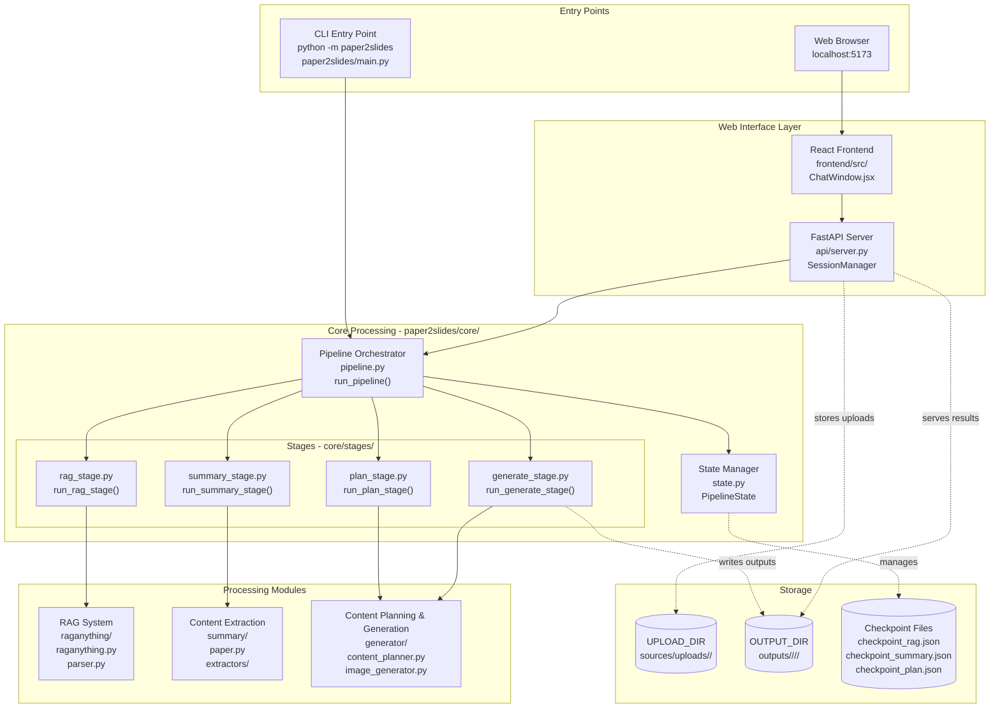
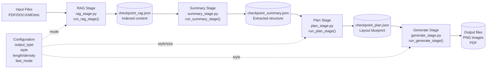
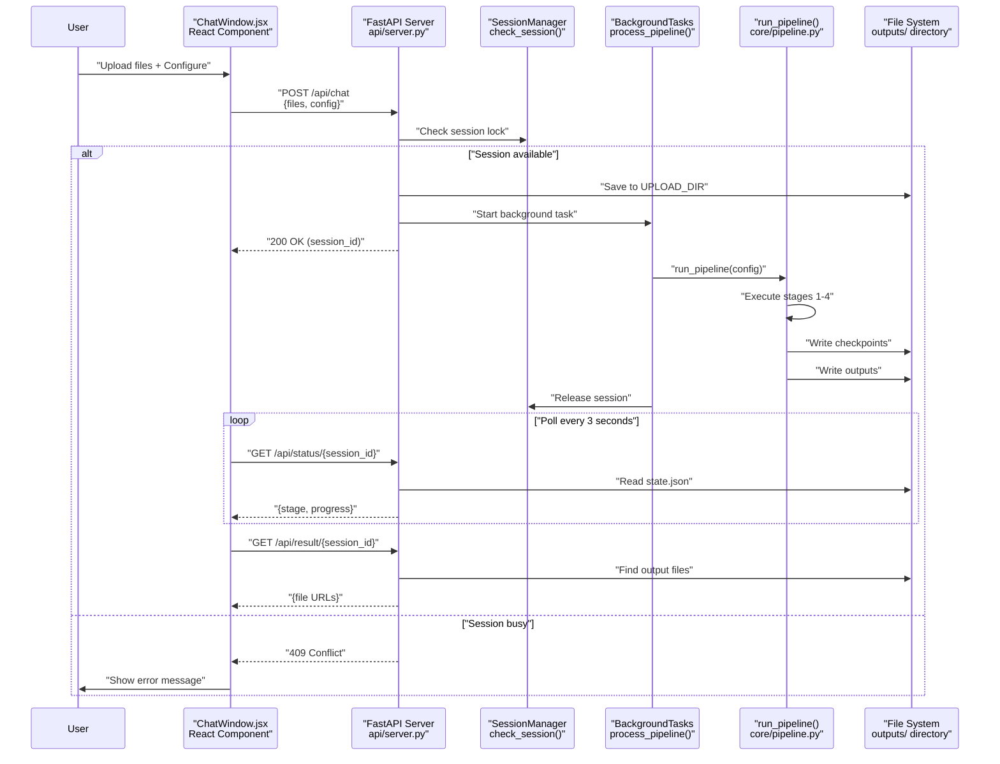

<!-- source: DeepWiki mcp.deepwiki.com · repo HKUDS/Paper2Slides · page 1 Overview · fetched 2026-11-09 -->

# Overview

<details>
<summary>Relevant source files</summary>

The following files were used as context for generating this wiki page:

- [README.md](README.md)

</details>


## Purpose and Scope

This document provides a high-level introduction to the Paper2Slides system, its architecture, and how its major components interact. It is intended for developers and technical users who want to understand how the system works before diving into specific subsystems.

For step-by-step setup and usage instructions, see [Getting Started](#1.1). For definitions of key terms used throughout the system, see [Key Concepts and Terminology](#1.2). For detailed documentation of the 4-stage processing pipeline, see [Core Pipeline Architecture](#2).

**Sources:** [README.md:1-100]()

---

## What is Paper2Slides

Paper2Slides is a document-to-presentation conversion system that transforms research papers, reports, and other documents into professional slides or posters. The system processes input files through a multi-stage pipeline that:

1. Parses and indexes document content using RAG (Retrieval Augmented Generation)
2. Extracts structured content including figures, tables, and hierarchies
3. Plans optimal layout and organization for the target output format
4. Generates final presentation materials as high-quality images and PDFs

The system supports multiple input formats (PDF, Word, Excel, PowerPoint, Markdown) and provides two user interfaces: a command-line interface for automation and scripting, and a web-based interface for interactive use.

**Sources:** [README.md:20-50]()

---

## System Architecture

The Paper2Slides system consists of three major layers: user interfaces, processing pipeline, and storage management. The architecture emphasizes resumability through checkpoints and efficient regeneration through intelligent caching.

### High-Level Component Structure



The system offers two entry points that converge on the same core pipeline. The CLI provides direct access via [paper2slides/main.py](), while the web interface adds a React frontend and FastAPI backend layer for session management and real-time progress tracking. Both paths execute the same 4-stage pipeline defined in [paper2slides/core/pipeline.py]().

**Sources:** [README.md:94-330](), [paper2slides/core/pipeline.py](), [api/server.py]()

---

## Core Processing Pipeline

The system implements a 4-stage pipeline where each stage produces checkpoints that enable resumption and selective regeneration:

| Stage | Module | Checkpoint | Purpose |
|-------|--------|------------|---------|
| **RAG** | `core/stages/rag_stage.py` | `checkpoint_rag.json` | Parse documents and build searchable index |
| **Analysis** | `core/stages/summary_stage.py` | `checkpoint_summary.json` | Extract structure, figures, tables |
| **Planning** | `core/stages/plan_stage.py` | `checkpoint_plan.json` | Generate layout blueprint |
| **Creation** | `core/stages/generate_stage.py` | Output directory | Render images and PDFs |

Each stage reads from the previous stage's checkpoint and writes its own checkpoint, creating a chain of resumable operations. The `PipelineState` class in [paper2slides/core/state.py]() manages checkpoint lifecycle and determines which stage to start from based on existing outputs.

### Stage Dependencies



The configuration parameters influence different stages: `fast_mode` affects RAG processing, `output_type` affects planning, and `style` parameters affect both planning and generation. Checkpoints at the mode level (`checkpoint_rag.json`, `checkpoint_summary.json`) can be reused across different style configurations, while `checkpoint_plan.json` is specific to a particular style/length/density combination.

**Sources:** [README.md:198-229](), [paper2slides/core/pipeline.py](), [paper2slides/core/state.py]()

---

## Entry Points and Interfaces

### Command-Line Interface

The CLI is the primary interface for automation and batch processing. It is invoked via Python's module execution:

```bash
python -m paper2slides --input paper.pdf --output slides --style doraemon --length medium
```

The entry point is [paper2slides/main.py](), which parses arguments and invokes `run_pipeline()` from [paper2slides/core/pipeline.py](). The CLI supports all configuration parameters and provides direct access to stage control via `--from-stage`.

For complete CLI documentation, see [Command-Line Interface](#3).

### Web Interface

The web interface consists of two services:

1. **Frontend**: React application served by Vite at `localhost:5173`. Main component is `ChatWindow` in [frontend/src/components/ChatWindow.jsx]()
2. **Backend**: FastAPI server in [api/server.py]() that manages sessions and executes the pipeline in background tasks

The web interface enables interactive configuration, real-time progress monitoring via polling, and visual result display. The backend enforces single-threaded execution through the `SessionManager` class to prevent concurrent pipeline runs.

For web interface details, see [Web Interface](#4).

**Sources:** [README.md:103-195](), [paper2slides/main.py](), [api/server.py]()

---

## Data Flow and Execution

### Web Interface Request Lifecycle



The web interface uses non-blocking asynchronous processing. The backend returns immediately with a `session_id`, allowing the frontend to poll `/api/status/{session_id}` for progress updates while the pipeline executes in the background. This architecture prevents HTTP timeout issues for long-running generations.

**Sources:** [api/server.py](), [frontend/src/components/ChatWindow.jsx]()

---

## Storage Organization

The system uses a hierarchical storage structure that enables intelligent caching and selective regeneration:

```
outputs/
├── <project_name>/              # Derived from PDF title or session_id
│   ├── <content_type>/          # "paper" or "general"
│   │   ├── <mode>/              # "fast" or "normal"
│   │   │   ├── checkpoint_rag.json
│   │   │   ├── checkpoint_summary.json
│   │   │   ├── summary.md
│   │   │   ├── <config_hash>/   # e.g., "slides_doraemon_medium"
│   │   │   │   ├── state.json
│   │   │   │   ├── checkpoint_plan.json
│   │   │   │   └── <timestamp>/
│   │   │   │       ├── slide_01.png
│   │   │   │       ├── slide_02.png
│   │   │   │       └── slides.pdf
│   │   │   └── rag_output/      # RAG index files
│   │   └── ...
```

### Checkpoint Reusability

| Checkpoint | Location | Reusable When |
|------------|----------|---------------|
| `checkpoint_rag.json` | `<mode>/` level | Same input files, same mode |
| `checkpoint_summary.json` | `<mode>/` level | Same input files, same mode |
| `checkpoint_plan.json` | `<config_hash>/` level | Same style + length/density |
| `state.json` | `<config_hash>/` level | Current pipeline execution state |

This structure allows regeneration with different styles without re-parsing documents. Changing from `style=doraemon` to `style=academic` reuses RAG and summary checkpoints but regenerates from the planning stage.

**Sources:** [README.md:231-263]()

---

## Key Design Principles

### 1. Resumability Through Checkpoints

Every pipeline stage writes structured checkpoint files. The `detect_start_stage()` function in [paper2slides/core/state.py]() examines existing checkpoints to determine the optimal starting point, enabling automatic recovery from interruptions and efficient regeneration when only downstream parameters change.

### 2. Single-Threaded Execution

The system enforces one active pipeline execution at a time through `SessionManager` in the web interface. This prevents resource conflicts and ensures consistent checkpoint state. The CLI naturally provides single-threaded execution per invocation.

### 3. Configuration-Driven Processing

All pipeline behavior is controlled by configuration parameters passed through `run_pipeline()`. The same core pipeline code handles both slides and posters, both normal and fast modes, through conditional logic based on configuration.

### 4. Separation of Concerns

- **Interfaces** (`main.py`, `api/server.py`) handle user interaction and input validation
- **Pipeline** (`core/pipeline.py`) orchestrates stage execution and checkpoint management
- **Stages** (`core/stages/`) implement specific processing logic
- **Modules** (`raganything/`, `summary/`, `generator/`) provide domain-specific functionality

This separation enables independent testing and modification of each layer.

**Sources:** [README.md:152-229](), [paper2slides/core/pipeline.py](), [paper2slides/core/state.py](), [api/server.py]()

---

## Summary

Paper2Slides transforms documents into presentations through a 4-stage pipeline (RAG → Analysis → Planning → Creation) accessible via CLI or web interface. The architecture prioritizes:

- **Reliability** through checkpoint-based recovery
- **Efficiency** through intelligent caching and stage skipping
- **Flexibility** through configuration-driven processing
- **Usability** through dual interfaces (CLI for automation, web for interaction)

The system's hierarchical storage structure and checkpoint strategy enable sophisticated workflows like regenerating with different styles without re-parsing, or resuming long-running generations after interruption.

For next steps:
- [Getting Started](#1.1) for installation and first use
- [Core Pipeline Architecture](#2) for detailed pipeline documentation
- [Command-Line Interface](#3) or [Web Interface](#4) for interface-specific details
- [Configuration Guide](#5) for all available parameters

**Sources:** [README.md:1-348]()

---

