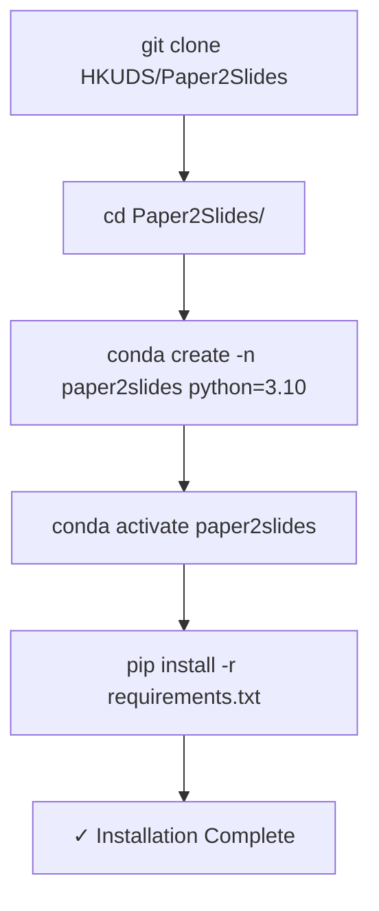
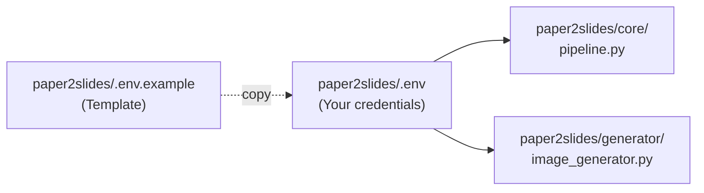
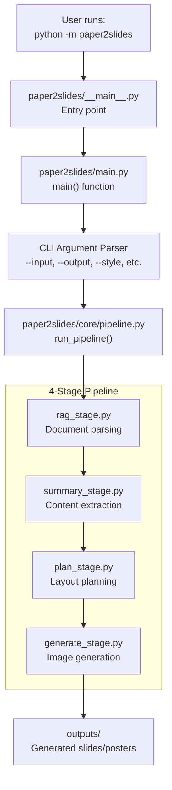
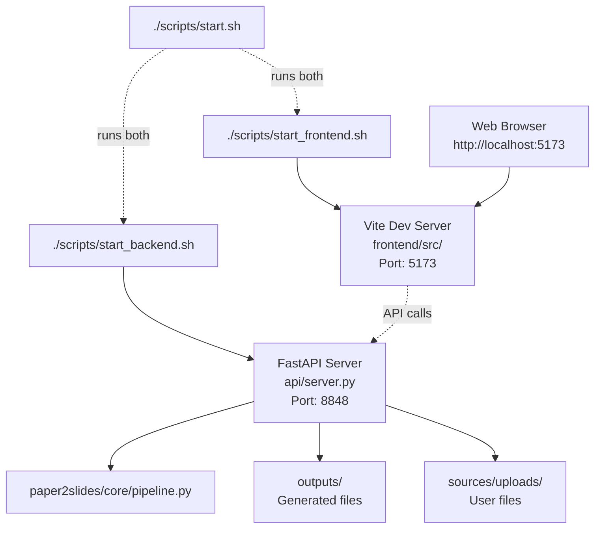
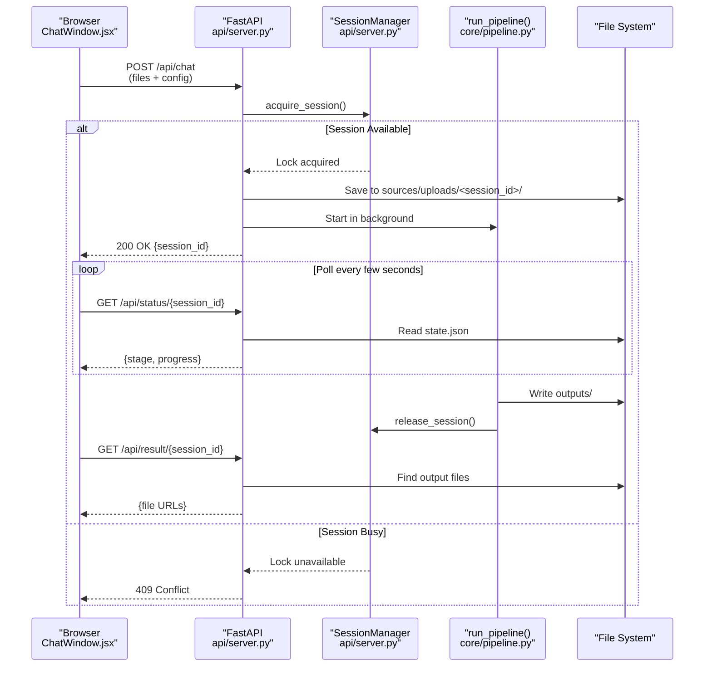

<!-- source: DeepWiki mcp.deepwiki.com · repo HKUDS/Paper2Slides · page 1.1 Getting Started · fetched 2026-11-09 -->

# Getting Started

<details>
<summary>Relevant source files</summary>

The following files were used as context for generating this wiki page:

- [README.md](README.md)

</details>


This page guides you through installing Paper2Slides, configuring API credentials, and running your first document-to-presentation conversion using either the command-line interface or web interface.

**Scope**: This page covers initial setup only. For detailed configuration options, see [Configuration Guide](#5). For comprehensive CLI usage, see [CLI Options Reference](#3.1). For understanding core concepts like RAG, checkpoints, and processing modes, see [Key Concepts and Terminology](#1.2).

---

## Prerequisites

Before installing Paper2Slides, ensure you have:

| Requirement | Version | Purpose |
|------------|---------|---------|
| Python | 3.10+ | Core runtime |
| Conda | Any recent version | Environment management |
| Git | Any recent version | Repository cloning |
| Google Gemini API Key | - | Image generation via `gemini-3-pro-image-preview` |

**Sources**: [README.md:106-118]()

---

## Installation

### Step 1: Clone and Setup Environment

```bash
# Clone the repository
git clone https://github.com/HKUDS/Paper2Slides.git
cd Paper2Slides

# Create isolated conda environment
conda create -n paper2slides python=3.10 -y
conda activate paper2slides

# Install Python dependencies
pip install -r requirements.txt
```



**Installation Flow**: The process creates an isolated conda environment named `paper2slides` and installs all dependencies specified in `requirements.txt`.

**Sources**: [README.md:106-118]()

---

## Configuration: API Keys Setup

Paper2Slides requires API credentials for LLM operations and image generation. These must be configured in a `.env` file before first use.

### Step 2: Create `.env` File

```bash
# Navigate to the paper2slides package directory
cd paper2slides/

# Copy the example environment file
cp .env.example .env

# Edit .env with your API keys
# Use your preferred text editor (nano, vim, code, etc.)
nano .env
```



**Environment File Location**: The `.env` file must be placed in the `paper2slides/` subdirectory (the package directory), not the repository root. This is where the Python package code expects to load it.

### Required API Keys

The `.env.example` template specifies which API keys are required. At minimum, you need:

- **Google Gemini API Key**: Used by [paper2slides/generator/image_generator.py]() for rendering slides/posters via `gemini-3-pro-image-preview` model

**Sources**: [README.md:120-121]()

---

## First Conversion: Command Line

Once installation and configuration are complete, you can run your first conversion using the CLI.

### Step 3: Basic CLI Conversion

```bash
# Ensure you're in the repository root and environment is activated
conda activate paper2slides

# Basic example: Generate slides from a PDF
python -m paper2slides --input paper.pdf --output slides --length medium

# Generate a poster instead
python -m paper2slides --input paper.pdf --output poster --density medium

# Fast mode (skip RAG indexing for quick preview)
python -m paper2slides --input paper.pdf --output slides --fast
```



**CLI Entry Point**: Running `python -m paper2slides` invokes [paper2slides/__main__.py]() which calls [paper2slides/main.py:main()]() to parse arguments and execute [paper2slides/core/pipeline.py:run_pipeline()]().

### Understanding the Output

After execution completes, your generated files will be in the `outputs/` directory:

```
outputs/
└── <project_name>/          # Derived from input filename
    └── paper/               # content_type
        └── normal/          # mode (or "fast")
            ├── checkpoint_rag.json
            ├── checkpoint_summary.json
            └── slides_doraemon_medium/    # <output>_<style>_<length>
                ├── state.json
                ├── checkpoint_plan.json
                └── <timestamp>/
                    ├── slide_01.png
                    ├── slide_02.png
                    ├── ...
                    └── slides.pdf      # Final output
```

**Sources**: [README.md:123-165](), [README.md:234-254]()

---

## First Conversion: Web Interface

The web interface provides an interactive way to upload documents, configure options, and monitor generation progress in real-time.

### Step 4: Launch Web Services

Paper2Slides' web interface requires both a backend API server and a frontend development server.

**Option A: Launch Both Services Together**
```bash
# From repository root
./scripts/start.sh
```

**Option B: Launch Services Separately**
```bash
# Terminal 1: Start FastAPI backend
./scripts/start_backend.sh

# Terminal 2: Start React/Vite frontend
./scripts/start_frontend.sh
```



**Service Architecture**: [scripts/start_backend.sh]() launches [api/server.py]() which listens on port 8848. [scripts/start_frontend.sh]() launches the Vite development server on port 5173, which serves the React application from `frontend/src/`.

### Step 5: Access Web Interface

1. Open your browser to `http://localhost:5173`
2. Upload one or more document files (PDF, Word, Markdown, etc.)
3. Configure generation options:
   - **Output Type**: Slides or Poster
   - **Style**: Academic, Doraemon, or custom description
   - **Length/Density**: Short/Medium/Long for slides, Sparse/Medium/Dense for posters
   - **Mode**: Normal (with RAG) or Fast (skip RAG)
4. Click "Generate" and monitor real-time progress
5. Download generated slides/poster when complete



**Web Request Flow**: The frontend [frontend/src/components/ChatWindow.jsx]() sends file uploads to [api/server.py:/api/chat]() endpoint. The backend uses `SessionManager` to enforce single-threaded execution, stores files in `sources/uploads/<session_id>/`, and runs [paper2slides/core/pipeline.py:run_pipeline()]() in a background task. The frontend polls [api/server.py:/api/status]() for progress updates.

**Sources**: [README.md:167-194]()

---

## Verifying Your Setup

After completing your first conversion, verify that Paper2Slides is working correctly:

### Verification Checklist

| Check | Expected Result | How to Verify |
|-------|-----------------|---------------|
| **CLI runs without errors** | Exit code 0, no exceptions | `echo $?` after CLI command |
| **Output directory created** | `outputs/<project_name>/` exists | `ls outputs/` |
| **Checkpoint files present** | `checkpoint_rag.json`, `checkpoint_summary.json`, `checkpoint_plan.json` exist | Check output directory |
| **Final outputs generated** | PNG files and PDF in `<timestamp>/` directory | Check final output directory |
| **Web services accessible** | Backend on port 8848, frontend on port 5173 | `curl http://localhost:8848/health` and open browser to `http://localhost:5173` |

### Quick Test Commands

```bash
# Test CLI with fast mode (quickest verification)
python -m paper2slides --input sample.pdf --output slides --fast

# List all generated outputs
python -m paper2slides --list

# Verify web backend is running (if web interface launched)
curl http://localhost:8848/health
```

**Sources**: [README.md:123-137]()

---

## Common First-Run Issues

| Issue | Cause | Solution |
|-------|-------|----------|
| `ModuleNotFoundError` | Conda environment not activated | Run `conda activate paper2slides` |
| `API key not found` error | `.env` file missing or in wrong location | Ensure `.env` is in `paper2slides/` directory, not repository root |
| `Permission denied` on scripts | Shell scripts not executable | Run `chmod +x scripts/*.sh` |
| Web interface won't start | Port already in use | Stop other services on ports 5173/8848, or modify port in scripts |
| `No such file or directory` for input | Incorrect file path | Use absolute path or verify relative path from repository root |

**Sources**: [README.md:106-121]()

---

## Next Steps

Now that you have Paper2Slides installed and verified, explore these topics:

- **[Key Concepts and Terminology](#1.2)**: Understand RAG, checkpoints, sessions, and processing modes
- **[CLI Options Reference](#3.1)**: Learn about all available CLI flags and options
- **[Configuration Guide](#5)**: Deep dive into output types, styles, and optimization parameters
- **[Smart Recovery System](#2.5)**: Learn how to resume interrupted conversions and regenerate with different settings
- **[Web Interface](#4)**: Detailed guide to using the web UI effectively

For developers wanting to customize or extend Paper2Slides:
- **[Development Guide](#7)**: Setup development environment and understand codebase structure

**Sources**: [README.md:94-100]()

---

