<!-- source: DeepWiki mcp.deepwiki.com · repo HKUDS/Paper2Slides · page 2 Core Pipeline Architecture · fetched 2026-11-09 -->

# Core Pipeline Architecture

<details>
<summary>Relevant source files</summary>

The following files were used as context for generating this wiki page:

- [README.md](README.md)
- [api/server.py](api/server.py)

</details>


## Purpose and Scope

This document describes the core 4-stage processing pipeline that transforms input documents into presentation materials. It covers the pipeline orchestration, stage sequencing, checkpoint mechanisms, and configuration flow. For detailed information about individual stages, see:
- Stage 1 (RAG): [Stage 1: RAG](#2.1)
- Stage 2 (Analysis): [Stage 2: Analysis and Content Extraction](#2.2)
- Stage 3 (Planning): [Stage 3: Planning and Layout](#2.3)
- Stage 4 (Creation): [Stage 4: Creation and Rendering](#2.4)
- Smart Recovery System: [Smart Recovery System](#2.5)

For user-facing configuration options, see [Configuration Guide](#5).

## Pipeline Overview

The Paper2Slides system processes documents through a linear 4-stage pipeline. Each stage produces checkpoint files that enable resumption and selective regeneration. The pipeline is orchestrated by the `run_pipeline` function in [paper2slides/core/pipeline.py]().

### Four Processing Stages

```mermaid
graph LR
    Input["Input Documents<br/>(PDF, MD, DOC, PPT)"]
    
    S1["Stage 1: rag<br/>RAG Indexing"]
    CP1[("checkpoint_rag.json")]
    
    S2["Stage 2: summary<br/>Content Extraction"]
    CP2[("checkpoint_summary.json")]
    
    S3["Stage 3: plan<br/>Layout Planning"]
    CP3[("checkpoint_plan.json")]
    
    S4["Stage 4: generate<br/>Image Generation"]
    Output["Output Files<br/>(PNG slides + PDF)"]
    
    Input --> S1
    S1 --> CP1
    CP1 --> S2
    S2 --> CP2
    CP2 --> S3
    S3 --> CP3
    CP3 --> S4
    S4 --> Output
```

**Stage Sequence**:
| Stage Number | Stage Name | Module | Primary Function | Checkpoint File |
|--------------|-----------|---------|------------------|-----------------|
| 1 | `rag` | `paper2slides.core.stages.rag_stage` | Document parsing and RAG indexing | `checkpoint_rag.json` |
| 2 | `summary` | `paper2slides.core.stages.summary_stage` | Extract structure, figures, tables | `checkpoint_summary.json` |
| 3 | `plan` | `paper2slides.core.stages.plan_stage` | Generate content layout blueprint | `checkpoint_plan.json` |
| 4 | `generate` | `paper2slides.core.stages.generate_stage` | Render final images and PDF | Output directory |

**Sources**: [README.md:202-207](), [paper2slides/core/pipeline.py]()

## Pipeline Orchestration

### Core Entry Points

The pipeline can be invoked through two interfaces that both converge on the same core execution logic:

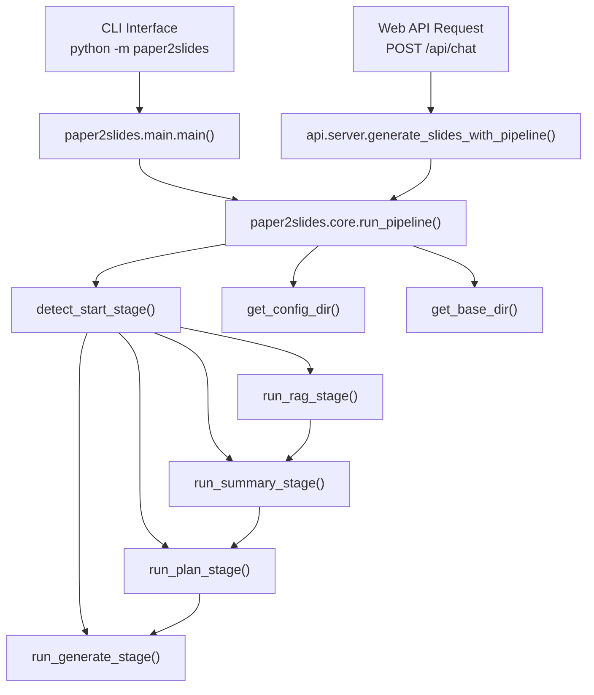

**Sources**: [api/server.py:294-430](), [paper2slides/main.py](), [paper2slides/core/pipeline.py]()

### Configuration Resolution

Before pipeline execution, the system resolves directory paths and determines which stage to start from:

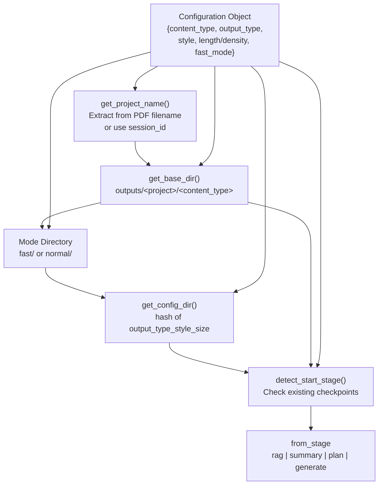

The `detect_start_stage` function implements the smart recovery logic by checking for existing checkpoint files and determining the earliest stage that needs execution:

**Logic Flow**:
1. Check if `checkpoint_plan.json` exists and is valid → start from `generate`
2. Check if `checkpoint_summary.json` exists and is valid → start from `plan`
3. Check if `checkpoint_rag.json` exists and is valid → start from `summary`
4. Otherwise → start from `rag`

**Sources**: [paper2slides/core/pipeline.py](), [api/server.py:388-404]()

## Stage Execution Flow

### Sequential Processing

Each stage follows a common execution pattern:

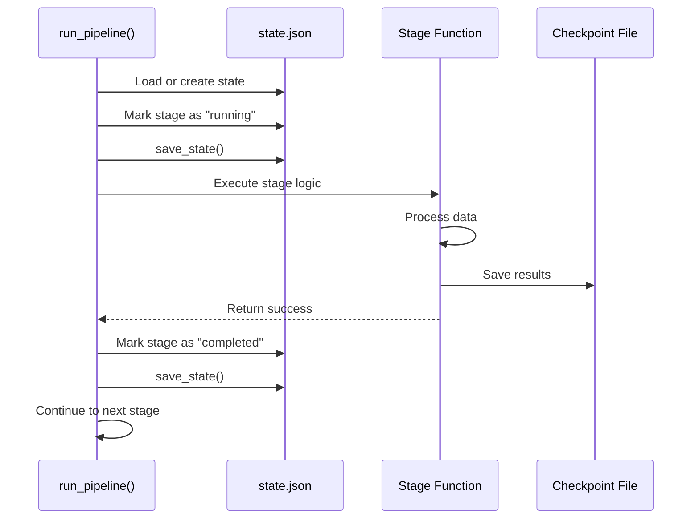

**State Tracking**: The `state.json` file maintains the current execution state. Each stage updates this file at the start and end of its execution:

```json
{
  "session_id": "uuid-string",
  "config": { /* configuration parameters */ },
  "stages": {
    "rag": "completed",
    "summary": "completed",
    "plan": "running",
    "generate": "pending"
  },
  "created_at": "2024-01-15T10:30:00",
  "updated_at": "2024-01-15T10:35:00"
}
```

**Sources**: [paper2slides/core/state.py](), [api/server.py:392-404]()

### Stage Interdependencies

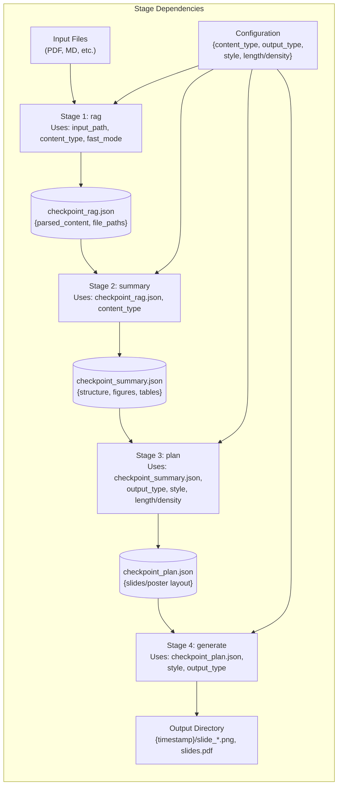

**Key Observations**:
- Stage 1 and 2 depend on `input_path` and `content_type` but not on `style` or `length`/`density`
- Stage 3 is the first stage influenced by `output_type`, `style`, and size parameters
- Stage 4 only depends on the plan checkpoint and style configuration

This dependency structure enables efficient regeneration: changing style only requires re-running stages 3-4, while the RAG and analysis results can be reused.

**Sources**: [README.md:202-228](), [paper2slides/core/pipeline.py]()

## Directory Structure and Checkpoints

### Hierarchical Output Organization

The output directory structure encodes processing context to enable checkpoint reuse:

```
outputs/
└── <project_name>/              # From PDF filename or session_id
    └── <content_type>/          # "paper" or "general"
        └── <mode>/              # "fast" or "normal"
            ├── checkpoint_rag.json        # Stage 1 output
            ├── checkpoint_summary.json    # Stage 2 output
            ├── summary.md                 # Human-readable summary
            ├── rag_output/                # RAG index files
            └── <config_hash>/             # e.g., "slides_doraemon_medium"
                ├── state.json             # Pipeline state tracker
                ├── checkpoint_plan.json   # Stage 3 output
                └── <timestamp>/           # e.g., "20240115_103045"
                    ├── slide_01.png
                    ├── slide_02.png
                    └── slides.pdf
```

### Checkpoint Reusability

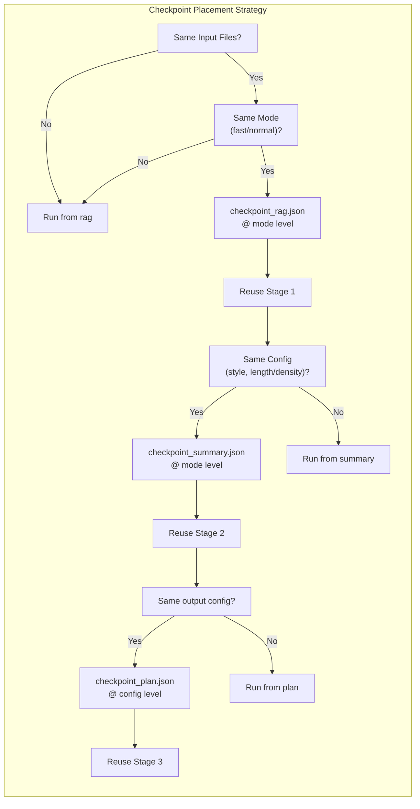

**Checkpoint Scope**:

| Checkpoint File | Location | Reusable When | Contains |
|-----------------|----------|---------------|----------|
| `checkpoint_rag.json` | `<mode>/` | Same input files + same mode | Parsed document content, file paths |
| `checkpoint_summary.json` | `<mode>/` | Same input files + same mode | Extracted figures, tables, structure |
| `checkpoint_plan.json` | `<config_hash>/` | Same config (style + length/density) | Content layout and slide/poster plan |
| `state.json` | `<config_hash>/` | Current generation | Stage statuses, timestamps |

**Sources**: [README.md:234-254](), [api/server.py:374-376]()

## Configuration Flow Through Pipeline

### Parameter Influence by Stage

Different configuration parameters affect different stages of the pipeline:

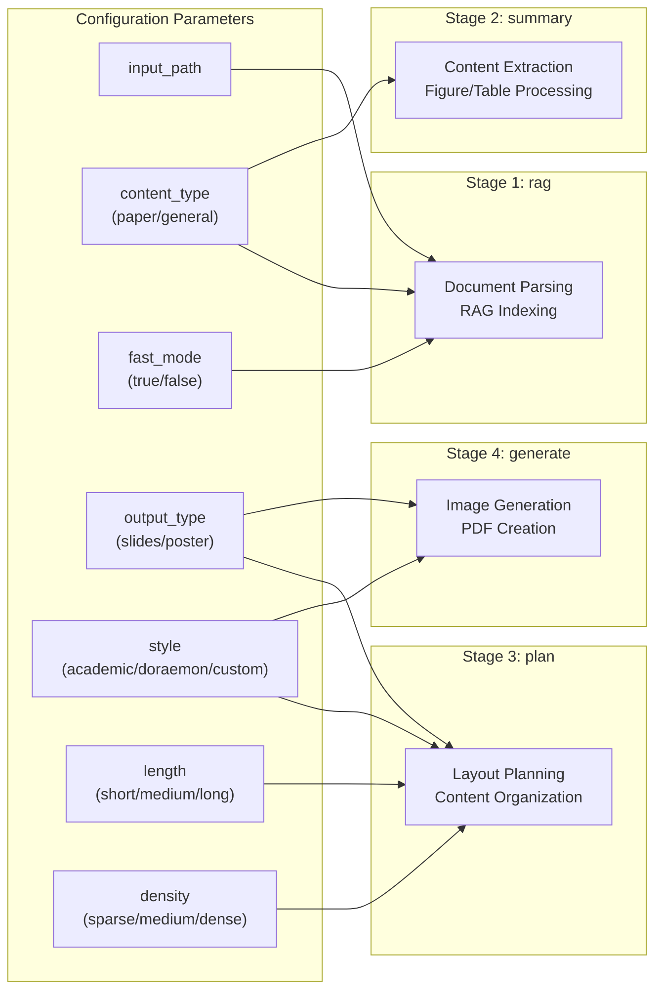

### Fast Mode vs Normal Mode

The `fast_mode` parameter creates a processing bifurcation at Stage 1:

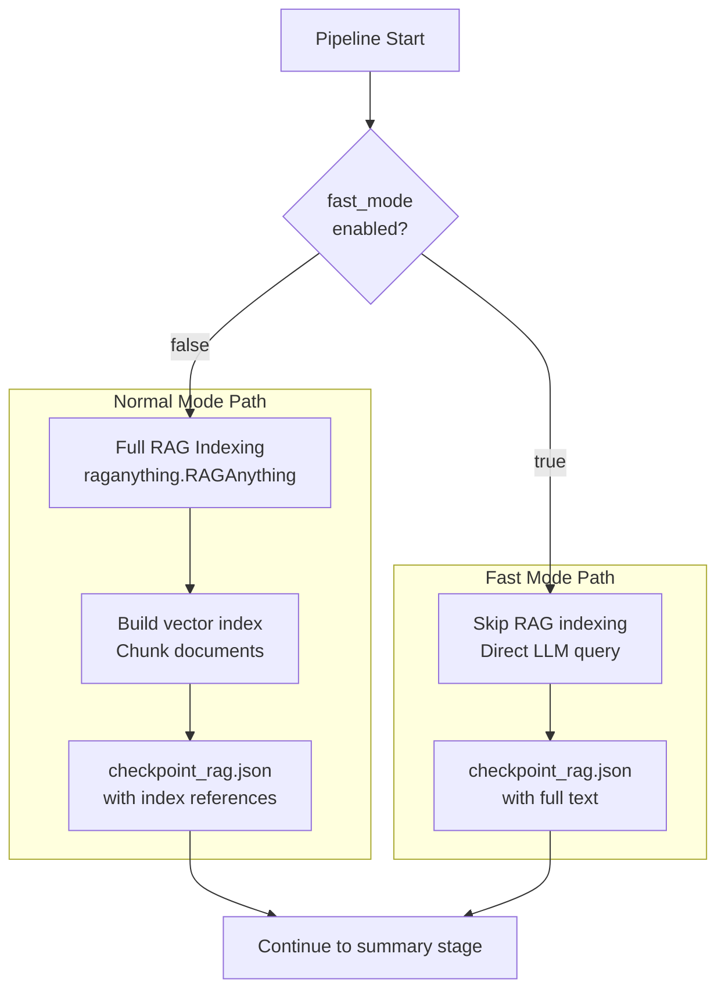

**Use Cases**:
- **Normal Mode** (`fast_mode=false`): Default. Performs full RAG indexing. Suitable for long documents, multiple files, or when precise retrieval is needed.
- **Fast Mode** (`fast_mode=true`): Skips RAG indexing and uses direct LLM queries. Suitable for short documents that fit in context window, quick previews, or rapid iteration.

**Sources**: [README.md:212-228](), [api/server.py:236-237]()

## Pipeline Invocation Patterns

### CLI Invocation

The command-line interface directly calls the pipeline:

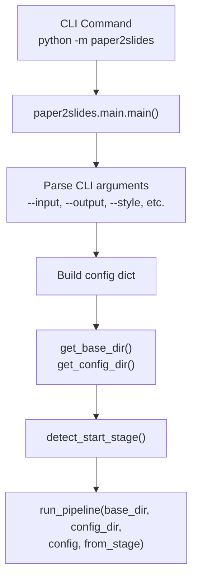

**Sources**: [paper2slides/main.py](), [README.md:123-166]()

### Web API Invocation

The web interface adds asynchronous processing and session management:

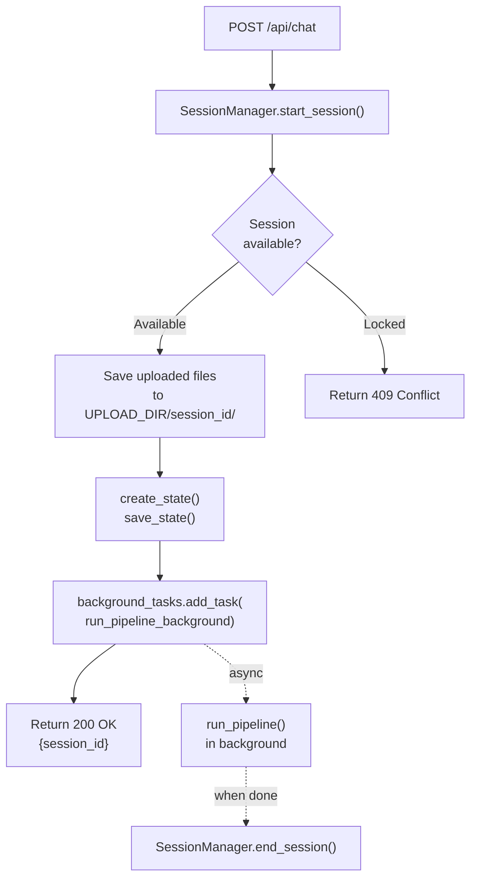

**Concurrency Control**: The `SessionManager` class enforces single-threaded execution. Only one session can run at a time. Concurrent requests receive HTTP 409 status.

**Sources**: [api/server.py:45-86](), [api/server.py:145-292](), [api/server.py:489-548]()

## Error Handling and State Persistence

### Error Propagation

When a stage fails, the pipeline updates the state file and stops execution:

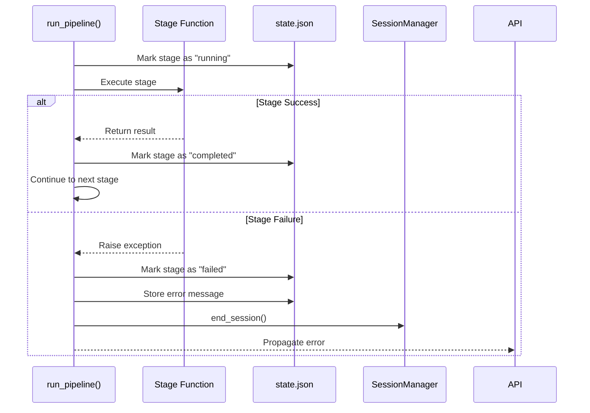

**State File on Error**:
```json
{
  "stages": {
    "rag": "completed",
    "summary": "completed",
    "plan": "failed",
    "generate": "pending"
  },
  "error": "Error message from stage",
  "updated_at": "2024-01-15T10:40:00"
}
```

**Sources**: [api/server.py:433-487](), [api/server.py:532-543]()

### Cancellation Support

The web interface supports session cancellation through the `SessionManager`:

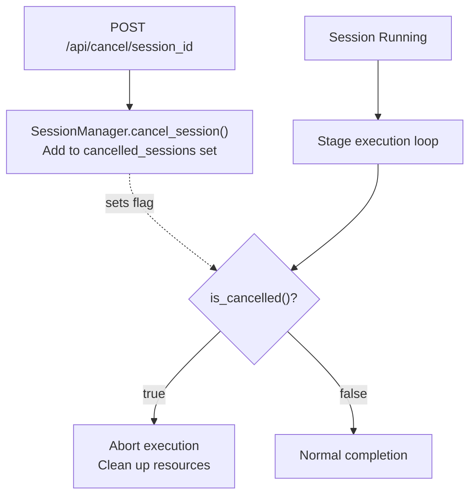

**Sources**: [api/server.py:68-79](), [api/server.py:131-143]()

## Summary

The Paper2Slides pipeline architecture provides:

1. **Linear 4-stage processing**: RAG → Analysis → Planning → Creation
2. **Checkpoint-based state**: Each stage saves recoverable checkpoints
3. **Smart resumption**: Auto-detection of completed stages enables selective regeneration
4. **Configuration-driven execution**: Parameters influence different stages appropriately
5. **Dual interfaces**: CLI for direct execution, Web API for asynchronous processing
6. **Session management**: Enforced single-threaded execution with cancellation support

The hierarchical directory structure and strategic checkpoint placement enable efficient regeneration when only style or output parameters change, while preserving computationally expensive RAG and analysis results.

**Sources**: [README.md:198-228](), [api/server.py:1-773](), [paper2slides/core/pipeline.py](), [paper2slides/core/state.py]()

---

