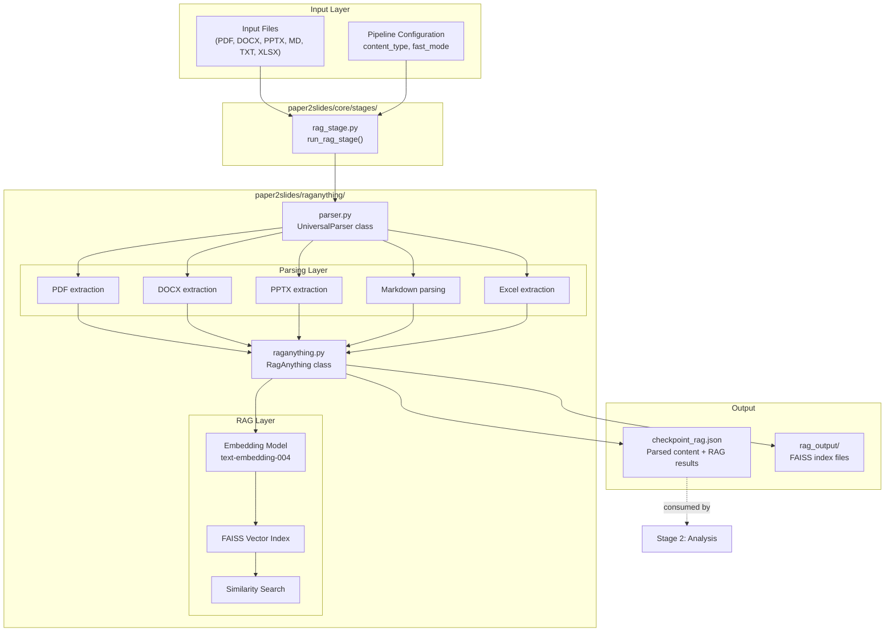
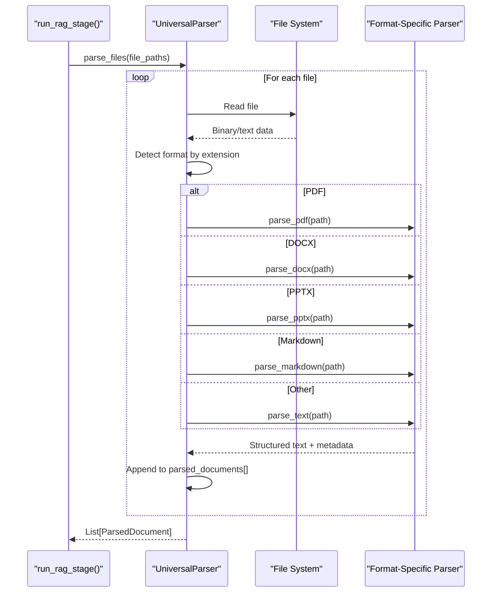
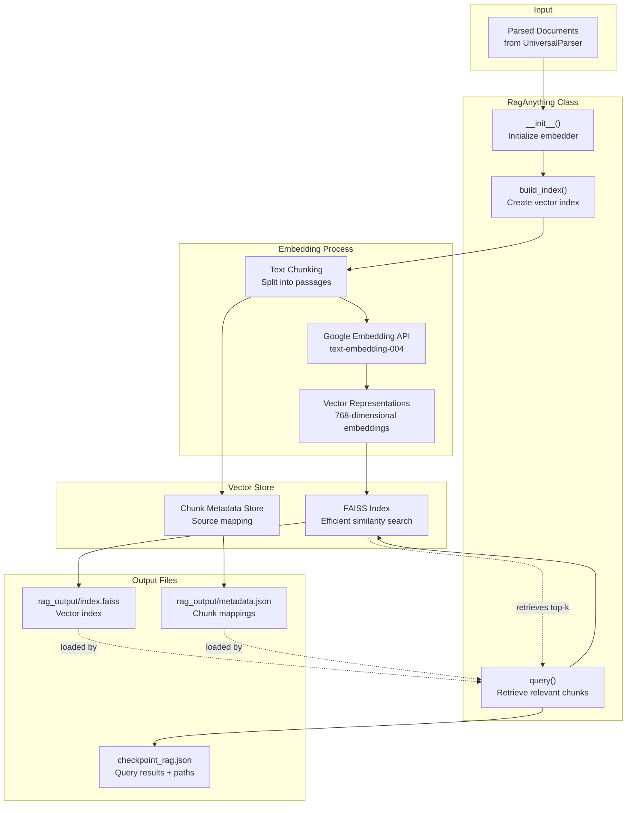
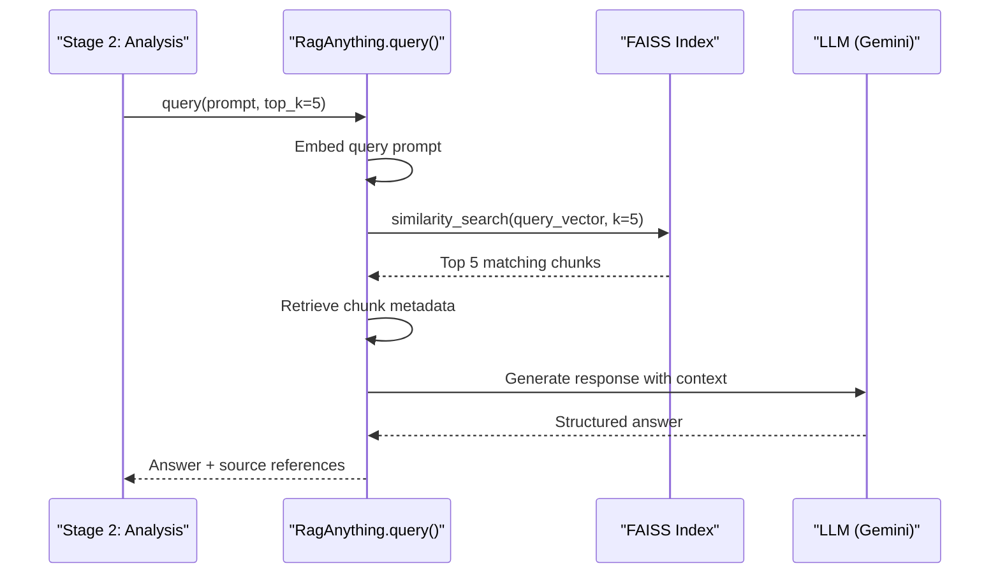
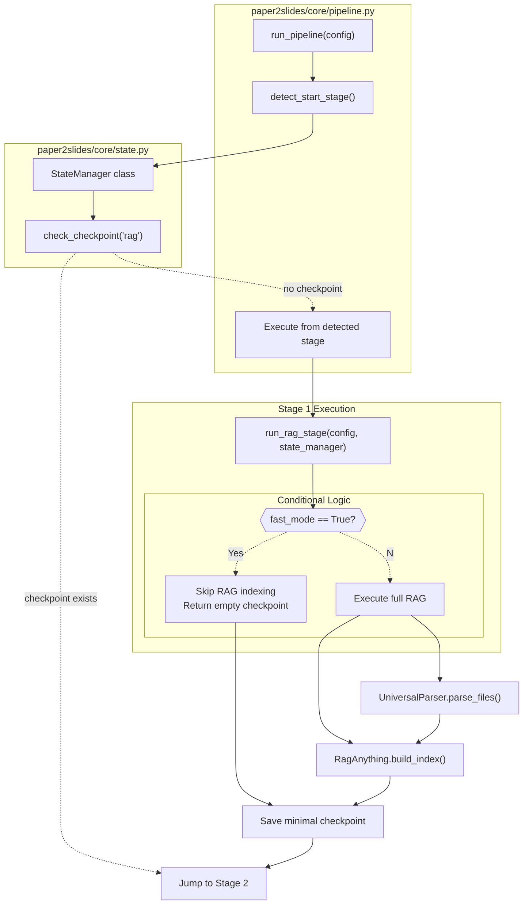
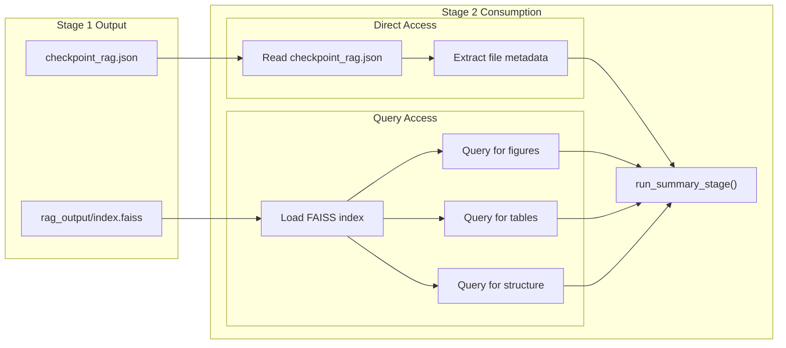

<!-- source: DeepWiki mcp.deepwiki.com · repo HKUDS/Paper2Slides · page 2.1 Stage 1: RAG (Retrieval Augmented Generation) · fetched 2026-11-09 -->

# Stage 1: RAG (Retrieval Augmented Generation)

<details>
<summary>Relevant source files</summary>

The following files were used as context for generating this wiki page:

- [README.md](README.md)

</details>


## Purpose and Scope

This page documents Stage 1 of the Paper2Slides pipeline, which parses input documents and constructs a searchable knowledge base using Retrieval Augmented Generation (RAG). This stage transforms raw document files (PDF, DOC, PPT, MD, etc.) into an indexed, queryable format that enables precise content extraction in later stages.

For information about:
- The complete pipeline architecture, see [Core Pipeline Architecture](#2)
- Stage 2 (content extraction), see [Stage 2: Analysis and Content Extraction](#2.2)
- Fast mode configuration and when to skip RAG, see [Processing Modes: Normal vs Fast](#5.3)
- Checkpoint file management, see [Checkpoint Files](#6.2)

**Sources:** [README.md:198-228]()

## Overview

Stage 1 serves as the document ingestion and indexing layer of the Paper2Slides system. It performs two primary functions:

1. **Document Parsing**: Converts various file formats into structured text with metadata
2. **RAG Indexing**: Constructs a vector-based retrieval index for intelligent content querying

The stage produces `checkpoint_rag.json`, which contains parsed content, file paths, and RAG query results. This checkpoint enables subsequent stages to retrieve relevant document sections without reprocessing the original files.

**When This Stage Runs:**
- **Normal Mode** (default): Full RAG indexing is performed
- **Fast Mode** (`--fast` flag): This stage is skipped entirely; Stage 2 queries the LLM directly

**Sources:** [README.md:202-228]()

---

## Architecture and Components

The RAG stage consists of two main subsystems: the document parser and the RAG processor, orchestrated by the pipeline's RAG stage handler.

### Component Diagram



**Sources:** [README.md:285-323](), [paper2slides/raganything/]()

---

## Document Parsing

The `UniversalParser` class in [paper2slides/raganything/parser.py]() handles multi-format document extraction. It identifies file types by extension and routes each file to the appropriate parser.

### Supported File Formats

| Format | Extensions | Parser Method | Extracted Content |
|--------|-----------|---------------|-------------------|
| PDF | `.pdf` | `parse_pdf()` | Text blocks, page numbers, layout |
| Word | `.docx`, `.doc` | `parse_docx()` | Paragraphs, headings, tables |
| PowerPoint | `.pptx`, `.ppt` | `parse_pptx()` | Slide text, notes, structure |
| Markdown | `.md` | `parse_markdown()` | Raw markdown content |
| Text | `.txt` | `parse_text()` | Raw text content |
| Excel | `.xlsx`, `.xls` | `parse_xlsx()` | Sheet data, cell values |

### Parsing Workflow



### Parsed Document Structure

Each parsed document is represented as a structured object containing:

```python
{
    "file_path": "path/to/document.pdf",
    "file_type": "pdf",
    "content": "Full extracted text content...",
    "metadata": {
        "page_count": 12,
        "title": "Document Title",
        "author": "Author Name",
        # Format-specific metadata
    },
    "chunks": [
        {
            "text": "Section content...",
            "page": 1,
            "chunk_id": 0
        },
        # Additional chunks...
    ]
}
```

The parser automatically chunks long documents to fit within embedding model token limits while preserving semantic boundaries.

**Sources:** [paper2slides/raganything/parser.py](), [README.md:26-27]()

---

## RAG Indexing

The `RagAnything` class in [paper2slides/raganything/raganything.py]() constructs a vector-based retrieval system using the parsed documents. This enables efficient similarity search during content extraction.

### RAG Processing Flow



### Embedding and Indexing

The RAG processor performs the following steps:

1. **Chunking**: Splits parsed documents into semantically coherent passages (typically 500-1000 tokens)
2. **Embedding**: Sends chunks to Google's `text-embedding-004` model to generate 768-dimensional vectors
3. **Indexing**: Stores vectors in a FAISS index for efficient similarity search
4. **Metadata Storage**: Maintains mapping between vector indices and source document chunks

### Query Mechanism

During Stage 2, the RAG index is queried with structured prompts to retrieve relevant document sections:



The `query()` method:
1. Embeds the query prompt using the same embedding model
2. Performs cosine similarity search in the FAISS index
3. Retrieves the top-k most relevant chunks
4. Augments the query with retrieved context
5. Sends to LLM for structured response generation
6. Returns answer with source chunk references

**Sources:** [paper2slides/raganything/raganything.py](), [README.md:28-29]()

---

## Checkpoint Format: checkpoint_rag.json

The RAG stage saves its output to `checkpoint_rag.json` in the mode-level directory (e.g., `outputs/<project>/paper/normal/checkpoint_rag.json`).

### Checkpoint Structure

```json
{
    "stage": "rag",
    "timestamp": "2024-01-15T10:30:00.000Z",
    "input_files": [
        "sources/uploads/session_abc123/paper.pdf"
    ],
    "parsed_files": [
        {
            "file_path": "sources/uploads/session_abc123/paper.pdf",
            "file_type": "pdf",
            "page_count": 15,
            "total_tokens": 12450,
            "chunk_count": 42
        }
    ],
    "rag_index_path": "outputs/project_name/paper/normal/rag_output/",
    "index_stats": {
        "total_chunks": 42,
        "embedding_dimension": 768,
        "index_type": "FAISS_FlatIP"
    },
    "query_results": {
        "document_structure": {
            "query": "Extract the main sections and their hierarchy",
            "top_chunks": [
                {
                    "chunk_id": 5,
                    "source_file": "paper.pdf",
                    "page": 2,
                    "text": "Section content...",
                    "similarity_score": 0.89
                }
            ],
            "answer": "Structured response from LLM..."
        },
        "key_contributions": {
            "query": "What are the main contributions?",
            "top_chunks": [...],
            "answer": "..."
        }
    }
}
```

### Checkpoint Fields

| Field | Type | Description |
|-------|------|-------------|
| `stage` | string | Always `"rag"` for this checkpoint |
| `timestamp` | string | ISO 8601 timestamp of completion |
| `input_files` | array | List of source file paths processed |
| `parsed_files` | array | Metadata for each parsed file |
| `rag_index_path` | string | Directory containing FAISS index files |
| `index_stats` | object | Vector index statistics |
| `query_results` | object | Pre-computed RAG queries for common questions |

### Checkpoint Reusability

`checkpoint_rag.json` can be reused when:
- ✅ Input files are identical (same file paths and content)
- ✅ Content type is the same (`paper` vs `general`)
- ❌ Style or length/density parameters change (checkpoint remains valid)

When the pipeline detects a valid `checkpoint_rag.json`, it skips Stage 1 entirely and proceeds directly to Stage 2, saving significant processing time.

**Sources:** [README.md:234-262](), [paper2slides/core/state.py]()

---

## Pipeline Integration

### Stage Execution Entry Point

The RAG stage is invoked through [paper2slides/core/stages/rag_stage.py]() via the `run_rag_stage()` function:



### Fast Mode vs Normal Mode

The RAG stage behavior changes based on the `fast_mode` configuration:

| Mode | RAG Behavior | Use Case | Processing Time |
|------|-------------|----------|-----------------|
| **Normal** | Full parsing + indexing | Long documents, multi-file inputs | ~30-60 seconds for typical paper |
| **Fast** | Skip RAG entirely | Short documents that fit in context | ~0 seconds (instant skip) |

### Configuration Parameters Affecting Stage 1

```python
# From pipeline configuration
{
    "content_type": "paper",      # Affects parsing strategy
    "fast_mode": False,            # Determines if RAG runs
    "input_files": [...]           # Files to process
}
```

**Sources:** [paper2slides/core/stages/rag_stage.py](), [paper2slides/core/pipeline.py](), [README.md:212-228]()

---

## Technical Implementation Details

### Key Classes and Functions

#### UniversalParser Class

Located in [paper2slides/raganything/parser.py]():

| Method | Purpose | Returns |
|--------|---------|---------|
| `parse_files(file_paths)` | Main entry point for parsing multiple files | `List[ParsedDocument]` |
| `parse_pdf(path)` | Extract text and structure from PDF | `ParsedDocument` |
| `parse_docx(path)` | Extract content from Word documents | `ParsedDocument` |
| `parse_pptx(path)` | Extract slides from PowerPoint | `ParsedDocument` |
| `parse_markdown(path)` | Parse Markdown files | `ParsedDocument` |
| `parse_xlsx(path)` | Extract data from Excel spreadsheets | `ParsedDocument` |

#### RagAnything Class

Located in [paper2slides/raganything/raganything.py]():

| Method | Purpose | Returns |
|--------|---------|---------|
| `__init__(embedding_model)` | Initialize with embedding configuration | `None` |
| `build_index(documents)` | Construct FAISS vector index | `None` |
| `query(prompt, top_k)` | Retrieve relevant chunks for query | `Dict[str, Any]` |
| `save_index(path)` | Persist FAISS index to disk | `None` |
| `load_index(path)` | Load existing FAISS index | `None` |

#### Stage Orchestration Function

Located in [paper2slides/core/stages/rag_stage.py]():

```python
def run_rag_stage(config: Dict, state_manager: StateManager) -> Dict:
    """
    Execute Stage 1: RAG indexing
    
    Args:
        config: Pipeline configuration with input_files, fast_mode, etc.
        state_manager: Manages checkpoint persistence
    
    Returns:
        Checkpoint dictionary with parsed files and RAG results
    """
    # Implementation details in source file
```

### Error Handling

The RAG stage implements robust error handling for common failure modes:

| Error Scenario | Handling Strategy |
|---------------|-------------------|
| Unsupported file format | Skip file with warning, continue with others |
| Corrupted/unreadable file | Log error, mark file as failed, continue |
| Embedding API failure | Retry with exponential backoff (3 attempts) |
| FAISS index build failure | Fall back to in-memory similarity search |
| Out of memory | Reduce chunk size, process in batches |

### Performance Characteristics

Typical processing times for a research paper:

| Document Size | Parsing Time | Embedding Time | Index Build Time | Total |
|--------------|-------------|----------------|------------------|-------|
| 10 pages | ~2 seconds | ~8 seconds | ~1 second | ~11s |
| 30 pages | ~5 seconds | ~20 seconds | ~3 seconds | ~28s |
| 100 pages | ~15 seconds | ~60 seconds | ~10 seconds | ~85s |

Memory usage scales linearly with document size, approximately 50MB per 100 pages.

**Sources:** [paper2slides/raganything/parser.py](), [paper2slides/raganything/raganything.py](), [paper2slides/core/stages/rag_stage.py]()

---

## Stage Output and Consumption

### Output Artifacts

Stage 1 produces the following files in the output directory:

```
outputs/<project_name>/<content_type>/<mode>/
├── checkpoint_rag.json          # Main checkpoint file
└── rag_output/                  # RAG index directory
    ├── index.faiss              # FAISS vector index
    ├── metadata.json            # Chunk source mappings
    └── config.json              # Indexing configuration
```

### Consumption by Stage 2

Stage 2 (Analysis) consumes the RAG stage output in two ways:

1. **Direct Checkpoint Reading**: Loads `checkpoint_rag.json` to access pre-computed query results and file metadata
2. **Active Querying**: Uses the RAG index to perform additional targeted queries for specific content extraction needs



**Sources:** [README.md:202-207](), [paper2slides/core/stages/summary_stage.py]()

---

## Summary

Stage 1 (RAG) serves as the foundational layer of the Paper2Slides pipeline:

- **Parses** multiple document formats into structured, chunked text
- **Indexes** content using FAISS-based vector search for efficient retrieval
- **Generates** reusable checkpoints that enable fast regeneration with different styles
- **Provides** a queryable knowledge base for precise content extraction in Stage 2

The stage is conditionally executed based on `fast_mode` configuration and can be skipped entirely for short documents, demonstrating the system's flexibility in balancing accuracy and speed.

**Sources:** [README.md:198-228](), [paper2slides/raganything/](), [paper2slides/core/stages/rag_stage.py]()

---

