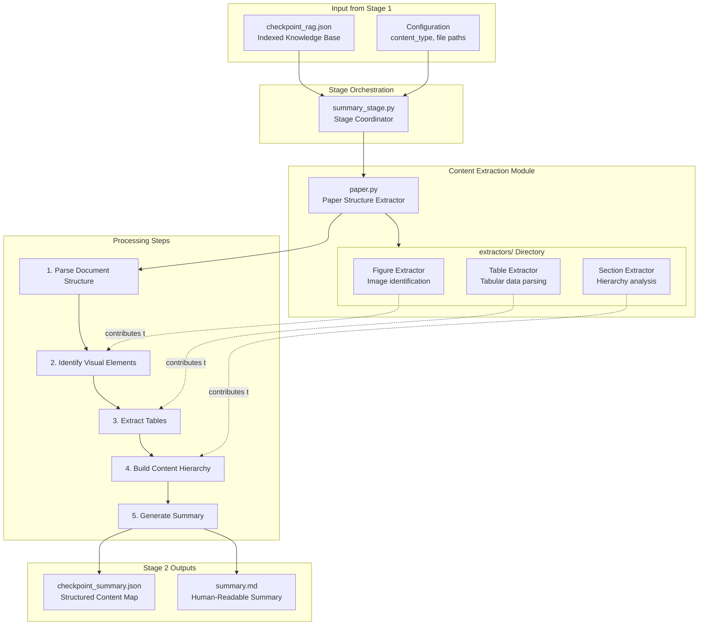
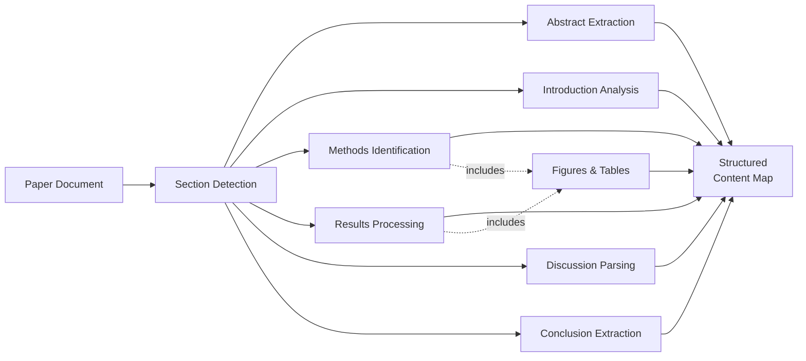
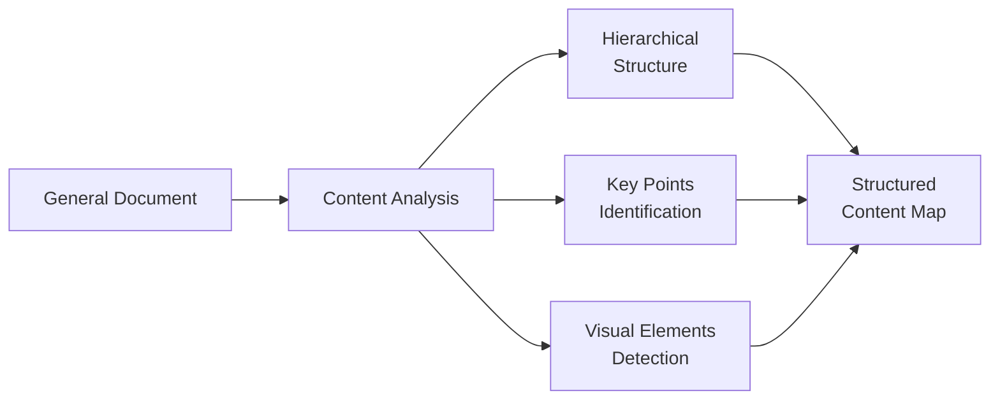
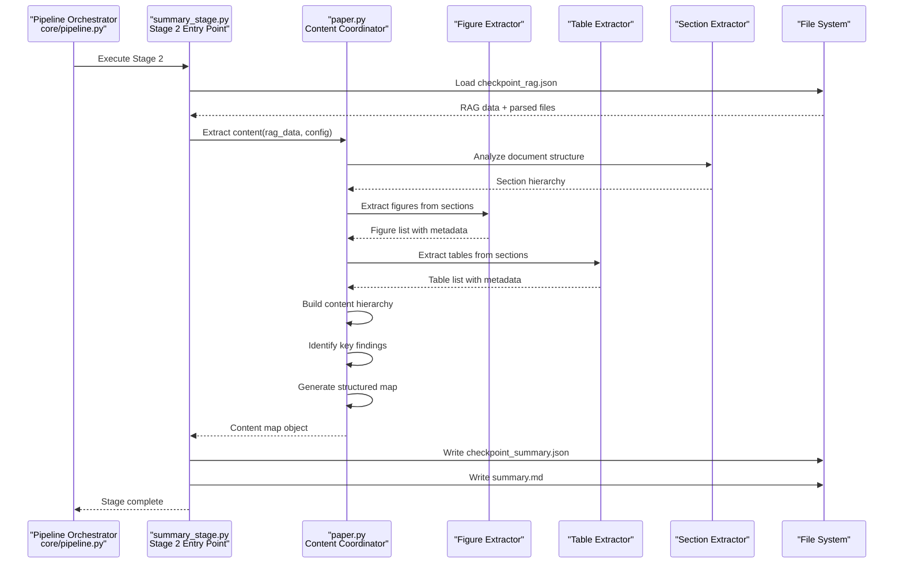

<!-- source: DeepWiki mcp.deepwiki.com · repo HKUDS/Paper2Slides · page 2.2 Stage 2: Analysis and Content Extraction · fetched 2026-11-09 -->

# Stage 2: Analysis and Content Extraction

<details>
<summary>Relevant source files</summary>

The following files were used as context for generating this wiki page:

- [README.md](README.md)

</details>


## Purpose and Scope

Stage 2 performs deep content analysis on documents that have been indexed by the RAG system in Stage 1. This stage extracts structured information including document hierarchy, sections, figures, tables, and key content elements. The output is a comprehensive content map that serves as the foundation for presentation planning.

For information about the RAG indexing that precedes this stage, see [Stage 1: RAG](#2.1). For details on how the extracted content is used to create presentation layouts, see [Stage 3: Planning and Layout](#2.3).

**Sources:** [README.md:198-208]()

---

## Stage Overview

Stage 2 transforms the searchable knowledge base created in Stage 1 into a structured content map optimized for presentation generation. The analysis process identifies:

- **Document Structure**: Section hierarchy, headings, and content organization
- **Visual Elements**: Figures, images, charts, and their captions
- **Tabular Data**: Tables with structure and content preservation
- **Key Content**: Important findings, methods, and results
- **Content Relationships**: Dependencies and logical flow between sections

The stage operates in two primary modes based on the `content_type` configuration:
- **Paper Mode** (`content_type=paper`): Optimized for academic papers with specialized extractors for abstract, methods, results, and conclusions
- **General Mode** (`content_type=general`): Flexible extraction for reports, documents, and general content

**Sources:** [README.md:203-207](), [README.md:285-291]()

---

## Input Requirements

### Primary Input: RAG Checkpoint

Stage 2 consumes the `checkpoint_rag.json` file produced by Stage 1, which contains:

| Field | Description |
|-------|-------------|
| **Parsed Files** | List of processed document paths |
| **RAG Query Results** | Indexed content segments with embeddings |
| **Document Metadata** | File types, page counts, structure hints |
| **Extraction State** | Information about successfully parsed content |

### Configuration Dependencies

The following configuration parameters influence Stage 2 behavior:

| Parameter | Impact on Analysis |
|-----------|-------------------|
| `content_type` | Determines extraction strategy (paper vs general) |
| `fast_mode` | May affect depth of analysis (though primary impact is in Stage 1) |
| Input file formats | Different extractors activated based on PDF, DOCX, PPTX, etc. |

**Sources:** [README.md:235-253](), [README.md:256-261]()

---

## Content Extraction Architecture



**Diagram: Content Extraction Data Flow**

**Sources:** [README.md:298-330](), [README.md:285-291]()

---

## Extraction Components

### Paper Structure Extractor

The `paper.py` module coordinates overall content extraction:

**Location:** [paper2slides/summary/paper.py]()

**Responsibilities:**
- Orchestrates the extraction process across all extractors
- Builds the document hierarchy (sections, subsections, paragraphs)
- Identifies key content sections (Abstract, Introduction, Methods, Results, Discussion, Conclusion)
- Synthesizes extracted elements into coherent content map
- Generates both machine-readable JSON and human-readable Markdown outputs

### Figure Extractor

**Location:** [paper2slides/summary/extractors/]()

**Capabilities:**
- Identifies images, charts, and diagrams within documents
- Extracts figure captions and numbers
- Associates figures with relevant text sections
- Preserves figure quality and format information
- Tracks figure references in the document text

### Table Extractor

**Location:** [paper2slides/summary/extractors/]()

**Capabilities:**
- Detects tabular structures in documents
- Preserves table headers, rows, and cell relationships
- Extracts table captions and numbers
- Maintains table formatting information
- Links tables to their contextual sections

### Section Hierarchy Analyzer

**Location:** [paper2slides/summary/extractors/]()

**Capabilities:**
- Identifies heading levels and document structure
- Builds hierarchical representation of content organization
- Detects section types (methodology, results, etc.)
- Tracks content flow and logical dependencies
- Supports both structured (academic papers) and unstructured (general documents) content

**Sources:** [README.md:313-321]()

---

## Content Type Strategies

### Paper Mode Processing

When `content_type=paper`, the system applies academic paper-specific heuristics:



**Diagram: Paper Mode Extraction Strategy**

### General Mode Processing

When `content_type=general`, the system uses flexible content detection:



**Diagram: General Mode Extraction Strategy**

**Sources:** [README.md:144-151]()

---

## Checkpoint Output Structure

### checkpoint_summary.json Format

The primary output of Stage 2 is `checkpoint_summary.json`, a structured data file containing:

| Field | Type | Description |
|-------|------|-------------|
| `document_structure` | Object | Hierarchical section organization |
| `sections` | Array | List of sections with content and metadata |
| `figures` | Array | Extracted figures with captions and locations |
| `tables` | Array | Extracted tables with structure and captions |
| `key_findings` | Array | Important content points identified |
| `content_hierarchy` | Object | Nested structure showing content relationships |
| `metadata` | Object | Document-level metadata (title, authors, etc.) |

### File Location

```
outputs/<project_name>/<content_type>/<mode>/checkpoint_summary.json
```

The checkpoint is stored at the mode level (`fast/` or `normal/`), making it **reusable across different style and layout configurations**. Changing only `--style`, `--length`, or `--density` parameters will reuse this checkpoint without re-analysis.

### summary.md Output

A human-readable Markdown file is also generated alongside the JSON checkpoint:

**Purpose:**
- Provides developers with readable summary of extracted content
- Useful for debugging and validation
- Shows hierarchical structure in familiar format
- Lists all figures and tables with captions

**Location:** Same directory as `checkpoint_summary.json`

**Sources:** [README.md:235-253](), [README.md:256-261]()

---

## Processing Flow Sequence



**Diagram: Stage 2 Processing Sequence**

**Sources:** [README.md:298-330]()

---

## Integration with Pipeline

### Stage Detection and Resumption

The pipeline can automatically detect if Stage 2 has already completed:

**Detection Logic:**
1. Check for existence of `checkpoint_summary.json` in the expected output directory
2. Verify checkpoint integrity and completeness
3. Compare input files to ensure they haven't changed since checkpoint creation

**Resume Behavior:**
- If checkpoint exists and is valid: **Skip to Stage 3**
- If checkpoint exists but inputs changed: **Re-run Stage 2**
- If `--from-stage summary` specified: **Force re-run Stage 2**

### Reusability Conditions

The `checkpoint_summary.json` file is reusable when:

| Condition | Reusable? | Reason |
|-----------|-----------|--------|
| Same input files | ✅ Yes | Content hasn't changed |
| Same `content_type` | ✅ Yes | Extraction strategy unchanged |
| Same `fast_mode` setting | ✅ Yes | RAG vs non-RAG consistent |
| Different `--style` | ✅ Yes | Style doesn't affect content extraction |
| Different `--length` | ✅ Yes | Length only affects Stage 3 planning |
| Different `--density` | ✅ Yes | Density only affects Stage 3 planning |
| Changed input files | ❌ No | Must re-analyze new content |

This design enables efficient iteration: users can experiment with different styles and layouts without re-analyzing the source document.

**Sources:** [README.md:153-165](), [README.md:256-261]()

---

## Error Handling

### Common Issues

| Issue | Cause | Recovery Strategy |
|-------|-------|-------------------|
| Missing RAG checkpoint | Stage 1 incomplete or failed | Pipeline automatically runs Stage 1 first |
| Corrupted checkpoint file | Interrupted write or disk error | Delete checkpoint and re-run with `--from-stage summary` |
| Unsupported document format | File type not handled by extractors | Check supported formats; convert if necessary |
| Extraction timeout | Very large or complex document | Consider splitting document or using `--fast` mode |

### Debug Mode

Enable detailed logging for Stage 2:

```bash
python -m paper2slides --input paper.pdf --from-stage summary --debug
```

Debug output includes:
- Section detection results
- Figure and table counts
- Extraction warnings and errors
- Checkpoint writing status

**Sources:** [README.md:150-151]()

---

## Performance Considerations

### Processing Time

Stage 2 typically takes:
- **Short documents (< 10 pages):** 10-30 seconds
- **Medium documents (10-30 pages):** 30-90 seconds
- **Long documents (> 30 pages):** 1-3 minutes

### Memory Usage

Memory requirements scale with:
- Document size and complexity
- Number of figures and tables
- Depth of section hierarchy

### Optimization Tips

1. **Fast Mode:** If Stage 1 used fast mode, Stage 2 works with simpler data structure
2. **Checkpoint Reuse:** Maximize checkpoint reuse by batch-processing different style variations
3. **File Format:** PDF documents generally extract faster than DOCX or PPTX

**Sources:** [README.md:213-228]()

---

## Code Module Reference

| File Path | Primary Responsibility |
|-----------|----------------------|
| [paper2slides/core/stages/summary_stage.py]() | Stage 2 orchestration and pipeline integration |
| [paper2slides/summary/paper.py]() | Main content extraction coordinator |
| [paper2slides/summary/extractors/]() | Specialized extractors for figures, tables, sections |
| [paper2slides/core/state.py]() | Checkpoint reading/writing for Stage 2 |

**Sources:** [README.md:298-330]()

---

