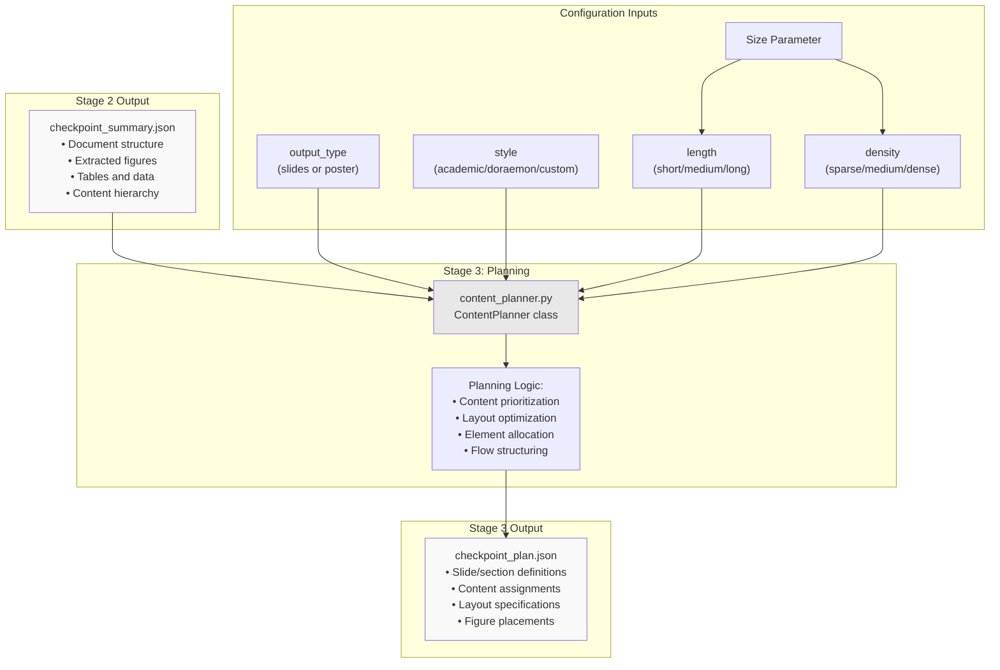
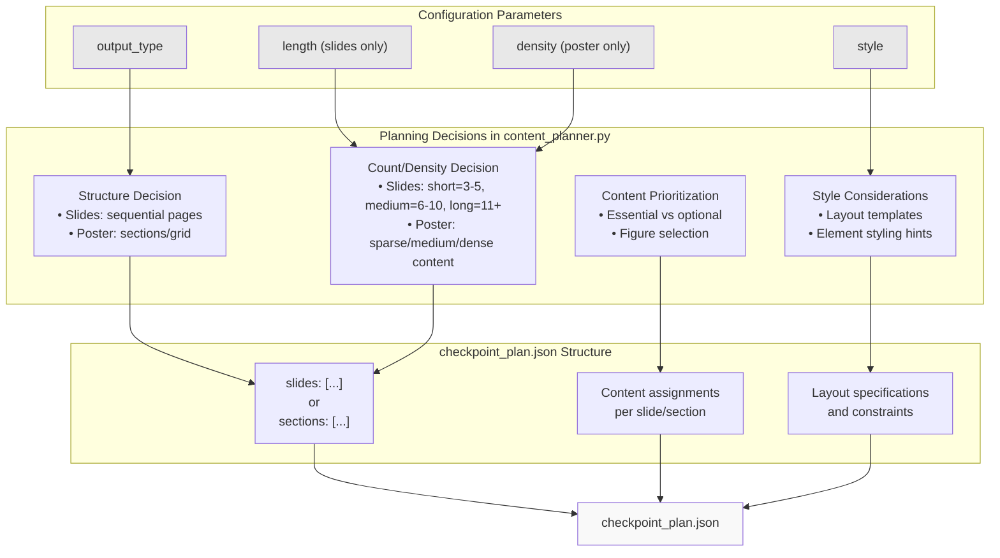
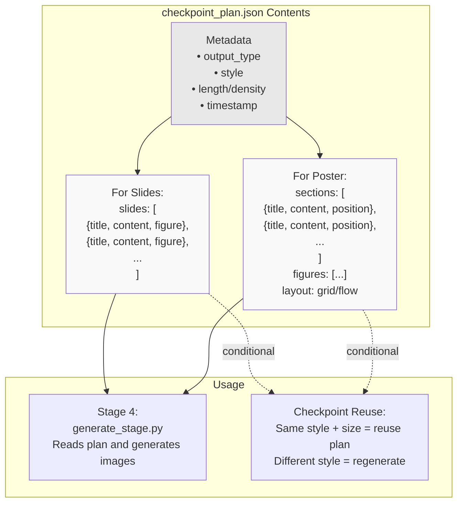
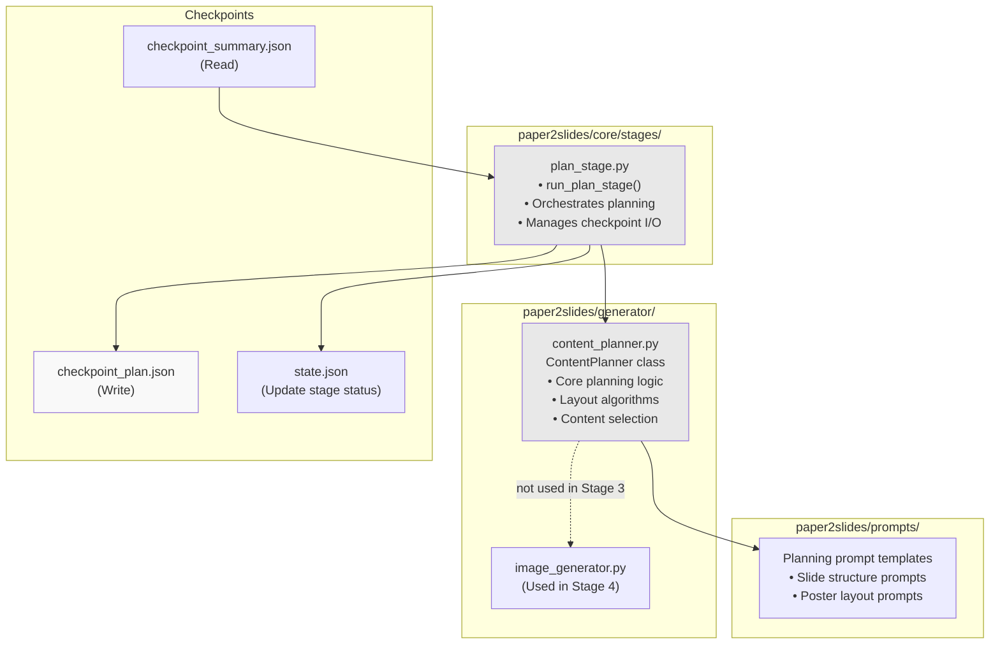
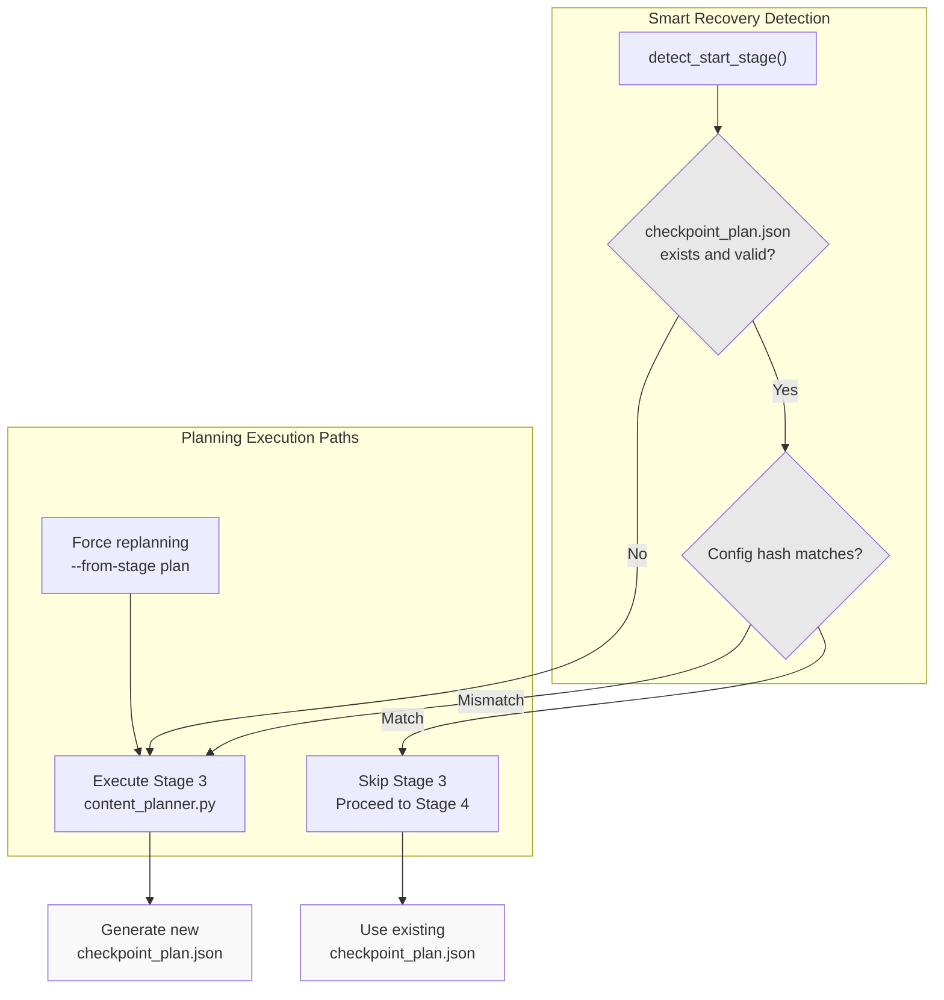

<!-- source: DeepWiki mcp.deepwiki.com · repo HKUDS/Paper2Slides · page 2.3 Stage 3: Planning and Layout · fetched 2026-11-09 -->

# Stage 3: Planning and Layout

<details>
<summary>Relevant source files</summary>

The following files were used as context for generating this wiki page:

- [README.md](README.md)

</details>


## Purpose and Scope

Stage 3 transforms the structured content extracted in [Stage 2: Analysis](#2.2) into an optimized presentation blueprint. This stage determines the organization, layout, and content distribution for the final slides or poster. The planning stage produces `checkpoint_plan.json`, which serves as a complete specification for the image generation stage.

For information about content extraction that feeds into planning, see [Stage 2: Analysis and Content Extraction](#2.2). For details about how the blueprint is rendered into images, see [Stage 4: Creation and Rendering](#2.4). For configuration options that influence planning decisions, see [Configuration Guide](#5).

---

## Overview

The planning stage is the strategic component of the Paper2Slides pipeline. It takes the structured content map from Stage 2 and makes decisions about:

- **Content selection**: Which elements to include and which to omit
- **Organization**: Logical flow and grouping of content
- **Layout structure**: Number of slides/poster sections and their arrangement
- **Element placement**: Where figures, tables, and text blocks appear

This stage is configuration-dependent, meaning the same input content can produce different plans based on user preferences for output type, style, length/density, and other parameters.

**Sources:** [README.md:198-210]()

---

## Data Flow



**Figure 1: Planning Stage Data Flow**

The planning stage receives two types of inputs:
1. **Content data** from `checkpoint_summary.json` (Stage 2 output)
2. **User configuration** parameters that control planning decisions

The stage processes these inputs through `content_planner.py` to produce `checkpoint_plan.json`, which contains the complete presentation blueprint.

**Sources:** [README.md:202-210](), [README.md:236-254]()

---

## Planning Process

### Slides Planning

When `output_type` is `slides`, the planner creates a sequential slide deck:

| Planning Aspect | Description |
|----------------|-------------|
| **Slide Count** | Determined by `length` parameter (short/medium/long) |
| **Content Flow** | Logical progression: intro → methodology → results → conclusion |
| **Figure Distribution** | Strategic placement of visual elements across slides |
| **Text Density** | Balanced per-slide content to avoid overcrowding |

### Poster Planning

When `output_type` is `poster`, the planner creates a single-page layout:

| Planning Aspect | Description |
|----------------|-------------|
| **Section Layout** | Grid-based organization (columns and rows) |
| **Content Density** | Controlled by `density` parameter (sparse/medium/dense) |
| **Visual Balance** | Strategic placement of figures for visual appeal |
| **Information Hierarchy** | Title, key points, supporting details |

**Sources:** [README.md:139-151](), [README.md:264-269]()

---

## Configuration Impact



**Figure 2: Configuration Parameters Influence Planning Logic**

### Output Type Impact

- **`output_type: slides`**: Creates sequential slide objects, each with title, content, and optional figure
- **`output_type: poster`**: Creates section-based layout with spatial relationships

### Style Impact

The `style` parameter influences:
- Layout template selection (academic uses formal grids, doraemon uses playful layouts)
- Content density preferences (some styles favor more whitespace)
- Element arrangement patterns

### Length/Density Impact

| Parameter | Values | Impact |
|-----------|--------|--------|
| `length` (slides) | short / medium / long | Controls number of slides generated |
| `density` (poster) | sparse / medium / dense | Controls amount of content per section |

**Sources:** [README.md:139-151](), [README.md:264-269]()

---

## Checkpoint Plan Structure

The `checkpoint_plan.json` file contains the complete presentation blueprint:



**Figure 3: Checkpoint Plan Structure and Usage**

### Reusability Conditions

The planning checkpoint is reusable when:
- Same `output_type` (slides vs poster)
- Same `style` parameter
- Same `length` (for slides) or `density` (for poster)

When these parameters match, Stage 3 is skipped and the existing plan is reused. When any differ, planning must be regenerated.

**Sources:** [README.md:256-262](), [README.md:236-254]()

---

## Code Organization



**Figure 4: Planning Stage Code Components**

### Key Components

| Component | Location | Responsibility |
|-----------|----------|----------------|
| `plan_stage.py` | [paper2slides/core/stages/]() | Stage orchestration, checkpoint management |
| `content_planner.py` | [paper2slides/generator/]() | Core planning algorithms, layout generation |
| Planning prompts | [paper2slides/prompts/]() | LLM prompt templates for planning |

### Execution Flow

1. `run_plan_stage()` in `plan_stage.py` is called by pipeline orchestrator
2. Loads `checkpoint_summary.json` from Stage 2
3. Instantiates `ContentPlanner` from `content_planner.py`
4. Planner processes content based on configuration parameters
5. Generates presentation structure (slides array or poster sections)
6. Writes `checkpoint_plan.json` to disk
7. Updates `state.json` with stage completion status

**Sources:** [README.md:283-293](), [README.md:298-329]()

---

## Planning vs Generation Separation

The separation of planning (Stage 3) from generation (Stage 4) provides several benefits:

### Checkpoint Efficiency

| Scenario | Stage 3 Reused? | Stage 4 Behavior |
|----------|-----------------|-------------------|
| Same config, regenerate | ✓ Yes | Reads existing plan, generates images |
| Change style | ✗ No | New plan → new images |
| Change length/density | ✗ No | New plan → new images |
| Regenerate only | ✓ Yes | Uses `--from-stage generate` |

### Iterative Refinement

Users can:
1. Generate initial output with one style
2. Preview results
3. Run with `--from-stage generate` to regenerate images only
4. Experiment with different prompting strategies in Stage 4 without replanning

**Sources:** [README.md:153-166](), [README.md:256-262]()

---

## CLI Integration

Planning stage execution is controlled through CLI options:

```bash
# Automatic planning based on configuration
python -m paper2slides --input paper.pdf --output slides --length medium

# Force restart from planning stage
python -m paper2slides --input paper.pdf --output slides --from-stage plan

# Change style requires replanning
python -m paper2slides --input paper.pdf --output poster --style academic --from-stage plan
```

The pipeline automatically detects whether planning needs to run based on:
- Existence of `checkpoint_plan.json`
- Configuration hash matching
- `--from-stage` flag override

**Sources:** [README.md:124-166]()

---

## Planning and Smart Recovery



**Figure 5: Smart Recovery Logic for Planning Stage**

The Smart Recovery System (see [Smart Recovery System](#2.5)) determines whether to execute Stage 3 based on:

1. **Checkpoint existence**: Does `checkpoint_plan.json` exist?
2. **Configuration match**: Does the config hash match the checkpoint?
3. **Explicit override**: Did user specify `--from-stage plan`?

This enables efficient workflows where users can change earlier parameters (like input files) and automatically regenerate from the appropriate stage.

**Sources:** [README.md:153-166](), [README.md:209-228]()

---

## Summary

Stage 3 Planning is the strategic decision-making component of Paper2Slides:

- **Input**: Structured content from `checkpoint_summary.json` + user configuration
- **Processing**: Content selection, organization, and layout optimization via `content_planner.py`
- **Output**: Presentation blueprint in `checkpoint_plan.json`
- **Reusability**: Checkpoint reused when `output_type`, `style`, and size parameters match
- **Integration**: Seamlessly works with Smart Recovery for efficient regeneration

The planning stage bridges the gap between raw extracted content and final visual generation, making strategic decisions about content presentation while deferring rendering details to Stage 4.

**Sources:** [README.md:198-228](), [README.md:236-262]()

---

