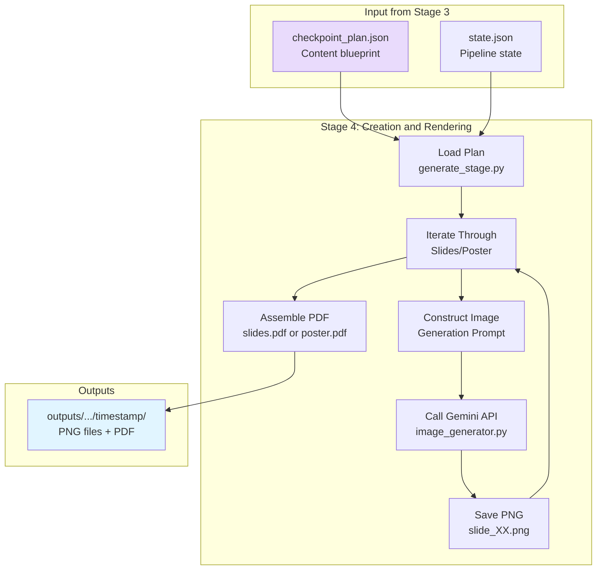
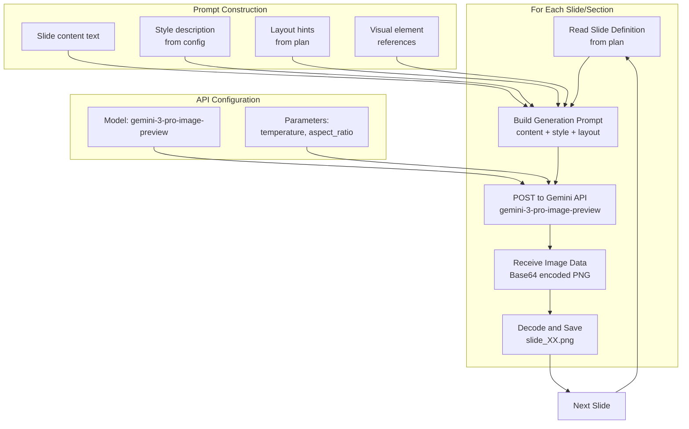
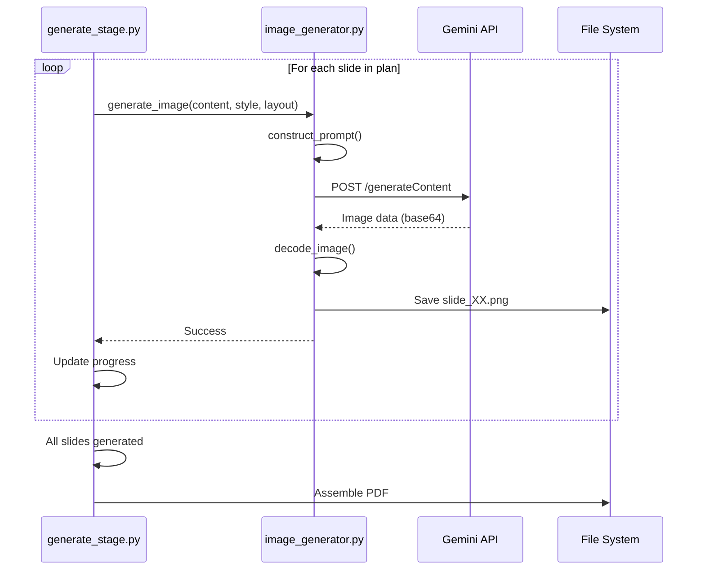
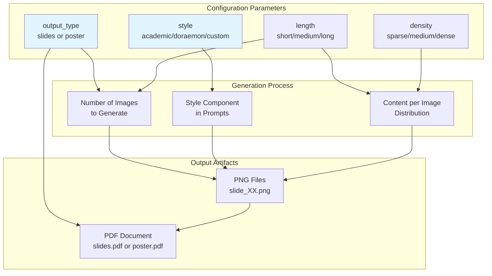
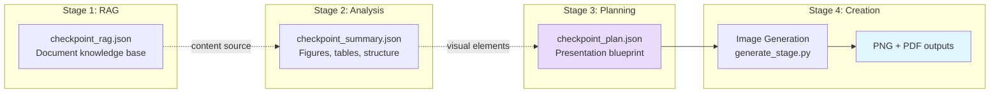

<!-- source: DeepWiki mcp.deepwiki.com · repo HKUDS/Paper2Slides · page 2.4 Stage 4: Creation and Rendering · fetched 2026-11-09 -->

# Stage 4: Creation and Rendering

<details>
<summary>Relevant source files</summary>

The following files were used as context for generating this wiki page:

- [README.md](README.md)

</details>


## Purpose and Scope

Stage 4 is the final stage of the Paper2Slides pipeline that transforms the presentation blueprint into actual visual outputs. This stage takes the structured content plan from Stage 3 and generates high-quality PNG images for each slide or poster, then assembles them into a final PDF document.

This page covers:
- Input from Stage 3 planning checkpoint
- Image generation using the Gemini API
- Output file organization and formats
- Configuration parameters affecting visual generation

For information about how the content plan is created, see [Stage 3: Planning and Layout](#2.3). For details on output directory structure and checkpoint reusability, see [File Management](#6).

---

## Overview

Stage 4 executes the final generation step of the pipeline, converting the abstract content plan into concrete visual presentations. Unlike the earlier stages that focus on information extraction and organization, this stage focuses on rendering and visual composition.



**Sources:** [README.md:198-228](), Diagram 1 and Diagram 3 from system overview

---

## Input: checkpoint_plan.json

Stage 4 begins by loading the `checkpoint_plan.json` file generated in Stage 3. This checkpoint contains the complete presentation blueprint including:

| Field | Description | Used For |
|-------|-------------|----------|
| `output_type` | `slides` or `poster` | Determines generation strategy |
| `style` | Style description (e.g., `academic`, `doraemon`, custom text) | Incorporated into image prompts |
| `slides` or `poster_sections` | Array of slide/section definitions | Individual image generation |
| `content` | Text content for each slide/section | Main content to visualize |
| `visual_elements` | Figures, diagrams, data to include | Elements to incorporate |
| `layout_hints` | Layout suggestions for each slide | Visual composition guidance |

Each slide or poster section in the plan defines:
- **Content text:** The main information to present
- **Visual elements:** References to figures, tables, or diagrams from earlier stages
- **Layout structure:** Organizational hints (title, sections, emphasis areas)
- **Styling context:** Thematic or stylistic notes

**Sources:** [README.md:206-207](), [README.md:256-262]()

---

## Image Generation Process

Stage 4 uses Google's Gemini API (`gemini-3-pro-image-preview`, also known as Nano Banana) for generating presentation images. The system employs an **iterative single-image generation** approach rather than batch generation to ensure consistency.



**Sources:** [README.md:271-280](), [paper2slides/generator/image_generator.py]()

### Prompt Engineering

The README provides key insights into effective prompt construction for Gemini's image generation model:

| Finding | Implication | Implementation Strategy |
|---------|-------------|-------------------------|
| **Mood keywords** strongly influence palette | Words like "warm", "elegant", "vibrant" affect colors | Style descriptions emphasize mood adjectives |
| **Layout instructions** ground well | Spatial arrangement instructions are followed | Include explicit layout structure in prompts |
| **Element styling** does not ground well | Fine-grained styling details are ignored | Avoid over-specifying visual details |
| **Simple prompts** outperform detailed ones | Brevity is more effective | Focus on core content and high-level style |
| **Multi-image output** is story-like | Native batch generation creates narrative sequences | Use iterative single-image generation instead |

The system constructs prompts that:
1. Begin with the overall style description (e.g., "doraemon style: colorful, friendly, with illustrations")
2. Specify the slide content in clear, concise language
3. Include layout hints (title position, content sections, visual element placement)
4. Avoid excessive styling minutiae

**Sources:** [README.md:271-280]()

### Iterative Generation Strategy

Rather than generating all slides in a single API call, Stage 4 generates each slide individually in sequence:



This approach ensures:
- **Consistency:** Each slide is generated with the same style parameters
- **Control:** Individual slides can be regenerated without affecting others
- **Error handling:** Failures affect only one slide, not the entire batch
- **Progress tracking:** Granular progress updates during generation

**Sources:** [README.md:279-280](), [paper2slides/core/stages/generate_stage.py]()

---

## Output File Generation

Stage 4 produces two types of output files:

### PNG Image Files

Each slide or poster section is saved as an individual PNG file with a standardized naming convention:

- **Slides:** `slide_01.png`, `slide_02.png`, ..., `slide_N.png`
- **Poster:** `poster.png` (single image)

PNG files are saved in the timestamped output directory immediately after generation, providing intermediate artifacts that can be reviewed independently of the final PDF.

### PDF Assembly

After all PNG images are generated, Stage 4 assembles them into a single PDF document:

- **Slides output:** `slides.pdf` containing all slides in sequence
- **Poster output:** `poster.pdf` containing the single poster image

The PDF assembly process:
1. Loads all generated PNG files in order
2. Converts each to PDF page format
3. Merges pages into a single document
4. Saves with appropriate filename

**Sources:** [README.md:246-251](), [README.md:207]()

---

## Output Directory Structure

Generated files are organized in a hierarchical directory structure that encodes the processing context:

```
outputs/
└── <content_type>/                    # paper or general
    └── <project_name>/                # From PDF name or session_id
        └── <mode>/                    # fast or normal
            └── <config_hash>/         # e.g., slides_doraemon_medium
                └── <timestamp>/       # ISO 8601 format: YYYYMMDD_HHMMSS
                    ├── slide_01.png
                    ├── slide_02.png
                    ├── ...
                    ├── slide_N.png
                    └── slides.pdf     # Final assembled PDF
```

### Directory Components

| Component | Purpose | Example |
|-----------|---------|---------|
| `content_type` | Distinguishes paper vs general documents | `paper/`, `general/` |
| `project_name` | Groups outputs from same source | `deepseek_v3_paper/` |
| `mode` | Separates fast vs normal mode outputs | `fast/`, `normal/` |
| `config_hash` | Identifies configuration: `{output}_{style}_{size}` | `slides_doraemon_medium/` |
| `timestamp` | Unique generation instance | `20240315_143022/` |

### Timestamp Directory

The timestamp directory (format: `YYYYMMDD_HHMMSS`) contains all outputs from a single generation run. Using timestamps ensures:
- **Multiple generations coexist:** Different style experiments don't overwrite each other
- **Historical tracking:** Previous outputs remain accessible
- **Rollback capability:** Can reference earlier versions if needed

**Sources:** [README.md:233-254](), Diagram 5 from system overview

---

## Configuration Impact on Generation

Several configuration parameters directly influence Stage 4's generation process:



### Output Type: Slides vs Poster

| Output Type | Generation Behavior | File Outputs |
|-------------|---------------------|--------------|
| `slides` | Generates N separate images (one per slide) | `slide_01.png`, ..., `slide_N.png`, `slides.pdf` |
| `poster` | Generates single composite image | `poster.png`, `poster.pdf` |

### Style Configuration

The `style` parameter is incorporated directly into image generation prompts:

- **`academic`**: Clean, professional academic presentation style → Prompts emphasize clarity, minimal decoration, structured layout
- **`doraemon`**: Colorful, friendly style with illustrations → Prompts include mood keywords like "colorful", "friendly", "illustrated"
- **Custom text**: Any natural language description → Passed directly to API as style guidance

### Length and Density

For **slides** output:
- `length` determines the number of slides generated from the content plan
- More content is distributed across more slides for `long`, condensed for `short`

For **poster** output:
- `density` affects how much information is packed into the single poster
- `sparse`: Fewer elements, more whitespace
- `dense`: More information, tighter layout

These parameters are resolved during Stage 3 planning, but affect Stage 4 by determining how many images to generate and what each contains.

**Sources:** [README.md:139-151](), [README.md:263-270]()

---

## Error Handling and Retry

Stage 4 implements robust error handling for the image generation process:

### API Call Failures

When Gemini API calls fail:
1. **Retry logic**: Attempts are retried with exponential backoff
2. **Partial progress preservation**: Successfully generated slides are saved
3. **Resume capability**: On re-run, existing PNG files are detected and skipped
4. **Error logging**: Detailed error information is logged for debugging

### Common Failure Scenarios

| Failure Type | Handling Strategy | Recovery |
|--------------|------------------|----------|
| Network timeout | Retry with backoff | Resume from last successful slide |
| API rate limit | Wait and retry | Progress preserved, continues automatically |
| Invalid prompt | Log error, skip slide | Manual intervention required for that slide |
| Image decode error | Retry generation | Previous attempt discarded |

### State Tracking

During generation, Stage 4 updates `state.json` with progress information:

```json
{
  "current_stage": "generate",
  "stage_progress": {
    "total_slides": 10,
    "completed_slides": 7,
    "current_slide": 8
  },
  "last_updated": "2024-03-15T14:30:22Z"
}
```

This enables:
- Real-time progress monitoring (especially in web UI)
- Detection of incomplete generations for smart resume
- Granular error reporting (which specific slide failed)

**Sources:** [README.md:153-166](), [paper2slides/core/state.py](), Diagram 3 from system overview

---

## Relationship to Other Stages

Stage 4 is the final execution stage but depends critically on earlier stages:



**Dependencies:**
- **From Stage 1:** Original document content for context (indirectly through later stages)
- **From Stage 2:** Extracted figures and tables that may be referenced in slides
- **From Stage 3:** Complete content plan with all slide definitions and layout instructions

**Outputs consumed by:**
- **Web UI:** Displays PNG previews and provides PDF download links
- **CLI:** Returns file paths to generated outputs
- **Users:** Final presentation materials ready for use

**Sources:** [README.md:198-228](), Diagram 1 and Diagram 3 from system overview

---

## Performance Considerations

### Generation Time

Stage 4 is typically the longest-running stage due to API call latency:

| Output Type | Typical Duration | Primary Factor |
|-------------|------------------|----------------|
| Poster (1 image) | 30-60 seconds | API response time |
| Short slides (5-8 slides) | 3-5 minutes | Number of API calls |
| Medium slides (10-15 slides) | 5-10 minutes | Number of API calls |
| Long slides (20+ slides) | 10-20 minutes | Number of API calls |

Each API call to Gemini typically takes 20-40 seconds per image.

### Optimization Strategies

1. **Checkpoint reuse**: If only non-visual parameters change (e.g., content text but not style), regenerate from Stage 3 planning
2. **Selective regeneration**: Modify `checkpoint_plan.json` to regenerate specific slides only
3. **Fast mode**: For quick iterations, use fast mode to skip RAG indexing in earlier stages
4. **Parallel generation**: Future enhancement could parallelize API calls (not currently implemented)

### Resource Usage

- **Memory**: Minimal; images are streamed and saved immediately
- **Disk**: PNG files typically 500KB-2MB each; PDF assembled in-memory then written once
- **Network**: Continuous API calls; requires stable internet connection

**Sources:** [README.md:214-228](), [paper2slides/core/stages/generate_stage.py]()

---

## Summary

Stage 4 completes the Paper2Slides pipeline by transforming the abstract content plan into concrete visual outputs. Key characteristics:

- **Input:** `checkpoint_plan.json` from Stage 3
- **Process:** Iterative single-image generation using Gemini API
- **Output:** PNG images and assembled PDF in timestamped directory
- **Configuration:** Influenced by `output_type`, `style`, `length`/`density`
- **Error handling:** Robust retry logic with progress preservation
- **Performance:** Longest stage due to API latency (seconds per image)

The generated outputs represent publication-ready presentation materials that can be used directly or further customized by users.

**Sources:** [README.md:198-280](), Diagram 1, Diagram 3, and Diagram 5 from system overview

---

