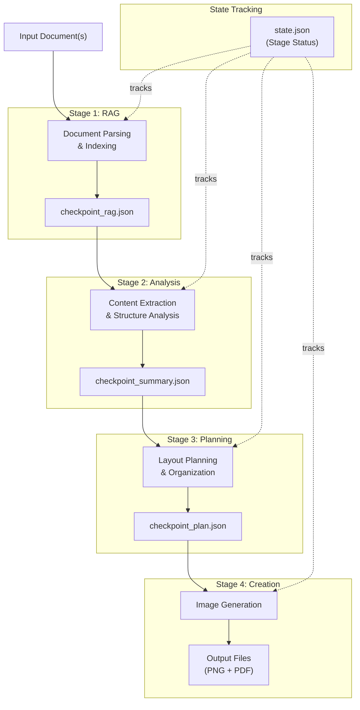
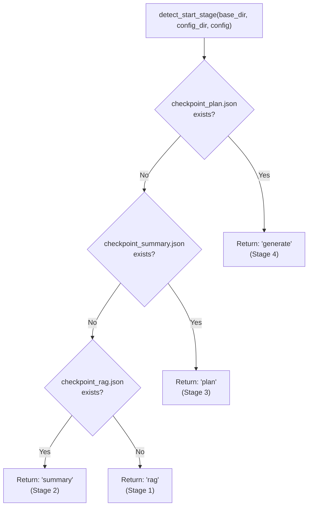
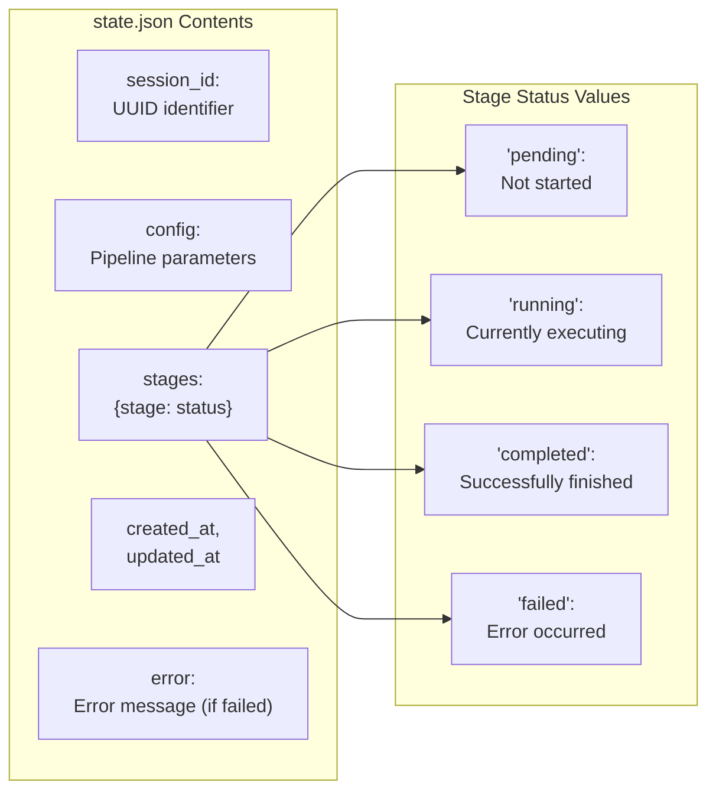
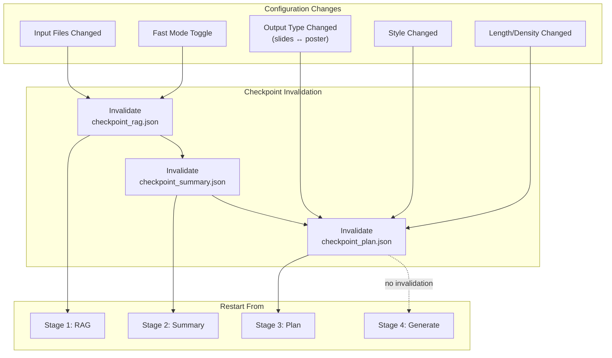
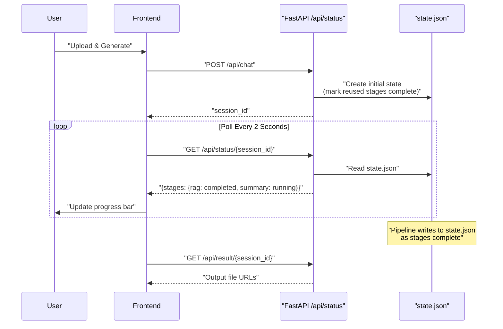
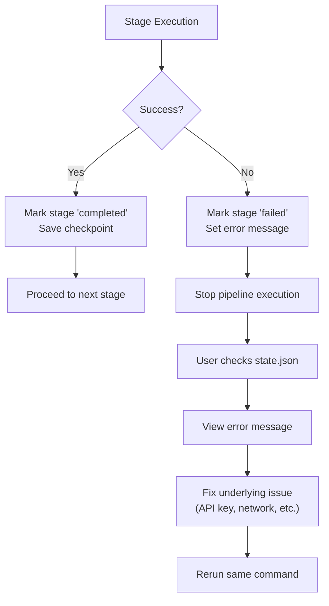
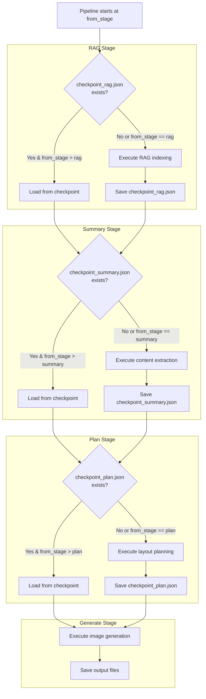

<!-- source: DeepWiki mcp.deepwiki.com · repo HKUDS/Paper2Slides · page 2.5 Smart Recovery System · fetched 2026-11-09 -->

# Smart Recovery System

<details>
<summary>Relevant source files</summary>

The following files were used as context for generating this wiki page:

- [README.md](README.md)
- [api/server.py](api/server.py)

</details>


The Smart Recovery System is Paper2Slides' checkpoint and resumption mechanism that enables interrupted pipeline executions to continue from the last completed stage without restarting from scratch. This system automatically detects which stages have been completed, determines the appropriate starting point, and manages state transitions throughout the pipeline lifecycle.

For information about the overall pipeline architecture and the four stages themselves, see [Core Pipeline Architecture](#2). For details about file organization and checkpoint file formats, see [Checkpoint Files](#6.2).

---

## Overview

The Smart Recovery System operates through three core mechanisms:

1. **Checkpoint Persistence**: Each pipeline stage writes a checkpoint file upon completion containing all data needed to resume the next stage
2. **Automatic Stage Detection**: The `detect_start_stage` function analyzes existing outputs to determine the optimal restart point
3. **State Tracking**: A `state.json` file maintains real-time pipeline progress including stage status, timestamps, and error information

This design enables efficient regeneration workflows where changing only style parameters can reuse expensive computation from earlier stages (RAG indexing and content analysis).

**Sources:** [README.md:153-165](), [README.md:202-210](), [README.md:256-262]()

---

## Checkpoint Architecture

### Checkpoint File Hierarchy

The system creates three checkpoint files at strategic points in the pipeline, each containing progressively refined data:



**Sources:** [README.md:202-210](), [README.md:235-254]()

### Checkpoint Storage Locations

Checkpoints are stored hierarchically to enable selective reuse based on configuration changes:

| Checkpoint File | Storage Location | Contains | Invalidated By |
|----------------|------------------|----------|----------------|
| `checkpoint_rag.json` | `outputs/<project>/<content>/<mode>/` | Parsed document content, RAG index metadata | Different input files or fast mode toggle |
| `checkpoint_summary.json` | `outputs/<project>/<content>/<mode>/` | Extracted figures, tables, document structure | Different input files |
| `checkpoint_plan.json` | `outputs/<project>/<content>/<mode>/<config>/` | Slide/poster layout plan, content organization | Different output type, style, or length/density |
| `state.json` | `outputs/<project>/<content>/<mode>/<config>/` | Current stage status, timestamps, errors | Not reused (always reflects current run) |

**Location Notes:**
- RAG and summary checkpoints are at the `<mode>` level (fast/normal), making them reusable across different styles
- Plan checkpoint is at the `<config>` level (e.g., `slides_doraemon_medium`), only reused for identical configurations
- The `<config>` directory name is generated by `get_config_name` function from output type, style, and size parameters

**Sources:** [README.md:235-254](), [README.md:256-262]()

---

## Stage Detection Logic

### Detection Function Flow

The `detect_start_stage` function determines the appropriate starting stage by checking for existing checkpoint files:



**Detection Logic:** The function checks checkpoint files in reverse order (from latest stage backwards) and returns the first stage that needs to be executed. If all checkpoints exist, it starts from the generation stage to create new output.

**Sources:** [api/server.py:387-389]()

### Manual Override with `--from-stage`

Users can force the pipeline to restart from a specific stage regardless of existing checkpoints:

| CLI Flag | Effect | Use Case |
|----------|--------|----------|
| `--from-stage rag` | Delete all checkpoints, restart from Stage 1 | Complete reprocessing needed |
| `--from-stage summary` | Keep RAG checkpoint, reprocess from Stage 2 | RAG index is fine but need fresh analysis |
| `--from-stage plan` | Keep RAG and summary, replan from Stage 3 | Only style/layout changed |
| `--from-stage generate` | Keep all checkpoints, regenerate images | Regenerate with same plan |
| (no flag) | Auto-detect from existing checkpoints | Normal behavior |

**Implementation:** The `--from-stage` parameter is passed directly to `run_pipeline`, which respects it over auto-detection results.

**Sources:** [README.md:153-165]()

---

## State Management

### State File Structure

The `state.json` file tracks pipeline execution in real-time:



**Sources:** [api/server.py:392-404]()

### State Initialization

Before pipeline execution begins, the system creates an initial state with stages before the starting point marked as completed:

```python
# From api/server.py:392-404
initial_state = create_state(config)
initial_state["session_id"] = session_id

# Mark stages before from_stage as completed (they are being reused)
start_idx = STAGES.index(from_stage)
for i in range(start_idx):
    initial_state["stages"][STAGES[i]] = "completed"

save_state(config_dir, initial_state)
```

**Rationale:** Marking reused stages as "completed" provides accurate progress tracking for the web interface and distinguishes between stages that haven't started vs. stages whose results are being reused.

**Sources:** [api/server.py:392-404]()

### State Updates During Execution

Each stage implementation updates its status at key points:

| Transition | When | Updated By |
|-----------|------|------------|
| `pending` → `running` | Stage begins execution | Stage entry point (e.g., `rag_stage.py`) |
| `running` → `completed` | Stage finishes successfully | Stage exit point after checkpoint save |
| `running` → `failed` | Stage encounters error | Exception handler or `_update_state_on_error` |

The web interface polls `/api/status/{session_id}` to read `state.json` and display progress to users.

**Sources:** [api/server.py:550-643]()

---

## Checkpoint Reusability Rules

### Configuration-Based Reuse

Different configuration changes trigger different levels of checkpoint reuse:



**Sources:** [README.md:256-262]()

### Reusability Matrix

| Change Type | RAG Checkpoint | Summary Checkpoint | Plan Checkpoint | Restart From |
|------------|----------------|-------------------|-----------------|--------------|
| Input files changed | ❌ Invalid | ❌ Invalid | ❌ Invalid | Stage 1: RAG |
| Fast mode toggled | ❌ Invalid | ❌ Invalid | ❌ Invalid | Stage 1: RAG |
| Output type changed | ✅ Reusable | ✅ Reusable | ❌ Invalid | Stage 3: Plan |
| Style changed | ✅ Reusable | ✅ Reusable | ❌ Invalid | Stage 3: Plan |
| Length/density changed | ✅ Reusable | ✅ Reusable | ❌ Invalid | Stage 3: Plan |
| No changes | ✅ Reusable | ✅ Reusable | ✅ Reusable | Stage 4: Generate |

**Key Insight:** The most common user iteration pattern—experimenting with different styles—only requires replanning (Stage 3) and regeneration (Stage 4), bypassing expensive RAG indexing and content analysis.

**Sources:** [README.md:256-262]()

---

## Auto-Resume Behavior

### Interrupted Execution Recovery

When a pipeline execution is interrupted (e.g., process killed, system crash, API timeout), the Smart Recovery System automatically resumes on the next invocation:

**Scenario 1: Interruption During RAG Stage**
```bash
# First attempt - interrupted during RAG indexing
python -m paper2slides --input paper.pdf --output slides
# Process killed at 60% RAG completion

# Second attempt - automatically detects no checkpoint_rag.json exists
python -m paper2slides --input paper.pdf --output slides
# Restarts from Stage 1: RAG
```

**Scenario 2: Interruption After Planning**
```bash
# First attempt - completed planning, interrupted during generation
python -m paper2slides --input paper.pdf --output slides
# checkpoint_plan.json exists but no output images

# Second attempt - detects plan exists
python -m paper2slides --input paper.pdf --output slides
# Starts from Stage 4: Generate (reuses plan)
```

**Detection Mechanism:** The system checks for checkpoint file existence before starting, not process exit status. This approach is robust to any interruption type.

**Sources:** [README.md:153-165]()

### Web Interface Session Recovery

The web interface tracks session state differently due to its asynchronous nature:



**Session Identification:** The web interface uses `session_id` stored in `state.json` to match status queries with the correct execution, enabling accurate progress tracking even with multiple historical runs in the same output directory.

**Sources:** [api/server.py:550-643](), [api/server.py:392-404]()

---

## Error Recovery

### Stage Failure Handling

When a stage fails, the system updates `state.json` to reflect the failure:



**Sources:** [api/server.py:532-547]()

### Error State Persistence

The `_update_state_on_error` function ensures failures are recorded even in background tasks:

**Key Behavior:**
- Identifies the stage that was running when error occurred
- Updates that stage's status to `"failed"`
- Stores error message in `state.json` under `"error"` field
- Preserves completed stages' status for potential resume

**Error Message Access:**
- CLI: Error printed to console and written to `state.json`
- Web Interface: `/api/status/{session_id}` returns `error` field from `state.json`

**Sources:** [api/server.py:433-486](), [api/server.py:532-547]()

### Retry After Failure

After fixing the underlying issue causing a failure, users can retry using the same command:

```bash
# First attempt - fails due to missing API key
python -m paper2slides --input paper.pdf --output slides
# Error: GEMINI_API_KEY not found

# User adds API key to .env file

# Retry - automatically resumes from failed stage
python -m paper2slides --input paper.pdf --output slides
# Detects checkpoint_summary.json exists (summary stage completed)
# Restarts from planning stage (which had failed)
```

**Recovery Logic:** The `detect_start_stage` function only checks checkpoint file existence, not failure status. If a stage failed but produced no checkpoint, the next run will retry that stage. If a stage completed before the failure, its checkpoint enables skipping.

**Sources:** [README.md:153-165]()

---

## Integration with Pipeline Components

### Pipeline Entry Point

The `run_pipeline` function in `paper2slides/core/pipeline.py` receives the detected start stage and initializes execution:

**Function Signature:**
```python
async def run_pipeline(
    base_dir: Path,
    config_dir: Path, 
    config: dict,
    from_stage: str,
    session_id: str,
    session_manager: SessionManager
)
```

**Parameters:**
- `base_dir`: Root directory for project outputs (`outputs/<project>/<content>/<mode>/`)
- `config_dir`: Configuration-specific directory (`base_dir/<config_name>/`)
- `config`: Full configuration dictionary including input paths and generation parameters
- `from_stage`: Stage to start from (either auto-detected or from `--from-stage` flag)
- `session_id`: Unique identifier for this execution (for web interface tracking)
- `session_manager`: Session lock manager (for web interface concurrency control)

**Sources:** [api/server.py:408]()

### Stage Execution Flow

Each stage checks for its corresponding checkpoint before executing:



**Stage Skipping:** If `from_stage` is later than the current stage and a checkpoint exists, the stage loads the checkpoint and immediately proceeds. If `from_stage` equals the current stage or no checkpoint exists, the stage executes fully.

**Sources:** [api/server.py:387-408]()

---

## Performance Optimization Through Smart Recovery

### Time Savings by Stage Reuse

Approximate execution times for a typical research paper (~20 pages, 10 figures):

| Stage | Typical Duration | Checkpoint Size | Reuse Benefit |
|-------|-----------------|-----------------|---------------|
| RAG | 30-120 seconds | 100-500 KB | Eliminates document parsing, chunk extraction, embedding generation |
| Analysis | 20-60 seconds | 50-200 KB | Eliminates figure extraction, structure analysis, LLM calls |
| Planning | 15-30 seconds | 10-50 KB | Eliminates layout optimization, content organization |
| Generation | 60-180 seconds | N/A (images) | Cannot reuse (always generates fresh images) |

**Common Iteration Patterns:**

1. **Style Experimentation** (3-5 iterations)
   - First run: ~150 seconds total (all stages)
   - Subsequent runs: ~90 seconds (plan + generate only)
   - Time saved: ~40% per iteration

2. **Length Adjustment** (2-3 iterations)
   - Same as style experimentation (plan checkpoint invalidated)
   - Time saved: ~40% per iteration

3. **Fast Mode vs Normal Mode** (comparison)
   - Cannot reuse checkpoints (mode directory changes)
   - But fast mode is inherently faster (~50% reduction)

**Sources:** [README.md:212-228]()

---

## CLI vs Web Interface Differences

### Detection Behavior Differences

| Aspect | CLI | Web Interface |
|--------|-----|---------------|
| Stage Detection | Runs synchronously before pipeline start | Runs in background task, status polled asynchronously |
| Session Tracking | Uses file paths only | Uses `session_id` in `state.json` |
| Progress Display | Console logs with stage transitions | Real-time progress bar from polling `/api/status` |
| Error Reporting | Immediate stack trace to console | Error stored in `state.json`, fetched by frontend |
| Manual Override | `--from-stage` flag | Not exposed (always auto-detects) |

### Session ID Usage in Web Interface

The web interface adds `session_id` tracking for accurate status queries across concurrent or historical runs:

**Problem Solved:** Multiple output directories may exist with different configurations. Without session tracking, `/api/status` might return progress from the wrong execution.

**Solution:** 
1. Generate unique `session_id` on upload [api/server.py:204]()
2. Store `session_id` in `state.json` [api/server.py:396]()
3. Match by exact `session_id` when querying status [api/server.py:589]()
4. Fall back to most recent timestamp if no match (for old runs) [api/server.py:595-601]()

**Sources:** [api/server.py:145-292](), [api/server.py:550-643]()

---

## Best Practices

### When to Force Restart

Use `--from-stage` to force restart in these scenarios:

| Scenario | Command | Reason |
|----------|---------|--------|
| Checkpoint corruption | `--from-stage rag` | Ensure clean state |
| Code changes in RAG parsing | `--from-stage rag` | Reprocess with new code |
| Code changes in content extraction | `--from-stage summary` | Reprocess analysis only |
| Debug prompt changes | `--from-stage plan` | Test planning prompts |
| API rate limit exceeded during generation | `--from-stage generate` | Retry generation only |

### Checkpoint File Maintenance

**When to Delete Checkpoints:**
- Significant code updates that change checkpoint format
- Experimenting with different document versions (to avoid confusion)
- Freeing disk space (checkpoints for old projects)

**When to Preserve Checkpoints:**
- Style iteration workflows (most common use case)
- Multi-configuration testing (same document, different outputs)
- Disaster recovery (allows restart after system failures)

**Sources:** [README.md:153-165]()

### Debugging Failed Stages

To investigate which stage failed and why:

1. **Check `state.json`** in the config directory:
   ```json
   {
     "stages": {
       "rag": "completed",
       "summary": "completed", 
       "plan": "failed",
       "generate": "pending"
     },
     "error": "GEMINI_API_KEY environment variable not set"
   }
   ```

2. **Review Console Output** (CLI) or backend logs (web interface) for detailed stack traces

3. **Verify Checkpoint Files** exist for completed stages:
   - `checkpoint_rag.json` present → RAG completed successfully
   - `checkpoint_summary.json` present → Analysis completed successfully
   - `checkpoint_plan.json` present → Planning completed successfully

4. **Retry with Appropriate Stage Override:**
   ```bash
   # If only generation failed
   python -m paper2slides --input paper.pdf --output slides --from-stage generate
   ```

**Sources:** [api/server.py:433-486](), [api/server.py:532-547]()

---

