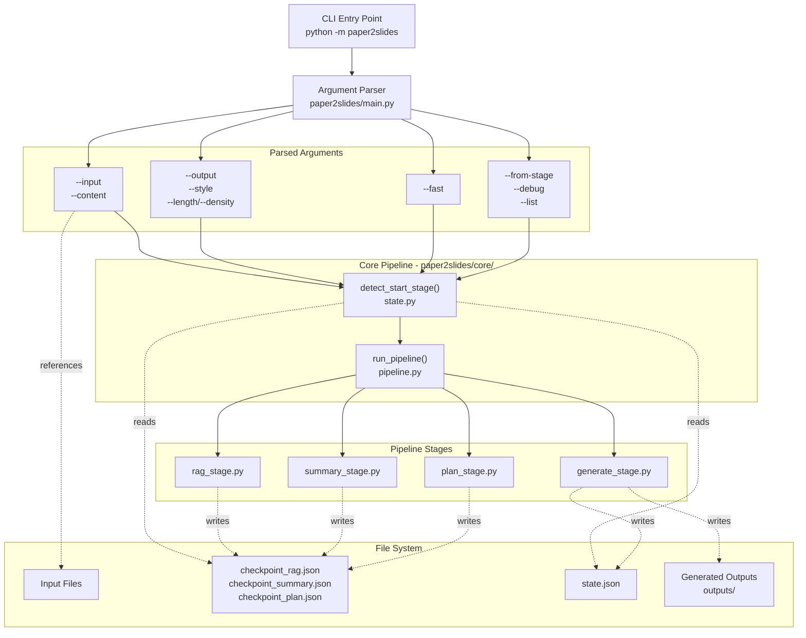
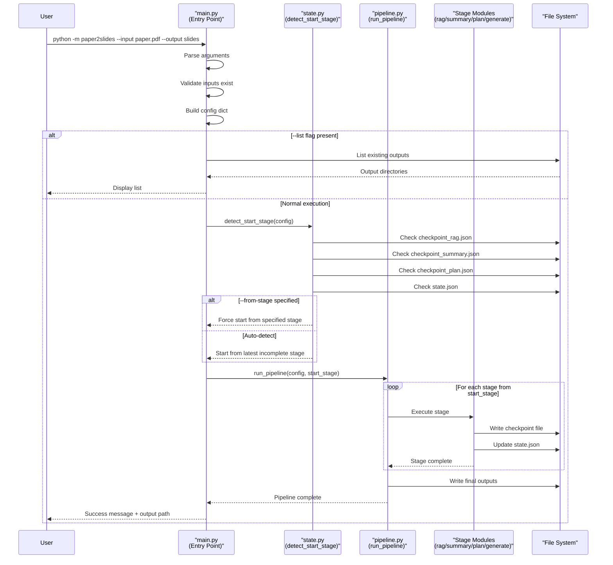
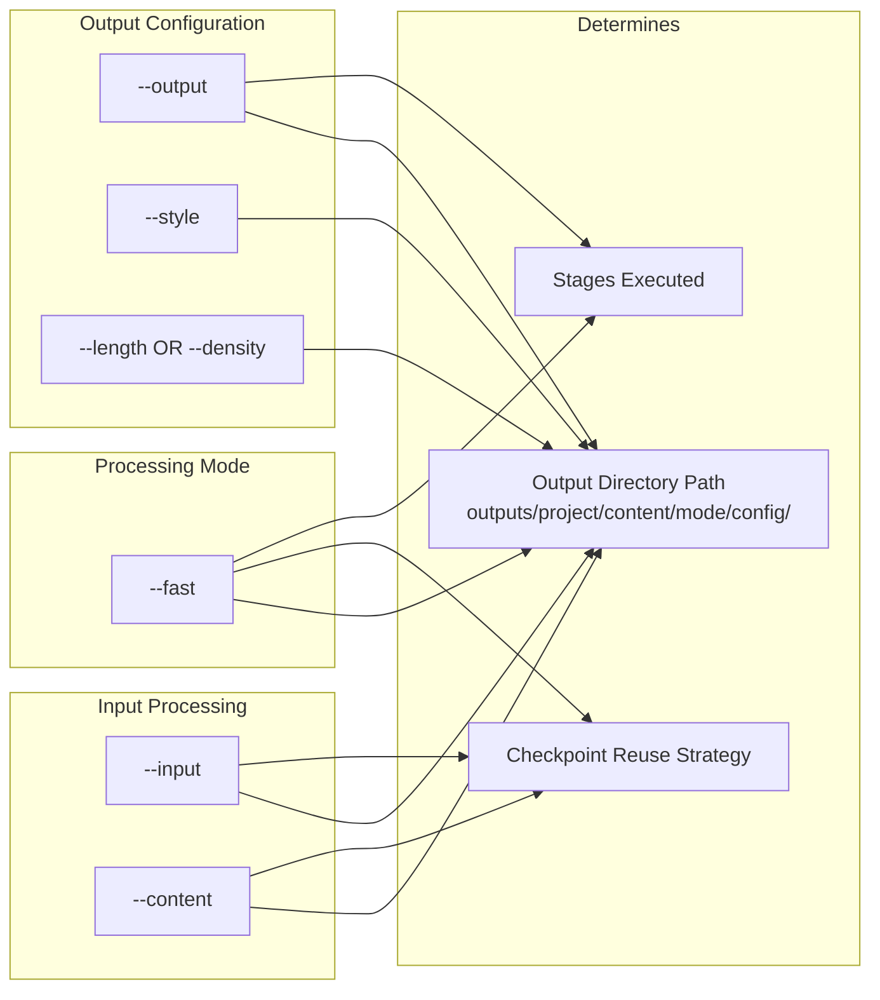
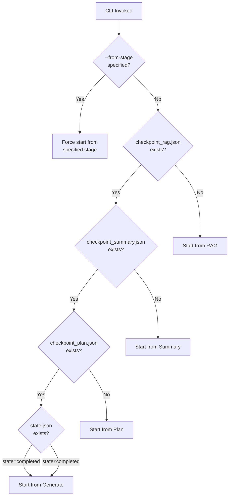

<!-- source: DeepWiki mcp.deepwiki.com · repo HKUDS/Paper2Slides · page 3 Command-Line Interface (CLI) · fetched 2026-11-09 -->

# Command-Line Interface (CLI)

<details>
<summary>Relevant source files</summary>

The following files were used as context for generating this wiki page:

- [README.md](README.md)

</details>


## Purpose and Scope

The Command-Line Interface (CLI) provides direct access to the Paper2Slides pipeline for power users, automation scripts, and batch processing workflows. The CLI accepts document inputs and configuration parameters, then executes the 4-stage processing pipeline to generate presentation materials.

This page covers the CLI's invocation, command structure, and core workflow. For detailed descriptions of individual options and flags, see [CLI Options Reference](#3.1). For practical examples and common workflows, see [CLI Usage Examples](#3.2). For information about the underlying pipeline stages, see [Core Pipeline Architecture](#2).

**Sources:** [README.md:103-165]()

---

## Invoking the CLI

The CLI is invoked as a Python module from the repository root:

```bash
python -m paper2slides [OPTIONS]
```

This command executes the entry point defined in [paper2slides/main.py:1-end](), which parses arguments and initiates the pipeline orchestration.

**Minimal Example:**
```bash
python -m paper2slides --input paper.pdf
```

**Complete Example:**
```bash
python -m paper2slides \
  --input paper.pdf \
  --output slides \
  --content paper \
  --style academic \
  --length medium \
  --fast \
  --debug
```

**Sources:** [README.md:123-137](), [README.md:300]()

---

## Command Structure and Argument Flow

The following diagram illustrates how CLI arguments are parsed and routed to the core pipeline components:



**Key Code Entities:**
- **Entry Point:** [paper2slides/main.py]() - Argument parsing and validation
- **State Detection:** [paper2slides/core/state.py]() - `detect_start_stage()` function
- **Pipeline Orchestration:** [paper2slides/core/pipeline.py]() - `run_pipeline()` function
- **Stage Implementations:** [paper2slides/core/stages/]() - Individual stage modules

**Sources:** [README.md:285-329](), [README.md:300-308]()

---

## CLI Execution Sequence

This sequence diagram shows the detailed execution flow when a CLI command is invoked:



**Sources:** [README.md:153-165](), [README.md:300-308]()

---

## Configuration Parameters

CLI parameters are organized into functional categories:

| Category | Parameters | Purpose |
|----------|------------|---------|
| **Input** | `--input`, `-i` | Specify input file(s) or directory |
| **Content** | `--content` | Document type: `paper` or `general` |
| **Output Type** | `--output` | Generation target: `slides` or `poster` |
| **Style** | `--style` | Visual theme: `academic`, `doraemon`, or custom description |
| **Size** | `--length` (slides)<br/>`--density` (poster) | Content amount: `short`/`medium`/`long` or `sparse`/`medium`/`dense` |
| **Processing** | `--fast` | Skip RAG indexing for faster processing |
| **Control** | `--from-stage`<br/>`--debug`<br/>`--list` | Pipeline control and debugging |

**Parameter Interactions:**



**Sources:** [README.md:139-151]()

---

## Checkpoint and Resume Behavior

The CLI automatically detects existing checkpoints and resumes from the appropriate stage. This "Smart Recovery System" eliminates redundant computation when regenerating with different parameters.

### Auto-Detection Logic

The `detect_start_stage()` function in [paper2slides/core/state.py]() implements the following decision tree:



### Checkpoint Files

| Checkpoint File | Location | Reusable When | Stage |
|----------------|----------|---------------|-------|
| `checkpoint_rag.json` | `outputs/project/content/mode/` | Same input files + same mode | After RAG |
| `checkpoint_summary.json` | `outputs/project/content/mode/` | Same input files + same mode | After Analysis |
| `checkpoint_plan.json` | `outputs/project/content/mode/config/` | Same config (output, style, size) | After Planning |
| `state.json` | `outputs/project/content/mode/config/` | Tracks current execution state | During Creation |

**Checkpoint Reuse Examples:**

| Scenario | Checkpoints Reused | Stages Re-executed |
|----------|-------------------|-------------------|
| Change style only | RAG + Summary | Plan + Generate |
| Change length/density only | RAG + Summary | Plan + Generate |
| Change output type (slides↔poster) | RAG + Summary | Plan + Generate |
| Add/remove `--fast` flag | None | All stages |
| Same exact command | All | None (skips to end) |

**Sources:** [README.md:153-165](), [README.md:253-262]()

---

## Output Directory Structure

The CLI generates a hierarchical output directory that encodes the processing context:

```
outputs/
└── <project_name>/                    # Derived from PDF title or session_id
    └── <content_type>/                # paper or general
        └── <mode>/                    # fast or normal
            ├── checkpoint_rag.json
            ├── checkpoint_summary.json
            ├── summary.md
            ├── rag_output/            # RAG index files
            └── <config_hash>/         # e.g., slides_doraemon_medium
                ├── state.json
                ├── checkpoint_plan.json
                └── <timestamp>/       # e.g., 20240115_143022
                    ├── slide_01.png
                    ├── slide_02.png
                    ├── ...
                    └── slides.pdf     # or poster.pdf
```

**Path Component Derivation:**

| Component | CLI Parameter | Example Values |
|-----------|--------------|----------------|
| `project_name` | Extracted from `--input` filename | `deepseek_paper`, `session_abc123` |
| `content_type` | `--content` | `paper`, `general` |
| `mode` | `--fast` flag | `fast`, `normal` |
| `config_hash` | `--output`, `--style`, `--length`/`--density` | `slides_academic_medium`, `poster_doraemon_dense` |
| `timestamp` | Auto-generated | `20240115_143022` |

**Sources:** [README.md:234-254](), [README.md:253-262]()

---

## Special CLI Flags

### `--list` Flag

Lists all previously generated outputs without running the pipeline:

```bash
python -m paper2slides --list
```

This scans the `outputs/` directory and displays a tree of all projects with their configurations and timestamps.

### `--debug` Flag

Enables verbose logging for troubleshooting:

```bash
python -m paper2slides --input paper.pdf --debug
```

Debug mode outputs detailed information about:
- Argument parsing results
- Checkpoint detection logic
- Stage execution progress
- LLM API requests and responses
- File I/O operations

### `--from-stage` Flag

Forces pipeline execution to start from a specific stage, ignoring auto-detection:

```bash
# Force full restart
python -m paper2slides --input paper.pdf --from-stage rag

# Skip to planning (if changing style only)
python -m paper2slides --input paper.pdf --style minimalist --from-stage plan

# Regenerate images only
python -m paper2slides --input paper.pdf --from-stage generate
```

**Valid stage values:** `rag`, `summary`, `plan`, `generate`

**Sources:** [README.md:139-165]()

---

## Exit Codes and Error Handling

The CLI returns standard Unix exit codes:

| Exit Code | Meaning | Common Causes |
|-----------|---------|---------------|
| `0` | Success | Pipeline completed successfully |
| `1` | General error | Invalid arguments, missing files, API failures |
| `2` | Invalid arguments | Unrecognized flags, mutually exclusive options |

Error messages are written to `stderr` and follow the format:
```
ERROR: [stage_name] Description of error
  at [file:line]
  Suggestion: How to fix the error
```

**Sources:** [README.md:139-151]()

---

## Related Pages

- [CLI Options Reference](#3.1) - Comprehensive documentation of all CLI flags
- [CLI Usage Examples](#3.2) - Practical examples and common workflows
- [Core Pipeline Architecture](#2) - Understanding the stages executed by the CLI
- [Configuration Guide](#5) - Detailed explanation of configuration parameters
- [Smart Recovery System](#2.5) - How checkpoints enable efficient resumption

**Sources:** [README.md:1-348]()

---

