<!-- source: DeepWiki mcp.deepwiki.com · repo HKUDS/Paper2Slides · page 3.1 CLI Options Reference · fetched 2026-11-09 -->

# CLI Options Reference

<details>
<summary>Relevant source files</summary>

The following files were used as context for generating this wiki page:

- [README.md](README.md)

</details>


## Purpose and Scope

This page provides a comprehensive reference for all command-line interface (CLI) options available in Paper2Slides. It documents each flag, its parameters, default values, and how options affect pipeline behavior and output organization.

For practical examples and common workflows using these options, see [CLI Usage Examples](#3.2). For information about the processing modes and stages referenced by these options, see [Core Pipeline Architecture](#2) and [Smart Recovery System](#2.5).

---

## CLI Invocation Pattern

The Paper2Slides CLI is invoked as a Python module:

```bash
python -m paper2slides [OPTIONS]
```

The entry point is located at [paper2slides/main.py](), which parses arguments and invokes the core pipeline orchestration in [paper2slides/core/pipeline.py]().

---

## Options Overview

Paper2Slides CLI options fall into four functional categories:

```mermaid
graph LR
    subgraph "Input Configuration"
        input["--input/-i"]
        content["--content"]
    end
    
    subgraph "Output Configuration"
        output["--output"]
        style["--style"]
        length["--length"]
        density["--density"]
    end
    
    subgraph "Processing Control"
        fast["--fast"]
        fromStage["--from-stage"]
    end
    
    subgraph "Utilities"
        debug["--debug"]
        list["--list"]
    end
    
    input --> Pipeline["Core Pipeline<br/>pipeline.py"]
    content --> Pipeline
    output --> Pipeline
    style --> Pipeline
    length --> Pipeline
    density --> Pipeline
    fast --> Pipeline
    fromStage --> Pipeline
    
    debug --> Logger["Logging System<br/>utils/logging"]
    list --> FileManager["Output Directory<br/>Enumeration"]
```

**Sources:** [README.md:139-151]()

---

## Input Configuration Options

### `--input` / `-i`

**Type:** String (file path or directory path)  
**Required:** Yes  
**Multiple:** Accepts multiple files or directories  

Specifies the input document(s) to process. Paper2Slides supports multiple formats simultaneously.

**Supported Formats:**
- PDF documents (`.pdf`)
- Microsoft Word (`.doc`, `.docx`)
- Microsoft Excel (`.xls`, `.xlsx`)
- Microsoft PowerPoint (`.ppt`, `.pptx`)
- Markdown (`.md`)

**Behavior:**
- **Single File:** `--input paper.pdf`
- **Multiple Files:** `--input paper.pdf supplement.pdf`
- **Directory:** `--input ./documents/` (processes all supported files in directory)

**File Processing Flow:**

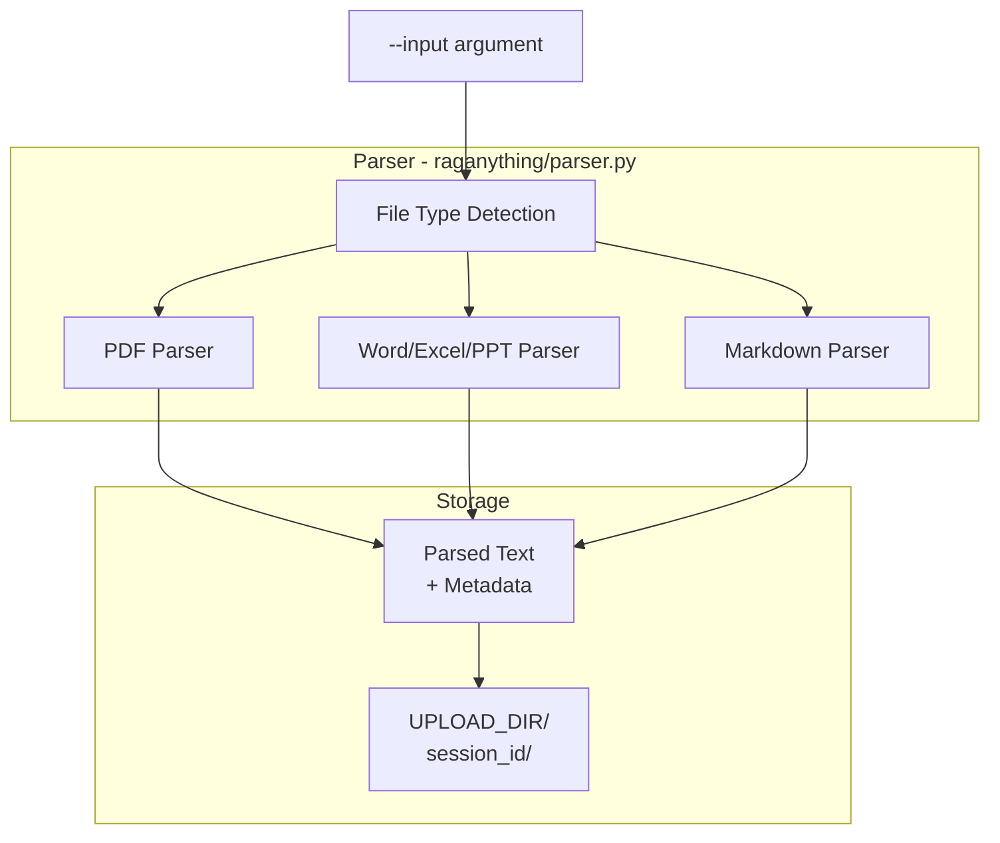

**Related Code:**
- Document parsing: [paper2slides/raganything/parser.py]()
- File validation and upload handling: [api/server.py]() (web interface equivalent)

**Sources:** [README.md:143]()

---

### `--content`

**Type:** String enum  
**Required:** No  
**Default:** `paper`  
**Valid Values:** `paper`, `general`  

Specifies the content type of input documents, which affects parsing and analysis strategies.

| Value | Description | Processing Differences |
|-------|-------------|------------------------|
| `paper` | Academic research papers | Optimized for paper structure (abstract, methods, results, etc.) |
| `general` | General documents, reports, presentations | Flexible content extraction without paper-specific assumptions |

**Impact on Pipeline:**

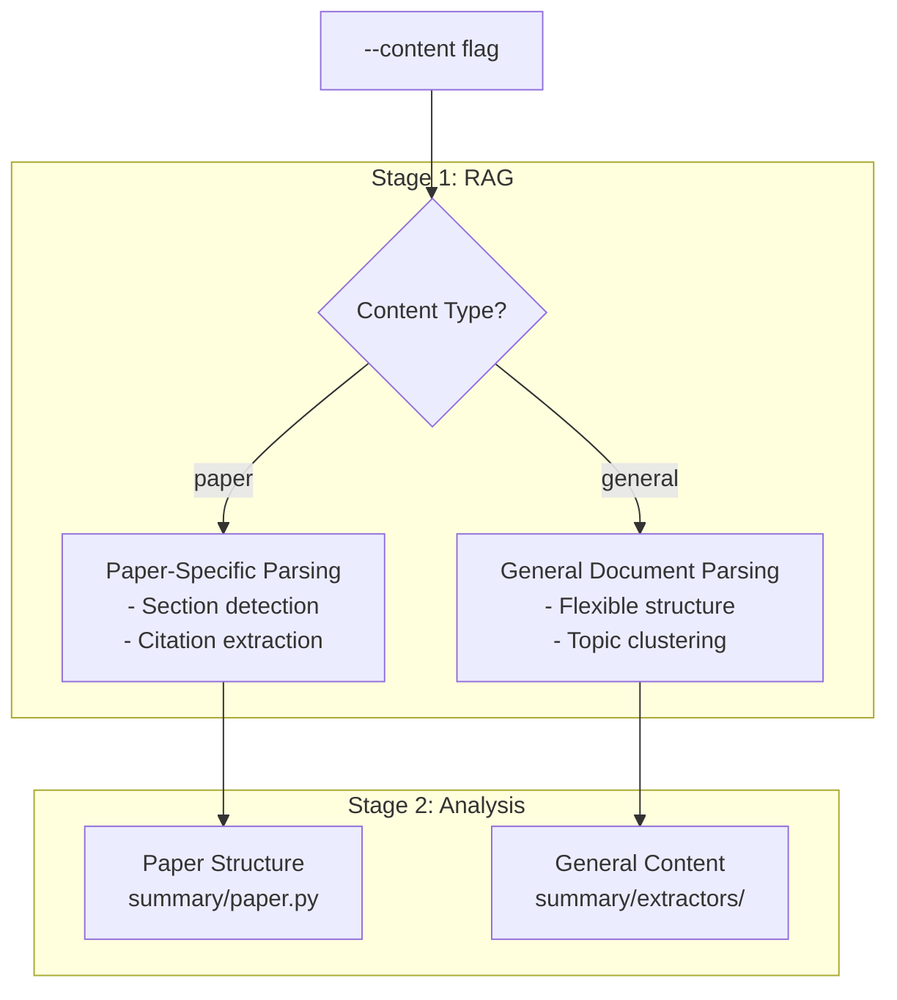

**Output Path Impact:**  
The content type is incorporated into the output directory structure:
```
outputs/<project_name>/<content_type>/...
```

**Related Code:**
- Paper structure extraction: [paper2slides/summary/paper.py]()
- RAG processing: [paper2slides/raganything/raganything.py]()

**Sources:** [README.md:145](), [README.md:237-238]()

---

## Output Configuration Options

### `--output`

**Type:** String enum  
**Required:** No  
**Default:** `poster`  
**Valid Values:** `slides`, `poster`  

Specifies the output format for generated presentations.

| Value | Description | Default Layout |
|-------|-------------|----------------|
| `slides` | Multi-page horizontal slides | 16:9 aspect ratio, sequential pages |
| `poster` | Single-page vertical poster | Portrait orientation, sectioned layout |

**Processing Differences:**

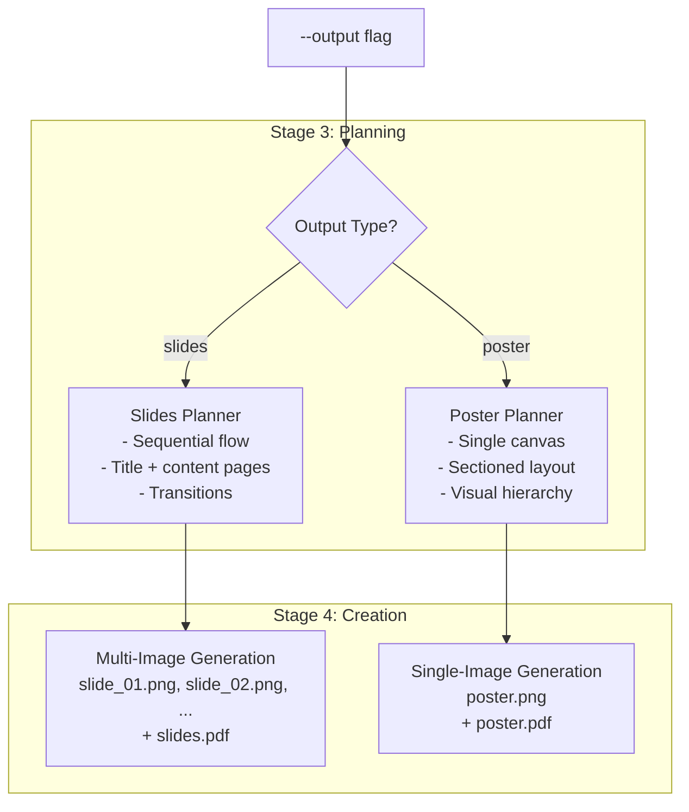

**Length/Density Interaction:**
- When `--output slides`: Use `--length` to control number of slides
- When `--output poster`: Use `--density` to control information density

For detailed information on slides vs posters, see [Output Types: Slides vs Posters](#5.1).

**Related Code:**
- Content planning: [paper2slides/generator/content_planner.py]()
- Image generation: [paper2slides/generator/image_generator.py]()

**Sources:** [README.md:144]()

---

### `--style`

**Type:** String  
**Required:** No  
**Default:** `doraemon`  

Specifies the visual style for generated slides or posters. Accepts predefined style names or custom natural language descriptions.

**Predefined Styles:**

| Style Name | Description | Visual Characteristics |
|------------|-------------|------------------------|
| `academic` | Professional academic style | Clean layout, serif fonts, neutral colors |
| `doraemon` | Colorful, friendly style | Bright colors, illustrations, approachable design |

**Custom Styles:**  
Any text description not matching predefined styles is treated as a custom style prompt for the image generation model:

```bash
# Custom style examples
--style "minimalist with blue theme"
--style "warm and elegant presentation"
--style "vibrant tech startup aesthetic"
```

**Style Application in Pipeline:**

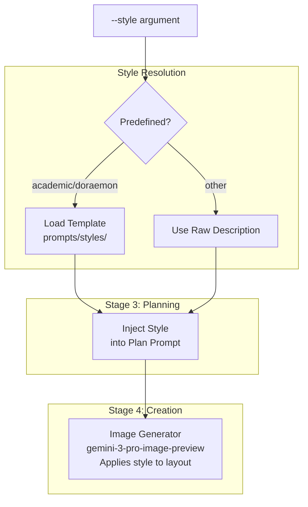

**Output Path Impact:**  
Style is part of the configuration hash in the output path:
```
outputs/<project>/<content>/<mode>/<output>_<style>_<length_or_density>/<timestamp>/
```

**Image Generation Notes:**  
The system uses `gemini-3-pro-image-preview` (Nano Banana) model, which responds well to:
- **Mood keywords:** "warm", "elegant", "vibrant" influence color palettes
- **Simple descriptions:** Concise prompts often outperform detailed ones
- **Layout instructions:** Ground better than fine-grained element styling

For detailed style configuration, see [Style Configuration](#5.2).

**Related Code:**
- Style templates: [paper2slides/prompts/]()
- Image generation with style application: [paper2slides/generator/image_generator.py]()

**Sources:** [README.md:146](), [README.md:264-269](), [README.md:271-279]()

---

### `--length`

**Type:** String enum  
**Required:** No  
**Default:** `short`  
**Valid Values:** `short`, `medium`, `long`  
**Applies To:** Slides output only (ignored for posters)

Controls the number of slides generated for `--output slides`.

| Length | Typical Slide Count | Use Case |
|--------|---------------------|----------|
| `short` | 5-10 slides | Quick overviews, elevator pitches |
| `medium` | 10-20 slides | Standard conference presentations |
| `long` | 20-40 slides | Detailed talks, comprehensive reviews |

**Impact on Content Planning:**

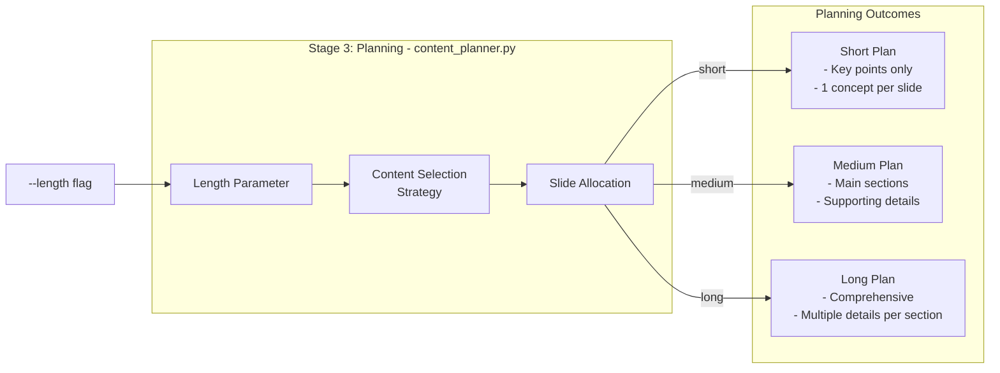

**Checkpoint Reusability:**  
The `--length` parameter is part of the configuration hash. Changing length regenerates from the planning stage ([Stage 3](#2.3)), reusing RAG and analysis checkpoints.

**Related Code:**
- Content planning logic: [paper2slides/generator/content_planner.py]()
- Checkpoint plan: [checkpoint_plan.json]() (stage 3 output)

**Sources:** [README.md:147]()

---

### `--density`

**Type:** String enum  
**Required:** No  
**Default:** `medium`  
**Valid Values:** `sparse`, `medium`, `dense`  
**Applies To:** Poster output only (ignored for slides)

Controls the information density for `--output poster`.

| Density | Information Level | Visual Characteristics |
|---------|-------------------|------------------------|
| `sparse` | Key highlights only | Generous whitespace, large text, minimal sections |
| `medium` | Balanced content | Standard academic poster layout |
| `dense` | Comprehensive details | Detailed information, multiple subsections, smaller text |

**Poster Layout Impact:**

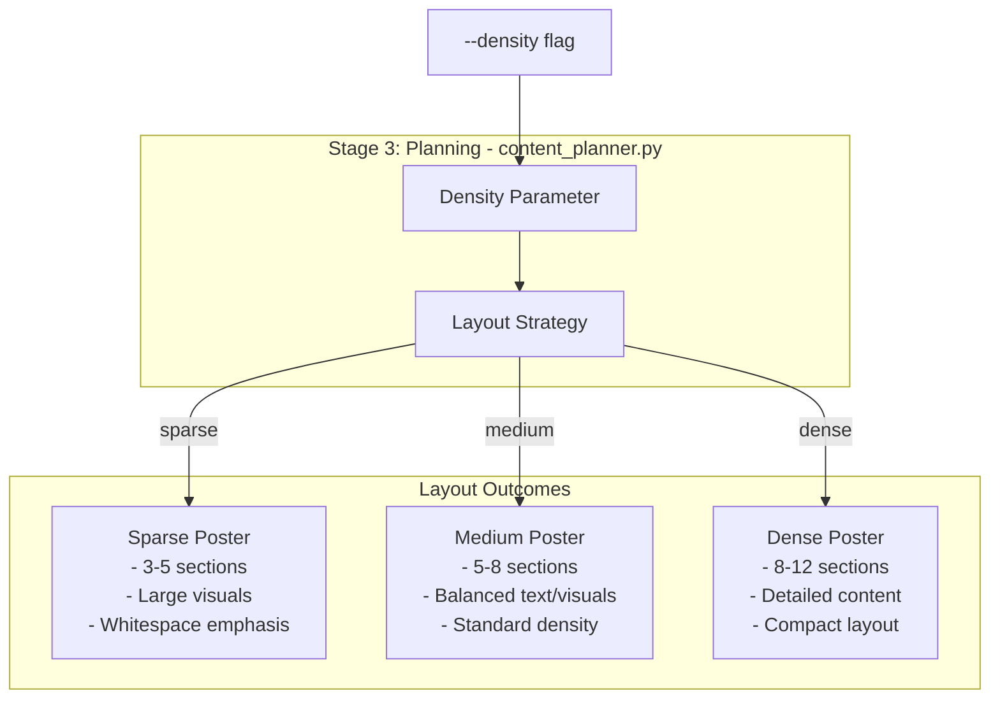

**Checkpoint Reusability:**  
Like `--length`, `--density` affects only the planning stage and is part of the configuration hash.

**Related Code:**
- Poster planning: [paper2slides/generator/content_planner.py]()
- Planning stage: [paper2slides/core/stages/plan_stage.py]()

**Sources:** [README.md:148]()

---

## Processing Control Options

### `--fast`

**Type:** Boolean flag  
**Required:** No  
**Default:** `false` (normal mode)  

Enables fast mode, which skips RAG indexing and directly queries the LLM with document content.

**Mode Comparison:**

| Aspect | Normal Mode | Fast Mode (`--fast`) |
|--------|-------------|----------------------|
| **RAG Indexing** | Full indexing | Skipped |
| **Processing Time** | Longer (includes indexing) | Faster (direct LLM query) |
| **Suitable For** | Long documents, complex papers, multiple files | Short documents, quick previews |
| **Context Limit** | No limit (uses retrieval) | Document must fit in LLM context |
| **Checkpoint** | `checkpoint_rag.json` created | `checkpoint_rag.json` minimal |

**Processing Path Difference:**

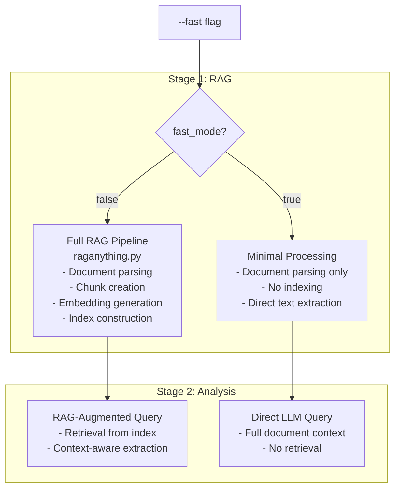

**Output Directory Impact:**  
Fast mode creates a separate output path:
```
outputs/<project>/<content>/fast/...     # Fast mode
outputs/<project>/<content>/normal/...   # Normal mode
```

This separation allows both modes to coexist with their own checkpoints.

**When to Use Fast Mode:**
- Document text + figures fit in LLM context window
- Quick iteration/preview needed
- Simple documents without complex structure
- Time constraints

**When to Use Normal Mode (default):**
- Long research papers (>10 pages)
- Multiple input files processed together
- Complex document structure
- Need precise retrieval for content selection

For detailed mode comparison, see [Processing Modes: Normal vs Fast](#5.3).

**Related Code:**
- RAG stage logic: [paper2slides/core/stages/rag_stage.py]()
- RAG indexing: [paper2slides/raganything/raganything.py]()
- Document parser: [paper2slides/raganything/parser.py]()

**Sources:** [README.md:149](), [README.md:212-228]()

---

### `--from-stage`

**Type:** String enum  
**Required:** No  
**Default:** Auto-detect (Smart Recovery)  
**Valid Values:** `rag`, `summary`, `plan`, `generate`  

Forces the pipeline to restart from a specific stage, overriding the automatic checkpoint detection.

**Stage Mapping:**

| Value | Stage Number | Stage Name | Checkpoint File |
|-------|--------------|------------|-----------------|
| `rag` | 1 | RAG - Document Parsing & Indexing | `checkpoint_rag.json` |
| `summary` | 2 | Analysis - Content Extraction | `checkpoint_summary.json` |
| `plan` | 3 | Planning - Layout Generation | `checkpoint_plan.json` |
| `generate` | 4 | Creation - Image Rendering | Output directory |

**Smart Recovery System (Default Behavior):**

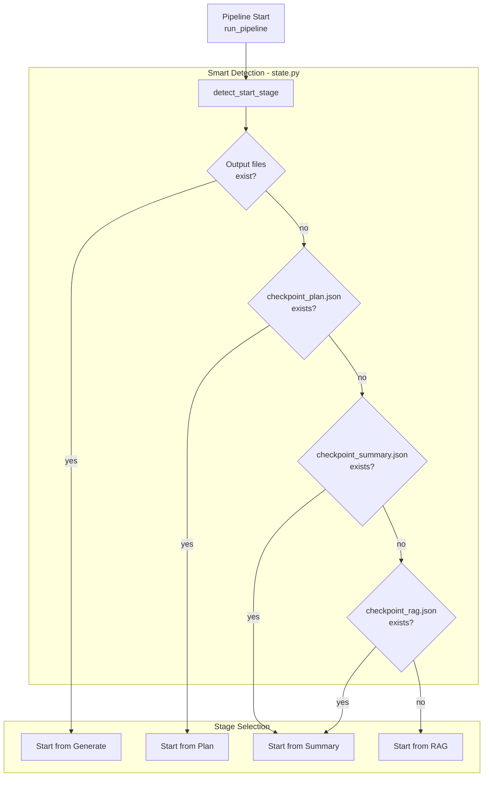

**Force Restart Use Cases:**

| Scenario | Command Flag | Rationale |
|----------|--------------|-----------|
| **Full regeneration** | `--from-stage rag` | Start from scratch, ignore all checkpoints |
| **Change content extraction** | `--from-stage summary` | Re-extract content with different parameters |
| **Style/length change only** | `--from-stage plan` | Keep content, regenerate layout |
| **Fix image generation** | `--from-stage generate` | Retry rendering with same plan |

**Checkpoint Dependency Chain:**

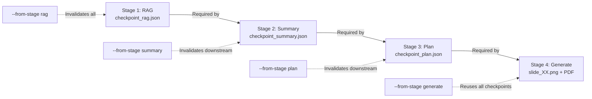

**Related Code:**
- Stage detection: [paper2slides/core/state.py]() (`detect_start_stage` function)
- Pipeline orchestration: [paper2slides/core/pipeline.py]() (`run_pipeline` function)
- Individual stage implementations: [paper2slides/core/stages/]()

**Sources:** [README.md:150](), [README.md:153-165]()

---

## Utility Options

### `--debug`

**Type:** Boolean flag  
**Required:** No  
**Default:** `false`  

Enables debug-level logging output for troubleshooting and development.

**Logging Levels:**

| Mode | Log Level | Output Includes |
|------|-----------|----------------|
| Normal (default) | INFO | High-level progress, stage transitions, errors |
| Debug (`--debug`) | DEBUG | Detailed execution traces, API calls, intermediate data |

**Debug Output Examples:**
```
[DEBUG] Loading checkpoint from: outputs/paper/paper/normal/checkpoint_rag.json
[DEBUG] RAG index contains 45 chunks
[DEBUG] Querying LLM with prompt length: 2,340 tokens
[DEBUG] Stage 2 complete: extracted 12 figures, 5 tables
```

**Related Code:**
- Logging configuration: [paper2slides/utils/]() (logging utilities)
- Stage-specific logging: Each stage in [paper2slides/core/stages/]()

**Sources:** [README.md:151]()

---

### `--list`

**Type:** Boolean flag  
**Required:** No  
**Default:** Not applicable (action flag)  

Lists all previously generated outputs in the `outputs/` directory and exits without processing.

**Output Format:**
```bash
$ python -m paper2slides --list

Processed Outputs:
==================

Project: deepseek-v3-paper
  Content: paper
  Mode: normal
  Configurations:
    - slides_doraemon_medium (2024-01-15 14:23:45)
    - poster_academic_dense (2024-01-15 15:10:22)

Project: meeting-notes
  Content: general
  Mode: fast
  Configurations:
    - slides_academic_short (2024-01-16 09:15:33)
```

**Directory Structure Traversed:**
```
outputs/
├── <project_1>/
│   └── <content_type>/
│       └── <mode>/
│           └── <config_hash>/
│               └── <timestamp>/   ← Listed with metadata
└── <project_2>/
    └── ...
```

**Related Code:**
- Output directory structure: [README.md:233-254]()
- File management utilities: [paper2slides/utils/]()

**Sources:** [README.md:136]()

---

## Option Interactions and Configuration Hash

Many CLI options combine to form a **configuration hash** that determines the output directory path and checkpoint reusability.

**Configuration Hash Components:**

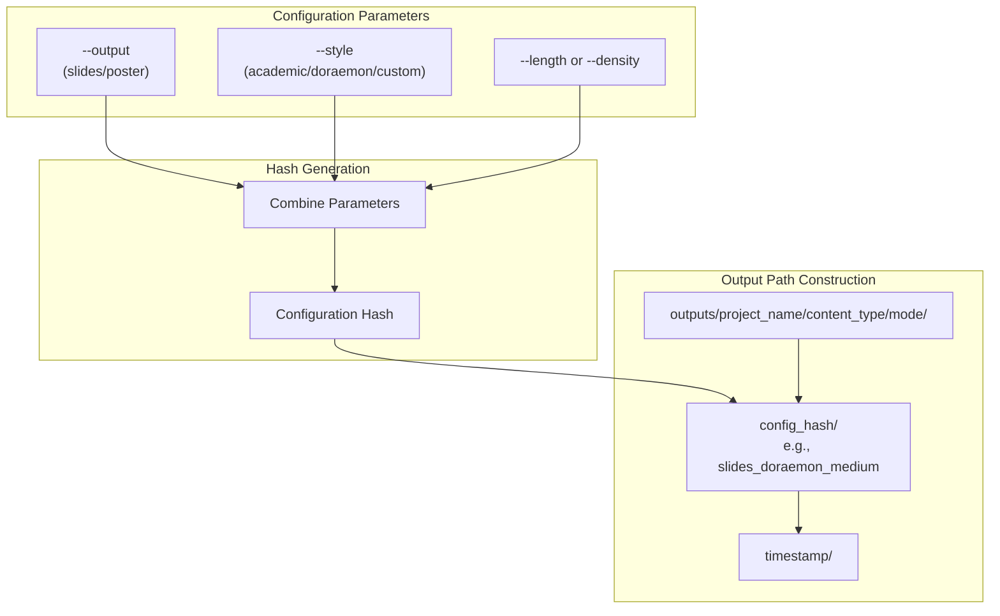

**Path Construction Example:**

| Option Set | Output Directory |
|------------|------------------|
| `--output slides --style doraemon --length medium` | `outputs/paper_name/paper/normal/slides_doraemon_medium/20240115_142345/` |
| `--output poster --style academic --density dense` | `outputs/paper_name/paper/normal/poster_academic_dense/20240115_151022/` |
| `--output slides --style "minimalist blue" --length short --fast` | `outputs/paper_name/paper/fast/slides_minimalist_blue_short/20240116_091533/` |

**Checkpoint Reusability Rules:**

```mermaid
graph TB
    InputChange{Input files<br/>changed?}
    ModeChange{Mode changed<br/>(fast/normal)?}
    ConfigChange{Config changed<br/>(output/style/size)?}
    
    InputChange -->|Yes| RAG["Restart from<br/>Stage 1: RAG"]
    InputChange -->|No| ModeChange
    
    ModeChange -->|Yes| RAG
    ModeChange -->|No| ConfigChange
    
    ConfigChange -->|Yes| Plan["Restart from<br/>Stage 3: Plan"]
    ConfigChange -->|No| Resume["Resume from<br/>last checkpoint"]
    
    RAG -.->|Creates new| CPRAG["checkpoint_rag.json"]
    RAG -.->|Creates new| CPSummary["checkpoint_summary.json"]
    
    Plan -.->|Reuses| CPRAG
    Plan -.->|Reuses| CPSummary
    Plan -.->|Creates new| CPPlan["checkpoint_plan.json"]
    
    Resume -.->|Reuses all| CPRAG
    Resume -.->|Reuses all| CPSummary
    Resume -.->|Reuses all| CPPlan
```

**Sources:** [README.md:233-254](), [README.md:256-261]()

---

## Complete Option Reference Table

| Option | Type | Default | Valid Values | Description |
|--------|------|---------|--------------|-------------|
| `--input`, `-i` | String/Path | Required | File or directory path | Input document(s) to process |
| `--output` | Enum | `poster` | `slides`, `poster` | Output format type |
| `--content` | Enum | `paper` | `paper`, `general` | Content type for parsing |
| `--style` | String | `doraemon` | `academic`, `doraemon`, or custom text | Visual style for output |
| `--length` | Enum | `short` | `short`, `medium`, `long` | Number of slides (slides only) |
| `--density` | Enum | `medium` | `sparse`, `medium`, `dense` | Information density (poster only) |
| `--fast` | Boolean | `false` | N/A (flag) | Enable fast mode (skip RAG) |
| `--from-stage` | Enum | Auto-detect | `rag`, `summary`, `plan`, `generate` | Force restart from stage |
| `--debug` | Boolean | `false` | N/A (flag) | Enable debug logging |
| `--list` | Boolean | N/A | N/A (action flag) | List processed outputs |

**Sources:** [README.md:139-151]()

---

## Option Precedence and Validation

**Mutually Dependent Options:**

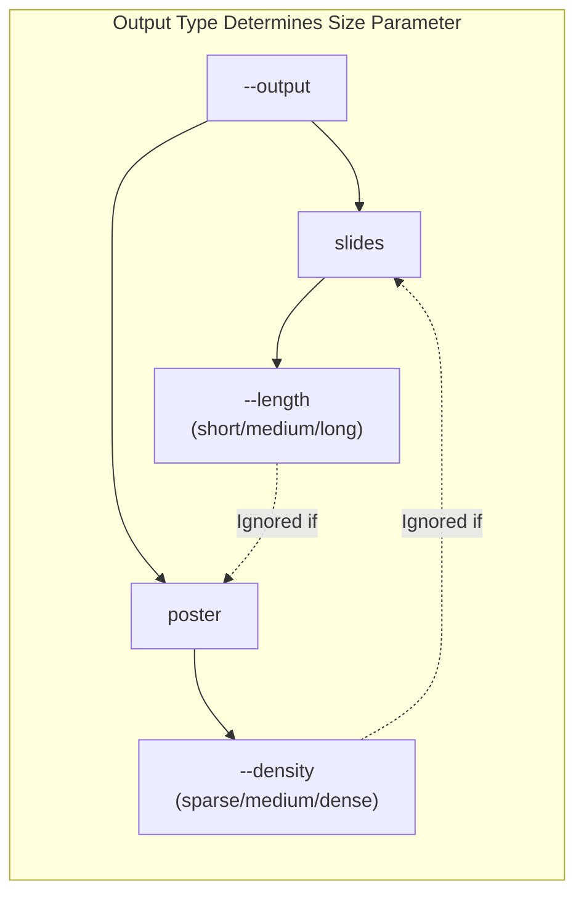

**Validation Rules:**
1. `--input` is mandatory unless using `--list`
2. `--length` is only used when `--output slides`
3. `--density` is only used when `--output poster`
4. `--from-stage` values must match defined stages
5. Custom style descriptions are arbitrary strings (no validation)

**Related Code:**
- Argument parsing: [paper2slides/main.py]()
- Configuration validation: [paper2slides/core/pipeline.py]()

**Sources:** [README.md:139-151]()

---

