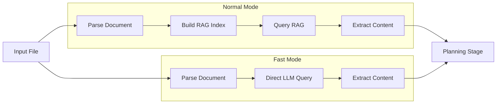
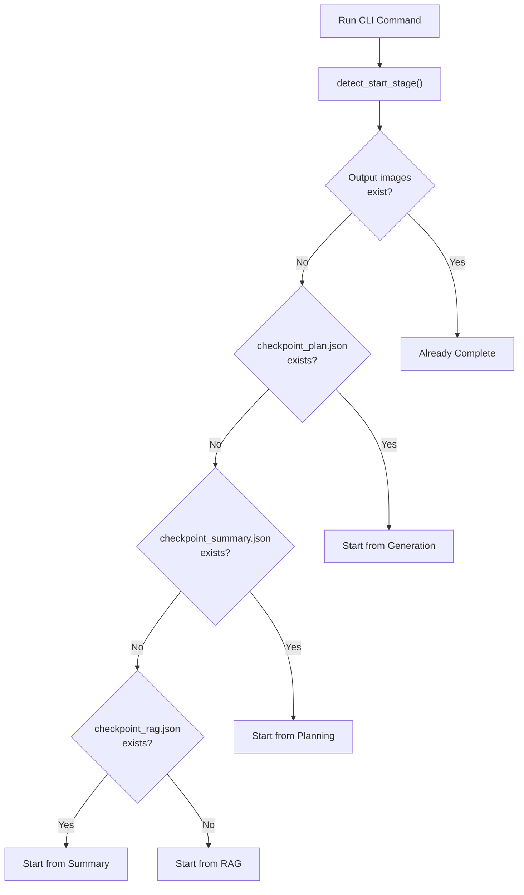
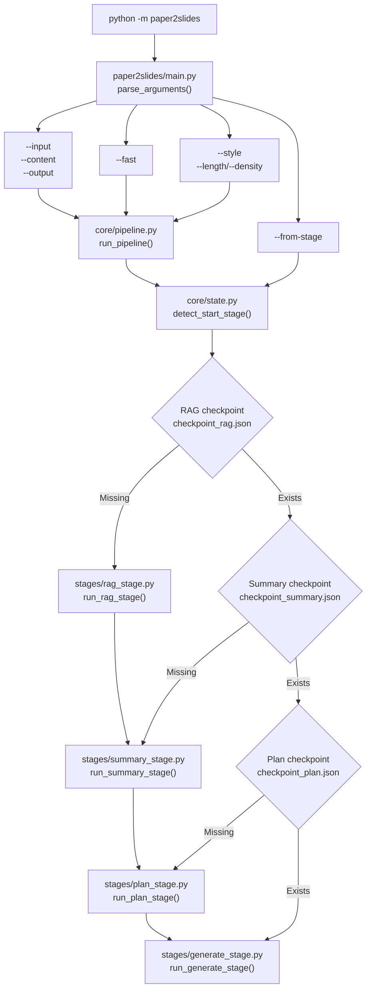

<!-- source: DeepWiki mcp.deepwiki.com · repo HKUDS/Paper2Slides · page 3.2 CLI Usage Examples · fetched 2026-11-09 -->

# CLI Usage Examples

<details>
<summary>Relevant source files</summary>

The following files were used as context for generating this wiki page:

- [README.md](README.md)

</details>


This page provides practical, real-world examples of using the Paper2Slides command-line interface. Each example demonstrates common workflows and use cases with complete commands and expected outcomes.

For a comprehensive reference of all CLI flags and parameters, see [CLI Options Reference](#3.1). For conceptual background on configuration parameters, see [Configuration Guide](#5).

---

## Basic Workflows

### First-Time Generation

The simplest way to generate slides from a paper:

```bash
python -m paper2slides --input paper.pdf --output slides
```

This command:
- Uses default `doraemon` style
- Generates `short` length slides
- Uses `paper` content type (auto-detected from output type)
- Runs in normal mode (with full RAG indexing)

**Expected Output:**
```
outputs/
└── paper/
    └── paper/
        └── normal/
            ├── checkpoint_rag.json
            ├── checkpoint_summary.json
            └── slides_doraemon_short/
                ├── checkpoint_plan.json
                ├── state.json
                └── 20250101_120000/
                    ├── slide_01.png
                    ├── slide_02.png
                    ├── ...
                    └── slides.pdf
```

**Sources:** [README.md:126-128]()

---

### Generating a Poster

Create a poster with custom styling:

```bash
python -m paper2slides \
    --input paper.pdf \
    --output poster \
    --style "minimalist with blue theme" \
    --density medium
```

**Parameters Explained:**
- `--output poster`: Switches to single-page poster generation
- `--style "minimalist with blue theme"`: Custom style description (instead of `academic` or `doraemon`)
- `--density medium`: Controls content density on the poster

**Sources:** [README.md:129-130]()

---

## Working with Different Content Types

### Academic Papers (Default)

For research papers with complex structure:

```bash
python -m paper2slides \
    --input research_paper.pdf \
    --output slides \
    --content paper \
    --style academic \
    --length long
```

The `paper` content type:
- Extracts figures, tables, and equations
- Preserves hierarchical section structure
- Links citations and references
- Uses specialized academic layout prompts

**Sources:** [README.md:145]()

---

### General Documents

For reports, documentation, or non-academic content:

```bash
python -m paper2slides \
    --input quarterly_report.docx \
    --output slides \
    --content general \
    --style doraemon \
    --length medium
```

The `general` content type:
- Skips academic-specific extraction (equations, citations)
- Uses simplified structure detection
- Optimized for business/technical documents

**Sources:** [README.md:145]()

---

### Multiple Files

Process multiple documents together:

```bash
python -m paper2slides \
    --input doc1.pdf doc2.pdf slides.pptx \
    --output slides \
    --length long
```

Or process an entire directory:

```bash
python -m paper2slides \
    --input ./research_papers/ \
    --output poster \
    --density dense
```

**Multi-file Behavior:**
- All files are parsed and indexed together in the RAG stage
- Content is merged intelligently across documents
- Figures and tables from all sources are available
- Project name derived from first file or directory name

**Sources:** [README.md:143]()

---

## Styling and Customization

### Using Predefined Styles

```bash
# Academic style - clean, professional
python -m paper2slides --input paper.pdf --style academic

# Doraemon style - colorful, friendly
python -m paper2slides --input paper.pdf --style doraemon
```

**Sources:** [README.md:146](), [README.md:265-269]()

---

### Custom Style Descriptions

Describe your desired style in natural language:

```bash
python -m paper2slides \
    --input paper.pdf \
    --output slides \
    --style "warm and elegant design with earth tones, similar to Apple keynote presentations" \
    --length medium
```

**Style Description Guidelines:**
- Use mood keywords: "warm", "elegant", "vibrant", "professional"
- Reference visual styles: "minimalist", "modern", "vintage"
- Specify color preferences: "blue theme", "earth tones", "monochrome"
- Keep descriptions concise (1-2 sentences work best)

**Sources:** [README.md:273-279]()

---

### Adjusting Content Length/Density

For slides, control the number of slides generated:

```bash
# Short presentation (5-8 slides)
python -m paper2slides --input paper.pdf --length short

# Medium presentation (10-15 slides)
python -m paper2slides --input paper.pdf --length medium

# Long presentation (20+ slides)
python -m paper2slides --input paper.pdf --length long
```

For posters, control information density:

```bash
# Sparse layout - more whitespace
python -m paper2slides --input paper.pdf --output poster --density sparse

# Medium density - balanced
python -m paper2slides --input paper.pdf --output poster --density medium

# Dense layout - maximize content
python -m paper2slides --input paper.pdf --output poster --density dense
```

**Sources:** [README.md:147-148]()

---

## Performance and Optimization

### Fast Mode Usage

Skip RAG indexing for quick previews:

```bash
python -m paper2slides \
    --input short_paper.pdf \
    --output slides \
    --fast
```

**When to Use Fast Mode:**

| Document Characteristics | Recommended Mode |
|-------------------------|------------------|
| Short document (< 10 pages) | `--fast` |
| Single file, simple structure | `--fast` |
| Quick preview/iteration needed | `--fast` |
| Long document (> 20 pages) | Normal (no flag) |
| Multiple files | Normal (no flag) |
| Complex figures/tables | Normal (no flag) |

**Processing Difference:**



**Sources:** [README.md:132-133](), [README.md:212-228]()

---

## Checkpoint and Recovery Workflows

### Resuming After Interruption

If generation is interrupted, simply re-run the same command:

```bash
# First run (interrupted)
python -m paper2slides --input paper.pdf --output slides --length medium

# Resume automatically
python -m paper2slides --input paper.pdf --output slides --length medium
```

**Auto-detection Logic:**



**Sources:** [README.md:153-165]()

---

### Changing Only Style

To regenerate with a different style without re-parsing:

```bash
# Original generation
python -m paper2slides --input paper.pdf --style academic

# Change to doraemon style - reuse RAG and analysis
python -m paper2slides --input paper.pdf --style doraemon --from-stage plan
```

**What Happens:**
1. Skips RAG stage (reuses `checkpoint_rag.json`)
2. Skips Analysis stage (reuses `checkpoint_summary.json`)
3. Re-runs Planning with new style
4. Re-generates all images

**Directory Structure:**
```
outputs/paper/paper/normal/
├── checkpoint_rag.json              # Reused
├── checkpoint_summary.json          # Reused
├── slides_academic_short/           # Original
│   └── 20250101_120000/
└── slides_doraemon_short/           # New
    └── 20250101_130000/
```

**Sources:** [README.md:160]()

---

### Regenerating Only Images

Keep the same plan but regenerate images:

```bash
python -m paper2slides \
    --input paper.pdf \
    --output slides \
    --from-stage generate
```

**Use Cases:**
- Retry if image generation failed
- Get different image variations with same layout
- Continue from interrupted generation stage

**Sources:** [README.md:161]()

---

### Full Restart

Force complete regeneration from scratch:

```bash
python -m paper2slides \
    --input paper.pdf \
    --output slides \
    --from-stage rag
```

**When to Use:**
- Input document was modified
- Want to test with different RAG settings
- Previous checkpoints are corrupted

**Sources:** [README.md:162]()

---

## Advanced Use Cases

### Listing All Outputs

View all generated presentations:

```bash
python -m paper2slides --list
```

**Example Output:**
```
Generated Outputs:
==================

Project: deepseek_v3_paper
├── paper/normal/
│   ├── slides_doraemon_medium/
│   │   └── 20250101_120000/ ✓ Complete (12 slides)
│   ├── slides_academic_long/
│   │   └── 20250101_140000/ ✓ Complete (24 slides)
│   └── poster_academic_medium/
│       └── 20250101_160000/ ✓ Complete (1 poster)

Project: quarterly_report
├── general/fast/
│   └── slides_doraemon_short/
│       └── 20250102_100000/ ✓ Complete (6 slides)
```

**Sources:** [README.md:136-137]()

---

### Debug Mode

Enable detailed logging for troubleshooting:

```bash
python -m paper2slides \
    --input paper.pdf \
    --output slides \
    --debug
```

**Debug Output Includes:**
- Detailed stage progress
- LLM API calls and responses
- File parsing details
- Checkpoint save/load operations
- Error stack traces

**Sources:** [README.md:151]()

---

## Complete Example Workflows

### Workflow 1: Research Paper Presentation

```bash
# Step 1: Generate initial slides quickly
python -m paper2slides \
    --input deepseek_paper.pdf \
    --output slides \
    --style academic \
    --length short \
    --fast

# Step 2: Review and decide to make longer version
python -m paper2slides \
    --input deepseek_paper.pdf \
    --output slides \
    --style academic \
    --length long \
    --from-stage plan

# Step 3: Try different style
python -m paper2slides \
    --input deepseek_paper.pdf \
    --output slides \
    --style doraemon \
    --length long \
    --from-stage plan
```

---

### Workflow 2: Conference Poster

```bash
# Step 1: Generate dense academic poster
python -m paper2slides \
    --input research.pdf \
    --output poster \
    --style academic \
    --density dense

# Step 2: Try custom colorful style
python -m paper2slides \
    --input research.pdf \
    --output poster \
    --style "vibrant and modern with gradients, suitable for tech conference" \
    --density dense \
    --from-stage plan
```

---

### Workflow 3: Multi-Document Report

```bash
# Process multiple chapters together
python -m paper2slides \
    --input chapter1.pdf chapter2.pdf chapter3.docx appendix.md \
    --output slides \
    --content general \
    --style "professional corporate presentation" \
    --length long
```

---

## CLI Command Mapping to Code

The following diagram shows how CLI parameters map to pipeline execution:



**Sources:** [README.md:300-303](), [README.md:304-310]()

---

## Summary Table: Common Commands

| Use Case | Command |
|----------|---------|
| **Quick slides from paper** | `python -m paper2slides --input paper.pdf --output slides --fast` |
| **Academic presentation** | `python -m paper2slides --input paper.pdf --style academic --length long` |
| **Conference poster** | `python -m paper2slides --input paper.pdf --output poster --density dense` |
| **Custom style** | `python -m paper2slides --input paper.pdf --style "your description"` |
| **Change style only** | `python -m paper2slides --input paper.pdf --style new_style --from-stage plan` |
| **Resume interrupted** | `python -m paper2slides --input paper.pdf` (same command) |
| **Multiple files** | `python -m paper2slides --input file1.pdf file2.docx --output slides` |
| **Debug mode** | `python -m paper2slides --input paper.pdf --debug` |
| **List outputs** | `python -m paper2slides --list` |

**Sources:** [README.md:126-137](), [README.md:153-165]()

---

