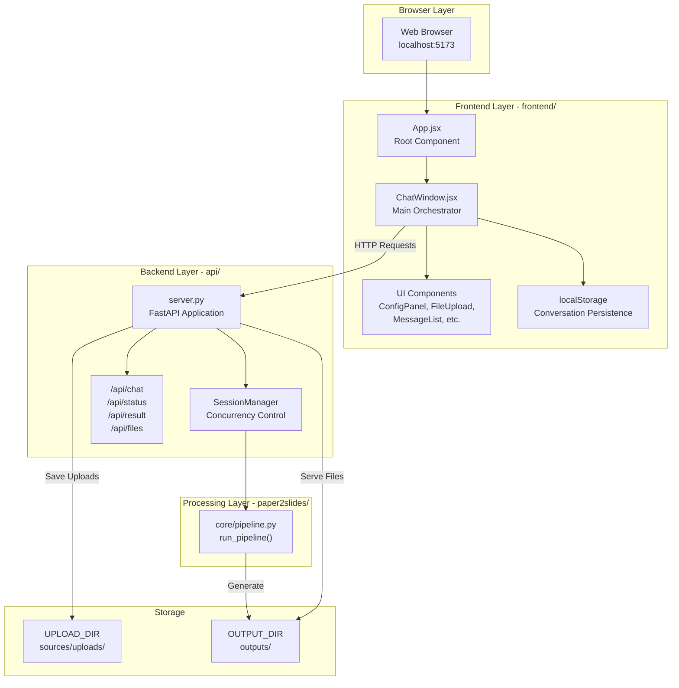
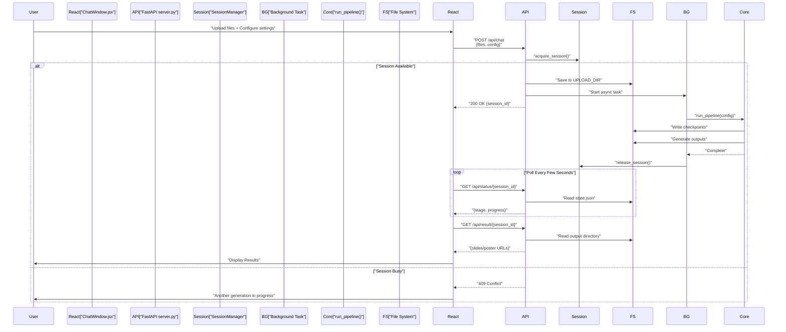
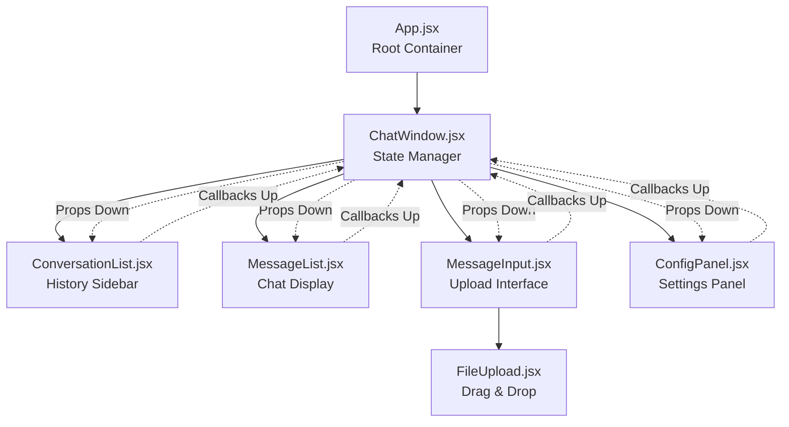

<!-- source: DeepWiki mcp.deepwiki.com · repo HKUDS/Paper2Slides · page 4 Web Interface · fetched 2026-11-09 -->

# Web Interface

<details>
<summary>Relevant source files</summary>

The following files were used as context for generating this wiki page:

- [README.md](README.md)
- [assets/ui_1.png](assets/ui_1.png)
- [assets/ui_2.png](assets/ui_2.png)
- [frontend/src/App.jsx](frontend/src/App.jsx)

</details>


The web interface provides a browser-based user experience for Paper2Slides, enabling interactive document upload, configuration, generation monitoring, and results viewing. This page covers launching the interface, basic architecture, and the user workflow.

For detailed backend API documentation, see [Backend API Server](#4.1). For frontend implementation details, see [Frontend Architecture](#4.2).

---

## Launching the Web Interface

The web interface requires both backend and frontend services to be running.

### Starting Both Services

Use the combined startup script:

```bash
./scripts/start.sh
```

This script starts both the FastAPI backend server and the Vite frontend development server.

### Starting Services Independently

Alternatively, start each service in a separate terminal:

```bash
# Terminal 1: Start backend
./scripts/start_backend.sh

# Terminal 2: Start frontend
./scripts/start_frontend.sh
```

The backend runs on port 8000 by default, and the frontend runs on port 5173.

**Sources:** [README.md:167-186]()

---

## Accessing the Interface

Once both services are running, access the web interface at:

```
http://localhost:5173
```

The interface works in any modern web browser. The frontend communicates with the backend API at `http://localhost:8000`.

**Sources:** [README.md:185]()

---

## System Architecture

The web interface consists of three primary layers that coordinate to process documents:



**Sources:** Diagram 1, Diagram 2, [README.md:291-293](), [frontend/src/App.jsx:1-14]()

---

## Request Flow

The following sequence diagram shows the complete lifecycle of a generation request through the web interface:



The backend enforces single-threaded execution via `SessionManager`, returning HTTP 409 for concurrent requests. The frontend immediately receives a `session_id` and polls for progress updates, decoupling generation time from HTTP timeout constraints.

**Sources:** Diagram 2, [README.md:291]()

---

## User Workflow

### 1. Upload Files

Users drag-and-drop or select files through the `FileUpload` component. Supported formats include PDF, Word, Excel, PowerPoint, and Markdown. Multiple files can be uploaded simultaneously.

### 2. Configure Generation

The `ConfigPanel` component allows users to set:
- **Output Type**: `slides` or `poster`
- **Content Type**: `paper` (academic) or `general`
- **Style**: `academic`, `doraemon`, or custom text description
- **Length/Density**: For slides (`short`/`medium`/`long`) or posters (`sparse`/`medium`/`dense`)
- **Fast Mode**: Skip RAG indexing for quick processing

For detailed configuration options, see [Configuration Guide](#5).

### 3. Generate

Clicking generate submits files and configuration to `POST /api/chat`. The backend:
1. Validates the session is not already processing
2. Saves uploaded files to `UPLOAD_DIR`
3. Starts a background task running the 4-stage pipeline
4. Returns a `session_id` for tracking

### 4. Monitor Progress

The frontend automatically polls `GET /api/status/{session_id}` every few seconds, displaying:
- Current stage (RAG, Analysis, Planning, Creation)
- Progress percentage
- Status messages

The `MessageList` component shows real-time updates as the pipeline executes each stage.

### 5. View Results

When generation completes, the frontend calls `GET /api/result/{session_id}` to retrieve:
- Generated slide/poster image URLs
- PDF download URL
- Metadata (timestamp, configuration used)

Results are displayed in the conversation history and persist in `localStorage` for later viewing.

**Sources:** Diagram 2, [README.md:81-91]()

---

## Component Hierarchy

The frontend follows a unidirectional data flow pattern with `ChatWindow` as the central state manager:



The `App` component ([frontend/src/App.jsx:1-14]()) is a minimal root that renders `ChatWindow` with styling. All application state, including conversations, active workflow, and configuration parameters, is managed by `ChatWindow`. Child components are presentational, receiving state via props and communicating actions through callbacks.

**Sources:** Diagram 4, [frontend/src/App.jsx:1-14]()

---

## API Endpoints

The backend exposes the following primary endpoints:

| Endpoint | Method | Purpose |
|----------|--------|---------|
| `/api/chat` | POST | Submit files and configuration to start generation |
| `/api/status/{session_id}` | GET | Poll for pipeline progress and current stage |
| `/api/result/{session_id}` | GET | Retrieve final output URLs and metadata |
| `/api/files/{path}` | GET | Serve generated images and PDFs |

For complete API documentation including request/response schemas and error codes, see [API Endpoints Reference](#4.1.1).

**Sources:** Diagram 2

---

## Session Management

The backend uses a `SessionManager` to enforce single-threaded pipeline execution. Only one generation can run at a time. When a request arrives:

1. `SessionManager.acquire_session()` attempts to acquire the lock
2. If successful, processing begins and returns `session_id`
3. If locked, returns HTTP 409 Conflict with a message

This prevents resource contention and ensures deterministic checkpoint behavior. The frontend handles 409 responses by displaying "Another generation in progress" and disabling the generate button.

For session lifecycle details, see [Session Management](#4.1.2).

**Sources:** Diagram 2

---

## File Management

### Uploads

Files uploaded through the web interface are stored in `UPLOAD_DIR` (typically `sources/uploads/`), organized by `session_id`:

```
sources/uploads/
└── {session_id}/
    ├── document1.pdf
    ├── document2.docx
    └── ...
```

### Outputs

Generated slides and posters are stored in `OUTPUT_DIR` (typically `outputs/`) following the hierarchical structure:

```
outputs/
└── {project_name}/
    └── {content_type}/
        └── {mode}/
            └── {config_hash}/
                └── {timestamp}/
                    ├── slide_01.png
                    ├── slide_02.png
                    ├── ...
                    └── slides.pdf
```

The frontend retrieves output files via `/api/files/{path}` endpoint, which serves static files from the output directory.

For detailed file organization, see [Directory Structure](#6.1).

**Sources:** Diagram 5, [README.md:235-254]()

---

## State Persistence

The frontend persists conversation history and configuration in browser `localStorage`. This allows users to:
- Return to previous conversations
- View past generation results
- Resume with the same configuration

State is stored as JSON under a key specific to the application. When the page loads, `ChatWindow` reads from `localStorage` to restore previous sessions.

**Sources:** Diagram 4

---

## Error Handling

The web interface handles several error scenarios:

| Error Type | Status Code | Frontend Behavior |
|------------|-------------|-------------------|
| Session busy | 409 | Display "Another generation in progress" message |
| Invalid files | 400 | Show validation error in chat |
| Server error | 500 | Display error message with retry option |
| Network error | - | Show connection error, enable retry |

Error messages appear in the `MessageList` component as system messages, maintaining the chat-like interaction pattern.

For backend error handling details, see [Error Handling and Recovery](#8.1).

**Sources:** Diagram 2

---

## Next Steps

- For detailed backend API documentation, including all endpoints, request/response formats, and session management, see [Backend API Server](#4.1)
- For frontend architecture details, including component specifications and state management patterns, see [Frontend Architecture](#4.2)
- For configuration options available through the web interface, see [Configuration Guide](#5)
- To understand the underlying pipeline being executed, see [Core Pipeline Architecture](#2)

---

