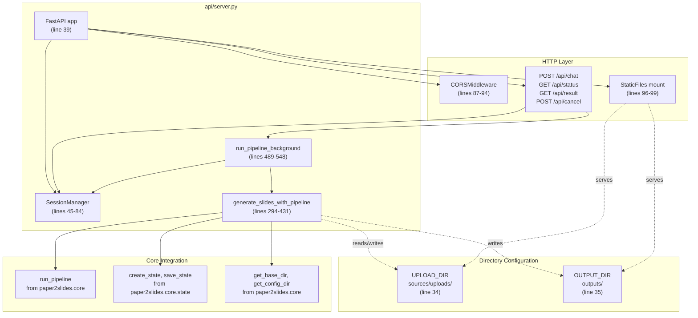
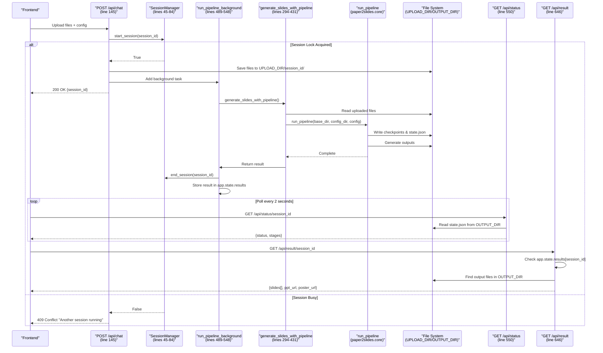
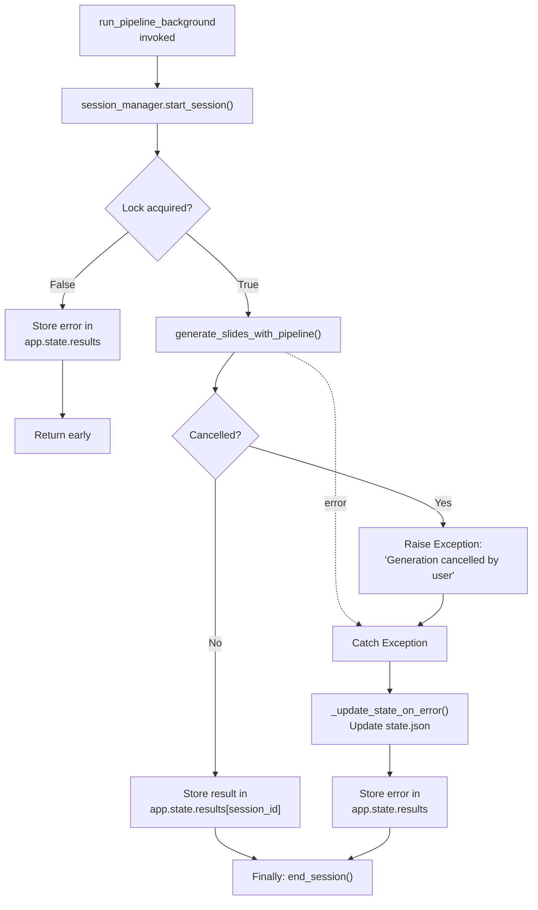
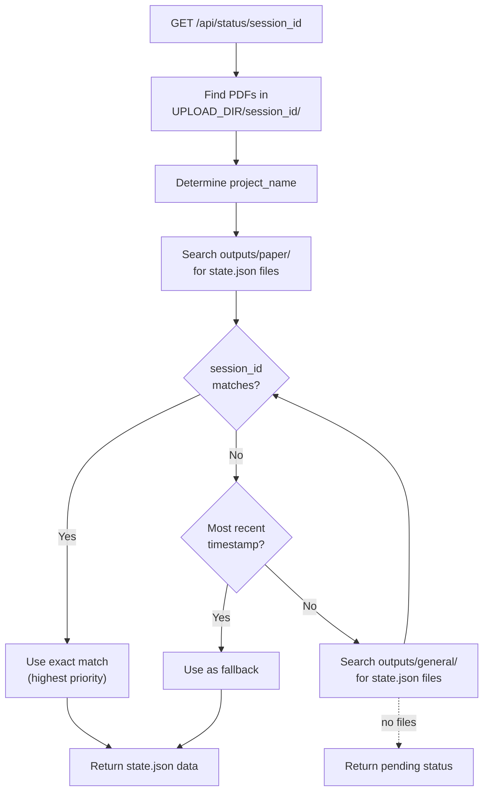

<!-- source: DeepWiki mcp.deepwiki.com · repo HKUDS/Paper2Slides · page 4.1 Backend API Server · fetched 2026-11-09 -->

# Backend API Server

<details>
<summary>Relevant source files</summary>

The following files were used as context for generating this wiki page:

- [README.md](README.md)
- [api/server.py](api/server.py)

</details>


## Purpose and Scope

This document describes the FastAPI backend server that powers the Paper2Slides web interface. The backend coordinates file uploads, manages concurrent processing sessions, executes the core pipeline in background tasks, and serves generated outputs. For detailed API endpoint specifications, see [API Endpoints Reference](#4.1.1). For session lifecycle and concurrency control details, see [Session Management](#4.1.2). For information about the frontend that communicates with this backend, see [Frontend Architecture](#4.2).

**Sources:** [api/server.py:1-773]()

---

## Server Architecture

The backend is implemented as a FastAPI application in [api/server.py]() that bridges HTTP requests from the React frontend to the core Paper2Slides pipeline. The server enforces single-threaded execution through `SessionManager`, uses background tasks for non-blocking pipeline execution, and provides polling endpoints for status updates.

### Component Overview



**Sources:** [api/server.py:1-99](), [api/server.py:294-431](), [api/server.py:489-548]()

---

## Request Processing Flow

The backend implements an asynchronous request-response pattern where the initial request returns immediately with a `session_id`, while the actual pipeline execution happens in a background task. The frontend polls for status updates until completion.

### Complete Request Lifecycle



**Sources:** [api/server.py:145-292](), [api/server.py:489-548](), [api/server.py:550-644](), [api/server.py:646-727]()

---

## Core Components

### FastAPI Application

The server is initialized at [api/server.py:39]() with title "Paper2Slides API" and version "1.0.0". Logging is configured through `setup_logging(level=logging.INFO)` at [api/server.py:42]().

```python
app = FastAPI(title="Paper2Slides API", version="1.0.0")
```

**Sources:** [api/server.py:39-42]()

### SessionManager

The `SessionManager` class [api/server.py:45-84]() enforces single-threaded execution of the pipeline to prevent resource conflicts. It maintains:
- `running_session`: Currently active session ID or `None`
- `cancelled_sessions`: Set of session IDs marked for cancellation
- `lock`: Asyncio lock for thread-safe state access

| Method | Purpose | Returns |
|--------|---------|---------|
| `start_session(session_id)` | Acquire execution lock | `True` if acquired, `False` if busy |
| `end_session(session_id)` | Release execution lock | None |
| `cancel_session(session_id)` | Mark session for cancellation | `True` if was running |
| `is_cancelled(session_id)` | Check cancellation status | Boolean |
| `get_running_session()` | Get active session ID | Session ID or `None` |

The global instance is created at [api/server.py:85]():
```python
session_manager = SessionManager()
```

**Sources:** [api/server.py:45-85]()

### CORS Configuration

CORS middleware is configured at [api/server.py:87-94]() to allow requests from local development servers:

```python
allow_origins=["http://localhost:3000", "http://localhost:5173", 
               "http://127.0.0.1:3000", "http://127.0.0.1:5173"]
```

This permits the Vite development server (default port 5173) and React development server (port 3000) to communicate with the backend.

**Sources:** [api/server.py:87-94]()

### Static File Serving

Two static file mounts are configured at [api/server.py:96-99]():

| Mount Point | Directory | Purpose |
|-------------|-----------|---------|
| `/outputs` | `OUTPUT_DIR` | Serve generated slides/posters |
| `/uploads` | `UPLOAD_DIR` | Serve uploaded source files |

This allows the frontend to directly access files via HTTP paths like `/outputs/paper/project_name/normal/slides_doraemon_medium/20240101_120000/slide_01.png`.

**Sources:** [api/server.py:96-99]()

---

## File Management

### Directory Structure

Two main directories are initialized at server startup [api/server.py:34-37]():

```
PROJECT_ROOT/
├── sources/uploads/          # UPLOAD_DIR
│   └── <session_id>/         # Per-session upload directories
│       ├── paper.pdf
│       └── document.docx
└── outputs/                  # OUTPUT_DIR
    └── <content_type>/
        └── <project_name>/
            └── <mode>/
                ├── checkpoint_rag.json
                ├── checkpoint_summary.json
                └── <config_hash>/
                    ├── state.json
                    └── <timestamp>/
                        ├── slide_01.png
                        └── slides.pdf
```

**Session-Based Uploads:** When files are uploaded via `/api/chat`, they are saved to `UPLOAD_DIR/session_id/` [api/server.py:206-234](). The `session_id` is a UUID generated per upload request.

**Output Organization:** Generated files are organized according to the configuration-driven hierarchy documented in [File Management](#6). The backend uses utility functions from `paper2slides.core` to determine paths:
- `get_base_dir(OUTPUT_DIR, project_name, content_type)` [api/server.py:374]()
- `get_config_dir(base_dir, config)` [api/server.py:375]()

**Sources:** [api/server.py:34-37](), [api/server.py:206-234](), [api/server.py:374-375]()

### Project Name Resolution

The backend determines the project name based on uploaded files [api/server.py:349-360]():

| Scenario | Project Name Logic | Input Path |
|----------|-------------------|------------|
| Single PDF | Extract from filename via `get_project_name(pdf_path)` | PDF file path |
| Multiple PDFs | `session_{first_8_chars_of_uuid}` | Session directory path |

**Sources:** [api/server.py:349-360]()

---

## Background Processing

### Pipeline Execution

The `run_pipeline_background` function [api/server.py:489-548]() executes in a FastAPI `BackgroundTasks` context. It coordinates with `SessionManager` and handles the complete pipeline lifecycle:



**Sources:** [api/server.py:489-548]()

### Configuration Building

The `generate_slides_with_pipeline` function [api/server.py:294-431]() builds a configuration dictionary matching the CLI format:

```python
config = {
    "input_path": input_path,
    "pdf_paths": pdf_paths,
    "content_type": content,
    "output_type": output_type,
    "style": style_type,
    "custom_style": custom_style,
    "slides_length": length or "medium",
    "poster_density": density or "medium",
    "fast_mode": fast_mode if content == "paper" else False,
}
```

This configuration is passed to `run_pipeline(base_dir, config_dir, config, from_stage, session_id, session_manager)` [api/server.py:408]().

**Style Priority Logic** [api/server.py:328-343]():
1. If user message is provided → use as custom style
2. If style is predefined (`academic`, `doraemon`) → use predefined
3. Otherwise → use style parameter as custom description

**Sources:** [api/server.py:294-431](), [api/server.py:328-343](), [api/server.py:362-373]()

### Initial State Creation

Before executing the pipeline, the backend creates and saves an initial state [api/server.py:391-404]():

```python
from paper2slides.core.state import create_state, save_state, STAGES

initial_state = create_state(config)
initial_state["session_id"] = session_id

# Mark stages before from_stage as completed
start_idx = STAGES.index(from_stage)
for i in range(start_idx):
    initial_state["stages"][STAGES[i]] = "completed"

save_state(config_dir, initial_state)
```

This allows the frontend to immediately start polling for status even before the pipeline begins execution.

**Sources:** [api/server.py:391-404]()

---

## State Tracking and Polling

### Status Endpoint Logic

The `/api/status/{session_id}` endpoint [api/server.py:550-644]() locates the `state.json` file for a session by:

1. Finding uploaded PDF files in `UPLOAD_DIR/session_id/` [api/server.py:555-562]()
2. Determining project name (single vs multiple PDFs) [api/server.py:565-569]()
3. Searching both `paper` and `general` content type directories [api/server.py:578-609]()
4. Prioritizing exact `session_id` match, falling back to most recent timestamp [api/server.py:588-608]()

**State.json Lookup Strategy:**


**Status Determination** [api/server.py:623-631]():
- `failed`: Any stage has status "failed"
- `completed`: All stages have status "completed"
- `running`: Any stage has status "running"
- `pending`: Otherwise

**Sources:** [api/server.py:550-644]()

### Result Endpoint Logic

The `/api/result/{session_id}` endpoint [api/server.py:646-727]() retrieves completed results from the in-memory cache `app.state.results` [api/server.py:651-652]().

**Response Construction** [api/server.py:658-714]():
1. Extract output files from result dictionary
2. Find PDF file (final output)
3. Find image files (individual slides/poster)
4. Determine `output_type` from `state.json` to decide response format
5. Build response with relative URLs using `/outputs/` mount point

**Output Type Handling:**
- `slides`: PDF link returned in `ppt_url` field
- `poster`: PDF link returned in `poster_url` field, or first image if no PDF

**Sources:** [api/server.py:646-727]()

---

## Error Handling

### Error Propagation

Errors during pipeline execution are captured at two levels:

1. **In-Memory Cache** [api/server.py:532-537](): Stored in `app.state.results[session_id]` with `{"error": str(e)}`
2. **State File** [api/server.py:539-543](): Updated via `_update_state_on_error()` to mark failed stage in `state.json`

The `_update_state_on_error` function [api/server.py:433-487]() reconstructs the project structure to locate the correct `state.json` file and marks the currently running stage as "failed".

**Sources:** [api/server.py:433-487](), [api/server.py:532-543]()

### Concurrent Request Handling

When a request arrives while another session is running, the endpoint returns HTTP 409 Conflict [api/server.py:177-202]():

```python
if running_session and running_session != session_id:
    raise HTTPException(
        status_code=409, 
        detail=f"Another session is already running. Running session: {running_session[:8]}"
    )
```

**Sources:** [api/server.py:177-202]()

### File Security

The `/api/download/{filepath:path}` endpoint [api/server.py:729-750]() includes path traversal protection [api/server.py:735-741]():

```python
file_path = file_path.resolve()
OUTPUT_DIR.resolve()
if not str(file_path).startswith(str(OUTPUT_DIR.resolve())):
    raise HTTPException(status_code=403, detail="Access denied")
```

This prevents access to files outside the `OUTPUT_DIR`.

**Sources:** [api/server.py:729-750]()

---

## Server Launch

The server can be started directly using uvicorn [api/server.py:753-772]():

```bash
python api/server.py [port]
```

The default port is 8001. Configuration parameters [api/server.py:765-772]():

| Parameter | Value | Purpose |
|-----------|-------|---------|
| `host` | `0.0.0.0` | Accept connections from any network interface |
| `port` | 8001 (default) | HTTP port |
| `timeout_keep_alive` | 300 seconds | Keep connections alive for long-running requests |
| `limit_concurrency` | 10 | Maximum concurrent connections |
| `limit_max_requests` | 1000 | Maximum total requests before restart |

In practice, the server is typically launched via shell scripts `scripts/start_backend.sh` which may override these defaults.

**Sources:** [api/server.py:753-772](), [README.md:177-183]()

---

## Integration with Core Pipeline

### Pipeline Invocation

The backend invokes the core pipeline through the `run_pipeline` function imported from `paper2slides.core` [api/server.py:26-29]():

```python
from paper2slides.core import (
    run_pipeline, get_base_dir, get_config_dir,
    get_config_name, detect_start_stage
)
```

The invocation passes the `session_manager` to enable cancellation checks during pipeline execution [api/server.py:408]():

```python
await run_pipeline(base_dir, config_dir, config, from_stage, session_id, session_manager)
```

For details on how the pipeline processes stages, see [Core Pipeline Architecture](#2).

**Sources:** [api/server.py:26-29](), [api/server.py:408]()

### Stage Detection

Before executing the pipeline, the backend calls `detect_start_stage` [api/server.py:388-389]() to determine whether to resume from a checkpoint:

```python
from_stage = detect_start_stage(base_dir, config_dir, config)
```

This implements the Smart Recovery System documented in [Smart Recovery System](#2.5).

**Sources:** [api/server.py:388-389]()

---

