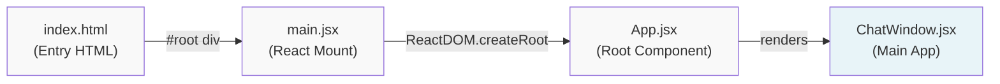
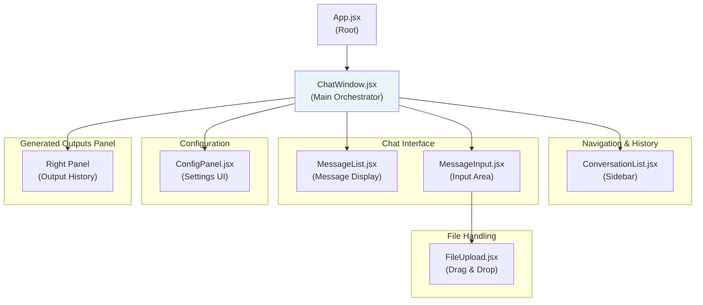
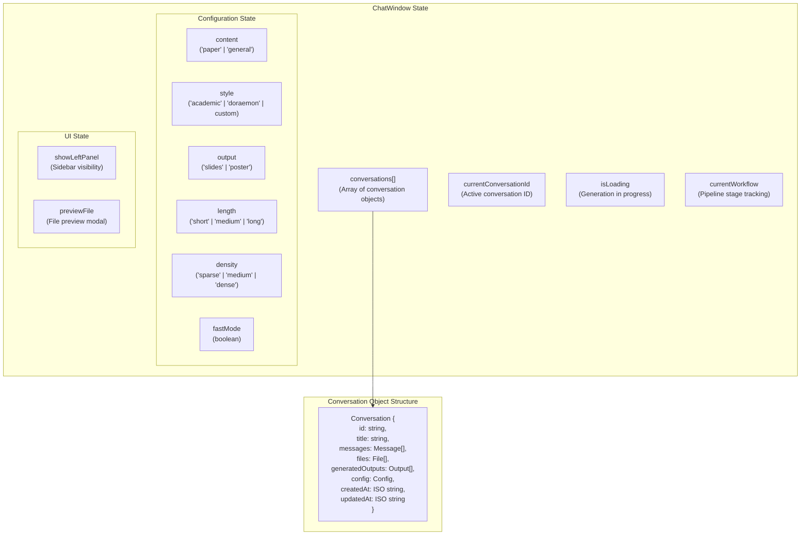
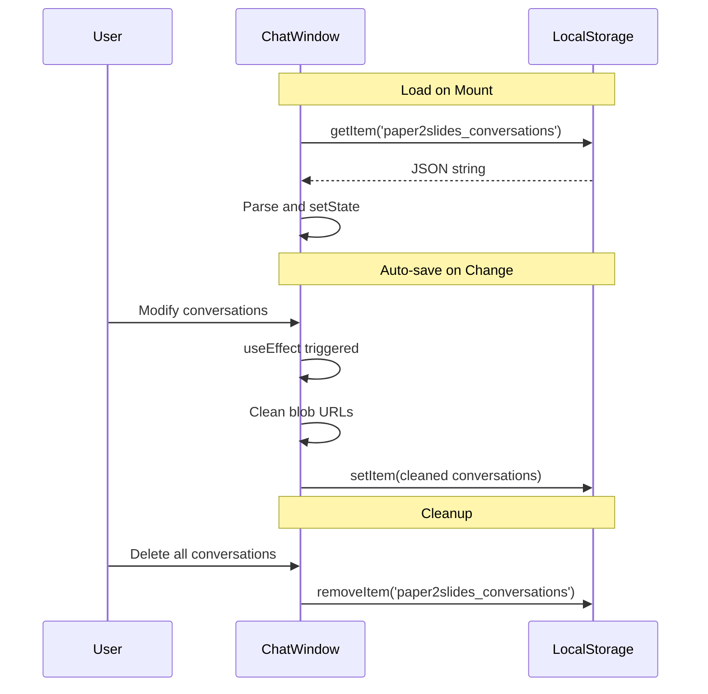
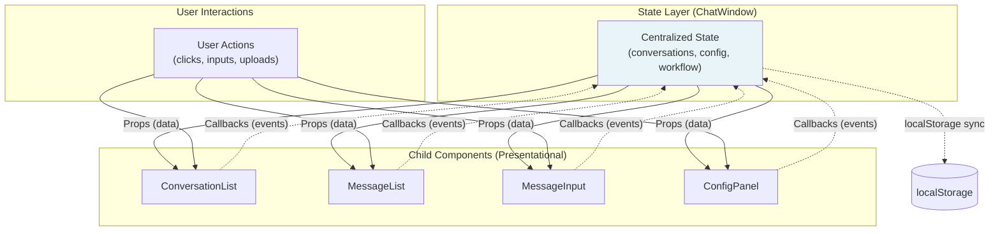
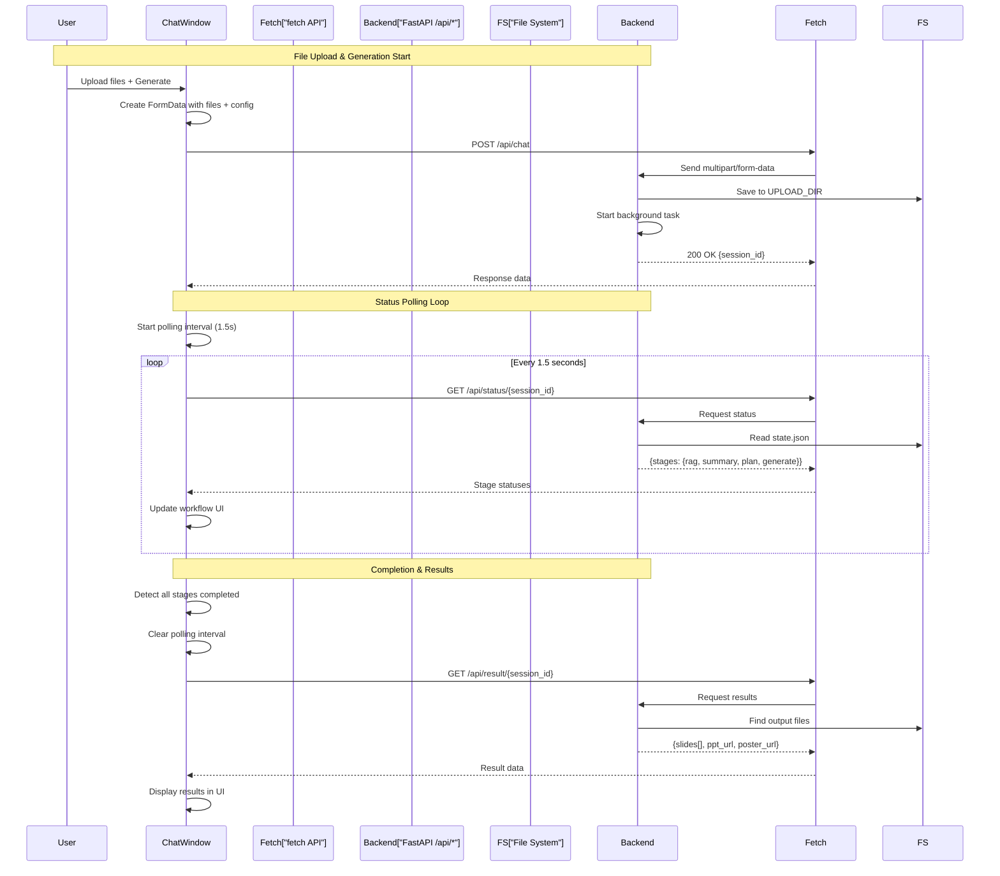
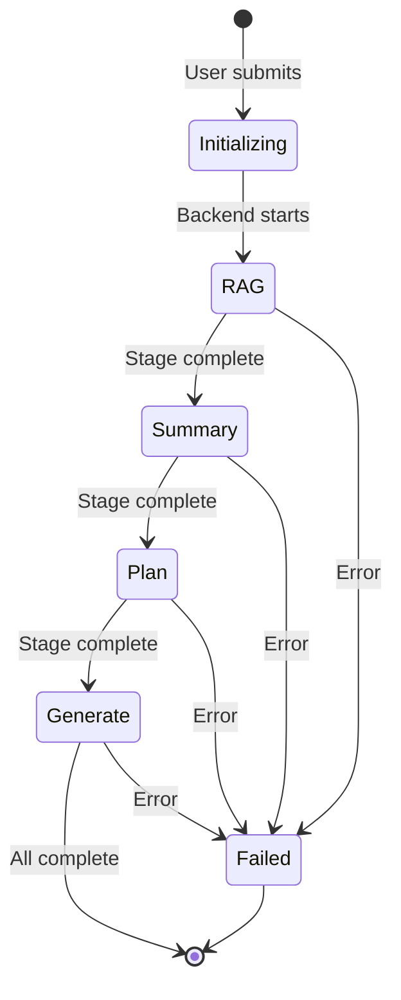
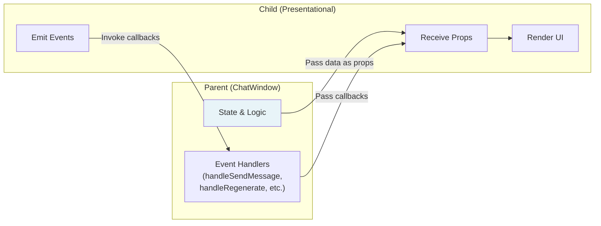
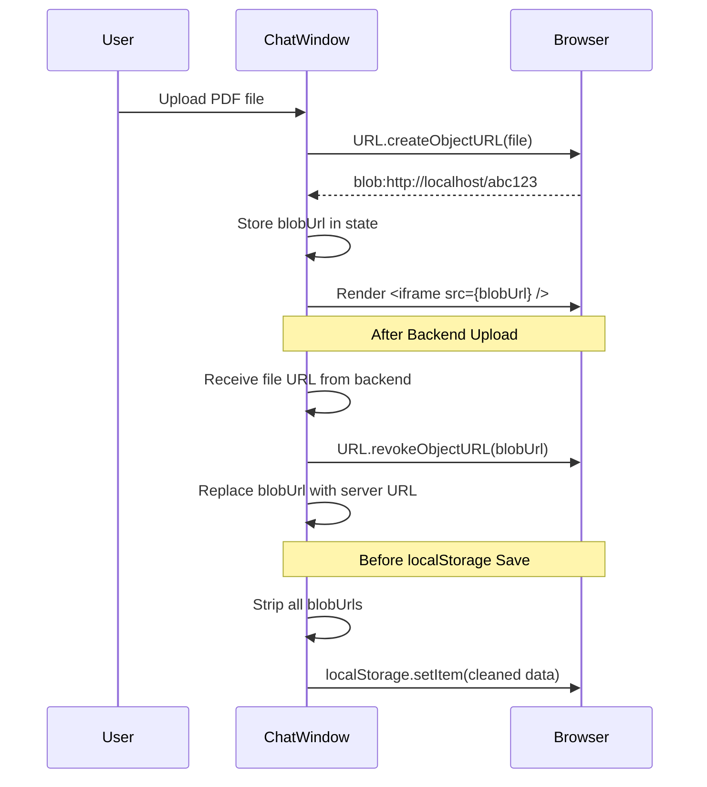
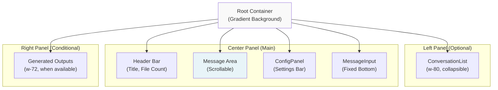

<!-- source: DeepWiki mcp.deepwiki.com · repo HKUDS/Paper2Slides · page 4.2 Frontend Architecture · fetched 2026-11-09 -->

# Frontend Architecture

<details>
<summary>Relevant source files</summary>

The following files were used as context for generating this wiki page:

- [frontend/index.html](frontend/index.html)
- [frontend/package.json](frontend/package.json)
- [frontend/src/App.jsx](frontend/src/App.jsx)
- [frontend/src/components/ChatWindow.jsx](frontend/src/components/ChatWindow.jsx)

</details>


## Purpose and Scope

This document provides an overview of the Paper2Slides React frontend architecture, including the technology stack, component hierarchy, state management patterns, and communication mechanisms with the backend. For detailed information about specific components, see:
- [ChatWindow Component](#4.2.1) - Main application orchestrator
- [Configuration Components](#4.2.2) - Settings and parameter controls
- [File Upload Components](#4.2.3) - File selection and drag-and-drop
- [Message and History Components](#4.2.4) - Chat display and conversation history

For backend API details, see [Backend API Server](#4.1).

---

## Technology Stack

The frontend is built using modern web technologies optimized for interactive single-page applications:

| Technology | Version | Purpose |
|------------|---------|---------|
| **React** | 18.2.0 | UI component framework with hooks |
| **React DOM** | 18.2.0 | React rendering to DOM |
| **Vite** | 4.3.9 | Build tool and dev server |
| **TailwindCSS** | 3.3.2 | Utility-first CSS framework |
| **Axios** | 1.4.0 | HTTP client (imported but fetch used primarily) |
| **lucide-react** | 0.263.1 | Icon library |
| **PostCSS** | 8.4.24 | CSS processing |
| **Autoprefixer** | 10.4.14 | CSS vendor prefixing |

**Sources:** [frontend/package.json:1-24]()

---

## Application Entry Points

The application follows a standard React initialization flow:



### index.html
The HTML entry point defines a minimal structure with:
- Document metadata and viewport configuration
- Root mounting point: `<div id="root"></div>`
- Module script import: `<script type="module" src="/src/main.jsx"></script>`

**Sources:** [frontend/index.html:1-13]()

### main.jsx
Initializes React and mounts the root component (not shown in provided files but referenced by [frontend/index.html:11]()).

### App.jsx
The root React component that wraps the entire application. It renders `ChatWindow` within a full-screen container with gradient background styling:

```jsx
<div className="h-screen w-screen bg-[#faf9f6] dark:bg-[#171717]">
  <ChatWindow />
</div>
```

**Sources:** [frontend/src/App.jsx:1-12]()

---

## Component Hierarchy

The frontend follows a hierarchical component structure with `ChatWindow` as the central orchestrator:



**Component Responsibilities:**

| Component | File | Primary Responsibility |
|-----------|------|----------------------|
| `App` | App.jsx | Root container with global styling |
| `ChatWindow` | ChatWindow.jsx | State management, API orchestration, conversation coordination |
| `ConversationList` | ConversationList.jsx | Display and manage conversation history |
| `MessageList` | MessageList.jsx | Render chat messages and workflow status |
| `MessageInput` | MessageInput.jsx | Handle user input and file selection |
| `ConfigPanel` | ConfigPanel.jsx | Display and modify generation parameters |
| `FileUpload` | FileUpload.jsx | Drag-and-drop file upload interface |

**Sources:** [frontend/src/App.jsx:1-12](), [frontend/src/components/ChatWindow.jsx:1-10]()

---

## State Management Architecture

The application uses React's built-in state management with `useState` hooks, following a centralized state pattern where `ChatWindow` acts as the single source of truth.

### State Structure



**Key State Variables:**

| State Variable | Type | Purpose | Location |
|----------------|------|---------|----------|
| `conversations` | Array | All conversation history | [ChatWindow.jsx:13]() |
| `currentConversationId` | String | Active conversation identifier | [ChatWindow.jsx:14]() |
| `isLoading` | Boolean | Generation process status | [ChatWindow.jsx:21]() |
| `currentWorkflow` | Object | Pipeline stage progress tracking | [ChatWindow.jsx:32]() |
| `content` | String | Content type ('paper'/'general') | [ChatWindow.jsx:24]() |
| `style` | String | Presentation style | [ChatWindow.jsx:25]() |
| `output` | String | Output type ('slides'/'poster') | [ChatWindow.jsx:26]() |
| `length` | String | Slides length parameter | [ChatWindow.jsx:27]() |
| `density` | String | Poster density parameter | [ChatWindow.jsx:28]() |
| `fastMode` | Boolean | Fast processing mode toggle | [ChatWindow.jsx:29]() |

**Sources:** [frontend/src/components/ChatWindow.jsx:13-35]()

### Persistence Strategy

Conversations are persisted to `localStorage` for session continuity:



**Key Implementation Details:**
- Load: [ChatWindow.jsx:43-57]() - Reads from `localStorage` on component mount
- Save: [ChatWindow.jsx:61-80]() - Automatic save via `useEffect` dependency on `conversations`
- Cleanup: Blob URLs are stripped before saving to prevent stale references [ChatWindow.jsx:63-77]()

**Sources:** [frontend/src/components/ChatWindow.jsx:42-80]()

---

## Data Flow Architecture

The application follows React's unidirectional data flow pattern with a centralized state management approach:



### Props Down Pattern

Child components receive read-only data and callback functions:

**Example: ConversationList Props**
```javascript
<ConversationList
  conversations={conversations}                    // Data prop
  currentConversationId={currentConversationId}   // Data prop
  onSelectConversation={handleSelectConversation}  // Callback
  onNewConversation={handleNewConversation}        // Callback
  onDeleteConversation={handleDeleteConversation}  // Callback
  onCollapse={() => setShowLeftPanel(false)}       // Callback
/>
```
**Sources:** [frontend/src/components/ChatWindow.jsx:987-994]()

**Example: MessageInput Props**
```javascript
<MessageInput
  onSendMessage={handleSendMessage}     // Callback
  isLoading={isLoading}                 // Data prop
  outputType={output}                   // Data prop
  style={style}                         // Data prop
  preSelectedFiles={[]}                 // Data prop
  onPreSelectedFilesClear={() => {}}    // Callback
  hasMessages={messages.length > 0}     // Data prop
/>
```
**Sources:** [frontend/src/components/ChatWindow.jsx:1139-1146]()

### State Update Functions

`ChatWindow` provides memoized callback functions using `useCallback` to prevent unnecessary re-renders:

| Function | Purpose | Location |
|----------|---------|----------|
| `updateConversation` | Update conversation properties | [ChatWindow.jsx:170-181]() |
| `addMessage` | Add message with duplicate detection | [ChatWindow.jsx:184-221]() |
| `addFilesToConversation` | Add files with duplicate prevention | [ChatWindow.jsx:224-237]() |
| `handleNewConversation` | Create or reuse empty conversation | [ChatWindow.jsx:249-274]() |
| `handleSelectConversation` | Switch active conversation | [ChatWindow.jsx:277-294]() |
| `handleDeleteConversation` | Remove conversation | [ChatWindow.jsx:297-312]() |
| `handleCancelGeneration` | Abort active pipeline | [ChatWindow.jsx:315-354]() |
| `handleSendMessage` | Process user input and start generation | [ChatWindow.jsx:458-766]() |
| `handleRegenerate` | Re-run pipeline with new config | [ChatWindow.jsx:768-975]() |

**Sources:** [frontend/src/components/ChatWindow.jsx:170-975]()

---

## Backend Communication

The frontend communicates with the FastAPI backend using the native `fetch` API, with a polling-based approach for long-running operations.

### API Interaction Flow



### Key API Endpoints

| Endpoint | Method | Purpose | Implementation |
|----------|--------|---------|----------------|
| `/api/chat` | POST | Upload files and start generation | [ChatWindow.jsx:577-591]() |
| `/api/status/{session_id}` | GET | Poll pipeline progress | [ChatWindow.jsx:606-673]() |
| `/api/result/{session_id}` | GET | Fetch final outputs | [ChatWindow.jsx:367-441]() |
| `/api/cancel/{session_id}` | POST | Cancel active generation | [ChatWindow.jsx:331-343]() |

**Sources:** [frontend/src/components/ChatWindow.jsx:577-673]()

### Polling Mechanism

The application uses a session-based polling strategy with `setInterval`:

**Polling Management:**
- **Interval Storage:** `pollIntervalsRef` (useRef Map) stores interval IDs keyed by `session_id` [ChatWindow.jsx:38]()
- **Poll Frequency:** 1500ms (1.5 seconds) [ChatWindow.jsx:677](), [ChatWindow.jsx:933]()
- **Duplicate Prevention:** `fetchingResultsRef` (useRef Set) prevents concurrent result fetches [ChatWindow.jsx:40](), [ChatWindow.jsx:359-364]()
- **Cleanup:** Intervals are cleared on completion, error, or component unmount [ChatWindow.jsx:83-91](), [ChatWindow.jsx:649-654]()

**Polling Lifecycle:**
```javascript
// Start polling
const statusPollInterval = setInterval(async () => {
  const statusResponse = await fetch(`/api/status/${sessionId}`)
  const statusData = await statusResponse.json()
  // Update workflow stages...
  
  if (allCompleted || anyFailed) {
    clearInterval(intervalId)
    pollIntervalsRef.current.delete(sessionId)
  }
}, 1500)

pollIntervalsRef.current.set(sessionId, statusPollInterval)
```

**Sources:** [frontend/src/components/ChatWindow.jsx:604-681](), [frontend/src/components/ChatWindow.jsx:860-937]()

### File Upload Strategy

Files are uploaded using `FormData` with immediate blob URL creation for preview:

```javascript
const formData = new FormData()
formData.append('message', text)
formData.append('content', content)
formData.append('output_type', output)
formData.append('style', style)
formData.append('length', length)
formData.append('density', density)
formData.append('fast_mode', fastMode ? 'true' : 'false')

files.forEach((file) => {
  formData.append('files', file)
})

// Create blob URLs for immediate preview
const filesWithBlobUrls = files.map(f => ({
  name: f.name,
  blobUrl: URL.createObjectURL(f),
  url: null  // Set after backend response
}))
```

**Sources:** [frontend/src/components/ChatWindow.jsx:558-575](), [frontend/src/components/ChatWindow.jsx:487-497]()

---

## Workflow Stage Tracking

The frontend maintains real-time visual feedback of the 4-stage pipeline through the `currentWorkflow` state object:



**Workflow Object Structure:**
```javascript
const workflow = {
  outputType: 'slides',
  style: 'academic',
  content: 'paper',
  conversationId: 'conv-id-123',
  stages: [
    { 
      id: 'rag', 
      name: 'RAG', 
      status: 'pending',  // 'pending' | 'active' | 'completed' | 'failed'
      description: 'Building knowledge graph from documents' 
    },
    { id: 'summary', name: 'Summary', status: 'pending', ... },
    { id: 'plan', name: 'Plan', status: 'pending', ... },
    { id: 'generate', name: 'Generate', status: 'pending', ... }
  ],
  currentStep: 'Initializing...',
  error: null
}
```

**Status Mapping from Backend:**
The frontend maps backend stage statuses to UI states:
```javascript
const backendStatus = stages[stage.id]  // From /api/status
let status = 'pending'
if (backendStatus === 'completed') status = 'completed'
else if (backendStatus === 'running') status = 'active'
else if (backendStatus === 'failed') status = 'failed'
```

**Sources:** [frontend/src/components/ChatWindow.jsx:539-551](), [frontend/src/components/ChatWindow.jsx:622-629]()

---

## Build System and Development

The frontend uses **Vite** as the build tool and development server, offering fast Hot Module Replacement (HMR) and optimized production builds.

### Build Configuration

**Available Scripts:**

| Script | Command | Purpose |
|--------|---------|---------|
| `dev` | `vite` | Start development server with HMR |
| `build` | `vite build` | Create production build |
| `preview` | `vite preview` | Preview production build locally |

**Sources:** [frontend/package.json:6-9]()

### Vite Plugin Configuration

The application uses `@vitejs/plugin-react` for React Fast Refresh and JSX transformation:

```json
{
  "devDependencies": {
    "@vitejs/plugin-react": "^4.0.0",
    "vite": "^4.3.9"
  }
}
```

**Expected vite.config.js structure (referenced but not provided):**
```javascript
import { defineConfig } from 'vite'
import react from '@vitejs/plugin-react'

export default defineConfig({
  plugins: [react()],
  server: {
    proxy: {
      '/api': 'http://localhost:8000'  // Proxy to FastAPI backend
    }
  }
})
```

**Sources:** [frontend/package.json:18-22]()

### Development Server

When running `npm run dev`, Vite starts a development server (typically on `http://localhost:5173`) with:
- **Hot Module Replacement (HMR):** Instant updates without full page reload
- **API Proxy:** `/api/*` requests forwarded to FastAPI backend at `http://localhost:8000`
- **Fast Startup:** Sub-second server startup using native ES modules

---

## Component Communication Patterns

### Parent-Child Communication



**Example: Configuration Panel Communication**

**Data Flow:**
1. `ChatWindow` holds configuration state: `content`, `style`, `output`, `length`, `density`, `fastMode`
2. `ConfigPanel` receives both values and setter functions as props
3. User changes configuration in `ConfigPanel`
4. `ConfigPanel` calls setter functions (e.g., `setStyle('academic')`)
5. `ChatWindow` state updates
6. All dependent components re-render with new values

**Implementation:**
```jsx
<ConfigPanel
  content={content}
  setContent={setContent}
  style={style}
  setStyle={setStyle}
  output={output}
  setOutput={setOutput}
  length={length}
  setLength={setLength}
  density={density}
  setDensity={setDensity}
  fastMode={fastMode}
  setFastMode={setFastMode}
  compact={messages.length > 0}
  onRegenerate={handleRegenerate}
  isLoading={isLoading}
/>
```

**Sources:** [frontend/src/components/ChatWindow.jsx:1117-1133]()

---

## Error Handling and User Feedback

The frontend implements multiple error handling strategies:

### Network Error Handling

```javascript
try {
  const response = await fetch('/api/chat', {
    method: 'POST',
    body: formData,
    signal: abortControllerRef.current.signal
  })

  if (!response.ok) {
    const errorData = await response.json().catch(() => ({}))
    if (response.status === 409) {
      throw new Error('Another session is already running...')
    }
    throw new Error(`HTTP error! status: ${response.status}`)
  }
} catch (error) {
  if (error.name === 'AbortError') {
    // User cancelled
    addMessage(convId, { role: 'assistant', content: 'Generation cancelled' })
  } else {
    // Network or server error
    addMessage(convId, { role: 'assistant', content: 'Error occurred', isError: true })
  }
}
```

**Sources:** [frontend/src/components/ChatWindow.jsx:583-760]()

### Duplicate Prevention

The application prevents duplicate messages and outputs using content and URL matching:

**Message Deduplication:**
```javascript
const isDuplicate = conv.messages.some(existing => {
  // Check URL match for assistant messages
  if (message.role === 'assistant' && existing.role === 'assistant') {
    if (message.pptUrl && existing.pptUrl && message.pptUrl === existing.pptUrl) {
      return true
    }
  }
  
  // Check content and timestamp for other messages
  const sameContent = existing.content === message.content
  const sameRole = existing.role === message.role
  const recentTimestamp = Math.abs(existingTime - messageTime) < 3000
  return sameContent && sameRole && recentTimestamp
})
```

**Sources:** [frontend/src/components/ChatWindow.jsx:187-206]()

---

## Memory Management

### Blob URL Lifecycle

The application creates blob URLs for immediate file preview but manages their lifecycle carefully:



**Blob URL Creation:**
```javascript
const filesWithBlobUrls = files.map(f => {
  const isPdf = f.type === 'application/pdf' || f.name?.toLowerCase().endsWith('.pdf')
  const blobUrl = isPdf ? URL.createObjectURL(f) : null
  return { name: f.name, blobUrl, url: null }
})
```

**Blob URL Cleanup:**
```javascript
// Clean up when server URL received
if (file.blobUrl) {
  URL.revokeObjectURL(file.blobUrl)
}
return { ...file, url: uploadedFile.url, blobUrl: null }
```

**localStorage Sanitization:**
```javascript
const cleanConversations = conversations.map(conv => ({
  ...conv,
  files: conv.files?.map(f => {
    const { blobUrl, ...cleanFile } = f  // Remove blobUrl
    return cleanFile
  })
}))
```

**Sources:** [frontend/src/components/ChatWindow.jsx:487-497](), [frontend/src/components/ChatWindow.jsx:691-698](), [frontend/src/components/ChatWindow.jsx:63-77]()

---

## UI Layout Structure

The application uses a three-panel layout with responsive behavior:



**Layout Implementation:**
- **Root:** `flex h-full w-full` - Flexbox container [ChatWindow.jsx:983]()
- **Left Panel:** `w-80 flex-shrink-0` - Fixed 320px width [ChatWindow.jsx:986]()
- **Center Panel:** `flex-1 min-w-0` - Grows to fill space [ChatWindow.jsx:999]()
- **Right Panel:** `w-72 flex-shrink-0` - Fixed 288px width, conditional render [ChatWindow.jsx:1153]()

**Panel Visibility:**
- Left panel controlled by `showLeftPanel` state [ChatWindow.jsx:31]()
- Right panel shown when `generatedOutputs.length > 0` [ChatWindow.jsx:1152]()

**Sources:** [frontend/src/components/ChatWindow.jsx:983-1189]()

---

## Summary

The Paper2Slides frontend is a modern React application built with:

1. **React 18** with hooks-based state management
2. **Vite** for fast development and optimized builds
3. **Centralized state** in `ChatWindow` with unidirectional data flow
4. **Polling-based** real-time progress updates
5. **localStorage persistence** for conversation history
6. **Careful memory management** with blob URL cleanup
7. **Component-based architecture** with clear separation of concerns

The architecture emphasizes **simplicity**, **maintainability**, and **user experience** through responsive UI updates, persistent sessions, and efficient communication with the backend pipeline.

**Sources:** [frontend/package.json:1-24](), [frontend/src/App.jsx:1-12](), [frontend/src/components/ChatWindow.jsx:1-1265](), [frontend/index.html:1-13]()

---

