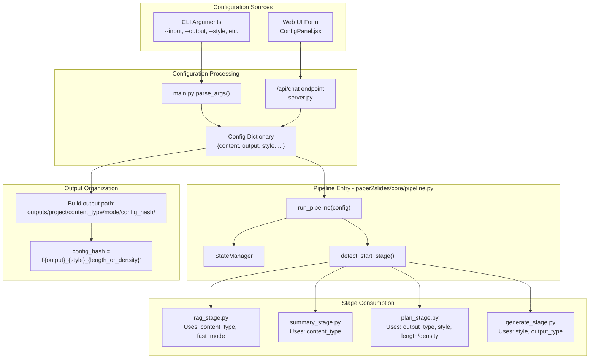
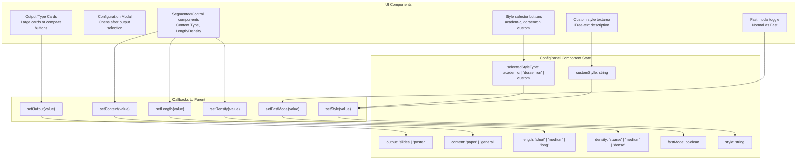
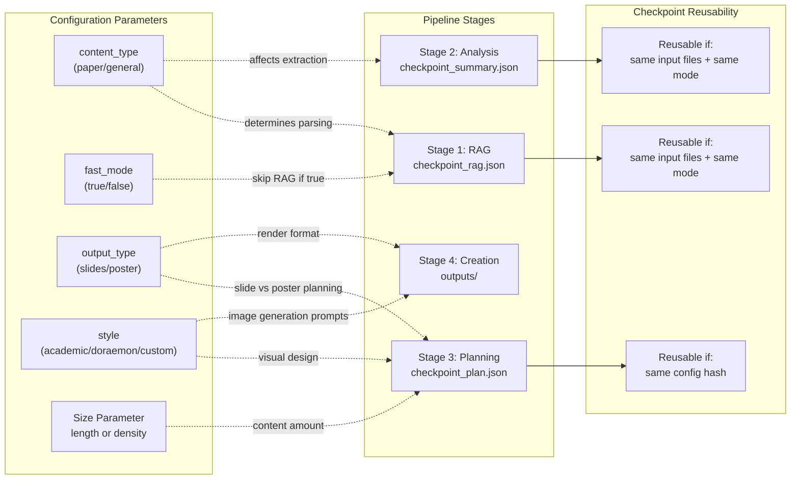
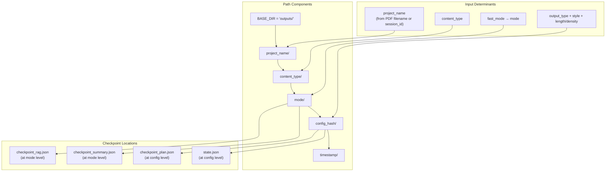

<!-- source: DeepWiki mcp.deepwiki.com · repo HKUDS/Paper2Slides · page 5 Configuration Guide · fetched 2026-11-09 -->

# Configuration Guide

<details>
<summary>Relevant source files</summary>

The following files were used as context for generating this wiki page:

- [README.md](README.md)
- [frontend/src/components/ConfigPanel.jsx](frontend/src/components/ConfigPanel.jsx)

</details>


## Purpose and Scope

This document provides a comprehensive reference for all configuration options available in Paper2Slides. Configuration parameters control the processing pipeline behavior, output format, visual styling, and content organization. 

For specific details about output types (slides vs posters), see [Output Types: Slides vs Posters](#5.1). For styling options, see [Style Configuration](#5.2). For processing mode differences, see [Processing Modes: Normal vs Fast](#5.3). For content type and sizing parameters, see [Content Type and Length Options](#5.4).

---

## Configuration Parameters Overview

Paper2Slides accepts configuration through two interfaces: command-line arguments and web UI form controls. All configuration parameters ultimately flow into the core pipeline and affect processing stages, output organization, and file naming.

### Core Configuration Parameters

The following table lists all configuration parameters recognized by the system:

| Parameter | Type | Values | Default | Affects Stages | Description |
|-----------|------|--------|---------|---------------|-------------|
| `content_type` | string | `paper`, `general` | `paper` | RAG, Analysis | Document type for specialized processing |
| `output_type` | string | `slides`, `poster` | `poster` | Planning, Creation | Output format to generate |
| `style` | string | `academic`, `doraemon`, custom text | `doraemon` | Planning, Creation | Visual styling theme |
| `length` | string | `short`, `medium`, `long` | `short` | Planning | Slide count target (5-8, 8-12, 12-15) |
| `density` | string | `sparse`, `medium`, `dense` | `medium` | Planning | Poster content density |
| `fast_mode` | boolean | `true`, `false` | `false` | RAG | Skip RAG indexing for short documents |
| `from_stage` | string | `rag`, `summary`, `plan`, `generate` | auto-detect | Pipeline | Force restart from specific stage |

**Sources:** [README.md:139-151](), [README.md:214-228]()

---

## Configuration Flow Through System

The following diagram illustrates how configuration parameters are consumed by different system components and pipeline stages:

### Configuration Parameter Flow



**Sources:** [README.md:139-151](), [frontend/src/components/ConfigPanel.jsx:4-20]()

---

## Command-Line Configuration

The CLI accepts configuration parameters as command-line flags. The entry point is [paper2slides/main.py]() which parses arguments and passes them to `run_pipeline()`.

### CLI Arguments

```bash
# Basic usage with configuration
python -m paper2slides \
  --input paper.pdf \
  --output slides \
  --content paper \
  --style doraemon \
  --length medium \
  --fast

# Custom style description
python -m paper2slides \
  --input report.pdf \
  --output poster \
  --style "minimalist with blue color scheme and modern typography" \
  --density dense

# Force restart from specific stage
python -m paper2slides \
  --input paper.pdf \
  --output slides \
  --from-stage plan
```

### CLI Flag Mapping

| CLI Flag | Config Key | Example |
|----------|-----------|---------|
| `--input, -i` | `input_files` | `--input paper.pdf` |
| `--output` | `output_type` | `--output slides` |
| `--content` | `content_type` | `--content paper` |
| `--style` | `style` | `--style academic` |
| `--length` | `length` | `--length medium` |
| `--density` | `density` | `--density sparse` |
| `--fast` | `fast_mode` | `--fast` (boolean flag) |
| `--from-stage` | `from_stage` | `--from-stage summary` |
| `--debug` | `debug` | `--debug` (boolean flag) |
| `--list` | N/A | List existing outputs |

**Sources:** [README.md:139-151]()

---

## Web UI Configuration

The web interface provides a visual form-based configuration panel implemented in [frontend/src/components/ConfigPanel.jsx](). Users select options through segmented controls and cards.

### Configuration Component Structure



**Sources:** [frontend/src/components/ConfigPanel.jsx:4-20](), [frontend/src/components/ConfigPanel.jsx:66-93]()

### Web UI Configuration Flow

When a user configures and submits:

1. User selects output type via cards [ConfigPanel.jsx:100-181]()
2. Modal opens for detailed configuration [ConfigPanel.jsx:294-441]()
3. User selects content type via `SegmentedControl` [ConfigPanel.jsx:318-327]()
4. User selects style (academic/doraemon/custom) [ConfigPanel.jsx:362-402]()
5. User selects length (for slides) or density (for posters) [ConfigPanel.jsx:404-427]()
6. User optionally enables fast mode [ConfigPanel.jsx:330-360]()
7. Configuration state is lifted to parent component via setter callbacks
8. Parent component sends configuration to backend API endpoint `/api/chat`

**Sources:** [frontend/src/components/ConfigPanel.jsx:36-65]()

---

## Configuration Impact on Pipeline

Different configuration parameters affect different stages of the 4-stage pipeline. Understanding this mapping helps optimize regeneration workflows.

### Configuration-to-Stage Mapping



**Implications for Regeneration:**

| Change Scenario | Can Reuse | Must Regenerate | Command Example |
|----------------|-----------|-----------------|-----------------|
| Change style only | RAG + Summary checkpoints | Plan + Generate | `--from-stage plan` |
| Change length/density only | RAG + Summary checkpoints | Plan + Generate | `--from-stage plan` |
| Change output type (slides ↔ poster) | RAG + Summary checkpoints | Plan + Generate | `--from-stage plan` |
| Change content type | Nothing | All stages | `--from-stage rag` |
| Toggle fast mode | Nothing | All stages | `--from-stage rag` |
| Same config, interrupted | All existing checkpoints | Only incomplete stages | No flag needed (auto-detect) |

**Sources:** [README.md:153-166](), [README.md:256-262]()

---

## Configuration Hash and Output Organization

The system generates a configuration hash to organize outputs and enable intelligent checkpoint reuse. This hash combines parameters that affect the planning stage.

### Configuration Hash Generation

The configuration hash format is:
```
{output_type}_{style}_{length_or_density}
```

Examples:
- `slides_doraemon_medium`
- `poster_academic_dense`
- `slides_minimalist_blue_theme_short` (custom style gets sanitized)

This hash determines the output directory path:

```
outputs/
  {project_name}/
    {content_type}/        # "paper" or "general"
      {mode}/              # "fast" or "normal"
        checkpoint_rag.json
        checkpoint_summary.json
        {config_hash}/     # e.g., "slides_doraemon_medium"
          state.json
          checkpoint_plan.json
          {timestamp}/
            slide_01.png
            slide_02.png
            ...
```

### Output Path Construction



**Key Points:**

1. **Mode-level checkpoints** (`checkpoint_rag.json`, `checkpoint_summary.json`) are stored at the `{mode}/` directory level and are reusable across different styles/lengths/densities
2. **Config-level checkpoints** (`checkpoint_plan.json`, `state.json`) are stored at the `{config_hash}/` directory level and are only reusable for identical configurations
3. **Timestamp directories** contain the actual generated images and PDFs, allowing multiple generation runs with the same configuration to coexist

**Sources:** [README.md:233-254](), [README.md:256-262]()

---

## Configuration Examples

### Example 1: Academic Paper to Short Slides

```bash
python -m paper2slides \
  --input paper.pdf \
  --output slides \
  --content paper \
  --style academic \
  --length short
```

Configuration dictionary:
```python
{
    "input_files": ["paper.pdf"],
    "output_type": "slides",
    "content_type": "paper",
    "style": "academic",
    "length": "short",
    "fast_mode": False
}
```

Output path:
```
outputs/paper/paper/normal/slides_academic_short/{timestamp}/
```

### Example 2: General Document to Dense Poster (Fast Mode)

```bash
python -m paper2slides \
  --input report.pdf \
  --output poster \
  --content general \
  --style doraemon \
  --density dense \
  --fast
```

Configuration dictionary:
```python
{
    "input_files": ["report.pdf"],
    "output_type": "poster",
    "content_type": "general",
    "style": "doraemon",
    "density": "dense",
    "fast_mode": True
}
```

Output path:
```
outputs/report/general/fast/poster_doraemon_dense/{timestamp}/
```

### Example 3: Custom Style with Regeneration

Initial generation:
```bash
python -m paper2slides \
  --input paper.pdf \
  --output slides \
  --style "modern minimalist with teal accents" \
  --length medium
```

Change only the style (reuse RAG and analysis checkpoints):
```bash
python -m paper2slides \
  --input paper.pdf \
  --output slides \
  --style "vintage academic with warm colors" \
  --length medium \
  --from-stage plan
```

The second command will:
1. Skip RAG stage (reuse `checkpoint_rag.json`)
2. Skip analysis stage (reuse `checkpoint_summary.json`)
3. Regenerate from planning stage with new style
4. Create new output directory with new config hash

**Sources:** [README.md:126-137](), [README.md:153-166]()

---

## Configuration Validation

While configuration parameters have default values, certain combinations are validated:

| Validation Rule | Behavior |
|----------------|----------|
| `output_type == 'slides'` | Only `length` parameter is used; `density` is ignored |
| `output_type == 'poster'` | Only `density` parameter is used; `length` is ignored |
| `fast_mode == True` | RAG indexing is skipped; only affects `content_type == 'paper'` |
| Invalid `from_stage` value | Falls back to auto-detection based on existing checkpoints |
| Custom `style` with empty string | Falls back to `'doraemon'` default |

**Sources:** [frontend/src/components/ConfigPanel.jsx:404-427]()

---

## Related Configuration Topics

For more detailed information on specific configuration aspects:

- **[Output Types: Slides vs Posters](#5.1)** - Detailed comparison of slides and poster outputs, including use cases and type-specific parameters
- **[Style Configuration](#5.2)** - Complete guide to predefined styles and custom style descriptions
- **[Processing Modes: Normal vs Fast](#5.3)** - When to use normal mode (full RAG) vs fast mode (skip RAG)
- **[Content Type and Length Options](#5.4)** - Document content types and sizing parameters (length/density)

**Sources:** [README.md:95-100]()

---

