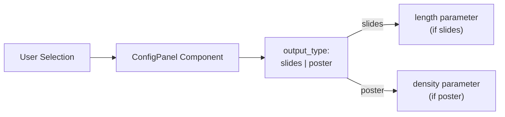
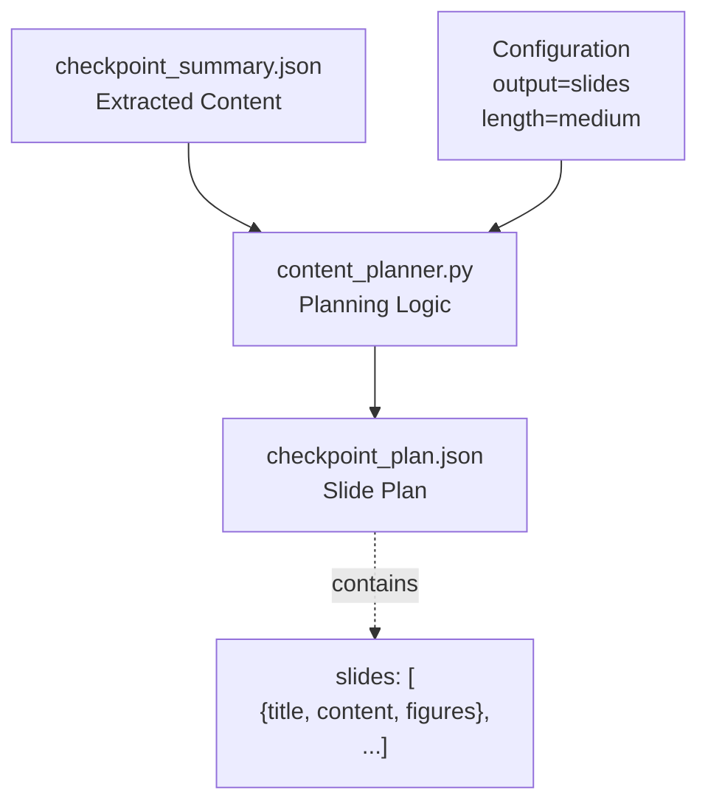
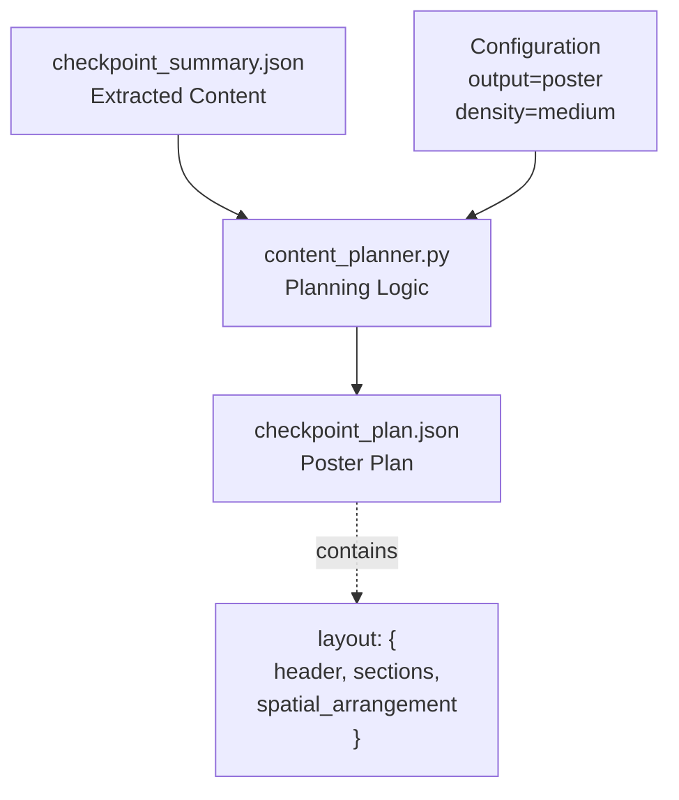
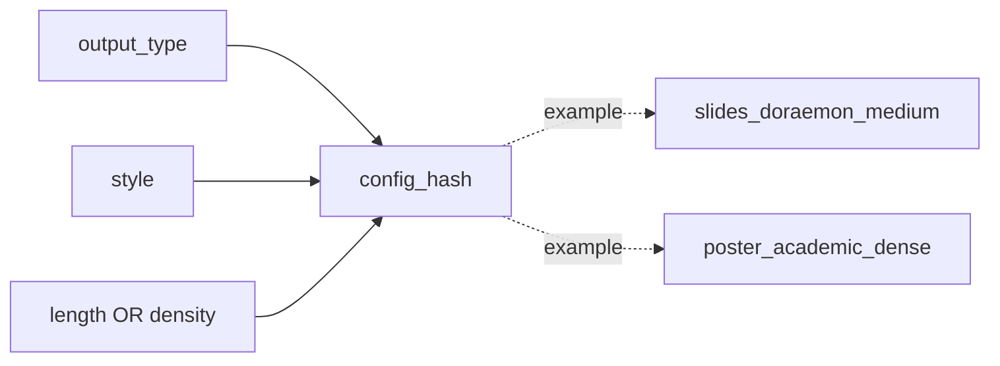
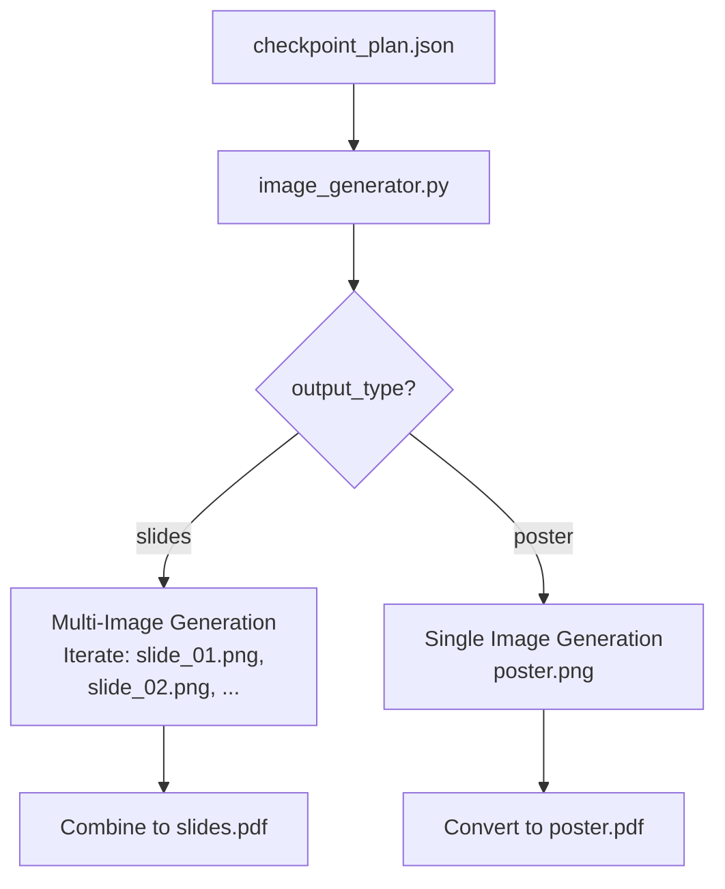
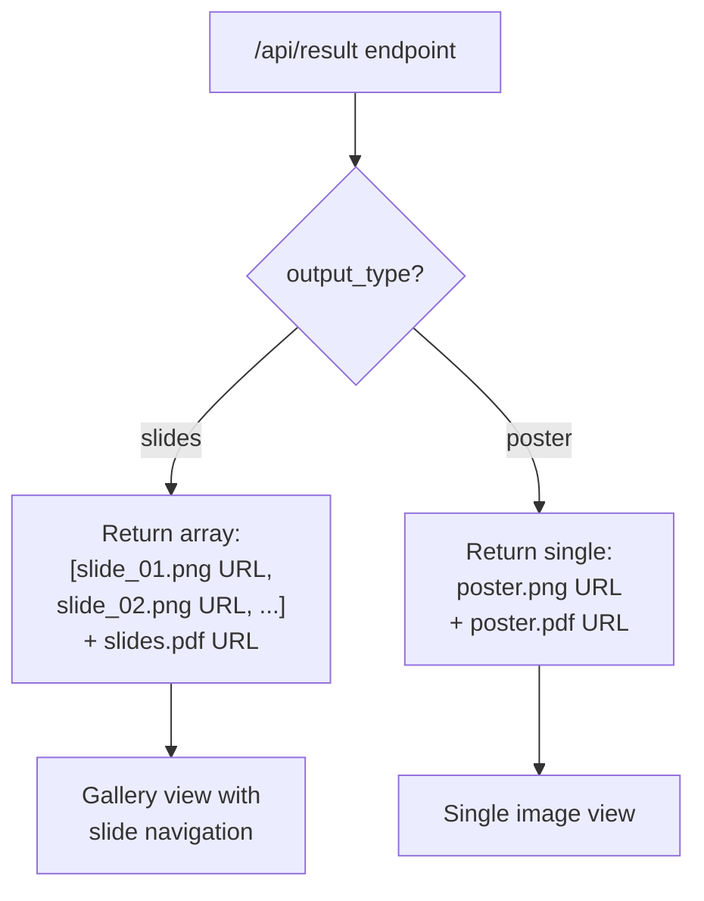

<!-- source: DeepWiki mcp.deepwiki.com · repo HKUDS/Paper2Slides · page 5.1 Output Types: Slides vs Posters · fetched 2026-11-09 -->

# Output Types: Slides vs Posters

<details>
<summary>Relevant source files</summary>

The following files were used as context for generating this wiki page:

- [README.md](README.md)
- [assets/academic_poster.png](assets/academic_poster.png)
- [assets/academic_slides.pdf](assets/academic_slides.pdf)
- [assets/doraemon_poster.png](assets/doraemon_poster.png)
- [assets/doraemon_slides.pdf](assets/doraemon_slides.pdf)

</details>


## Purpose and Scope

This page documents the two output types supported by Paper2Slides: **slides** and **posters**. It explains the fundamental differences between these formats, when to use each, their type-specific configuration parameters, and how the choice affects pipeline execution and output organization.

For information about style customization that applies to both output types, see [Style Configuration](#5.2). For general configuration parameters like content type and processing mode, see [Content Type and Length Options](#5.4) and [Processing Modes: Normal vs Fast](#5.3).

---

## Overview of Output Types

Paper2Slides generates two fundamentally different presentation formats, each optimized for different use cases:

| Aspect | Slides | Poster |
|--------|--------|--------|
| **Format** | Multi-page presentation | Single-page visual |
| **Typical Use** | Oral presentations, lectures, conferences | Academic conferences, exhibitions, summaries |
| **Output Files** | Multiple PNG images + combined PDF | Single PNG image + PDF |
| **Content Organization** | Sequential narrative across pages | Hierarchical layout on one page |
| **Size Parameter** | `--length` (short/medium/long) | `--density` (sparse/medium/dense) |
| **Generated Files** | `slide_01.png`, `slide_02.png`, ..., `slides.pdf` | `poster.png`, `poster.pdf` |

**Sources:** [README.md:140-152](), [README.md:233-254]()

---

## Configuration: Specifying Output Type

### CLI Configuration

The output type is specified using the `--output` flag:

```bash
# Generate slides
python -m paper2slides --input paper.pdf --output slides --length medium

# Generate poster
python -m paper2slides --input paper.pdf --output poster --density medium
```

| Parameter | Type | Values | Default |
|-----------|------|--------|---------|
| `--output` | Required | `slides` or `poster` | `poster` |
| `--length` | Slides-specific | `short`, `medium`, `long` | `short` |
| `--density` | Poster-specific | `sparse`, `medium`, `dense` | `medium` |

**Sources:** [README.md:140-152]()

### Web Interface Configuration

In the web interface, output type is selected via the `ConfigPanel` component, which dynamically shows either the length or density parameter based on the selected output type.



**Sources:** [frontend/src/components/ConfigPanel.jsx](), [README.md:140-152]()

---

## Slides Output Type

### Characteristics

Slides are designed for sequential presentation delivery, where content flows across multiple pages in a logical narrative structure.

**Content Distribution:**
- Title slide with paper metadata
- Introduction/background slides
- Methodology slides
- Results slides with figures/tables
- Conclusion slide

**File Output Pattern:**
```
outputs/
└── <project_name>/
    └── <content_type>/
        └── <mode>/
            └── slides_<style>_<length>/
                └── <timestamp>/
                    ├── slide_01.png    # Title
                    ├── slide_02.png    # Introduction
                    ├── slide_03.png    # Methods
                    ├── ...
                    └── slides.pdf      # Combined PDF
```

### Length Parameter

The `--length` parameter controls the number of slides generated:

| Length | Typical Slide Count | Use Case |
|--------|-------------------|----------|
| `short` | 5-8 slides | Quick overviews, lightning talks |
| `medium` | 10-15 slides | Standard conference presentations |
| `long` | 18-25 slides | Detailed seminars, thesis defenses |

**Sources:** [README.md:140-152](), [README.md:233-254]()

### Planning Stage for Slides

The planning stage (`plan_stage.py`) generates a content plan that includes slide-specific structure:



**Sources:** [paper2slides/core/stages/plan_stage.py](), [paper2slides/generator/content_planner.py]()

---

## Poster Output Type

### Characteristics

Posters present a complete visual summary on a single page, using spatial layout to organize information hierarchically.

**Layout Sections:**
- Header with title and author information
- Abstract/introduction section
- Methodology section (often with flowchart)
- Results section with figures/tables
- Conclusion section
- References (if applicable)

**File Output Pattern:**
```
outputs/
└── <project_name>/
    └── <content_type>/
        └── <mode>/
            └── poster_<style>_<density>/
                └── <timestamp>/
                    ├── poster.png      # Single image
                    └── poster.pdf      # PDF version
```

### Density Parameter

The `--density` parameter controls information density on the poster:

| Density | Visual Characteristics | Use Case |
|---------|----------------------|----------|
| `sparse` | Large fonts, generous whitespace, minimal text | High-level overview, visual emphasis |
| `medium` | Balanced layout, moderate text, clear sections | Standard academic posters |
| `dense` | Smaller fonts, more content, detailed information | Comprehensive technical posters |

**Sources:** [README.md:140-152](), [README.md:233-254]()

### Planning Stage for Posters

The planning stage generates a spatial layout plan for poster sections:



**Sources:** [paper2slides/core/stages/plan_stage.py](), [paper2slides/generator/content_planner.py]()

---

## Pipeline Processing Differences

### Configuration Hash Generation

The output type and its associated size parameter are included in the configuration hash, which determines the output directory path:



**Directory Structure Impact:**
```
outputs/paper_name/paper/normal/
├── slides_doraemon_short/      # slides + short
├── slides_doraemon_medium/     # slides + medium
├── slides_academic_long/       # slides + long
├── poster_doraemon_sparse/     # poster + sparse
└── poster_academic_dense/      # poster + dense
```

**Sources:** [README.md:233-254](), [api/server.py]()

### Generation Stage Processing

The generation stage (`generate_stage.py`) handles output types differently:



**Sources:** [paper2slides/core/stages/generate_stage.py](), [paper2slides/generator/image_generator.py]()

---

## Checkpoint Reusability

Checkpoints created in earlier stages (RAG and Summary) are **reusable across both output types** because they contain content-level information independent of presentation format. However, the planning checkpoint is **specific to the output type**.

### Checkpoint Dependency Table

| Checkpoint File | Location | Reusable Across Output Types? |
|----------------|----------|------------------------------|
| `checkpoint_rag.json` | `<mode>/` level | ✅ Yes - content is format-agnostic |
| `checkpoint_summary.json` | `<mode>/` level | ✅ Yes - extracted content structure |
| `checkpoint_plan.json` | `<config_hash>/` level | ❌ No - contains output-specific layout |
| `state.json` | `<config_hash>/` level | ❌ No - tracks config-specific progress |

### Smart Recovery Example

```bash
# Generate poster first
python -m paper2slides --input paper.pdf --output poster --density medium

# Now generate slides - reuses RAG and summary, regenerates plan
python -m paper2slides --input paper.pdf --output slides --length medium

# Change only density - regenerates from plan stage
python -m paper2slides --input paper.pdf --output poster --density dense
```

**Sources:** [README.md:153-166](), [README.md:233-262]()

---

## Output File Details

### Slides Output

Generated files for slides output:

```
<timestamp>/
├── slide_01.png    # Title slide
├── slide_02.png    # Content slide 1
├── slide_03.png    # Content slide 2
├── ...
├── slide_N.png     # Final slide
└── slides.pdf      # Combined PDF (all slides)
```

**Image Specifications:**
- Format: PNG
- Typical dimensions: 1920×1080 (16:9 aspect ratio)
- Each slide is generated separately by `image_generator.py`

**Sources:** [README.md:233-254](), [paper2slides/generator/image_generator.py]()

### Poster Output

Generated files for poster output:

```
<timestamp>/
├── poster.png      # Single poster image
└── poster.pdf      # PDF version
```

**Image Specifications:**
- Format: PNG
- Typical dimensions: 2400×3200 (portrait orientation, 3:4 aspect ratio)
- Single comprehensive image generation

**Sources:** [README.md:233-254](), [paper2slides/generator/image_generator.py]()

---

## Web Interface Result Display

The web interface displays results differently based on output type:



**Frontend Components:**
- `MessageList.jsx` renders slides as a gallery or poster as a single image
- Download button links to the PDF version

**Sources:** [api/server.py](), [frontend/src/components/MessageList.jsx]()

---

## Image Generation Prompting

The prompting strategy differs between slides and posters:

### Slides Prompting

Each slide receives an individual prompt focused on:
- Slide number and total count context
- Specific content for that slide
- Visual consistency with previous slides
- Layout appropriate for sequential viewing

### Poster Prompting

Single comprehensive prompt including:
- Overall poster layout structure
- Section placement and hierarchy
- Dense information organization
- Visual balance across entire poster

**Note:** The system uses `gemini-3-pro-image-preview` model for image generation. According to the README, "Simple prompts generally outperform detailed ones" and "Fine-grained layout instructions ground well; fine-grained element styling does not."

**Sources:** [README.md:271-280](), [paper2slides/generator/image_generator.py]()

---

## Choosing Between Slides and Posters

### Decision Matrix

| Consideration | Choose Slides | Choose Poster |
|--------------|---------------|---------------|
| **Presentation Format** | Oral presentation with speaker | Self-contained visual display |
| **Time Available** | 5-30 minutes with speaker | Viewers scan independently |
| **Content Depth** | Detailed narrative with progression | High-level overview with details available |
| **Audience Interaction** | Guided by speaker | Self-guided exploration |
| **Physical Display** | Projected on screen | Printed or displayed vertically |
| **Content Volume** | Can distribute across many slides | Must fit on single page |

### Typical Use Cases

**Slides:**
- Conference presentations
- Classroom lectures
- Webinars and online talks
- Thesis defenses
- Workshop tutorials

**Posters:**
- Conference poster sessions
- Laboratory displays
- Research summaries
- Competition submissions
- Hallway exhibitions

**Sources:** [README.md:1-100]()

---

## Example Commands

### Complete Workflow Examples

```bash
# Quick 5-slide overview for a lightning talk
python -m paper2slides --input paper.pdf --output slides --length short --style academic

# Standard conference presentation
python -m paper2slides --input paper.pdf --output slides --length medium --style doraemon

# Detailed seminar with custom style
python -m paper2slides --input paper.pdf --output slides --length long \
  --style "minimalist with blue theme and technical diagrams"

# Academic conference poster
python -m paper2slides --input paper.pdf --output poster --density medium --style academic

# Dense technical poster
python -m paper2slides --input paper.pdf --output poster --density dense \
  --style "professional with emphasis on data visualization"

# Quick poster preview with fast mode
python -m paper2slides --input paper.pdf --output poster --density sparse --fast
```

**Sources:** [README.md:124-137]()

---

## API Integration

### Web Interface Request Format

The web interface sends output type configuration in the `/api/chat` endpoint:

```json
{
  "files": ["uploaded_file.pdf"],
  "config": {
    "content_type": "paper",
    "output_type": "slides",
    "style": "academic",
    "length": "medium",
    "fast_mode": false
  }
}
```

For posters:

```json
{
  "files": ["uploaded_file.pdf"],
  "config": {
    "content_type": "paper",
    "output_type": "poster",
    "style": "academic",
    "density": "dense",
    "fast_mode": false
  }
}
```

**Note:** The system validates that `length` is only used with `output_type="slides"` and `density` is only used with `output_type="poster"`.

**Sources:** [api/server.py](), [frontend/src/components/ChatWindow.jsx]()

---

## Summary

The output type is a fundamental configuration choice that determines:

1. **File structure**: Multiple images vs. single image
2. **Size parameter**: `length` for slides, `density` for posters
3. **Content organization**: Sequential narrative vs. spatial layout
4. **Planning logic**: Slide-by-slide vs. section-based
5. **Generation process**: Iterative vs. single-shot
6. **Directory naming**: Part of `config_hash` path component

Both output types share the same RAG and Summary stages, enabling efficient regeneration when switching between formats or adjusting type-specific parameters.

**Sources:** [README.md:140-152](), [README.md:233-254](), [paper2slides/core/stages/plan_stage.py](), [paper2slides/core/stages/generate_stage.py]()

---

