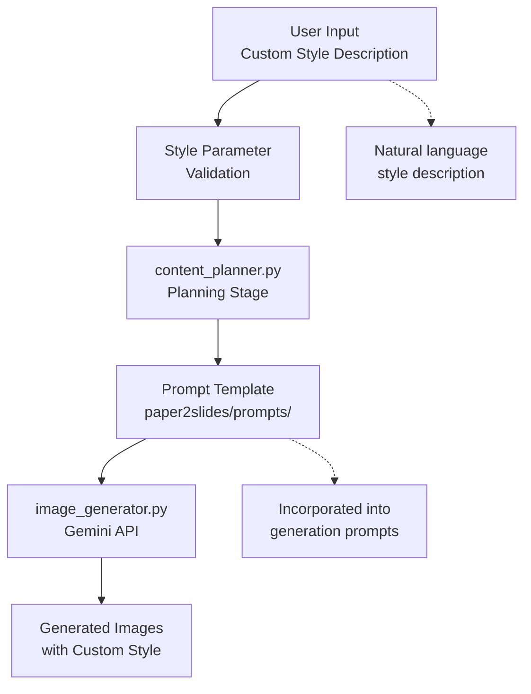
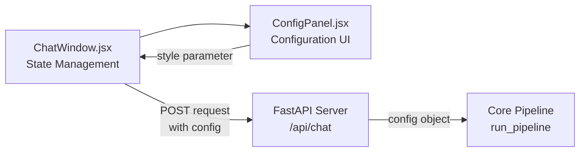
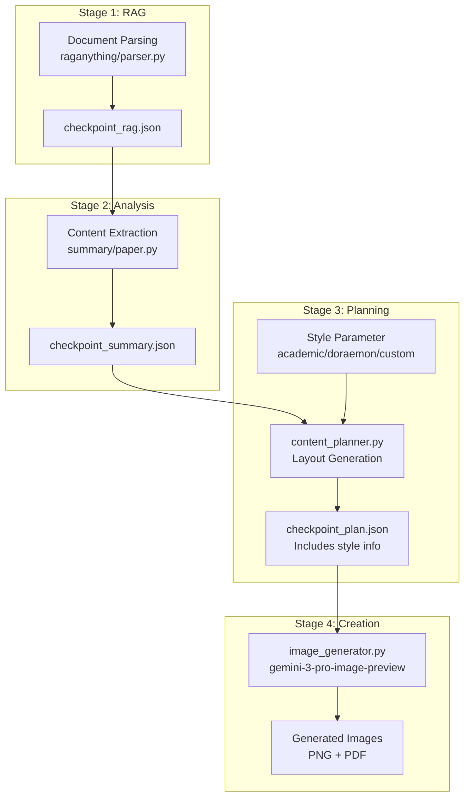
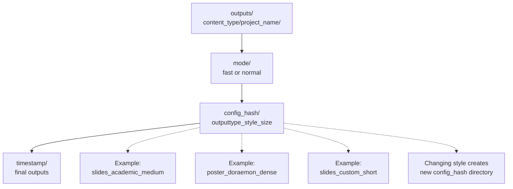
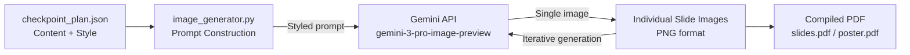
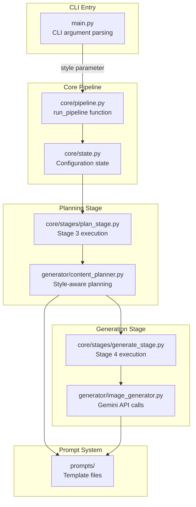
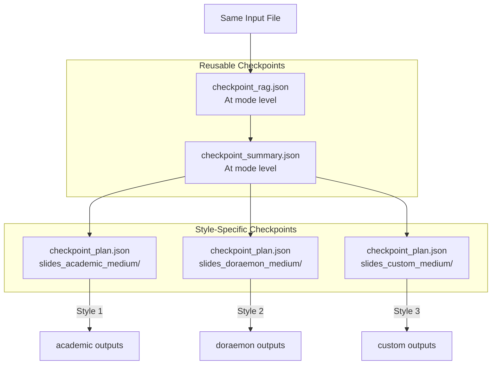
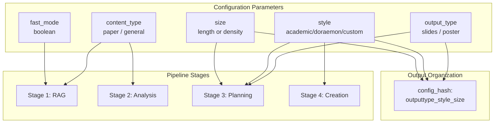
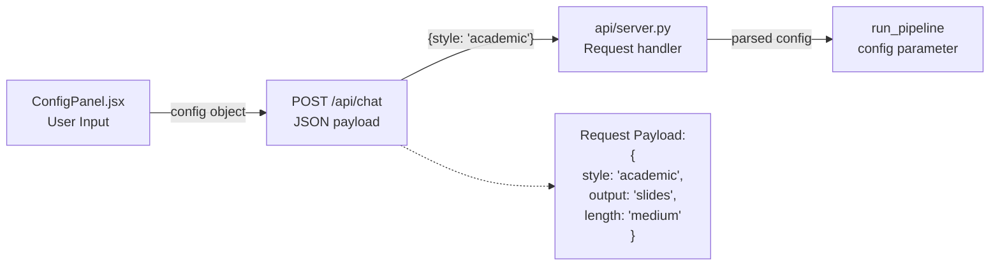

<!-- source: DeepWiki mcp.deepwiki.com · repo HKUDS/Paper2Slides · page 5.2 Style Configuration · fetched 2026-11-09 -->

# Style Configuration

<details>
<summary>Relevant source files</summary>

The following files were used as context for generating this wiki page:

- [README.md](README.md)
- [assets/academic_slides.pdf](assets/academic_slides.pdf)
- [assets/doraemon_slides.pdf](assets/doraemon_slides.pdf)
- [assets/totoro_slides.pdf](assets/totoro_slides.pdf)

</details>


This document covers the style configuration system in Paper2Slides, including predefined styles (`academic`, `doraemon`), custom style descriptions, and how styles influence the generation pipeline. For information about other configuration options such as output types and length parameters, see [Output Types: Slides vs Posters](#5.1) and [Content Type and Length Options](#5.4).

---

## Overview

The `style` parameter controls the visual design and aesthetic of generated slides and posters. Paper2Slides supports two predefined styles and accepts custom natural language style descriptions. The style parameter influences the planning stage of the pipeline and affects how content is structured and presented visually.

**Sources:** [README.md:146](), [README.md:263-269]()

---

## Predefined Styles

Paper2Slides provides two built-in styles optimized for different presentation contexts:

| Style | Description | Use Case |
|-------|-------------|----------|
| `academic` | Clean, professional academic presentation style with minimal decoration | Research presentations, academic conferences, formal settings |
| `doraemon` | Colorful, friendly style with illustrations and playful visual elements | Educational content, engaging presentations, general audiences |

### Visual Examples

The following table shows example outputs for each predefined style:

| Style | Poster Example | Slides Example |
|-------|---------------|----------------|
| `academic` | Clean layout with structured sections | Professional slide design with clear typography |
| `doraemon` | Vibrant colors with illustrated elements | Friendly, approachable slide layouts |

**Sources:** [README.md:54-77](), [README.md:263-269]()

---

## Custom Style Descriptions

### Defining Custom Styles

Instead of using predefined styles, users can provide natural language descriptions of their desired style. The system accepts any text description and passes it to the image generation model to create custom-styled outputs.

**Example Custom Descriptions:**
- `"minimalist with blue theme"`
- `"corporate professional with navy and gold colors"`
- `"playful totoro-themed with forest elements"`
- `"elegant dark mode with purple accents"`

### Custom Style Processing



**Sources:** [README.md:129-130](), [README.md:263-269]()

---

## Style Configuration Methods

### Command-Line Interface

The `--style` flag accepts either predefined style names or custom descriptions:

```bash
# Predefined style
python -m paper2slides --input paper.pdf --output slides --style academic

# Custom style description
python -m paper2slides --input paper.pdf --output slides --style "minimalist with blue theme"
```

**Default Value:** `doraemon`

**Sources:** [README.md:126-150]()

### Web Interface

In the web UI, users configure styles through the `ConfigPanel` component:



The `ConfigPanel` component provides:
- Dropdown for predefined styles (`academic`, `doraemon`)
- Text input for custom style descriptions

**Sources:** [README.md:167-194](), Section 4.2.2 of wiki structure

---

## Style in the Pipeline Flow

### Pipeline Integration

The style parameter influences the **Planning Stage (Stage 3)** of the four-stage pipeline:



**Key Points:**
- Style does **not** affect RAG (Stage 1) or Analysis (Stage 2)
- Style information is embedded in `checkpoint_plan.json`
- Changing only style allows resumption from Stage 3 using `--from-stage plan`

**Sources:** [README.md:198-228](), Architecture Diagram 3 in system overview

---

## Output Organization and Style

The style parameter is part of the configuration hash used to organize outputs:



**Directory Structure Example:**
```
outputs/
  paper/
    my_research_paper/
      normal/
        checkpoint_rag.json
        checkpoint_summary.json
        slides_academic_medium/
          checkpoint_plan.json
          20240115_143022/
            slide_01.png
            slide_02.png
            slides.pdf
        slides_doraemon_medium/
          checkpoint_plan.json
          20240115_150130/
            slide_01.png
            slide_02.png
            slides.pdf
```

This organization allows:
- Multiple styles for the same document without re-processing RAG/Analysis
- Easy comparison of different style outputs
- Efficient regeneration with style changes only

**Sources:** [README.md:230-262](), Architecture Diagram 5 in system overview

---

## Image Generation Model and Best Practices

### Model: gemini-3-pro-image-preview

Paper2Slides uses Google's `gemini-3-pro-image-preview` model (also known as Nano Banana) for generating slide and poster images. The model is accessed through the `image_generator.py` module.



**Sources:** [README.md:271-280]()

### Style Best Practices

Based on empirical findings with the Gemini image generation model:

| Aspect | Recommendation | Reason |
|--------|----------------|---------|
| **Mood Keywords** | Use descriptive mood words like "warm", "elegant", "vibrant", "professional" | Strongly influences overall color palette and atmosphere |
| **Layout Instructions** | Provide detailed layout structure (sections, positions, hierarchy) | Fine-grained layout instructions ground well |
| **Element Styling** | Keep element-level styling general | Fine-grained element styling does not ground well |
| **Prompt Length** | Prefer simple, concise descriptions | Simple prompts generally outperform detailed ones |
| **Consistency** | Use iterative single-image generation | Native multi-image output is story-like; single-image iteration maintains consistency |

### Examples of Effective Style Descriptions

**Good (Simple + Mood):**
```
"professional academic style with clean layout"
"warm friendly design with soft colors"
"modern minimalist with blue accent"
```

**Less Effective (Overly Detailed):**
```
"use 18pt Helvetica font for titles in #2C3E50 color, 
12pt Arial for body text in #34495E, with 20px margins 
and rounded corners at 5px radius"
```

**Sources:** [README.md:271-280]()

---

## Style Configuration in Code

### Key Files and Components



### Configuration Flow

1. **Input:** User provides `--style` flag or configures via `ConfigPanel.jsx`
2. **Validation:** Style parameter validated in `main.py` or `api/server.py`
3. **State Management:** Style stored in configuration state (`core/state.py`)
4. **Planning:** `content_planner.py` incorporates style into layout plan
5. **Checkpoint:** Style information saved in `checkpoint_plan.json`
6. **Generation:** `image_generator.py` applies style to image prompts
7. **Output:** Styled images saved in `config_hash` directory

**Sources:** [README.md:283-330]()

---

## Predefined vs Custom Style Comparison

| Aspect | Predefined Styles | Custom Style Descriptions |
|--------|-------------------|---------------------------|
| **Input Format** | Single keyword: `academic`, `doraemon` | Natural language text |
| **Prompt Templates** | Optimized pre-written prompts | User description incorporated into templates |
| **Consistency** | Highly consistent across generations | Varies based on description quality |
| **Customization** | None - fixed design | Fully customizable |
| **Best For** | Standard presentations, quick generation | Specific branding, unique requirements |
| **Learning Curve** | None | Requires understanding of effective descriptions |

**Sources:** [README.md:263-280]()

---

## Checkpoint and Resume with Style Changes

### Style-Only Regeneration

When changing only the style parameter, the system can resume from the Planning stage without reprocessing earlier stages:

```bash
# Initial generation with academic style
python -m paper2slides --input paper.pdf --output slides --style academic

# Regenerate with doraemon style (reuses RAG and Analysis)
python -m paper2slides --input paper.pdf --output slides --style doraemon

# Force restart from planning stage
python -m paper2slides --input paper.pdf --output slides --style "custom blue theme" --from-stage plan
```

### Checkpoint Reusability



**Key Points:**
- `checkpoint_rag.json` and `checkpoint_summary.json` are reused across all styles
- Each unique style generates a separate `checkpoint_plan.json`
- Changing style does not invalidate earlier stage checkpoints
- Multiple style variants can coexist for the same document

**Sources:** [README.md:153-165](), [README.md:230-262]()

---

## Style Parameter Validation

The system validates style parameter values to ensure proper processing:

### Valid Inputs

- **Predefined:** `academic`, `doraemon` (case-insensitive)
- **Custom:** Any non-empty string describing desired style
- **Maximum Length:** Typically limited to reasonable prompt lengths (< 500 characters)

### Default Behavior

- If no `--style` flag provided: defaults to `doraemon`
- Empty string: uses default style
- Web UI: dropdown selection or text input validation

**Sources:** [README.md:146]()

---

## Integration with Other Configuration Parameters

The style parameter works in conjunction with other configuration options:



**Parameter Interactions:**
- **content_type:** Affects RAG and Analysis, independent of style
- **output_type:** Works with style to determine layout approach (slides vs poster)
- **length/density:** Combines with style for configuration hash
- **fast_mode:** Affects pipeline path, independent of style

For detailed information about these parameters, see:
- [Output Types: Slides vs Posters](#5.1)
- [Processing Modes: Normal vs Fast](#5.3)
- [Content Type and Length Options](#5.4)

**Sources:** [README.md:139-151](), Architecture Diagram 6 in system overview

---

## API and Web Interface Style Configuration

### Backend API Configuration

The FastAPI backend accepts style configuration through the `/api/chat` endpoint:



### Web UI State Management

The `ChatWindow` component manages style configuration as part of application state:

- **State Storage:** Style value stored in React component state
- **Persistence:** Saved to browser `localStorage` for session continuity
- **Validation:** Dropdown selection ensures valid predefined styles
- **Custom Input:** Text field allows custom style descriptions

**Sources:** Section 4.2.1 and 4.2.2 of wiki structure, Architecture Diagram 4 in system overview

---

## Summary Table

| Configuration Aspect | Details |
|---------------------|---------|
| **Parameter Name** | `--style` (CLI), `style` field (API) |
| **Predefined Options** | `academic`, `doraemon` |
| **Custom Options** | Any natural language description |
| **Default Value** | `doraemon` |
| **Pipeline Stage** | Influences Stage 3 (Planning) and Stage 4 (Creation) |
| **Checkpoint File** | Stored in `checkpoint_plan.json` |
| **Output Organization** | Part of `config_hash` directory name |
| **Resume Capability** | Can resume from Stage 3 with `--from-stage plan` |
| **Image Model** | `gemini-3-pro-image-preview` |
| **Best Practice** | Use simple mood keywords for custom styles |

**Sources:** [README.md:139-280](), Architecture diagrams 3, 5, and 6 in system overview

---

