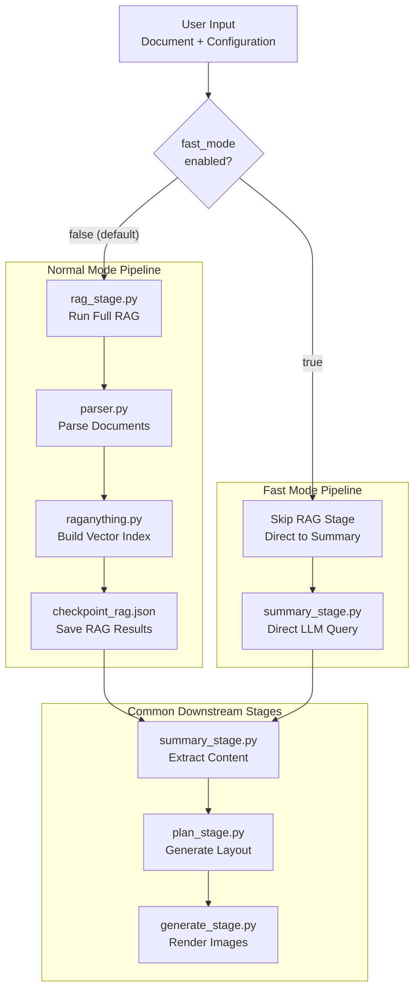
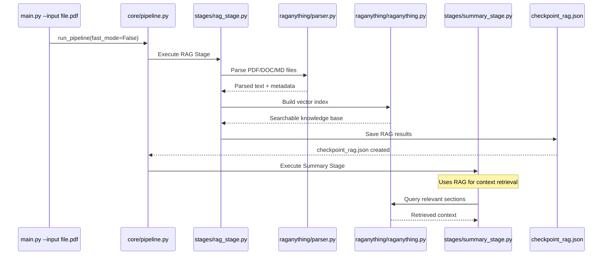
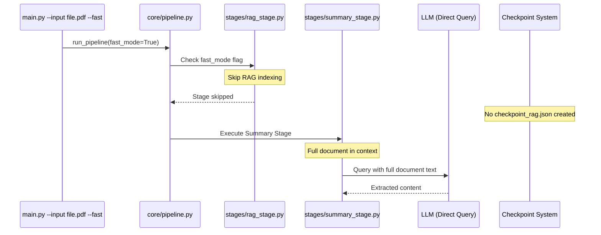
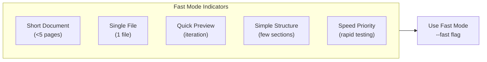
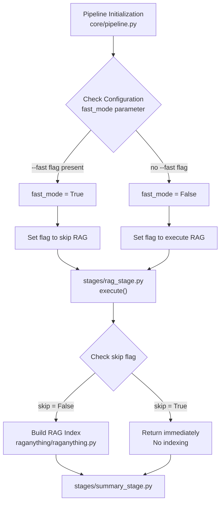

<!-- source: DeepWiki mcp.deepwiki.com · repo HKUDS/Paper2Slides · page 5.3 Processing Modes: Normal vs Fast · fetched 2026-11-09 -->

# Processing Modes: Normal vs Fast

<details>
<summary>Relevant source files</summary>

The following files were used as context for generating this wiki page:

- [README.md](README.md)

</details>


This document explains the two processing modes available in Paper2Slides: Normal Mode and Fast Mode. It covers their technical differences, performance characteristics, and guidelines for selecting the appropriate mode based on document characteristics and use case requirements.

For information about other configuration options, see [Configuration Guide](#5). For details on the RAG stage itself, see [Stage 1: RAG](#2.1). For checkpoint behavior, see [Smart Recovery System](#2.5).

---

## Overview

Paper2Slides supports two processing modes that differ in how they handle the RAG (Retrieval Augmented Generation) stage of the pipeline. The mode selection is controlled by the `--fast` CLI flag or the `fast_mode` configuration parameter in the web interface.

| Mode | Flag | RAG Behavior | Default |
|------|------|--------------|---------|
| **Normal** | (no flag) | Full RAG indexing with document parsing and vector storage | ✓ Yes |
| **Fast** | `--fast` | Skips RAG indexing, direct LLM query with full document context | No |

**Sources:** [README.md:212-228]()

---

## Mode Selection Decision Flow

The following diagram shows how the `fast_mode` configuration parameter determines the processing path through the pipeline stages:



**Sources:** [README.md:212-228](), Diagram 6 from system architecture overview

---

## Technical Implementation Differences

### Normal Mode Processing

Normal mode executes the complete 4-stage pipeline with full RAG indexing:



In normal mode:
1. **Document Parsing:** All input files are parsed by `raganything/parser.py` to extract text, figures, and structure
2. **Vector Indexing:** Parsed content is indexed by `raganything/raganything.py` into a searchable vector database
3. **Checkpoint Creation:** Results are saved to `checkpoint_rag.json` at mode level (`outputs/<project>/<content_type>/<mode>/`)
4. **Context Retrieval:** Subsequent stages query the RAG index to retrieve relevant document sections

**Sources:** [README.md:202-210](), [README.md:287-292](), Diagram 3 from system architecture overview

---

### Fast Mode Processing

Fast mode bypasses RAG indexing and provides the full document directly to the LLM:



In fast mode:
1. **RAG Stage Skipped:** The `rag_stage.py` detects `fast_mode=True` and terminates early
2. **No Vector Index:** No indexing occurs in `raganything/raganything.py`
3. **No RAG Checkpoint:** `checkpoint_rag.json` is not created
4. **Direct LLM Context:** `summary_stage.py` receives the full document text directly without retrieval

**Sources:** [README.md:212-228](), [README.md:300-312](), Diagram 3 and Diagram 6 from system architecture overview

---

## Directory Structure Impact

The processing mode determines the directory path where checkpoints and outputs are stored. The mode appears as a directory segment in the output hierarchy:

```
outputs/
└── <project_name>/
    └── <content_type>/          # paper or general
        ├── normal/              # Normal mode outputs
        │   ├── checkpoint_rag.json          # ✓ Created
        │   ├── checkpoint_summary.json      # ✓ Created
        │   ├── rag_output/                  # ✓ Vector index
        │   └── <config_name>/
        │       ├── checkpoint_plan.json
        │       └── <timestamp>/
        └── fast/                # Fast mode outputs
            ├── checkpoint_summary.json      # ✓ Created
            └── <config_name>/
                ├── checkpoint_plan.json
                └── <timestamp>/
            # ✗ No checkpoint_rag.json
            # ✗ No rag_output/
```

Key differences:
- **Normal mode** creates `checkpoint_rag.json` and `rag_output/` directory
- **Fast mode** omits these RAG-related artifacts
- Both modes create `checkpoint_summary.json` and downstream checkpoints
- Outputs from different modes are isolated and do not interfere

**Sources:** [README.md:234-254](), [README.md:256-261](), Diagram 5 from system architecture overview

---

## Checkpoint Reusability

The mode selection affects checkpoint reusability when regenerating with different configurations:

| Checkpoint File | Normal Mode | Fast Mode | Reusable Across Modes? |
|-----------------|-------------|-----------|------------------------|
| `checkpoint_rag.json` | Created at mode level | Not created | No - mode-specific |
| `checkpoint_summary.json` | Created at mode level | Created at mode level | No - mode-specific |
| `checkpoint_plan.json` | Created at config level | Created at config level | No - mode-specific |

**Mode-specific isolation means:**
- Switching between normal and fast mode requires re-execution of all stages
- Changing only `--style` or `--length`/`--density` can reuse checkpoints **within the same mode**
- The Smart Recovery System (see [Smart Recovery System](#2.5)) detects the start stage based on mode consistency

**Sources:** [README.md:256-261](), Diagram 5 from system architecture overview

---

## Performance Characteristics

### Processing Time Comparison

| Stage | Normal Mode | Fast Mode | Time Savings |
|-------|-------------|-----------|--------------|
| **RAG Stage** | Full indexing (30s - 5min depending on document size) | Skipped | ~95-99% |
| **Summary Stage** | Retrieval queries (~5-10s) | Direct context (~2-5s) | ~50% |
| **Plan Stage** | Same | Same | None |
| **Generate Stage** | Same | Same | None |
| **Total** | Baseline | 30-80% faster for short documents | Significant |

### Resource Usage

| Resource | Normal Mode | Fast Mode |
|----------|-------------|-----------|
| **Disk Space** | Higher (vector index stored in `rag_output/`) | Lower (no vector index) |
| **Memory** | Higher (index loaded into memory) | Lower (no index) |
| **LLM Context** | Smaller (retrieved chunks) | Larger (full document) |
| **API Calls** | More (multiple retrieval queries) | Fewer (single query) |

**Sources:** [README.md:212-228]()

---

## Decision Guide: When to Use Each Mode

### Use Normal Mode When:


**Specific scenarios:**
- Document exceeds ~20,000 tokens (including text and figure descriptions)
- Processing multiple files simultaneously
- Document has complex multi-level section structure requiring selective retrieval
- Research papers with extensive references, equations, and detailed technical content
- Production use where accuracy is critical

**Example:**
```bash
# Research paper with 30 pages and 15 figures
python -m paper2slides --input research_paper.pdf --output slides --length long
```

**Sources:** [README.md:224-228]()

---

### Use Fast Mode When:



**Specific scenarios:**
- Document with text + figures fits comfortably in LLM context window (~20,000 tokens)
- Single file with simple structure
- Rapid iteration during style or layout experimentation
- Quick previews before committing to full processing
- Documents where retrieval is unnecessary (already concise)

**Example:**
```bash
# 3-page executive summary
python -m paper2slides --input summary.pdf --output poster --fast --density sparse
```

**Sources:** [README.md:219-223]()

---

## Configuration Examples

### CLI Configuration

```bash
# Normal mode (default) - full RAG processing
python -m paper2slides --input paper.pdf --output slides --length medium

# Fast mode - skip RAG for quick generation
python -m paper2slides --input paper.pdf --output slides --length medium --fast

# Forcing restart from RAG stage in normal mode
python -m paper2slides --input paper.pdf --from-stage rag

# Fast mode with custom style
python -m paper2slides --input report.pdf --output poster --fast \
  --style "minimalist blue theme" --density medium
```

**Sources:** [README.md:126-137](), [README.md:139-151]()

---

### Mode-Specific Restart Behavior

The Smart Recovery System interacts with processing modes:

| Scenario | Command | Behavior |
|----------|---------|----------|
| Resume in same mode | Same command | Auto-detects and continues from last checkpoint |
| Switch normal → fast | Add `--fast` | Restarts from beginning (no RAG checkpoint reuse) |
| Switch fast → normal | Remove `--fast` | Restarts from beginning (builds RAG index) |
| Change style (same mode) | Modify `--style` | Resumes from plan stage (reuses RAG/summary) |
| Force full restart | Add `--from-stage rag` | Clears all checkpoints, starts fresh |

**Sources:** [README.md:153-165](), Diagram 3 from system architecture overview

---

## Mode Selection Algorithm

When the pipeline initializes, it follows this logic to determine processing:



**Sources:** [README.md:300-312](), Diagram 6 from system architecture overview

---

## Summary Table

| Aspect | Normal Mode | Fast Mode |
|--------|-------------|-----------|
| **RAG Indexing** | Full vector indexing | Skipped |
| **Processing Time** | Longer (includes indexing) | Shorter (30-80% faster) |
| **Accuracy** | Higher (retrieval-based) | Good (full context) |
| **Context Limit** | No limit (retrieval-based) | Limited by LLM window |
| **Multi-file Support** | Excellent | Limited |
| **Disk Usage** | Higher (`rag_output/` stored) | Lower (no index) |
| **Use Case** | Long/complex documents | Short/simple documents |
| **CLI Flag** | (default) | `--fast` |
| **Checkpoint** | `checkpoint_rag.json` created | `checkpoint_rag.json` not created |
| **Output Path** | `outputs/<project>/<content>/normal/` | `outputs/<project>/<content>/fast/` |

**Sources:** [README.md:212-228](), [README.md:234-254]()

---

