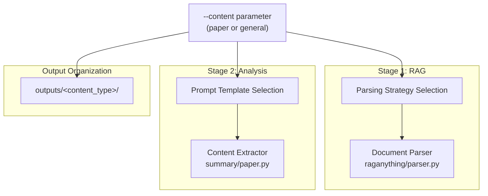
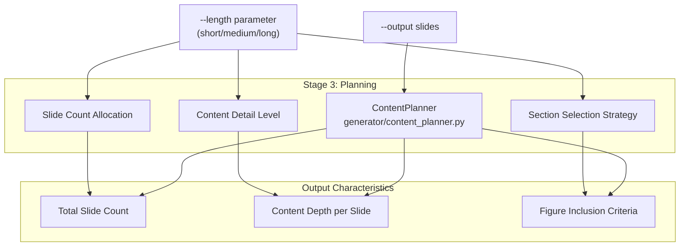
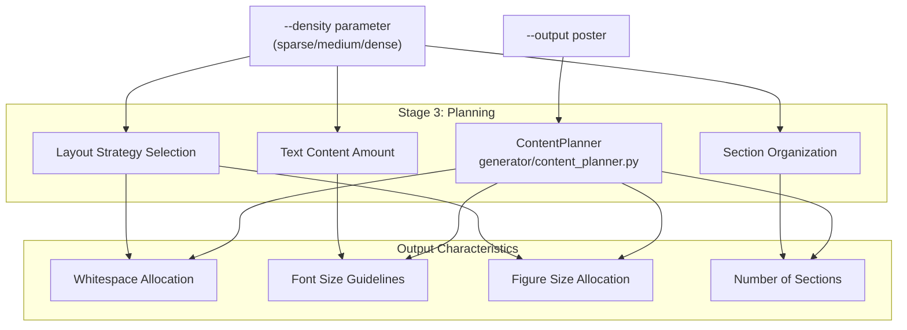
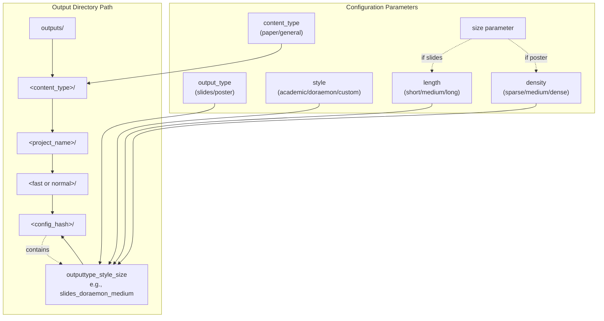
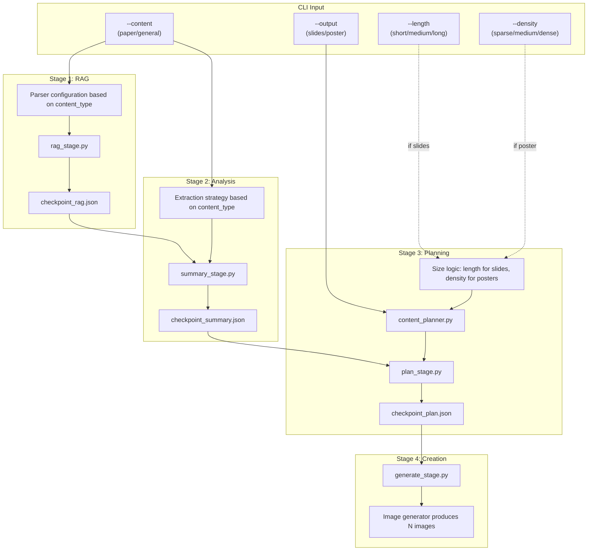

<!-- source: DeepWiki mcp.deepwiki.com · repo HKUDS/Paper2Slides · page 5.4 Content Type and Length Options · fetched 2026-11-09 -->

# Content Type and Length Options

<details>
<summary>Relevant source files</summary>

The following files were used as context for generating this wiki page:

- [README.md](README.md)

</details>


## Purpose and Scope

This page documents the content type parameter (`--content`) and size parameters (`--length` for slides, `--density` for posters) that control how Paper2Slides processes and organizes content. These parameters determine processing behavior, content selection strategies, and output characteristics.

For output type selection (slides vs posters), see [Output Types: Slides vs Posters](#5.1). For styling options, see [Style Configuration](#5.2). For processing mode selection, see [Processing Modes: Normal vs Fast](#5.3).

---

## Content Type Parameter

The `--content` parameter specifies the document type being processed, which affects content extraction strategies and prompt selection throughout the pipeline.

### Available Content Types

| Content Type | Description | Use Cases | Default |
|--------------|-------------|-----------|---------|
| `paper` | Academic research papers | Scientific papers, research reports, technical documents with formal structure | Yes |
| `general` | General documents | Business reports, meeting notes, general presentations, non-academic content | No |

### Content Type Characteristics

**Paper Mode (`--content paper`)**
- Expects academic structure: abstract, introduction, methods, results, conclusion
- Prioritizes figures, tables, equations, and experimental results
- Uses academic-focused prompts for content extraction
- Optimized for citation management and technical terminology
- Applies paper-specific parsing heuristics for section detection

**General Mode (`--content general`)**
- Flexible structure detection for various document types
- Broader content selection strategy without academic assumptions
- Uses general-purpose prompts for content extraction
- Suitable for business documents, reports, and non-structured content

### How Content Type Affects Processing



**Sources**: [README.md:145](), [README.md:236-238]()

---

## Length Options for Slides

The `--length` parameter controls the number of slides and detail level when generating slide presentations. This parameter is only applicable when `--output slides` is specified.

### Available Length Options

| Length | Approximate Slides | Content Coverage | Use Cases |
|--------|-------------------|------------------|-----------|
| `short` | 8-12 slides | Key highlights only | Quick overviews, brief presentations, time-limited talks |
| `medium` | 15-20 slides | Balanced coverage | Standard conference presentations, detailed overviews |
| `long` | 25-30+ slides | Comprehensive | In-depth seminars, full paper presentations, lectures |

### Length Impact on Content Planning



### Length Selection Guidelines

**Choose `short` when:**
- Presentation time is limited (10-15 minutes)
- Audience needs only high-level overview
- Document is brief or straightforward
- Quick preview before detailed generation

**Choose `medium` when:**
- Standard conference presentation (20-25 minutes)
- Balanced detail without overwhelming audience
- Most common use case (default recommendation)
- Covering complete paper sections with key details

**Choose `long` when:**
- Comprehensive seminar or lecture (45+ minutes)
- Detailed coverage of methodology and results required
- Teaching or educational context
- Maximum content preservation desired

**Sources**: [README.md:147](), [README.md:261]()

---

## Density Options for Posters

The `--density` parameter controls content density and layout complexity when generating poster presentations. This parameter is only applicable when `--output poster` is specified.

### Available Density Options

| Density | Layout Characteristics | Content Amount | Use Cases |
|---------|----------------------|----------------|-----------|
| `sparse` | Spacious, minimal text | Essential highlights only | Conference posters with limited space, visual-first presentations |
| `medium` | Balanced layout | Standard information density | Standard academic posters, balanced text-visual ratio |
| `dense` | Information-rich | Comprehensive details | Technical posters, maximum information display, detailed references |

### Density Impact on Layout Planning



### Density Selection Guidelines

**Choose `sparse` when:**
- Poster will be viewed from distance
- Visual impact is priority over detail
- Space constraints require minimal text
- Audience has limited reading time

**Choose `medium` when:**
- Standard academic conference poster
- Balanced text-to-visual ratio desired
- Typical poster presentation context
- Most versatile option (default recommendation)

**Choose `dense` when:**
- Detailed technical information required
- Poster serves as standalone reference
- Maximum content coverage needed
- Viewers expected to read carefully

**Sources**: [README.md:148](), [README.md:261]()

---

## Configuration Hash and Output Organization

Content type and size parameters contribute to the configuration hash that determines output directory structure, enabling efficient checkpoint reuse.

### Directory Structure with Parameters



### Example Directory Paths

| Configuration | Resulting Path |
|---------------|----------------|
| Paper, slides, medium, normal | `outputs/paper/<project>/normal/slides_doraemon_medium/` |
| General, poster, dense, fast | `outputs/general/<project>/fast/poster_academic_dense/` |
| Paper, slides, short, normal | `outputs/paper/<project>/normal/slides_academic_short/` |

### Checkpoint Reusability

Content type and size parameters affect which checkpoints can be reused:

| Checkpoint File | Reusable When | Affected By |
|-----------------|---------------|-------------|
| `checkpoint_rag.json` | Same input files, same mode | Content type (indirectly through parsing) |
| `checkpoint_summary.json` | Same input files, same mode | Content type (directly affects extraction) |
| `checkpoint_plan.json` | Same output, style, and size | Output type, style, length/density |

**Sources**: [README.md:236-254](), [README.md:256-261]()

---

## Parameter Flow Through Pipeline

### Complete Parameter Flow Diagram



**Sources**: [README.md:202-207](), [README.md:236-254]()

---

## Command-Line Examples

### Basic Usage with Default Parameters

```bash
# Paper with default parameters (short slides)
python -m paper2slides --input paper.pdf --output slides

# Equivalent explicit form
python -m paper2slides --input paper.pdf --output slides --content paper --length short
```

### Customizing Length for Slides

```bash
# Short presentation (8-12 slides)
python -m paper2slides --input paper.pdf --output slides --length short

# Medium presentation (15-20 slides)
python -m paper2slides --input paper.pdf --output slides --length medium

# Long presentation (25-30+ slides)
python -m paper2slides --input paper.pdf --output slides --length long
```

### Customizing Density for Posters

```bash
# Sparse poster (minimal text, spacious)
python -m paper2slides --input paper.pdf --output poster --density sparse

# Medium poster (balanced)
python -m paper2slides --input paper.pdf --output poster --density medium

# Dense poster (information-rich)
python -m paper2slides --input paper.pdf --output poster --density dense
```

### Content Type Selection

```bash
# Academic paper with paper mode (default)
python -m paper2slides --input research_paper.pdf --content paper --output slides

# Business report with general mode
python -m paper2slides --input business_report.docx --content general --output slides

# Meeting notes as poster
python -m paper2slides --input meeting_notes.md --content general --output poster
```

### Combined Configuration Examples

```bash
# Academic paper → long slides with academic style
python -m paper2slides --input paper.pdf --content paper --output slides --style academic --length long

# General document → medium density poster with custom style
python -m paper2slides --input report.docx --content general --output poster --density medium --style "minimalist blue theme"

# Fast mode with specific parameters
python -m paper2slides --input short_paper.pdf --content paper --output slides --length short --fast
```

**Sources**: [README.md:126-137](), [README.md:140-151]()

---

## Configuration Parameter Matrix

### Complete Parameter Interaction Table

| Content Type | Output Type | Size Parameter | Valid Values | Affects Stages | Config Hash Component |
|--------------|-------------|----------------|--------------|----------------|----------------------|
| `paper` | `slides` | `--length` | short/medium/long | RAG, Analysis, Planning | `slides_<style>_<length>` |
| `paper` | `poster` | `--density` | sparse/medium/dense | RAG, Analysis, Planning | `poster_<style>_<density>` |
| `general` | `slides` | `--length` | short/medium/long | RAG, Analysis, Planning | `slides_<style>_<length>` |
| `general` | `poster` | `--density` | sparse/medium/dense | RAG, Analysis, Planning | `poster_<style>_<density>` |

---

## Best Practices

### Choosing Content Type

1. **Use `paper` for:**
   - Published research papers
   - Technical reports with academic structure
   - Documents with formal methodology sections
   - Content with citations and references

2. **Use `general` for:**
   - Business presentations
   - Meeting summaries
   - Project documentation
   - Non-academic technical documents

### Choosing Size Parameters

1. **Start with defaults:**
   - `--length medium` for slides (good balance)
   - `--density medium` for posters (good balance)

2. **Adjust based on results:**
   - If output feels too brief → increase to next level
   - If output feels too crowded → decrease to previous level
   - Use `--from-stage plan` to regenerate quickly with new size

3. **Consider context:**
   - Presentation time available
   - Audience expertise level
   - Venue constraints (poster size, viewing distance)

### Regeneration Workflow

When experimenting with different size parameters:

```bash
# Initial generation
python -m paper2slides --input paper.pdf --output slides --length short

# Regenerate with different length (reuses RAG and analysis)
python -m paper2slides --input paper.pdf --output slides --length medium --from-stage plan

# Regenerate poster with different density (reuses RAG and analysis)
python -m paper2slides --input paper.pdf --output poster --density dense --from-stage plan
```

**Sources**: [README.md:153-165](), [README.md:256-261]()

---

## Web Interface Integration

These parameters are configurable through the web interface's ConfigPanel component. The frontend presents these options as dropdown selectors that map to the same backend parameters.

### Web UI Parameter Mapping

| Web UI Control | Backend Parameter | Component |
|----------------|-------------------|-----------|
| Content Type selector | `content_type` | ConfigPanel.jsx |
| Output Type selector | `output_type` | ConfigPanel.jsx |
| Length slider/selector | `length` | ConfigPanel.jsx (when slides selected) |
| Density slider/selector | `density` | ConfigPanel.jsx (when poster selected) |

The web interface dynamically shows length or density controls based on the selected output type, ensuring users cannot specify incompatible parameter combinations.

**Sources**: [README.md:169-195]()

---

