<!-- source: DeepWiki mcp.deepwiki.com · repo HKUDS/Paper2Slides · page 6 File Management · fetched 2026-11-09 -->

# File Management

<details>
<summary>Relevant source files</summary>

The following files were used as context for generating this wiki page:

- [README.md](README.md)
- [api/server.py](api/server.py)

</details>


## Purpose and Scope

This document explains how Paper2Slides organizes and manages files throughout the document processing lifecycle. It covers the storage of uploaded source files, the hierarchical organization of generated outputs, and the checkpoint system that enables resumable processing.

For details on the internal structure of checkpoint files, see [Checkpoint Files](#6.2). For information about the `state.json` file and pipeline progress tracking, see [State Management](#6.3). For the complete directory hierarchy reference, see [Directory Structure](#6.1).

---

## Storage Architecture Overview

Paper2Slides maintains two primary storage locations for file management:

| Directory | Purpose | Location | Managed By |
|-----------|---------|----------|------------|
| `UPLOAD_DIR` | Stores user-uploaded source files organized by session | `sources/uploads/` | [api/server.py:34]() |
| `OUTPUT_DIR` | Stores generated outputs, checkpoints, and state files | `outputs/` | [api/server.py:35]() |

The separation between uploads and outputs enables:
- **Session-based upload management**: Files grouped by unique session identifiers
- **Configuration-based output isolation**: Different parameter combinations produce separate outputs
- **Checkpoint reusability**: Intermediate results shared across regenerations with different styling

**Sources:** [api/server.py:34-37](), [README.md:234-254]()

---

## Upload Directory Structure

### Session-Based Organization

Uploaded files are stored in session-specific directories under `sources/uploads/`:

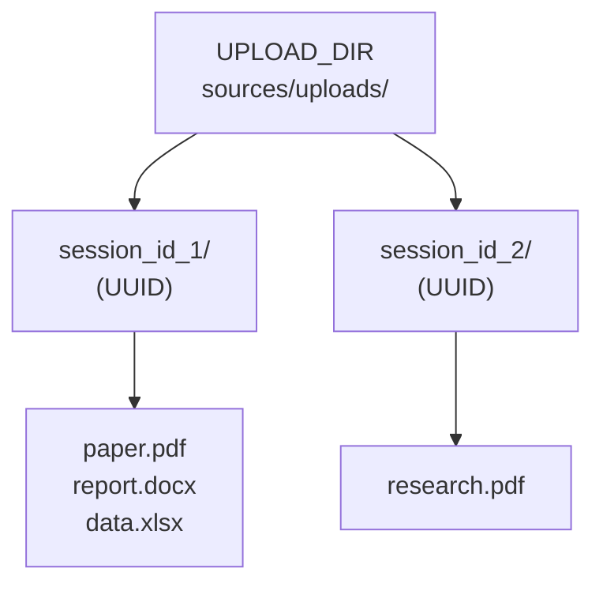

### Session ID Generation

When files are uploaded through the web interface, a unique session identifier is generated:

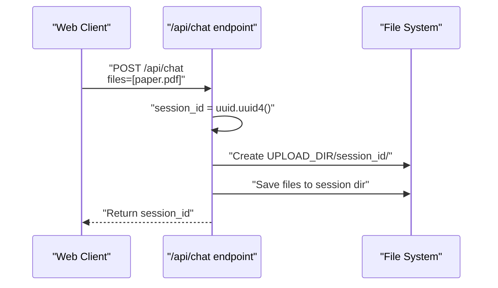

The session ID serves multiple purposes:

| Purpose | Implementation |
|---------|----------------|
| **File isolation** | Each upload batch stored separately | 
| **File reuse** | Regeneration with different parameters reuses existing files |
| **Tracking** | Links uploaded files to generated outputs via `state.json` |

**Code Reference:**
- Session ID generation: [api/server.py:204]()
- Session directory creation: [api/server.py:205-206]()
- File saving logic: [api/server.py:222-234]()

### File Reuse for Regeneration

When regenerating with different parameters, the API accepts an existing `session_id` to reuse uploaded files:

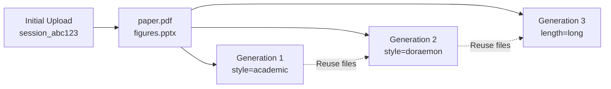

**Sources:** [api/server.py:179-196](), [api/server.py:210-219]()

---

## Output Directory Hierarchy

### Hierarchical Path Encoding

Generated outputs use a hierarchical directory structure that encodes processing context:

```
outputs/
└── <content_type>/           # "paper" or "general"
    └── <project_name>/       # From PDF name or session_id
        └── <mode>/           # "fast" or "normal"
            ├── checkpoint_rag.json
            ├── checkpoint_summary.json
            ├── summary.md
            └── <config_hash>/    # e.g., "slides_doraemon_medium"
                ├── checkpoint_plan.json
                ├── state.json
                └── <timestamp>/  # YYYYMMDD_HHMMSS
                    ├── slide_01.png
                    ├── slide_02.png
                    └── slides.pdf
```

### Path Component Functions

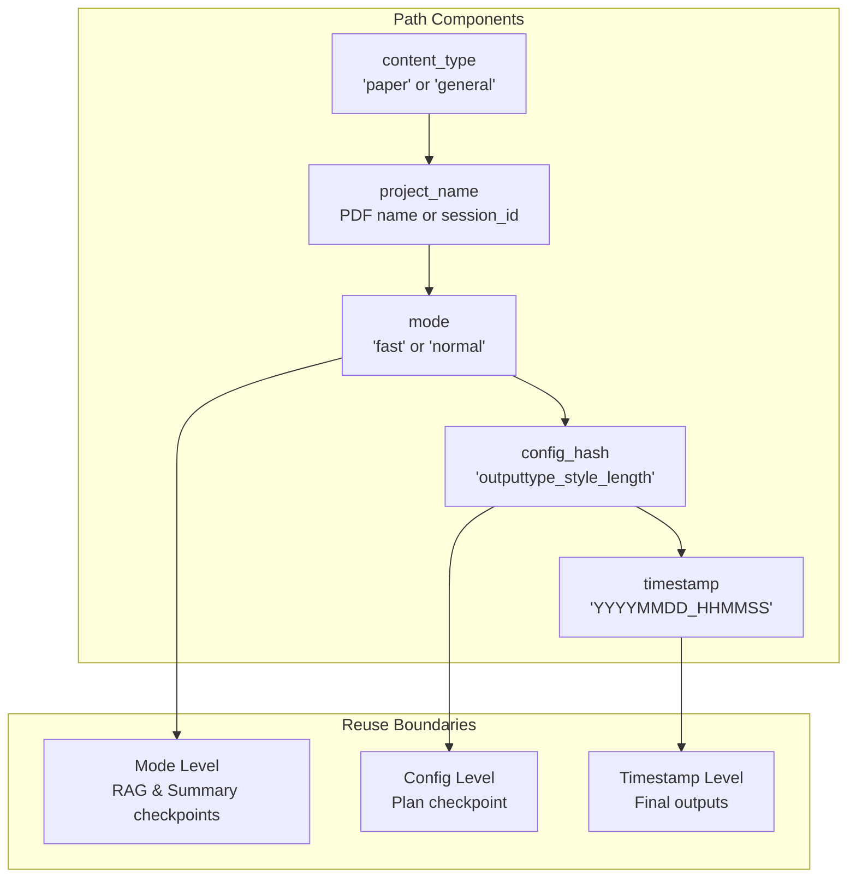

| Component | Determines | Example Values |
|-----------|------------|----------------|
| `content_type` | Processing strategy | `paper`, `general` |
| `project_name` | Source document grouping | `deepseek_v3_paper`, `session_a3f4b2c1` |
| `mode` | RAG indexing behavior | `normal`, `fast` |
| `config_hash` | Output configuration | `slides_doraemon_medium`, `poster_academic_dense` |
| `timestamp` | Generation time | `20250115_143022` |

**Sources:** [README.md:234-254](), [api/server.py:374-376]()

### Project Name Resolution

The `project_name` component is determined by file input:

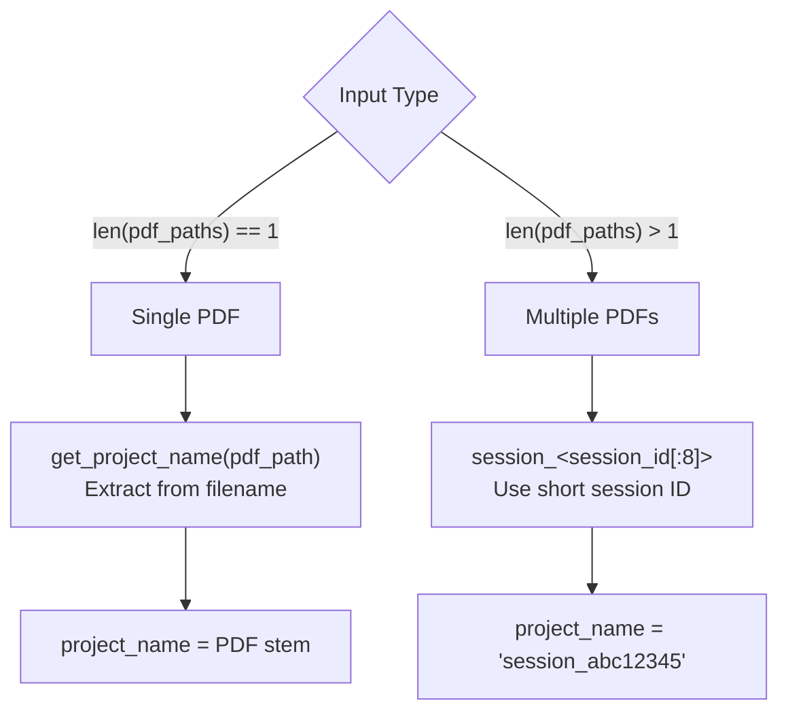

**Code Reference:**
- Single PDF: [api/server.py:357]()
- Multiple PDFs: [api/server.py:351]()
- Project name function: [api/server.py:30]()

---

## Checkpoint System Architecture

### Checkpoint Placement Strategy

Checkpoints are strategically placed at different directory levels to maximize reusability:

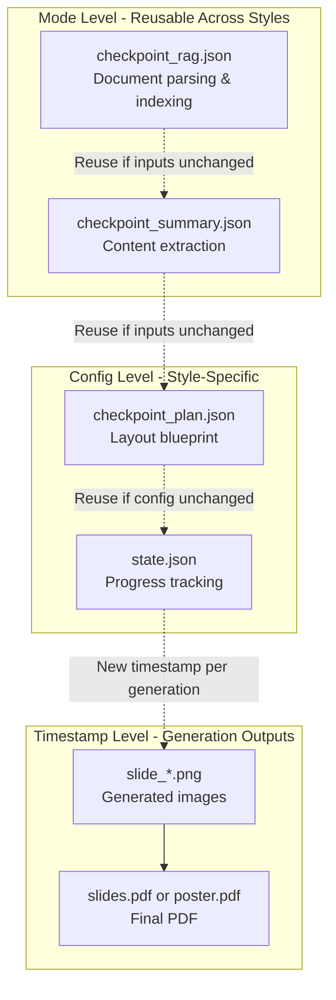

### Reusability Conditions

| Checkpoint File | Location | Reusable When | Skip Stages |
|-----------------|----------|---------------|-------------|
| `checkpoint_rag.json` | `mode/` | Input files unchanged | None (required) |
| `checkpoint_summary.json` | `mode/` | Input files + content type unchanged | RAG |
| `checkpoint_plan.json` | `config_hash/` | Style + length/density unchanged | RAG + Summary |
| Final outputs | `timestamp/` | Never reused (always regenerated) | RAG + Summary + Plan |

### Path Resolution Functions

The system uses helper functions to compute directory paths based on configuration:

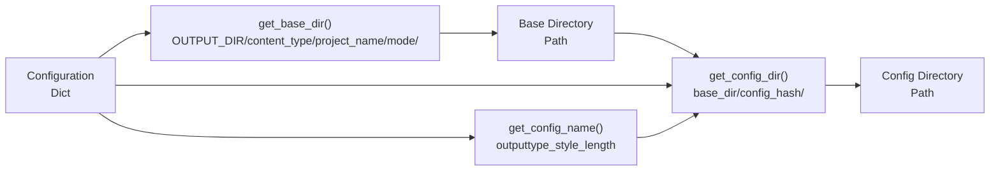

**Code Reference:**
- `get_base_dir()`: [api/server.py:27]()
- `get_config_dir()`: [api/server.py:27]()
- `get_config_name()`: [api/server.py:28]()
- Usage: [api/server.py:374-376]()

**Sources:** [README.md:256-261](), [api/server.py:374-404]()

---

## File Access and Serving

### Static File Mounting

The FastAPI server mounts both storage directories as static file endpoints:

| Mount Point | Directory | Purpose |
|-------------|-----------|---------|
| `/outputs` | `OUTPUT_DIR` | Serve generated slides/posters |
| `/uploads` | `UPLOAD_DIR` | Serve uploaded source files |

**Code Reference:** [api/server.py:97-99]()

### URL Construction

Generated files are accessible via HTTP URLs constructed from their relative paths:

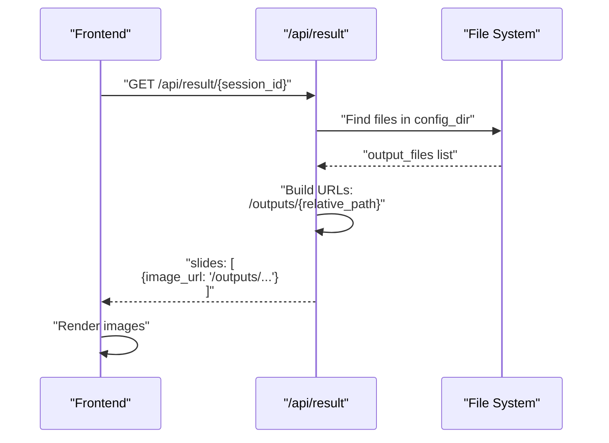

**Example URL Construction:**

```
File Path:
  outputs/paper/deepseek_paper/normal/slides_doraemon_medium/20250115_143022/slide_01.png

Relative Path (from OUTPUT_DIR):
  paper/deepseek_paper/normal/slides_doraemon_medium/20250115_143022/slide_01.png

Served URL:
  http://localhost:8001/outputs/paper/deepseek_paper/normal/slides_doraemon_medium/20250115_143022/slide_01.png
```

**Code Reference:**
- File discovery: [api/server.py:411-424]()
- URL construction: [api/server.py:695-701]()

---

## File Discovery and State Tracking

### Finding State Files by Session

The API must locate state files to track progress. It searches for `state.json` files matching the session ID:

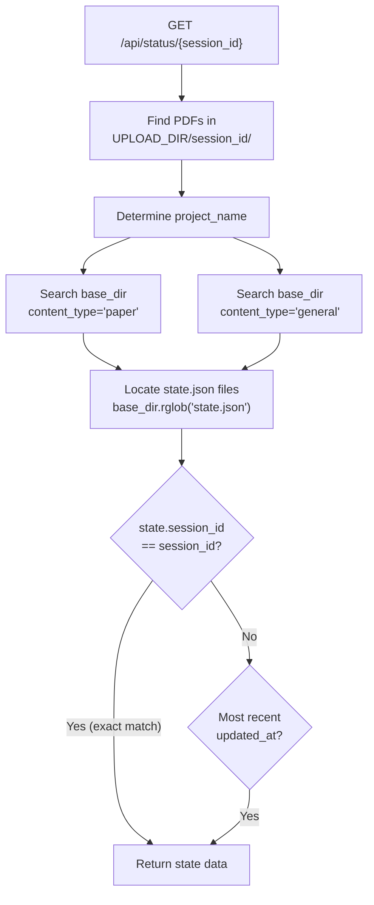

**Matching Priority:**

1. **Exact match**: `state["session_id"] == session_id` (highest priority)
2. **Most recent**: Fallback to most recent `updated_at` timestamp

**Code Reference:** [api/server.py:550-643]()

**Sources:** [api/server.py:550-643](), [api/server.py:374-404]()

---

## Security and Path Validation

### Upload Path Safety

Session IDs are UUIDs, preventing directory traversal attacks in upload paths:

```python
session_id = str(uuid.uuid4())  # e.g., "a3f4b2c1-..."
session_dir = UPLOAD_DIR / session_id  # Safe: no ".." possible
```

### Download Path Validation

The download endpoint validates that requested files are within `OUTPUT_DIR`:

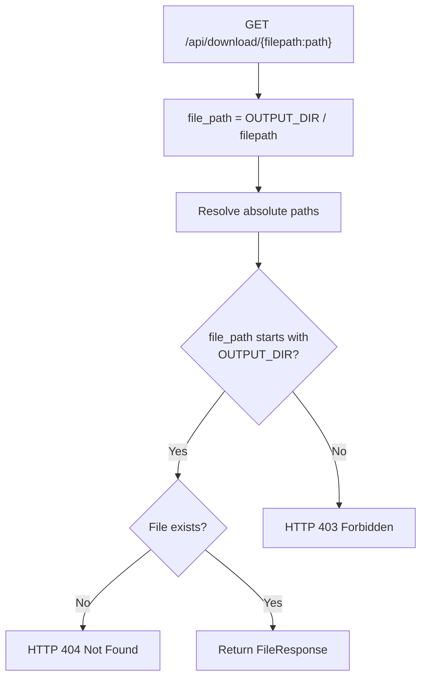

**Code Reference:** [api/server.py:729-750]()

**Sources:** [api/server.py:206](), [api/server.py:729-750]()

---

## Multi-File Processing

### Handling Multiple PDFs

When multiple PDFs are uploaded in a single session, they are processed as a unified project:

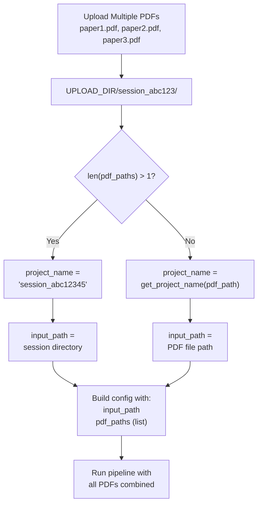

**Configuration Differences:**

| Scenario | `input_path` | `pdf_paths` | `project_name` |
|----------|--------------|-------------|----------------|
| Single PDF | `/path/to/paper.pdf` | `['/path/to/paper.pdf']` | `paper` |
| Multiple PDFs | `/uploads/session_id/` | `['.../paper1.pdf', '.../paper2.pdf']` | `session_a3f4b2c1` |

**Code Reference:**
- Multi-file detection: [api/server.py:349-359]()
- Config construction: [api/server.py:362-372]()

**Sources:** [api/server.py:323-372]()

---

## Summary

Paper2Slides implements a sophisticated file management system with:

- **Session-based uploads**: Isolated file storage per upload batch
- **Hierarchical outputs**: Configuration-encoded directory structure
- **Strategic checkpoints**: Placed at mode/config levels for optimal reuse
- **Path safety**: UUID-based sessions and validated download paths
- **Multi-file support**: Unified processing of multiple documents

This architecture enables efficient regeneration scenarios where style changes reuse expensive parsing and analysis work, while maintaining isolation between different configurations.

**Sources:** [api/server.py:1-773](), [README.md:234-254]()

---

