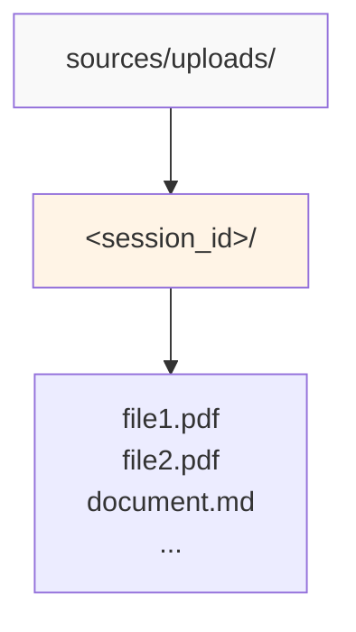
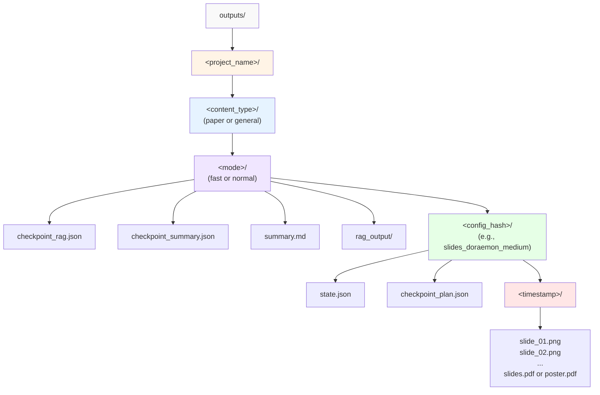
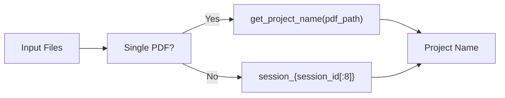
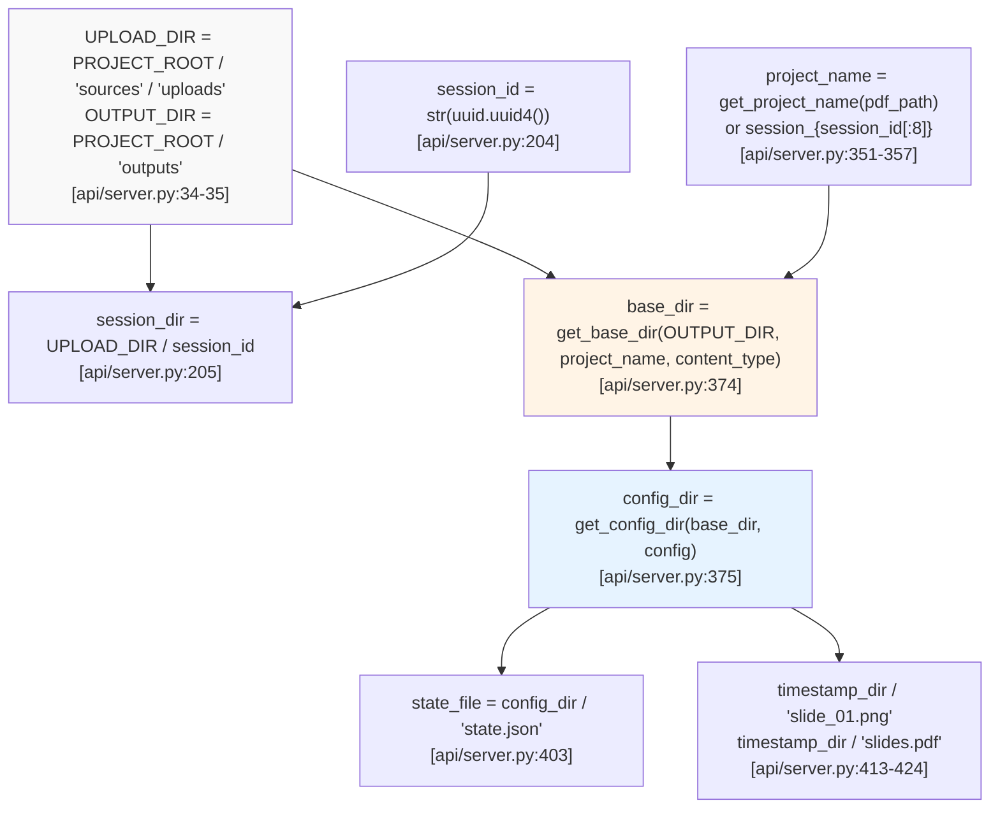
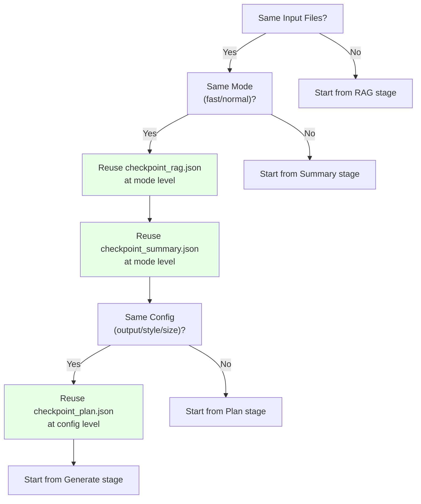

<!-- source: DeepWiki mcp.deepwiki.com · repo HKUDS/Paper2Slides · page 6.1 Directory Structure · fetched 2026-11-09 -->

# Directory Structure

<details>
<summary>Relevant source files</summary>

The following files were used as context for generating this wiki page:

- [README.md](README.md)
- [api/server.py](api/server.py)

</details>


This page documents the complete directory hierarchy used by Paper2Slides for storing uploaded files, checkpoints, and generated outputs. The system uses a sophisticated hierarchical organization that enables efficient checkpoint reuse and supports multiple concurrent projects.

For information about the content and format of checkpoint files within these directories, see [Checkpoint Files](#6.2). For details about the `state.json` file and pipeline progress tracking, see [State Management](#6.3). For the codebase module organization, see [Project Structure](#7.1).

---

## Overview

Paper2Slides manages two primary directory trees:

| Directory | Purpose | Configuration | Contents |
|-----------|---------|---------------|----------|
| `sources/uploads/` | User-uploaded files | `UPLOAD_DIR` in [api/server.py:34]() | PDFs, DOCs, MD files organized by session |
| `outputs/` | Generated results and checkpoints | `OUTPUT_DIR` in [api/server.py:35]() | Slides, posters, PDFs, checkpoints organized hierarchically |

**Sources:** [api/server.py:34-37]()

---

## Upload Directory Structure

The upload directory stores user-submitted files organized by session ID, enabling file reuse across regenerations with different configuration parameters.

### Hierarchy



**Directory Structure Diagram: Upload Organization**

### Session-Based Organization

When files are uploaded via the web interface, they are stored in a directory named after the unique session ID:

```
sources/uploads/
└── <session_id>/              # UUID v4 format
    ├── paper.pdf
    ├── supplementary.pdf
    └── notes.md
```

**Key Characteristics:**
- Session IDs are generated using `uuid.uuid4()` in [api/server.py:204]()
- Each session maintains its own isolated directory
- Files persist across regenerations with different styles/configurations
- Multiple PDFs can coexist in a single session directory

**Sources:** [api/server.py:34](), [api/server.py:204-206](), [api/server.py:183-235]()

---

## Output Directory Structure

The output directory uses a multi-level hierarchy that encodes project identity, content type, processing mode, and configuration parameters. This design enables efficient checkpoint reuse.

### Complete Hierarchy



**Directory Structure Diagram: Output Hierarchy**

### Level-by-Level Breakdown

| Level | Name | Description | Example Values | Determined By |
|-------|------|-------------|----------------|---------------|
| 1 | `<project_name>` | Identifies the document/project | `deepseek_v3_paper`, `session_a1b2c3d4` | PDF filename or session ID |
| 2 | `<content_type>` | Type of content being processed | `paper`, `general` | `--content` flag or `content` form field |
| 3 | `<mode>` | Processing mode | `fast`, `normal` | `--fast` flag or `fast_mode` form field |
| 4 | `checkpoint_rag.json` | RAG processing checkpoint | (file at mode level) | Reusable across all configs in this mode |
| 4 | `checkpoint_summary.json` | Content extraction checkpoint | (file at mode level) | Reusable across all configs in this mode |
| 4 | `summary.md` | Human-readable summary | (file at mode level) | Reusable across all configs in this mode |
| 4 | `rag_output/` | RAG index storage | (directory at mode level) | Contains vector index files |
| 5 | `<config_hash>` | Configuration-specific directory | `slides_doraemon_medium`, `poster_academic_dense` | Hash of output type, style, and size |
| 6 | `state.json` | Pipeline progress tracker | (file at config level) | Updated during pipeline execution |
| 6 | `checkpoint_plan.json` | Content plan checkpoint | (file at config level) | Specific to this configuration |
| 7 | `<timestamp>` | Generation timestamp | `20250101_120000` | Created when generation starts |
| 8 | Output files | Generated images and PDFs | `slide_01.png`, `slides.pdf` | Final outputs |

**Sources:** [README.md:234-254](), [api/server.py:373-376]()

### Example Structure

```
outputs/
└── deepseek_v3_paper/
    └── paper/
        ├── normal/
        │   ├── checkpoint_rag.json
        │   ├── checkpoint_summary.json
        │   ├── summary.md
        │   ├── rag_output/
        │   │   ├── chroma.sqlite3
        │   │   └── ...
        │   ├── slides_doraemon_medium/
        │   │   ├── state.json
        │   │   ├── checkpoint_plan.json
        │   │   └── 20250101_120000/
        │   │       ├── slide_01.png
        │   │       ├── slide_02.png
        │   │       ├── slide_03.png
        │   │       └── slides.pdf
        │   └── slides_academic_short/
        │       ├── state.json
        │       ├── checkpoint_plan.json
        │       └── 20250101_130000/
        │           ├── slide_01.png
        │           └── slides.pdf
        └── fast/
            ├── checkpoint_summary.json
            ├── summary.md
            └── poster_doraemon_medium/
                ├── state.json
                ├── checkpoint_plan.json
                └── 20250101_140000/
                    ├── poster_01.png
                    └── poster.pdf
```

**Sources:** [README.md:234-254]()

---

## Directory Naming Conventions

### Project Name Resolution

The project name is the first level of the output hierarchy and is determined by the input source:



**Project Name Resolution Diagram**

**Implementation:**
- Single PDF: Extracted from filename via `get_project_name()` in [api/server.py:357]()
- Multiple PDFs: Uses session-based naming `session_{session_id[:8]}` in [api/server.py:351]()

**Sources:** [api/server.py:349-359]()

### Configuration Hash

The configuration-specific directory name encodes three parameters:

| Format | Example | Components |
|--------|---------|------------|
| `<output_type>_<style>_<size>` | `slides_doraemon_medium` | output_type: slides, style: doraemon, size: medium |
| `<output_type>_<style>_<size>` | `poster_academic_dense` | output_type: poster, style: academic, size: dense |

The size parameter varies by output type:
- **Slides:** `length` parameter (`short`, `medium`, `long`)
- **Poster:** `density` parameter (`sparse`, `medium`, `dense`)

This naming is generated by `get_config_name()` referenced in [api/server.py:28]().

**Sources:** [api/server.py:28](), [README.md:146-149]()

### Timestamp Format

Timestamp directories use the format generated during pipeline execution. Multiple timestamp directories can coexist under the same configuration, preserving the history of regenerations.

**Sources:** [README.md:246-250]()

---

## Path Construction in Code

The following diagram illustrates how code components construct and utilize directory paths:



**Path Construction Flow Diagram**

### Key Functions

| Function | Purpose | Returns | Source |
|----------|---------|---------|--------|
| `get_project_name(path)` | Extract project identifier from file path | String (sanitized filename) | [api/server.py:357]() |
| `get_base_dir(output_dir, project_name, content_type)` | Construct base directory path | Path to `outputs/<project>/<content>/<mode>/` | [api/server.py:374]() |
| `get_config_dir(base_dir, config)` | Construct config-specific directory | Path to `.../<mode>/<config_hash>/` | [api/server.py:375]() |
| `get_config_name(config)` | Generate configuration hash string | String like `slides_doraemon_medium` | [api/server.py:28]() |
| `detect_start_stage(base_dir, config_dir, config)` | Determine resume point from existing files | Stage name (`rag`, `summary`, `plan`, `generate`) | [api/server.py:388]() |

**Sources:** [api/server.py:26-29](), [api/server.py:374-376](), [api/server.py:388]()

---

## Checkpoint Reusability

The hierarchical structure enables intelligent checkpoint reuse based on what has changed:



**Checkpoint Reuse Logic Diagram**

### Reusability Rules

| Checkpoint | Location | Reusable When | Example Use Case |
|------------|----------|---------------|------------------|
| `checkpoint_rag.json` | Mode level | Input files unchanged, same mode | Change style from academic to doraemon |
| `checkpoint_summary.json` | Mode level | Input files unchanged, same mode | Change output type from slides to poster |
| `checkpoint_plan.json` | Config level | Exact same configuration | Regenerate after interrupted generation |

When configuration parameters change, the system automatically determines the appropriate starting stage using `detect_start_stage()` in [api/server.py:388]().

**Sources:** [README.md:257-262](), [api/server.py:388-389]()

---

## Directory Access Patterns

### Web Interface Access

The FastAPI server mounts both directories as static file endpoints:

| Endpoint | Directory | Purpose | Configuration |
|----------|-----------|---------|---------------|
| `/uploads` | `sources/uploads/` | Serve uploaded source files | [api/server.py:99]() |
| `/outputs` | `outputs/` | Serve generated slides/posters | [api/server.py:97]() |

**URL Pattern Examples:**
- Uploaded file: `http://localhost:8001/uploads/{session_id}/paper.pdf`
- Generated slide: `http://localhost:8001/outputs/{project}/{content}/{mode}/{config}/{timestamp}/slide_01.png`

**Sources:** [api/server.py:97-99]()

### Session-to-Output Mapping

The server maps session IDs to output directories by:

1. Determining project name from session's PDF files ([api/server.py:567-568]())
2. Searching for `state.json` files with matching `session_id` field ([api/server.py:589]())
3. Using the most recent `updated_at` timestamp as fallback ([api/server.py:595-601]())

**Sources:** [api/server.py:550-643]()

---

## Directory Initialization

### Upload Directory

Created during server initialization:

```python
UPLOAD_DIR = PROJECT_ROOT / "sources" / "uploads"
UPLOAD_DIR.mkdir(parents=True, exist_ok=True)
```

**Sources:** [api/server.py:34](), [api/server.py:36]()

### Output Directory

Created during server initialization:

```python
OUTPUT_DIR = PROJECT_ROOT / "outputs"
OUTPUT_DIR.mkdir(exist_ok=True)
```

Subdirectories are created automatically by the pipeline as needed during processing.

**Sources:** [api/server.py:35](), [api/server.py:37]()

### Session Directory

Created when files are uploaded:

```python
session_id = str(uuid.uuid4())
session_dir = UPLOAD_DIR / session_id
session_dir.mkdir(exist_ok=True)
```

**Sources:** [api/server.py:204-206]()

---

## Examples

### Example 1: Single PDF with Multiple Configurations

```
sources/uploads/
└── 3f7e8a9b-4c2d-1e5f-6g7h-8i9j0k1l2m3n/
    └── research_paper.pdf

outputs/
└── research_paper/
    └── paper/
        └── normal/
            ├── checkpoint_rag.json
            ├── checkpoint_summary.json
            ├── slides_academic_short/
            │   └── 20250101_100000/
            │       └── slides.pdf
            ├── slides_doraemon_medium/
            │   └── 20250101_110000/
            │       └── slides.pdf
            └── poster_academic_dense/
                └── 20250101_120000/
                    └── poster.pdf
```

All three outputs share the same RAG and summary checkpoints, regenerating only from the plan stage.

### Example 2: Multiple PDFs in One Session

```
sources/uploads/
└── a1b2c3d4-e5f6-7g8h-9i0j-k1l2m3n4o5p6/
    ├── main_paper.pdf
    ├── supplementary.pdf
    └── appendix.pdf

outputs/
└── session_a1b2c3d4/
    └── paper/
        └── normal/
            ├── checkpoint_rag.json
            ├── checkpoint_summary.json
            └── slides_doraemon_medium/
                └── 20250101_150000/
                    └── slides.pdf
```

Multiple PDFs are processed together under a session-based project name.

**Sources:** [api/server.py:349-354]()

---

## Summary

The Paper2Slides directory structure achieves three key goals:

1. **Isolation:** Session-based upload directories prevent file conflicts
2. **Reusability:** Hierarchical checkpoint placement enables selective regeneration
3. **Traceability:** Timestamp preservation maintains generation history

Understanding this structure is essential for debugging, managing storage, and customizing the system's behavior.

**Sources:** [README.md:234-254](), [api/server.py:34-37](), [api/server.py:97-99]()

---

