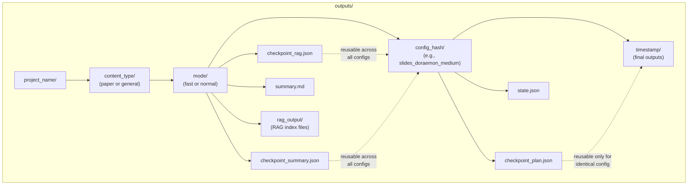
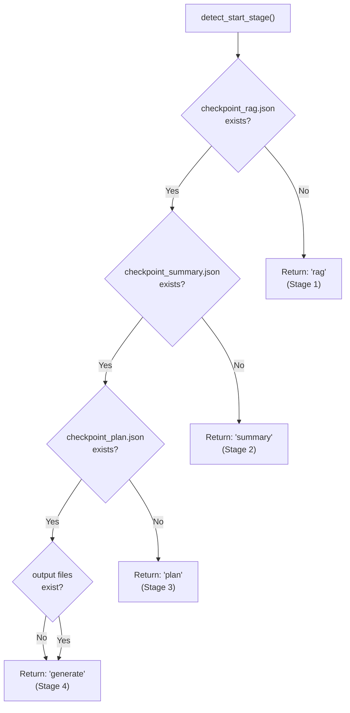
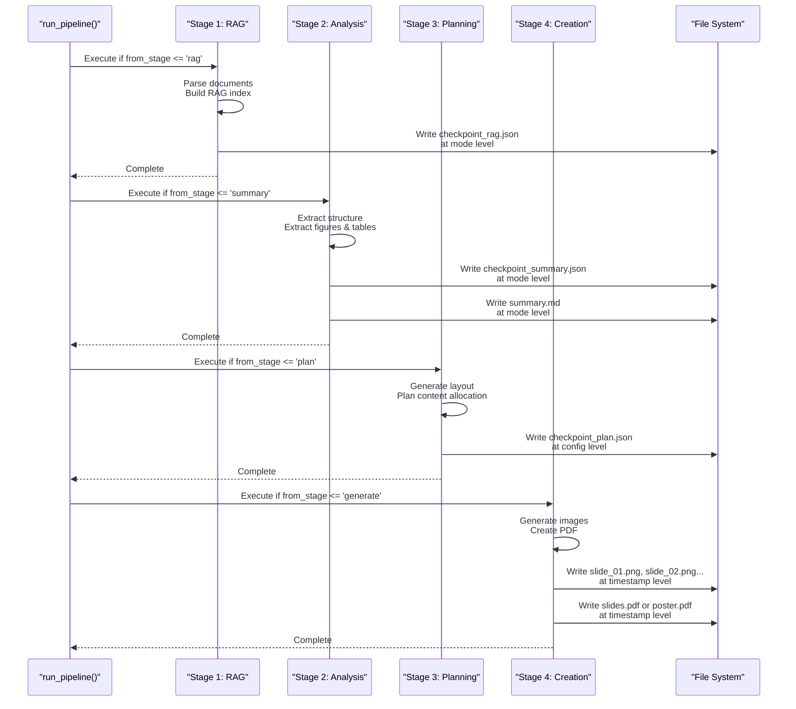

<!-- source: DeepWiki mcp.deepwiki.com · repo HKUDS/Paper2Slides · page 6.2 Checkpoint Files · fetched 2026-11-09 -->

# Checkpoint Files

<details>
<summary>Relevant source files</summary>

The following files were used as context for generating this wiki page:

- [README.md](README.md)
- [api/server.py](api/server.py)

</details>


This page documents the checkpoint files that Paper2Slides creates during pipeline execution. These files enable the Smart Recovery System by preserving intermediate results at key stages. For information about the overall directory structure where these files are stored, see [Directory Structure](#6.1). For information about the `state.json` file that tracks pipeline progress, see [State Management](#6.3).

## Overview

Paper2Slides creates three checkpoint files during its 4-stage pipeline, each corresponding to a completed processing stage:

| Checkpoint File | Stage | Purpose | Storage Level |
|----------------|-------|---------|---------------|
| `checkpoint_rag.json` | Stage 1: RAG | Parsed document content and RAG query results | Mode level (`fast/` or `normal/`) |
| `checkpoint_summary.json` | Stage 2: Analysis | Extracted figures, tables, and document structure | Mode level (`fast/` or `normal/`) |
| `checkpoint_plan.json` | Stage 3: Planning | Presentation blueprint with slide/poster layout | Config level (e.g., `slides_doraemon_medium/`) |

These checkpoints enable resumption from any stage without reprocessing earlier stages, making the system efficient for style changes and regeneration.

**Sources:** [README.md:202-207](), [README.md:256-261]()

---

## Checkpoint File Locations

The checkpoint files are strategically placed at different levels of the directory hierarchy to optimize reusability:



**Hierarchy Explanation:**

- **Mode Level** (`fast/` or `normal/`): `checkpoint_rag.json` and `checkpoint_summary.json` are stored here because they depend only on the input documents and processing mode, not on style or layout parameters
- **Config Level** (e.g., `slides_doraemon_medium/`): `checkpoint_plan.json` is stored here because it depends on output type, style, and size parameters

This hierarchical placement enables efficient cache reuse—changing only the style parameter requires reprocessing only from the Planning stage, reusing the RAG and Analysis results.

**Sources:** [README.md:236-253](), [api/server.py:374-376]()

---

## checkpoint_rag.json

### Purpose

The `checkpoint_rag.json` file stores the results of Stage 1 (RAG - Retrieval Augmented Generation). It contains parsed document content and enables the system to skip document parsing and RAG indexing when regenerating with different styles.

### Contents

The RAG checkpoint contains:

- **Parsed document paths**: References to processed PDF, Markdown, Word, and other input files
- **RAG query results**: Pre-indexed content chunks that can be quickly retrieved
- **Document metadata**: File names, page counts, and structural information
- **Text extraction results**: Full text content from all input documents

The exact structure depends on the implementation in [paper2slides/raganything/raganything.py]().

### Storage Location

```
outputs/
└── <project_name>/
    └── <content_type>/           # paper or general
        └── <mode>/                # fast or normal
            ├── checkpoint_rag.json
            └── rag_output/         # Associated RAG index files
```

**Note:** In `fast_mode`, RAG indexing is skipped, so this checkpoint may contain minimal data or be absent entirely, as the system performs direct LLM queries instead of RAG retrieval.

### Reusability Conditions

`checkpoint_rag.json` can be reused when:

- ✅ Same input files (identical PDFs, documents)
- ✅ Same processing mode (`fast` vs `normal`)
- ✅ Different output types (slides vs poster)
- ✅ Different styles (academic, doraemon, custom)
- ✅ Different size parameters (length/density)

It **cannot** be reused when:
- ❌ Input files change
- ❌ Processing mode changes (switching between `fast` and `normal`)

**Sources:** [README.md:257-261](), [paper2slides/core/pipeline.py]()

---

## checkpoint_summary.json

### Purpose

The `checkpoint_summary.json` file stores the results of Stage 2 (Analysis). It contains extracted document structure, figures, tables, and content hierarchies. This checkpoint enables style changes without re-extracting content.

### Contents

The Analysis checkpoint contains:

- **Document structure**: Sections, subsections, and content hierarchy
- **Extracted figures**: References to figures with captions and context
- **Extracted tables**: Table data with descriptions
- **Key content**: Important sentences, concepts, and relationships
- **Content mapping**: Logical organization of extracted information

The extraction is performed by modules in [paper2slides/summary/](), including [paper2slides/summary/paper.py]() for structure and [paper2slides/summary/extractors/]() for figures and tables.

### Storage Location

```
outputs/
└── <project_name>/
    └── <content_type>/
        └── <mode>/
            ├── checkpoint_summary.json
            └── summary.md              # Human-readable summary
```

The `summary.md` file provides a human-readable version of the extracted content for review.

### Reusability Conditions

`checkpoint_summary.json` can be reused when:

- ✅ Same RAG checkpoint (same input files and mode)
- ✅ Different output types (slides vs poster)
- ✅ Different styles
- ✅ Different size parameters

It **cannot** be reused when:
- ❌ RAG checkpoint changes (input files or mode change)

**Sources:** [README.md:257-261](), [README.md:240-242]()

---

## checkpoint_plan.json

### Purpose

The `checkpoint_plan.json` file stores the results of Stage 3 (Planning). It contains the complete presentation blueprint, including slide/poster layout, content allocation, and visual organization. This is the most specific checkpoint, dependent on all configuration parameters.

### Contents

The Planning checkpoint contains:

- **Layout plan**: Number and organization of slides/poster sections
- **Content allocation**: Which extracted content goes on each slide
- **Visual structure**: Title, body, figure placements for each slide
- **Style interpretation**: How the chosen style affects layout decisions
- **Size parameters**: How length (for slides) or density (for poster) affects content distribution

The planning is performed by [paper2slides/generator/content_planner.py]().

### Storage Location

```
outputs/
└── <project_name>/
    └── <content_type>/
        └── <mode>/
            └── <config_hash>/         # e.g., slides_doraemon_medium
                ├── checkpoint_plan.json
                └── state.json
```

The `config_hash` directory name encodes the configuration: `<output_type>_<style>_<size>`, for example:
- `slides_doraemon_medium`
- `poster_academic_dense`
- `slides_custom_short`

**Sources:** [README.md:243-250](), [api/server.py:374-376]()

### Reusability Conditions

`checkpoint_plan.json` can be reused **only** when:

- ✅ Same RAG checkpoint
- ✅ Same Summary checkpoint
- ✅ Same output type (slides vs poster)
- ✅ Same style
- ✅ Same size parameter (length or density)

It **cannot** be reused when:
- ❌ Any of the above parameters change

This is why changing the style requires regenerating from the Planning stage—the plan is style-specific.

**Sources:** [README.md:257-261]()

---

## Checkpoint Reusability Matrix

The following table summarizes when each checkpoint can be reused:

| Change Scenario | RAG Reusable | Summary Reusable | Plan Reusable | Starts From Stage |
|----------------|--------------|------------------|---------------|-------------------|
| Same everything | ✅ | ✅ | ✅ | `generate` (Stage 4) |
| Change style only | ✅ | ✅ | ❌ | `plan` (Stage 3) |
| Change length/density only | ✅ | ✅ | ❌ | `plan` (Stage 3) |
| Change output type (slides↔poster) | ✅ | ✅ | ❌ | `plan` (Stage 3) |
| Change input files | ❌ | ❌ | ❌ | `rag` (Stage 1) |
| Change mode (fast↔normal) | ❌ | ❌ | ❌ | `rag` (Stage 1) |
| Change content type | ❌ | ❌ | ❌ | `rag` (Stage 1) |

**Sources:** [README.md:153-165]()

---

## Checkpoint Detection and Recovery

### Stage Detection Logic

The `detect_start_stage` function determines which stage to begin execution from by checking for existing checkpoint files:



The function is called from [api/server.py:388]() before starting the pipeline:

```python
from_stage = detect_start_stage(base_dir, config_dir, config)
```

This automatic detection enables the Smart Recovery System—users simply run the same command again, and the system automatically resumes from the appropriate stage.

**Sources:** [api/server.py:388-389](), [README.md:153-165]()

### Checkpoint Creation Flow

The following diagram shows how checkpoint files are created during pipeline execution:



**Sources:** [paper2slides/core/pipeline.py](), [README.md:202-207]()

---

## File Format Details

### JSON Structure

All checkpoint files use JSON format for easy inspection and debugging. While the exact schema is implementation-specific, they generally follow this pattern:

```json
{
  "version": "1.0",
  "created_at": "2024-01-15T10:30:00Z",
  "config": {
    "input_path": "...",
    "content_type": "paper",
    "fast_mode": false
  },
  "data": {
    // Stage-specific data
  }
}
```

### Accessing Checkpoint Data

Checkpoint files are standard JSON and can be:

- **Inspected manually**: Open with any text editor to review extracted content
- **Read programmatically**: Use `json.load()` to access data in Python scripts
- **Backed up**: Copy for archival or sharing intermediate results

The human-readable `summary.md` file alongside `checkpoint_summary.json` provides an easier way to review extracted content without parsing JSON.

**Sources:** [README.md:240-242]()

---

## Integration with Command-Line Interface

### Forcing Stage Restart

The CLI provides the `--from-stage` flag to override automatic checkpoint detection:

```bash
# Force restart from RAG stage (ignore all checkpoints)
python -m paper2slides --input paper.pdf --from-stage rag

# Force restart from Planning stage (reuse RAG and Summary)
python -m paper2slides --input paper.pdf --style academic --from-stage plan

# Force restart from Generation stage (reuse plan, regenerate images)
python -m paper2slides --input paper.pdf --from-stage generate
```

This is useful when:
- Debugging specific stages
- Forcing a fresh start despite existing checkpoints
- Testing different stage implementations

Without `--from-stage`, the system automatically detects the appropriate starting stage based on existing checkpoints.

**Sources:** [README.md:150-165](), [api/server.py:388]()

---

## Checkpoint Lifecycle Management

### When Checkpoints Are Invalidated

Checkpoints are **not** automatically deleted but become invalid (ignored) when:

1. **Input files change**: New/different source documents invalidate RAG and Summary checkpoints
2. **Mode changes**: Switching between `fast` and `normal` invalidates all checkpoints at that mode level
3. **Configuration changes**: Changing style or size parameters invalidates the Plan checkpoint for the old config

The system detects these changes and automatically starts from the appropriate stage, leaving old checkpoints in place for potential reuse if you revert configurations.

### Manual Cleanup

To fully restart with no checkpoints:

```bash
# Remove all outputs for a project
rm -rf outputs/<project_name>/

# Or use --from-stage rag to ignore existing checkpoints
python -m paper2slides --input paper.pdf --from-stage rag
```

**Sources:** [README.md:158-162]()

---

## Performance Implications

### Stage Execution Times

The checkpoint system dramatically reduces regeneration time:

| Scenario | Stages Executed | Typical Time Savings |
|----------|-----------------|---------------------|
| Style change only | Plan + Generate | ~70-80% faster |
| Regenerate images | Generate only | ~85-90% faster |
| New input files | All stages | No savings (full pipeline) |

Stage 1 (RAG) and Stage 2 (Analysis) are typically the most time-consuming, so checkpoints at the mode level provide the most significant performance benefits.

### Storage Considerations

Checkpoint files are relatively small:

- `checkpoint_rag.json`: 100KB - 5MB (depends on document size)
- `checkpoint_summary.json`: 50KB - 2MB (depends on content extracted)
- `checkpoint_plan.json`: 10KB - 200KB (depends on number of slides)

The RAG index files in `rag_output/` can be larger (10-50MB for large documents) but are essential for retrieval functionality.

**Sources:** [README.md:209-228]()

---

## Summary

Checkpoint files are the foundation of Paper2Slides' Smart Recovery System:

- **`checkpoint_rag.json`**: Stores parsed documents and RAG index (mode level)
- **`checkpoint_summary.json`**: Stores extracted structure and content (mode level)
- **`checkpoint_plan.json`**: Stores presentation blueprint (config level)

Their hierarchical placement enables intelligent cache reuse—changing only presentation style requires reprocessing only the Planning and Creation stages, while keeping RAG and Analysis results intact. The `detect_start_stage` function automatically determines the optimal resumption point based on existing checkpoints, making the system efficient and user-friendly.

**Sources:** [README.md:202-261](), [api/server.py:374-408]()

---

