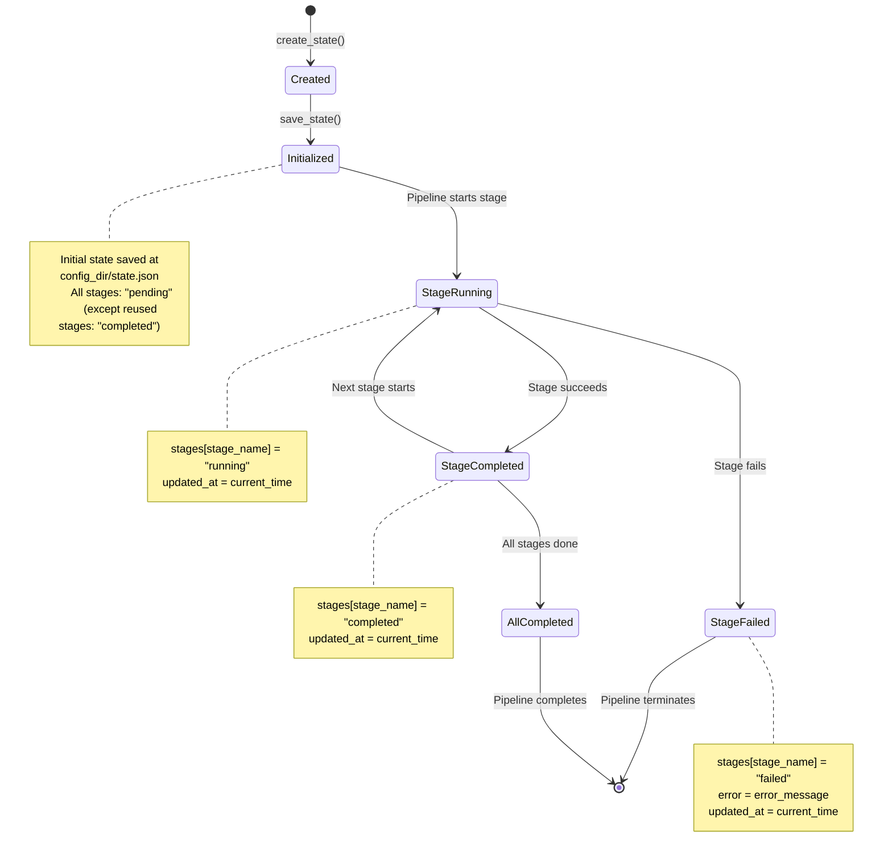
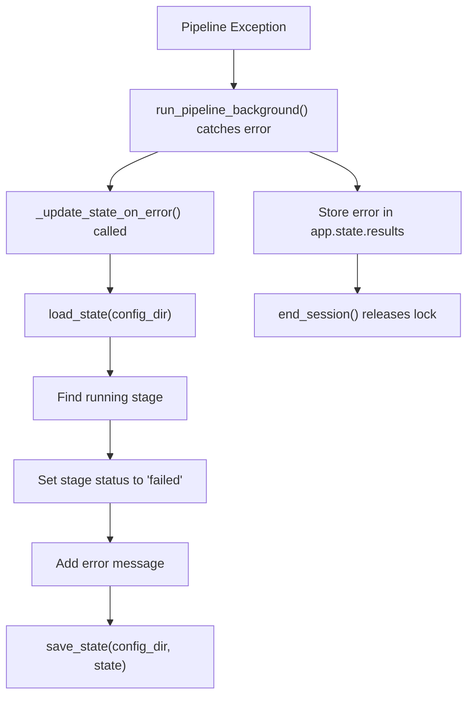
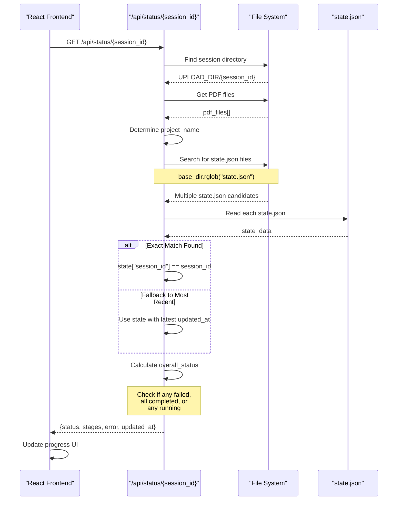
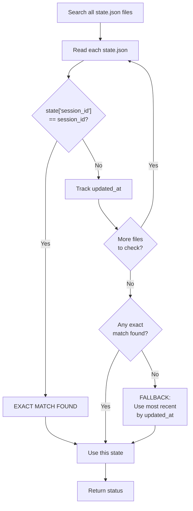
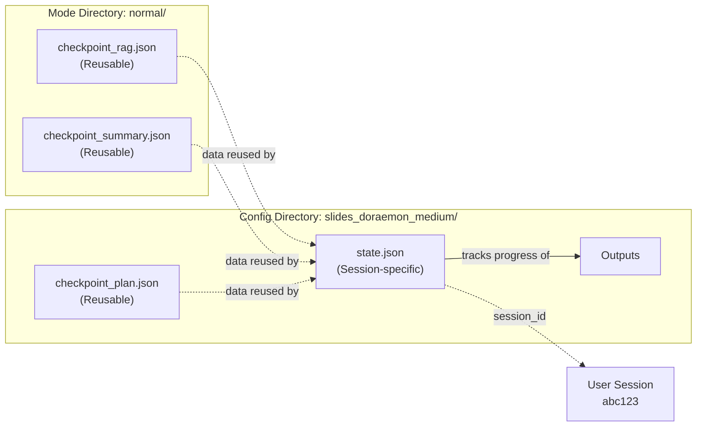
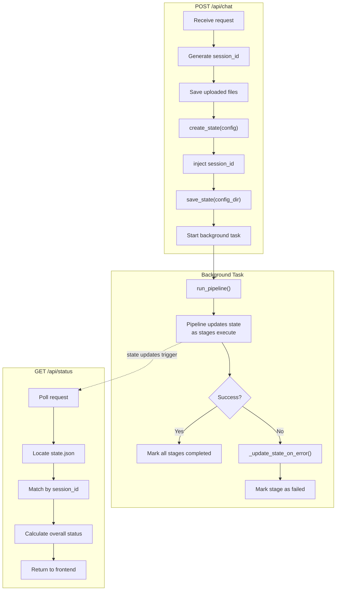

<!-- source: DeepWiki mcp.deepwiki.com · repo HKUDS/Paper2Slides · page 6.3 State Management · fetched 2026-11-09 -->

# State Management

<details>
<summary>Relevant source files</summary>

The following files were used as context for generating this wiki page:

- [README.md](README.md)
- [api/server.py](api/server.py)

</details>


This page documents how the Paper2Slides system tracks pipeline execution progress through the `state.json` file. This state tracking enables the web interface to display real-time progress updates, facilitates error recovery, and links user sessions to their pipeline execution status.

For information about session concurrency control and the SessionManager, see [Session Management](#4.1.2). For details about checkpoint files that store intermediate pipeline results, see [Checkpoint Files](#6.2).

---

## Overview

The `state.json` file serves as the primary mechanism for tracking pipeline execution progress. It is created at the start of each pipeline run and updated as the pipeline progresses through its four stages. Unlike checkpoint files which store intermediate processing results, `state.json` stores only metadata about the pipeline's execution state.

**Key Functions:**
- Tracks which stage is currently executing
- Records completion status of each stage
- Stores error information when failures occur
- Links user sessions to pipeline executions
- Enables real-time progress polling by the web interface

**File Location:** `outputs/<project_name>/<content_type>/<mode>/<config_hash>/state.json`

Sources: [README.md:245](), [api/server.py:392-404]()

---

## State File Structure

The `state.json` file contains a JSON object with the following structure:

```json
{
  "session_id": "a1b2c3d4-e5f6-7890-abcd-ef1234567890",
  "config": {
    "output_type": "slides",
    "style": "doraemon",
    "slides_length": "medium",
    "poster_density": "medium",
    "fast_mode": false,
    "content_type": "paper"
  },
  "stages": {
    "rag": "completed",
    "summary": "completed",
    "plan": "running",
    "generate": "pending"
  },
  "created_at": "2024-01-15T10:30:00.123456",
  "updated_at": "2024-01-15T10:32:15.789012",
  "error": null
}
```

### Field Descriptions

| Field | Type | Description |
|-------|------|-------------|
| `session_id` | string | UUID linking this pipeline execution to a user session |
| `config` | object | Configuration parameters used for this pipeline run |
| `stages` | object | Map of stage names to their current status |
| `created_at` | string | ISO timestamp when state was created |
| `updated_at` | string | ISO timestamp of last state update |
| `error` | string or null | Error message if pipeline failed |

### Stage Names

The `stages` object contains exactly four keys corresponding to the pipeline stages:

| Stage Key | Pipeline Stage | Description |
|-----------|---------------|-------------|
| `"rag"` | RAG | Document parsing and indexing |
| `"summary"` | Analysis | Content extraction and structure analysis |
| `"plan"` | Planning | Layout generation and content organization |
| `"generate"` | Creation | Image rendering and PDF generation |

### Stage Status Values

Each stage can have one of four status values:

| Status | Description | Terminal |
|--------|-------------|----------|
| `"pending"` | Stage has not started yet | No |
| `"running"` | Stage is currently executing | No |
| `"completed"` | Stage finished successfully | Yes |
| `"failed"` | Stage encountered an error | Yes |

Sources: [api/server.py:392-404](), [README.md:202-207]()

---

## State Lifecycle



### State Creation and Initialization

State creation occurs before the pipeline starts executing:

1. **Session Initiated**: User uploads files and submits configuration via web interface or CLI
2. **Initial State Created**: Function `create_state()` is called with configuration parameters
3. **Reused Stages Marked**: If checkpoints exist, stages before `from_stage` are marked `"completed"`
4. **Session ID Added**: The `session_id` is injected into the state for tracking
5. **State Persisted**: `save_state()` writes the initial state to disk

**Code Reference:** [api/server.py:392-404]()

```python
# Create initial state BEFORE starting pipeline
from paper2slides.core.state import create_state, save_state, STAGES
initial_state = create_state(config)

# Add session_id to state for tracking
initial_state["session_id"] = session_id

# Mark stages before from_stage as completed (they are being reused)
start_idx = STAGES.index(from_stage)
for i in range(start_idx):
    initial_state["stages"][STAGES[i]] = "completed"

save_state(config_dir, initial_state)
```

### State Updates During Execution

The pipeline updates state as it progresses through stages. While the exact update mechanism is in `paper2slides/core/state.py` (not provided), the system exhibits the following behavior:

- When a stage begins: `stages[stage_name] = "running"`
- When a stage succeeds: `stages[stage_name] = "completed"`
- When a stage fails: `stages[stage_name] = "failed"` and `error` field is populated
- Each update refreshes the `updated_at` timestamp

### Error State Updates

When the background pipeline fails, the error state is updated through `_update_state_on_error()`:

**Code Reference:** [api/server.py:433-487]()



Sources: [api/server.py:433-487](), [api/server.py:532-546]()

---

## State Persistence and Storage

### File Location Strategy

The `state.json` file is stored at the configuration level in the output directory hierarchy:

```
outputs/
└── <project_name>/
    └── <content_type>/          # "paper" or "general"
        └── <mode>/               # "normal" or "fast"
            └── <config_hash>/    # e.g., "slides_doraemon_medium"
                ├── state.json    ← State file location
                ├── checkpoint_plan.json
                └── <timestamp>/
                    └── ...outputs...
```

This placement strategy ensures that:
- **Configuration-specific**: Each unique configuration has its own state
- **Reusable checkpoints share state**: Multiple regenerations with same config update the same state
- **Session tracking**: The `session_id` field links the state to the user session

**Storage Functions:**

| Function | Module | Purpose |
|----------|--------|---------|
| `create_state(config)` | `paper2slides.core.state` | Create new state object |
| `save_state(config_dir, state)` | `paper2slides.core.state` | Write state to disk |
| `load_state(config_dir)` | `paper2slides.core.state` | Read state from disk |

Sources: [README.md:234-254](), [api/server.py:392](), [api/server.py:477]()

---

## State Querying and Status Polling

The web interface polls the `/api/status/{session_id}` endpoint to retrieve pipeline progress:



### Status Retrieval Logic

**Endpoint:** `GET /api/status/{session_id}`

**Code Reference:** [api/server.py:550-643]()

**Algorithm:**

1. **Locate Session**: Find session directory in `UPLOAD_DIR/{session_id}`
2. **Identify Project**: Determine `project_name` from PDF files
3. **Search State Files**: Use `base_dir.rglob("state.json")` to find all state files
4. **Match by Session ID**: Prioritize state files where `state["session_id"]` matches exactly
5. **Fallback Strategy**: If no exact match, use most recently updated state
6. **Calculate Overall Status**: Aggregate stage statuses into overall status

### Overall Status Calculation

The overall status is derived from individual stage statuses:

```python
# Determine overall status
stages = state_data.get("stages", {})
if any(status == "failed" for status in stages.values()):
    overall_status = "failed"
elif all(status == "completed" for status in stages.values()):
    overall_status = "completed"
elif any(status == "running" for status in stages.values()):
    overall_status = "running"
else:
    overall_status = "pending"
```

**Overall Status Values:**

| Status | Condition |
|--------|-----------|
| `"failed"` | Any stage has failed |
| `"completed"` | All stages are completed |
| `"running"` | Any stage is running (and none failed) |
| `"pending"` | No stages running or failed yet |

**Response Format:**

```json
{
  "session_id": "a1b2c3d4-e5f6-7890-abcd-ef1234567890",
  "status": "running",
  "stages": {
    "rag": "completed",
    "summary": "completed",
    "plan": "running",
    "generate": "pending"
  },
  "error": null,
  "updated_at": "2024-01-15T10:32:15.789012"
}
```

Sources: [api/server.py:550-643]()

---

## Session Tracking and State Association

### Session ID Injection

When a pipeline execution starts, the web interface's `session_id` is injected into the state:

**Code Reference:** [api/server.py:396]()

```python
# Add session_id to state for tracking
initial_state["session_id"] = session_id
```

This enables the system to associate multiple state files with their originating user sessions, which is critical when:
- Multiple configurations are tried with the same input files
- Users regenerate outputs with different parameters
- The system needs to track which session is currently executing

### State Matching Strategy

The `/api/status/{session_id}` endpoint uses a two-tier matching strategy:



**Priority Order:**

1. **Exact Match**: State file where `state["session_id"]` equals requested `session_id`
2. **Temporal Fallback**: State file with most recent `updated_at` timestamp (for legacy compatibility)

**Code Reference:** [api/server.py:582-608]()

```python
# Check both paper and general content types
state_data = None
most_recent_time = None

for content_type in ["paper", "general"]:
    base_dir = Path(get_base_dir(str(OUTPUT_DIR), project_name, content_type))
    if base_dir.exists():
        # Look for all state.json files in config directories
        for state_file_path in base_dir.rglob("state.json"):
            if state_file_path.is_file():
                try:
                    with open(state_file_path, 'r') as f:
                        current_state = json.load(f)
                    
                    # First priority: exact match by session_id
                    if current_state.get("session_id") == session_id:
                        state_data = current_state
                        logger.debug(f"Found exact session match: {state_file_path}")
                        break
                    
                    # Second priority: most recently updated (fallback)
                    updated_at = current_state.get("updated_at") or current_state.get("created_at")
                    if updated_at:
                        if most_recent_time is None or updated_at > most_recent_time:
                            most_recent_time = updated_at
                            if state_data is None or state_data.get("session_id") != session_id:
                                state_data = current_state
                except Exception as e:
                    logger.warning(f"Error reading state file {state_file_path}: {e}")
                    continue
```

### Multiple Configurations per Session

A single session can generate multiple state files when the user regenerates with different configurations:

```
outputs/
└── example_paper/
    └── paper/
        └── normal/
            ├── slides_doraemon_medium/
            │   └── state.json           # session_id: abc123
            ├── slides_academic_long/
            │   └── state.json           # session_id: abc123 (same session, different config)
            └── poster_doraemon_medium/
                └── state.json           # session_id: abc123 (same session, different output type)
```

The exact match by `session_id` ensures the status polling retrieves the correct state file corresponding to the current generation request.

Sources: [api/server.py:396](), [api/server.py:582-608]()

---

## State vs. Checkpoint Files

It's important to distinguish between state files and checkpoint files:

| Aspect | state.json | Checkpoint Files |
|--------|-----------|------------------|
| **Purpose** | Track execution progress | Store intermediate results |
| **Content** | Metadata only | Processing data |
| **Size** | Small (~1KB) | Large (MBs to GBs) |
| **Updates** | Frequent during execution | Once per stage completion |
| **Reusability** | Session-specific | Reusable across sessions |
| **Location** | Config directory | Mode directory (RAG, summary) or config directory (plan) |
| **Examples** | Stage statuses, errors | `checkpoint_rag.json`, `checkpoint_summary.json`, `checkpoint_plan.json` |

**Relationship Diagram:**



**Key Distinction:** Checkpoint files contain *what was computed*, while state.json tracks *how far the computation has progressed*.

Sources: [README.md:245-261](), [README.md:202-210]()

---

## Integration with Pipeline and API

### Backend API Integration

The FastAPI backend creates and manages state throughout the request lifecycle:



### Web Interface Polling

The React frontend polls the status endpoint to update the UI:

**Polling Behavior:**
- **Frequency**: Every few seconds (typically 2-3 seconds)
- **Duration**: Until `status` is `"completed"` or `"failed"`
- **UI Updates**: Progress bars, stage indicators, and status messages

**Frontend Flow:**

1. User submits files → receives `session_id`
2. Frontend starts polling `/api/status/{session_id}`
3. Display real-time progress based on `stages` object
4. On completion, fetch results from `/api/result/{session_id}`

Sources: [api/server.py:145-291](), [api/server.py:489-548](), [api/server.py:550-643]()

---

## Error Handling and Recovery

### Error State Capture

When a pipeline stage fails, the error information is captured in state:

```json
{
  "stages": {
    "rag": "completed",
    "summary": "completed",
    "plan": "failed",
    "generate": "pending"
  },
  "error": "ValueError: Invalid style configuration"
}
```

### Error Update Mechanism

**Code Reference:** [api/server.py:433-487]()

The `_update_state_on_error()` function:

1. Reconstructs the config directories from session information
2. Loads the existing state file
3. Finds the stage that was running
4. Marks that stage as `"failed"`
5. Stores the error message
6. Saves the updated state

**Fail-Safe Design:** If the state update itself fails, the error is logged but does not crash the system. The error is still available in the `app.state.results` cache.

### Client-Side Error Display

When the frontend polls and receives a `"failed"` status:

```json
{
  "status": "failed",
  "stages": { ... },
  "error": "Error message here"
}
```

The frontend displays the error to the user and stops polling.

Sources: [api/server.py:433-487](), [api/server.py:532-543]()

---

## Summary

The `state.json` file is the central mechanism for tracking pipeline execution progress in Paper2Slides. Key characteristics:

- **Location**: Stored at the config directory level
- **Content**: Stage statuses, session ID, configuration, timestamps, and errors
- **Updates**: Modified as pipeline progresses through stages
- **Querying**: Retrieved by the API to provide real-time status to the frontend
- **Session Tracking**: Links user sessions to pipeline executions via `session_id`
- **Error Recovery**: Captures failure information for debugging and user feedback

The state management system enables:
- Real-time progress monitoring in the web interface
- Error tracking and debugging
- Session-specific state isolation
- Resumability and checkpoint coordination

Sources: [README.md:245](), [api/server.py:392-404](), [api/server.py:550-643]()

---

