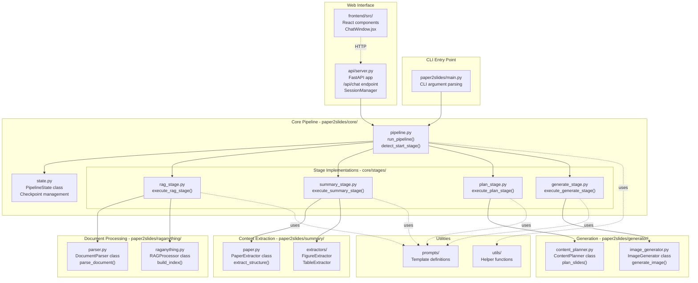
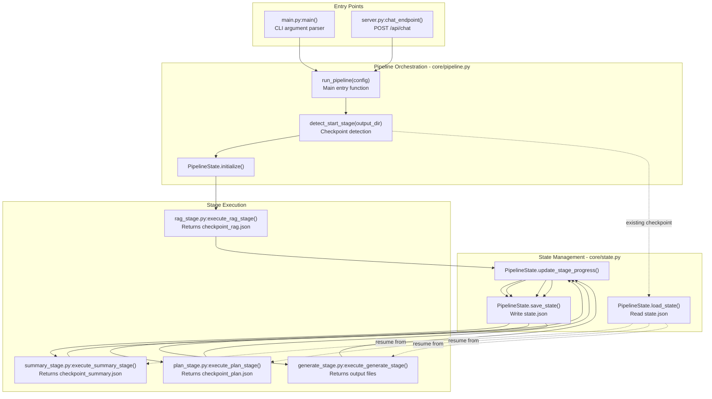

<!-- source: DeepWiki mcp.deepwiki.com · repo HKUDS/Paper2Slides · page 7 Development Guide · fetched 2026-11-09 -->

# Development Guide

<details>
<summary>Relevant source files</summary>

The following files were used as context for generating this wiki page:

- [.gitignore](.gitignore)
- [README.md](README.md)
- [frontend/package.json](frontend/package.json)
- [frontend/postcss.config.js](frontend/postcss.config.js)

</details>


## Purpose and Scope

This document provides technical guidance for developers who want to contribute to, extend, or customize the Paper2Slides system. It covers the codebase architecture, technology stack, development setup, and extension points.

For installation and first-time setup instructions, see [Getting Started](#1.1). For information about running the backend and frontend services, see [Running and Deploying](#7.3). For detailed project structure documentation, see [Project Structure](#7.1).

**Sources:** [README.md:1-348]()

---

## Technology Stack

Paper2Slides is built using the following technologies:

| Component | Technology | Version | Purpose |
|-----------|-----------|---------|---------|
| **Backend Language** | Python | 3.10+ | Core pipeline and API server |
| **API Framework** | FastAPI | Latest | RESTful API endpoints |
| **Frontend Framework** | React | 18.2.0 | UI components |
| **Build Tool** | Vite | 4.3.9 | Frontend development and bundling |
| **Styling** | TailwindCSS | 3.3.2 | UI styling framework |
| **HTTP Client** | Axios | 1.4.0 | API communication |
| **Icons** | Lucide React | 0.263.1 | UI icons |
| **LLM Backend** | Gemini API | Latest | Image generation (gemini-3-pro-image-preview) |
| **Environment** | Conda | Any | Python environment management |

**Sources:** [README.md:107-118](), [frontend/package.json:1-25]()

---

## Codebase Architecture

### Module Organization

The codebase is organized into distinct modules with clear separation of concerns:



**Key Architectural Principles:**

1. **Modular Pipeline**: Each processing stage is implemented as a separate module in `core/stages/`
2. **State Isolation**: `PipelineState` class handles all checkpoint operations independently
3. **Pluggable Components**: Document parsers, extractors, and generators are designed for extensibility
4. **Dual Interface**: CLI (`main.py`) and API (`server.py`) both invoke the same core pipeline
5. **Template-Driven**: LLM prompts are centralized in the `prompts/` directory

**Sources:** [README.md:283-330]()

---

## Development Workflow

### Core Pipeline Execution Flow

The following diagram shows the actual function call flow through the core pipeline with real code entity names:



**Key Functions to Understand:**

| Function | Location | Responsibility |
|----------|----------|----------------|
| `run_pipeline()` | `paper2slides/core/pipeline.py` | Orchestrates the entire 4-stage pipeline |
| `detect_start_stage()` | `paper2slides/core/pipeline.py` | Determines which stage to start from based on checkpoints |
| `execute_rag_stage()` | `paper2slides/core/stages/rag_stage.py` | Stage 1: Document parsing and RAG indexing |
| `execute_summary_stage()` | `paper2slides/core/stages/summary_stage.py` | Stage 2: Content extraction and analysis |
| `execute_plan_stage()` | `paper2slides/core/stages/plan_stage.py` | Stage 3: Layout planning |
| `execute_generate_stage()` | `paper2slides/core/stages/generate_stage.py` | Stage 4: Image generation |
| `PipelineState.save_state()` | `paper2slides/core/state.py` | Persists current pipeline state to disk |
| `PipelineState.load_state()` | `paper2slides/core/state.py` | Loads existing pipeline state from disk |

**Sources:** [README.md:198-228]()

---

## Key Entry Points for Development

### CLI Entry Point

The CLI is implemented as a Python module entry point:

**File:** `paper2slides/main.py`

The CLI parser handles:
- Input file validation
- Configuration parameter parsing
- Invocation of `run_pipeline()` with user-specified config
- Output listing (`--list` flag)
- Debug mode activation (`--debug` flag)

**Invocation:**
```bash
python -m paper2slides --input paper.pdf --output slides
```

The `-m` flag tells Python to run `paper2slides` as a module, which executes `paper2slides/main.py`.

**Sources:** [README.md:47-50](), [README.md:123-151]()

---

### API Entry Point

The web API is a FastAPI application:

**File:** `api/server.py`

**Key Components:**

| Component | Type | Purpose |
|-----------|------|---------|
| `app` | FastAPI instance | Main application object |
| `SessionManager` | Class | Enforces single-threaded execution, prevents concurrent generation |
| `chat_endpoint()` | Async function | POST `/api/chat` - Accepts files and config, starts background task |
| `status_endpoint()` | Async function | GET `/api/status/{session_id}` - Returns current pipeline progress |
| `result_endpoint()` | Async function | GET `/api/result/{session_id}` - Returns generated output file URLs |
| `UPLOAD_DIR` | Path constant | Directory for uploaded files (`sources/uploads/`) |
| `OUTPUT_DIR` | Path constant | Directory for generated outputs (`outputs/`) |

**API Workflow:**
1. Client uploads files to `/api/chat`
2. Server saves files to `UPLOAD_DIR/{session_id}/`
3. Server starts background task executing `run_pipeline()`
4. Client polls `/api/status/{session_id}` to track progress
5. Client retrieves results from `/api/result/{session_id}`

**Sources:** [README.md:169-195]()

---

### Frontend Entry Point

The React application is built with Vite:

**File:** `frontend/src/App.jsx` (root component)

**Build Configuration:**
- **Package Manager:** npm/yarn
- **Dev Server:** Vite dev server (port 5173 by default)
- **Build Output:** `frontend/dist/`
- **Styling:** TailwindCSS with PostCSS

**Key Frontend Files:**

| File | Purpose |
|------|---------|
| `frontend/src/App.jsx` | Root component, application setup |
| `frontend/src/components/ChatWindow.jsx` | Main UI orchestrator, state management |
| `frontend/src/components/ConfigPanel.jsx` | User configuration UI |
| `frontend/src/components/MessageInput.jsx` | File upload interface |
| `frontend/src/components/FileUpload.jsx` | Drag-and-drop file upload |
| `frontend/vite.config.js` | Vite build configuration |
| `frontend/tailwind.config.js` | TailwindCSS styling configuration |

**Development Commands:**
```bash
npm run dev     # Start dev server
npm run build   # Build for production
npm run preview # Preview production build
```

**Sources:** [frontend/package.json:1-25](), [frontend/postcss.config.js:1-7]()

---

## Extending the System

### Adding a New Pipeline Stage

To add a new stage to the pipeline:

1. **Create Stage Module:** Add `paper2slides/core/stages/new_stage.py`
2. **Implement Execute Function:**
   ```python
   def execute_new_stage(config: dict, state: PipelineState) -> dict:
       # Stage logic here
       checkpoint_data = {...}
       return checkpoint_data
   ```
3. **Update Pipeline Orchestrator:** Modify `paper2slides/core/pipeline.py`:
   - Add stage to execution sequence in `run_pipeline()`
   - Add stage detection logic to `detect_start_stage()`
4. **Define Checkpoint Schema:** Create checkpoint file format (e.g., `checkpoint_new_stage.json`)
5. **Update State Management:** Add stage to `PipelineState` class in `paper2slides/core/state.py`

**Sources:** [README.md:198-228]()

---

### Adding a Custom Document Parser

To support a new document format:

1. **Extend DocumentParser:** Create parser in `paper2slides/raganything/parser.py`
2. **Register Format Handler:** Add format detection and parsing logic
3. **Return Standardized Output:** Ensure parser returns text and metadata in expected format

**Example Parser Structure:**
```python
class CustomFormatParser:
    def can_parse(self, file_path: str) -> bool:
        # Check if file is supported format
        
    def parse(self, file_path: str) -> dict:
        # Return {"text": str, "metadata": dict, "figures": list}
```

**Sources:** [README.md:311-312]()

---

### Adding a Custom Content Extractor

To extract new types of content (e.g., code blocks, equations):

1. **Create Extractor:** Add to `paper2slides/summary/extractors/`
2. **Implement Extraction Logic:**
   ```python
   class CustomExtractor:
       def extract(self, document: dict) -> list:
           # Return list of extracted items
   ```
3. **Register Extractor:** Add to summary stage in `paper2slides/core/stages/summary_stage.py`
4. **Update Checkpoint Schema:** Extend `checkpoint_summary.json` format

**Sources:** [README.md:315-316]()

---

### Customizing Image Generation

The image generator uses the Gemini API. To customize:

**File:** `paper2slides/generator/image_generator.py`

**Key Class:** `ImageGenerator`

**Customization Points:**
- **Prompt Templates:** Modify prompts in `paper2slides/prompts/`
- **Model Selection:** Change model name (currently `gemini-3-pro-image-preview`)
- **Generation Parameters:** Adjust temperature, max_tokens, etc.
- **Post-processing:** Add filters, transformations to generated images

**Environment Configuration:**
The API key must be set in `paper2slides/.env`:
```
GEMINI_API_KEY=your_api_key_here
```

**Sources:** [README.md:271-280](), [README.md:121]()

---

## Code Organization Principles

### Directory Structure

```
Paper2Slides/
├── paper2slides/              # Core library (Python package)
│   ├── __init__.py
│   ├── main.py                # CLI entry point
│   ├── core/                  # Pipeline orchestration
│   │   ├── pipeline.py        # Main pipeline logic
│   │   ├── state.py           # State management
│   │   └── stages/            # Stage implementations
│   ├── raganything/           # Document parsing & RAG
│   ├── summary/               # Content extraction
│   ├── generator/             # Planning & generation
│   ├── prompts/               # LLM prompt templates
│   └── utils/                 # Shared utilities
│
├── api/                       # Web backend
│   └── server.py              # FastAPI application
│
├── frontend/                  # Web frontend
│   ├── src/                   # React source files
│   │   ├── App.jsx
│   │   └── components/
│   ├── package.json
│   ├── vite.config.js
│   └── tailwind.config.js
│
├── scripts/                   # Shell scripts
│   ├── start.sh               # Start both services
│   ├── start_backend.sh       # Start API only
│   └── start_frontend.sh      # Start frontend only
│
├── sources/                   # Runtime data (gitignored)
│   └── uploads/               # Uploaded files
│
├── outputs/                   # Generated outputs (gitignored)
│   └── [project_name]/
│
├── requirements.txt           # Python dependencies
├── .env.example               # Environment template
└── README.md
```

**Sources:** [README.md:283-330](), [.gitignore:1-64]()

---

### Naming Conventions

| Entity | Convention | Example |
|--------|-----------|---------|
| **Python Modules** | lowercase_with_underscores | `content_planner.py` |
| **Python Classes** | PascalCase | `PipelineState`, `ImageGenerator` |
| **Python Functions** | lowercase_with_underscores | `run_pipeline()`, `detect_start_stage()` |
| **React Components** | PascalCase | `ChatWindow.jsx`, `ConfigPanel.jsx` |
| **API Endpoints** | lowercase with hyphens | `/api/chat`, `/api/status` |
| **Checkpoint Files** | lowercase_with_underscores | `checkpoint_rag.json` |
| **Environment Variables** | UPPERCASE_WITH_UNDERSCORES | `GEMINI_API_KEY`, `UPLOAD_DIR` |

**Sources:** [README.md:283-330]()

---

### Configuration Management

Configuration flows through the system as a dictionary with the following structure:

| Key | Type | Values | Description |
|-----|------|--------|-------------|
| `input` | str/list | File path(s) | Input document(s) |
| `output` | str | `"slides"` \| `"poster"` | Output type |
| `content` | str | `"paper"` \| `"general"` | Content type |
| `style` | str | `"academic"` \| `"doraemon"` \| custom | Style specification |
| `length` | str | `"short"` \| `"medium"` \| `"long"` | Slides length (if output=slides) |
| `density` | str | `"sparse"` \| `"medium"` \| `"dense"` | Poster density (if output=poster) |
| `fast_mode` | bool | `true` \| `false` | Skip RAG indexing |
| `from_stage` | str | `"rag"` \| `"summary"` \| `"plan"` \| `"generate"` | Force start stage |

Configuration is passed through all stages and influences:
- **RAG Stage:** `content`, `fast_mode`
- **Summary Stage:** `content`
- **Plan Stage:** `output`, `style`, `length`/`density`
- **Generate Stage:** `output`, `style`

**Sources:** [README.md:139-151]()

---

## File System Conventions

### Generated Output Hierarchy

The output directory structure encodes processing context:

```
outputs/
└── {content_type}/           # "paper" or "general"
    └── {project_name}/       # Derived from PDF filename or session_id
        └── {mode}/           # "fast" or "normal"
            ├── checkpoint_rag.json        # Reusable across configs
            ├── checkpoint_summary.json    # Reusable across configs
            ├── summary.md                 # Human-readable
            └── {config_hash}/             # e.g., "slides_doraemon_medium"
                ├── state.json             # Current state
                ├── checkpoint_plan.json   # Config-specific
                └── {timestamp}/           # Generation timestamp
                    ├── slide_01.png
                    ├── slide_02.png
                    └── slides.pdf
```

**Key Design Decisions:**

1. **Checkpoints at Mode Level:** `checkpoint_rag.json` and `checkpoint_summary.json` are placed at the mode level (not config level), enabling reuse when only style/length changes
2. **Config Hash Directory:** Isolates outputs for different configurations while allowing checkpoint sharing
3. **Timestamp Directory:** Enables multiple generations with same config, preserving history
4. **Flat Checkpoint Files:** All checkpoint files are JSON for easy inspection and debugging

**Sources:** [README.md:234-261]()

---

### Ignored Files

The `.gitignore` excludes runtime-generated files:

| Pattern | Reason |
|---------|--------|
| `sources/` | User-uploaded files (potentially large, privacy-sensitive) |
| `outputs/` | Generated outputs (reproducible from source) |
| `__pycache__/`, `*.pyc` | Python bytecode |
| `node_modules/` | Frontend dependencies (reproducible from package.json) |
| `dist/`, `dist-ssr/` | Frontend build outputs |
| `.env` | API keys and secrets |
| `logs/`, `*.log` | Runtime logs |

**Sources:** [.gitignore:1-64]()

---

## Development Dependencies

### Python Dependencies

Installed via `pip install -r requirements.txt`:

**Core Dependencies:**
- **FastAPI:** Web API framework
- **Uvicorn:** ASGI server for FastAPI
- **LangChain:** LLM orchestration
- **Google Generative AI:** Gemini API client
- **PyMuPDF (fitz):** PDF parsing
- **python-docx:** Word document parsing
- **openpyxl:** Excel parsing
- **python-pptx:** PowerPoint parsing
- **pillow:** Image processing
- **markdown:** Markdown parsing

**Development Dependencies:**
- **pytest:** Unit testing
- **black:** Code formatting
- **flake8:** Linting

**Sources:** [README.md:107-118]()

---

### Frontend Dependencies

Installed via `npm install` in `frontend/`:

**Production Dependencies:**
- `react`: ^18.2.0 - UI framework
- `react-dom`: ^18.2.0 - React DOM renderer
- `lucide-react`: ^0.263.1 - Icon library
- `axios`: ^1.4.0 - HTTP client

**Development Dependencies:**
- `@vitejs/plugin-react`: ^4.0.0 - Vite React plugin
- `autoprefixer`: ^10.4.14 - CSS post-processor
- `postcss`: ^8.4.24 - CSS transformer
- `tailwindcss`: ^3.3.2 - Utility CSS framework
- `vite`: ^4.3.9 - Build tool

**Sources:** [frontend/package.json:1-25]()

---

## Testing and Debugging

### Debug Mode

Enable verbose logging with the `--debug` flag:

```bash
python -m paper2slides --input paper.pdf --output slides --debug
```

Debug mode enables:
- Detailed stage execution logs
- Checkpoint file contents logging
- API request/response logging
- Error stack traces

**Sources:** [README.md:151]()

---

### Checkpoint Inspection

All checkpoint files are JSON and can be inspected manually:

```bash
# View RAG checkpoint
cat outputs/paper/my_paper/normal/checkpoint_rag.json

# View summary checkpoint
cat outputs/paper/my_paper/normal/checkpoint_summary.json

# View plan checkpoint
cat outputs/paper/my_paper/normal/slides_doraemon_medium/checkpoint_plan.json

# View current state
cat outputs/paper/my_paper/normal/slides_doraemon_medium/state.json
```

**Sources:** [README.md:234-261]()

---

## Best Practices for Contributors

1. **Maintain Checkpoint Compatibility:** When modifying stage implementations, ensure checkpoint files remain backward-compatible or implement migration logic
2. **Use Type Hints:** Add Python type hints to all function signatures for better IDE support
3. **Document LLM Prompts:** Add comments explaining prompt design decisions in `paper2slides/prompts/`
4. **Test Both Modes:** Verify changes work in both normal and fast mode
5. **Handle File System Errors:** Always check for file existence and handle missing checkpoints gracefully
6. **Follow React Best Practices:** Use functional components with hooks, avoid class components
7. **Minimize API Calls:** Cache LLM responses when possible to reduce costs
8. **Log State Transitions:** Use structured logging to track pipeline stage transitions

**Sources:** [README.md:1-348]()

---

