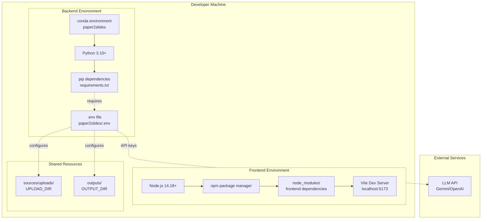
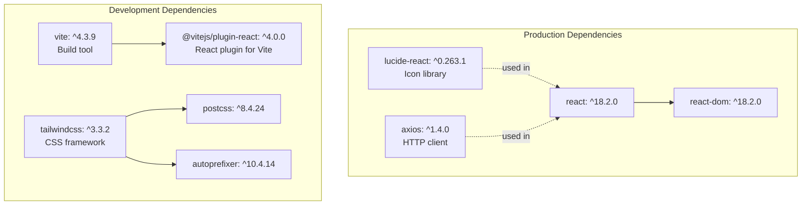
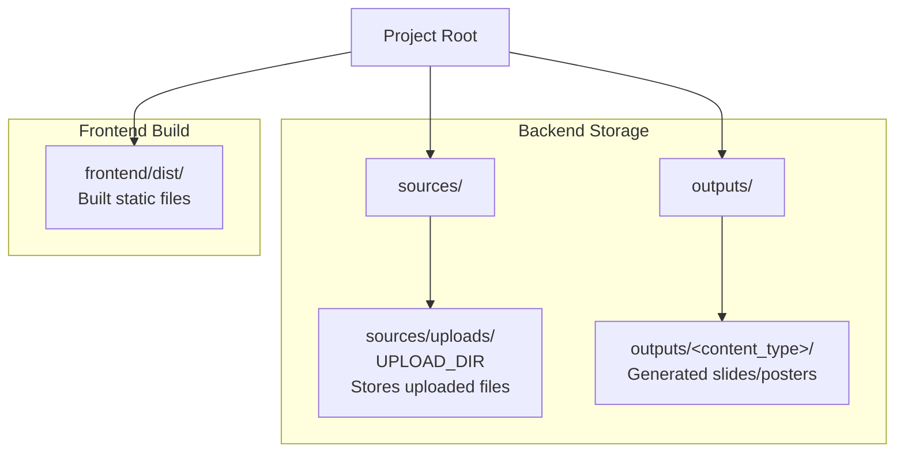
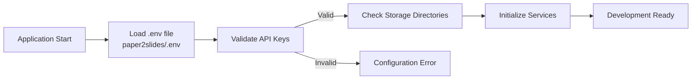
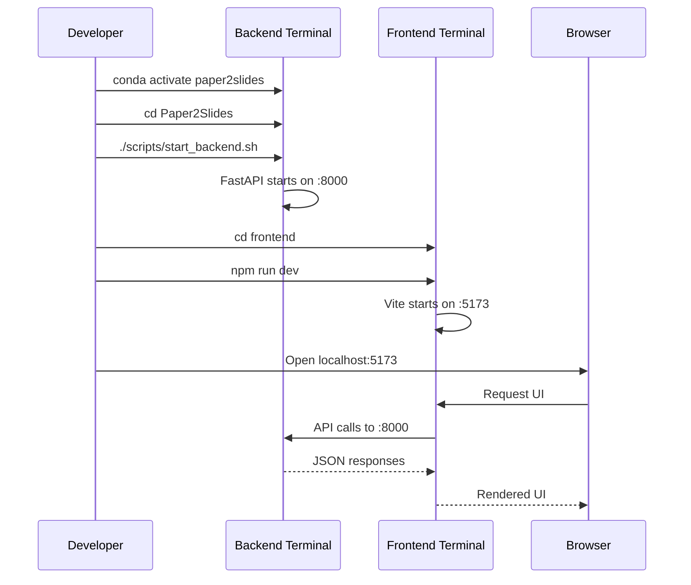

<!-- source: DeepWiki mcp.deepwiki.com · repo HKUDS/Paper2Slides · page 7.2 Setting Up Development Environment · fetched 2026-11-09 -->

# Setting Up Development Environment

<details>
<summary>Relevant source files</summary>

The following files were used as context for generating this wiki page:

- [README.md](README.md)
- [frontend/package-lock.json](frontend/package-lock.json)
- [frontend/package.json](frontend/package.json)

</details>


This page provides instructions for setting up a local development environment for Paper2Slides. This includes installing dependencies for both the Python backend and React frontend, configuring environment variables, and verifying the setup. For information about project structure and code organization, see [Project Structure](#7.1). For deployment and running services, see [Running and Deploying](#7.3).

---

## Overview

Paper2Slides consists of two main components that require separate setup:

1. **Backend**: Python-based core processing pipeline and FastAPI server
2. **Frontend**: React application built with Vite

Both components must be configured to enable full-stack development.

**Development Environment Architecture**



Sources: [README.md:105-122](), [frontend/package.json:1-24]()

---

## Prerequisites

Before beginning setup, ensure the following tools are installed:

| Tool | Minimum Version | Purpose |
|------|----------------|---------|
| Python | 3.10 | Backend runtime |
| Conda | Any recent version | Python environment management |
| Node.js | 14.18.0 | Frontend runtime |
| npm | 8.0.0 | Frontend package management |
| Git | Any recent version | Repository cloning |

Sources: [README.md:7](), [frontend/package.json:6-9]()

---

## Backend Setup

### Step 1: Clone Repository

```bash
git clone https://github.com/HKUDS/Paper2Slides.git
cd Paper2Slides
```

Sources: [README.md:108-110]()

### Step 2: Create Python Environment

Paper2Slides uses Conda for Python environment management to ensure dependency isolation.

```bash
# Create environment with Python 3.10
conda create -n paper2slides python=3.10 -y

# Activate environment
conda activate paper2slides
```

The environment name `paper2slides` should be used consistently for development.

Sources: [README.md:112-114]()

### Step 3: Install Python Dependencies

```bash
# Install all required packages
pip install -r requirements.txt
```

This installs backend dependencies including:
- FastAPI for the API server
- LLM client libraries (Gemini, OpenAI)
- Document parsing libraries
- RAG processing tools
- Image generation utilities

Sources: [README.md:116-118]()

### Step 4: Configure Environment Variables

Create a `.env` file in the `paper2slides/` directory with required API keys and configuration:

```bash
# Navigate to paper2slides directory
cd paper2slides

# Create .env from example (if available)
cp .env.example .env

# Edit .env with your configuration
nano .env  # or use your preferred editor
```

**Required Environment Variables**

The `.env` file must contain API keys for external services. Refer to `paper2slides/.env.example` for the complete list of required variables.

Common variables include:
- LLM API keys (Gemini, OpenAI)
- Model configuration parameters
- Service endpoints

Sources: [README.md:120-122]()

---

## Frontend Setup

### Step 1: Navigate to Frontend Directory

```bash
cd frontend
```

### Step 2: Install Node Dependencies

```bash
# Install all dependencies from package.json
npm install
```

This installs frontend dependencies defined in `package.json`.

**Frontend Dependency Structure**



Sources: [frontend/package.json:11-23]()

**Key Dependencies**

| Package | Version | Purpose |
|---------|---------|---------|
| `react` | ^18.2.0 | Core UI library |
| `react-dom` | ^18.2.0 | DOM rendering |
| `axios` | ^1.4.0 | API communication with backend |
| `lucide-react` | ^0.263.1 | Icon components |
| `vite` | ^4.3.9 | Development server and build tool |
| `tailwindcss` | ^3.3.2 | Utility-first CSS framework |

Sources: [frontend/package.json:11-23]()

### Step 3: Verify Frontend Configuration

The frontend uses Vite for development. Configuration files that should exist:

- `vite.config.js` - Vite configuration
- `tailwind.config.js` - Tailwind CSS configuration
- `postcss.config.js` - PostCSS configuration
- `index.html` - Entry HTML file

Sources: [frontend/package.json:6-9]()

---

## Directory Structure Initialization

After dependency installation, ensure the following directories exist for runtime operation:

**Storage Directories**



These directories are typically created automatically by the application at runtime, but can be created manually:

```bash
# From project root
mkdir -p sources/uploads
mkdir -p outputs
```

Sources: [README.md:234-254]()

---

## Environment Variable Configuration

### Backend Environment Variables

Create `paper2slides/.env` file with the following structure:

```bash
# LLM API Configuration
GEMINI_API_KEY=your_gemini_api_key_here
OPENAI_API_KEY=your_openai_api_key_here

# Model Configuration
DEFAULT_MODEL=gemini-pro
IMAGE_MODEL=gemini-3-pro-image-preview

# Storage Configuration (optional, defaults exist)
UPLOAD_DIR=sources/uploads
OUTPUT_DIR=outputs

# Server Configuration (optional)
API_PORT=8000
FRONTEND_URL=http://localhost:5173
```

**Configuration Validation Flow**



Sources: [README.md:120-122]()

---

## Verification Steps

After completing setup, verify the environment is correctly configured.

### Backend Verification

```bash
# Activate conda environment
conda activate paper2slides

# Test Python imports
python -c "import paper2slides; print('Backend OK')"

# Check if .env is loaded (from project root)
python -c "from dotenv import load_dotenv; import os; load_dotenv('paper2slides/.env'); print('API Key loaded' if os.getenv('GEMINI_API_KEY') else 'API Key missing')"
```

### Frontend Verification

```bash
# Navigate to frontend directory
cd frontend

# Check if dependencies are installed
npm list --depth=0

# Test Vite dev server (should start without errors)
npm run dev
# Server should start at http://localhost:5173
# Press Ctrl+C to stop
```

Sources: [frontend/package.json:6-9](), [README.md:112-118]()

---

## Development Workflow Setup

**Typical Development Session**



Sources: [README.md:177-183]()

**Recommended Terminal Setup**

Use two terminal sessions for active development:

**Terminal 1 - Backend**
```bash
conda activate paper2slides
cd Paper2Slides
./scripts/start_backend.sh
# FastAPI server runs on http://localhost:8000
```

**Terminal 2 - Frontend**
```bash
cd Paper2Slides/frontend
npm run dev
# Vite dev server runs on http://localhost:5173
```

Sources: [README.md:177-186]()

---

## Common Issues and Solutions

### Issue: Python Import Errors

**Symptom**: `ModuleNotFoundError` when running Python code

**Solution**:
```bash
# Ensure conda environment is activated
conda activate paper2slides

# Reinstall dependencies
pip install -r requirements.txt
```

### Issue: Node Module Errors

**Symptom**: Frontend fails to start with missing module errors

**Solution**:
```bash
cd frontend
rm -rf node_modules package-lock.json
npm install
```

### Issue: Port Already in Use

**Symptom**: Backend or frontend fails to start due to port conflict

**Solution**:
```bash
# For backend (port 8000)
lsof -ti:8000 | xargs kill -9

# For frontend (port 5173)
lsof -ti:5173 | xargs kill -9
```

### Issue: .env File Not Found

**Symptom**: Application fails to start with configuration errors

**Solution**:
```bash
# Ensure .env exists in correct location
ls paper2slides/.env

# If missing, create from example
cp paper2slides/.env.example paper2slides/.env
# Edit with your API keys
```

Sources: [README.md:120-122]()

---

## Development Tools Recommendations

### Python Development

| Tool | Purpose |
|------|---------|
| `ipython` | Interactive Python shell for testing |
| `pytest` | Unit testing framework |
| `black` | Code formatting |
| `flake8` | Linting |

### Frontend Development

| Tool | Purpose |
|------|---------|
| Browser DevTools | Debugging React components |
| React Developer Tools | Chrome/Firefox extension for React debugging |
| Vite DevTools | Built-in hot module replacement (HMR) |

### IDE Configuration

Recommended IDE setup for optimal development experience:

- **VSCode**: Install Python and ESLint extensions
- **PyCharm**: Configure interpreter to use conda environment
- **WebStorm**: Enable ESLint and Prettier for frontend

---

## Next Steps

After completing development environment setup:

1. Familiarize yourself with the project structure - see [Project Structure](#7.1)
2. Learn how to run and deploy services - see [Running and Deploying](#7.3)
3. Start the development servers and test basic functionality
4. Review the core pipeline architecture - see [Core Pipeline Architecture](#2)

Sources: [README.md:103-196]()

---

