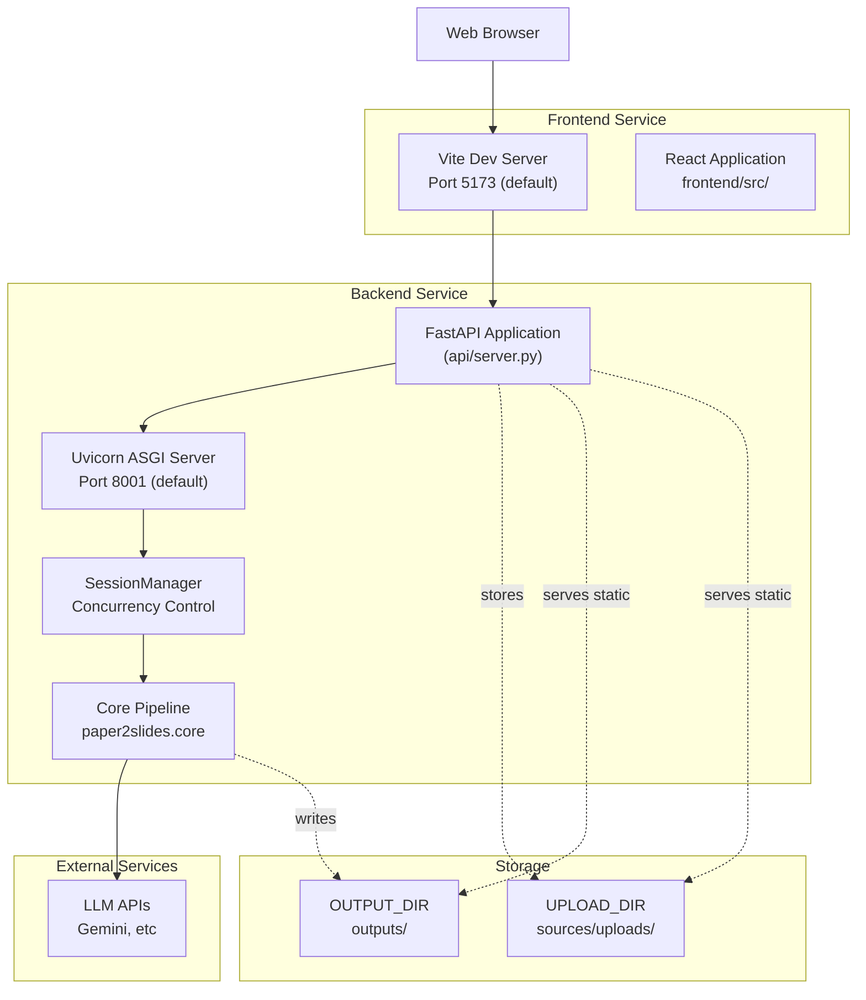
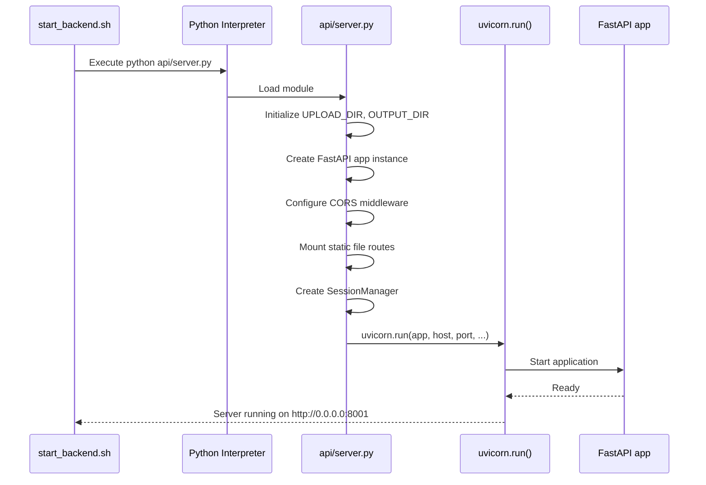
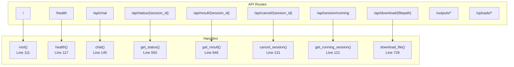
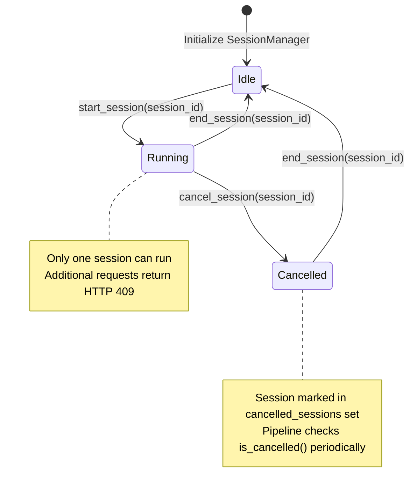
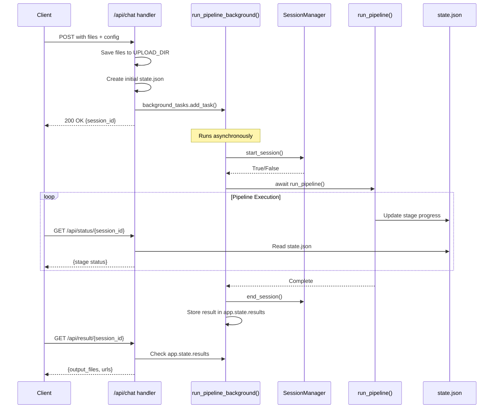

<!-- source: DeepWiki mcp.deepwiki.com · repo HKUDS/Paper2Slides · page 7.3 Running and Deploying · fetched 2026-11-09 -->

# Running and Deploying

<details>
<summary>Relevant source files</summary>

The following files were used as context for generating this wiki page:

- [README.md](README.md)
- [api/server.py](api/server.py)

</details>


This document provides instructions for running the Paper2Slides backend and frontend services in development and production environments. It covers service startup, configuration, and deployment considerations.

For information about setting up the development environment and dependencies, see [Setting Up Development Environment](#7.2). For CLI usage without the web interface, see [Command-Line Interface (CLI)](#3).

---

## Service Architecture Overview

Paper2Slides consists of two independently deployable services that communicate via HTTP:



**Sources:** [api/server.py:1-100](), [README.md:167-195]()

---

## Running Services in Development

### Backend Service

The backend is a FastAPI application served by Uvicorn. It can be started using the provided script or directly with Python.

**Using the startup script:**

```bash
./scripts/start_backend.sh
```

**Direct invocation:**

```bash
cd api
python server.py [port]
```

The server starts on port 8001 by default. To specify a different port, pass it as an argument: `python server.py 8080`.

**Backend startup sequence:**



**Sources:** [api/server.py:753-772](), [README.md:176-182]()

### Frontend Service

The frontend is a React application built with Vite. Start it using:

**Using the startup script:**

```bash
./scripts/start_frontend.sh
```

**Direct invocation:**

```bash
cd frontend
npm run dev
```

The Vite development server starts on port 5173 by default and provides hot module replacement for rapid development.

**Sources:** [README.md:176-186]()

### Starting Both Services

To launch both services simultaneously:

```bash
./scripts/start.sh
```

This script starts the backend in the background, then starts the frontend. Access the web interface at `http://localhost:5173`.

**Sources:** [README.md:169-186]()

---

## Backend Configuration

The FastAPI backend exposes several configuration points defined in [api/server.py]():

### Directory Configuration

| Directory | Path | Purpose | Line Reference |
|-----------|------|---------|----------------|
| `UPLOAD_DIR` | `sources/uploads/` | Stores uploaded files organized by session ID | [api/server.py:34]() |
| `OUTPUT_DIR` | `outputs/` | Stores generated outputs and checkpoints | [api/server.py:35]() |

Both directories are created automatically on startup if they don't exist [api/server.py:36-37]().

### Server Configuration

The Uvicorn server is configured with the following parameters at [api/server.py:765-772]():

| Parameter | Value | Purpose |
|-----------|-------|---------|
| `host` | `"0.0.0.0"` | Accept connections from all network interfaces |
| `port` | `8001` (default) | HTTP port, configurable via CLI argument |
| `timeout_keep_alive` | `300` | Keep-alive timeout (5 minutes) for long-running pipeline tasks |
| `limit_concurrency` | `10` | Maximum concurrent connections |
| `limit_max_requests` | `1000` | Maximum requests before worker restart |

### CORS Configuration

The CORS middleware allows requests from these origins [api/server.py:88-94]():

```python
allow_origins=["http://localhost:3000", "http://localhost:5173", 
               "http://127.0.0.1:3000", "http://127.0.0.1:5173"]
```

Update these origins for production deployments to match your domain.

**Sources:** [api/server.py:34-94](), [api/server.py:765-772]()

### Static File Serving

The backend mounts two static file directories [api/server.py:96-99]():

```python
app.mount("/outputs", StaticFiles(directory=str(OUTPUT_DIR)), name="outputs")
app.mount("/uploads", StaticFiles(directory=str(UPLOAD_DIR)), name="uploads")
```

These enable the frontend to directly access uploaded source files and generated outputs via HTTP.

**Sources:** [api/server.py:96-99]()

---

## Service Endpoints

The backend exposes the following API endpoints:



| Endpoint | Method | Purpose | Handler |
|----------|--------|---------|---------|
| `/` | GET | Server status check | [api/server.py:111-113]() |
| `/health` | GET | Health check | [api/server.py:116-118]() |
| `/api/chat` | POST | Submit generation request | [api/server.py:145-291]() |
| `/api/status/{session_id}` | GET | Poll pipeline progress | [api/server.py:550-643]() |
| `/api/result/{session_id}` | GET | Retrieve completed results | [api/server.py:646-726]() |
| `/api/cancel/{session_id}` | POST | Cancel running generation | [api/server.py:131-142]() |
| `/api/session/running` | GET | Check if session is running | [api/server.py:121-128]() |
| `/api/download/{filepath}` | GET | Download output files | [api/server.py:729-750]() |

**Sources:** [api/server.py:111-750]()

---

## Session Management

The `SessionManager` class [api/server.py:45-84]() enforces single-threaded pipeline execution:



Key methods:

| Method | Purpose | Line Reference |
|--------|---------|----------------|
| `start_session(session_id)` | Acquire execution lock, returns `False` if busy | [api/server.py:51-59]() |
| `end_session(session_id)` | Release execution lock | [api/server.py:61-66]() |
| `cancel_session(session_id)` | Mark session for cancellation | [api/server.py:68-75]() |
| `is_cancelled(session_id)` | Check if session cancelled | [api/server.py:77-79]() |
| `get_running_session()` | Get currently running session ID | [api/server.py:81-83]() |

**Sources:** [api/server.py:45-84]()

---

## Background Task Processing

Generation requests are processed asynchronously using FastAPI's `BackgroundTasks`:



The background task handler [api/server.py:489-547]() performs the following:

1. **Acquire session lock** via `SessionManager.start_session()` [api/server.py:506]()
2. **Execute pipeline** by calling `generate_slides_with_pipeline()` [api/server.py:516-518]()
3. **Check cancellation** periodically via `session_manager.is_cancelled()` [api/server.py:521-523]()
4. **Store results** in `app.state.results` dictionary [api/server.py:528-530]()
5. **Release lock** via `SessionManager.end_session()` in finally block [api/server.py:546]()

**Sources:** [api/server.py:145-291](), [api/server.py:489-547]()

---

## Environment Variables

The backend requires API keys configured in a `.env` file located at `paper2slides/.env`:

```bash
# Create from template
cp paper2slides/.env.example paper2slides/.env

# Edit with your API keys
nano paper2slides/.env
```

The `.env` file should contain credentials for the LLM services used by the pipeline. Refer to `paper2slides/.env.example` for required variables.

**Sources:** [README.md:120-121]()

---

## Production Deployment Considerations

### Process Management

For production, use a process manager to ensure services stay running:

**Option 1: systemd (Linux)**

Create service files for backend and frontend:

```ini
# /etc/systemd/system/paper2slides-backend.service
[Unit]
Description=Paper2Slides Backend API
After=network.target

[Service]
Type=simple
User=www-data
WorkingDirectory=/path/to/Paper2Slides
ExecStart=/path/to/conda/envs/paper2slides/bin/python api/server.py 8001
Restart=always
RestartSec=10

[Install]
WantedBy=multi-user.target
```

**Option 2: Docker**

Containerize both services with separate Dockerfiles, mounting persistent volumes for `sources/uploads/` and `outputs/`.

**Option 3: PM2 (Node.js process manager)**

```bash
pm2 start api/server.py --interpreter python3 --name paper2slides-backend
pm2 start "npm run dev" --name paper2slides-frontend
pm2 save
pm2 startup
```

### Reverse Proxy Configuration

Use nginx or Apache as a reverse proxy:

```nginx
# nginx configuration example
server {
    listen 80;
    server_name paper2slides.example.com;
    
    # Frontend
    location / {
        proxy_pass http://localhost:5173;
        proxy_http_version 1.1;
        proxy_set_header Upgrade $http_upgrade;
        proxy_set_header Connection 'upgrade';
        proxy_set_header Host $host;
        proxy_cache_bypass $http_upgrade;
    }
    
    # Backend API
    location /api/ {
        proxy_pass http://localhost:8001;
        proxy_read_timeout 600s;  # Allow long-running pipeline tasks
        proxy_send_timeout 600s;
        proxy_set_header Host $host;
        proxy_set_header X-Real-IP $remote_addr;
    }
    
    # Static outputs
    location /outputs/ {
        proxy_pass http://localhost:8001/outputs/;
    }
    
    location /uploads/ {
        proxy_pass http://localhost:8001/uploads/;
    }
}
```

**Key configuration points:**

- **Timeouts:** Set `proxy_read_timeout` and `proxy_send_timeout` to at least 600s (10 minutes) to accommodate long-running generations [api/server.py:769]()
- **CORS origins:** Update `allow_origins` in [api/server.py:90]() to include your production domain
- **Static files:** Ensure `/outputs/` and `/uploads/` are proxied correctly

### Security Considerations

1. **File Path Validation:** The download endpoint includes path traversal protection [api/server.py:734-741]()
2. **CORS Restrictions:** Limit `allow_origins` to your production domains only [api/server.py:88-94]()
3. **API Keys:** Store `.env` file outside the web root and set restrictive permissions: `chmod 600 .env`
4. **Upload Limits:** Configure FastAPI/Uvicorn `limit_max_requests` appropriately [api/server.py:771]()
5. **Session IDs:** UUIDs are used to prevent session enumeration [api/server.py:204]()

**Sources:** [api/server.py:88-94](), [api/server.py:729-750](), [api/server.py:765-772]()

### Storage Management

Monitor and periodically clean old sessions:

```bash
# Find sessions older than 7 days
find sources/uploads/ -type d -mtime +7

# Clean old outputs (be careful with this!)
find outputs/ -type d -name "20*" -mtime +30 -exec rm -rf {} +
```

Consider implementing automated cleanup in your deployment:
- Set up cron jobs to remove old uploads after N days
- Archive completed outputs to cold storage
- Monitor disk usage on `OUTPUT_DIR` and `UPLOAD_DIR`

**Sources:** [api/server.py:34-37]()

---

## Port Configuration Summary

| Service | Default Port | Configuration | Reason |
|---------|--------------|---------------|--------|
| Backend | 8001 | [api/server.py:758]() command-line argument | FastAPI/Uvicorn server |
| Frontend | 5173 | Vite default | React development server |
| CORS Origins | 3000, 5173 | [api/server.py:90]() | Support both React dev server ports |

To change ports:

**Backend:**
```bash
python api/server.py 8080  # Run on port 8080
```

**Frontend:**
```bash
# Edit frontend/vite.config.js or use --port flag
npm run dev -- --port 3000
```

**Sources:** [api/server.py:758](), [api/server.py:88-94]()

---

## Monitoring and Logging

The backend uses Python's `logging` module, configured at [api/server.py:42]():

```python
setup_logging(level=logging.INFO)
```

Log output includes:
- Session start/end events [api/server.py:515](), [api/server.py:547]()
- Background task errors [api/server.py:533]()
- Pipeline progress from `paper2slides.core`

For production, configure log aggregation to capture:
- API request logs (access logs)
- Application logs (errors, session events)
- Pipeline execution logs (stage transitions, checkpoint saves)

Consider using structured logging (JSON format) for easier parsing by log aggregation tools like ELK stack or Splunk.

**Sources:** [api/server.py:8](), [api/server.py:42](), [api/server.py:489-547]()

---

## Health Checks

The backend provides health check endpoints for monitoring:

| Endpoint | Status Code | Response | Use Case |
|----------|-------------|----------|----------|
| `/` | 200 | `{"message": "Paper2Slides API Server", "status": "running"}` | Basic availability |
| `/health` | 200 | `{"status": "healthy"}` | Load balancer health checks |

Configure your load balancer or orchestration system to poll `/health` every 30-60 seconds.

**Sources:** [api/server.py:111-118]()

---

