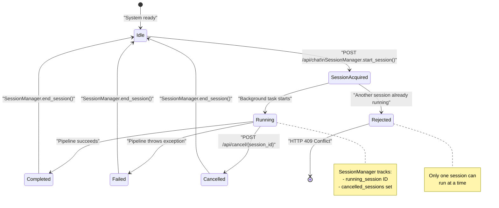
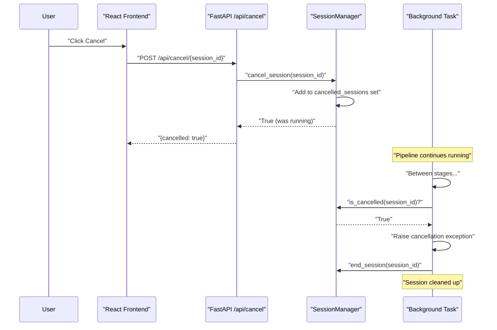
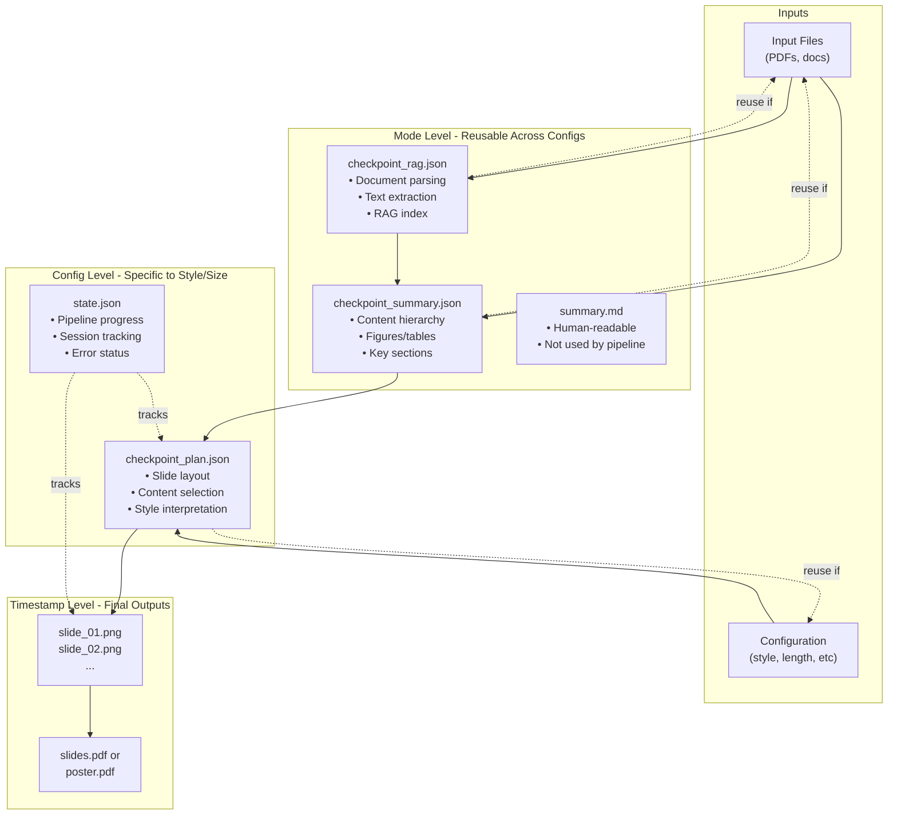
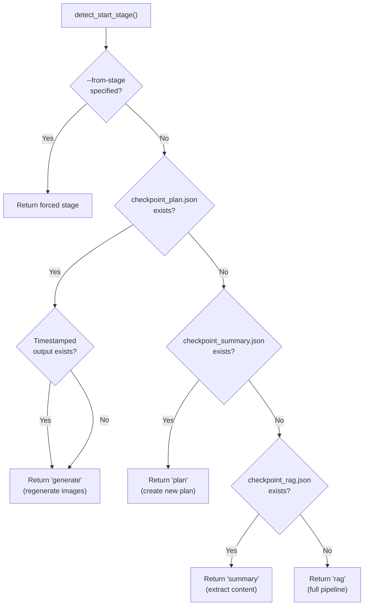
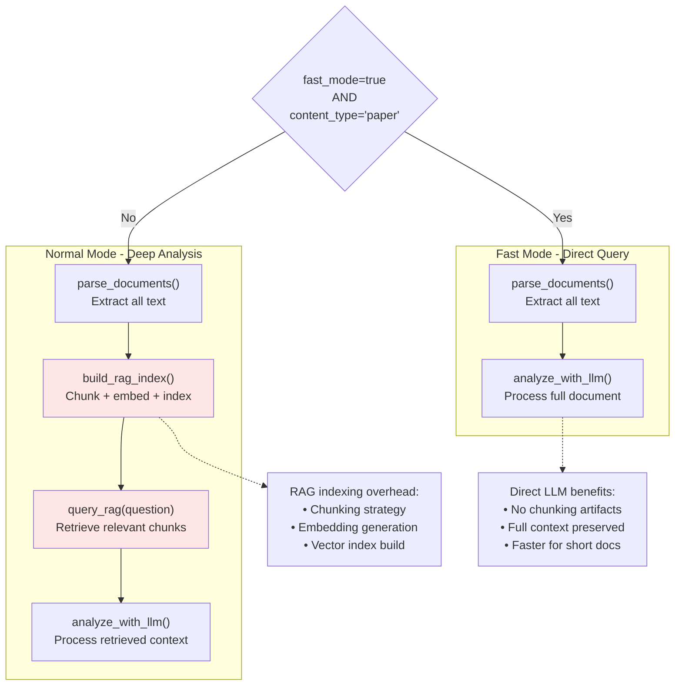
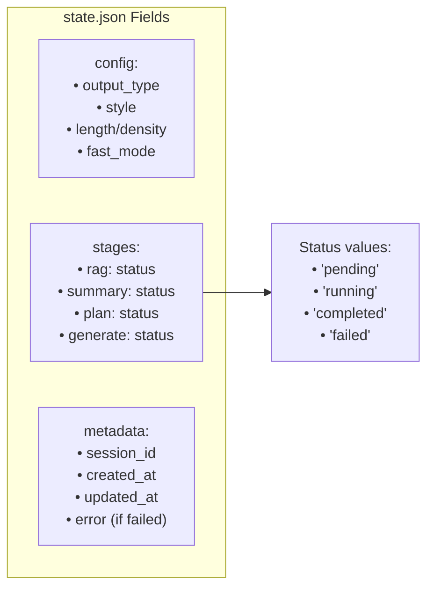
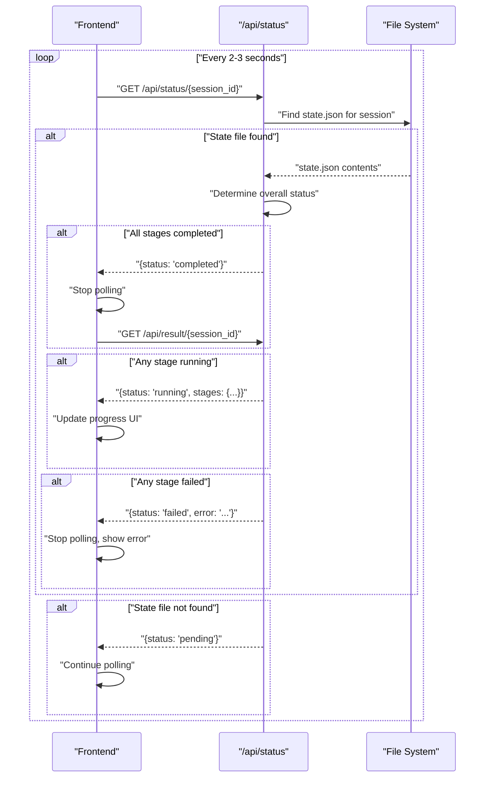
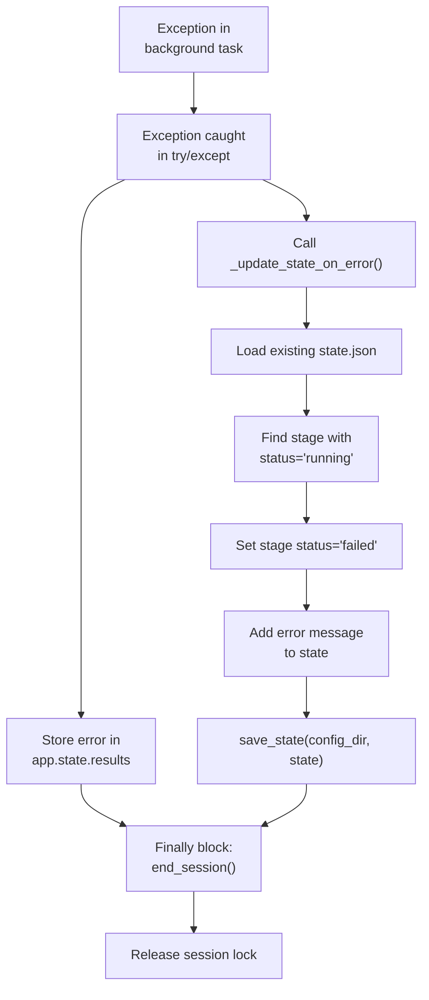
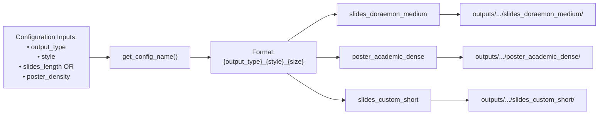

<!-- source: DeepWiki mcp.deepwiki.com · repo HKUDS/Paper2Slides · page 8 Advanced Topics · fetched 2026-11-09 -->

# Advanced Topics

<details>
<summary>Relevant source files</summary>

The following files were used as context for generating this wiki page:

- [README.md](README.md)
- [api/server.py](api/server.py)

</details>


This section covers advanced use cases, optimization strategies, and best practices for the Paper2Slides system. It is intended for users who want to understand deeper system behavior, optimize performance for specific scenarios, or troubleshoot complex issues.

**Scope**: This page provides an overview of advanced topics including concurrency control, checkpoint reuse strategies, resource optimization, and error recovery patterns. For specific guidance, see:
- Error handling details: [Error Handling and Recovery](#8.1)
- Performance tuning: [Performance Optimization](#8.2)  
- Issue resolution: [Troubleshooting Guide](#8.3)

Configuration basics are covered in [Configuration Guide](#5). This page assumes familiarity with the 4-stage pipeline architecture described in [Core Pipeline Architecture](#2).

---

## Session Management and Concurrency

The web interface enforces single-threaded execution to prevent resource conflicts and ensure predictable behavior. The `SessionManager` class coordinates request handling and prevents concurrent pipeline execution.

### Session Lifecycle



**Sources**: [api/server.py:45-84](), [api/server.py:176-202]()

### Concurrency Control Implementation

The `SessionManager` uses an asyncio lock to provide thread-safe session coordination:

| Method | Purpose | Return Value |
|--------|---------|--------------|
| `start_session(session_id)` | Attempt to acquire execution lock | `True` if acquired, `False` if busy |
| `end_session(session_id)` | Release execution lock | None |
| `cancel_session(session_id)` | Mark session for cancellation | `True` if was running |
| `is_cancelled(session_id)` | Check cancellation status | Boolean |
| `get_running_session()` | Get current session ID | Session ID or `None` |

When a request arrives while another session is running, the API returns HTTP 409 (Conflict) with the running session ID. The frontend detects this and displays a "generation in progress" message.

**Sources**: [api/server.py:45-84](), [api/server.py:121-128]()

### Session Cancellation



The cancellation mechanism is cooperative - the pipeline checks `session_manager.is_cancelled()` between stages rather than forcefully terminating threads. This allows graceful cleanup and prevents partial state corruption.

**Sources**: [api/server.py:131-142](), [api/server.py:520-523]()

---

## Checkpoint Reuse Strategy

The checkpoint system enables selective regeneration by caching intermediate results. Understanding checkpoint placement and reusability is key to efficient iteration.

### Checkpoint Hierarchy



**Sources**: [README.md:233-262](), [api/server.py:373-404]()

### Reuse Decision Logic

The system automatically determines the starting stage based on existing checkpoints:

| Scenario | Starting Stage | Checkpoints Reused | Typical Use Case |
|----------|---------------|-------------------|------------------|
| First run on document | `rag` | None | Initial generation |
| Same inputs, different style | `plan` | RAG + Summary | Style experimentation |
| Same inputs+style, regenerate | `generate` | RAG + Summary + Plan | Image regeneration |
| User forces `--from-stage` | User-specified | All stages before | Manual control |
| Fast mode enabled | `summary` | None (RAG skipped) | Quick preview |

The `detect_start_stage()` function implements this logic by checking for checkpoint file existence:



**Sources**: [api/server.py:388-404](), [README.md:153-165]()

---

## Fast Mode Optimization

Fast mode trades indexing overhead for speed by skipping RAG stage when documents are small enough to fit in LLM context windows.

### Processing Path Comparison



**Sources**: [README.md:212-228](), [api/server.py:371-372]()

### When to Use Fast Mode

| Document Characteristics | Recommended Mode | Reason |
|--------------------------|------------------|--------|
| Single PDF < 10 pages | Fast | Fits in LLM context |
| Multiple files | Normal | Need retrieval for relevant content |
| Complex figures/tables | Normal | Better figure extraction with RAG |
| Quick preview needed | Fast | Skip indexing overhead |
| Conference paper (8-10 pages) | Either | Depends on complexity |
| Technical report (50+ pages) | Normal | Requires retrieval |

Fast mode only applies when `content_type='paper'`. General content always uses normal mode since it may lack academic structure that RAG helps parse.

**Sources**: [README.md:219-228](), [api/server.py:371-372]()

---

## State Tracking and Progress Monitoring

The `state.json` file tracks pipeline execution and enables progress polling in the web interface.

### State File Structure



**Sources**: [api/server.py:392-404](), [api/server.py:623-638]()

### Progress Polling Flow

The frontend polls `/api/status/{session_id}` to track progress:



**Sources**: [api/server.py:550-643]()

### Error State Management

When a background task fails, the system updates `state.json` to mark the failed stage:



This ensures the frontend can detect failures through status polling and display appropriate error messages.

**Sources**: [api/server.py:433-486](), [api/server.py:532-546]()

---

## Resource Management Strategies

### Memory Optimization

The system handles large files through streaming and chunked processing:

| Component | Strategy | Implementation |
|-----------|----------|----------------|
| File uploads | 1MB chunk streaming | [api/server.py:225-228]() |
| PDF parsing | Page-by-page processing | RAG parser |
| Image generation | Single-image iteration | [README.md:273-279]() |
| Output delivery | Static file serving | [api/server.py:96-99]() |

### Directory Organization for Cache Efficiency

The hierarchical output structure enables efficient checkpoint reuse:

```
outputs/
└── {project_name}/
    └── {content_type}/              # paper or general
        └── {mode}/                  # fast or normal
            ├── checkpoint_rag.json       # ← Shared across all configs
            ├── checkpoint_summary.json   # ← Shared across all configs  
            └── {config_hash}/            # ← Unique per style/length/density
                ├── checkpoint_plan.json
                └── {timestamp}/
                    ├── slide_01.png
                    └── slides.pdf
```

This organization means:
- Changing only style regenerates from `plan` stage
- Multiple style experiments reuse the same RAG/summary work
- Each configuration maintains independent outputs
- Old outputs remain accessible by timestamp

**Sources**: [README.md:233-262](), [api/server.py:374-385]()

### API Server Configuration

The FastAPI server includes resource limits to prevent exhaustion:

| Parameter | Default Value | Purpose |
|-----------|---------------|---------|
| `timeout_keep_alive` | 300 seconds | Long-running generation support |
| `limit_concurrency` | 10 | Prevent connection exhaustion |
| `limit_max_requests` | 1000 | Request lifecycle limit |

These values balance responsiveness with stability for long-running document processing.

**Sources**: [api/server.py:765-772]()

---

## Configuration Hash System

The system generates configuration hashes to create unique directories for different parameter combinations:



This ensures that:
- Different configurations never overwrite each other
- Each parameter set has its own checkpoint
- Users can regenerate with different styles without losing work

**Sources**: [api/server.py:362-372](), [README.md:243-250]()

---

## Best Practices Summary

### For Optimal Performance

1. **Use fast mode** for papers under 10 pages that fit in LLM context
2. **Reuse sessions** when experimenting with styles - pass `session_id` without new files
3. **Leverage checkpoints** - use `--from-stage` CLI flag to skip completed stages
4. **Organize inputs** - group related documents in a single session for coherent output

### For Reliable Operation

1. **Monitor state.json** - check pipeline progress and detect failures early
2. **Handle 409 conflicts** - only one generation can run at a time in web interface  
3. **Check cancellation** - system supports graceful cancellation between stages
4. **Validate uploads** - ensure at least one PDF is present before submission

### For Development

1. **Study SessionManager** - understand concurrency model before modifying API
2. **Test checkpoint reuse** - verify that stage skipping works correctly
3. **Handle long operations** - use background tasks and polling, not blocking requests
4. **Preserve state.json** - critical for progress tracking and error recovery

**Sources**: [README.md:212-228](), [api/server.py:45-84](), [api/server.py:489-547]()

---

