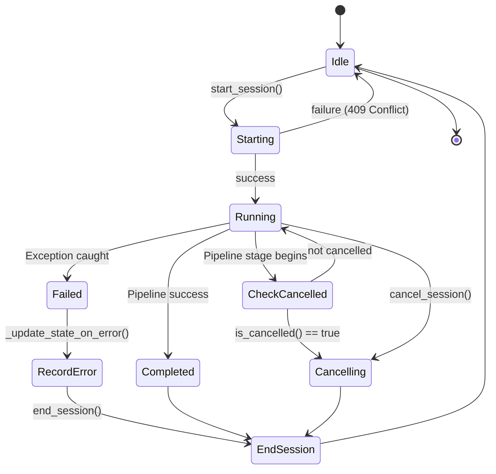
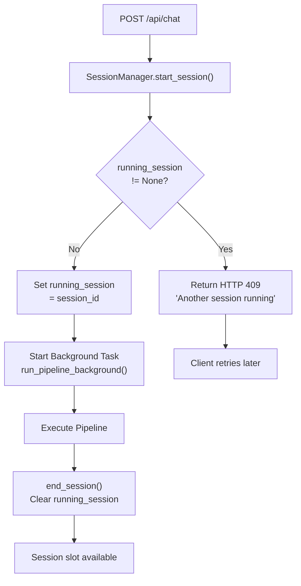
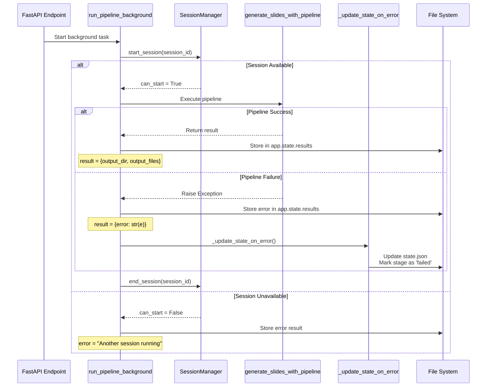
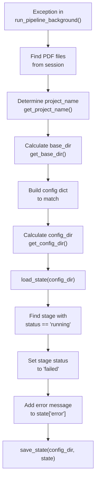
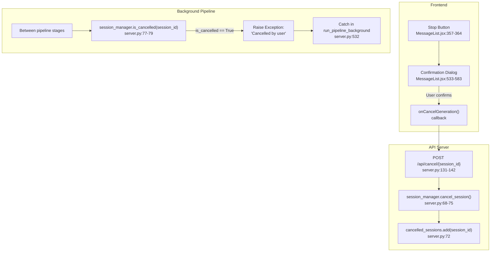
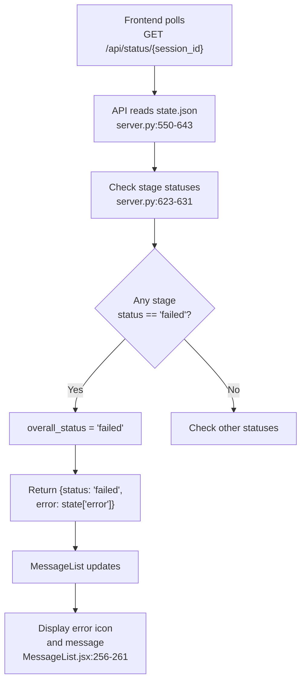
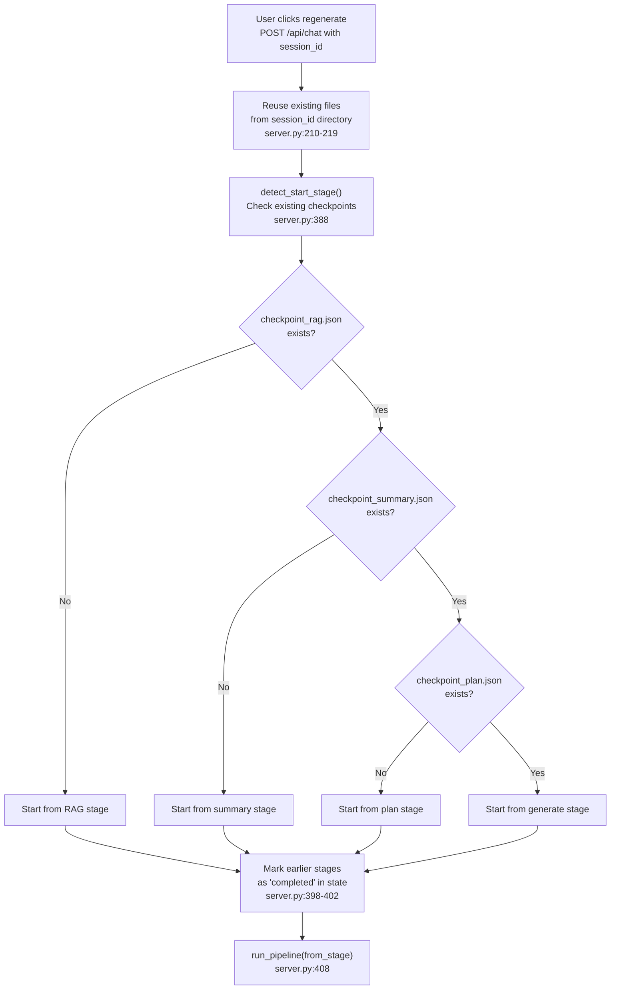

<!-- source: DeepWiki mcp.deepwiki.com · repo HKUDS/Paper2Slides · page 8.1 Error Handling and Recovery · fetched 2026-11-09 -->

# Error Handling and Recovery

<details>
<summary>Relevant source files</summary>

The following files were used as context for generating this wiki page:

- [api/server.py](api/server.py)
- [frontend/src/components/MessageList.jsx](frontend/src/components/MessageList.jsx)

</details>


This page documents the error handling mechanisms throughout the Paper2Slides system, including error detection, classification, state tracking, user-initiated cancellation, and recovery strategies. For information about resuming from checkpoints after successful stage completion, see [Smart Recovery System](#2.5). For troubleshooting common issues, see [Troubleshooting Guide](#8.3).

## Error Detection and Classification

The Paper2Slides system implements multi-layered error handling across the API server, core pipeline, and frontend components. Errors are classified by their origin and handled at the appropriate layer.

### Error Categories

| Category | Origin | Handling Layer | Recovery Strategy |
|----------|--------|----------------|-------------------|
| Concurrency Conflicts | Multiple simultaneous requests | `SessionManager` | HTTP 409, user retry |
| File System Errors | Missing files, permission issues | API server | HTTP 404/500, error state |
| Pipeline Failures | LLM errors, processing exceptions | Background task | State file update, partial checkpoints |
| User Cancellation | Explicit user action | `SessionManager` + Pipeline | Graceful shutdown, cleanup |
| Configuration Errors | Invalid parameters | API validation | HTTP 400, error message |
| Network/Timeout | External API failures | Retry logic (in core) | Exponential backoff |

**Sources:** [api/server.py:45-86](), [api/server.py:289-291](), [api/server.py:532-547]()

## Session-Level Error Handling

The `SessionManager` class provides single-threaded execution guarantees and tracks session lifecycle, including error states and cancellation.

### SessionManager Error Flow



### Concurrency Control Implementation

The `SessionManager` enforces single-threaded execution by maintaining a lock and tracking the currently running session:



Key methods:
- `start_session(session_id)` - Acquires session lock [51-59]()
- `end_session(session_id)` - Releases session lock [61-66]()
- `get_running_session()` - Returns current session ID [81-83]()

When a request arrives while another session is running, the API immediately returns HTTP 409 Conflict without queuing the request [189-202]().

**Sources:** [api/server.py:45-86](), [api/server.py:176-202](), [api/server.py:505-513]()

## Pipeline Execution Error Handling

Pipeline errors are caught in the `run_pipeline_background` function, which wraps the entire generation process in a try-except block.

### Background Task Error Flow



The `run_pipeline_background` function implements comprehensive error handling [489-548]():

1. **Try to acquire session** [505-513]()
2. **Execute pipeline** [516-518]()
3. **Check for cancellation** [521-523]()
4. **Store result** [528-530]()
5. **Catch exceptions** [532-543]()
6. **Update state file** [540-543]()
7. **Always release session** [544-547]()

**Sources:** [api/server.py:489-548]()

## State Tracking and Error Recording

The system maintains a `state.json` file in each configuration directory to track pipeline progress and record errors.

### State File Structure on Error

```json
{
  "session_id": "abc123...",
  "config": { ... },
  "stages": {
    "rag": "completed",
    "summary": "completed",
    "plan": "failed",
    "generate": "pending"
  },
  "error": "Exception message text",
  "created_at": "2024-01-15T10:30:00",
  "updated_at": "2024-01-15T10:35:00"
}
```

### Error State Update Process

The `_update_state_on_error` function updates the state file when a background pipeline fails [433-487]():



Key steps:
1. Reconstruct project name and paths [449-458]()
2. Build config to locate correct state file [462-474]()
3. Load existing state [477]()
4. Find the running stage [480-483]()
5. Mark stage as failed [482]()
6. Add error message [484]()
7. Save updated state [485]()

**Sources:** [api/server.py:433-487]()

## User-Initiated Cancellation

Users can cancel ongoing generation through the web interface. The system implements cooperative cancellation by checking a flag between stages.

### Cancellation Mechanism



### SessionManager Cancellation Methods

The `SessionManager` tracks cancelled sessions in a set:

```python
class SessionManager:
    def __init__(self):
        self.cancelled_sessions = set()  # Track cancelled session IDs
    
    async def cancel_session(self, session_id: str) -> bool:
        """Cancel a running session. Returns True if session was running"""
        async with self.lock:
            if self.running_session == session_id:
                self.cancelled_sessions.add(session_id)
                return True
            return False
    
    def is_cancelled(self, session_id: str) -> bool:
        """Check if a session has been cancelled"""
        return session_id in self.cancelled_sessions
```

The pipeline checks for cancellation at strategic points:
- After each stage completes [521-523]()
- Before expensive operations (in core pipeline implementation)

**Sources:** [api/server.py:45-86](), [api/server.py:131-142](), [api/server.py:521-523](), [frontend/src/components/MessageList.jsx:357-364](), [frontend/src/components/MessageList.jsx:533-583]()

## Frontend Error Display

The web interface displays errors to users through the message list and status polling.

### Error Message Rendering



Error display components in `MessageList.jsx`:
- Error icon indicator [257-259]()
- Error message text [263-267]()
- Red styling for failed status [256]()

**Sources:** [api/server.py:550-643](), [frontend/src/components/MessageList.jsx:256-269]()

## Recovery from Failures

The system provides multiple recovery mechanisms depending on the failure type.

### Recovery Strategies by Failure Type

| Failure Type | Detection | Recovery Action | Preserved State |
|--------------|-----------|-----------------|-----------------|
| Stage 1 (RAG) failure | `state.json` shows `rag: failed` | Re-run from beginning | None |
| Stage 2 (Analysis) failure | `state.json` shows `summary: failed` | Re-run from stage 2 | `checkpoint_rag.json` |
| Stage 3 (Planning) failure | `state.json` shows `plan: failed` | Re-run from stage 3 | `checkpoint_rag.json`, `checkpoint_summary.json` |
| Stage 4 (Generation) failure | `state.json` shows `generate: failed` | Re-run from stage 4 | All checkpoints |
| User cancellation | `cancelled_sessions` set | Full restart | All checkpoints (reusable) |
| Concurrency conflict | HTTP 409 response | Wait and retry | N/A |

### Automatic Recovery on Regeneration

When a user regenerates with the same or modified configuration, the system automatically resumes from the appropriate checkpoint:



The `detect_start_stage` function determines the appropriate starting point based on existing checkpoint files and configuration changes [388]().

**Sources:** [api/server.py:210-219](), [api/server.py:388-404](), [api/server.py:408]()

## Logging and Debugging

The system uses Python's `logging` module for error tracking and debugging.

### Logging Configuration

Logger setup in `api/server.py`:
```python
import logging
logger = logging.getLogger(__name__)

# Configure logging for paper2slides
from paper2slides.utils import setup_logging
setup_logging(level=logging.INFO)
```

Key logging points [18](), [42]():

| Log Level | Location | Purpose |
|-----------|----------|---------|
| `ERROR` | [141](), [533](), [642]() | Error conditions, exceptions |
| `INFO` | [73](), [486](), [515](), [525](), [547]() | Session lifecycle, state updates |
| `WARNING` | [603]() | Non-critical issues (e.g., state file read failures) |
| `DEBUG` | [591]() | Detailed troubleshooting information |

### Error Logging Example

```python
# Log with exception traceback
logger.error(f"Background pipeline failed for session {session_id[:8]}: {e}", exc_info=True)

# Log state update
logger.info(f"Updated state.json with error for session {session_id[:8]}")
```

Console output also includes pipeline configuration and status [377-404]().

**Sources:** [api/server.py:8](), [api/server.py:18](), [api/server.py:42](), [api/server.py:141](), [api/server.py:486](), [api/server.py:533](), [api/server.py:642]()

## Error Response Codes

The API returns standard HTTP status codes for different error conditions:

| Status Code | Meaning | Trigger Condition | Response Body |
|-------------|---------|-------------------|---------------|
| 200 | Success | Pipeline started successfully | `{session_id, message, uploaded_files}` |
| 202 | Accepted | Result not ready yet | `{message: "Result not ready yet"}` |
| 400 | Bad Request | Invalid file path | `{detail: "Invalid file path"}` |
| 403 | Forbidden | File access denied | `{detail: "Access denied"}` |
| 404 | Not Found | Session or file not found | `{detail: "Session not found"}` |
| 409 | Conflict | Another session running | `{detail: "Another session is already running"}` |
| 500 | Internal Server Error | Pipeline or API failure | `{detail: error_message}` |

Error responses are raised using FastAPI's `HTTPException` [290-291](), [195](), [239](), [642-643](), [723-726]().

**Sources:** [api/server.py:189-202](), [api/server.py:289-291](), [api/server.py:640-643](), [api/server.py:722-726](), [api/server.py:733-750]()

---

