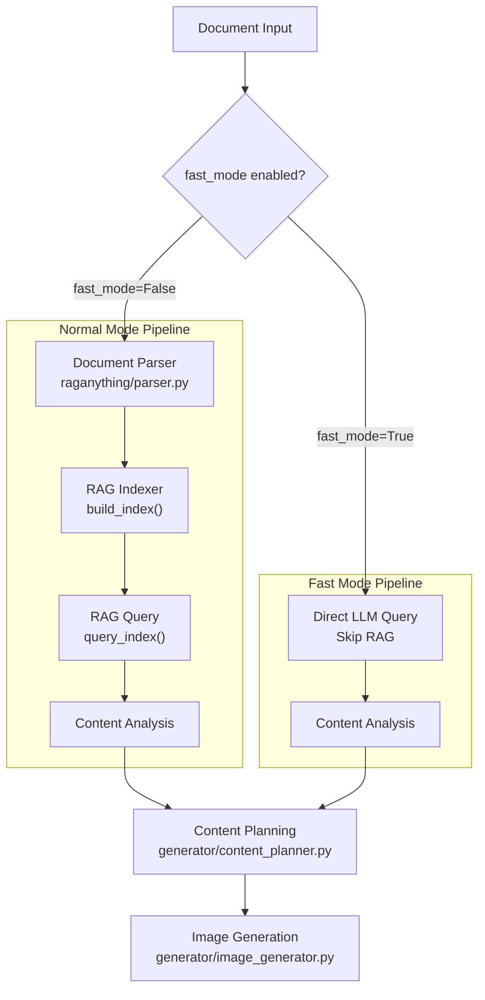
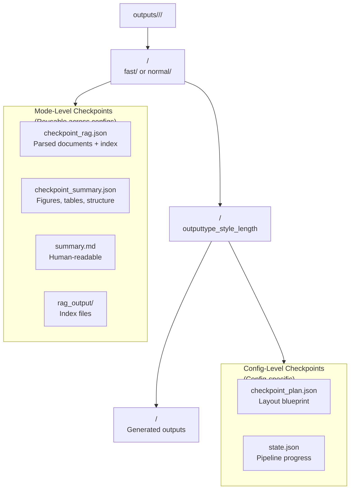
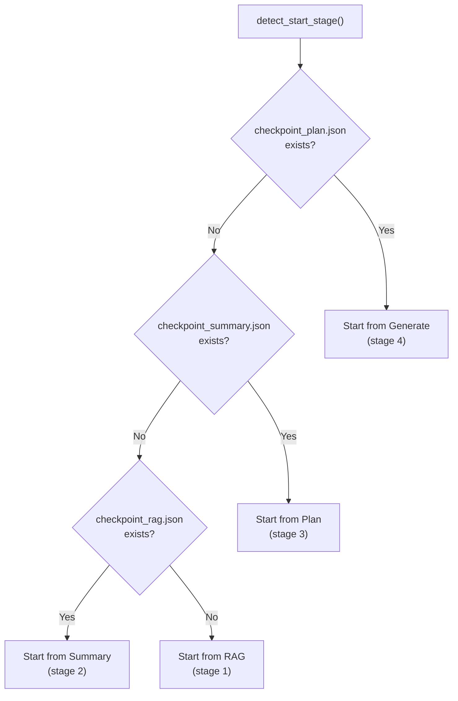
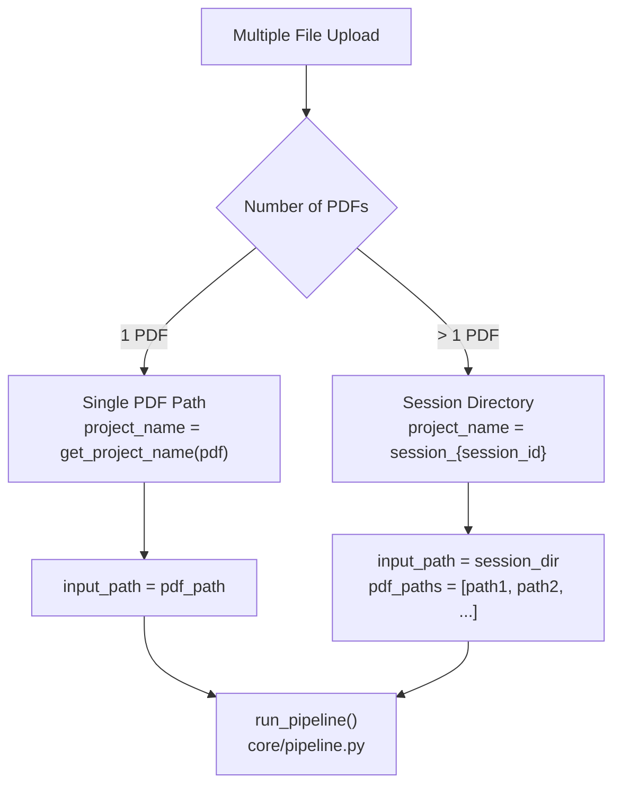
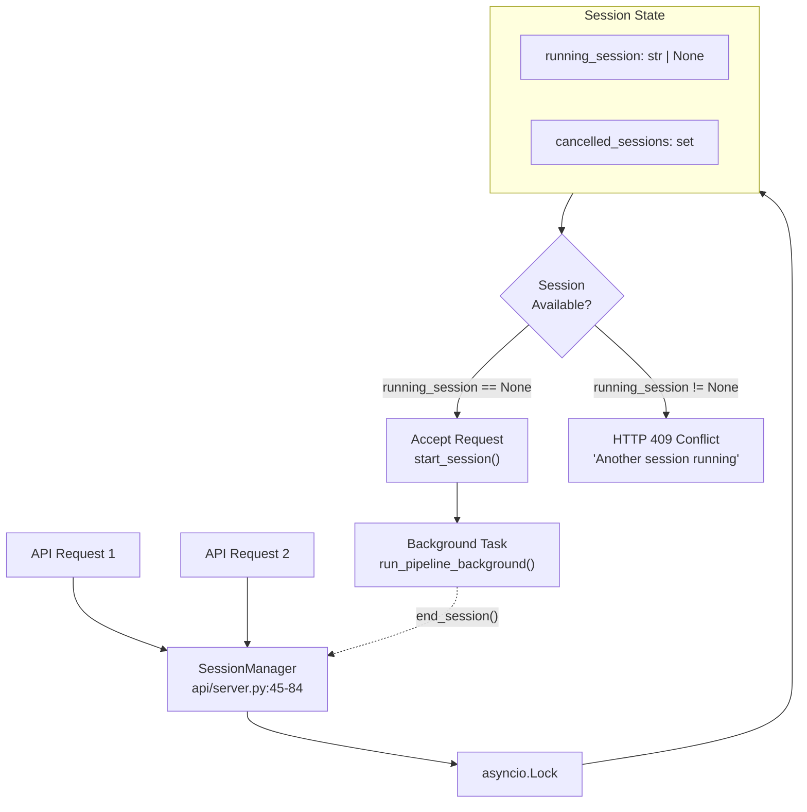
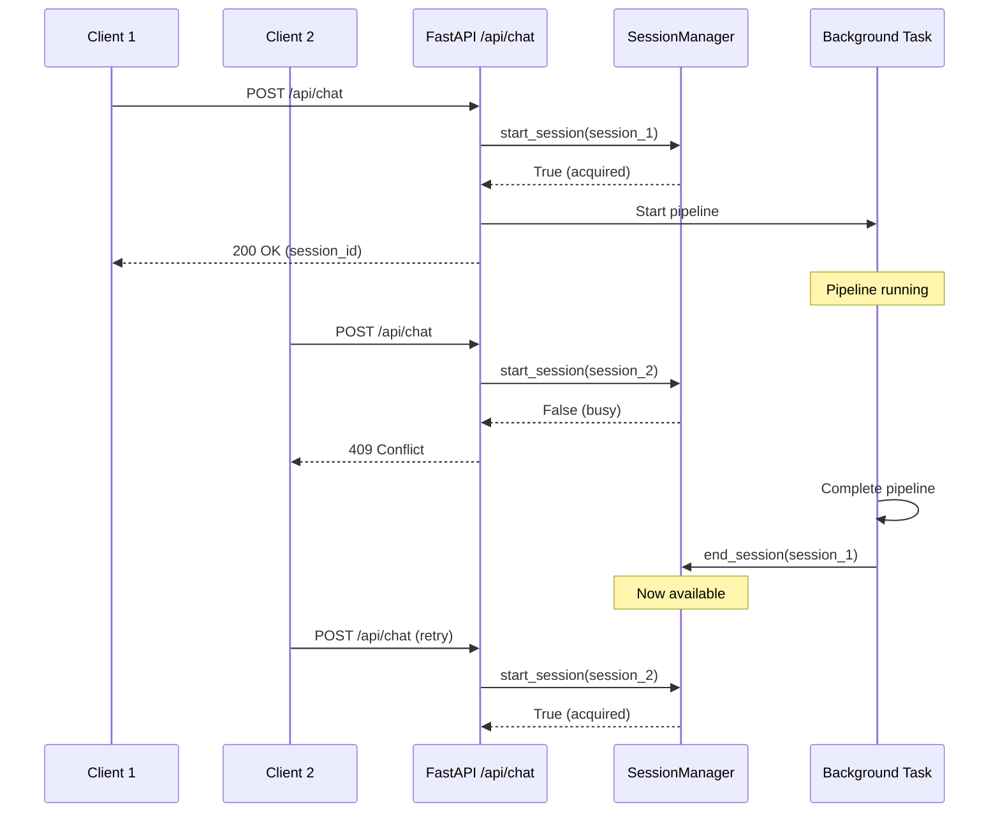

<!-- source: DeepWiki mcp.deepwiki.com · repo HKUDS/Paper2Slides · page 8.2 Performance Optimization · fetched 2026-11-09 -->

# Performance Optimization

<details>
<summary>Relevant source files</summary>

The following files were used as context for generating this wiki page:

- [README.md](README.md)
- [api/server.py](api/server.py)

</details>


This page documents techniques for optimizing Paper2Slides generation speed, managing large documents efficiently, and controlling resource usage. Topics include the Fast Mode optimization, checkpoint reuse strategies, session management, and server configuration options.

For information about error handling and recovery mechanisms, see [Error Handling and Recovery](#8.1). For general troubleshooting, see [Troubleshooting Guide](#8.3).

## Processing Mode Selection

Paper2Slides offers two processing modes with significantly different performance characteristics. The choice between them depends on document size and processing requirements.

### Fast Mode vs Normal Mode



**Sources:** [README.md:212-228](), [api/server.py:236-237](), [api/server.py:371]()

### Performance Comparison

| Aspect | Normal Mode | Fast Mode |
|--------|-------------|-----------|
| **RAG Indexing** | Full indexing required | Skipped entirely |
| **Processing Time** | 2-5 minutes typical | 30-90 seconds typical |
| **Document Limit** | No practical limit | Must fit in LLM context window |
| **Content Selection** | RAG-based retrieval | Direct LLM processing |
| **Best For** | Complex papers, multiple files | Short documents, quick iterations |
| **Use Cases** | Research papers, lengthy documents | Previews, style changes, simple docs |

**Sources:** [README.md:213-228]()

### When to Use Fast Mode

Fast mode is enabled with the `--fast` CLI flag or `fast_mode: true` in API requests. The mode is only applicable when `content_type` is `"paper"` [api/server.py:371]().

```python
# CLI usage
python -m paper2slides --input paper.pdf --fast

# API request
{
    "content": "paper",
    "fast_mode": "true"  # String 'true' in form data
}
```

**Configuration Logic:**
- Fast mode string is parsed to boolean at [api/server.py:236-237]()
- Mode is only enabled for paper content at [api/server.py:371]()
- Documents should be short enough to fit in context window
- Best for documents with text + figures under ~20 pages

**Sources:** [README.md:219-228](), [api/server.py:154](), [api/server.py:236-237](), [api/server.py:371]()

## Checkpoint System and Cache Reuse

The checkpoint system is the primary mechanism for optimizing repeated generations. It allows selective regeneration without reprocessing unchanged stages.

### Checkpoint File Hierarchy



**Sources:** [README.md:234-262]()

### Checkpoint Reusability Matrix

| Checkpoint | Stage | Reusable When | Invalidated By |
|------------|-------|---------------|----------------|
| `checkpoint_rag.json` | RAG | Same input files, same mode | Different files, mode change |
| `checkpoint_summary.json` | Analysis | Same input files, same mode | Different files, mode change |
| `checkpoint_plan.json` | Planning | Same config (style+length/density) | Style or length/density change |
| `state.json` | All | Same session config | Any config change |

**Directory Structure Impact:**
- Mode-level checkpoints stored at: `outputs/<project>/<content>/<mode>/` [README.md:240-242]()
- Config-level checkpoints at: `outputs/<project>/<content>/<mode>/<config_hash>/` [README.md:243-246]()
- This hierarchy enables efficient cache reuse across different configurations

**Sources:** [README.md:256-262]()

### Auto-Detection and Stage Resumption

The pipeline automatically detects which stage to start from using `detect_start_stage()` [api/server.py:388]().



**Detection Logic:**
1. Check if latest config's checkpoint exists
2. If planning checkpoint exists → start from generation [README.md:161]()
3. If summary checkpoint exists → start from planning [README.md:160]()
4. If RAG checkpoint exists → start from summary
5. Otherwise → start from RAG (full pipeline)

**Sources:** [README.md:153-165](), [api/server.py:388-389]()

### Practical Optimization Scenarios

| Scenario | Command/Action | Stages Skipped | Time Saved |
|----------|----------------|----------------|------------|
| Change style only | `--from-stage plan` | RAG, Summary | ~70-80% |
| Regenerate images | `--from-stage generate` | RAG, Summary, Plan | ~85-90% |
| Resume after crash | Rerun same command | Auto-detects completed | Varies |
| Different length | Auto-detected | RAG, Summary | ~60-70% |

**Example: Changing Style**
```bash
# Initial generation (full pipeline)
python -m paper2slides --input paper.pdf --output slides --style doraemon --length medium

# Change to academic style (reuses RAG and summary)
python -m paper2slides --input paper.pdf --output slides --style academic --length medium
# Automatically starts from planning stage
```

**Sources:** [README.md:156-162]()

## Large Document Strategies

### Multi-File Processing

The system supports processing multiple PDFs simultaneously as a unified project [api/server.py:349-354]().



**Multi-File Logic:**
- Multiple PDFs detected at [api/server.py:349]()
- Project name becomes `session_{session_id[:8]}` [api/server.py:351]()
- All files grouped under single RAG index [api/server.py:353]()
- `input_path` set to session directory for RAG parser [api/server.py:353]()

**Sources:** [api/server.py:345-359]()

### Memory Management for Large Documents

**Chunked File Upload:**
```python
# Server uses 1MB chunks to avoid memory spikes
CHUNK_SIZE = 1024 * 1024  # 1MB chunks
with open(file_path, "wb") as buffer:
    while chunk := file.file.read(CHUNK_SIZE):
        buffer.write(chunk)
```
**Sources:** [api/server.py:225-228]()

**Recommendations:**
1. **Split Very Large PDFs**: For documents >100 pages, consider splitting into logical sections
2. **Use Normal Mode**: Large documents benefit from RAG's selective retrieval
3. **Monitor Checkpoints**: Verify intermediate checkpoints save successfully
4. **Session-Based Processing**: For multiple large files, process as single session

## Session Management and Concurrency

The system enforces single-threaded execution through the `SessionManager` class to prevent resource contention.

### Session Manager Architecture



**Key Methods:**
- `start_session(session_id)` - Acquires lock, returns False if busy [api/server.py:51-59]()
- `end_session(session_id)` - Releases lock [api/server.py:61-66]()
- `cancel_session(session_id)` - Marks session for cancellation [api/server.py:68-75]()
- `is_cancelled(session_id)` - Checks cancellation status [api/server.py:77-79]()

**Sources:** [api/server.py:45-84]()

### Concurrency Control Flow



**Conflict Handling:**
- Concurrent requests return HTTP 409 [api/server.py:191-193](), [api/server.py:199-201]()
- Error message includes running session ID [api/server.py:192]()
- Frontend should display "Another generation in progress" message
- Clients should implement polling or retry with exponential backoff

**Sources:** [api/server.py:177-207](), [api/server.py:505-514]()

### Session Lifecycle Management

**Background Task Pattern:**
```python
async def run_pipeline_background(session_id, ...):
    try:
        # Acquire session
        can_start = await session_manager.start_session(session_id)
        if not can_start:
            # Store error and return
            return
        
        # Run pipeline
        result = await generate_slides_with_pipeline(...)
        
        # Check cancellation
        if session_manager.is_cancelled(session_id):
            raise Exception("Generation cancelled")
        
        # Store result
        app.state.results[session_id] = result
    finally:
        # Always release session
        await session_manager.end_session(session_id)
```

**Sources:** [api/server.py:489-547]()

## API Server Configuration

The FastAPI server includes several configuration options for performance tuning.

### Server Parameters

```python
uvicorn.run(
    app, 
    host="0.0.0.0", 
    port=port,
    timeout_keep_alive=300,  # Keep connections alive for 5 minutes
    limit_concurrency=10,     # Max concurrent connections
    limit_max_requests=1000   # Max requests before restart
)
```

**Parameter Descriptions:**

| Parameter | Value | Purpose |
|-----------|-------|---------|
| `timeout_keep_alive` | 300s | Prevents premature connection drops during long generations |
| `limit_concurrency` | 10 | Limits simultaneous HTTP connections (not generation sessions) |
| `limit_max_requests` | 1000 | Forces worker restart periodically to prevent memory leaks |

**Sources:** [api/server.py:765-772]()

### Connection Timeouts

**Long-Running Operations:**
- Initial request returns immediately with session_id [api/server.py:286-287]()
- Frontend polls `/api/status/{session_id}` for progress [api/server.py:550]()
- Final result retrieved via `/api/result/{session_id}` [api/server.py:646]()

**Benefits:**
- HTTP request timeouts decoupled from generation time
- Client can disconnect and reconnect without losing progress
- Enables progress reporting during generation

**Sources:** [api/server.py:145-291](), [api/server.py:550-643]()

## Resource Usage Optimization

### Memory Optimization Strategies

**Checkpoint File Management:**
1. **Lazy Loading**: Checkpoints loaded only when needed, not kept in memory
2. **Streaming Writes**: Large outputs written incrementally, not buffered
3. **Temporary Cleanup**: RAG index files can be cleared after summary stage if disk space is limited

**API Response Caching:**
```python
# Simple in-memory result cache
if not hasattr(app.state, 'results'):
    app.state.results = {}
app.state.results[session_id] = result
```
- Results cached temporarily in `app.state.results` [api/server.py:528-530]()
- Alternative: Use Redis or database for production deployments
- Cached data includes output file paths, not file contents

**Sources:** [api/server.py:528-530](), [api/server.py:651-652]()

### Disk Space Management

**Output Directory Structure:**
```
outputs/
├── <project_name>/
│   ├── <content_type>/
│   │   ├── <mode>/
│   │   │   ├── checkpoint_rag.json       # ~1-5 MB
│   │   │   ├── checkpoint_summary.json   # ~500 KB - 2 MB
│   │   │   ├── rag_output/               # 10-50 MB (can be deleted)
│   │   │   └── <config_hash>/
│   │   │       ├── checkpoint_plan.json  # ~100-500 KB
│   │   │       └── <timestamp>/
│   │   │           ├── slide_*.png       # ~500 KB each
│   │   │           └── slides.pdf        # ~2-10 MB
```

**Cleanup Strategies:**
1. **Delete Old Timestamps**: Keep only latest generation per config
2. **Remove RAG Output**: Delete `rag_output/` after analysis stage completes
3. **Archive Completed Sessions**: Move old session directories to archive storage
4. **Prune Orphaned Uploads**: Clean `sources/uploads/` for old session IDs

**Sources:** [README.md:234-254]()

## Best Practices Summary

### Performance Optimization Checklist

| Optimization | When to Apply | Expected Benefit |
|--------------|---------------|------------------|
| **Fast Mode** | Short documents (<20 pages) | 60-75% faster |
| **Checkpoint Reuse** | Style/length iterations | 70-90% faster |
| **Multi-file Sessions** | Related documents | Unified context |
| **Single Session Lock** | High-concurrency environments | Resource stability |
| **Background Tasks** | Web API deployments | Non-blocking responses |
| **Chunked Uploads** | Large file uploads | Reduced memory spikes |

### Configuration Recommendations by Use Case

**Quick Previews:**
```bash
python -m paper2slides --input paper.pdf --fast --length short
```
- Use fast mode to skip RAG
- Short length for minimal slides
- Ideal for initial reviews

**Production Slides:**
```bash
python -m paper2slides --input paper.pdf --length medium --style academic
```
- Normal mode for comprehensive analysis
- Medium length for balanced coverage
- Use predefined styles for consistency

**Style Iterations:**
```bash
# First generation
python -m paper2slides --input paper.pdf --output slides --style doraemon

# Style change (automatically reuses checkpoints)
python -m paper2slides --input paper.pdf --output slides --style academic

# Manual force from planning stage
python -m paper2slides --input paper.pdf --output slides --style "custom description" --from-stage plan
```

**Sources:** [README.md:124-165](), [api/server.py:236-252]()

### Monitoring and Diagnostics

**State File Tracking:**
```json
{
  "session_id": "abc123...",
  "stages": {
    "rag": "completed",
    "summary": "running",
    "plan": "pending",
    "generate": "pending"
  },
  "updated_at": "2024-01-15T10:30:00Z"
}
```

**Status Endpoint:**
- Poll `/api/status/{session_id}` for progress [api/server.py:550]()
- Returns stage completion status [api/server.py:623-638]()
- Detects failures via stage status "failed" [api/server.py:624-625]()

**Sources:** [api/server.py:550-643]()

---

