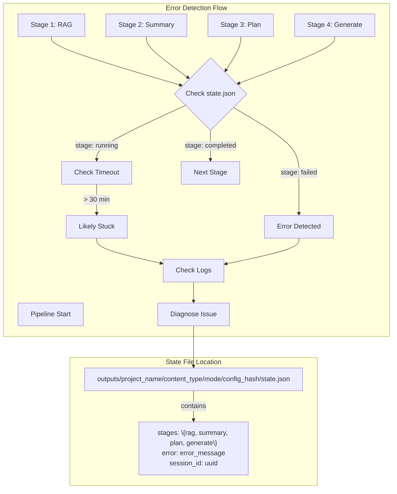
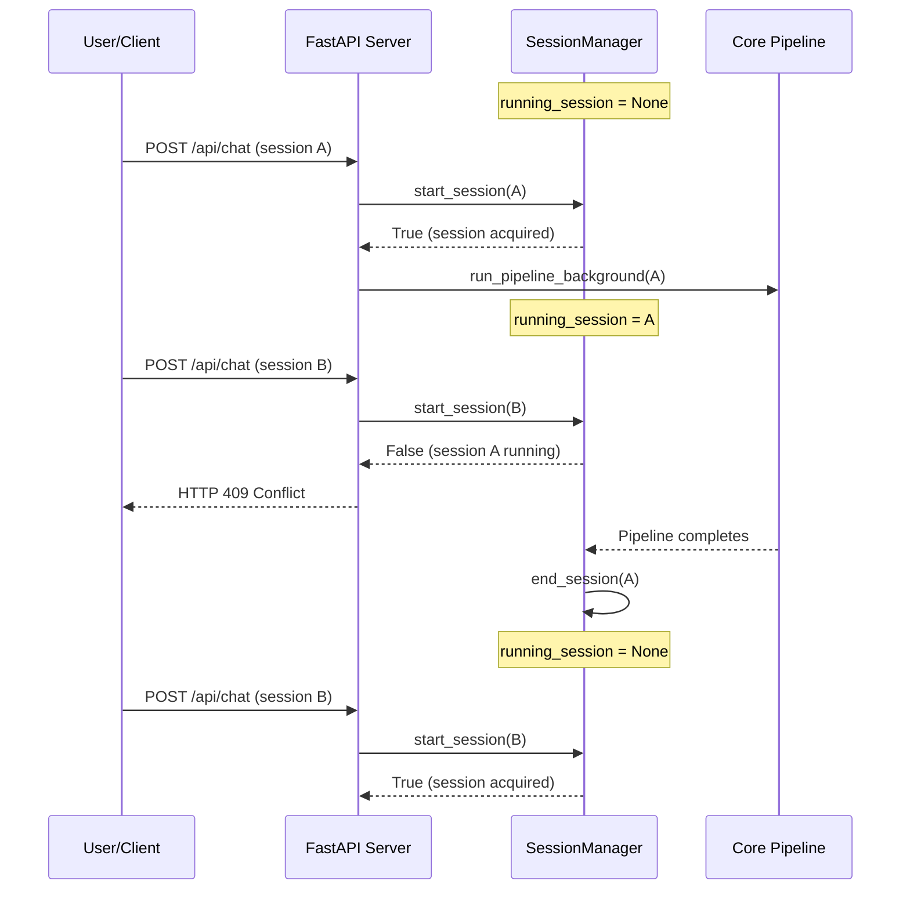
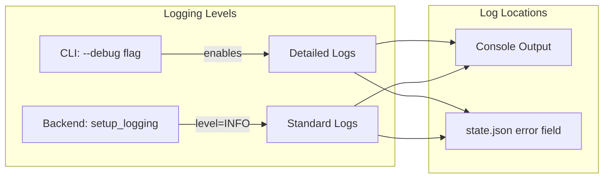
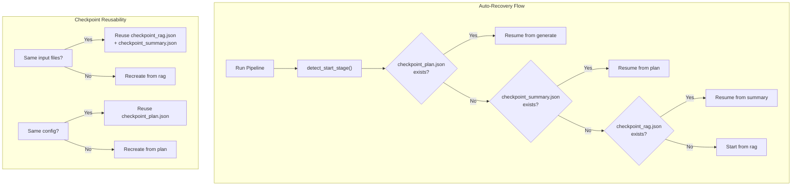

<!-- source: DeepWiki mcp.deepwiki.com · repo HKUDS/Paper2Slides · page 8.3 Troubleshooting Guide · fetched 2026-11-09 -->

# Troubleshooting Guide

<details>
<summary>Relevant source files</summary>

The following files were used as context for generating this wiki page:

- [README.md](README.md)
- [api/server.py](api/server.py)

</details>


This page provides solutions to common issues encountered when using Paper2Slides, diagnostic procedures for identifying problems, and debugging techniques. For information about error handling mechanisms and recovery strategies, see [Error Handling and Recovery](#8.1). For optimization tips to prevent issues, see [Performance Optimization](#8.2).

---

## Common Issues and Solutions

### Environment and Configuration Issues

#### Missing or Invalid API Keys

**Symptoms:**
- Pipeline fails at RAG or generation stages with authentication errors
- Error messages containing "API key" or "authentication"

**Diagnosis:**
```bash
# Check if .env file exists
ls paper2slides/.env

# Verify API keys are set (without displaying them)
grep -q "GEMINI_API_KEY" paper2slides/.env && echo "GEMINI key found" || echo "GEMINI key missing"
```

**Solution:**
1. Create `.env` file in `paper2slides/` directory if it doesn't exist
2. Copy required variables from `paper2slides/.env.example`
3. Add your API keys:
   ```bash
   GEMINI_API_KEY=your_api_key_here
   ```
4. Restart any running services

**Sources:** [README.md:121]()

---

#### Python Version Mismatch

**Symptoms:**
- Import errors
- Syntax errors in core modules
- Package installation failures

**Diagnosis:**
```bash
python --version
```

**Solution:**
Ensure Python 3.10 or higher is installed:
```bash
conda create -n paper2slides python=3.10 -y
conda activate paper2slides
pip install -r requirements.txt
```

**Sources:** [README.md:112-118]()

---

### File Upload and Processing Issues

#### Session Directory Not Found

**Symptoms:**
- HTTP 404 error: "Session {session_id} not found"
- Unable to regenerate with existing session

**Diagnosis:**
```bash
# Check if session directory exists
ls sources/uploads/{session_id}
```

**Solution:**
- If regenerating, ensure you're using the correct session ID
- Upload files again if session directory was deleted
- Check `UPLOAD_DIR` configuration in [api/server.py:34]()

**Sources:** [api/server.py:183-195]()

---

#### Unsupported File Format

**Symptoms:**
- Parser errors during RAG stage
- "No PDF file found" errors

**Diagnosis:**
Check uploaded file extensions:
```bash
ls sources/uploads/{session_id}/
```

**Solution:**
Supported formats include PDF, Word, Excel, PowerPoint, and Markdown. For slides/poster generation:
- At least one PDF file is required in the session
- Other formats can supplement the PDF
- Ensure files are not corrupted

**Sources:** [api/server.py:324-326](), [README.md:25-26]()

---

### Pipeline Execution Failures



**Sources:** [api/server.py:550-643](), [api/server.py:433-487]()

---

#### Stage Stuck in "running" Status

**Symptoms:**
- Status API returns stage as "running" for extended period (>30 minutes)
- No progress updates
- Process appears hung

**Diagnosis:**
1. Check the `state.json` file:
   ```bash
   # Find state file for your project
   find outputs/ -name "state.json" -exec cat {} \;
   ```
2. Check backend logs for errors
3. Verify backend process is still running:
   ```bash
   ps aux | grep "python -m uvicorn"
   ```

**Solution:**
1. **If backend crashed:** Restart backend and run same command - pipeline will auto-resume
   ```bash
   ./scripts/start_backend.sh
   ```
2. **If process is genuinely stuck:** Force restart from last completed stage
   ```bash
   # CLI: Use --from-stage to skip completed stages
   python -m paper2slides --input paper.pdf --from-stage plan
   ```
3. **Check for resource constraints:** See [Performance Optimization](#8.2)

**Sources:** [api/server.py:550-643](), [README.md:153-165]()

---

#### RAG Stage Failures

**Symptoms:**
- Error during document parsing
- "Failed to create RAG index" messages
- Checkpoint file `checkpoint_rag.json` not created

**Common Causes:**
- Corrupted or password-protected PDFs
- Extremely large documents exceeding memory limits
- Missing dependencies for specific file formats

**Diagnosis:**
```bash
# Enable debug logging
python -m paper2slides --input paper.pdf --debug

# Check RAG checkpoint
cat outputs/project_name/paper/normal/checkpoint_rag.json
```

**Solution:**
1. **For large documents:** Use fast mode to skip RAG indexing
   ```bash
   python -m paper2slides --input paper.pdf --fast
   ```
2. **For corrupted PDFs:** Try re-exporting or using OCR tools
3. **For password-protected PDFs:** Unlock the PDF before processing

**Sources:** [README.md:149](), [README.md:213-228]()

---

#### Generation Stage Failures

**Symptoms:**
- Images not generated
- PDF creation fails
- Error: "Image generation failed"

**Common Causes:**
- API rate limits exceeded
- Invalid style descriptions
- Gemini API issues

**Diagnosis:**
Check state file for error details:
```bash
# Look for error field in state.json
cat outputs/*/paper/*/*/state.json | grep -A 5 "error"
```

**Solution:**
1. **Rate limiting:** Wait and retry, or spread generation across time
2. **Invalid style:** Use predefined styles (`academic`, `doraemon`) or simplify custom description
3. **API issues:** Verify API key and check Gemini API status

**Sources:** [api/server.py:516-518](), [README.md:271-280]()

---

### Session Management Issues



**Sources:** [api/server.py:45-84]()

---

#### HTTP 409 Conflict - Session Already Running

**Symptoms:**
- Error: "Another session is already running"
- Unable to start new generation
- Web interface shows "Another generation in progress"

**Explanation:**
Paper2Slides enforces single-threaded execution via `SessionManager` to prevent resource conflicts and ensure stable processing.

**Solution:**
1. **Wait for current session to complete:**
   - Check status: `GET /api/status/{session_id}`
   - Monitor backend logs for completion
   
2. **Cancel running session (Web Interface):**
   - Use cancel button in web UI
   - API endpoint: `POST /api/cancel/{session_id}`

3. **Force-stop backend (if needed):**
   ```bash
   # Find backend process
   ps aux | grep "api.server"
   
   # Kill process
   kill -9 <pid>
   
   # Restart backend
   ./scripts/start_backend.sh
   ```

**Sources:** [api/server.py:177-202](), [api/server.py:131-143]()

---

#### Session Results Not Found

**Symptoms:**
- `GET /api/result/{session_id}` returns HTTP 202 "Result not ready yet"
- Results never appear despite pipeline completion

**Diagnosis:**
```bash
# Check if result is cached in app.state.results
# This requires backend access or logs

# Alternative: Check output directory directly
ls -la outputs/*/paper/*/*/*/
```

**Solution:**
1. Verify pipeline actually completed by checking `state.json`
2. Check for errors in state file
3. If completed but no cache entry, query output directory directly:
   ```bash
   # Find latest output
   find outputs/ -name "*.pdf" -o -name "slide_*.png"
   ```
4. Restart backend if cache was lost due to restart

**Sources:** [api/server.py:646-726](), [api/server.py:528-530]()

---

### Web Interface Issues

#### Frontend Cannot Connect to Backend

**Symptoms:**
- "Network Error" in browser console
- Connection refused errors
- API calls timeout

**Diagnosis:**
```bash
# Check if backend is running
curl http://localhost:8001/health

# Check if correct port is used
grep -r "8001" frontend/src/
```

**Solution:**
1. **Start backend if not running:**
   ```bash
   ./scripts/start_backend.sh
   ```

2. **Check CORS configuration:**
   Backend allows origins on ports 3000 and 5173 [api/server.py:88-94]()

3. **Verify frontend API base URL:**
   Check frontend configuration for correct backend URL

**Sources:** [api/server.py:88-94](), [README.md:169-185]()

---

#### Uploaded Files Not Displaying

**Symptoms:**
- Files uploaded but not shown in UI
- Image URLs return 404

**Diagnosis:**
Check mounted static directories:
```bash
# Verify uploads directory is accessible
ls sources/uploads/{session_id}/

# Check if StaticFiles middleware is configured
curl http://localhost:8001/uploads/{session_id}/{filename}
```

**Solution:**
Ensure `UPLOAD_DIR` is mounted correctly in [api/server.py:99](). Files should be accessible at `/uploads/{session_id}/{filename}`.

**Sources:** [api/server.py:96-99]()

---

## Diagnostic Procedures

### Examining State Files

State files track pipeline progress and are critical for debugging:

| File | Location | Purpose | Key Fields |
|------|----------|---------|------------|
| `state.json` | `outputs/.../config_hash/` | Current pipeline state | `stages`, `error`, `session_id`, `updated_at` |
| `checkpoint_rag.json` | `outputs/.../mode/` | RAG results | Parsed content, file paths |
| `checkpoint_summary.json` | `outputs/.../mode/` | Extracted content | Figures, tables, structure |
| `checkpoint_plan.json` | `outputs/.../config_hash/` | Content plan | Slide/poster layout |

**Reading State:**
```python
import json
from pathlib import Path

# Load state file
state_path = Path("outputs/project/paper/normal/slides_doraemon_medium/state.json")
with open(state_path) as f:
    state = json.load(f)

# Check stage statuses
print(state["stages"])
# Output: {"rag": "completed", "summary": "completed", "plan": "running", "generate": "pending"}

# Check for errors
if "error" in state:
    print(f"Error: {state['error']}")
```

**Sources:** [api/server.py:550-643](), [README.md:234-262]()

---

### Debug Logging



**Sources:** [README.md:151](), [api/server.py:42]()

---

#### Enabling Debug Mode

**CLI:**
```bash
python -m paper2slides --input paper.pdf --debug
```

**Backend:**
The backend uses INFO level logging by default [api/server.py:42](). To increase verbosity, modify:
```python
setup_logging(level=logging.DEBUG)
```

**What Debug Logging Shows:**
- File parsing details
- RAG indexing progress
- LLM API calls and responses
- Checkpoint save/load operations
- Stage transitions

**Sources:** [api/server.py:31](), [README.md:151]()

---

### Using `--from-stage` for Diagnosis

Force restart from specific stage to isolate issues:

```bash
# Test RAG stage only
python -m paper2slides --input paper.pdf --from-stage rag

# Skip RAG, test summary stage
python -m paper2slides --input paper.pdf --from-stage summary

# Test planning with existing summary
python -m paper2slides --input paper.pdf --from-stage plan

# Test generation only (change style without reprocessing)
python -m paper2slides --input paper.pdf --from-stage generate --style academic
```

**Use Cases:**

| Scenario | Command | Purpose |
|----------|---------|---------|
| RAG parsing fails | `--from-stage rag` | Force re-parse documents |
| Style change | `--from-stage plan` | Regenerate with new style |
| Image quality issues | `--from-stage generate` | Regenerate images only |
| Full restart | `--from-stage rag` | Clear all checkpoints |

**Sources:** [README.md:150](), [README.md:158-162]()

---

## Recovery Strategies

### Checkpoint-Based Recovery

Paper2Slides automatically resumes from checkpoints after interruption:



**Sources:** [README.md:153-165](), [api/server.py:388](), [README.md:256-262]()

---

### Manual State Cleanup

If checkpoints are corrupted or you need a fresh start:

```bash
# Remove all checkpoints for a project
rm -rf outputs/project_name/

# Remove specific config outputs only
rm -rf outputs/project_name/paper/normal/slides_doraemon_medium/

# Keep RAG/summary, remove plan and outputs
rm -rf outputs/project_name/paper/normal/slides_*/
```

**Warning:** Checkpoint removal forces re-execution of those stages, which may be time-consuming for large documents.

**Sources:** [README.md:234-262]()

---

### Regeneration Best Practices

| What Changed | Recommended Approach | Reason |
|--------------|---------------------|--------|
| Style only | `--from-stage plan` or use same session_id in web UI | Reuses RAG and analysis |
| Length/density | `--from-stage plan` | Reuses document processing |
| Different document | Start fresh (new input) | Cannot reuse checkpoints |
| API failure during generation | Just re-run same command | Auto-resumes from last checkpoint |
| Want different images | `--from-stage generate` | Keeps same plan, new images |

**Sources:** [README.md:158-162]()

---

## Performance Issues

### Slow Processing

**Symptoms:**
- Pipeline takes unusually long (>15 min for normal documents)
- API timeouts

**Diagnosis:**
1. Check document size and complexity
2. Monitor system resources (CPU, memory)
3. Check for fast mode vs normal mode

**Solutions:**

1. **Use Fast Mode for short documents:**
   ```bash
   python -m paper2slides --input paper.pdf --fast
   ```
   Skips RAG indexing, suitable for documents that fit in LLM context [README.md:219-222]()

2. **Increase timeout settings:**
   In [api/server.py:769](), the backend sets `timeout_keep_alive=300` (5 minutes)

3. **Split large documents:**
   Process sections separately if document is extremely large

4. **Check concurrent requests:**
   Only one session can run at a time due to `SessionManager` constraints

**Sources:** [README.md:213-228](), [api/server.py:765-772]()

---

### Memory Issues

**Symptoms:**
- Out of memory errors
- System becomes unresponsive during processing

**Solutions:**
1. Close other applications to free memory
2. Use fast mode to reduce memory footprint
3. Process documents sequentially rather than in batch
4. Consider increasing system RAM for large document processing

For more optimization strategies, see [Performance Optimization](#8.2).

---

## Getting Additional Help

### Checking Logs

**Backend logs:**
```bash
# If started with start_backend.sh
tail -f logs/backend.log  # if logging to file

# Or check console output
./scripts/start_backend.sh  # logs appear in terminal
```

**Frontend logs:**
Check browser developer console (F12) for client-side errors.

---

### Community Support

For issues not covered in this guide, see [Community and Support](#9.2) for information about:
- Communication channels (Feishu, WeChat)
- Discussion groups
- Bug reporting on GitHub

**Sources:** [README.md:9-10]()

---

### Reporting Bugs

When reporting issues, include:
1. Command used or API request details
2. Relevant error messages from logs
3. Content of `state.json` file
4. Python version and OS
5. Steps to reproduce

This information helps maintainers diagnose and resolve issues quickly.

---

