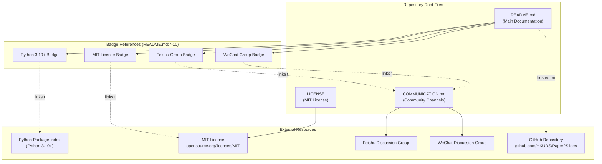
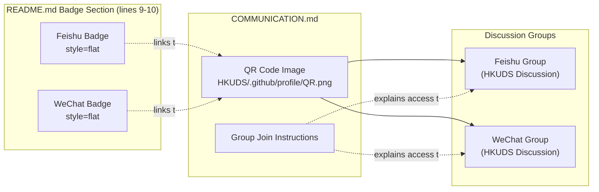
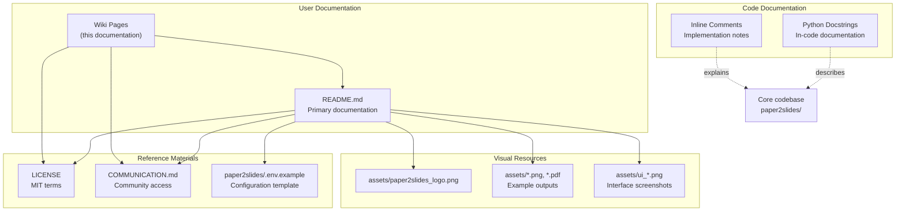

<!-- source: DeepWiki mcp.deepwiki.com · repo HKUDS/Paper2Slides · page 9 Reference · fetched 2026-11-09 -->

# Reference

<details>
<summary>Relevant source files</summary>

The following files were used as context for generating this wiki page:

- [COMMUNICATION.md](COMMUNICATION.md)
- [LICENSE](LICENSE)
- [README.md](README.md)

</details>


This page provides quick reference materials for the Paper2Slides system, including licensing information, community support channels, and additional resources. For detailed usage instructions, see [Getting Started](#1.1). For configuration options, see [Configuration Guide](#5).

## Overview

The reference materials are distributed across several files in the repository root:

| File | Purpose | Key Information |
|------|---------|-----------------|
| [LICENSE:1-22]() | Software license terms | MIT License, Copyright © 2025 HKUDS |
| [COMMUNICATION.md:1-5]() | Community contact information | WeChat and Feishu group QR codes |
| [README.md:1-348]() | Main documentation and badges | Repository links, status badges, quick start |



**Sources:** [README.md:1-348](), [LICENSE:1-22](), [COMMUNICATION.md:1-5]()

---

## License Information

Paper2Slides is released under the **MIT License**, a permissive open-source license that allows for both commercial and non-commercial use with minimal restrictions.

### License Terms

The complete license is located at [LICENSE:1-22]() with the following key provisions:

| Term | Details |
|------|---------|
| **Copyright Holder** | HKUDS (2025) |
| **License Type** | MIT License |
| **Permissions** | Use, copy, modify, merge, publish, distribute, sublicense, sell |
| **Conditions** | Include copyright notice and license text in all copies |
| **Limitations** | No warranty; no liability for damages |

### Full License Text

```
MIT License

Copyright (c) 2025 HKUDS

Permission is hereby granted, free of charge, to any person obtaining a copy
of this software and associated documentation files (the "Software"), to deal
in the Software without restriction, including without limitation the rights
to use, copy, modify, merge, publish, distribute, sublicense, and/or sell
copies of the Software, and to permit persons to whom the Software is
furnished to do so, subject to the following conditions:

The above copyright notice and this permission notice shall be included in all
copies or substantial portions of the Software.

THE SOFTWARE IS PROVIDED "AS IS", WITHOUT WARRANTY OF ANY KIND, EXPRESS OR
IMPLIED, INCLUDING BUT NOT LIMITED TO THE WARRANTIES OF MERCHANTABILITY,
FITNESS FOR A PARTICULAR PURPOSE AND NONINFRINGEMENT. IN NO EVENT SHALL THE
AUTHORS OR COPYRIGHT HOLDERS BE LIABLE FOR ANY CLAIM, DAMAGES OR OTHER
LIABILITY, WHETHER IN AN ACTION OF CONTRACT, TORT OR OTHERWISE, ARISING FROM,
OUT OF OR IN CONNECTION WITH THE SOFTWARE OR THE USE OR OTHER DEALINGS IN THE
SOFTWARE.
```

### Including Attribution

When distributing or modifying Paper2Slides, include the copyright notice and license terms from [LICENSE:1-22]() in all copies or substantial portions of the software.

**Sources:** [LICENSE:1-22]()

---

## Communication Channels

The Paper2Slides project provides discussion groups for community support and collaboration.

### Available Channels



**Sources:** [README.md:9-10](), [COMMUNICATION.md:1-5]()

### Joining Discussion Groups

Access to WeChat and Feishu groups is provided through QR codes in [COMMUNICATION.md:1-5]():

1. Navigate to the `COMMUNICATION.md` file in the repository root
2. Scan the QR code image to join either WeChat or Feishu discussion groups
3. The QR code image is hosted at: `https://github.com/HKUDS/.github/blob/main/profile/QR.png`

Both channels are maintained by HKUDS for community discussions, support requests, and feature discussions.

**Sources:** [COMMUNICATION.md:1-5]()

---

## Repository Information

### GitHub Repository

The official repository is hosted at: `https://github.com/HKUDS/Paper2Slides`

### Status Badges

The README includes several status badges ([README.md:7-10]()) that provide quick reference to system requirements and resources:

| Badge | Purpose | Link Target |
|-------|---------|-------------|
| Python 3.10+ | Minimum Python version requirement | `https://www.python.org/` |
| MIT License | License information | `https://opensource.org/licenses/MIT/` |
| Feishu Group | Community discussion channel | `./COMMUNICATION.md` |
| WeChat Group | Community discussion channel | `./COMMUNICATION.md` |

### Visitor Statistics

The repository tracks visitor statistics using a badge displayed at [README.md:346]():

```markdown

```

**Sources:** [README.md:7-10](), [README.md:346]()

---

## Quick Reference Links

### Common Tasks

| Task | Wiki Section |
|------|--------------|
| Install and run first generation | [Getting Started](#1.1) |
| Use CLI commands | [CLI Usage](#3) |
| Launch web interface | [Web Interface](#4) |
| Configure output types and styles | [Configuration Guide](#5) |
| Understand pipeline stages | [Core Pipeline Architecture](#2) |
| Resume from checkpoints | [Smart Recovery System](#2.5) |
| Troubleshoot issues | [Troubleshooting Guide](#8.3) |

### Configuration Quick Reference

| Configuration | Values | Wiki Section |
|---------------|--------|--------------|
| Output type | `slides`, `poster` | [Output Types](#5.1) |
| Style | `academic`, `doraemon`, custom text | [Style Configuration](#5.2) |
| Processing mode | normal (default), `--fast` flag | [Processing Modes](#5.3) |
| Content type | `paper`, `general` | [Content Type](#5.4) |
| Slides length | `short`, `medium`, `long` | [Content Type](#5.4) |
| Poster density | `sparse`, `medium`, `dense` | [Content Type](#5.4) |

### File Locations

| Resource | Path |
|----------|------|
| CLI entry point | `python -m paper2slides` |
| Environment configuration | `paper2slides/.env` (create from `.env.example`) |
| Upload directory | `sources/uploads/` |
| Output directory | `outputs/` |
| Backend API | `api/server.py` |
| Frontend source | `frontend/src/` |

**Sources:** [README.md:96-348]()

---

## API Keys and Environment Setup

Paper2Slides requires API keys for LLM services. Configuration is managed through environment variables.

### Environment File Location

Create a `.env` file at: `paper2slides/.env`

Reference the example template at: `paper2slides/.env.example` (mentioned in [README.md:121]())

### Required API Keys

The system uses external LLM services that require API credentials:

- **Image Generation**: Uses `gemini-3-pro-image-preview` (Nano Banana) as documented in [README.md:274]()
- Configure API keys in the `.env` file following the structure in `.env.example`

For details on configuring API keys, see [Setting Up Development Environment](#7.2).

**Sources:** [README.md:121](), [README.md:274]()

---

## Additional Resources

### Logo and Branding

The Paper2Slides logo is located at: `assets/paper2slides_logo.png` ([README.md:3]())

### Example Assets

The repository includes example outputs in the `assets/` directory ([README.md:56-77]()):

| Asset Type | Files |
|------------|-------|
| Poster examples | `doraemon_poster.png`, `academic_poster.png`, `totoro_poster.png` |
| Slide examples | `doraemon_slides.pdf`, `academic_slides.pdf`, `totoro_slides.pdf` |
| Slide previews | `doraemon_slides_preview.png`, `academic_slides_preview.png`, `totoro_slides_preview.png` |
| UI screenshots | `ui_1.png`, `ui_2.png` |

All examples are generated from: [DeepSeek-V3.2: Pushing the Frontier of Open Large Language Models](https://arxiv.org/abs/2512.02556) ([README.md:75]())

### Documentation Structure



**Sources:** [README.md:1-348](), [LICENSE:1-22](), [COMMUNICATION.md:1-5]()

---

## External Dependencies

Paper2Slides relies on external services and libraries documented in the repository.

### Python Version Requirement

- **Minimum Version**: Python 3.10+ ([README.md:7](), [README.md:113]())
- Install using: `conda create -n paper2slides python=3.10 -y`

### Package Dependencies

All Python dependencies are listed in: `requirements.txt`

Install with: `pip install -r requirements.txt` ([README.md:117]())

For a complete list of dependencies and development setup, see [Setting Up Development Environment](#7.2).

**Sources:** [README.md:7](), [README.md:113](), [README.md:117]()

---

## Getting Help

### Troubleshooting

For common issues and solutions, see [Troubleshooting Guide](#8.3).

### Community Support

For questions and discussions:

1. Join the **WeChat** or **Feishu** discussion groups via [COMMUNICATION.md:1-5]()
2. Open an issue on GitHub: `https://github.com/HKUDS/Paper2Slides/issues`

### Contributing

For information on contributing to the project, see [Development Guide](#7).

**Sources:** [COMMUNICATION.md:1-5](), [README.md:336-338]()

---

