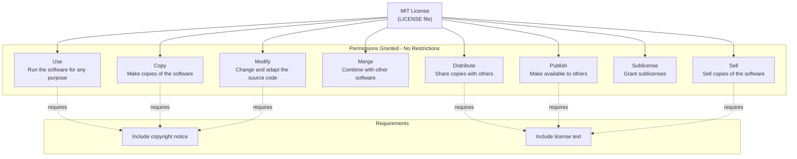
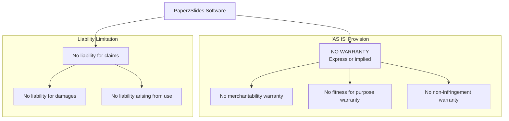

<!-- source: DeepWiki mcp.deepwiki.com · repo HKUDS/Paper2Slides · page 9.1 License · fetched 2026-11-09 -->

# License

<details>
<summary>Relevant source files</summary>

The following files were used as context for generating this wiki page:

- [LICENSE](LICENSE)

</details>


This document specifies the licensing terms under which the Paper2Slides software is distributed, including copyright information, permissions granted, and obligations for users and contributors. For information about contributing to the project or getting support, see [Community and Support](#9.2).

---

## License Overview

The Paper2Slides project is released under the **MIT License**, one of the most permissive open-source licenses. The copyright is held by HKUDS (2025).

**Sources:** [LICENSE:1-21]()

---

## Copyright Holder

```
Copyright (c) 2025 HKUDS
```

The copyright notice identifies HKUDS as the legal owner of the Paper2Slides software and associated documentation.

**Sources:** [LICENSE:3]()

---

## Permissions Granted

The MIT License grants users extensive freedoms to use, modify, and distribute the Paper2Slides software.

### Permission Flow Diagram



**Permitted Actions:**
- **Use**: Execute the software for any purpose (commercial or non-commercial)
- **Copy**: Create copies of the software
- **Modify**: Alter the source code to suit your needs
- **Merge**: Integrate Paper2Slides into other projects
- **Publish**: Make the software publicly available
- **Distribute**: Share the software with others
- **Sublicense**: Grant these same rights to others
- **Sell**: Include the software in commercial products

**Sources:** [LICENSE:5-9]()

---

## License Requirements

While the MIT License is highly permissive, it includes minimal obligations to protect the original authors.

### Required Actions

| Requirement | Description | Applies To |
|------------|-------------|------------|
| **Copyright Notice** | Include the copyright notice: "Copyright (c) 2025 HKUDS" | All copies or substantial portions |
| **License Text** | Include the full MIT License text | All copies or substantial portions |

**Inclusion Locations:**
- Source code distributions: Include [LICENSE:1-21]() file
- Binary distributions: Include license in documentation or about dialog
- Derivative works: Retain original copyright and license notices

**Sources:** [LICENSE:10-13]()

---

## Warranty and Liability Disclaimer

The MIT License explicitly disclaims warranties and limits liability to protect the copyright holder.



### No Warranty

The software is provided **"AS IS"** without warranty of any kind, including but not limited to:
- **Merchantability**: No guarantee the software is suitable for sale or use
- **Fitness for a particular purpose**: No guarantee it meets your specific needs
- **Non-infringement**: No guarantee it doesn't violate third-party rights

### No Liability

The authors and copyright holders are not liable for:
- Claims arising from the software
- Damages caused by the software
- Any other liability related to the software, whether in contract, tort, or otherwise

**Sources:** [LICENSE:15-21]()

---

## Practical Implications

### For Users

**What You Can Do:**
- Use Paper2Slides for personal projects ✓
- Use Paper2Slides for commercial products ✓
- Modify the code for your needs ✓
- Distribute modified versions ✓
- Integrate into proprietary software ✓

**What You Must Do:**
- Include the copyright notice in distributions
- Include the license text in distributions

**What You Cannot Do:**
- Hold HKUDS liable for issues arising from the software
- Claim warranty coverage

### For Contributors

Contributions to Paper2Slides are assumed to be licensed under the same MIT License terms. By contributing, you:
- Grant permission for your contributions to be distributed under the MIT License
- Retain copyright to your contributions
- Do not receive compensation beyond attribution

### For Distributors

If you distribute Paper2Slides (original or modified):

| Distribution Type | Requirements |
|------------------|-------------|
| Source code | Include [LICENSE:1-21]() file unchanged |
| Binary/Compiled | Include license in documentation or accessible location |
| Modified versions | Retain original copyright notice, add your own if you added substantial modifications |
| Integrated products | Include full license text in product documentation |

**Sources:** [LICENSE:1-21]()

---

## Full License Text

The complete MIT License text as it appears in the repository:

```
MIT License

Copyright (c) 2025 HKUDS

Permission is hereby granted, free of charge, to any person obtaining a copy
of this software and associated documentation files (the "Software"), to deal
in the Software without restriction, including without limitation the rights
to use, copy, modify, merge, publish, distribute, sublicense, and/or sell
copies of the Software, and to permit persons to whom the Software is
furnished to do so, subject to the following conditions:

The above copyright notice and this permission notice shall be included in all
copies or substantial portions of the Software.

THE SOFTWARE IS PROVIDED "AS IS", WITHOUT WARRANTY OF ANY KIND, EXPRESS OR
IMPLIED, INCLUDING BUT NOT LIMITED TO THE WARRANTIES OF MERCHANTABILITY,
FITNESS FOR A PARTICULAR PURPOSE AND NONINFRINGEMENT. IN NO EVENT SHALL THE
AUTHORS OR COPYRIGHT HOLDERS BE LIABLE FOR ANY CLAIM, DAMAGES OR OTHER
LIABILITY, WHETHER IN AN ACTION OF CONTRACT, TORT OR OTHERWISE, ARISING FROM,
OUT OF OR IN CONNECTION WITH THE SOFTWARE OR THE USE OR OTHER DEALINGS IN THE
SOFTWARE.
```

**Sources:** [LICENSE:1-21]()

---

## License File Location

The canonical license file is located at the repository root:

```
Paper2Slides/
├── LICENSE          # MIT License text
├── README.md
├── paper2slides/
├── api/
├── frontend/
└── ...
```

This file must be preserved in all distributions of the software.

**Sources:** [LICENSE:1-21]()

---

## Summary

| Aspect | Details |
|--------|---------|
| **License Type** | MIT License |
| **Copyright Holder** | HKUDS |
| **Copyright Year** | 2025 |
| **Permissions** | Use, copy, modify, merge, publish, distribute, sublicense, sell |
| **Requirements** | Include copyright notice and license text |
| **Warranty** | None ("AS IS") |
| **Liability** | None |

The MIT License provides maximum freedom to users while requiring only attribution to the original authors. This makes Paper2Slides suitable for use in both open-source and proprietary projects.

**Sources:** [LICENSE:1-21]()

---

