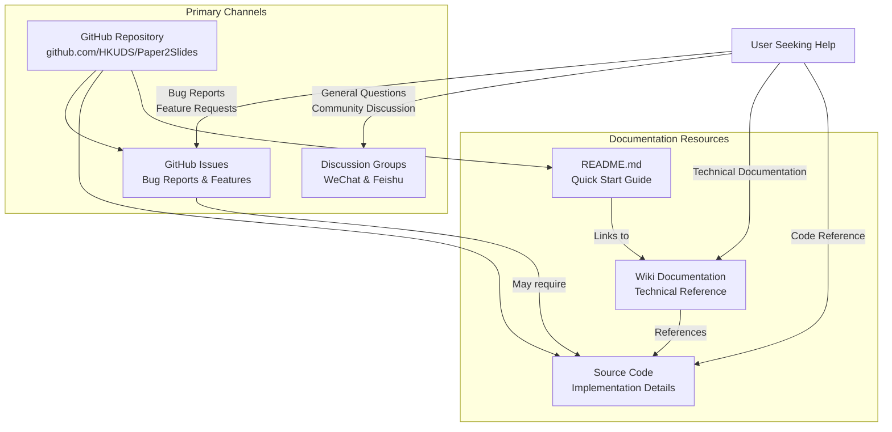
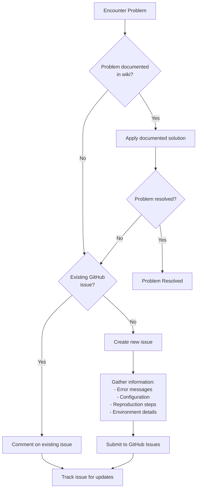
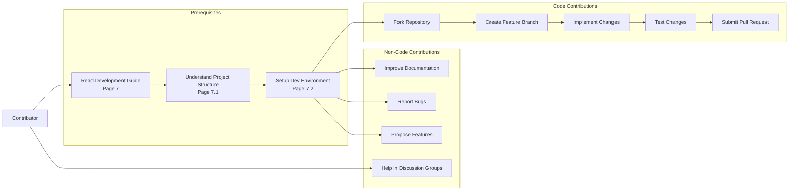

<!-- source: DeepWiki mcp.deepwiki.com · repo HKUDS/Paper2Slides · page 9.2 Community and Support · fetched 2026-11-09 -->

# Community and Support

<details>
<summary>Relevant source files</summary>

The following files were used as context for generating this wiki page:

- [COMMUNICATION.md](COMMUNICATION.md)

</details>


**Purpose and Scope**

This page provides information about available communication channels, discussion groups, and how to get help with Paper2Slides. For license information, see [License](#9.1). For resolving specific technical issues, see [Troubleshooting Guide](#8.3).

---

## Communication Channels Overview

The Paper2Slides project offers multiple channels for community interaction, support, and collaboration. Each channel serves specific purposes in the support ecosystem.

### Communication Channels by Purpose



**Sources:**
- COMMUNICATION.md:1-5

---

## GitHub Repository

The primary hub for Paper2Slides development and support is the GitHub repository:

**Repository URL:** `https://github.com/HKUDS/Paper2Slides`

### Repository Components

| Component | Purpose | Access |
|-----------|---------|--------|
| **Source Code** | View implementation, browse files | Navigate repository file tree |
| **Issues** | Report bugs, request features, track problems | `/issues` endpoint |
| **Releases** | Download stable versions, view changelogs | `/releases` endpoint |
| **README** | Quick start guide, installation instructions | Root `README.md` file |
| **Documentation** | Technical wiki (this document) | Linked from README |

**Sources:**
- COMMUNICATION.md:1-5

---

## Discussion Groups

The HKUDS team maintains discussion groups for real-time community interaction and support. These groups are accessible through WeChat and Feishu platforms.

### Joining Discussion Groups

To join the HKUDS discussion groups, scan the QR codes provided in the `COMMUNICATION.md` file located at the repository root:

[COMMUNICATION.md:1-5]()

### Discussion Group Use Cases

Discussion groups are appropriate for:

- **General Questions**: Installation help, usage clarification, configuration advice
- **Community Interaction**: Sharing use cases, discussing best practices, networking
- **Quick Support**: Real-time responses from community members and maintainers
- **Announcements**: Updates about new features, releases, and project news

Discussion groups are **not** suitable for:

- **Bug Reports**: Use GitHub Issues instead for trackable problem reports
- **Feature Requests**: Use GitHub Issues for formal feature proposals
- **Long-Term Tracking**: Discussions are ephemeral; use GitHub for persistent records

**Sources:**
- COMMUNICATION.md:1-5

---

## Getting Help

### Issue Reporting Workflow

When encountering problems with Paper2Slides, follow this workflow to get help efficiently:



**Sources:**
- COMMUNICATION.md:1-5

### Required Information for Bug Reports

When creating a GitHub issue for a bug report, include the following information:

```markdown
**Environment:**
- Operating System: [e.g., Ubuntu 22.04, macOS 14.0, Windows 11]
- Python Version: [e.g., 3.10.12]
- Installation Method: [pip, source]

**Configuration:**
- Content Type: [paper/general]
- Output Type: [slides/poster]
- Processing Mode: [normal/fast]
- Style: [academic/doraemon/custom]
- Length/Density: [short/medium/long or sparse/medium/dense]

**Steps to Reproduce:**
1. [First step]
2. [Second step]
3. [And so on...]

**Expected Behavior:**
[What you expected to happen]

**Actual Behavior:**
[What actually happened]

**Error Messages:**
[Paste complete error output or attach log files]

**Additional Context:**
[Attach input files if possible, screenshots, etc.]
```

**Sources:**
- COMMUNICATION.md:1-5

---

## Documentation Navigation

### Finding Information by Topic

```mermaid
graph TB
    Question["I need help with..."]
    
    subgraph "Installation & Setup"
        GS["Getting Started<br/>Page 1.1"]
        DevEnv["Development Environment<br/>Page 7.2"]
    end
    
    subgraph "Usage & Configuration"
        CLI["CLI Usage<br/>Pages 3, 3.1, 3.2"]
        Web["Web Interface<br/>Pages 4, 4.1, 4.2"]
        Config["Configuration Options<br/>Pages 5, 5.1-5.4"]
    end
    
    subgraph "Understanding Internals"
        Pipeline["Pipeline Architecture<br/>Pages 2, 2.1-2.5"]
        Files["File Management<br/>Pages 6, 6.1-6.3"]
        Dev["Development Guide<br/>Pages 7, 7.1-7.3"]
    end
    
    subgraph "Problem Solving"
        Troubleshoot["Troubleshooting<br/>Page 8.3"]
        Error["Error Handling<br/>Page 8.1"]
        Performance["Performance<br/>Page 8.2"]
    end
    
    Question -->|"Installing"| GS
    Question -->|"Developing"| DevEnv
    Question -->|"Running CLI"| CLI
    Question -->|"Using Web UI"| Web
    Question -->|"Configuring"| Config
    Question -->|"Understanding system"| Pipeline
    Question -->|"File organization"| Files
    Question -->|"Contributing code"| Dev
    Question -->|"Solving problems"| Troubleshoot
    Question -->|"Handling errors"| Error
    Question -->|"Optimizing speed"| Performance
```



**Sources:**
- COMMUNICATION.md:1-5

### Quick Reference by Error Type

| Error Type | First Check | Documentation Page |
|------------|-------------|-------------------|
| **Installation fails** | Python version, dependencies | [Getting Started](#1.1) |
| **File upload rejected** | File format, size limits | [File Upload Components](#4.2.3) |
| **Pipeline stage fails** | Checkpoint files, logs | [Smart Recovery System](#2.5) |
| **API returns 409 Conflict** | Concurrent requests | [Session Management](#4.1.2) |
| **Generation incomplete** | State file, stage progress | [State Management](#6.3) |
| **Output quality issues** | Configuration parameters | [Configuration Guide](#5) |
| **Performance problems** | Mode selection, document size | [Performance Optimization](#8.2) |

**Sources:**
- COMMUNICATION.md:1-5

---

## Contributing to the Project

### Contribution Pathways

For developers interested in contributing to Paper2Slides, several pathways are available:



**Sources:**
- COMMUNICATION.md:1-5

### Contribution Guidelines

Before contributing code:

1. **Review the Development Guide**: See [Development Guide](#7) for project structure and conventions
2. **Setup Development Environment**: Follow instructions in [Setting Up Development Environment](#7.2)
3. **Check Existing Issues**: Avoid duplicate work by reviewing open issues
4. **Start Small**: Begin with documentation improvements or small bug fixes
5. **Follow Code Style**: Maintain consistency with existing codebase

For development-related questions:
- See [Project Structure](#7.1) for codebase organization
- See [Running and Deploying](#7.3) for testing your changes locally

**Sources:**
- COMMUNICATION.md:1-5

---

## Support Resources Summary

### Quick Access Table

| Need | Resource | Location |
|------|----------|----------|
| **Quick Start** | Getting Started guide | [Page 1.1](#1.1) |
| **All Features** | Configuration reference | [Page 5](#5) |
| **CLI Commands** | CLI options reference | [Page 3.1](#3.1) |
| **API Endpoints** | API reference | [Page 4.1.1](#4.1.1) |
| **Common Issues** | Troubleshooting guide | [Page 8.3](#8.3) |
| **Bug Reports** | GitHub Issues | `github.com/HKUDS/Paper2Slides/issues` |
| **Live Discussion** | WeChat/Feishu groups | [COMMUNICATION.md:1-5]() |
| **Code Reference** | GitHub repository | `github.com/HKUDS/Paper2Slides` |
| **License Info** | License page | [Page 9.1](#9.1) |

**Sources:**
- COMMUNICATION.md:1-5

---

## Best Practices for Getting Help

### Effective Communication

When seeking help through any channel:

1. **Be Specific**: Describe the exact problem, not general symptoms
2. **Provide Context**: Include configuration, environment, and steps taken
3. **Include Evidence**: Attach error messages, logs, or screenshots
4. **Search First**: Check documentation and existing issues before asking
5. **Follow Up**: Update issues with additional information or resolution

### Choosing the Right Channel

| Question Type | Best Channel | Reason |
|---------------|--------------|--------|
| "How do I install?" | Wiki [1.1](#1.1), then Discussion Groups | Documentation first, clarification if needed |
| "What does this error mean?" | Troubleshooting [8.3](#8.3), then GitHub Issues | Documentation may have answer, issue for bugs |
| "Can I add feature X?" | GitHub Issues | Trackable feature request |
| "Which style should I use?" | Discussion Groups | Subjective, benefits from community input |
| "My pipeline crashes at stage 2" | GitHub Issues | Bug report requiring tracking |
| "What's the difference between modes?" | Wiki [5.3](#5.3) | Documented in configuration guide |

**Sources:**
- COMMUNICATION.md:1-5