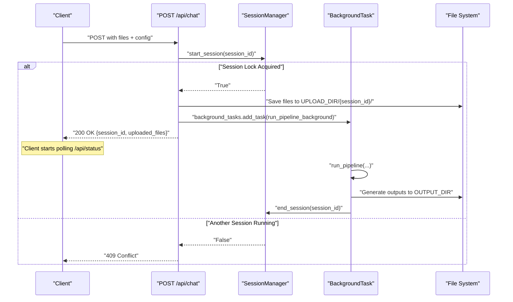
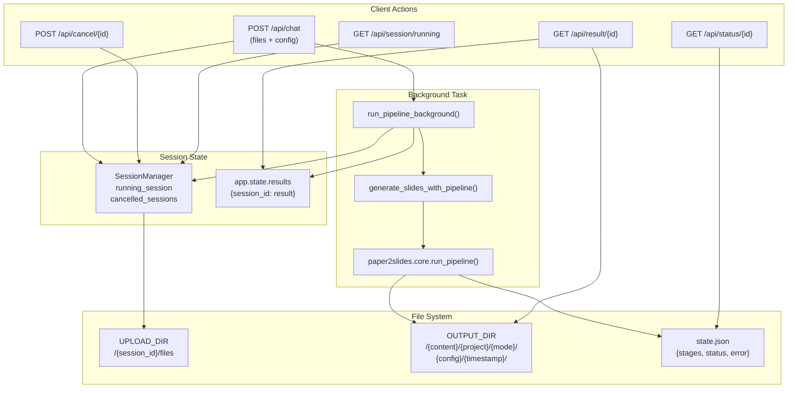

<!-- source: DeepWiki mcp.deepwiki.com · repo HKUDS/Paper2Slides · extra page API Endpoints Reference · fetched 2026-11-09 -->

# API Endpoints Reference

<details>
<summary>Relevant source files</summary>

The following files were used as context for generating this wiki page:

- [api/server.py](api/server.py)

</details>


This page provides a complete reference for all HTTP endpoints exposed by the Paper2Slides FastAPI backend server. For information about session lifecycle and concurrency control, see [Session Management](#4.1.2). For frontend integration patterns, see [ChatWindow Component](#4.2.1).

The API follows REST conventions and uses JSON for request/response bodies. All endpoints are defined in [api/server.py:1-773]().

## Server Configuration

The FastAPI application is instantiated at [api/server.py:39]() and runs on port 8001 by default [api/server.py:758](). The server is configured with:

- **Base directories**: Uploads stored in `sources/uploads/`, outputs in `outputs/` [api/server.py:34-37]()
- **CORS**: Allows origins `localhost:3000`, `localhost:5173`, `127.0.0.1:3000`, `127.0.0.1:5173` [api/server.py:88-94]()
- **Static mounts**: `/outputs` serves OUTPUT_DIR, `/uploads` serves UPLOAD_DIR [api/server.py:97-99]()
- **Timeout settings**: Keep-alive 300s, max 1000 requests [api/server.py:769-771]()

**Sources**: [api/server.py:34-99]()

## Endpoint Overview

The following table summarizes all available endpoints:

| Method | Path | Purpose | Response |
|--------|------|---------|----------|
| GET | `/` | Server status check | JSON with message and status |
| GET | `/health` | Health check endpoint | JSON with status |
| GET | `/api/session/running` | Query active session | Session status |
| POST | `/api/cancel/{session_id}` | Cancel running session | Cancellation confirmation |
| POST | `/api/chat` | Initiate document processing | Session ID and file info |
| GET | `/api/status/{session_id}` | Poll pipeline progress | Stage completion status |
| GET | `/api/result/{session_id}` | Retrieve generated outputs | URLs to slides/poster |
| GET | `/api/download/{filepath:path}` | Download output file | File stream |
| GET | `/outputs/{path}` | Static file serving | Output files |
| GET | `/uploads/{path}` | Static file serving | Uploaded source files |

**Sources**: [api/server.py:111-750]()

## Detailed Endpoint Documentation

### Root and Health Endpoints

#### `GET /`

Returns basic server information.

**Response** (200 OK):
```json
{
  "message": "Paper2Slides API Server",
  "status": "running"
}
```

**Implementation**: [api/server.py:111-113]()

#### `GET /health`

Health check endpoint for monitoring.

**Response** (200 OK):
```json
{
  "status": "healthy"
}
```

**Implementation**: [api/server.py:116-118]()

**Sources**: [api/server.py:111-118]()

### Session Management Endpoints

#### `GET /api/session/running`

Checks if a generation session is currently running. Used by frontend to prevent concurrent requests.

**Response** (200 OK):
```json
{
  "has_running_session": true,
  "running_session_id": "a1b2c3d4"
}
```

The `running_session_id` is truncated to 8 characters for display [api/server.py:127]().

**Implementation**: [api/server.py:121-128]()

#### `POST /api/cancel/{session_id}`

Requests cancellation of a running session. The session is marked for cancellation in `SessionManager.cancelled_sessions` [api/server.py:72]() and checked during pipeline execution.

**Path Parameters**:
- `session_id` (string): Full session UUID

**Response** (200 OK):
```json
{
  "message": "Session a1b2c3d4 cancellation requested",
  "cancelled": true
}
```

If session is not running:
```json
{
  "message": "Session a1b2c3d4 is not running",
  "cancelled": false
}
```

**Error Responses**:
- 500: Internal server error

**Implementation**: [api/server.py:131-142]()

**Sources**: [api/server.py:121-142]()

### Main Generation Endpoint

#### `POST /api/chat`

Initiates document processing pipeline. Accepts multipart form data with files and configuration parameters. Returns immediately with session ID; actual processing occurs in background task [api/server.py:272-284]().

**Request Parameters** (all as `Form` data):

| Parameter | Type | Required | Default | Description |
|-----------|------|----------|---------|-------------|
| `message` | string | No | "" | Custom style description (overrides `style`) |
| `content` | string | No | "paper" | Content type: `"paper"` or `"general"` |
| `output_type` | string | No | "slides" | Output format: `"slides"` or `"poster"` |
| `style` | string | No | "doraemon" | Predefined style or custom description |
| `length` | string | No | None | Slides length: `"short"`, `"medium"`, `"long"` |
| `density` | string | No | None | Poster density: `"sparse"`, `"medium"`, `"dense"` |
| `fast_mode` | string | No | None | Skip RAG indexing: `"true"` or `"false"` |
| `session_id` | string | No | None | Existing session ID for regeneration |
| `files` | File[] | No | [] | Uploaded PDF/DOC/MD files |

**Parameter Processing Logic**:
- If `message` is provided, it overrides `style` as custom style description [api/server.py:332-343]()
- `fast_mode` is parsed from string to boolean [api/server.py:237]()
- If `session_id` is provided without files, existing files are reused [api/server.py:180-195]()

**File Handling**:
- Files are saved to `UPLOAD_DIR/{session_id}/` [api/server.py:206]()
- Supports chunked upload (1MB chunks) [api/server.py:225-228]()
- File info includes filename, path, and size [api/server.py:229-233]()

**Response** (200 OK):
```json
{
  "message": "Processing 2 file(s)...",
  "session_id": "550e8400-e29b-41d4-a716-446655440000",
  "uploaded_files": [
    {
      "name": "paper.pdf",
      "size": 2048576,
      "url": "/uploads/550e8400-e29b-41d4-a716-446655440000/paper.pdf"
    }
  ],
  "slides": [],
  "ppt_url": null,
  "poster_url": null
}
```

**Error Responses**:
- **409 Conflict**: Another session is already running [api/server.py:190-193](), [api/server.py:199-202]()
- **404 Not Found**: Session ID not found (when reusing session) [api/server.py:195]()
- **500 Internal Server Error**: Processing error [api/server.py:289-291]()

**Concurrency Control**:
The endpoint enforces single-threaded execution via `SessionManager`. If another session is running, returns HTTP 409:
```json
{
  "detail": "Another session is already running. Please wait for it to complete. Running session: a1b2c3d4"
}
```

**Implementation**: [api/server.py:145-291]()

**Sources**: [api/server.py:145-291]()

### Pipeline Request Flow Diagram



**Sources**: [api/server.py:145-291](), [api/server.py:489-547]()

### Status Polling Endpoint

#### `GET /api/status/{session_id}`

Returns real-time pipeline progress for a session. Frontend polls this endpoint every few seconds to update UI [api/server.py:550-643]().

**Path Parameters**:
- `session_id` (string): Full session UUID

**Status Detection Logic**:
1. Locates session directory in `UPLOAD_DIR/{session_id}` [api/server.py:555-557]()
2. Determines project name from PDF files [api/server.py:560-568]()
3. Searches for `state.json` matching session ID [api/server.py:574-608]()
4. Falls back to most recently updated state if no exact match [api/server.py:595-601]()

**Response** (200 OK):
```json
{
  "session_id": "550e8400-e29b-41d4-a716-446655440000",
  "status": "running",
  "stages": {
    "rag": "completed",
    "summary": "completed",
    "plan": "running",
    "generate": "pending"
  },
  "error": null,
  "updated_at": "2024-01-15T10:30:00Z"
}
```

**Stage Status Values**:
- `"pending"`: Not started
- `"running"`: Currently executing
- `"completed"`: Successfully finished
- `"failed"`: Encountered error

**Overall Status Values**:
- `"pending"`: No stages started
- `"running"`: At least one stage is running
- `"completed"`: All stages completed
- `"failed"`: At least one stage failed
- `"no_files"`: No PDF files found in session

**Status Determination Logic** [api/server.py:623-631]():
```
if any stage is "failed" -> overall = "failed"
else if all stages are "completed" -> overall = "completed"
else if any stage is "running" -> overall = "running"
else -> overall = "pending"
```

**Error Responses**:
- **404 Not Found**: Session does not exist [api/server.py:557]()
- **500 Internal Server Error**: Error reading state [api/server.py:641-643]()

**Implementation**: [api/server.py:550-643]()

**Sources**: [api/server.py:550-643]()

### Result Retrieval Endpoint

#### `GET /api/result/{session_id}`

Retrieves final outputs after pipeline completion. Should only be called after `/api/status` returns `"status": "completed"`.

**Path Parameters**:
- `session_id` (string): Full session UUID

**Result Caching**:
Results are stored in `app.state.results` dictionary [api/server.py:528-530]() by the background task [api/server.py:489-547]().

**Response** (200 OK):
```json
{
  "session_id": "550e8400-e29b-41d4-a716-446655440000",
  "slides": [
    {
      "title": "Slide 1",
      "image_url": "/outputs/paper/project_name/normal/slides_doraemon_medium/20240115_103000/slide_01.png"
    },
    {
      "title": "Slide 2",
      "image_url": "/outputs/paper/project_name/normal/slides_doraemon_medium/20240115_103000/slide_02.png"
    }
  ],
  "ppt_url": "/outputs/paper/project_name/normal/slides_doraemon_medium/20240115_103000/slides.pdf"
}
```

For poster output:
```json
{
  "session_id": "550e8400-e29b-41d4-a716-446655440000",
  "slides": [
    {
      "title": "Slide 1",
      "image_url": "/outputs/paper/project_name/normal/poster_academic_dense/20240115_103000/poster.png"
    }
  ],
  "poster_url": "/outputs/paper/project_name/normal/poster_academic_dense/20240115_103000/poster.pdf"
}
```

**Output Type Detection**:
The endpoint determines whether outputs are slides or poster by reading `state.json` [api/server.py:674-691](), defaulting to "slides" if not found [api/server.py:677]().

**File URL Construction**:
- Image URLs: `/outputs/{relative_path}` [api/server.py:698]()
- PDF URLs: `/outputs/{relative_path}` [api/server.py:707](), [api/server.py:709]()

**Error Responses**:
- **202 Accepted**: Result not ready yet (still processing) [api/server.py:717-720]()
- **500 Internal Server Error**: Pipeline failed with error [api/server.py:655]()

**Implementation**: [api/server.py:646-726]()

**Sources**: [api/server.py:646-726]()

### File Download and Serving

#### `GET /api/download/{filepath:path}`

Downloads a generated file from OUTPUT_DIR with security checks.

**Path Parameters**:
- `filepath` (string): Relative path within OUTPUT_DIR (supports subdirectories)

**Security**:
Resolves paths and verifies file is within OUTPUT_DIR to prevent directory traversal attacks [api/server.py:735-741]().

**Response**:
- **200 OK**: Returns file with `application/octet-stream` content type [api/server.py:746-750]()
- **403 Forbidden**: Path attempts to access outside OUTPUT_DIR [api/server.py:739]()
- **404 Not Found**: File does not exist [api/server.py:744]()

**Implementation**: [api/server.py:729-750]()

#### Static File Mounts

Two directories are mounted as static file servers:

1. **`/outputs`**: Serves files from OUTPUT_DIR [api/server.py:97]()
   - Access pattern: `/outputs/{content_type}/{project_name}/{mode}/{config_hash}/{timestamp}/{file}`
   
2. **`/uploads`**: Serves files from UPLOAD_DIR [api/server.py:99]()
   - Access pattern: `/uploads/{session_id}/{filename}`

**Sources**: [api/server.py:97-99](), [api/server.py:729-750]()

## Request/Response Models

### ChatResponse Model

Defined at [api/server.py:102-108](), used for structured responses from `/api/chat`:

```python
class ChatResponse(BaseModel):
    message: str                          # Status message
    slides: Optional[List[dict]] = None   # Slide image URLs
    ppt_url: Optional[str] = None         # Slides PDF URL
    poster_url: Optional[str] = None      # Poster PDF URL
    session_id: Optional[str] = None      # Session UUID
    uploaded_files: Optional[List[dict]] = None  # File metadata
```

**Sources**: [api/server.py:102-108]()

### Background Processing

The `/api/chat` endpoint delegates processing to `run_pipeline_background()` [api/server.py:489-547](), which:

1. Acquires session lock [api/server.py:506-513]()
2. Calls `generate_slides_with_pipeline()` [api/server.py:294-430]()
3. Stores result in `app.state.results` [api/server.py:528-530]()
4. Releases session lock on completion or error [api/server.py:546]()
5. Updates state.json on failure [api/server.py:540-543]()

The pipeline can check for cancellation via `session_manager.is_cancelled()` [api/server.py:77-79](), [api/server.py:521-523]().

**Sources**: [api/server.py:489-547](), [api/server.py:294-430]()

## Error Handling

### HTTP Status Codes

| Code | Meaning | When Used |
|------|---------|-----------|
| 200 | OK | Successful request |
| 202 | Accepted | Result not ready yet (still processing) |
| 404 | Not Found | Session or file not found |
| 409 | Conflict | Another session is already running |
| 500 | Internal Server Error | Pipeline or processing error |

### Error Response Format

All errors return JSON with `detail` field:
```json
{
  "detail": "Error message here"
}
```

**Sources**: [api/server.py:145-726]()

## API Workflow Diagram



**Sources**: [api/server.py:1-773]()

## Code Entity Reference

Key classes and functions referenced by the API:

| Entity | Location | Purpose |
|--------|----------|---------|
| `SessionManager` | [api/server.py:45-84]() | Concurrency control for pipeline execution |
| `ChatResponse` | [api/server.py:102-108]() | Response model for /api/chat endpoint |
| `run_pipeline_background()` | [api/server.py:489-547]() | Background task for pipeline execution |
| `generate_slides_with_pipeline()` | [api/server.py:294-430]() | Core pipeline invocation logic |
| `_update_state_on_error()` | [api/server.py:433-486]() | Updates state.json when pipeline fails |
| `app.state.results` | [api/server.py:528-530]() | In-memory result cache |

**Sources**: [api/server.py:45-547]()

---

