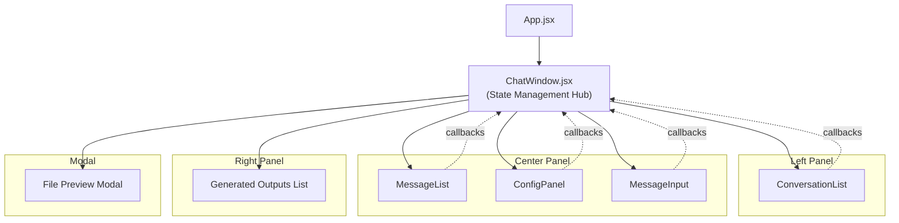
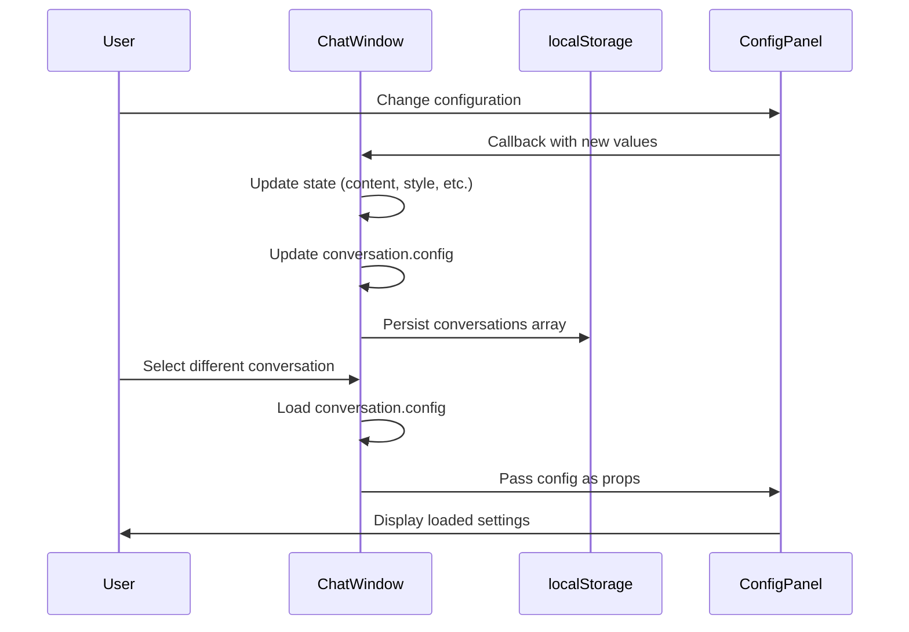
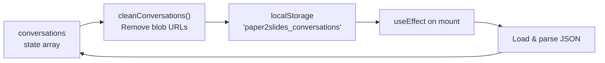
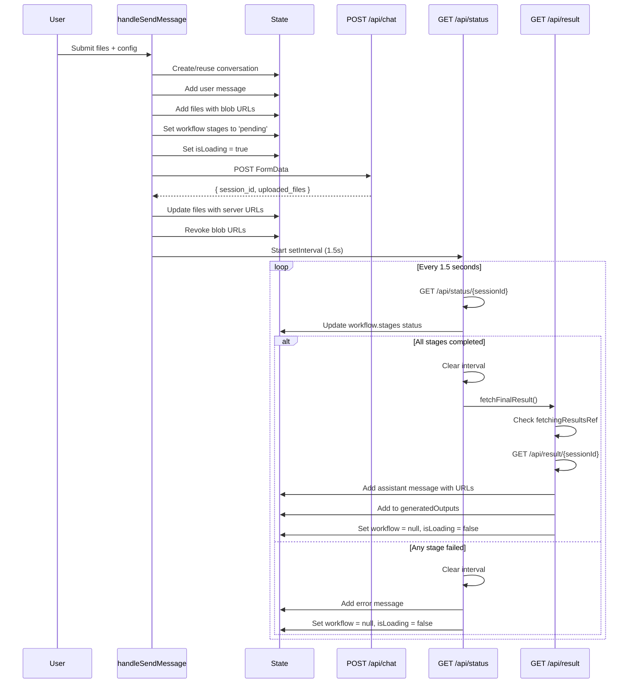
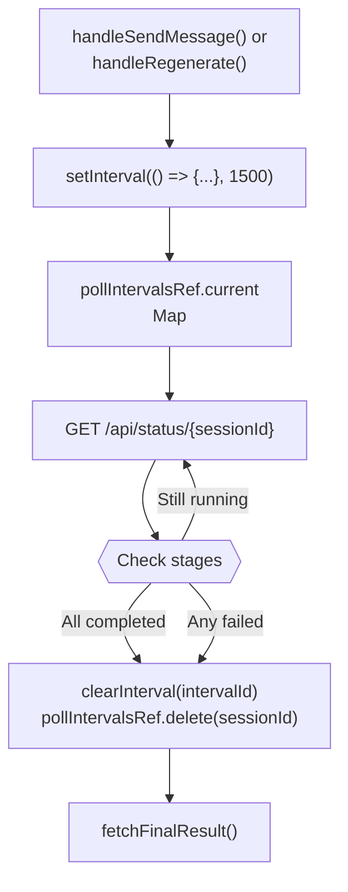
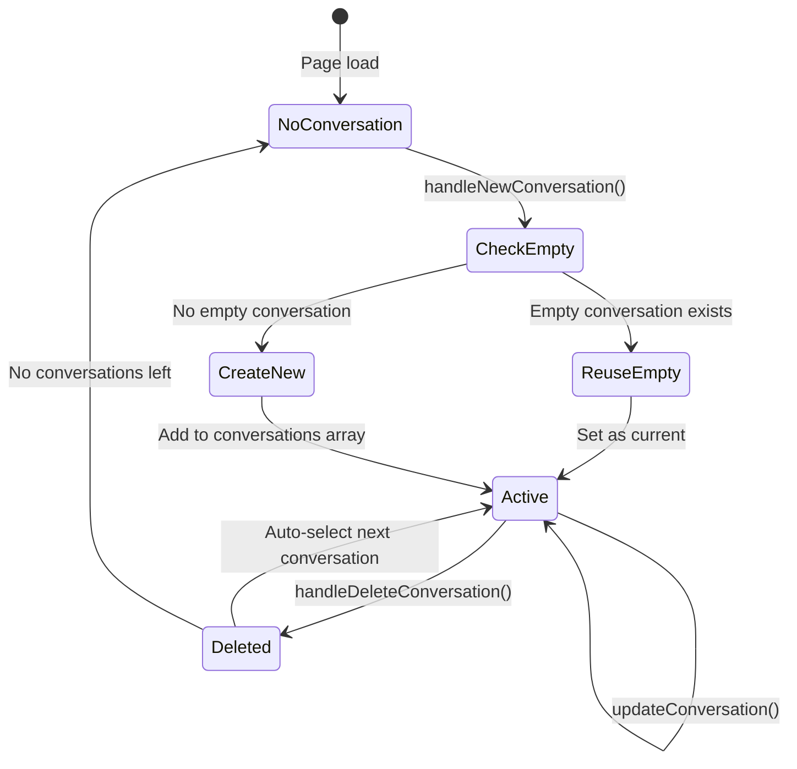
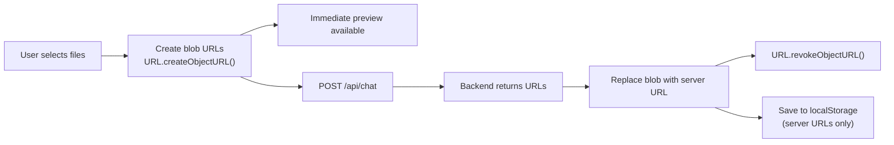
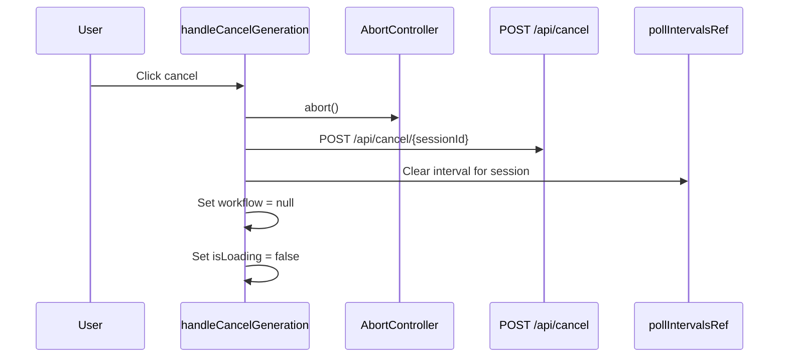
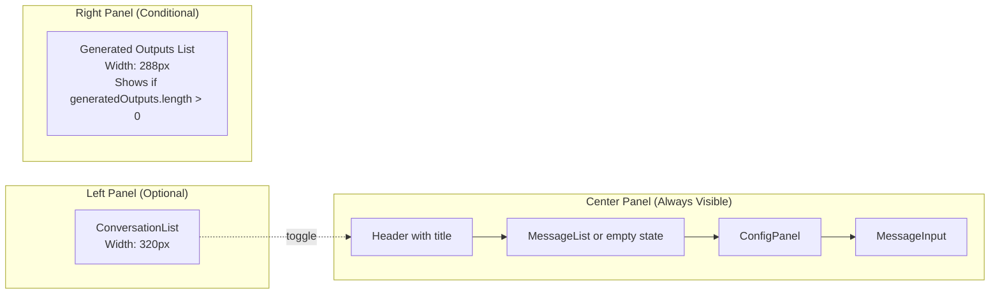

<!-- source: DeepWiki mcp.deepwiki.com · repo HKUDS/Paper2Slides · extra page ChatWindow Component · fetched 2026-11-09 -->

# ChatWindow Component

<details>
<summary>Relevant source files</summary>

The following files were used as context for generating this wiki page:

- [frontend/src/components/ChatWindow.jsx](frontend/src/components/ChatWindow.jsx)

</details>


## Purpose and Scope

The `ChatWindow` component is the central orchestrator of the Paper2Slides web interface. It manages all application state, coordinates child components, handles API communication with the backend server, and persists conversation history to `localStorage`. This component implements the chat-style interface where users upload documents, configure generation parameters, and view results.

For information about the child components rendered by `ChatWindow`, see:
- [Configuration Components](#4.2.2) - `ConfigPanel` for output settings
- [File Upload Components](#4.2.3) - `MessageInput` and `FileUpload` for file selection
- [Message and History Components](#4.2.4) - `MessageList` and `ConversationList` for display

For details about the backend API that `ChatWindow` interacts with, see:
- [Backend API Server](#4.1) - Overview of FastAPI endpoints
- [API Endpoints Reference](#4.1.1) - Complete endpoint specifications
- [Session Management](#4.1.2) - Session lifecycle and concurrency control

**Sources:** [frontend/src/components/ChatWindow.jsx:1-1265]()

---

## Component Architecture

### Position in Component Hierarchy

The `ChatWindow` component serves as the root container for the entire chat interface, managing all child components through a unidirectional data flow pattern.

**Component Hierarchy Diagram**



**Sources:** [frontend/src/components/ChatWindow.jsx:982-1261]()

---

## State Management

### Primary State Variables

The `ChatWindow` component manages the following state categories:

| State Variable | Type | Purpose | Persistence |
|---|---|---|---|
| `conversations` | `Array<Conversation>` | List of all conversation objects | `localStorage` |
| `currentConversationId` | `string \| null` | ID of currently active conversation | Derived from selection |
| `isLoading` | `boolean` | Whether pipeline is executing | Transient |
| `currentWorkflow` | `WorkflowState \| null` | Stage progress for active pipeline run | Transient |
| `content` | `'paper' \| 'general'` | Content type configuration | Per-conversation |
| `style` | `string` | Style preset or custom description | Per-conversation |
| `output` | `'slides' \| 'poster'` | Output type configuration | Per-conversation |
| `length` | `'short' \| 'medium' \| 'long'` | Slides length parameter | Per-conversation |
| `density` | `'sparse' \| 'medium' \| 'dense'` | Poster density parameter | Per-conversation |
| `fastMode` | `boolean` | Whether to skip RAG indexing | Per-conversation |
| `showLeftPanel` | `boolean` | Sidebar visibility toggle | Transient |
| `previewFile` | `File \| null` | File selected for modal preview | Transient |

**Sources:** [frontend/src/components/ChatWindow.jsx:12-36]()

### Ref-based State

Three refs manage imperative operations and prevent race conditions:

| Ref | Type | Purpose |
|---|---|---|
| `pollIntervalsRef` | `Map<sessionId, intervalId>` | Track status polling intervals per session |
| `fetchingResultsRef` | `Set<sessionId>` | Prevent duplicate result fetches |
| `abortControllerRef` | `AbortController` | Enable request cancellation |
| `messagesEndRef` | `HTMLElement` | Auto-scroll anchor for messages |

**Sources:** [frontend/src/components/ChatWindow.jsx:34-40]()

### Conversation Data Structure

Each conversation object follows this schema:

```javascript
{
  id: string,                    // Generated UUID
  title: string,                 // Display name (derived from first file)
  messages: Array<Message>,      // User and assistant messages
  files: Array<FileInfo>,        // Uploaded files with URLs
  generatedOutputs: Array<Output>, // Historical generation results
  config: {                      // Snapshot of config when generated
    content: string,
    style: string,
    output: string,
    length: string,
    density: string,
    fastMode: boolean
  },
  createdAt: string,             // ISO timestamp
  updatedAt: string              // ISO timestamp
}
```

**Sources:** [frontend/src/components/ChatWindow.jsx:257-266](), [frontend/src/components/ChatWindow.jsx:469-478]()

---

## State Flow and Data Synchronization

### State Update Pattern

The component uses React's automatic batching (React 18) to efficiently update multiple state variables. Configuration state flows in both directions:



**Sources:** [frontend/src/components/ChatWindow.jsx:276-294](), [frontend/src/components/ChatWindow.jsx:532-534]()

### localStorage Persistence

Conversations are automatically persisted to `localStorage` with key `paper2slides_conversations`. Blob URLs (temporary file preview URLs) are excluded from persistence to avoid storing invalid references.

**Persistence Flow:**



**Sources:** [frontend/src/components/ChatWindow.jsx:42-80]()

---

## Component Lifecycle and Child Coordination

### Child Component Props Flow

The `ChatWindow` passes state down and receives callbacks up from child components:

| Child Component | Props Passed Down | Callbacks Received |
|---|---|---|
| `ConversationList` | `conversations`, `currentConversationId` | `onSelectConversation`, `onNewConversation`, `onDeleteConversation`, `onCollapse` |
| `MessageList` | `messages`, `uploadedFiles`, `currentWorkflow`, `isLoading`, `conversationId` | `onCancelGeneration` |
| `ConfigPanel` | `content`, `style`, `output`, `length`, `density`, `fastMode`, `compact`, `isLoading` | `setContent`, `setStyle`, `setOutput`, `setLength`, `setDensity`, `setFastMode`, `onRegenerate` |
| `MessageInput` | `isLoading`, `outputType`, `style`, `preSelectedFiles`, `hasMessages` | `onSendMessage`, `onPreSelectedFilesClear` |

**Sources:** [frontend/src/components/ChatWindow.jsx:987-1148]()

### Derived State Pattern

The component uses derived state to avoid redundant storage:

```javascript
const currentConversation = conversations.find(c => c.id === currentConversationId) || null
const messages = currentConversation?.messages || []
const conversationFiles = currentConversation?.files || []
```

This pattern ensures child components always receive consistent data without manual synchronization.

**Sources:** [frontend/src/components/ChatWindow.jsx:17-19]()

---

## Message Handling Flow

### Send Message Process

The `handleSendMessage` function orchestrates the complete generation flow:

**Message Handling Flow Diagram**



**Sources:** [frontend/src/components/ChatWindow.jsx:458-766]()

### Key Implementation Details

1. **Conversation Creation** - Reuses empty conversations before creating new ones [frontend/src/components/ChatWindow.jsx:462-484]()
2. **Blob URL Management** - Creates temporary preview URLs for immediate file display, replaces with server URLs after upload [frontend/src/components/ChatWindow.jsx:486-497]()
3. **FormData Construction** - Builds FormData with message, config parameters, and file blobs [frontend/src/components/ChatWindow.jsx:558-575]()
4. **AbortController** - Creates controller for cancellation support [frontend/src/components/ChatWindow.jsx:555-556]()
5. **Session-based Polling** - Uses `pollIntervalsRef.current.set(sessionId, intervalId)` to track intervals per session [frontend/src/components/ChatWindow.jsx:680]()

**Sources:** [frontend/src/components/ChatWindow.jsx:458-766]()

---

## Status Polling Mechanism

### Polling Architecture

The component maintains separate polling intervals for each active session, stored in `pollIntervalsRef`:



**Sources:** [frontend/src/components/ChatWindow.jsx:604-681](), [frontend/src/components/ChatWindow.jsx:860-937]()

### Stage Status Mapping

The backend returns stage statuses that are mapped to UI states:

| Backend Status | UI Status | Visual Indicator |
|---|---|---|
| `'completed'` | `'completed'` | Checkmark, green |
| `'running'` | `'active'` | Spinner, blue |
| `'failed'` | `'failed'` | X mark, red |
| Not present | `'pending'` | Dot, gray |

**Mapping Logic:**

```javascript
const newStages = prev.stages.map(stage => {
  const backendStatus = stages[stage.id]
  let status = 'pending'
  if (backendStatus === 'completed') status = 'completed'
  else if (backendStatus === 'running') status = 'active'
  else if (backendStatus === 'failed') status = 'failed'
  return { ...stage, status }
})
```

**Sources:** [frontend/src/components/ChatWindow.jsx:622-629](), [frontend/src/components/ChatWindow.jsx:878-885]()

### Duplicate Result Prevention

The `fetchingResultsRef` Set prevents race conditions where multiple polling intervals try to fetch results simultaneously:

```javascript
if (fetchingResultsRef.current.has(sessionId)) {
  console.log(`Already fetching result for session ${sessionId}, skipping...`)
  return
}
fetchingResultsRef.current.add(sessionId)
```

**Sources:** [frontend/src/components/ChatWindow.jsx:359-364]()

---

## Regeneration Flow

The `handleRegenerate` function allows users to regenerate outputs with different configuration parameters while reusing uploaded files:

**Regeneration vs Initial Generation**

| Aspect | Initial Generation | Regeneration |
|---|---|---|
| Files | Uploaded in FormData | Reused via `session_id` parameter |
| API call | POST /api/chat with files | POST /api/chat with `session_id` |
| Conversation | Creates new or reuses empty | Uses current conversation |
| Message content | User's text input | Empty string to avoid custom style |

**Regeneration Implementation:**

```javascript
// Key difference: Pass session_id instead of files
formData.append('session_id', sessionId)  // Reuse existing files
formData.append('message', '')            // Empty to avoid custom style interpretation

// Same polling logic as initial generation
const statusPollInterval = setInterval(async () => { ... }, 1500)
pollIntervalsRef.current.set(sessionId, statusPollInterval)
```

**Sources:** [frontend/src/components/ChatWindow.jsx:768-975]()

---

## Conversation Management

### Conversation Lifecycle Operations

**Conversation Operations Diagram**



**Sources:** [frontend/src/components/ChatWindow.jsx:249-312]()

### Empty Conversation Reuse Strategy

To avoid clutter, the component reuses empty conversations (those with no messages, files, or outputs) before creating new ones:

```javascript
const findEmptyConversation = useCallback(() => {
  return conversations.find(conv => 
    conv.messages.length === 0 && 
    conv.files.length === 0 &&
    (!conv.generatedOutputs || conv.generatedOutputs.length === 0)
  )
}, [conversations])
```

This pattern is applied in both `handleNewConversation` and `handleSendMessage`.

**Sources:** [frontend/src/components/ChatWindow.jsx:240-246](), [frontend/src/components/ChatWindow.jsx:249-255](), [frontend/src/components/ChatWindow.jsx:462-467]()

### Conversation Title Generation

Conversation titles are automatically derived from the first uploaded file name (with extension removed):

```javascript
if (conv && (!conv.files || conv.files.length === 0)) {
  const fileName = files[0].name.replace(/\.[^/.]+$/, '')
  updateConversation(convId, { title: fileName })
}
```

**Sources:** [frontend/src/components/ChatWindow.jsx:524-528]()

---

## File Management

### File Upload and Preview System

**File Lifecycle Diagram**



**File Object Structure in Conversation:**

```javascript
{
  name: string,           // Original filename
  filename: string,       // Alias for name
  size: number,           // File size in bytes
  type: string,           // MIME type
  blobUrl: string | null, // Temporary preview URL (not persisted)
  url: string | null,     // Server URL (persisted)
  sessionId: string       // Session identifier for regeneration
}
```

**Sources:** [frontend/src/components/ChatWindow.jsx:486-497](), [frontend/src/components/ChatWindow.jsx:513-521](), [frontend/src/components/ChatWindow.jsx:684-722]()

### File Preview Modal

The component renders a modal for previewing uploaded files:

- **PDF files**: Embedded in `<iframe>` using blob URL or server URL [frontend/src/components/ChatWindow.jsx:1218-1223]()
- **Other files**: Display file metadata with icon [frontend/src/components/ChatWindow.jsx:1224-1245]()
- **Activation**: Click eye icon on file chips [frontend/src/components/ChatWindow.jsx:1086-1094]()

**Sources:** [frontend/src/components/ChatWindow.jsx:1192-1260]()

---

## Cancellation and Cleanup

### Cancellation Flow

Users can cancel in-progress generations via the cancel button in `MessageList`:



**Sources:** [frontend/src/components/ChatWindow.jsx:315-354]()

### Component Unmount Cleanup

On unmount, the component clears all active polling intervals:

```javascript
useEffect(() => {
  return () => {
    // Clear all polling intervals
    pollIntervalsRef.current.forEach((intervalId) => {
      clearInterval(intervalId)
    })
    pollIntervalsRef.current.clear()
  }
}, [])
```

**Sources:** [frontend/src/components/ChatWindow.jsx:83-91]()

---

## API Integration

### API Endpoints Called

The `ChatWindow` component interacts with four primary endpoints:

| Endpoint | Method | Purpose | When Called |
|---|---|---|---|
| `/api/chat` | POST | Submit generation request | `handleSendMessage`, `handleRegenerate` |
| `/api/status/{sessionId}` | GET | Poll pipeline progress | Every 1.5s during generation |
| `/api/result/{sessionId}` | GET | Fetch final outputs | After all stages complete |
| `/api/cancel/{sessionId}` | POST | Cancel active generation | `handleCancelGeneration` |

**Sources:** [frontend/src/components/ChatWindow.jsx:577-581](), [frontend/src/components/ChatWindow.jsx:606](), [frontend/src/components/ChatWindow.jsx:367](), [frontend/src/components/ChatWindow.jsx:331]()

### Request Format: POST /api/chat

**FormData Structure:**

```javascript
formData.append('message', text)              // User message or empty string
formData.append('content', content)           // 'paper' | 'general'
formData.append('output_type', output)        // 'slides' | 'poster'
formData.append('style', style)               // Style preset or custom
formData.append('length', length)             // If output === 'slides'
formData.append('density', density)           // If output === 'poster'
formData.append('fast_mode', fastMode)        // 'true' | 'false' (only if content === 'paper')
formData.append('session_id', sessionId)      // For regeneration only
files.forEach(file => formData.append('files', file))  // File blobs (initial only)
```

**Sources:** [frontend/src/components/ChatWindow.jsx:558-575](), [frontend/src/components/ChatWindow.jsx:819-833]()

### Response Format: POST /api/chat

```json
{
  "message": "Processing your request...",
  "session_id": "1234567890-abc123",
  "uploaded_files": [
    {
      "name": "paper.pdf",
      "url": "/sources/uploads/1234567890-abc123/paper.pdf"
    }
  ]
}
```

**Sources:** [frontend/src/components/ChatWindow.jsx:592-722]()

### Response Format: GET /api/status/{sessionId}

```json
{
  "stages": {
    "rag": "completed",
    "summary": "completed",
    "plan": "running",
    "generate": "pending"
  },
  "error": null
}
```

**Sources:** [frontend/src/components/ChatWindow.jsx:606-641]()

### Response Format: GET /api/result/{sessionId}

```json
{
  "message": "Generation complete",
  "slides": [
    "/outputs/paper/example/normal/slides_doraemon_medium/20240101_120000/slide_01.png",
    "/outputs/paper/example/normal/slides_doraemon_medium/20240101_120000/slide_02.png"
  ],
  "ppt_url": "/outputs/paper/example/normal/slides_doraemon_medium/20240101_120000/slides.pdf",
  "poster_url": null
}
```

**Sources:** [frontend/src/components/ChatWindow.jsx:367-384]()

---

## Duplicate Message Prevention

The component implements deduplication logic to prevent the same message from appearing multiple times:

**Deduplication Strategies:**

1. **Assistant messages with URLs**: Match on `pptUrl` or `posterUrl` [frontend/src/components/ChatWindow.jsx:188-198]()
2. **Other messages**: Match on content, role, and timestamp within 3-second window [frontend/src/components/ChatWindow.jsx:201-206]()
3. **Generated outputs**: Match on `pptUrl` or `posterUrl` in `generatedOutputs` array [frontend/src/components/ChatWindow.jsx:405-410]()

This prevents duplicate messages when:
- Status polling completes multiple times due to race conditions
- User rapidly clicks regenerate
- Browser state updates trigger multiple renders

**Sources:** [frontend/src/components/ChatWindow.jsx:184-221](), [frontend/src/components/ChatWindow.jsx:401-424]()

---

## Configuration Synchronization

### Bidirectional Config Flow

Configuration state flows bidirectionally between `ChatWindow` and `ConfigPanel`:

**Forward Flow (User Changes Config):**
```
User → ConfigPanel → setContent/setStyle/etc → ChatWindow state → updateConversation
```

**Reverse Flow (User Switches Conversation):**
```
User → handleSelectConversation → Read conversation.config → setContent/setStyle/etc → ConfigPanel props
```

**Implementation:**

```javascript
// When selecting conversation, restore its config
if (conv?.config) {
  if (conv.config.content !== undefined) setContent(conv.config.content)
  if (conv.config.style !== undefined) setStyle(conv.config.style)
  if (conv.config.output !== undefined) setOutput(conv.config.output)
  if (conv.config.length !== undefined) setLength(conv.config.length)
  if (conv.config.density !== undefined) setDensity(conv.config.density)
  if (conv.config.fastMode !== undefined) setFastMode(conv.config.fastMode)
}
```

**Sources:** [frontend/src/components/ChatWindow.jsx:283-293](), [frontend/src/components/ChatWindow.jsx:532-534]()

---

## Workflow State Structure

The `currentWorkflow` object tracks pipeline progress during generation:

**Workflow Object Schema:**

```javascript
{
  outputType: string,           // 'slides' | 'poster'
  style: string,                // Style configuration
  content: string,              // 'paper' | 'general'
  conversationId: string,       // Which conversation this belongs to
  stages: [
    {
      id: 'rag',                // Stage identifier
      name: 'RAG',              // Display name
      status: 'completed',      // 'pending' | 'active' | 'completed' | 'failed'
      description: 'Building knowledge graph from documents'
    },
    { id: 'summary', name: 'Summary', status: 'active', ... },
    { id: 'plan', name: 'Plan', status: 'pending', ... },
    { id: 'generate', name: 'Generate', status: 'pending', ... }
  ],
  currentStep: 'Summary: Extracting and summarizing key content',
  error: null | string
}
```

**Sources:** [frontend/src/components/ChatWindow.jsx:539-551](), [frontend/src/components/ChatWindow.jsx:799-811]()

---

## Error Handling

### Error Scenarios and Responses

| Error Type | Detection | User Feedback | State Updates |
|---|---|---|---|
| HTTP error | `!response.ok` | Assistant error message | Clear workflow, set isLoading = false |
| Session conflict (409) | `response.status === 409` | "Another session is already running" message | Clear workflow, set isLoading = false |
| User cancellation | `error.name === 'AbortError'` | "Generation cancelled by user" message | Clear workflow, set isLoading = false |
| Stage failure | `anyFailed` in status poll | Error message with details | Clear workflow and interval |
| Result fetch failure | Exception in `fetchFinalResult` | "Failed to fetch results" message | Clear workflow, set isLoading = false |

**Sources:** [frontend/src/components/ChatWindow.jsx:583-590](), [frontend/src/components/ChatWindow.jsx:724-763](), [frontend/src/components/ChatWindow.jsx:660-671](), [frontend/src/components/ChatWindow.jsx:442-455]()

---

## UI Layout and Panels

### Three-Panel Layout

The `ChatWindow` renders a flexible three-panel layout:



**Visibility Logic:**

- **Left panel**: Controlled by `showLeftPanel` state, can be toggled [frontend/src/components/ChatWindow.jsx:985-996]()
- **Center panel**: Always visible [frontend/src/components/ChatWindow.jsx:998-1149]()
- **Right panel**: Renders only if `currentConversation.generatedOutputs.length > 0` [frontend/src/components/ChatWindow.jsx:1152-1189]()

**Sources:** [frontend/src/components/ChatWindow.jsx:982-1261]()

---

## Summary

The `ChatWindow` component implements a sophisticated state management system that:

1. **Centralizes state** - All application state flows through this component
2. **Coordinates async operations** - Manages polling, cancellation, and result fetching
3. **Persists history** - Automatically saves conversations to `localStorage`
4. **Prevents race conditions** - Uses refs to track active sessions and prevent duplicates
5. **Optimizes renders** - Uses derived state and React 18 automatic batching
6. **Handles errors gracefully** - Provides user feedback for all error scenarios
7. **Enables resumability** - Stores session IDs for file reuse during regeneration

The component follows React best practices with unidirectional data flow, lifting state up, and passing callbacks down to child components.

**Sources:** [frontend/src/components/ChatWindow.jsx:1-1265]()

---

