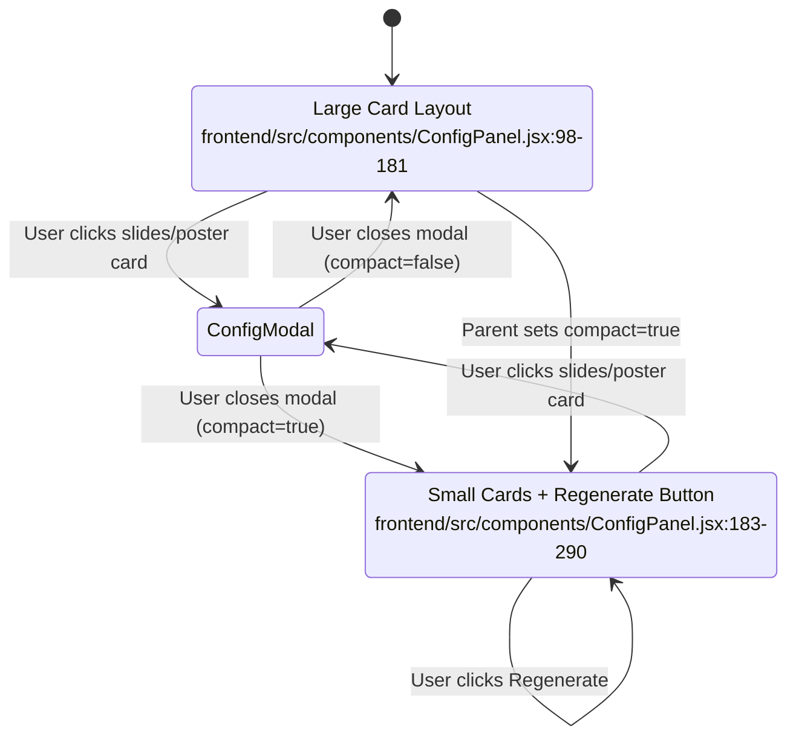
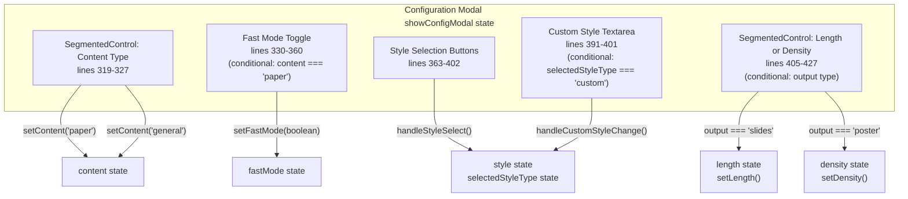
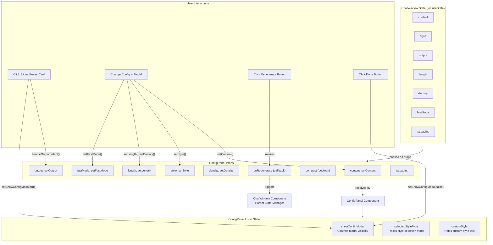
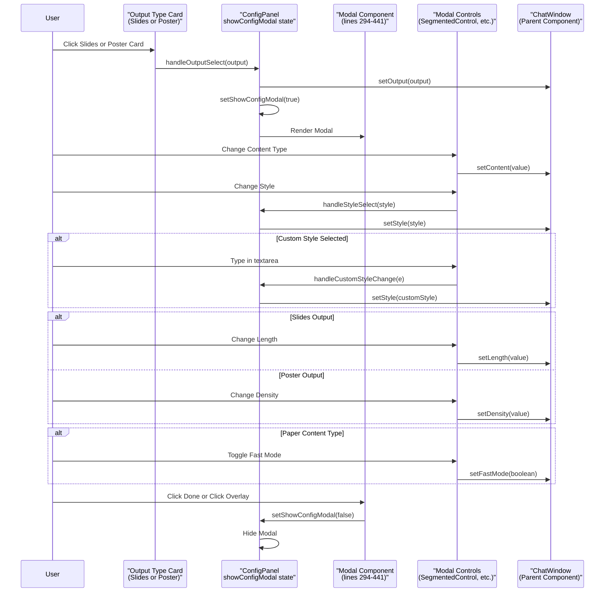
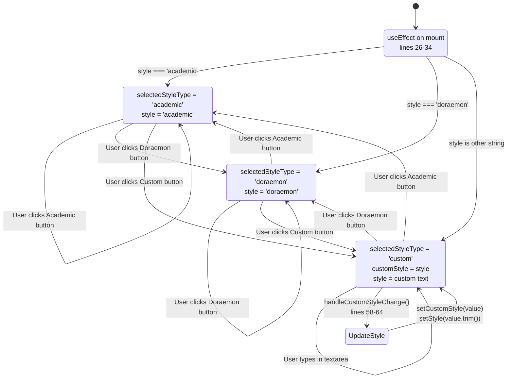

<!-- source: DeepWiki mcp.deepwiki.com · repo HKUDS/Paper2Slides · extra page Configuration Components · fetched 2026-11-09 -->

# Configuration Components

<details>
<summary>Relevant source files</summary>

The following files were used as context for generating this wiki page:

- [frontend/src/components/ConfigPanel.jsx](frontend/src/components/ConfigPanel.jsx)

</details>


## Purpose and Scope

This page documents the `ConfigPanel` component located at [frontend/src/components/ConfigPanel.jsx](), which provides the user interface for configuring presentation generation settings in the Paper2Slides web application. The component manages output type selection (slides vs posters), style preferences, content type, processing mode, and size parameters.

For comprehensive information about the configuration options themselves (what each option means and when to use them), see [Configuration Guide](#5). For information about how `ConfigPanel` integrates with the parent state manager, see [ChatWindow Component](#4.2.1).

**Sources:** [frontend/src/components/ConfigPanel.jsx:1-446]()

---

## Component Overview

The `ConfigPanel` component serves as the primary interface for users to specify generation parameters. It operates in two distinct visual modes and manages a configuration modal for detailed settings. The component is a controlled component that receives state values and setter functions as props from its parent `ChatWindow`.

### Component Signature

```javascript
ConfigPanel({ 
  content, setContent,           // 'paper' or 'general'
  style, setStyle,               // 'academic', 'doraemon', or custom string
  output, setOutput,             // 'slides' or 'poster'
  length, setLength,             // 'short', 'medium', 'long'
  density, setDensity,           // 'sparse', 'medium', 'dense'
  fastMode, setFastMode,         // boolean
  compact,                       // boolean: controls layout mode
  onRegenerate,                  // callback function
  isLoading                      // boolean: generation in progress
})
```

**Sources:** [frontend/src/components/ConfigPanel.jsx:4-20]()

---

## Visual Modes and Layout States

The `ConfigPanel` operates in two distinct layout modes controlled by the `compact` prop:

| Mode | When Used | Layout | User Actions |
|------|-----------|--------|--------------|
| **Non-Compact** | Initial state, before first generation | Large card selection (slides/poster) | Click card → Opens modal |
| **Compact** | After generation completes | Small inline cards + Regenerate button | Click card → Opens modal |

**Diagram: Layout Mode State Machine**



**Sources:** [frontend/src/components/ConfigPanel.jsx:17,97-291]()

### Non-Compact Mode: Large Card Selection

In non-compact mode, the component displays two prominent cards for output type selection:

- **Slides Card** ([lines 100-139]()): Features `FileText` icon, purple/pink gradient styling when selected
- **Poster Card** ([lines 141-180]()): Features `Image` icon, same gradient styling when selected

Clicking either card sets the `output` state and automatically opens the configuration modal.

**Sources:** [frontend/src/components/ConfigPanel.jsx:98-181]()

### Compact Mode: Inline Cards with Regenerate

In compact mode, the component displays smaller inline cards with a regenerate button:

- **Compact Cards** ([lines 188-265]()): Smaller versions with 8x8 icons, horizontal layout
- **Regenerate Button** ([lines 268-288]()): Gradient button with `Send` icon, disabled during loading

The regenerate button triggers the `onRegenerate` callback passed from the parent `ChatWindow`.

**Sources:** [frontend/src/components/ConfigPanel.jsx:183-290]()

---

## Configuration Options Managed

The component manages six configuration parameters, each with its own UI control within the modal:

### Configuration Parameters

| Parameter | Type | Options | Applies To | Code Reference |
|-----------|------|---------|------------|----------------|
| `content` | string | 'paper', 'general' | All outputs | [line 5-6]() |
| `fastMode` | boolean | true, false | Paper content only | [line 15-16]() |
| `style` | string | 'academic', 'doraemon', or custom text | All outputs | [line 7-8]() |
| `length` | string | 'short', 'medium', 'long' | Slides only | [line 11-12]() |
| `density` | string | 'sparse', 'medium', 'dense' | Poster only | [line 13-14]() |
| `output` | string | 'slides', 'poster' | Primary selection | [line 9-10]() |

**Diagram: Configuration Parameters and Their UI Controls**



**Sources:** [frontend/src/components/ConfigPanel.jsx:4-16,294-441]()

---

## UI Component Hierarchy and Code Mapping

**Diagram: ConfigPanel Component Structure to Code Entities**

```mermaid
graph TB
    ConfigPanel["ConfigPanel Component<br/>frontend/src/components/ConfigPanel.jsx"]
    
    subgraph LocalState["Local State (useState)"]
        ShowModal["showConfigModal<br/>line 21"]
        StyleType["selectedStyleType<br/>line 22<br/>'academic'|'doraemon'|'custom'"]
        CustomText["customStyle<br/>line 23"]
    end
    
    subgraph Renders["Rendered Components"]
        OuterDiv["<div className='w-full'>"]
        
        subgraph NonCompact["!compact branch (lines 98-181)"]
            LargeCards["Two <button> cards"]
            SlidesCard["Slides Card<br/>FileText icon<br/>handleOutputSelect('slides')"]
            PosterCard["Poster Card<br/>Image icon<br/>handleOutputSelect('poster')"]
        end
        
        subgraph Compact["compact branch (lines 183-290)"]
            SmallCards["Inline <button> cards"]
            RegenBtn["Regenerate Button<br/>onRegenerate callback<br/>Send icon"]
        end
        
        subgraph Modal["showConfigModal && (...) (lines 294-441)"]
            ModalOverlay["Fixed overlay div<br/>bg-black/50"]
            ModalContent["Modal content div<br/>bg-white dark:bg-gray-800"]
            ModalHeader["Header with X button"]
            SegControl1["SegmentedControl<br/>Content Type"]
            FastModeUI["Fast Mode Toggle<br/>conditional render"]
            StyleUI["Style Selection<br/>3 buttons"]
            CustomTA["Custom Style <textarea><br/>conditional render"]
            SegControl2["SegmentedControl<br/>Length/Density"]
            DoneBtn["Done Button"]
        end
    end
    
    subgraph HelperFuncs["Helper Functions"]
        HandleOutput["handleOutputSelect()<br/>lines 36-41"]
        HandleStyle["handleStyleSelect()<br/>lines 43-56"]
        HandleCustom["handleCustomStyleChange()<br/>lines 58-64"]
        SegmentedControlComp["SegmentedControl()<br/>lines 67-93<br/>Reusable component"]
    end
    
    ConfigPanel --> LocalState
    ConfigPanel --> Renders
    ConfigPanel --> HelperFuncs
    
    OuterDiv --> NonCompact
    OuterDiv --> Compact
    OuterDiv --> Modal
    
    LargeCards --> SlidesCard
    LargeCards --> PosterCard
    
    SlidesCard -.onClick.-> HandleOutput
    PosterCard -.onClick.-> HandleOutput
    
    ModalContent --> ModalHeader
    ModalContent --> SegControl1
    ModalContent --> FastModeUI
    ModalContent --> StyleUI
    ModalContent --> CustomTA
    ModalContent --> SegControl2
    ModalContent --> DoneBtn
    
    SegControl1 -.uses.-> SegmentedControlComp
    SegControl2 -.uses.-> SegmentedControlComp
    StyleUI -.onClick.-> HandleStyle
    CustomTA -.onChange.-> HandleCustom
```



**Sources:** [frontend/src/components/ConfigPanel.jsx:1-446]()

---

## SegmentedControl: Reusable UI Component

The `SegmentedControl` is an internal utility component defined within `ConfigPanel` that provides a consistent UI pattern for selecting between multiple options. It is used for content type and length/density selection.

### SegmentedControl Interface

```javascript
SegmentedControl({ 
  label,      // string: Display label
  options,    // array: [{ label: string, value: string }, ...]
  value,      // string: Currently selected value
  onChange    // function: Callback with selected value
})
```

### Usage Examples in Code

1. **Content Type Selection** ([lines 319-327]()):
   ```javascript
   <SegmentedControl
     label="Content Type"
     options={[
       { label: 'Paper', value: 'paper' },
       { label: 'General', value: 'general' }
     ]}
     value={content}
     onChange={setContent}
   />
   ```

2. **Length Selection** ([lines 406-415]()):
   ```javascript
   <SegmentedControl
     label="Length"
     options={[
       { label: 'Short (5-8)', value: 'short' },
       { label: 'Medium (8-12)', value: 'medium' },
       { label: 'Long (12-15)', value: 'long' }
     ]}
     value={length}
     onChange={setLength}
   />
   ```

**Sources:** [frontend/src/components/ConfigPanel.jsx:67-93,319-327,406-427]()

---

## State Management and Data Flow

**Diagram: Props and State Flow Between ChatWindow and ConfigPanel**



**Sources:** [frontend/src/components/ConfigPanel.jsx:4-20]()

---

## Modal Interaction Flow

The configuration modal (`showConfigModal` state) is the central interface for detailed settings. It appears conditionally and can be triggered from both layout modes.

**Diagram: Modal Lifecycle and User Interaction Flow**



**Sources:** [frontend/src/components/ConfigPanel.jsx:36-64,294-441]()

---

## Conditional Rendering Logic

The component employs several conditional rendering patterns based on configuration state:

### Layout Mode Conditional

```javascript
{!compact ? (
  /* Large Card Selection - lines 98-181 */
) : (
  /* Compact Configuration - lines 183-290 */
)}
```

**Sources:** [frontend/src/components/ConfigPanel.jsx:97-291]()

### Fast Mode Conditional

Fast mode toggle only appears when content type is 'paper':

```javascript
{content === 'paper' && setFastMode && (
  /* Fast Mode Toggle UI - lines 330-360 */
)}
```

**Sources:** [frontend/src/components/ConfigPanel.jsx:330-360]()

### Custom Style Conditional

The custom style textarea appears when user selects 'custom' style option:

```javascript
{selectedStyleType === 'custom' && (
  <textarea
    value={customStyle}
    onChange={handleCustomStyleChange}
    /* lines 393-400 */
  />
)}
```

**Sources:** [frontend/src/components/ConfigPanel.jsx:391-401]()

### Output Type Conditional

Length control for slides, density control for posters:

```javascript
{output === 'slides' ? (
  <SegmentedControl label="Length" /* lines 406-415 */ />
) : (
  <SegmentedControl label="Density" /* lines 417-426 */ />
)}
```

**Sources:** [frontend/src/components/ConfigPanel.jsx:405-427]()

---

## Style Selection State Management

Style selection requires special handling to support three modes (academic, doraemon, custom) with a text input for custom descriptions.

**Diagram: Style Selection State Management**



### Style Selection Logic

The `handleStyleSelect` function ([lines 43-56]()) manages transitions between style modes:

- For 'academic' or 'doraemon': Sets `selectedStyleType` and calls `setStyle(selectedStyle)` immediately
- For 'custom': Sets `selectedStyleType` to 'custom', uses existing `customStyle` if available

The `handleCustomStyleChange` function ([lines 58-64]()) updates both local `customStyle` state and parent `style` state as user types.

**Sources:** [frontend/src/components/ConfigPanel.jsx:21-64]()

---

## Integration with Parent ChatWindow

The `ConfigPanel` is a fully controlled component that relies on its parent `ChatWindow` for state management. All configuration changes flow through setter functions provided as props.

### Communication Pattern

| Action | ConfigPanel | ChatWindow | Backend Impact |
|--------|-------------|------------|----------------|
| User changes output type | Calls `setOutput()` | Updates `output` state | Passed to API on generation |
| User changes style | Calls `setStyle()` | Updates `style` state | Affects planning stage |
| User changes length/density | Calls `setLength()/setDensity()` | Updates respective state | Affects planning stage |
| User changes fast mode | Calls `setFastMode()` | Updates `fastMode` state | Skips RAG stage if true |
| User clicks Regenerate | Calls `onRegenerate()` | Triggers new API request | Starts new pipeline run |
| Pipeline completes | - | Sets `compact={true}` | Changes ConfigPanel layout |

For details on how `ChatWindow` uses these configuration values in API requests, see [ChatWindow Component](#4.2.1). For details on how these configuration options affect pipeline execution, see [Configuration Guide](#5).

**Sources:** [frontend/src/components/ConfigPanel.jsx:4-20]()

---

## Summary

The `ConfigPanel` component provides a two-mode interface for presentation configuration:

1. **Non-compact mode**: Large visual cards for initial output type selection
2. **Compact mode**: Inline controls with regenerate functionality for iterative refinement

Key architectural patterns:
- **Controlled component**: All state managed by parent `ChatWindow`
- **Modal-based configuration**: Detailed settings accessed via popup modal
- **Conditional rendering**: UI adapts based on output type, content type, and style selection
- **Reusable `SegmentedControl`**: Consistent UI pattern for multi-option selection
- **Three-state style system**: Predefined styles (academic, doraemon) plus custom text input

The component serves as the primary user interface for the six configuration parameters that control pipeline behavior: `content`, `output`, `style`, `length`/`density`, and `fastMode`.

**Sources:** [frontend/src/components/ConfigPanel.jsx:1-446]()

---

