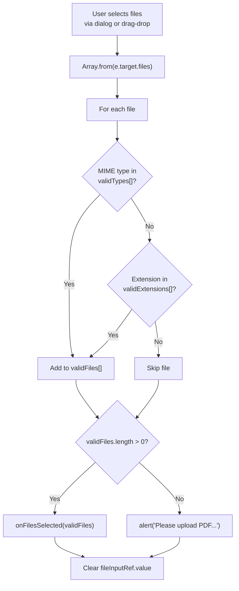
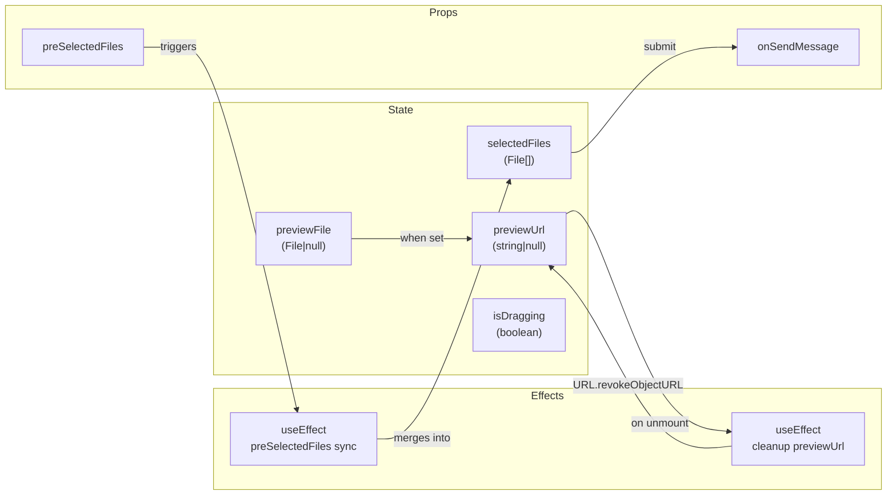
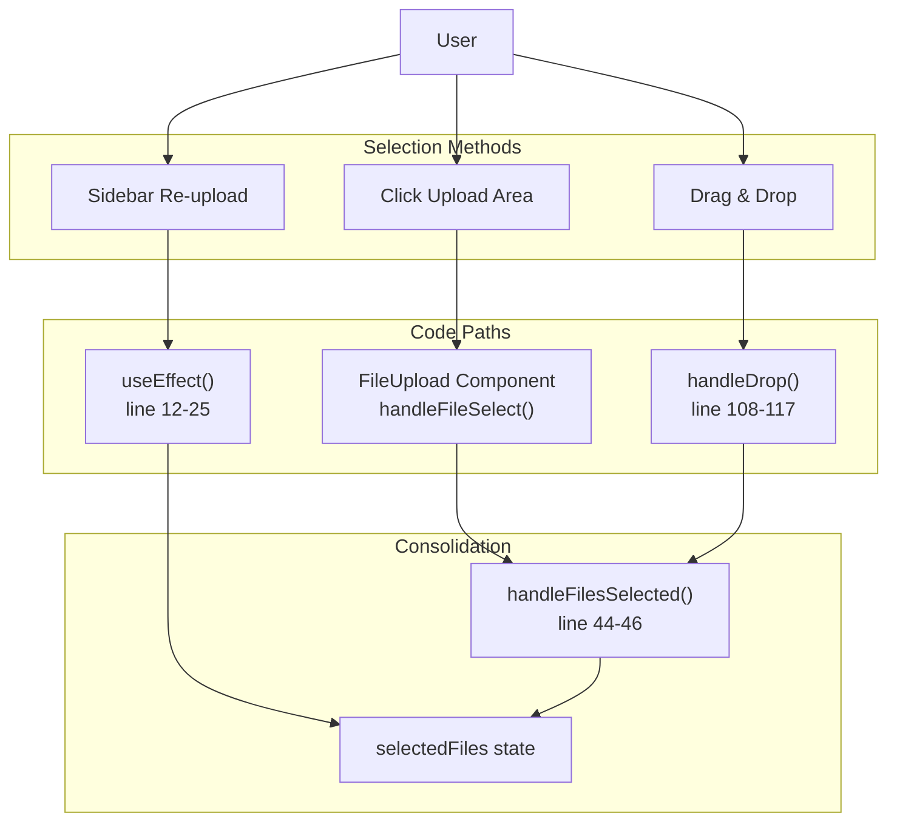
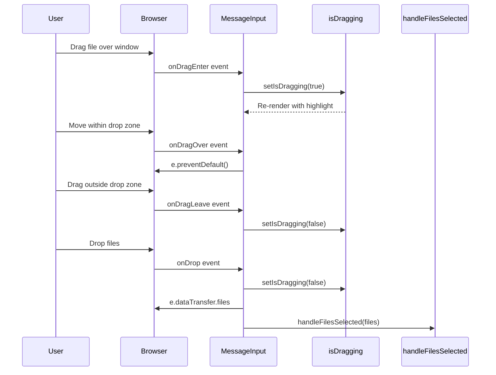
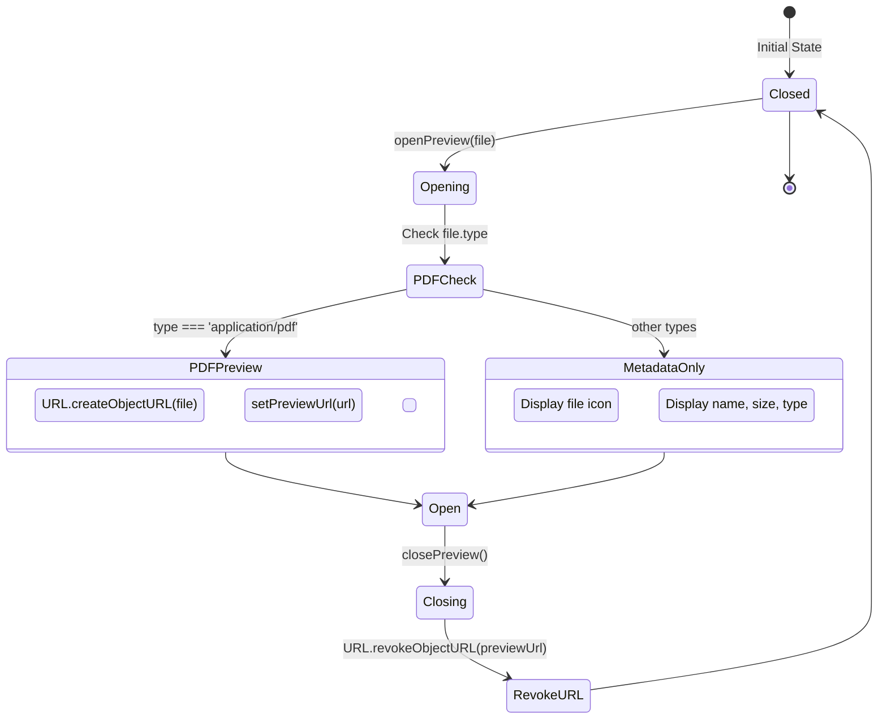
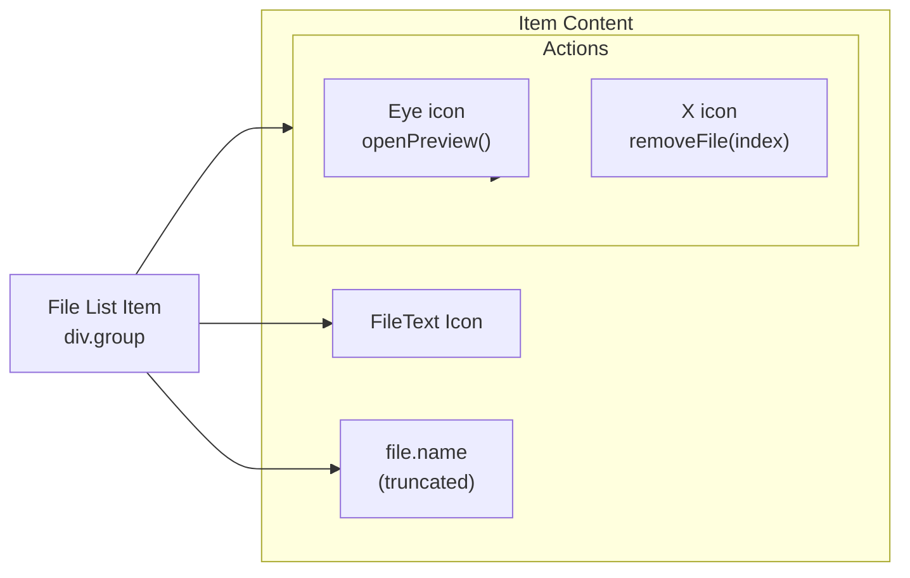
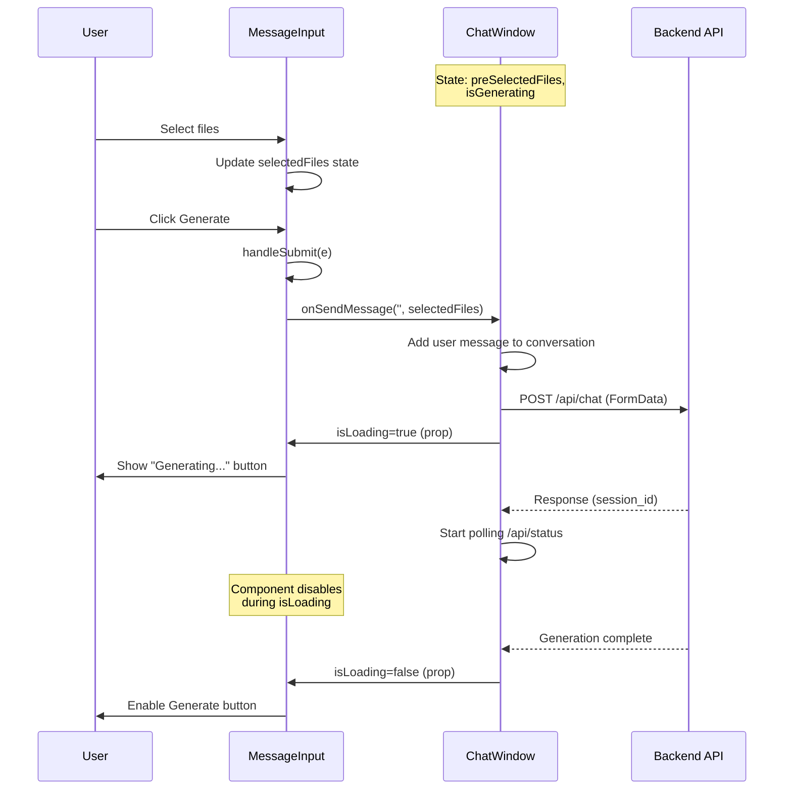
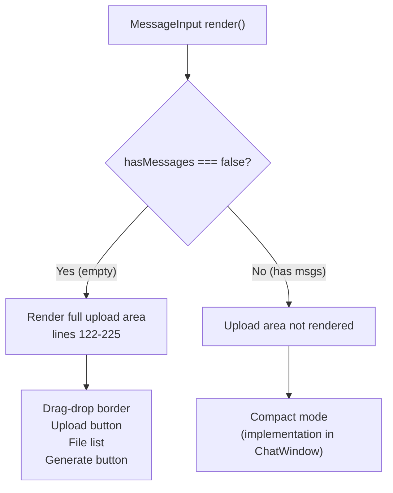
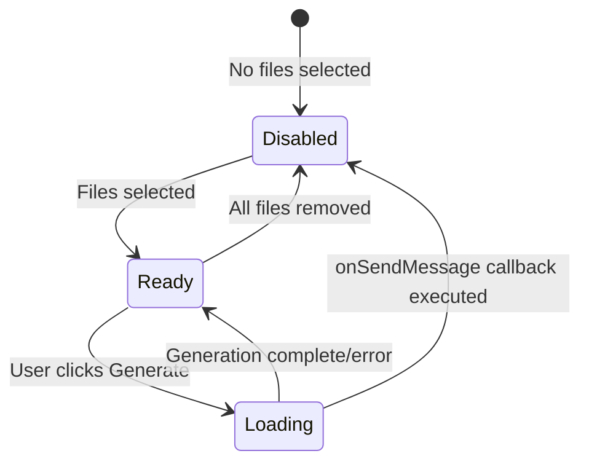

<!-- source: DeepWiki mcp.deepwiki.com · repo HKUDS/Paper2Slides · extra page File Upload Components · fetched 2026-11-09 -->

# File Upload Components

<details>
<summary>Relevant source files</summary>

The following files were used as context for generating this wiki page:

- [frontend/src/components/FileUpload.jsx](frontend/src/components/FileUpload.jsx)
- [frontend/src/components/MessageInput.jsx](frontend/src/components/MessageInput.jsx)

</details>


## Purpose and Scope

This page documents the file upload components in the Paper2Slides web interface, specifically the `FileUpload` and `MessageInput` components that handle document selection, validation, and submission to the backend for processing. These components provide the primary user interaction mechanism for uploading papers and documents to be converted into slides or posters.

For information about the overall frontend architecture and how these components integrate into the application, see [Frontend Architecture](#4.2). For details on how the ChatWindow orchestrates these components, see [ChatWindow Component](#4.2.1).

---

## Component Architecture

The file upload system consists of two primary components working in tandem:

**Component Hierarchy Diagram**

```mermaid
graph TB
    ChatWindow["ChatWindow<br/>(Parent Orchestrator)"]
    MessageInput["MessageInput<br/>frontend/src/components/MessageInput.jsx"]
    FileUpload["FileUpload<br/>frontend/src/components/FileUpload.jsx"]
    HiddenInput["<input type='file' />"]
    
    ChatWindow -->|"props:<br/>onSendMessage<br/>isLoading<br/>outputType<br/>style<br/>hasMessages"| MessageInput
    MessageInput -->|"props:<br/>onFilesSelected<br/>disabled<br/>customButton"| FileUpload
    FileUpload -->|"renders & controls"| HiddenInput
    
    MessageInput -->|"calls on submit"| ChatWindow
    FileUpload -->|"callback with files"| MessageInput
```



**Component Responsibility Table**

| Component | Responsibility | Primary Functionality |
|-----------|---------------|----------------------|
| `FileUpload` | Low-level file input abstraction | File dialog trigger, file type validation, callback dispatch |
| `MessageInput` | User interaction orchestrator | File collection, drag-and-drop, preview, submission coordination |

**Sources:** [frontend/src/components/FileUpload.jsx:1-69](), [frontend/src/components/MessageInput.jsx:1-302]()

---

## FileUpload Component

The `FileUpload` component is a reusable utility component that wraps the native HTML file input with validation and customizable rendering.

### Component Interface

**Props:**

| Prop | Type | Description |
|------|------|-------------|
| `onFilesSelected` | `(files: File[]) => void` | Callback invoked with validated files |
| `disabled` | `boolean` | Disables file selection when true |
| `customButton` | `(onClick: () => void) => ReactElement` | Optional render prop for custom trigger UI |

**Sources:** [frontend/src/components/FileUpload.jsx:4-4]()

### File Validation Logic

The component validates files against both MIME types and file extensions to ensure compatibility with the backend processing pipeline.

**File Validation Flow Diagram**



**Supported File Types:**

```javascript
// MIME types accepted
const validTypes = [
  'application/pdf',
  'text/markdown',
  'text/x-markdown',
  'application/vnd.openxmlformats-officedocument.wordprocessingml.document',
  'application/msword',
  'application/vnd.openxmlformats-officedocument.presentationml.presentation',
  'application/vnd.ms-powerpoint'
]

// File extensions accepted
const validExtensions = ['.pdf', '.md', '.markdown', '.doc', '.docx', '.ppt', '.pptx']
```

**Sources:** [frontend/src/components/FileUpload.jsx:11-38]()

### Key Functions

| Function | Location | Purpose |
|----------|----------|---------|
| `handleFileSelect` | [frontend/src/components/FileUpload.jsx:7-9]() | Programmatically triggers native file dialog |
| `handleFileChange` | [frontend/src/components/FileUpload.jsx:11-39]() | Validates selected files and invokes callback |

### Rendering Modes

The component supports two rendering modes:

1. **Default Mode:** Renders a paperclip icon button ([frontend/src/components/FileUpload.jsx:46-54]())
2. **Custom Mode:** Accepts a render prop `customButton` for custom UI ([frontend/src/components/FileUpload.jsx:43-45]())

**Sources:** [frontend/src/components/FileUpload.jsx:41-64]()

---

## MessageInput Component

The `MessageInput` component is the primary user interface for file upload, providing drag-and-drop support, file management, preview capabilities, and submission orchestration.

### Component State Management

**State Variables:**

| State | Type | Purpose |
|-------|------|---------|
| `selectedFiles` | `File[]` | Array of files selected for processing |
| `previewFile` | `File \| null` | Currently previewed file |
| `previewUrl` | `string \| null` | Blob URL for PDF preview iframe |
| `isDragging` | `boolean` | Visual feedback for drag-over state |

**Sources:** [frontend/src/components/MessageInput.jsx:6-9]()

### Component Lifecycle

**State and Effect Relationships Diagram**



**Sources:** [frontend/src/components/MessageInput.jsx:6-34]()

### File Selection Methods

The component supports three methods for file selection:

**File Selection Method Mapping**



**Sources:** [frontend/src/components/MessageInput.jsx:44-46](), [frontend/src/components/MessageInput.jsx:108-117](), [frontend/src/components/MessageInput.jsx:12-25]()

---

## Drag-and-Drop Implementation

The component implements native HTML5 drag-and-drop functionality with visual feedback.

### Event Handler Flow

**Drag-and-Drop Event Sequence Diagram**



**Event Handler Implementation:**

| Handler | Location | Purpose |
|---------|----------|---------|
| `handleDragEnter` | [frontend/src/components/MessageInput.jsx:91-95]() | Sets dragging state to true |
| `handleDragLeave` | [frontend/src/components/MessageInput.jsx:97-101]() | Sets dragging state to false |
| `handleDragOver` | [frontend/src/components/MessageInput.jsx:103-106]() | Prevents default to enable drop |
| `handleDrop` | [frontend/src/components/MessageInput.jsx:108-117]() | Extracts files and processes them |

**Visual Feedback Classes:**

The component applies conditional styling based on `isDragging` state:

```javascript
className={`... ${
  isDragging 
    ? 'border-purple-400 bg-purple-50 dark:bg-purple-900/20' 
    : 'border-gray-300 dark:border-gray-700 hover:border-purple-300'
}`}
```

**Sources:** [frontend/src/components/MessageInput.jsx:91-117](), [frontend/src/components/MessageInput.jsx:125-129]()

---

## File Preview System

The component provides a modal-based file preview system, with full PDF rendering support and metadata display for non-previewable formats.

### Preview Modal Architecture

**Preview Modal Lifecycle Diagram**



**Sources:** [frontend/src/components/MessageInput.jsx:52-69]()

### Preview Modal Components

The preview modal renders differently based on file type:

| File Type | Rendering Method | Location |
|-----------|------------------|----------|
| PDF | `<iframe>` with blob URL | [frontend/src/components/MessageInput.jsx:254-259]() |
| Other | Metadata display with icon | [frontend/src/components/MessageInput.jsx:261-281]() |

**Helper Functions:**

| Function | Location | Purpose |
|----------|----------|---------|
| `formatFileSize` | [frontend/src/components/MessageInput.jsx:71-76]() | Converts bytes to human-readable format (B/KB/MB) |
| `getFileTypeName` | [frontend/src/components/MessageInput.jsx:78-86]() | Maps file extensions to display names |
| `openPreview` | [frontend/src/components/MessageInput.jsx:52-61]() | Initiates preview by creating blob URL for PDFs |
| `closePreview` | [frontend/src/components/MessageInput.jsx:63-69]() | Cleans up blob URL and closes modal |

**Sources:** [frontend/src/components/MessageInput.jsx:52-86](), [frontend/src/components/MessageInput.jsx:228-296]()

---

## File Management Interface

The component provides a compact file list with per-file actions.

### Selected Files Display

**File List Item Structure:**



**Action Buttons Implementation:**

The component uses CSS hover states to reveal action buttons:

```css
opacity-0 group-hover:opacity-100
```

This provides a clean interface that exposes controls only when needed.

**Sources:** [frontend/src/components/MessageInput.jsx:189-221]()

### File Removal

The `removeFile` function removes a file from the selection by filtering the array:

```javascript
const removeFile = (index) => {
  setSelectedFiles(prev => prev.filter((_, i) => i !== index))
}
```

**Sources:** [frontend/src/components/MessageInput.jsx:48-50]()

---

## Integration with ChatWindow

The `MessageInput` component integrates with `ChatWindow` through callback props and coordinated state management.

**Integration Data Flow Diagram**



**ChatWindow Props Passed to MessageInput:**

| Prop | Source | Purpose |
|------|--------|---------|
| `onSendMessage` | ChatWindow callback | Submits files to backend via ChatWindow orchestration |
| `isLoading` | ChatWindow state | Disables UI during active generation |
| `outputType` | ChatWindow config | Display context (not directly used by MessageInput) |
| `style` | ChatWindow config | Display context (not directly used by MessageInput) |
| `preSelectedFiles` | ChatWindow state | Files selected from history sidebar for re-upload |
| `onPreSelectedFilesClear` | ChatWindow callback | Clears pre-selected files after adding to selection |
| `hasMessages` | ChatWindow state | Controls visibility of upload area vs compact mode |

**Sources:** [frontend/src/components/MessageInput.jsx:5-5](), [frontend/src/components/MessageInput.jsx:36-42]()

---

## Conditional Rendering Based on Conversation State

The component adapts its UI based on whether messages exist in the conversation.

### Rendering Modes

**Mode Selection Logic:**



**Display Logic:**

The main upload interface is conditionally rendered:

```javascript
{!hasMessages && (
  <div className="w-full px-6 py-4">
    {/* Full upload area with drag-drop */}
  </div>
)}
```

When `hasMessages` is true, the upload area is hidden and ChatWindow typically displays a more compact input interface.

**Sources:** [frontend/src/components/MessageInput.jsx:122-225]()

---

## Submit Button State Management

The Generate button reflects multiple states to provide clear user feedback.

**Button State Table:**

| Condition | Visual State | Classes Applied |
|-----------|--------------|-----------------|
| Can send (`selectedFiles.length > 0` and not loading) | Gradient purple/pink, enabled | `bg-gradient-to-r from-purple-500 to-pink-500` |
| Loading | Gray with spinner | `bg-gray-200 text-gray-400` + spinner animation |
| Cannot send (no files) | Gray, disabled | `bg-gray-200 text-gray-400 disabled:cursor-not-allowed` |

**Button State Diagram:**



**Sources:** [frontend/src/components/MessageInput.jsx:88-88](), [frontend/src/components/MessageInput.jsx:164-185]()

---

## Memory Management

The component implements proper cleanup for blob URLs to prevent memory leaks.

### Blob URL Lifecycle

**Cleanup Implementation:**

```javascript
// Create blob URL when opening preview
const url = URL.createObjectURL(file)
setPreviewUrl(url)

// Cleanup effect on unmount
useEffect(() => {
  return () => {
    if (previewUrl) {
      URL.revokeObjectURL(previewUrl)
    }
  }
}, [previewUrl])

// Cleanup when closing preview
const closePreview = () => {
  if (previewUrl) {
    URL.revokeObjectURL(previewUrl)
  }
  setPreviewFile(null)
  setPreviewUrl(null)
}
```

**Memory Management Points:**

1. **Creation:** [frontend/src/components/MessageInput.jsx:56-56]() - URL created when PDF preview opens
2. **Unmount Cleanup:** [frontend/src/components/MessageInput.jsx:28-34]() - useEffect cleanup function
3. **Manual Cleanup:** [frontend/src/components/MessageInput.jsx:64-66]() - closePreview() revokes URL

**Sources:** [frontend/src/components/MessageInput.jsx:28-34](), [frontend/src/components/MessageInput.jsx:52-69]()

---

## Summary

The file upload components provide a comprehensive interface for document selection with the following key features:

| Feature | Implementation |
|---------|---------------|
| **File Validation** | MIME type and extension checking in FileUpload |
| **Multiple Selection Methods** | Click-to-upload, drag-and-drop, sidebar re-upload |
| **Visual Feedback** | Drag-over highlighting, file count display, loading states |
| **File Management** | Per-file preview and removal actions |
| **PDF Preview** | Blob URL-based iframe rendering with cleanup |
| **Memory Safety** | Proper blob URL revocation on cleanup |
| **Responsive UI** | Conditional rendering based on conversation state |
| **Integration** | Callback-based communication with ChatWindow |

These components work together to provide a seamless file upload experience that integrates with the broader Paper2Slides web interface architecture.

**Sources:** [frontend/src/components/FileUpload.jsx:1-69](), [frontend/src/components/MessageInput.jsx:1-302]()

---

