<!-- source: DeepWiki mcp.deepwiki.com · repo HKUDS/Paper2Slides · extra page Message and History Components · fetched 2026-11-09 -->

# Message and History Components

Relevant source files

The following files were used as context for generating this wiki page:

- [frontend/src/components/ConversationList.jsx](frontend/src/components/ConversationList.jsx)
- [frontend/src/components/HistoryPanel.jsx](frontend/src/components/HistoryPanel.jsx)
- [frontend/src/components/MessageList.jsx](frontend/src/components/MessageList.jsx)

This page documents the frontend components responsible for displaying conversation messages, file previews, generation progress, conversation history, and document management. These components form the core user interface for viewing results and navigating past generations.

For information about the main chat interface container, see [ChatWindow Component](#4.2.1). For configuration UI components, see [Configuration Components](#4.2.2).

---

## Overview

The message and history system consists of three primary components:

- **MessageList**: Displays messages within the active conversation, including uploaded files, generation progress, and results
- **ConversationList**: Manages the sidebar list of all conversations with metadata and navigation
- **HistoryPanel**: Provides access to previously generated files and uploaded documents for reuse

These components are presentational, receiving state via props from the parent `ChatWindow` component and communicating user actions through callbacks.

**Sources:** [frontend/src/components/MessageList.jsx:1-589](), [frontend/src/components/ConversationList.jsx:1-298](), [frontend/src/components/HistoryPanel.jsx:1-242]()

---

## Component Architecture

### Component Hierarchy

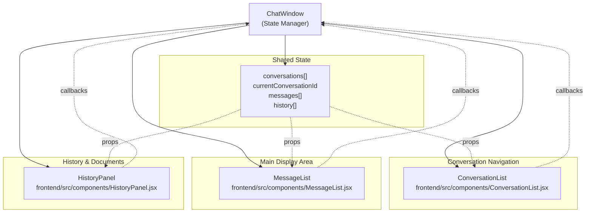

**Sources:** [frontend/src/components/ConversationList.jsx:4-11](), [frontend/src/components/MessageList.jsx:5-5](), [frontend/src/components/HistoryPanel.jsx:4-4]()

---

## MessageList Component

The `MessageList` component is responsible for rendering the conversation thread, showing both user inputs and system responses with rich media support.

### Props Interface

| Prop | Type | Purpose |
|------|------|---------|
| `messages` | Array | Array of message objects with `role`, `content`, `files`, etc. |
| `uploadedFiles` | Array | Files uploaded in current session for URL resolution |
| `currentWorkflow` | Object | Active generation workflow with stages and progress |
| `isLoading` | Boolean | Whether generation is in progress |
| `onCancelGeneration` | Function | Callback to cancel active generation |
| `conversationId` | String | ID of current conversation for workflow matching |

**Sources:** [frontend/src/components/MessageList.jsx:5-5]()

### Message Grouping Logic

Messages are grouped into "conversation rounds" pairing user messages with assistant responses:

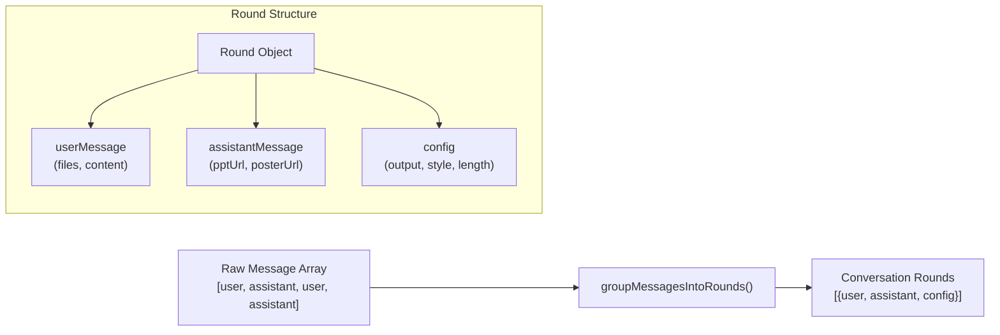

The grouping algorithm [frontend/src/components/MessageList.jsx:65-103]() processes messages sequentially:
1. User message starts a new round
2. Assistant message completes the round
3. Orphan assistant messages (errors/cancels) form standalone rounds
4. Configuration metadata is attached to each round

**Sources:** [frontend/src/components/MessageList.jsx:64-103]()

### UI Structure

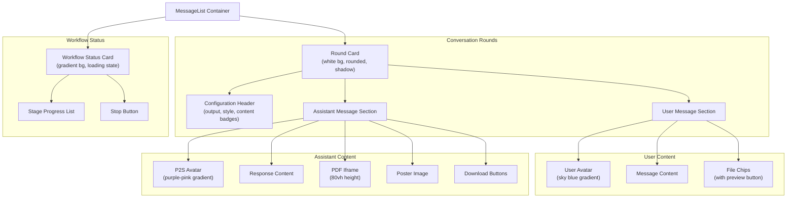

**Sources:** [frontend/src/components/MessageList.jsx:108-435]()

### File Preview System

The component implements a modal file preview system:

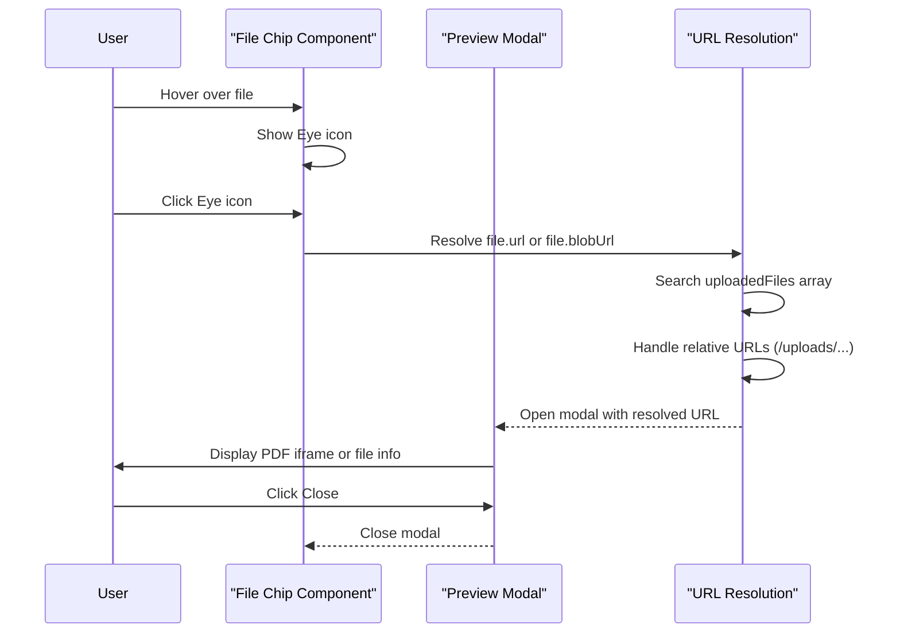

File URL resolution logic [frontend/src/components/MessageList.jsx:170-191]() handles multiple sources:
- Direct `file.url` or `file.blobUrl` properties
- Fallback search in `uploadedFiles` array by name matching
- Relative backend URLs (e.g., `/uploads/...`) handled by Vite proxy

**Sources:** [frontend/src/components/MessageList.jsx:9-15](), [frontend/src/components/MessageList.jsx:170-234](), [frontend/src/components/MessageList.jsx:438-531]()

### Workflow Status Display

During active generation, a workflow status card displays stage progress:

| Stage Property | Visual Representation |
|----------------|----------------------|
| `status: 'completed'` | Green checkmark icon, green border |
| `status: 'active'` | Spinning loader, purple border, animated dots |
| `status: 'pending'` | Gray circle, muted colors |

The `getStageStatus()` function [frontend/src/components/MessageList.jsx:53-62]() determines stage status based on position in the stages array and current active stage index.

**Sources:** [frontend/src/components/MessageList.jsx:42-62](), [frontend/src/components/MessageList.jsx:338-435]()

### Result Display

Generated outputs are displayed inline with the assistant message:

- **Slides (PPT)**: PDF embedded in iframe at 80vh height [frontend/src/components/MessageList.jsx:277-288]()
- **Poster**: Image displayed with `contain` object-fit, max 80vh [frontend/src/components/MessageList.jsx:291-302]()
- **Downloads**: Gradient buttons for PDF/poster download [frontend/src/components/MessageList.jsx:305-326]()

**Sources:** [frontend/src/components/MessageList.jsx:274-328]()

---

## ConversationList Component

The `ConversationList` component manages the sidebar showing all conversations with chronological grouping and deletion support.

### Props Interface

| Prop | Type | Purpose |
|------|------|---------|
| `conversations` | Array | All conversation objects |
| `currentConversationId` | String | Active conversation ID for highlighting |
| `onSelectConversation` | Function | Callback when conversation is clicked |
| `onNewConversation` | Function | Callback to create new conversation |
| `onDeleteConversation` | Function | Callback to delete conversation |
| `onCollapse` | Function | Callback to collapse sidebar |

**Sources:** [frontend/src/components/ConversationList.jsx:4-11]()

### Date Grouping Algorithm

Conversations are grouped into four temporal categories:

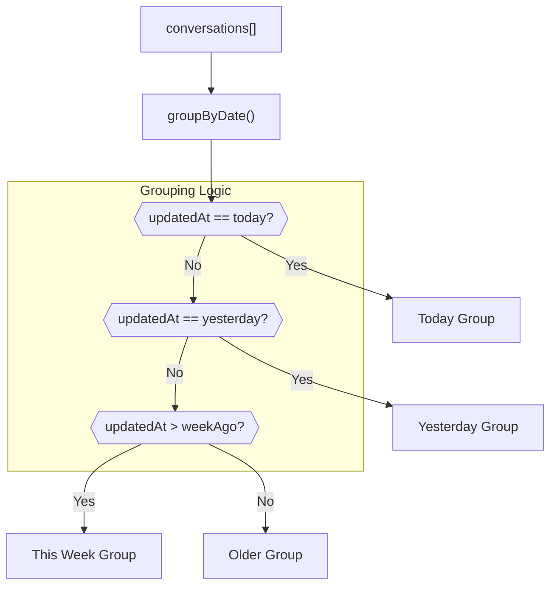

The `groupByDate()` function [frontend/src/components/ConversationList.jsx:80-111]() normalizes dates to midnight and compares timestamps to determine group membership.

**Sources:** [frontend/src/components/ConversationList.jsx:79-111]()

### Conversation Metadata Display

Each conversation item displays computed metadata:

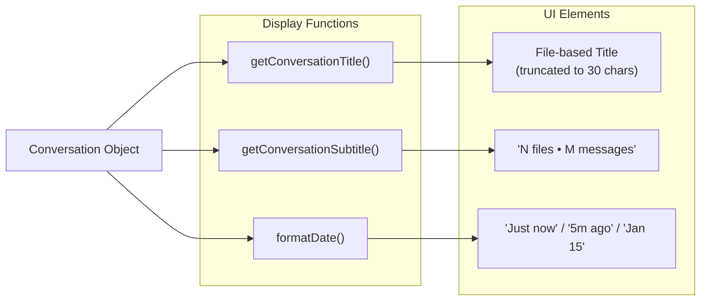

Title derivation [frontend/src/components/ConversationList.jsx:29-38]():
- Uses first file name without extension
- Truncates to 30 characters with ellipsis
- Falls back to `conv.title` or "New Chat"

**Sources:** [frontend/src/components/ConversationList.jsx:15-53]()

### Deletion Workflow

Conversation deletion uses a two-step confirmation pattern:

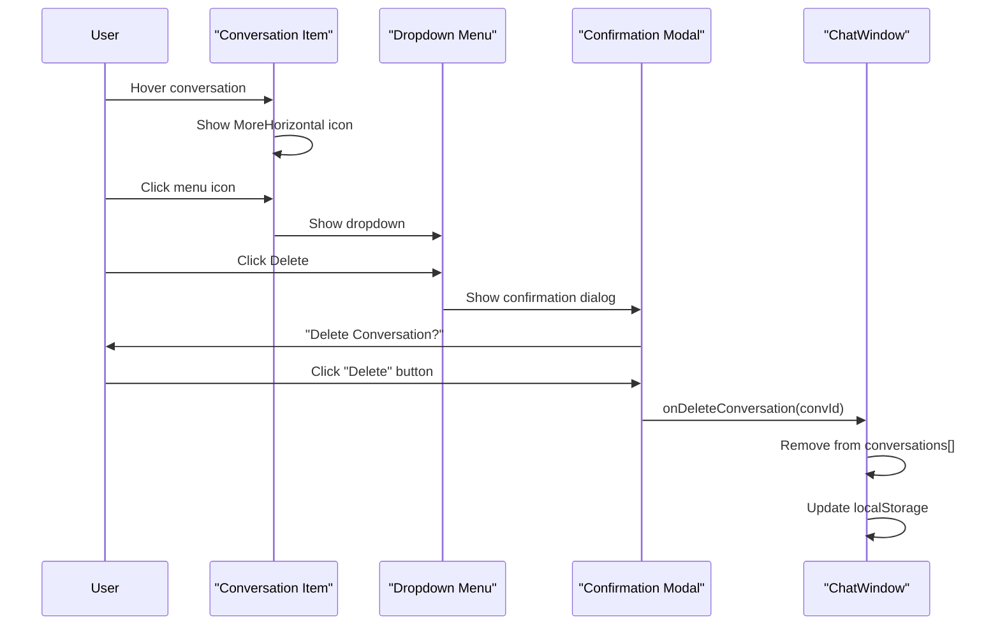

The deletion state is managed through `deleteConfirmId` [frontend/src/components/ConversationList.jsx:13-13](), which triggers the modal render when set.

**Sources:** [frontend/src/components/ConversationList.jsx:55-72](), [frontend/src/components/ConversationList.jsx:247-292]()

### Visual States

Conversation items have distinct visual states:

| State | CSS Classes | Visual Effect |
|-------|-------------|---------------|
| Active | `from-purple-100 to-pink-100`, `border-purple-300` | Gradient background, purple border |
| Inactive | `hover:bg-gray-100`, `border-transparent` | Subtle hover effect |
| Hover Actions | `opacity-0 group-hover:opacity-100` | Show menu button on hover |

**Sources:** [frontend/src/components/ConversationList.jsx:124-189]()

---

## HistoryPanel Component

The `HistoryPanel` component provides a tabbed interface for accessing generated files and uploaded documents.

### Props Interface

| Prop | Type | Purpose |
|------|------|---------|
| `history` | Array | Array of generation result objects |
| `uploadedDocuments` | Array | Array of uploaded document objects |
| `onSelectFile` | Function | Callback when document is clicked for reuse |
| `onSelectHistoryItem` | Function | Callback when history item is clicked |

**Sources:** [frontend/src/components/HistoryPanel.jsx:4-4]()

### Tab Structure

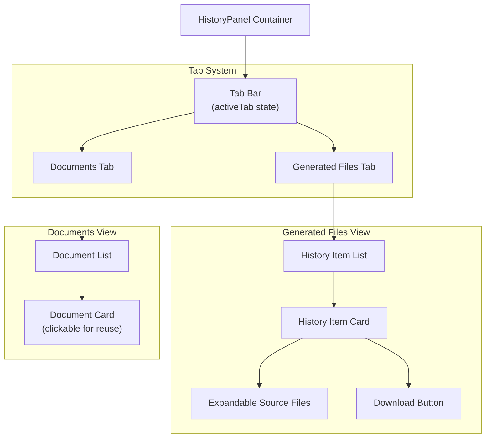

The `activeTab` state [frontend/src/components/HistoryPanel.jsx:6-6]() toggles between `'history'` and `'documents'` views.

**Sources:** [frontend/src/components/HistoryPanel.jsx:78-235]()

### History Item Display Name

History items are displayed with a computed name combining multiple configuration parameters:

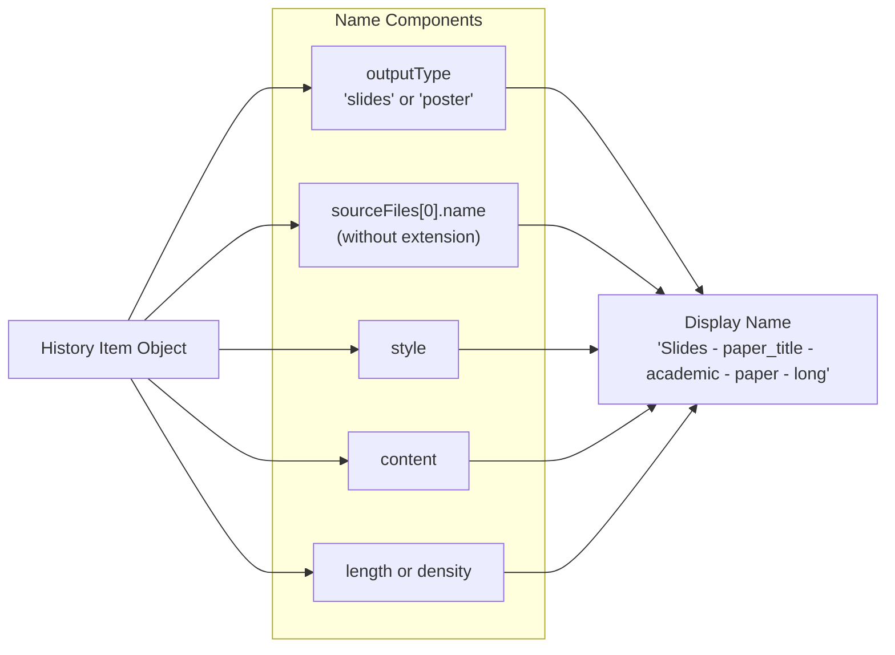

The `getHistoryItemDisplayName()` function [frontend/src/components/HistoryPanel.jsx:30-62]() constructs names by joining configuration parameters with " - " separators.

**Sources:** [frontend/src/components/HistoryPanel.jsx:29-62]()

### Source File Expansion

History items include expandable source file lists:

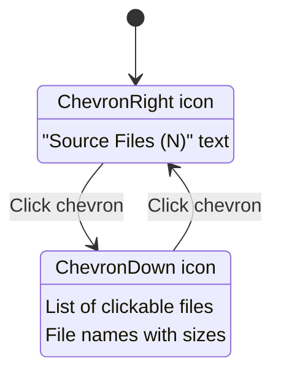

The `expandedItems` state object [frontend/src/components/HistoryPanel.jsx:5-5]() tracks which history items are expanded using item IDs as keys.

**Sources:** [frontend/src/components/HistoryPanel.jsx:8-13](), [frontend/src/components/HistoryPanel.jsx:159-198]()

### File Reuse Pattern

Both tabs support file reuse through click handlers:

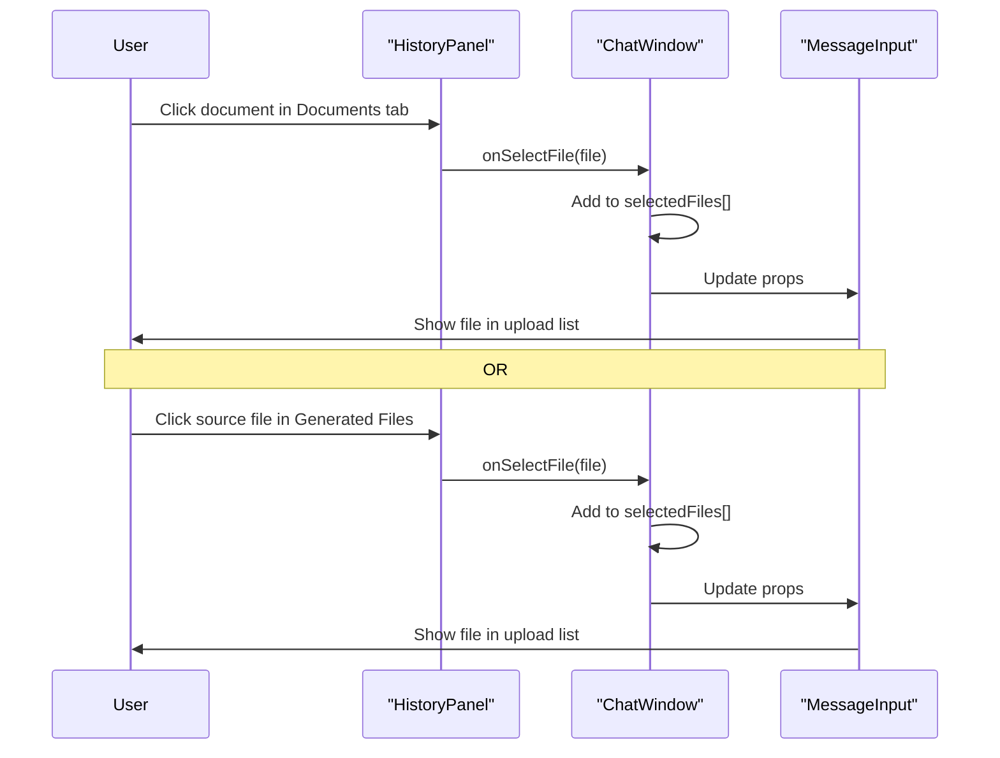

**Sources:** [frontend/src/components/HistoryPanel.jsx:64-75](), [frontend/src/components/HistoryPanel.jsx:177-194](), [frontend/src/components/HistoryPanel.jsx:213-230]()

---

## Data Flow Summary

### State Down, Callbacks Up

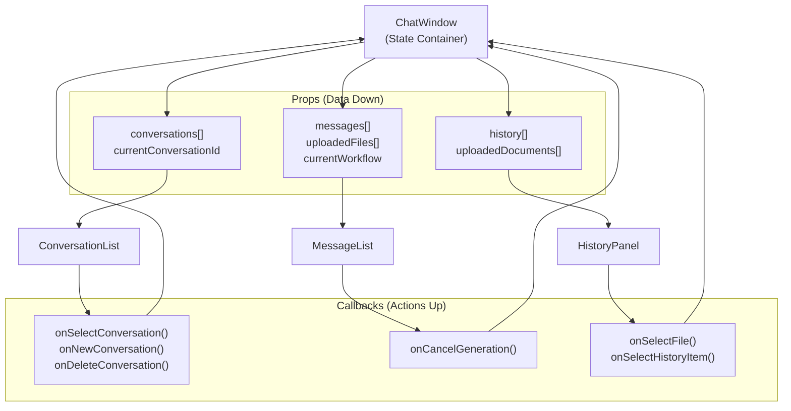

**Sources:** [frontend/src/components/ConversationList.jsx:4-11](), [frontend/src/components/MessageList.jsx:5-5](), [frontend/src/components/HistoryPanel.jsx:4-4]()

---

## Key Features Summary

| Component | Primary Responsibilities | Key Functions |
|-----------|-------------------------|---------------|
| **MessageList** | Display conversation thread, show generation progress, preview files and results | `groupMessagesIntoRounds()` [frontend/src/components/MessageList.jsx:65-103](), `getStageStatus()` [frontend/src/components/MessageList.jsx:53-62]() |
| **ConversationList** | List conversations with date grouping, handle selection and deletion | `groupByDate()` [frontend/src/components/ConversationList.jsx:80-111](), `getConversationTitle()` [frontend/src/components/ConversationList.jsx:29-38]() |
| **HistoryPanel** | Provide access to generated files and documents for reuse | `getHistoryItemDisplayName()` [frontend/src/components/HistoryPanel.jsx:30-62]() |

All three components follow React best practices with unidirectional data flow and separation of presentation from state management.

**Sources:** [frontend/src/components/MessageList.jsx:1-589](), [frontend/src/components/ConversationList.jsx:1-298](), [frontend/src/components/HistoryPanel.jsx:1-242]()

---

