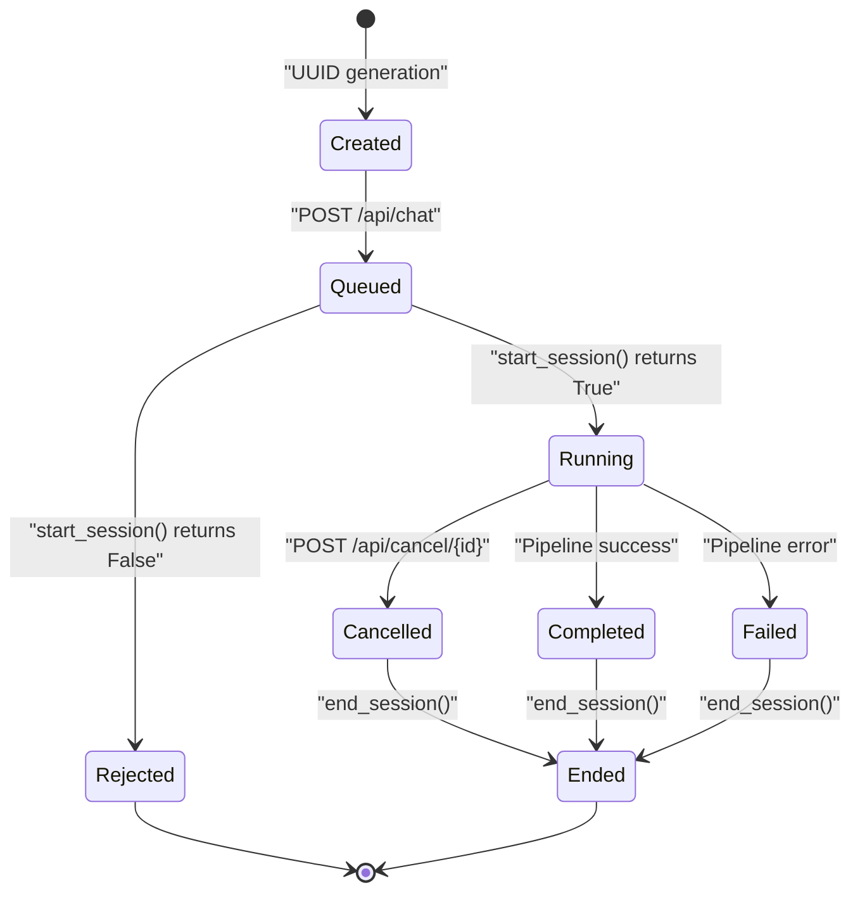
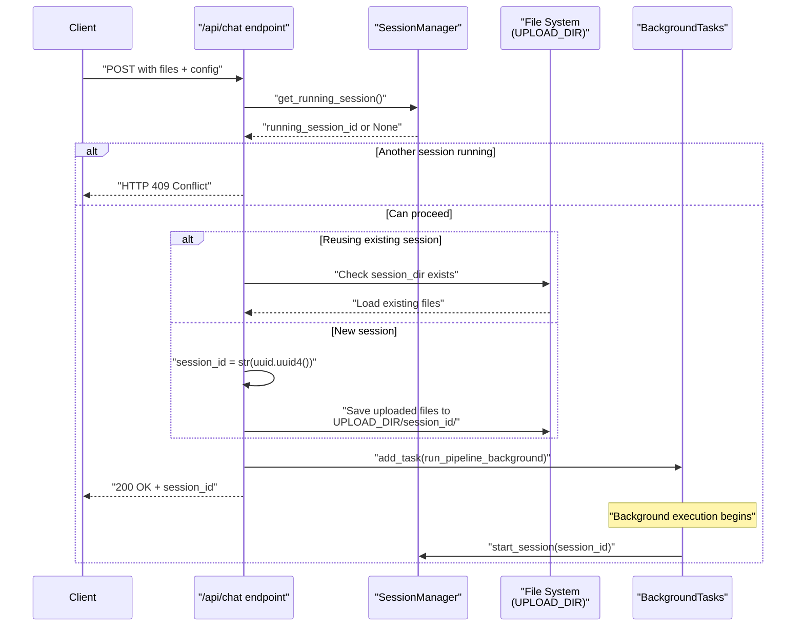
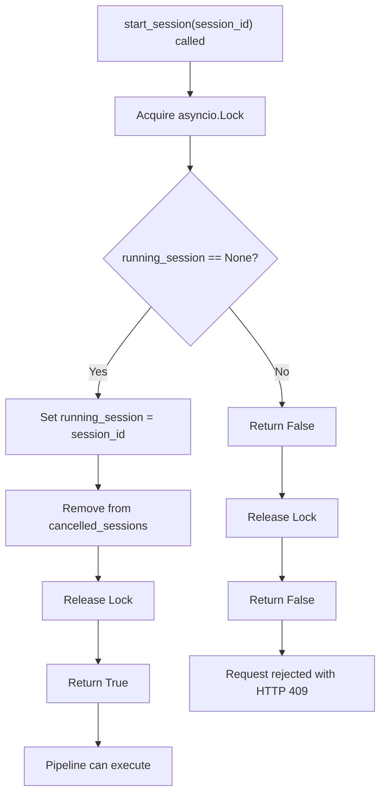
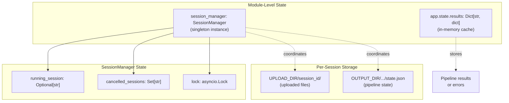
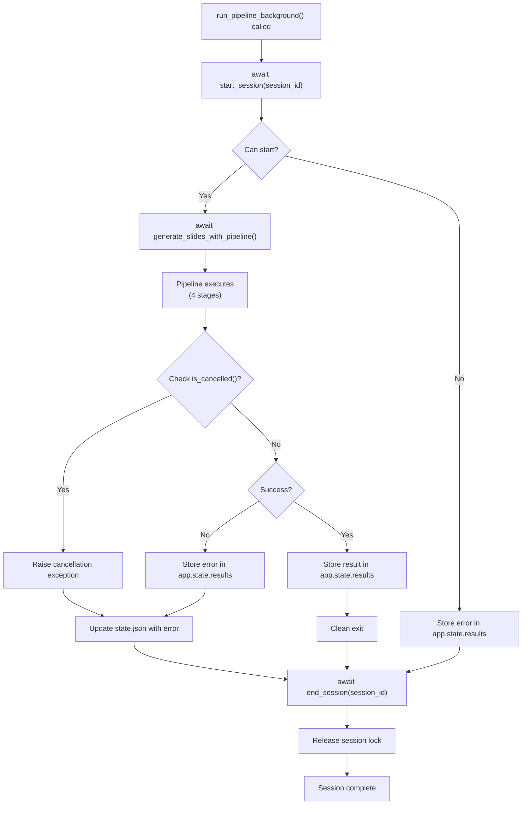
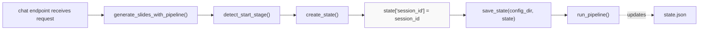
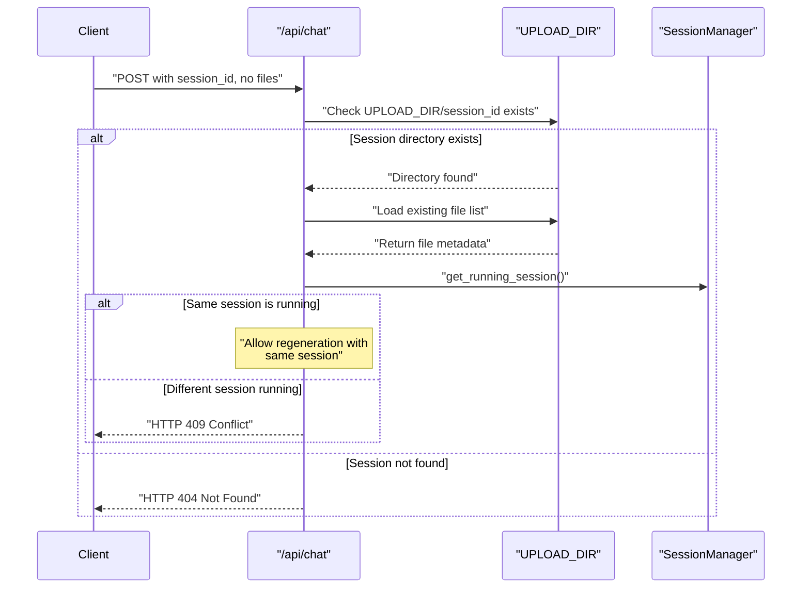
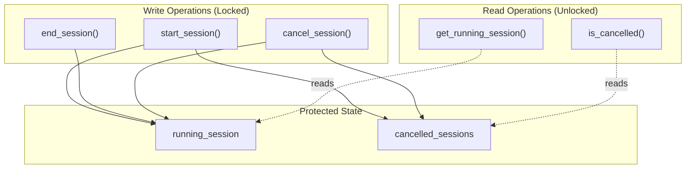

<!-- source: DeepWiki mcp.deepwiki.com · repo HKUDS/Paper2Slides · extra page Session Management · fetched 2026-11-09 -->

# Session Management

<details>
<summary>Relevant source files</summary>

The following files were used as context for generating this wiki page:

- [api/server.py](api/server.py)

</details>


## Purpose and Scope

This document describes the session management system in the Paper2Slides backend API server. Session management controls concurrent access to the core pipeline, tracks generation progress, and coordinates file storage for multi-step processing workflows. The `SessionManager` class enforces single-threaded execution of the pipeline to prevent resource conflicts and coordinate cancellation requests.

For information about the API endpoints that use session management, see [API Endpoints Reference](#4.1.1). For details on pipeline execution within sessions, see [Core Pipeline Architecture](#2). For file organization per session, see [Directory Structure](#6.1).

---

## SessionManager Class

The `SessionManager` class [api/server.py:45-84]() provides the central coordination mechanism for managing concurrent pipeline execution. It maintains global state about running sessions and provides thread-safe methods for session lifecycle management.

### Class Structure

| Component | Type | Purpose |
|-----------|------|---------|
| `running_session` | `Optional[str]` | Currently executing session ID, or `None` if idle |
| `cancelled_sessions` | `Set[str]` | Set of session IDs that have been marked for cancellation |
| `lock` | `asyncio.Lock` | Async lock for thread-safe state access |

### Core Methods

| Method | Parameters | Returns | Purpose |
|--------|-----------|---------|---------|
| `start_session` | `session_id: str` | `bool` | Attempt to acquire execution lock; returns `False` if busy |
| `end_session` | `session_id: str` | `None` | Release execution lock when pipeline completes |
| `cancel_session` | `session_id: str` | `bool` | Mark session for cancellation; returns `True` if session was running |
| `is_cancelled` | `session_id: str` | `bool` | Check if session has been cancelled |
| `get_running_session` | - | `Optional[str]` | Retrieve currently running session ID |

**Sources:** [api/server.py:45-84]()

---

## Session Lifecycle

### State Machine

The following diagram shows the lifecycle of a session from creation through completion or cancellation:



**Sources:** [api/server.py:45-84](), [api/server.py:489-547]()

### Session Creation and Initialization

When a request arrives at `/api/chat` [api/server.py:145-291](), the server performs the following sequence:



**Sources:** [api/server.py:145-291](), [api/server.py:176-206]()

---

## Concurrency Control Mechanism

### Single-Threaded Execution Enforcement

The `SessionManager` enforces single-threaded pipeline execution using an async lock pattern. The `start_session` method [api/server.py:51-59]() implements optimistic locking:



**Sources:** [api/server.py:51-59](), [api/server.py:176-202]()

### Lock Acquisition at Request Boundaries

The concurrency check occurs at two levels:

1. **Request validation** [api/server.py:176-202](): The `/api/chat` endpoint checks for running sessions before accepting new requests
2. **Background task initialization** [api/server.py:505-513](): The `run_pipeline_background` function attempts to acquire the session lock before starting pipeline execution

| Check Location | Purpose | Action on Conflict |
|----------------|---------|-------------------|
| `/api/chat` endpoint | Early rejection of concurrent requests | Return HTTP 409 immediately |
| `run_pipeline_background` | Final enforcement before execution | Store error in `app.state.results` |

**Sources:** [api/server.py:176-202](), [api/server.py:505-513]()

---

## Session Tracking and State Persistence

### Global Session Registry

The module maintains a singleton `SessionManager` instance [api/server.py:85]() and a global results cache [api/server.py:528-530]():



**Sources:** [api/server.py:85](), [api/server.py:528-530]()

### Session ID Tracking

Session IDs are tracked at multiple levels:

1. **SessionManager.running_session** [api/server.py:47](): Tracks the currently executing session
2. **SessionManager.cancelled_sessions** [api/server.py:48](): Tracks sessions marked for cancellation
3. **app.state.results** [api/server.py:528-530](): Caches pipeline results or errors keyed by session ID
4. **state.json files** [api/server.py:396](): Stores `session_id` in the pipeline state for correlation

**Sources:** [api/server.py:45-84](), [api/server.py:396]()

---

## Background Task Coordination

### Pipeline Execution in Background

The `run_pipeline_background` function [api/server.py:489-547]() orchestrates asynchronous pipeline execution:



**Sources:** [api/server.py:489-547]()

### Cancellation Check Points

The session manager is passed to the pipeline execution [api/server.py:408]() to enable cancellation checks. After pipeline completion, the system verifies cancellation status [api/server.py:520-523]():

| Check Point | Code Location | Action |
|-------------|---------------|--------|
| Before pipeline start | [api/server.py:506-513]() | Reject if another session running |
| After pipeline completion | [api/server.py:520-523]() | Raise exception if cancelled during execution |
| During pipeline execution | Passed to `run_pipeline()` | Pipeline stages can check `is_cancelled()` |

**Sources:** [api/server.py:408](), [api/server.py:520-523]()

---

## Session Management API Endpoints

### GET /api/session/running

Returns information about whether a session is currently executing [api/server.py:121-128]():

**Response Format:**
```json
{
  "has_running_session": true,
  "running_session_id": "a1b2c3d4"
}
```

The endpoint truncates session IDs to 8 characters for display [api/server.py:127]().

**Sources:** [api/server.py:121-128]()

### POST /api/cancel/{session_id}

Requests cancellation of a running session [api/server.py:131-142]():

**Response Format (success):**
```json
{
  "message": "Session a1b2c3d4 cancellation requested",
  "cancelled": true
}
```

**Response Format (not running):**
```json
{
  "message": "Session a1b2c3d4 is not running",
  "cancelled": false
}
```

The cancellation is cooperative - it marks the session in `cancelled_sessions` [api/server.py:72]() but does not forcefully terminate execution. The pipeline must check `is_cancelled()` to honor the cancellation request.

**Sources:** [api/server.py:131-142](), [api/server.py:68-79]()

---

## Integration with Pipeline Execution

### Session State File Coordination

When the pipeline starts, the backend creates an initial `state.json` file [api/server.py:391-404]() that includes the session ID:



This allows the `/api/status/{session_id}` endpoint [api/server.py:550-643]() to correlate state files with sessions by checking the `session_id` field [api/server.py:589]().

**Sources:** [api/server.py:391-404](), [api/server.py:589]()

### Error State Synchronization

When a background pipeline fails, the system updates both the in-memory cache and the filesystem state [api/server.py:532-543]():

| Storage Location | Update Mechanism | Purpose |
|-----------------|------------------|---------|
| `app.state.results[session_id]` | Direct assignment in exception handler | Enables `/api/result` to return errors |
| `state.json` file | `_update_state_on_error()` function | Enables `/api/status` to report failures |

The `_update_state_on_error` function [api/server.py:433-486]() locates the failed stage by finding stages marked as `"running"` [api/server.py:480-483]() and updates them to `"failed"` [api/server.py:482]().

**Sources:** [api/server.py:433-486](), [api/server.py:532-543]()

---

## Session Reuse for Regeneration

The session management system supports file reuse for regeneration with different parameters [api/server.py:179-195]():



When `session_id` is provided without files [api/server.py:181](), the system:
1. Checks if the session directory exists [api/server.py:183-184]()
2. Loads existing files from the directory [api/server.py:211-219]()
3. Allows the same session to regenerate, but rejects concurrent requests from different sessions [api/server.py:189-193]()

**Sources:** [api/server.py:179-195](), [api/server.py:211-219]()

---

## Cleanup and Resource Management

### Session Termination

The `end_session` method [api/server.py:61-66]() releases the session lock unconditionally:

```python
async def end_session(self, session_id: str):
    """End a session"""
    async with self.lock:
        if self.running_session == session_id:
            self.running_session = None
        # Keep cancelled flag for a bit, clean up later if needed
```

This method is called in the `finally` block of `run_pipeline_background` [api/server.py:544-547](), ensuring the lock is released even if the pipeline raises an exception.

### Cancelled Session Tracking

The `cancelled_sessions` set [api/server.py:48]() persists entries after session completion. The comment [api/server.py:66]() indicates this is intentional to maintain cancellation history temporarily. The set is cleared when a session with the same ID starts again [api/server.py:58]().

**Sources:** [api/server.py:61-66](), [api/server.py:544-547](), [api/server.py:58]()

---

## Thread Safety Considerations

### Async Lock Usage

All `SessionManager` state mutations are protected by `asyncio.Lock` [api/server.py:49]():

| Method | Lock Acquisition | Protected State |
|--------|-----------------|-----------------|
| `start_session` | [api/server.py:53]() | `running_session`, `cancelled_sessions` |
| `end_session` | [api/server.py:63]() | `running_session` |
| `cancel_session` | [api/server.py:70]() | `running_session`, `cancelled_sessions` |

The `is_cancelled` and `get_running_session` methods [api/server.py:77-83]() read state without acquiring the lock, which is safe for the single-writer pattern implemented by the manager.

**Sources:** [api/server.py:45-84]()

### Concurrency Model

The system uses a single-writer, multiple-reader concurrency model:



**Sources:** [api/server.py:45-84]()

---

