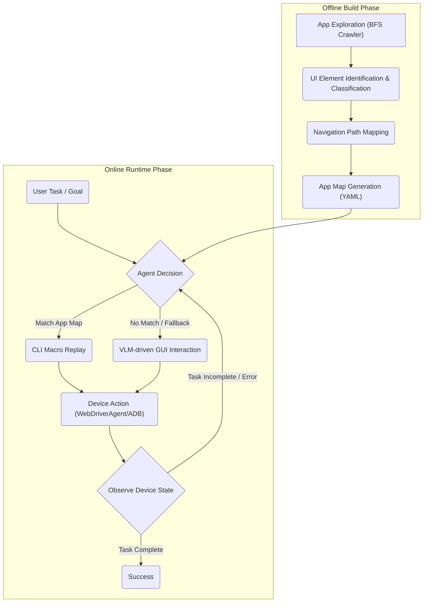

<!-- source: DeepWiki mcp.deepwiki.com · repo HKUDS/PhoneCLI · page 1 Overview · fetched 2026-11-09 -->

# Overview

Relevant source files

The following files were used as context for generating this wiki page:

- [README.md](README.md)
- [README_CN.md](README_CN.md)
- [figures/phone_cli.png](figures/phone_cli.png)
- [figures/phonecli_attribution.png](figures/phonecli_attribution.png)
- [figures/phonecli_case.png](figures/phonecli_case.png)
- [figures/phonecli_framework.png](figures/phonecli_framework.png)
- [figures/phonecli_log.png](figures/phonecli_log.png)

PhoneCLI, also known as OpenPhone, is a novel approach to mobile agent development that combines the efficiency of Command Line Interface (CLI) macro replay with the robustness of Visual Language Model (VLM) fallback. This dual-modality system aims to make all mobile applications "agent-native" by compiling app navigation into deterministic commands, significantly reducing reliance on costly and slow VLM calls for routine tasks. This page provides a high-level overview of PhoneCLI's architecture, its core components, and key results, with links to dedicated child pages for in-depth technical details.

Sources:
- [README.md:9-10]()
- [README.md:47-55]()

## What PhoneCLI/OpenPhone Is

PhoneCLI addresses the limitations of traditional GUI agents that rely solely on VLM for every step, which is often slow, expensive, and prone to errors [README.md:47-47](). Instead, it introduces a hybrid approach:

1.  **Harness (GUI + CLI, two modalities)**: An offline process uses a BFS crawler to build a YAML-based "app map" of an application's navigation. Each screen in the app map corresponds to a deterministic command. During online execution, these commands are replayed on the device (via WebDriverAgent on iOS or ADB on Android) in sub-second time with zero VLM cost. If a CLI path fails or encounters an unmapped screen, it falls back to a GUI mode, which can utilize a VLM. This compilation strategy ensures that routine navigation is handled efficiently, while novel situations can still be addressed by a VLM [README.md:51-53]().
2.  **On-device first (one request, three tiers)**: Requests are processed through a three-tier system: CLI → on-device model → cloud. The CLI tier handles navigation without any model calls. Only the remaining, more complex steps are passed to an on-device model, and finally to a cloud-based VLM if needed. This tiered approach significantly reduces cloud API calls and leverages an efficient memory system to maintain context over 10-20 steps [README.md:54-54]().
3.  **Open and replaceable model**: The CLI path requires no model. The VLM fallback path can use any general LLM or a GUI-tuned model. PhoneCLI ships with an open 3B on-device model, emphasizing that the harness and compilation are the core innovation, not just the model size [README.md:55-55]().

### PhoneCLI Framework Overview

The PhoneCLI framework operates in two main phases: an offline build phase and an online runtime phase. The build phase constructs an "app map" by systematically exploring the application's UI. The runtime phase then leverages this app map for efficient, deterministic command execution, falling back to VLM-driven GUI interaction when necessary.

Sources:
- [README.md:44-45]()
- [README_CN.md:128-130]()
- [figures/phonecli_framework.png]()

## Repository Layout

The PhoneCLI codebase is organized into several key directories, each responsible for a specific aspect of the system:

*   `phonecli/`: Contains the core iOS harness, including the CLI, agent execution loop, and app map build pipeline for iOS devices.
*   `phonecli_android/`: Houses the Android agent harness, which includes components for task execution, macro agents, device control via ADB, and Android app map building. This directory also integrates with the AndroidLab benchmark.
*   `evaluation/`: Dedicated to the evaluation framework, including task definitions, LLM judging, and result aggregation for benchmark runs.
*   `model_training/`: Contains scripts and configurations for training the OpenPhone model, covering SFT and GRPO training.
*   `prepare_data/`: Responsible for data preparation, including data synthesis and conversion for model training.
*   `docs/`: Provides documentation, including setup guides and developer resources.

## Key Results

PhoneCLI demonstrates significant improvements over pure VLM-based approaches, particularly on the AndroidLab benchmark (9 apps / 138 tasks). Using Qwen3.7-Plus as the cloud model, PhoneCLI achieved:

*   **63.0% vs 50.7% task success**: A **+12.3 percentage point** improvement over the pure-VLM baseline.
*   **7.52 → 6.72 steps (-11%)**: Fewer model calls for the same tasks.
*   **40.1k → 34.4k tokens (-14%)**: Reduced token usage.
*   **0 model calls** for executing compiled commands, enabling sub-second, deterministic navigation replay.

These results highlight the efficiency gains and improved reliability offered by the dual-modality approach [README.md:57-62]().

## Getting Started & Environment Setup

To begin using PhoneCLI, you'll need to set up your environment, including installing necessary requirements, configuring Android SDK/AVD for Android development, or WebDriverAgent for iOS. Detailed instructions are available in the child pages, covering environment variables and how to run your first task.

For details, see [Getting Started & Environment Setup](#1.1).

## Configuration System

PhoneCLI utilizes a flexible configuration system, primarily managed through `config_env.py` [phonecli_android/config_env.py](). This system allows for loading and expanding environment variables within configuration files, supporting `${VAR:-default}` syntax for default values. Configurations are typically defined in YAML files, with schemas for agent, task, and evaluation blocks.

For details, see [Configuration System](#1.2).

## Core Concepts: App Maps, Macros, Three-Tier Execution

At the heart of PhoneCLI are several core concepts that enable its efficient operation:

*   **App Maps**: These are YAML-based representations of an application's navigation structure, encoding screens, interactive elements, and transition paths [README_CN.md:134-147]().
*   **Screen Macros**: Deterministic sequences of actions associated with specific screens, allowing for rapid, model-free execution of common navigation patterns.
*   **Landing Verification**: Mechanisms to ensure that the agent has successfully navigated to the expected screen after an action.
*   **VLM Fallback**: The system's ability to switch to VLM-driven GUI interaction when app map-based navigation is insufficient.
*   **Three-Tier Execution**: The hierarchical routing of requests through CLI, on-device model, and cloud model tiers to optimize performance and cost.

For details, see [Core Concepts: App Maps, Macros, Three-Tier Execution](#1.3).

Sources:
- [README_CN.md:134-147]()

---

