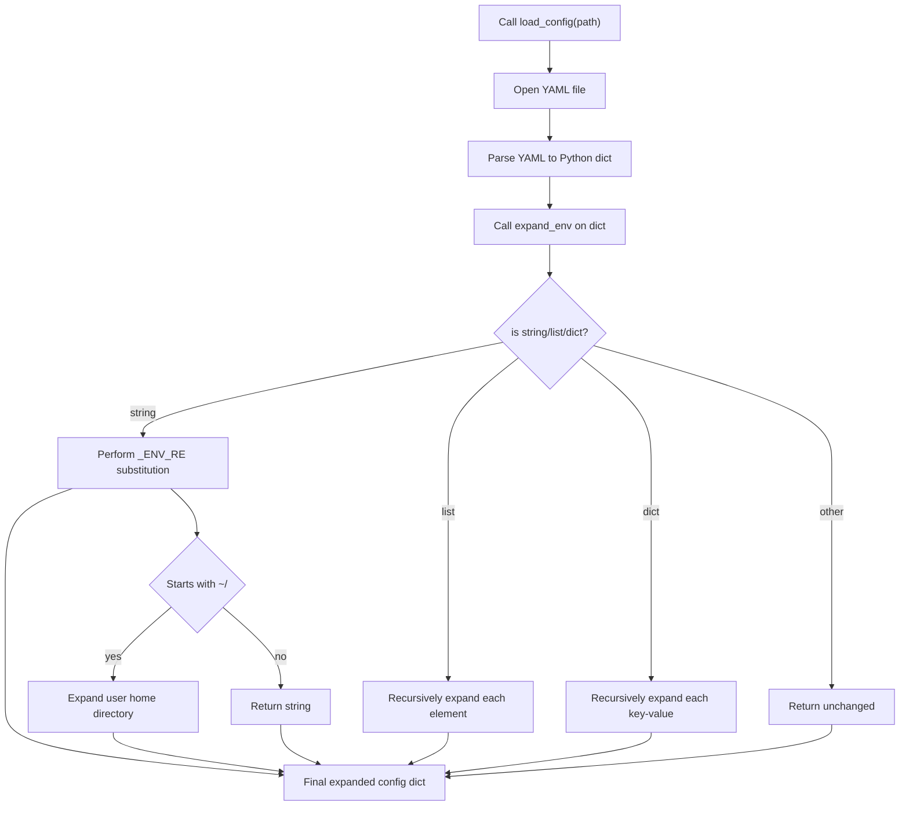
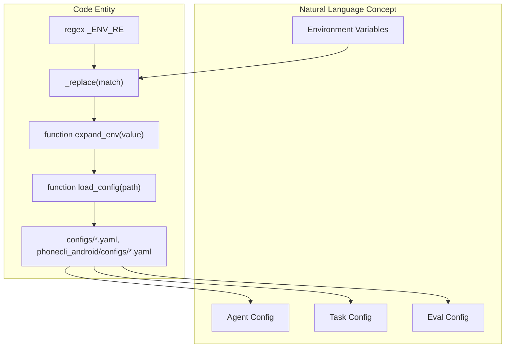

<!-- source: DeepWiki mcp.deepwiki.com · repo HKUDS/PhoneCLI · page 1.2 Configuration System · fetched 2026-11-09 -->

# Configuration System

<details>
<summary>Relevant source files</summary>

The following files were used as context for generating this wiki page:

- [config_env.py](config_env.py)
- [configs/example_xml_cloud_hyper.yaml](configs/example_xml_cloud_hyper.yaml)
- [configs/glm-4-plus-mac-XML.yaml](configs/glm-4-plus-mac-XML.yaml)
- [configs/gpt-4o-mac-SoM.yaml](configs/gpt-4o-mac-SoM.yaml)
- [phonecli_android/config_env.py](phonecli_android/config_env.py)
- [phonecli_android/configs/test_macro.yaml](phonecli_android/configs/test_macro.yaml)
- [phonecli_android/configs/test_screen_cloud.yaml](phonecli_android/configs/test_screen_cloud.yaml)

</details>


This page documents the configuration system used throughout the PhoneCLI/OpenPhone codebase. It covers the `config_env.py` module responsible for loading and preprocessing YAML configuration files with environment variable expansion, the `${VAR:-default}` syntax semantics, and the common YAML schema structure used in the `configs/` directory for specifying agent, task, and evaluation blocks. Additionally, it highlights the Android-specific config usage under `phonecli_android/configs`.

---

## Purpose and Scope

The configuration system standardizes how runtime parameters, API keys, paths, and runtime toggles are defined for PhoneCLI/OpenPhone experiments and agent runs. The key goals are:

- **Portability:** Config files are secret-free and machine-independent by design.
- **Environment Variable Expansion:** Variables like `${OPENROUTER_API_KEY}`, `${ANDROID_SDK_PATH:-~/Library/Android/sdk}`, or user home `~` directory prefixes are dynamically resolved at load time.
- **Declarative YAML Structure:** All configurations adopt a three-block schema—`agent`, `task`, and `eval`—to modularly specify different aspects of an experiment run.
- **Reuse and Consistency** across iOS and Android agents with slight variations (e.g., `phonecli_android/config_env.py` reimplements the same logic for Android).

---

## Implementation and Data Flow

### 1. Environment Variable Expansion (`config_env.py`, `phonecli_android/config_env.py`)

Both `config_env.py` files (one at root and one for Android) provide the core logic to parse YAML config files and expand embedded environment variables inside strings. These files are nearly identical and centralize the config loading logic.

- The key regex `_ENV_RE` matches environment variable placeholders of the forms:
  - `${VAR}` - expanded to the corresponding env var or empty string if unset.
  - `${VAR:-default}` - expanded to the env var or uses `"default"` fallback value.
- On loading a YAML file, `load_config(path)` reads it and recursively calls `expand_env` to replace all such placeholders in strings, lists, and dictionaries.
- Also expands leading `~/` to the user home directory via `os.path.expanduser`.
- This mechanism allows config YAML files to remain static and generic, with secrets and machine-specific paths supplied dynamically via environment variables.

#### Key functions:

```python
def _replace(match):
    # Return environment variable or fallback default or empty string

def expand_env(value):
    # Recursively replace placeholders with actual strings or defaults

def load_config(path):
    # Read file, parse YAML, expand environment variables recursively
```

### Mermaid Diagram 1: Environment Variable Expansion Flow



### 2. Configuration YAML Schema (`configs/*.yaml` and `phonecli_android/configs/*.yaml`)

Config YAML files are organized in three main blocks:

- `agent`: Specifies the agent class name and initialization arguments.
- `task`: Specifies the task class and its arguments.
- `eval`: Specifies evaluation parameters like Android emulator setup, output directories, and runtime flags.

#### Example (excerpt from `configs/example_xml_cloud_hyper.yaml`):

```yaml
agent:
    name: OpenAIAgent
    args:
        api_key: "EMPTY"
        api_base: "http://localhost:8002/v1"
        model_name: "Qwen/Qwen2.5-3B-Instruct"
        max_new_tokens: 6144

task:
    class: ScreenReactTask_AutoTest_Cloud_hyper
    args:
        save_dir: "./logs/evaluation"
        max_rounds: 25
        request_interval: 3

eval:
    avd_base: "${ANDROID_AVD_BASE:-~/.android/avd}"
    avd_name: Pixel_7_Pro_API_33
    avd_log_dir: ./logs/avd
    android_sdk_path: "${ANDROID_SDK_PATH:-~/Library/Android/sdk}"
    show_avd: true
```

- `agent` includes parameters like API keys, model names, and token limits.
- `task` governs task execution settings like output logs, round limits, and polling intervals.
- `eval` includes runtime environment configuring the Android Virtual Device (AVD), SDK path, and UI flags.

#### Variability

- Different agent classes can be specified, for example `OpenAIAgent`, `GLM4Agent`.
- Different task classes, such as `MacroAgentTask_AutoTest` or `ScreenshotCloudTask_AutoTest`.
- The Android-specific configs use the placeholders extensively in `eval` block, referencing keys like `${HOME}` or `${ANDROID_SDK_PATH}` for portability.

---

### 3. Android-Specific Configuration (`phonecli_android/configs/`)

Configurations under `phonecli_android/configs` apply the same schema but accommodate the Android evaluation framework:

- Example: `test_macro.yaml` configures a hybrid macro agent using `"${OPENROUTER_API_KEY}"` for API keys.
- Android-specific paths for AVD and SDK are typically overridden or resolved with environment variables.

This pattern ensures consistent config semantics across platform-specific implementations.

---

## Key Classes and Functions

| Symbol                      | Location                     | Role                                              |
|-----------------------------|------------------------------|--------------------------------------------------|
| `_ENV_RE`                   | `config_env.py:21-21`        | Regex for matching env var placeholders           |
| `_replace(match)`           | `config_env.py:24-28`        | Substitute env var/fallback                       |
| `expand_env(value)`         | `config_env.py:31-42`        | Recursively expand placeholders and `~`          |
| `load_config(path)`         | `config_env.py:45-48`        | Load YAML and apply `expand_env`                  |

---

## Summary Diagram 2: Configuration System Overview Bridging Natural and Code Entities



---

## How Configuration is Loaded and Used

1. When a PhoneCLI or OpenPhone run starts, a command or script loads a specified YAML config file.
2. `load_config(path)` is called, which reads the file then calls `expand_env` on the parsed YAML object.
3. `expand_env` recursively traverses the config structure:
   - Applies environment variable substitution per matched `${VAR}` or `${VAR:-default}` entries.
   - Resolves user directory `~` prefixes.
4. After this transformation, the returned dictionary contains all resolved strings and structured config.
5. The resulting config dictionary is passed to agent, task, and eval modules within the framework, governing runtime behavior.

---

## Practical Example of `${VAR:-default}` Syntax

- `${OPENROUTER_API_KEY}` expands to the environment variable `OPENROUTER_API_KEY` or to empty string if unset. This is suitable when the variable **must** be set externally.
- `${ANDROID_SDK_PATH:-~/Library/Android/sdk}` expands to the env var `ANDROID_SDK_PATH` if set, else falls back to `~/Library/Android/sdk` automatically expanded to the user’s home directory.
- This syntax is critical for portability and secret handling without hardcoding sensitive data in versioned YAML.

---

## Summary Table: Built-in YAML Config Blocks

| Block Name | Description                                     | Typical Fields/Keys                               |
|------------|------------------------------------------------|--------------------------------------------------|
| `agent`    | Defines the LLM or VLM agent class and params | `name`, `args` (e.g. `api_key`, `model_name`)    |
| `task`     | Defines task/experiment class and runtime args | `class`, `args` (e.g. `save_dir`, `max_rounds`)  |
| `eval`     | Defines environment and evaluation settings     | Paths (`avd_base`, `android_sdk_path`), flags    |

---

## Cross-References to Other Wiki Sections

- The `agent` and `task` classes referenced in config files correspond closely to core concepts described later:
  - Agent execution loop and CLI integration in sections **2.1** and **2.2**.
  - Android harness and benchmark config in section **3**.
- The environment variables resolved here are preconditions for **1.1 Getting Started & Environment Setup**.
- YAML config validation and usage in evaluation pipeline covered in **4.1 Task Definitions and Per-App Checkers**.

---

# Sources

- `config_env.py:1-49`  
- `phonecli_android/config_env.py:1-49`  
- `configs/example_xml_cloud_hyper.yaml:1-21`  
- `configs/glm-4-plus-mac-XML.yaml:1-23`  
- `configs/gpt-4o-mac-SoM.yaml:1-23`  
- `phonecli_android/configs/test_macro.yaml:1-36`  
- `phonecli_android/configs/test_screen_cloud.yaml:1-28`

---

