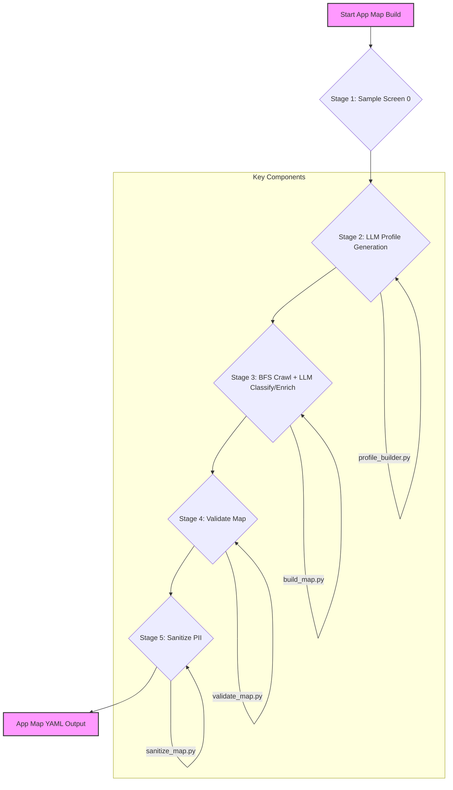
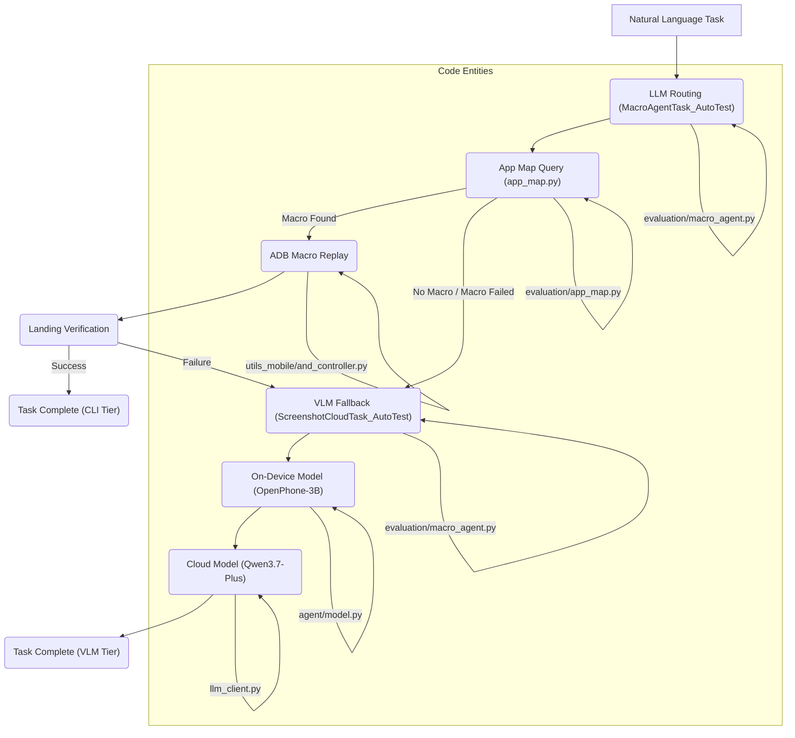

<!-- source: DeepWiki mcp.deepwiki.com · repo HKUDS/PhoneCLI · page 1.3 Core Concepts: App Maps, Macros, Three-Tier Execution · fetched 2026-11-09 -->

# Core Concepts: App Maps, Macros, Three-Tier Execution

<details>
<summary>Relevant source files</summary>

The following files were used as context for generating this wiki page:

- [README.md](README.md)
- [README_CN.md](README_CN.md)
- [figures/phone_cli.png](figures/phone_cli.png)
- [phonecli/README.md](phonecli/README.md)
- [phonecli_android/README.md](phonecli_android/README.md)
- [phonecli_android/README_CN.md](phonecli_android/README_CN.md)

</details>


This page details the core architectural concepts behind PhoneCLI, focusing on how app maps are constructed and utilized, the role of screen macros, the mechanism of landing verification, the VLM fallback strategy, and the three-tier execution model (CLI, on-device model, cloud model). These concepts are fundamental to understanding how PhoneCLI achieves efficient and robust mobile agent operation.

## App Map Graph

The "app map" is a central concept in PhoneCLI. It represents a compiled navigation graph of a mobile application. Instead of treating every task as a new GUI exploration, PhoneCLI compiles an app's navigation into callable commands stored within this map [README.md:123-124]().

An app map is a YAML file that encodes each screen as a node and each interactive element as an edge [README_CN.md:134-135](). It contains:
*   **`screens`**: A list of screen definitions. Each screen has an `id`, a `description`, and a list of `elements`.
*   **`elements`**: Within each screen, elements are defined with properties like `text`, normalized `center` coordinates, a `fixed` boolean indicating stability across versions, and `leads_to` specifying the next screen ID upon interaction [README_CN.md:136-144](). Elements can also have `aliases` and `semantic_type` for richer understanding [phonecli_android/README_CN.md:162-163]().
*   **`screen_macros`**: These define precise replay sequences for navigating to specific screens [README_CN.md:146-147]().

The app map is built offline by a BFS crawler that systematically explores the app via WebDriverAgent (iOS) or ADB (Android). During this process, it records clickable elements, their coordinates, and navigation paths between screens. An LLM is used to classify elements (stable/dynamic) and enrich them with semantic metadata [README_CN.md:132-133]().

### App Map Structure Example

```yaml
app: Clock
package: com.google.android.deskclock
screen_w: 1440
screen_h: 3120
launch_behavior: resume_last
screens:
  - id: screen_0
    description: "Main Alarm screen with the alarm list and bottom navigation."
    elements:
      - text: Alarm
        center: [0.1295, 0.0821]      # Normalized coordinates
        fixed: false
        found_at_scroll: 0
        leads_to: screen_0            # Self-loop = no navigation
        aliases: [闹钟, alarms, alarm tab]
        semantic_type: tab
screen_macros:                        # Full replay path from screen_0, absolute pixels
  screen_1:
    - {action: force_stop, package: com.google.android.deskclock, wait: 0.5}
    - {action: launch,     package: com.google.android.deskclock, wait: 3.0}
    - {action: tap, x: 1370, y: 256, wait: 1.5}
common_tasks:
  - Create and configure a new alarm
  - Use the stopwatch to track elapsed time
  # … 另有 7 条
known_limitations:
  - Bedtime feature requires completing an onboarding flow before it can be used
  # … 另有 3 条
```
Sources: [README_CN.md:134-147](), [phonecli_android/README_CN.md:147-175]()

### App Map Building Process

The app map building process is a multi-stage pipeline:
1.  **Sampling**: Collects visible element texts from an initial screen.
2.  **Profile Generation**: An LLM generates an app-specific profile, including `dynamic_patterns` and `preserve_navigation` rules.
3.  **BFS Crawl**: A Breadth-First Search (BFS) crawler explores the app, using the generated profile. An LLM classifies and enriches elements during this stage.
4.  **Validation**: The generated map is validated for errors, data quality, and the effectiveness of the profile.
5.  **Sanitization**: An LLM batch-detects and redacts personal identifiable information (PII) from the map.
Sources: [phonecli/README.md:204-210]()

### Diagram: App Map Build Pipeline


Sources: [phonecli/README.md:204-210]()

## Screen Macros

`screen_macros` are deterministic sequences of ADB (Android) or WebDriverAgent (iOS) commands that can navigate to a specific screen or perform a specific action within an app [README_CN.md:146-147](). These macros are pre-compiled and stored within the app map. When a task can be mapped to an existing macro, it is replayed deterministically on the device, offering sub-second execution time and zero VLM cost [README.md:53-54]().

For Android, a macro might include actions like `force_stop`, `launch`, and `tap` with absolute pixel coordinates [phonecli_android/README_CN.md:165-168](). This allows for precise and repeatable execution of common navigation patterns.

## Landing Verification

After a macro is executed, "landing verification" is performed. This step ensures that the macro successfully navigated to the intended screen or achieved the desired state. If the verification fails, it indicates that the compiled CLI path was unsuccessful, triggering a fallback mechanism.
Sources: [phonecli_android/README.md:29]()

## VLM Fallback

PhoneCLI operates with a dual-modality approach: CLI macro replay and GUI VLM fallback [README.md:49-51](). If a task cannot be handled by a pre-compiled macro (e.g., the app map doesn't cover the required navigation, or landing verification fails), the system falls back to a Vision-Language Model (VLM) loop. In this mode, the agent captures screenshots, calls a VLM to understand the screen and determine the next action, and then executes that action [README.md:47](). This ensures that compilation can only help, as a failed CLI path will always fall back to the more general (but slower and more expensive) VLM approach [README.md:54]().

## Three-Tier Execution: On-Device vs. Cloud Routing

PhoneCLI implements a three-tier execution strategy to optimize performance, cost, and privacy: **CLI → on-device model → cloud model** [README.md:55]().

1.  **CLI Tier**: This is the first and most efficient tier. If a task can be resolved by an existing `screen_macro` in the app map, it is executed directly on the device using deterministic commands (ADB for Android, WebDriverAgent for iOS). This tier incurs zero model cost and executes in sub-second time [README.md:53-54]().
2.  **On-Device Model Tier**: If the CLI tier cannot handle the task, the request is routed to an on-device model. This model is typically a smaller, optimized LLM/VLM (e.g., OpenPhone-3B) that can process the task locally, reducing latency and maintaining privacy compared to cloud models [README.md:55]().
3.  **Cloud Model Tier**: As a final fallback, if the on-device model is insufficient or unavailable, the request is sent to a more powerful, but slower and more expensive, cloud-based VLM [README.md:55]().

This tiered approach significantly reduces cloud API calls and token usage, leading to improved efficiency and lower operational costs [README.md:59-60]().

### Diagram: Three-Tier Execution Flow

```mermaid
graph TD
    A[User Task Request] --> B{Can CLI handle?};
    B -- "Yes (App Map Match)" --> C[CLI Macro Replay];
    C --> D{Landing Verification?};
    D -- "Success" --> E[Task Complete (CLI)];
    D -- "Failure" --> F[VLM Fallback];

    B -- "No" --> F;

    F --> G{On-Device Model Available?};
    G -- "Yes" --> H[On-Device Model Execution];
    H --> I{Task Complete (On-Device)?};
    I -- "Yes" --> E;
    I -- "No" --> J[Cloud Model Execution];

    G -- "No" --> J;

    J --> K{Task Complete (Cloud)?};
    K -- "Yes" --> E;
    K -- "No" --> L[Task Failed];

    subgraph "Execution Tiers"
        C, D, E, F, H, J, K, L
    end

    style C fill:#ccffcc,stroke:#333,stroke-width:2px
    style H fill:#ffffcc,stroke:#333,stroke-width:2px
    style J fill:#ffcccc,stroke:#333,stroke-width:2px
    style E fill:#99ff99,stroke:#333,stroke-width:2px
    style L fill:#ff9999,stroke:#333,stroke-width:2px
```
Sources: [README.md:53-55](), [phonecli_android/README.md:27-30]()

### Diagram: Natural Language to Code Entity Mapping


Sources: [README.md:53-55](), [phonecli_android/README.md:27-30](), [phonecli_android/README.md:10](), [phonecli_android/README.md:110]()

---

