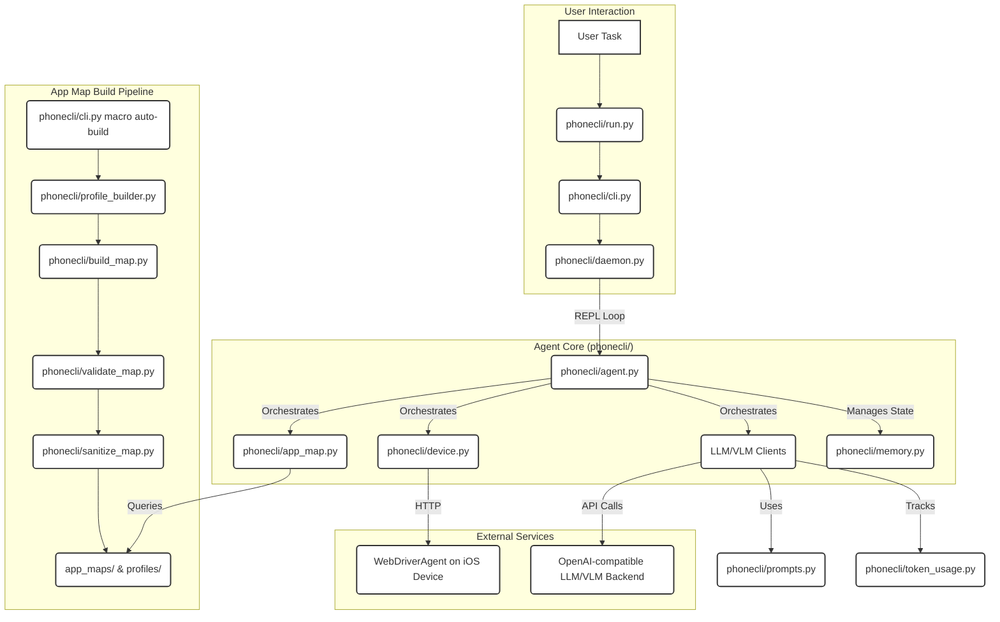

<!-- source: DeepWiki mcp.deepwiki.com · repo HKUDS/PhoneCLI · page 2 iOS Harness (phonecli/) · fetched 2026-11-09 -->

# iOS Harness (phonecli/)

Relevant source files

The following files were used as context for generating this wiki page:

- [phonecli/README.md](phonecli/README.md)
- [phonecli/README_CN.md](phonecli/README_CN.md)

The `phonecli/` directory houses the core components for controlling iOS devices, primarily leveraging WebDriverAgent (WDA) for device interaction. This section provides a high-level overview of the iOS agent toolkit, its command-line interface, the agent's execution loop, and the automated app map build pipeline. For detailed information on each topic, please refer to the linked child pages.

Sources:
- [phonecli/README.md:1-7]()
- [phonecli/README_CN.md:1-6]()

## 2.1 CLI and Entrypoints

The `phonecli/` module provides a comprehensive command-line interface (CLI) for interacting with iOS devices and managing the agent's operations. The `cli.py` script organizes commands into distinct groups: `device` for direct device control (e.g., screenshots, taps), `macro` for building, running, and validating app maps, `llm` for map-related tasks and XML verification, and `vlm` for visual actions and verification [phonecli/README.md:10-15]().

Beyond the CLI, the system offers various entry points for different modes of operation. The `run.py` script facilitates one-shot task execution and interactive sessions, while `daemon.py` provides a Read-Eval-Print Loop (REPL) for continuous interaction [phonecli/README.md:17-18](). Session state and memory management are handled by `memory.py`.

For details, see [CLI and Entrypoints](#2.1).

Sources:
- [phonecli/README.md:10-18]()
- [phonecli/README_CN.md:9-19]()

## 2.2 PhoneAgent Execution Loop

The `agent.py` script orchestrates the PhoneAgent's execution loop, managing the flow of control and decision-making on the iOS device [phonecli/README.md:10-11](). This loop involves several key stages: screen recognition, macro routing, task decomposition by a planner, loop detection to prevent infinite actions, and escalation to Visual Language Models (VLMs) when macros are insufficient.

Screen recognition is performed using `app_map.py`, which queries pre-built app maps to identify the current screen and available elements. Device control, including actions like tapping and swiping, is handled through HTTP commands sent to WebDriverAgent via `device.py`.

For details, see [PhoneAgent Execution Loop](#2.2).

Sources:
- [phonecli/README.md:10-11]()
- [phonecli/README_CN.md:9-11]()

## 2.3 App Map Build Pipeline (iOS)

The iOS app map build pipeline is a five-stage automated process designed to create detailed navigation graphs for applications. This pipeline is crucial for enabling deterministic macro routing and efficient screen recognition.

The stages include:
1.  **Sampling**: Initial collection of visible element texts from a starting screen [phonecli/README.md:205]().
2.  **Profile Building**: `profile_builder.py` generates an app-specific profile, including dynamic patterns and navigation preservation rules, often with LLM assistance [phonecli/README.md:206]().
3.  **BFS Crawl**: `build_map.py` performs a Breadth-First Search (BFS) crawl of the app, using the generated profile, classifying elements with LLMs, and enriching the map data [phonecli/README.md:207]().
4.  **Validation**: `validate_map.py` checks the generated map for errors, data quality, and the effectiveness of the profile [phonecli/README.md:208]().
5.  **Sanitization**: `sanitize_map.py` redacts Personally Identifiable Information (PII) by batch-detecting and replacing sensitive data using LLMs [phonecli/README.md:209]().

The output of this pipeline is stored in `app_maps/` and `profiles/` directories, with checkpoints managed to allow for resuming interrupted builds [phonecli/README_CN.md:208-210]().

For details, see [App Map Build Pipeline (iOS)](#2.3).

Sources:
- [phonecli/README.md:205-209]()
- [phonecli/README_CN.md:194-210]()

## 2.4 LLM/VLM Clients, Prompts and Token Accounting

The `phonecli/` harness integrates with various Large Language Models (LLMs) and Visual Language Models (VLMs) to enable intelligent decision-making and screen understanding. The `llm_client.py` module provides an interface for OpenAI-compatible backends, allowing flexibility in choosing different models [phonecli/README.md:106-119]().

System prompts, which guide the behavior and responses of the LLMs, are managed within `prompts.py`. These prompts are essential for tasks such as screen classification, element enrichment, and PII redaction. To monitor and manage operational costs, `token_usage.py` handles token accounting, tracking the usage of LLM/VLM services.

For details, see [LLM/VLM Clients, Prompts and Token Accounting](#2.4).

Sources:
- [phonecli/README.md:106-119]()
- [phonecli/README_CN.md:102-115]()

### iOS Harness Architecture

Sources:
- [phonecli/README.md:10-27]()
- [phonecli/README_CN.md:9-26]()

---

