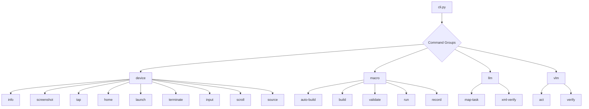

<!-- source: DeepWiki mcp.deepwiki.com · repo HKUDS/PhoneCLI · page 2.1 CLI and Entrypoints · fetched 2026-11-09 -->

# CLI and Entrypoints

<details>
<summary>Relevant source files</summary>

The following files were used as context for generating this wiki page:

- [phonecli/README.md](phonecli/README.md)
- [phonecli/README_CN.md](phonecli/README_CN.md)

</details>


This page details the command-line interface (CLI) and various entry points for interacting with the PhoneCLI system. It covers the `cli.py` utility for direct device and macro control, the `run.py` script for one-shot task execution and interactive mode, the `daemon.py` for a persistent REPL, and how `memory.py` manages session state.

## CLI Command Groups (`cli.py`)

The `cli.py` script provides a comprehensive command-line interface for direct interaction with the iOS device and various PhoneCLI functionalities. It is structured into several command groups, each focusing on a specific area of control or operation. The `cli.py` acts as a subprocess target for `agent.py` for certain operations [phonecli/README.md:9-15]().

### Device Commands

The `device` command group allows for low-level interaction with the connected iOS device via WebDriverAgent (WDA). These commands are essential for debugging and direct control.

| Command | Description |
|---|---|
| `info` | Retrieves device information (e.g., screen dimensions) [phonecli/README.md:124-125](). |
| `screenshot` | Takes a screenshot of the device. |
| `tap <x> <y>` | Performs a tap gesture at specified coordinates. |
| `home` | Navigates to the device's home screen. |
| `launch <bundle_id>` | Launches an application by its bundle ID. |
| `terminate <bundle_id>` | Terminates an application by its bundle ID. |
| `input <text>` | Inputs text into the currently focused element. |
| `scroll <direction>` | Scrolls the screen in a specified direction. |
| `source` | Dumps the XML source hierarchy of the current screen. |

Sources:
* [phonecli/README.md:9-15]()
* [phonecli/README.md:124-125]()

### Macro Commands

The `macro` command group is dedicated to building, running, and validating app maps and screen macros. This is a core component for automating interactions within applications.

| Command | Description |
|---|---|
| `auto-build` | Runs the 5-stage app map auto-build pipeline [phonecli/README.md:165-166](). This includes sampling, profile generation, BFS crawl, validation, and PII redaction [phonecli/README.md:195-210](). |
| `build` | Performs the main BFS crawl to build an app map. |
| `validate` | Validates an existing app map for errors and data quality. |
| `run <macro_name>` | Executes a specific screen macro. |
| `record` | Starts a recording session to create a new macro. |

Sources:
* [phonecli/README.md:9-15]()
* [phonecli/README.md:165-166]()
* [phonecli/README.md:195-210]()

### LLM Commands

The `llm` command group provides utilities for interacting with Language Model (LLM) functionalities, primarily for tasks related to app map generation and verification.

| Command | Description |
|---|---|
| `map-task` | Uses an LLM to map a natural language task to a sequence of screen macros. |
| `xml-verify` | Verifies the state of the UI using LLM analysis of the XML source. |

Sources:
* [phonecli/README.md:9-15]()

### VLM Commands

The `vlm` command group focuses on Visual Language Model (VLM) capabilities, used for visual understanding, action, and verification.

| Command | Description |
|---|---|
| `act` | Uses a VLM to determine and execute an action based on a visual input. |
| `verify` | Verifies the success of an action or state using VLM analysis of a screenshot. |

Sources:
* [phonecli/README.md:9-15]()

### CLI Command Structure

**Figure 1: `cli.py` Command Structure**

Sources:
* [phonecli/README.md:9-15]()

## One-Shot and Interactive Modes (`run.py`)

The `run.py` script serves as the primary entry point for executing tasks with the PhoneCLI agent. It supports both one-shot task execution and an interactive mode for continuous interaction.

### One-Shot Mode

In one-shot mode, `run.py` takes a natural language task as an argument and attempts to complete it. The agent automatically discovers built app maps, decomposes the task, replays macros, and uses VLM for verification [phonecli/README.md:177-178]().

Example:
```bash
python phonecli/run.py --task "Turn on airplane mode"
```
[phonecli/README.md:174-174]()

### Interactive Mode

The interactive mode allows for a continuous conversation with the agent, where it can process multiple tasks or follow-up instructions. This mode is useful for complex scenarios requiring iterative refinement or multi-step operations.

Sources:
* [phonecli/README.md:174-174]()
* [phonecli/README.md:177-178]()

## Daemon REPL (`daemon.py`)

The `daemon.py` script provides a persistent Read-Eval-Print Loop (REPL) for the PhoneCLI agent. It maintains state across multiple interactions and can manage multiple app maps [phonecli/README.md:17-20](). This is particularly useful for long-running sessions or when developing and testing complex sequences of operations. The daemon communicates with `agent.py` via JSON over subprocess [phonecli/README.md:9-15]().

```mermaid
graph TD
    User[User Input] --> Daemon[daemon.py REPL]
    Daemon --> Memory[memory.py (Session State)]
    Daemon --> Agent[agent.py (Agent Logic)]
    Agent -- JSON --> CLI[cli.py (Device/Macro/LLM/VLM)]
    CLI -- HTTP --> WDA[WebDriverAgent on iOS Device]
    WDA --> iOS[iOS Device]
    iOS --> WDA
    WDA --> CLI
    CLI -- JSON --> Agent
    Agent --> Daemon
    Daemon --> User[User Output]
```
**Figure 2: Daemon REPL Interaction Flow**

Sources:
* [phonecli/README.md:9-15]()
* [phonecli/README.md:17-20]()

## Session State (`memory.py`)

The `memory.py` module is responsible for managing the session state of the PhoneCLI agent. It stores information relevant to the current interaction, such as loaded app maps, current screen context, and historical actions. This allows the `daemon.py` REPL to maintain continuity across commands and enables the agent to make informed decisions based on past interactions.

Sources:
* [phonecli/README.md:17-20]()

---

