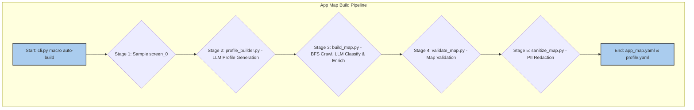
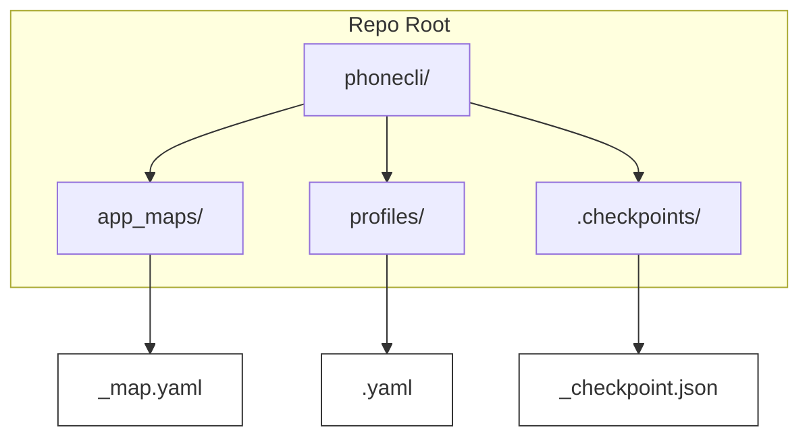

<!-- source: DeepWiki mcp.deepwiki.com · repo HKUDS/PhoneCLI · page 2.3 App Map Build Pipeline (iOS) · fetched 2026-11-09 -->

# App Map Build Pipeline (iOS)

<details>
<summary>Relevant source files</summary>

The following files were used as context for generating this wiki page:

- [phonecli/README.md](phonecli/README.md)
- [phonecli/README_CN.md](phonecli/README_CN.md)

</details>


This page details the five-stage automated pipeline for building iOS app maps. App maps are crucial for the `PhoneCLI` agent, providing a structured representation of an application's UI, enabling deterministic macro routing and reducing reliance on costly VLM operations. The pipeline involves sampling, profile generation, a Breadth-First Search (BFS) crawl, validation, and PII redaction.

## Overview of the Five-Stage Pipeline

The app map build process is an automated pipeline designed to systematically explore an iOS application, identify its screens and interactive elements, and generate a structured YAML representation. This process is initiated via the `phonecli/cli.py macro auto-build` command [phonecli/README.md:191-200]().

The pipeline consists of five distinct stages:
1.  **Sampling**: Initial screen capture and text extraction.
2.  **Profile Generation**: LLM-driven creation of an app-specific profile for dynamic content handling.
3.  **BFS Crawl**: The main exploration phase, using the generated profile, LLM classification, and enrichment.
4.  **Validation**: Checking the generated app map for errors, data quality, and profile effectiveness.
5.  **Sanitization**: Redacting Personally Identifiable Information (PII) using an LLM.

This pipeline outputs an app map YAML file to `phonecli/app_maps/<app>_map.yaml` and a profile YAML file to `phonecli/profiles/<App>.yaml` [phonecli/README_CN.md:208-210](). Checkpoints are used for resuming interrupted builds, stored in `.checkpoints/<app>_checkpoint.json` [phonecli/README_CN.md:211]().

### App Map Build Pipeline Flow

Sources:
- [phonecli/README.md:191-210]()
- [phonecli/README_CN.md:187-211]()

## Stage 1: Sampling

The first stage involves capturing the initial screen (`screen_0`) of the target application and extracting visible element texts [phonecli/README.md:205](). This initial data is crucial for the subsequent profile generation.

Sources:
- [phonecli/README.md:205]()

## Stage 2: Profile Generation (`profile_builder.py`)

After initial sampling, an LLM is used to generate an app-specific profile. This profile contains rules for `dynamic_patterns` and `preserve_navigation`, which are essential for handling dynamic content and maintaining navigation integrity during the BFS crawl [phonecli/README.md:206](). The `profile_builder.py` script is responsible for this stage [phonecli/README.md:23]().

The generated profile is stored in `phonecli/profiles/<App>.yaml` [phonecli/README_CN.md:209]().

Sources:
- [phonecli/README.md:23]()
- [phonecli/README.md:206]()
- [phonecli/README_CN.md:209]()

## Stage 3: BFS Crawl (`build_map.py`)

This is the core of the app map generation. The `build_map.py` script performs a Breadth-First Search (BFS) crawl of the application's UI [phonecli/README.md:24](). During the crawl, it utilizes the profile generated in Stage 2 to identify and classify UI elements. An LLM is employed for classifying elements as stable or dynamic, and for enriching the map with aliases, semantic types, and descriptions [phonecli/README.md:207]().

Key parameters for the crawl include:
*   `--max-screens`: Maximum number of screens to explore (default: 50) [phonecli/README_CN.md:238]().
*   `--max-depth`: Maximum navigation depth (default: 3) [phonecli/README_CN.md:239]().
*   `--scroll-pages`: Number of times to scroll on each screen (default: 3) [phonecli/README_CN.md:240]().

The `build_map.py` script interacts with the iOS device via WebDriverAgent (WDA) to capture screenshots, tap elements, and retrieve UI hierarchies.

### BFS Crawl Data Flow
```mermaid
graph TD
    A[Start build_map.py] --> B{Initialize with Profile};
    B --> C{Queue: [Initial Screen]};
    C --> D{While Queue not empty AND max_screens/max_depth not reached};
    D --> E{Dequeue Screen};
    E --> F[Capture Screenshot & UI Hierarchy via WDA];
    F --> G{Identify Interactive Elements};
    G --> H{LLM: Classify Elements (Stable/Dynamic)};
    H --> I{LLM: Enrich Elements (Aliases, Semantic Types, Descriptions)};
    I --> J{For each interactive element};
    J --> K{Simulate Tap via WDA};
    K --> L{Capture New Screen};
    L --> M{If New Screen not visited AND not dynamic (per profile)};
    M --> N{Add New Screen to App Map};
    N --> O{Enqueue New Screen};
    O --> D;
    D --> P[Output Intermediate App Map];
```
Sources:
- [phonecli/README.md:24]()
- [phonecli/README.md:207]()
- [phonecli/README_CN.md:238-240]()

## Stage 4: Validation (`validate_map.py`)

After the BFS crawl, the generated app map undergoes a validation process using `validate_map.py` [phonecli/README.md:24](). This stage checks for errors, assesses data quality, and evaluates the effectiveness of the generated profile [phonecli/README.md:208](). This ensures the app map is robust and accurate before being used by the agent.

Sources:
- [phonecli/README.md:24]()
- [phonecli/README.md:208]()

## Stage 5: Sanitization (`sanitize_map.py`)

The final stage involves redacting Personally Identifiable Information (PII) from the app map. The `sanitize_map.py` script uses an LLM to batch-detect and replace sensitive personal data within the map [phonecli/README.md:25](). This is crucial for privacy and security, especially when sharing or storing app maps.

Sources:
- [phonecli/README.md:25]()
- [phonecli/README.md:209]()

## Output Files and Checkpoints

The pipeline generates several important files:
*   **App map**: `phonecli/app_maps/<app>_map.yaml` - The complete navigation graph, including screens, elements, and macros [phonecli/README_CN.md:208]().
*   **Profile**: `phonecli/profiles/<App>.yaml` - Contains rules for filtering dynamic content [phonecli/README_CN.md:209]().
*   **Checkpoint**: `.checkpoints/<app>_checkpoint.json` - Used for resuming interrupted builds. This file is automatically deleted upon successful completion [phonecli/README_CN.md:211]().

The `auto-build` command supports checkpointing with the `-c` or `--checkpoint` flag, and resuming from a checkpoint with `-r` or `--resume` [phonecli/README_CN.md:243-255]().

### File Layout

Sources:
- [phonecli/README_CN.md:208-211]()
- [phonecli/README_CN.md:243-255]()

## CLI Usage

The entire pipeline can be run with a single `auto-build` command:
```bash
python phonecli/cli.py macro auto-build \
    -b com.apple.mobilecal \
    -a Calendar \
    -o phonecli/app_maps/calendar_map.yaml \
    --classify --enrich --redact
```
This command specifies the bundle ID (`-b`), app name (`-a`), output path (`-o`), and enables the classification, enrichment, and redaction steps [phonecli/README.md:191-200]().

Common bundle IDs for various iOS apps are provided in the `README_CN.md` [phonecli/README_CN.md:213-225](). The `ideviceinstaller -l` command can be used to list installed app bundle IDs [phonecli/README_CN.md:227]().

Sources:
- [phonecli/README.md:191-200]()
- [phonecli/README_CN.md:213-227]()

---

