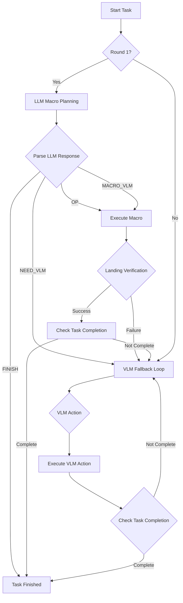

<!-- source: DeepWiki mcp.deepwiki.com · repo HKUDS/PhoneCLI · page 3.2 MacroAgent: Routing, Replay and Fallback · fetched 2026-11-09 -->

# MacroAgent: Routing, Replay and Fallback

<details>
<summary>Relevant source files</summary>

The following files were used as context for generating this wiki page:

- [evaluation/definition.py](evaluation/definition.py)
- [phonecli_android/evaluation/app_map.py](phonecli_android/evaluation/app_map.py)
- [phonecli_android/evaluation/evaluation.py](phonecli_android/evaluation/evaluation.py)
- [phonecli_android/evaluation/macro_agent.py](phonecli_android/evaluation/macro_agent.py)

</details>


This page details the implementation of the `MacroAgent` in the Android evaluation harness. The `MacroAgent` is a hybrid agent designed for the AndroidLab benchmark, combining a two-phase routing mechanism (macro-based navigation) with a VLM (Vision-Language Model) fallback. It focuses on efficient initial navigation using pre-defined app maps and macros, and then transitions to a VLM-driven approach for more complex interactions.

The core purpose is to explain:
1. The two-phase routing logic within `evaluation/macro_agent.py` which includes `OP`, `MACRO_VLM`, `NEED_VLM`, and `FINISH` states.
2. How `phonecli_android/evaluation/app_map.py` is used for runtime queries and landing verification.
3. The VLM loop fallback mechanism implemented in `phonecli_android/evaluation/evaluation.py`.

Sources:
- [evaluation/macro_agent.py:1-11]()
- [phonecli_android/evaluation/app_map.py:1-11]()
- [phonecli_android/evaluation/evaluation.py:1-156]()

## MacroAgent Architecture and Two-Phase Routing

The `MacroAgent` operates in two distinct phases to execute a given instruction:

**Phase 1: Macro Routing (Round 1)**
In the initial round, the agent attempts to use pre-defined macros from the app map to navigate to a relevant screen. This phase leverages an LLM to map the task instruction to a known operation (`OP` or `MACRO_VLM`) within the `AppMap`. A crucial step here is "landing verification" to ensure the selected macro leads to a useful screen for the task. If a suitable macro is found and verified, it is executed.

**Phase 2: VLM Fallback (Round 2+)**
If Phase 1 fails to identify a suitable macro, or if the task requires more granular interaction than macros can provide, the agent falls back to a VLM-driven approach. This phase uses a `ScreenshotTask`-like VLM loop, where the VLM analyzes screenshots and XML to determine the next action. This is a more flexible but potentially slower approach.

The `MacroAgentTask` class [evaluation/macro_agent.py:50-85]() orchestrates this two-phase process. It initializes with a `_FallbackTask` (which is essentially a `ScreenshotReactTask` [evaluation/macro_agent.py:55-56]()) to handle the VLM fallback.

### Routing States

The `_parse_llm_map_response` function [evaluation/macro_agent.py:26-47]() is responsible for interpreting the LLM's output from the macro planning phase and determining the next state. The possible states are:

*   **OP**: The LLM has identified a specific operation (`op_id`) from the app map that directly addresses the task. This operation's macro will be executed.
*   **MACRO_VLM**: The LLM has identified an operation (`op_id`) but suggests that VLM verification might be needed after executing the macro. This is similar to `OP` but indicates a higher uncertainty or a need for visual confirmation.
*   **NEED_VLM**: The LLM could not find a suitable macro or determined that the task requires direct VLM interaction. The agent will transition to the VLM fallback loop.
*   **FINISH**: The LLM believes the task is complete and provides an answer.


**Diagram: MacroAgent Two-Phase Routing Flow**

Sources:
- [evaluation/macro_agent.py:1-11]()
- [evaluation/macro_agent.py:26-47]()
- [evaluation/macro_agent.py:50-85]()
- [evaluation/macro_agent.py:100-140]()

### Macro Routing Implementation (`_llm_map_task`)

The `_llm_map_task` method [evaluation/macro_agent.py:100-140]() is the core of the first phase. It performs the following steps:

1.  **App Map Check**: Verifies if an `AppMap` is loaded and if an operations catalog (`_ops_catalog`) is available. If not, it immediately returns `NEED_VLM`.
2.  **Prompt Construction**: Formats the `MACRO_PLAN_PROMPT` [phonecli/prompts:1-1]() with the app name, the catalog of navigation-only operations, and the current instruction.
3.  **LLM Call**: Calls `text_completion` [phonecli/llm_client:1-1]() using the configured LLM client to get a response.
4.  **Response Parsing**: Uses `_parse_llm_map_response` [evaluation/macro_agent.py:26-47]() to interpret the LLM's output into one of the routing states.
5.  **Landing Verification**: If the LLM suggests an `OP` or `MACRO_VLM`, it calls `_verify_operation` [evaluation/macro_agent.py:141-164]() to perform a secondary check. If verification fails, it falls back to `NEED_VLM`.

The `MACRO_PLAN_PROMPT` [phonecli/prompts:1-1]() guides the LLM to output one of the specific tags (`OP:`, `MACRO_VLM:`, `NEED_VLM:`, `FINISH:`) followed by relevant information.

Sources:
- [evaluation/macro_agent.py:100-140]()
- [evaluation/macro_agent.py:26-47]()
- [evaluation/macro_agent.py:141-164]()
- [phonecli/prompts:1-1]()
- [phonecli/llm_client:1-1]()

### App Map Runtime Queries and Landing Verification

The `AppMap` class [phonecli_android/evaluation/app_map.py:49-50]() is central to macro routing. It loads and provides access to the app's structure and pre-defined operations.

**`AppMap` Structure:**
The `AppMap` is initialized from a YAML file [phonecli_android/evaluation/app_map.py:52-56]() and contains:
*   `screens`: A list of `Screen` objects, each representing a distinct UI state with its elements and description [phonecli_android/evaluation/app_map.py:68-87]().
*   `_macros`: A dictionary mapping screen IDs to sequences of actions (macros) [phonecli_android/evaluation/app_map.py:89]().
*   `_ops_catalog`: A catalog of `Operation` objects, built by `build_operations` [phonecli_android/evaluation/app_map.py:173-175](), which represent high-level actions or navigations.

**Runtime Queries:**
*   `get_screen(screen_id)`: Retrieves a `Screen` object by its ID [phonecli_android/evaluation/app_map.py:91-95]().
*   `identify_current_screen(xml_str)`: Attempts to identify the current screen based on the UIAutomator XML dump, returning a `(screen_id, confidence)` tuple [phonecli_android/evaluation/app_map.py:97-142](). This is used for landing verification.
*   `find_relative_macro(from_id, to_id)`: Computes the sequence of actions to navigate from one screen to another, leveraging common path prefixes [phonecli_android/evaluation/app_map.py:144-159]().
*   `format_ops_catalog(ops_catalog, nav_only)`: Formats the operations catalog into a string suitable for LLM prompts [phonecli_android/evaluation/app_map.py:390-409]().

**Landing Verification (`_verify_operation`)**
After the LLM proposes an operation, `_verify_operation` [evaluation/macro_agent.py:141-164]() is called to confirm its suitability. This is a critical step to prevent the agent from navigating to an irrelevant screen.

1.  It retrieves the `Operation` object and its target screen description using `get_target_screen_info` [phonecli_android/evaluation/app_map.py:411-420]().
2.  It constructs a `MACRO_VERIFY_PROMPT` [phonecli/prompts:1-1]() with the task, operation description, and target screen description.
3.  It calls `text_completion` [phonecli/llm_client:1-1]() again to ask an LLM if the proposed operation's target screen is relevant to the task.
4.  The LLM's response (e.g., "YES" or "NO") determines if the operation is accepted or if the agent falls back to VLM.

This two-step LLM interaction (planning then verification) adds robustness to the macro routing phase.

```mermaid
graph TD
    subgraph "AppMap (phonecli_android/evaluation/app_map.py)"
        AM[AppMap Object] --> AM_L[Load YAML: map_path];
        AM_L --> AM_S[Screens: list[Screen]];
        AM_L --> AM_M[Macros: dict];
        AM_L --> AM_O[Operations: dict[str, Operation]];
        AM_O -- build_operations() --> AM_O;
    end

    subgraph "MacroAgent (evaluation/macro_agent.py)"
        MA_LLM_P[LLM Macro Planning (MACRO_PLAN_PROMPT)] --> MA_LLM_R{LLM Response};
        MA_LLM_R -- OP/MACRO_VLM --> MA_VO[Call _verify_operation];
        MA_VO --> MA_VP[LLM Landing Verification (MACRO_VERIFY_PROMPT)];
        MA_VP -- YES --> MA_E[Execute Macro];
        MA_VP -- NO --> MA_F[Fallback to VLM];
        MA_LLM_R -- NEED_VLM --> MA_F;
        MA_LLM_R -- FINISH --> MA_T[Task Finished];
    end

    MA_LLM_P -- Queries --> AM_O;
    MA_VO -- Queries --> AM_O;
    MA_VO -- Queries --> AM_S;
```
**Diagram: App Map Interaction and Landing Verification**

Sources:
- [phonecli_android/evaluation/app_map.py:49-50]()
- [phonecli_android/evaluation/app_map.py:52-56]()
- [phonecli_android/evaluation/app_map.py:68-87]()
- [phonecli_android/evaluation/app_map.py:89]()
- [phonecli_android/evaluation/app_map.py:91-95]()
- [phonecli_android/evaluation/app_map.py:97-142]()
- [phonecli_android/evaluation/app_map.py:144-159]()
- [phonecli_android/evaluation/app_map.py:173-175]()
- [phonecli_android/evaluation/app_map.py:390-409]()
- [phonecli_android/evaluation/app_map.py:411-420]()
- [evaluation/macro_agent.py:141-164]()
- [phonecli/prompts:1-1]()
- [phonecli/llm_client:1-1]()

### VLM Loop Fallback in `evaluation.py`

If the macro routing phase (Round 1) determines `NEED_VLM` or if landing verification fails, the `MacroAgentTask` transitions to its VLM fallback mechanism. This is handled by the `_parent` attribute, which is an instance of `ScreenshotReactTask` [evaluation/macro_agent.py:55-56]().

The `ScreenshotReactTask` (aliased as `_FallbackTask` in `MacroAgentTask`) is defined in `phonecli_android/evaluation/evaluation.py` [phonecli_android/evaluation/evaluation.py:60-156](). It implements a standard VLM agent loop:

1.  **Capture State**: `self.record.update_before` [phonecli_android/evaluation/evaluation.py:90-92]() captures a screenshot and the UIAutomator XML.
2.  **Prompt Construction**: A prompt is built including the instruction, history, and the current screenshot.
3.  **Agent Decision**: The VLM (`self.agent`) is called to `act` [phonecli_android/evaluation/evaluation.py:139]() based on the visual information. This VLM can be a local model or a cloud-based model, potentially with a control agent deciding which to use [phonecli_android/evaluation/evaluation.py:108-117]().
4.  **Action Execution**: The VLM's output (a code snippet) is parsed by `get_code_snippet` [evaluation/definition.py:78-80]() and executed by the `page_executor` [phonecli_android/evaluation/evaluation.py:48]().
5.  **Update History**: `self.record.update_after` [phonecli_android/evaluation/evaluation.py:49]() updates the task history with the executed action and the VLM's response.
6.  **Loop**: This process repeats until the task is deemed complete or a maximum number of steps is reached.

The `MacroAgentTask` effectively delegates to this `ScreenshotReactTask` for all subsequent rounds after the initial macro routing phase.

Sources:
- [evaluation/macro_agent.py:55-56]()
- [phonecli_android/evaluation/evaluation.py:60-156]()
- [phonecli_android/evaluation/evaluation.py:90-92]()
- [phonecli_android/evaluation/evaluation.py:139]()
- [evaluation/definition.py:78-80]()
- [phonecli_android/evaluation/evaluation.py:48]()
- [phonecli_android/evaluation/evaluation.py:49]()
- [phonecli_android/evaluation/evaluation.py:108-117]()

---

