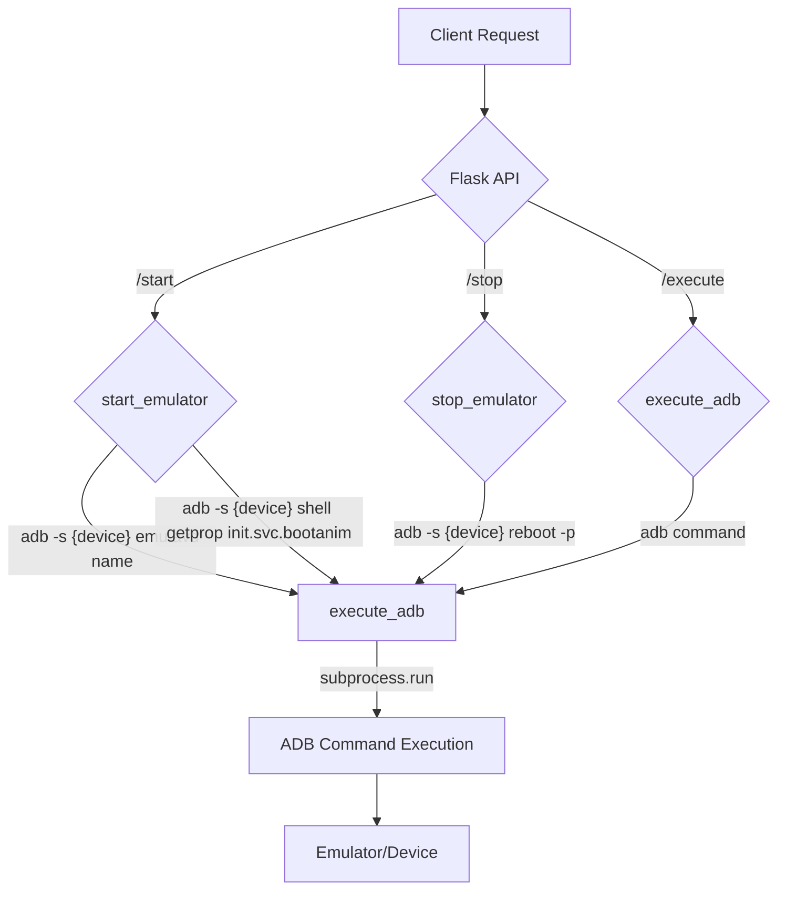
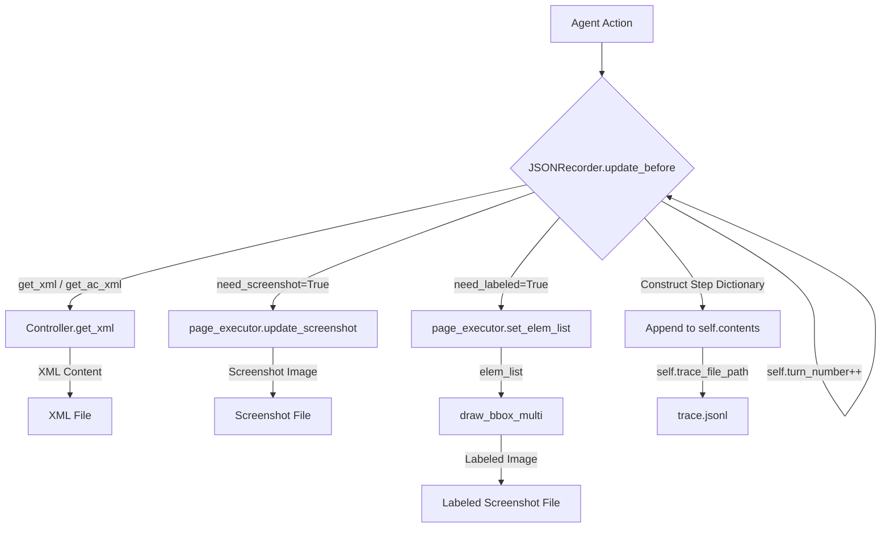

<!-- source: DeepWiki mcp.deepwiki.com · repo HKUDS/PhoneCLI · page 3.3 Device Control and Page Executors · fetched 2026-11-09 -->

# Device Control and Page Executors

Relevant source files

The following files were used as context for generating this wiki page:

- [page_executor/text_executor.py](page_executor/text_executor.py)
- [phonecli_android/adb_client.py](phonecli_android/adb_client.py)
- [phonecli_android/page_executor/simple_vision_executor.py](phonecli_android/page_executor/simple_vision_executor.py)
- [phonecli_android/page_executor/text_executor.py](phonecli_android/page_executor/text_executor.py)
- [phonecli_android/page_executor/utils.py](phonecli_android/page_executor/utils.py)
- [phonecli_android/recorder/json_recoder.py](phonecli_android/recorder/json_recoder.py)
- [recorder/json_recoder.py](recorder/json_recoder.py)
- [utils_mobile/utils.py](utils_mobile/utils.py)

This page details the core components responsible for interacting with Android devices and executing actions within the Android harness. It covers the `adb_client.py` for ADB communication, `utils_mobile/and_controller.py` for higher-level device control, `xml_tool.py` for UI XML parsing, and the `page_executor` modules (`text_executor.py` and `simple_vision_executor.py`) which define the action primitives. Finally, it explains how `recorder/json_recoder.py` captures execution traces.

## ADB Client and Android Controller

The `adb_client.py` module provides a low-level interface for executing ADB commands, primarily for managing Android Virtual Devices (AVDs). The `EmulatorController` class handles starting, stopping, and executing arbitrary ADB commands on emulators. The `utils_mobile/and_controller.py` module (not fully provided but inferred from usage) builds upon this to offer higher-level device interaction functionalities.

### `adb_client.py` Overview

The `adb_client.py` script includes functions to list connected devices, get device names, and a `EmulatorController` class to manage emulator lifecycles. It also exposes a Flask API for remote control of emulators.

**Diagram: ADB Client Interaction Flow**
Sources: [phonecli_android/adb_client.py:8-17](), [phonecli_android/adb_client.py:20-28](), [phonecli_android/adb_client.py:44-57](), [phonecli_android/adb_client.py:58-103](), [phonecli_android/adb_client.py:104-124]()

- `list_all_devices()`: Returns a list of connected ADB device serials [phonecli_android/adb_client.py:8-17]().
- `get_adb_device_name(avd_name)`: Retrieves the ADB device name associated with a given AVD name [phonecli_android/adb_client.py:20-28]().
- `EmulatorController.execute_adb(adb_command)`: Executes an ADB command using `subprocess.run` and returns its output. It prepends `/root/.android/platform-tools/adb` to the command [phonecli_android/adb_client.py:44-57]().
- `EmulatorController.start_emulator(avd_name)`: Initiates an AVD, waits for it to boot completely, and returns the device serial [phonecli_android/adb_client.py:58-103]().
- `EmulatorController.stop_emulator(avd_name)`: Terminates the emulator process and ensures the device is no longer listed [phonecli_android/adb_client.py:104-124]().

The Flask application (`app`) provides HTTP endpoints for external control:
- `/start`: Starts an emulator given an `avd_name` [phonecli_android/adb_client.py:129-137]().
- `/stop`: Stops an emulator given an `avd_name` [phonecli_android/adb_client.py:139-146]().
- `/execute`: Executes an arbitrary ADB command [phonecli_android/adb_client.py:148-158]().

Sources: [phonecli_android/adb_client.py]()

### `utils_mobile/and_controller.py` (Inferred)

While the full content of `utils_mobile/and_controller.py` is not provided, its role can be inferred from its usage in `page_executor` modules. It acts as a high-level wrapper around ADB commands, providing methods for common Android interactions like `tap`, `text` (type), `swipe`, `back`, `home`, `launch`, `get_xml`, `get_current_activity`, and `save_screenshot`. It likely uses `adb_client.py` internally to perform these actions.

Sources: [page_executor/text_executor.py:18-19](), [page_executor/text_executor.py:45-46](), [page_executor/text_executor.py:107](), [page_executor/text_executor.py:164](), [recorder/json_recoder.py:64](), [recorder/json_recoder.py:70](), [recorder/json_recoder.py:111](), [recorder/json_recoder.py:130]()

## UI XML Tooling

The `utils_mobile/xml_tool.py` module (not fully provided, but its `UIXMLTree` class is used) is responsible for parsing and compressing UI XML dumps from the Android device. This XML represents the current state of the UI hierarchy, including elements, their attributes, and bounding boxes.

- `UIXMLTree`: This class is used to process raw XML strings obtained from the device. It can compress the XML into different formats (e.g., "json", "plain_text") and levels of detail [utils_mobile/utils.py:21-33](), [recorder/json_recoder.py:11-25]().
- `get_compressed_xml(xml_path, type, version)`: A utility function that reads an XML file, uses `UIXMLTree` to process it, and returns a compressed representation. This is crucial for reducing the token count when feeding UI information to language models [utils_mobile/utils.py:24-33](), [recorder/json_recoder.py:11-25]().

Sources: [utils_mobile/utils.py:21-33](), [recorder/json_recoder.py:11-25]()

## Page Executors

Page executors are responsible for translating high-level actions into device-specific commands. Two main executors are provided: `TextOnlyExecutor` and `VisionExecutor`.

### `TextOnlyExecutor`

The `TextOnlyExecutor` (`page_executor/text_executor.py`) is designed to execute actions based on textual descriptions or bounding box coordinates. It uses the `controller` (an instance of `and_controller.py`) to interact with the device.

- `__init__(self, controller, config)`: Initializes the executor with a device controller and configuration [page_executor/text_executor.py:16-22]().
- `__call__(self, code_snippet)`: The main entry point for executing a code snippet. It parses the snippet, extracts the action, and calls the corresponding method [page_executor/text_executor.py:52-76](). It uses `inspect.getmembers` to dynamically get available methods [page_executor/text_executor.py:78-95]().
- `update_screenshot(self, prefix=None, suffix=None)`: Captures a screenshot of the current device state and saves it to the configured directory [page_executor/text_executor.py:97-107]().
- `do(self, action, element, **kwargs)`: A dispatcher method that takes an `action` string and `element` (e.g., bounding box) and calls the appropriate action method (`tap`, `type`, `swipe`, etc.) [page_executor/text_executor.py:109-135](). It supports actions like "Tap", "Type", "Swipe", "Enter", "Home", "Back", "Long Press", "Wait", "Launch", and "Call_API" [page_executor/text_executor.py:110-112]().
- `modify_relative_bbox(self, relative_bbox)`: Converts relative bounding box coordinates (0-1000 scale) to absolute pixel coordinates based on the device's viewport size [page_executor/text_executor.py:44-50]().
- `get_relative_bbox_center(self, instruction, screenshot)`: Uses an external DINO service (`call_dino`) to get a relative bounding box for a given instruction and screenshot, then calculates the center pixel coordinates [page_executor/text_executor.py:138-155]().
- `tap(self, element)`: Taps on the center of the provided element's bounding box or at specified coordinates [page_executor/text_executor.py:157-167]().
- `long_press(self, element)`: Performs a long press on the center of the provided element's bounding box [page_executor/text_executor.py:169-170]().

Sources: [page_executor/text_executor.py]()

### `VisionExecutor`

The `VisionExecutor` (`phonecli_android/page_executor/simple_vision_executor.py`) extends `TextOnlyExecutor` and is specifically designed for scenarios where actions are identified by an index corresponding to a labeled UI element.

- `__init__(self, controller, config)`: Initializes the executor, inheriting from `TextOnlyExecutor` [phonecli_android/page_executor/simple_vision_executor.py:71-86]().
- `AndroidElement`: A simple data class to hold UI element information (UID, bounding box, attribute) [phonecli_android/page_executor/simple_vision_executor.py:7-17]().
- `traverse_tree(xml_path, elem_list, attrib, add_index)`: A helper function that parses an XML UI dump and extracts elements based on a specified attribute (e.g., "clickable", "focusable"), populating `elem_list` with `AndroidElement` objects [phonecli_android/page_executor/simple_vision_executor.py:34-68]().
- `set_elem_list(self, xml_path)`: Populates `self.elem_list` by traversing the XML tree for clickable and focusable elements. It also handles merging overlapping elements [phonecli_android/page_executor/simple_vision_executor.py:90-113]().
- `tap(self, index)`: Taps on the element identified by `index` from `self.elem_list` [phonecli_android/page_executor/simple_vision_executor.py:115-120]().
- `text(self, input_str)` / `type(self, input_str)`: Types the given string into the device [phonecli_android/page_executor/simple_vision_executor.py:122-128]().
- `long_press(self, index)`: Performs a long press on the element identified by `index` [phonecli_android/page_executor/simple_vision_executor.py:130-134]().
- `swipe(self, index, direction, dist)`: Swipes from the center of the element identified by `index` in a given direction and distance [phonecli_android/page_executor/simple_vision_executor.py:136-141]().
- `back(self)`: Simulates a back button press [phonecli_android/page_executor/simple_vision_executor.py:143-145]().
- `home(self)`: Simulates a home button press [phonecli_android/page_executor/simple_vision_executor.py:147-149]().
- `wait(self, interval)`: Pauses execution for a specified interval [phonecli_android/page_executor/simple_vision_executor.py:151-154]().
- `enter(self)`: Simulates an enter key press [phonecli_android/page_executor/simple_vision_executor.py:156-158]().
- `launch(self, app_name)`: Launches a specified application [phonecli_android/page_executor/simple_vision_executor.py:160-162]().
- `finish(self, message)`: Sets the `is_finish` flag to `True`, indicating task completion [phonecli_android/page_executor/simple_vision_executor.py:164-166]().

Sources: [phonecli_android/page_executor/simple_vision_executor.py]()

## Execution Traces with `JSONRecorder`

The `recorder/json_recoder.py` module is responsible for logging the entire interaction sequence with the device, creating a detailed trace of the agent's actions and the device's state.

**Diagram: JSONRecorder Trace Generation**
Sources: [recorder/json_recoder.py:28-55](), [recorder/json_recoder.py:104-155]()

- `JSONRecorder(id, instruction, page_executor, config)`: Initializes the recorder, setting up directories for traces, XML dumps, and logs. It also stores the task ID, instruction, and a reference to the `page_executor` [recorder/json_recoder.py:28-55]().
- `update_before(self, controller, prompt, need_screenshot, ac_status, need_labeled)`: This is the primary method for recording a step.
    - It optionally captures a screenshot using `page_executor.update_screenshot()` [recorder/json_recoder.py:105-107]().
    - It obtains the UI XML dump from the `controller` (either standard XML or accessibility XML) and saves it [recorder/json_recoder.py:110-121]().
    - It constructs a dictionary (`step`) containing `trace_id`, `index`, `prompt`, paths to the `image` and `xml` files, current activity, window size, target instruction, and cloud/control status [recorder/json_recoder.py:123-135]().
    - If `need_labeled` is true, it uses `page_executor.set_elem_list` to get UI elements and `utils_mobile.utils.draw_bbox_multi` to draw bounding boxes on the screenshot, saving a labeled image [recorder/json_recoder.py:137-152]().
    - The `step` dictionary is appended to `self.contents` [recorder/json_recoder.py:154]().
- `test_per_step(self, step, controller)`: Executes any `adb` commands specified in `self.command_per_step` and records their results within the `step` dictionary [recorder/json_recoder.py:93-102]().
- `dectect_auto_stop(self)`: Implements a simple loop detection mechanism. If the same parsed action is repeated five times consecutively, it sets `page_executor.is_finish` to `True` to stop the agent [recorder/json_recoder.py:156-169]().
- `get_latest_xml(self)`: Retrieves the XML content from the last recorded step [recorder/json_recoder.py:170-173]().

The `trace.jsonl` file stores a sequence of these `step` dictionaries, providing a comprehensive record of the agent's interaction with the device.

Sources: [recorder/json_recoder.py]()

---

