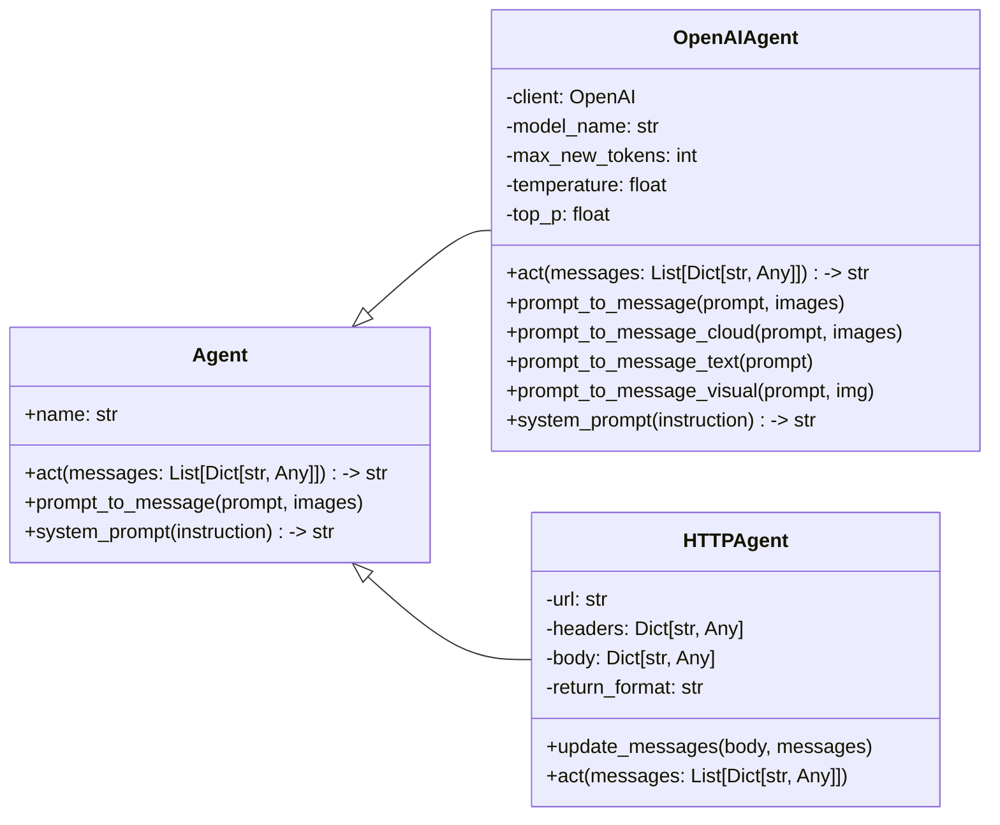

<!-- source: DeepWiki mcp.deepwiki.com · repo HKUDS/PhoneCLI · page 3.4 Model Backends (agent/) · fetched 2026-11-09 -->

# Model Backends (agent/)

<details>
<summary>Relevant source files</summary>

The following files were used as context for generating this wiki page:

- [agent/model.py](agent/model.py)
- [phonecli_android/agent/__init__.py](phonecli_android/agent/__init__.py)
- [phonecli_android/agent/llm/glm4.py](phonecli_android/agent/llm/glm4.py)
- [phonecli_android/agent/llm/qwen_llm_model.py](phonecli_android/agent/llm/qwen_llm_model.py)
- [phonecli_android/agent/mllm/claude_model.py](phonecli_android/agent/mllm/claude_model.py)
- [phonecli_android/agent/mllm/qwen_model.py](phonecli_android/agent/mllm/qwen_model.py)
- [phonecli_android/agent/model.py](phonecli_android/agent/model.py)
- [phonecli_android/agent/utils.py](phonecli_android/agent/utils.py)

</details>


This page details the model backend abstractions and implementations found within the `agent/` directory, specifically focusing on `agent/model.py` and its associated LLM and MLLM backends. It covers the core `Agent` interface, its `OpenAIAgent` and `HTTPAgent` implementations, and specific integrations for models like GLM4, Qwen, and Claude. The page also explains utilities for prompt and response handling, including image encoding for multimodal models.

## Core Agent Abstraction

The `agent/model.py` file defines the foundational `Agent` abstract class, which specifies the interface for all language model interactions. This class includes methods for performing actions (`act`), converting prompts to message formats (`prompt_to_message`), and generating system prompts (`system_prompt`). All concrete agent implementations must inherit from this base class and implement these methods. The `Agent` class also incorporates a robust retry mechanism using `backoff.on_exception` to handle transient errors during API calls [agent/model.py:29-44]().

### `Agent` Class
The `Agent` class defines the following abstract methods:
- `act(self, messages: List[Dict[str, Any]]) -> str`: This method is responsible for sending a list of messages to the underlying language model and returning its response. It is decorated with `@backoff.on_exception` to automatically retry failed API calls with exponential backoff [agent/model.py:37-38]().
- `prompt_to_message(self, prompt, images)`: Converts a given prompt and optional images into a message format suitable for the specific model API [agent/model.py:40-41]().
- `system_prompt(self, instruction) -> str`: Generates a system-level instruction for the model based on the provided task instruction [agent/model.py:43-44]().

### `OpenAIAgent`
The `OpenAIAgent` class is a concrete implementation of the `Agent` interface designed to interact with OpenAI-compatible APIs [agent/model.py:46-198](). It uses the `openai` Python client library.

Key features:
- **Initialization**: Takes `api_key`, `api_base`, `model_name`, `max_new_tokens`, `temperature`, and `top_p` as parameters [agent/model.py:47-56]().
- **`act` method**: Calls `self.client.chat.completions.create` to interact with the OpenAI API. It also includes logic for token accounting, tracking prompt and completion tokens, and distinguishing between text and VLM calls [agent/model.py:73-118]().
- **Prompt Conversion**: Provides several methods for converting prompts and images into the OpenAI message format:
    - `prompt_to_message(self, prompt, images)`: Converts a text prompt and a list of image paths into a multimodal message with base64 encoded images [agent/model.py:120-141]().
    - `prompt_to_message_cloud(self, prompt, images)`: Similar to `prompt_to_message` but returns a list of messages, potentially for cloud-based VLM calls [agent/model.py:143-162]().
    - `prompt_to_message_text(self, prompt)`: Converts a text-only prompt into a message [agent/model.py:164-171]().
    - `prompt_to_message_visual(self, prompt, img, max_width=1000, max_height=2200)`: Converts a text prompt and a single image file path into a message, handling image loading and base64 encoding [agent/model.py:173-197]().
- **System Prompt**: The `system_prompt` method constructs a system prompt by appending the task instruction to a predefined `SYSTEM_PROMPT_ANDROID_MLLM_DIRECT` template [agent/model.py:200-202]().

### `HTTPAgent`
The `HTTPAgent` class provides a generic way to interact with LLM APIs via HTTP requests [agent/model.py:204-218](). It's designed for flexibility when a specific client library isn't available or a custom endpoint is needed.

Key features:
- **Initialization**: Configured with a `url`, `headers`, `body` (for default request parameters), and a `return_format` string for parsing the response [agent/model.py:206-211]().
- **`act` method**: Sends a POST request to the configured URL with updated messages in the body and parses the response using the `return_format` string [agent/model.py:218]().


Title: Agent Class Hierarchy
Sources: [agent/model.py:29-218]()

## LLM Backends

The `phonecli_android/agent/llm/` directory contains specific implementations for various Large Language Models (LLMs). These typically inherit from `OpenAIAgent` or `Agent` and adapt their `act` method or message formatting to interact with the respective model APIs.

### GLM4 Agent (`phonecli_android/agent/llm/glm4.py`)
The `GLM4Agent` integrates with the ZhipuAI GLM4 model. It inherits from `OpenAIAgent` but overrides the `act` method to use the `ZhipuAI` client [phonecli_android/agent/llm/glm4.py:6-37]().

Key features:
- **Initialization**: Requires `model_name` and `model_key` for ZhipuAI API access [phonecli_android/agent/llm/glm4.py:8-15]().
- **`act` method**: Uses `self.client.chat.completions.create` with the GLM4 model [phonecli_android/agent/llm/glm4.py:31-35]().

### Qwen LLM Agent (`phonecli_android/agent/llm/qwen_llm_model.py`)
The `QwenLLMAgent` is designed to interact with Qwen LLM models that are compatible with the OpenAI API format. It directly inherits from `OpenAIAgent` and primarily configures the `OpenAI` client with Qwen-specific API details [phonecli_android/agent/llm/qwen_llm_model.py:4-24]().

## MLLM Backends

The `phonecli_android/agent/mllm/` directory houses implementations for Multimodal Large Language Models (MLLMs), which can process both text and image inputs.

### Claude Model (`phonecli_android/agent/mllm/claude_model.py`)
The `Claude_official` agent integrates with Anthropic's Claude models. It inherits from `OpenAIAgent` but provides its own `act` and `format_message` methods to handle Claude's specific API requirements [phonecli_android/agent/mllm/claude_model.py:7-88]().

Key features:
- **Initialization**: Takes `model_name` and `model_key` for Anthropic API access [phonecli_android/agent/mllm/claude_model.py:9-15]().
- **`act` method**: Uses the `anthropic.Anthropic` client to create messages. It handles system prompts separately if present [phonecli_android/agent/mllm/claude_model.py:29-57]().
- **`format_message` method**: This crucial method transforms the generic message format into Claude's specific multimodal message structure, including converting base64 image URLs into Claude's `image` source format [phonecli_android/agent/mllm/claude_model.py:59-88]().

### Qwen MLLM Agent (`phonecli_android/agent/mllm/qwen_model.py`)
The `QwenAgent` integrates with Alibaba Cloud's Qwen-VL models via the `dashscope` SDK. It also inherits from `OpenAIAgent` but customizes its `act` and `format_message` methods [phonecli_android/agent/mllm/qwen_model.py:8-63]().

Key features:
- **Initialization**: Requires `api_key` and `model_name` (defaulting to "qwen-vl-max") [phonecli_android/agent/mllm/qwen_model.py:9-16]().
- **`act` method**: Uses `dashscope.MultiModalConversation.call` to interact with the Qwen-VL API. It also prints token usage information [phonecli_android/agent/mllm/qwen_model.py:30-44]().
- **`format_message` method**: Adapts the input messages to the `dashscope` format, specifically handling system prompts by embedding them into the last user message's content [phonecli_android/agent/mllm/qwen_model.py:46-48]().
- **`prompt_to_message` method**: Converts a prompt and image paths into the Qwen-VL specific message format, using `file://` URLs for images [phonecli_android/agent/mllm/qwen_model.py:50-63]().

## Prompt and Response Utilities

The `agent/utils.py` file provides helper functions for handling images, particularly for multimodal models [phonecli_android/agent/utils.py:1-32]().

- `encode_image(image_path)`: Reads an image file and returns its base64 encoded string [phonecli_android/agent/utils.py:5-7]().
- `image_to_base64(image_path)`: Similar to `encode_image`, reads an image file and returns its base64 encoded string [phonecli_android/agent/utils.py:10-12]().
- `replace_image_url(messages, throw_details=False, keep_path=False)`: This utility function iterates through a list of messages and, for any `image_url` content, replaces the image path with its base64 encoded string. It can optionally remove `detail` fields or keep the original path [phonecli_android/agent/utils.py:15-32]().

## Agent Instantiation

The `phonecli_android/agent/__init__.py` file provides a factory function `get_agent` to dynamically instantiate agent classes based on a string name [phonecli_android/agent/__init__.py:19-31](). This allows for flexible configuration of which model backend to use.

```mermaid
graph TD
    subgraph "Model Backends (agent/)"
        A[Agent (Abstract Base Class)] --> B[OpenAIAgent]
        A --> C[HTTPAgent]

        subgraph "LLM Backends"
            B --> D[GLM4Agent]
            B --> E[QwenLLMAgent]
        end

        subgraph "MLLM Backends"
            B --> F[Claude_official]
            B --> G[QwenAgent]
        end
    end

    subgraph "Utilities"
        H[image_to_base64]
        I[replace_image_url]
    end

    subgraph "Agent Factory"
        J[get_agent(agent_module, **kwargs)] --> D
        J --> E
        J --> F
        J --> G
    end

    D -- "Uses ZhipuAI Client" --> K[ZhipuAI API]
    E -- "Uses OpenAI Client" --> L[Qwen LLM API (OpenAI Compatible)]
    F -- "Uses Anthropic Client" --> M[Claude API]
    G -- "Uses Dashscope Client" --> N[Qwen-VL API]

    B -- "Uses image_to_base64" --> H
    F -- "Uses replace_image_url" --> I
    G -- "Uses image_to_base64" --> H
```
Title: Model Backend Architecture
Sources: [agent/model.py:29-218](), [phonecli_android/agent/__init__.py:19-31](), [phonecli_android/agent/llm/glm4.py:6-37](), [phonecli_android/agent/llm/qwen_llm_model.py:4-24](), [phonecli_android/agent/mllm/claude_model.py:7-88](), [phonecli_android/agent/mllm/qwen_model.py:8-63](), [phonecli_android/agent/utils.py:1-32]()

Sources:
- [agent/model.py:29-218]()
- [phonecli_android/agent/__init__.py:19-31]()
- [phonecli_android/agent/llm/glm4.py:6-37]()
- [phonecli_android/agent/llm/qwen_llm_model.py:4-24]()
- [phonecli_android/agent/mllm/claude_model.py:7-88]()
- [phonecli_android/agent/mllm/qwen_model.py:8-63]()
- [phonecli_android/agent/utils.py:1-32]()

---

